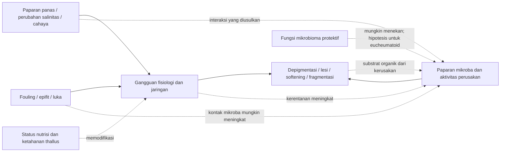

# Sintesis pola penyebab ice-ice

Tanggal: 14 Oktober 2026. Corpus: 21 PDF dalam `Challenge Final/PDFs`, 20 artikel unik; S14 identik dengan S13 berdasarkan SHA-256. Fokus: hubungan kausal yang mungkin, pola lintas artikel, dan hipotesis untuk sintesis pengguna. Pembacaan mencakup abstrak seluruh artikel dan pendalaman bagian metode, hasil, serta pembahasan yang relevan; rincian cakupan ada di matriks.

**Hipotesis utama yang paling produktif: ice-ice muncul ketika kapasitas thallus mempertahankan jaringan dan komunitas mikrobanya tidak lagi mengimbangi tekanan lingkungan serta paparan mikroba.** Ini adalah model sintesis yang diusulkan, bukan variabel yang telah diukur sebagai satu “ambang” dalam artikel. Model ini membuka dua jalur: kerentanan host meningkat lebih dahulu, atau paparan mikroba cukup kuat untuk memulai kerusakan. Keduanya dapat saling memperkuat.

## 1. Suhu tinggi punya jalur fisiologis yang nyata

Dalam eksperimen pada *K. alvarezii* Tambalang brown, peningkatan suhu mengurangi pertumbuhan, kinerja fotosintesis, kandungan pigmen dan kualitas karaginan, sementara produksi reactive oxygen species (ROS) meningkat. Perlakuan 36°C dihentikan setelah 10 hari dan 40°C setelah 2 hari ketika bleaching, fragmentasi dan gangguan fotosintesis sudah berat. [Kumar et al. (2020)](</Users/cindyram/Documents/Second Brain/02-Projects/Challenge Final/PDFs/P11 (Kumar et al., 2020).pdf>)<!--ref:S11-->

**Pola:** panas dapat melemahkan thallus melalui gangguan fotosintesis dan stres oksidatif sebelum atau bersamaan dengan kerusakan yang terlihat. Ini memberi jalur mekanistik untuk menghubungkan cuaca panas dengan jaringan yang makin rentan. Namun, eksperimen ini tidak memisahkan host bebas mikroba dari host bermikrobioma, sehingga kontribusi panas terhadap kerusakan kuat, sementara klaim “murni panas tanpa mikroba” belum diuji.

**Possibility:** urutan panas → gangguan fisiologi → berkurangnya kapasitas mempertahankan jaringan → kolonisasi/perusakan oleh mikroba layak dijadikan jalur utama. Panas juga bisa langsung menghasilkan bleaching, sehingga bercak putih perlu dibaca bersama kelunakan, erosi atau fragmentasi. Pijakan bukti: metode suhu hlm. 4; hasil hlm. 7–10; pembahasan hlm. 11–13. [Kumar et al. (2020)](</Users/cindyram/Documents/Second Brain/02-Projects/Challenge Final/PDFs/P11 (Kumar et al., 2020).pdf>)<!--ref:S11-->

## 2. Mikroba dapat menjadi pemicu, sekaligus penguat kerusakan

Challenge pada *K. striatus* brown cultivar menunjukkan bahwa penambahan *Vibrio brasiliensis*, *V. chemaguriensis* atau kontrol positif *Cytobacillus* V2 menghasilkan depigmentasi, lesi, softening dan fragmentasi, sementara kontrol dengan mikrobioma alami tetap sehat. Kondisi laboratorium relatif stabil pada 25±1°C. Gejala awal muncul hari 3; bleaching akhir dilaporkan 50–80%, tergantung strain. Paparan diberikan setiap hari pada 10^7 CFU/mL selama 10 hari. [Lestari et al. (2026)](</Users/cindyram/Documents/Second Brain/02-Projects/Challenge Final/PDFs/P13 (Lestari et al., 2026).pdf>)<!--ref:S13-->

**Pola:** urutan lingkungan buruk lalu bakteri tidak wajib untuk setiap kondisi uji. Bakteri tertentu mampu memulai kerusakan ketika paparan dibuat besar dan berulang. Review sebelumnya juga merangkum isolat yang menginduksi gejala tanpa stressor tambahan terlapor, dan gejalanya lebih cepat/berat ketika stressor ditambahkan. [Ward et al. (2021, online)](</Users/cindyram/Documents/Second Brain/02-Projects/Challenge Final/PDFs/P10 (Ward et al., 2021).pdf>)<!--ref:S10-->

**Possibility:** kejadian penyakit bergantung pada kombinasi strain, jumlah paparan, lama paparan dan ketahanan host. Paparan mikroba tinggi mungkin “mengalahkan” host yang secara visual sehat; host yang sudah stres mungkin hanya membutuhkan tekanan mikroba lebih kecil. Interaksi ambang ini adalah inferensi kita dan belum diuji sebagai kurva dosis × stres dalam corpus. Pijakan: challenge dan kontrol S13 hlm. 4–8; pembahasan variasi gejala hlm. 10–11; S10 hlm. 17.

Ko-kultur thallus sakit dan sehat menghasilkan gejala pada thallus sehat dalam 2–4 hari, dengan kontrol negatif tetap tanpa gejala dan adanya lisis jaringan. Ini memperkuat kemungkinan bahwa thallus sakit menjadi sumber paparan bagi tanaman sekitar. Percobaan tersebut tidak menentukan bakteri spesifik atau memisahkan perpindahan melalui kontak dari air. [Aris & Labenua (2020)](</Users/cindyram/Documents/Second Brain/02-Projects/Challenge Final/PDFs/P07 (Aris & Labenua, 2020).pdf>)<!--ref:S07-->

## 3. Hujan, salinitas dan musim bekerja pada skala waktu berbeda

Review khusus ice-ice merangkum eksperimen penurunan salinitas sekitar 20 ppt ke bawah yang menghasilkan whitening, serta perubahan suhu dan cahaya yang menginduksi stres. Nilai itu merupakan hasil studi tertentu yang dilaporkan review, bukan ambang siap pakai untuk seluruh lokasi. [Tahiluddin & Terzi (2021)](</Users/cindyram/Documents/Second Brain/02-Projects/Challenge Final/PDFs/P09 (Tahiluddin & Terzi, 2021).pdf>)<!--ref:S09-->

Pada monitoring tahunan Sibutu, **prevalensi** lebih tinggi pada musim kering. Tetapi hujan berhubungan positif dengan **panjang bercak**, r=0,232 dan p=0,005; hubungan hujan dengan prevalensi tidak signifikan. Suhu dan salinitas yang diukur pada kunjungan bulanan juga tidak berkorelasi signifikan dengan penyakit. [Tahiluddin & Terzi (2024)](</Users/cindyram/Documents/Second Brain/02-Projects/Challenge Final/PDFs/P08 (Tahiluddin & Terzi, 2024).pdf>)<!--ref:S08-->

**Pola:** periode panas-kering dapat menaikkan jumlah tanaman terdampak, sedangkan kejadian hujan/runoff mungkin memperberat lesi pada tanaman tertentu. Dua outcome ini berbeda: berapa banyak tanaman sakit versus seberapa panjang kerusakannya.

**Possibility:** paparan sebelumnya, laju perubahan salinitas, serta lonjakan singkat mungkin lebih menjelaskan perkembangan penyakit daripada angka saat kunjungan bulanan. Hujan → freshening/runoff → gangguan host adalah penjelasan yang masuk akal, tetapi perubahan singkat dan urutannya tidak ditangkap oleh data bulanan tersebut. Dugaan lag ini harus diuji, bukan dianggap alasan yang sudah terbukti menjelaskan korelasi nol. Pijakan: S08 Tabel 2 hlm. 8; metode hlm. 9–11; pembahasan hlm. 11–12.

## 4. Permukaan thallus dapat menjadi titik pertemuan beberapa tekanan

Epifit dapat mengurangi akses cahaya dan nutrisi, sementara epi-endofit tertentu merusak korteks. Biofilm/fouling juga dapat mempertahankan kontak mikroba dengan permukaan jaringan. Review menggambarkan luka dari grazer atau pengikatan sebagai pintu masuk yang mungkin bagi kolonisasi. [Ward et al. (2021, online)](</Users/cindyram/Documents/Second Brain/02-Projects/Challenge Final/PDFs/P10 (Ward et al., 2021).pdf>)<!--ref:S10--> [Ward et al. (2020)](</Users/cindyram/Documents/Second Brain/02-Projects/Challenge Final/PDFs/P01 (Ward et al., 2020).pdf>)<!--ref:S01-->

Dalam studi farm Sabah, paket pengecekan propagul, pembersihan thallus/tali dan monitoring diikuti kejadian IID yang lebih rendah dan muncul lebih lambat. Rata-rata pada *K. alvarezii* adalah 4,5% pada farm dengan biosecurity versus 11,5% tanpa paket tersebut; pada *K. malesianus* 5,5% versus 25%. Suhu dan salinitas kedua farm relatif serupa, meskipun beberapa parameter lain berbeda. [Kambey et al. (2021)](</Users/cindyram/Documents/Second Brain/02-Projects/Challenge Final/PDFs/P19 (Kambey et al., 2021).pdf>)<!--ref:S19-->

**Pola:** keadaan permukaan tanaman dan praktik farm ikut menentukan risiko ketika latar lingkungan yang diukur relatif mirip. Paket intervensi mendukung peran proses ini, tetapi tidak mengidentifikasi komponen mana yang paling menentukan. Korelasi epifit dengan IID pada *K. alvarezii* sendiri kecil, r=0,14–0,18; keberhasilan paket tidak boleh diubah menjadi bukti bahwa epifit selalu penyebab utama.

**Possibility:** sirkulasi lemah + fouling + luka dapat bertemu pada titik yang sama: permukaan thallus yang kurang terlindungi dan lebih mudah dikolonisasi. Sesudah kerusakan terjadi, organik dari jaringan dapat memberi substrat bagi mikroba, lalu mempercepat kerusakan berikutnya. Lingkaran penguatan ini adalah sintesis mekanistik dari review dan intervensi, bukan rangkaian lengkap yang diukur dalam satu percobaan. Pijakan: S10 hlm. 12–15; S19 hlm. 6–8 dan 12–16; S18 hlm. 22–23. [Alimin et al. (2026)](</Users/cindyram/Documents/Second Brain/02-Projects/Challenge Final/PDFs/P18 (Alimin et al., 2026).pdf>)<!--ref:S18-->

## 5. Ketahanan jaringan dan pertumbuhan adalah dua hal berbeda

AMPEP menurunkan kejadian ice-ice pada endpoint 45 hari dibanding kontrol dalam uji *K. striatus*, sementara ammonium phosphate meningkatkan pertumbuhan pada hari 30. Perlakuan ammonium phosphate tidak berbeda signifikan dari AMPEP maupun kontrol untuk ice-ice hari 45. Subsampel pertumbuhan kelompok pupuk dan kontrol hilang pada hari 45 akibat outbreak; angka efek akhir harus dibaca dengan konteks ini. [Tahiluddin, Andon, & Burahim (2022)](</Users/cindyram/Documents/Second Brain/02-Projects/Challenge Final/PDFs/P05 (Tahiluddin et al., 2022).pdf>)<!--ref:S05-->

Dalam uji lain, pengayaan urea atau fosfor tidak menurunkan kejadian ice-ice secara signifikan. Jadi, peningkatan pasokan nutrisi atau pertumbuhan tidak otomatis memberi proteksi. [Sarri et al. (2022)](</Users/cindyram/Documents/Second Brain/02-Projects/Challenge Final/PDFs/P06 (Sarri et al., 2022).pdf>)<!--ref:S06-->

Perendaman CaSiO3 pada *K. alvarezii* memberi petunjuk lain: perlakuan 2 g/L memiliki kejadian IID populasi 17,77% versus 91% pada kontrol, serta korteks rata-rata 18 μm versus 8,76 μm. Penulis mengusulkan penguatan thallus sebagai penjelasan. Yang langsung diamati adalah perubahan outcome dan jaringan secara bersamaan; peran ketebalan korteks sebagai mediator, deposisi mineral, dan efek Ca versus Si secara terpisah belum dipastikan. [Wirantari et al. (2025)](</Users/cindyram/Documents/Second Brain/02-Projects/Challenge Final/PDFs/P21 (Wirantari et al., 2025).pdf>)<!--ref:S21-->

**Pola:** kualitas pertahanan host mungkin lebih dekat dengan kerentanan ice-ice daripada laju pertumbuhan semata. Nutrisi dapat berperan, tetapi bentuk pengayaan, waktu aplikasi, status awal host dan fungsi jaringan perlu dibedakan.

**Possibility:** defisit sumber daya untuk mempertahankan pigmen, pertahanan kimia atau integritas jaringan dapat meningkatkan kerentanan. Data ammonium lapangan mendukung petunjuk nutrisi terhadap severity: ammonium terkait negatif dengan jumlah serta panjang spot, tetapi bukan prevalensi secara signifikan. Korelasi itu tidak membuktikan kekurangan ammonium sebagai penyebab. Pijakan: S05 hlm. 4–7; S06 hlm. 4–8; S21 hlm. 4–5 dan 8; S08 Tabel 2. [Tahiluddin & Terzi (2024)](</Users/cindyram/Documents/Second Brain/02-Projects/Challenge Final/PDFs/P08 (Tahiluddin & Terzi, 2024).pdf>)<!--ref:S08-->

## 6. Kedalaman dasar perairan tidak sama dengan kedalaman tanaman

Survei 16 farm dan observasi Sibutu selama tiga bulan tidak menemukan perbedaan signifikan kejadian IID menurut kategori farm dangkal/dalam. Sebaliknya, monitoring satu tahun menemukan prevalensi lebih tinggi di deep-water farm. [Faisan et al. (2021)](</Users/cindyram/Documents/Second Brain/02-Projects/Challenge Final/PDFs/P15 (Faisan et al., 2021).pdf>)<!--ref:S15--> [Tahiluddin & Damsik (2023)](</Users/cindyram/Documents/Second Brain/02-Projects/Challenge Final/PDFs/P16 (Tahiluddin & Damsik, 2023).pdf>)<!--ref:S16--> [Tahiluddin & Terzi (2024)](</Users/cindyram/Documents/Second Brain/02-Projects/Challenge Final/PDFs/P08 (Tahiluddin & Terzi, 2024).pdf>)<!--ref:S08-->

Penjelasan yang diajukan penulis monitoring tahunan adalah bahwa metode apung mempertahankan thallus dekat permukaan, dan lokasi deep-water farm lebih dekat ke daratan/rumah panggung serta kemungkinan runoff. Itu bukan eksperimen yang memisahkan lokasi, metode dan kedalaman. [Tahiluddin & Terzi (2024)](</Users/cindyram/Documents/Second Brain/02-Projects/Challenge Final/PDFs/P08 (Tahiluddin & Terzi, 2024).pdf>)<!--ref:S08-->

**Possibility:** variabel yang relevan mungkin paparan aktual thallus terhadap suhu, cahaya, freshening dan arus, bukan bathymetry saja. Karena itu, “tanam di laut yang lebih dalam” bisa gagal mengurangi risiko bila tanaman tetap mengapung di lapisan permukaan. Ini memberi hipotesis spasial yang lebih spesifik untuk sintesismu. Pijakan: S08 Discussion hlm. 11–12; karakteristik farm S16 hlm. 3.

## 7. Mikroba yang melindungi host memberi petunjuk tentang mekanisme penyakit

Pada *Delisea pulchra*, pemberian *Phaeobacter* BS52 sebelum challenge meningkatkan proporsi individu sehat dari 41% menjadi 80%. Proteksinya berkaitan dengan mitigasi perubahan komunitas, sementara tidak ditemukan korelasi negatif signifikan antara kelimpahan relatif BS52 dan patogen. [Li et al. (2022)](</Users/cindyram/Documents/Second Brain/02-Projects/Challenge Final/PDFs/P02 (Li et al., 2022).pdf>)<!--ref:S02-->

**Possibility untuk ice-ice:** hilangnya fungsi protektif mikrobioma dapat ikut menjelaskan kenapa tanaman dengan bakteri yang serupa menunjukkan nasib berbeda. Hipotesis yang perlu diuji adalah perubahan fungsi atau proporsi komunitas, bukan sekadar ada/tidaknya satu genus. Bukti S02 adalah analogi pada host dan penyakit berbeda; challenge S13 tidak mengukur komunitas secara menyeluruh sehingga dysbiosis pada *K. striatus* belum langsung ditunjukkan oleh data komunitas di studi itu. Review bakteri juga menekankan bahwa peran mikroba bergantung pada strain dan host. [Corr et al. (2026)](</Users/cindyram/Documents/Second Brain/02-Projects/Challenge Final/PDFs/P03 (Corr et al., 2026).pdf>)<!--ref:S03-->

## Model kerja dan prioritas hipotesis

Diagram ini merangkum bukti dan inferensi; panah bukan estimasi besar efek. Jalur fisiologi dan challenge mikroba punya pijakan eksperimen tersendiri. Penggabungan semua jalur menjadi satu model serta umpan balik masih merupakan hipotesis sintesis.

| Prioritas | Hipotesis yang diusulkan | Prediksi yang membedakannya | Pijakan |
|---|---|---|---|
| 1 | Kapasitas host × paparan mikroba menentukan onset dan berat penyakit | Pada dosis bakteri sama, host yang diberi stres mengalami gejala lebih cepat/berat; pada status host sama, perubahan dosis mengubah onset | S11, S13, S10 |
| 2 | Fouling/luka dan kontak jaringan sakit memperkuat proses lokal | Tanaman dengan luka/fouling atau dekat sumber sakit lebih dahulu berlesi setelah latar lingkungan diperhitungkan | S07, S19, S10 |
| 3 | Riwayat paparan dan kejadian singkat lebih informatif dari snapshot bulanan | Lonjakan suhu/freshening sebelum onset memprediksi gejala lebih baik dari pengukuran saat tanaman sudah sakit | S08, S11; inferensi skala waktu |
| 4 | Ketahanan jaringan memberi proteksi yang tidak tercermin dari pertumbuhan cepat | Dua perlakuan dengan pertumbuhan setara dapat berbeda dalam kerusakan dan integritas jaringan | S05, S06, S21 |
| 5 | Paparan aktual thallus lebih relevan daripada kategori kedalaman farm | Farm pada dasar dalam tetap berisiko jika thallus berada dekat permukaan; risiko mengikuti exposure aktual | S08 dibanding S15/S16 |
| 6 | Fungsi mikrobioma protektif menjadi penyangga kerentanan | Perubahan fungsi/komposisi komunitas mendahului kerusakan, dan pemulihan fungsi mengurangi gejala | S02 sebagai analogi; S03/S10 sebagai kerangka |

Urutan ini adalah prioritas analitis, bukan ranking besar efek yang sudah terukur. Fungi tetap menjadi kandidat tambahan: review melaporkan isolat *Aspergillus* dan *Phoma* yang menginduksi gejala, tetapi corpus ini tidak berisi eksperimen primer fungi tersebut. [Tahiluddin & Terzi (2021)](</Users/cindyram/Documents/Second Brain/02-Projects/Challenge Final/PDFs/P09 (Tahiluddin & Terzi, 2021).pdf>)<!--ref:S09-->

## Paragraf sintesis yang bisa kamu olah

> Dari hubungan antarartikel, saya mengusulkan bahwa ice-ice berkembang ketika ketahanan fisiologis dan struktural thallus tidak lagi mampu mengimbangi tekanan lingkungan serta aktivitas mikroba. Suhu tinggi memiliki jalur kerusakan yang terukur melalui penurunan fotosintesis, kehilangan pigmen dan peningkatan stres oksidatif. Paparan bakteri tertentu juga dapat memulai gejala pada kondisi laboratorium relatif stabil, sehingga mikroba dapat berperan sebagai pemicu maupun penguat kerusakan. Kondisi permukaan thallus, luka, fouling dan kontak dengan jaringan sakit berpotensi menentukan lokasi awal serta kecepatan perkembangannya. Efek intervensi nutrisi dan mineral menunjukkan bahwa pertumbuhan dan ketahanan terhadap penyakit perlu dipisahkan. Karena itu, kemungkinan kausal yang paling layak ditelusuri adalah interaksi antara riwayat stres, integritas jaringan dan tekanan mikroba, dengan paparan aktual tanaman serta fungsi mikrobiomanya sebagai pemodifikasi.

Pijakan paragraf: [Kumar et al. (2020)](</Users/cindyram/Documents/Second Brain/02-Projects/Challenge Final/PDFs/P11 (Kumar et al., 2020).pdf>)<!--ref:S11--> [Lestari et al. (2026)](</Users/cindyram/Documents/Second Brain/02-Projects/Challenge Final/PDFs/P13 (Lestari et al., 2026).pdf>)<!--ref:S13--> [Aris & Labenua (2020)](</Users/cindyram/Documents/Second Brain/02-Projects/Challenge Final/PDFs/P07 (Aris & Labenua, 2020).pdf>)<!--ref:S07--> [Kambey et al. (2021)](</Users/cindyram/Documents/Second Brain/02-Projects/Challenge Final/PDFs/P19 (Kambey et al., 2021).pdf>)<!--ref:S19--> [Tahiluddin, Andon, & Burahim (2022)](</Users/cindyram/Documents/Second Brain/02-Projects/Challenge Final/PDFs/P05 (Tahiluddin et al., 2022).pdf>)<!--ref:S05--> [Sarri et al. (2022)](</Users/cindyram/Documents/Second Brain/02-Projects/Challenge Final/PDFs/P06 (Sarri et al., 2022).pdf>)<!--ref:S06--> [Wirantari et al. (2025)](</Users/cindyram/Documents/Second Brain/02-Projects/Challenge Final/PDFs/P21 (Wirantari et al., 2025).pdf>)<!--ref:S21-->. Bagian yang menyatukan hasil menjadi interaksi adalah inferensi sintesis, bukan kesimpulan satu artikel.

## Batas interpretasi yang menentukan cara memakai hasil

- Bukti eksperimen suhu dan bakteri mendukung mekanisme di kondisi masing-masing. Corpus tidak memberikan besar efek relatif semua faktor dalam satu desain factorial; ranking kontribusi penyebab belum bisa dihitung.
- Review sering memakai eksperimen klasik yang sama. Jumlah artikel yang menyebut suatu faktor tidak sama dengan jumlah replikasi independen.
- Kejadian IID, panjang bercak, bobot jaringan rusak dan pigment loss adalah outcome berbeda. Persentasenya tidak dipool atau diperbandingkan sebagai satu ukuran penyakit.
- Perbedaan strain, spesies, metode tanam dan kondisi farm dapat mengubah pola. S16 juga mencampurkan perbedaan spesies dengan praktik pupuk; tidak menetapkan satu spesies selalu paling tahan.
- S12 memberi daftar isolat terkait jaringan sakit, S17 memberi bukti pengenalan kondisi optik, dan S20 memberi konteks iklim regional. Ketiganya punya peran dalam pembacaan, tetapi tidak diberi bobot setara challenge bakteri.
- Dua hal yang paling belum terukur dalam hubungan ini: urutan perubahan fisiologi/mikrobioma sebelum gejala, serta interaksi dosis mikroba dengan tingkat stres host. Hipotesis di atas dirancang agar kedua hal itu dapat dibedakan.

## Jejak kerja

Sumber dan lokasi klaim lengkap berada di [Matriks Bukti Ice-Ice](<./Matriks Bukti Ice-Ice.md>). Identitas file, SHA-256, jumlah halaman dan cakupan baca tersimpan dalam `manifest.json`; teks hasil ekstraksi tersimpan dalam `Extracted`. Nomor halaman dalam catatan merujuk urutan halaman PDF, bukan selalu pagination jurnal. Tabel korelasi S08 dan hasil individu/populasi S21 diperiksa lewat gambar halaman PDF. Pemeriksaan daring dipakai untuk mencocokkan beberapa metadata dengan halaman penerbit; sintesis tetap berpijak pada PDF pengguna. Analisis ini dibantu AI dan ditulis sebagai catatan kerja penelitian, dengan inferensi dibedakan dari temuan artikel.

## Konteks percakapan yang diimpor 14 Oktober 2026

Lihat [[Konteks Riset Rumput Laut - 14 Oktober 2026]] dan [[Register Literatur dari Konteks Percakapan Rumput Laut]]. Rangkuman percakapan dicatat sebagai sumber konteks; rincian bukti pada catatan ini dipertahankan.

## Navigasi kategori

[[Indeks - Riset Ice-Ice]] · [[Peta Catatan - Challenge Final]]
