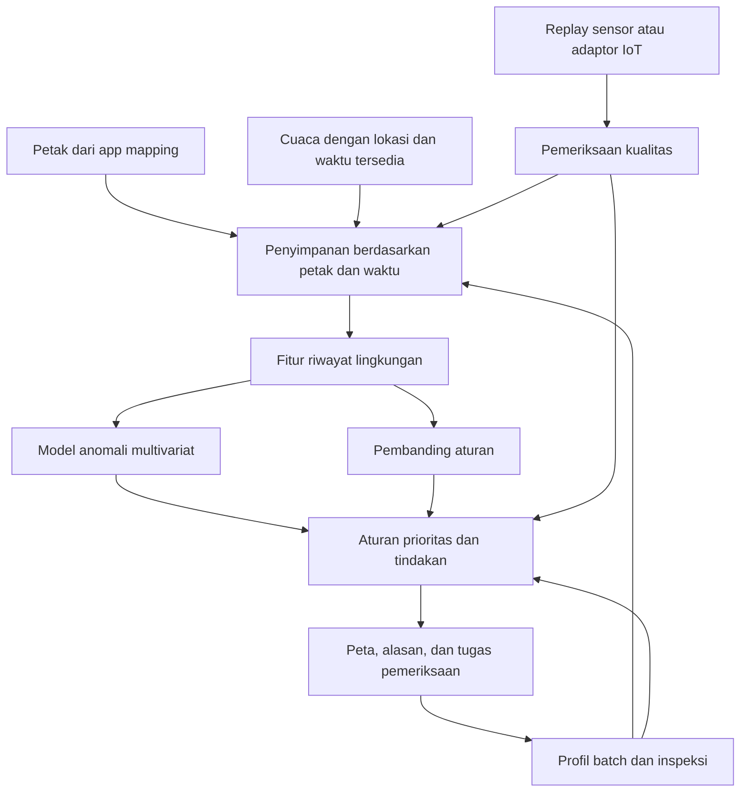

# Desain POC - Peta Prioritas Pemeriksaan Rumput Laut

> [!info] Status versi dokumen
> Scope dan roadmap di bawah merekam desain/form sintetis 16 Oktober 2026. Implementasi native 19 Oktober berkembang menjadi monitoring ocean-only MUR/VIIRS/PACE dengan pipeline Python; belum ada model penyakit. Baca [[Riwayat Pengembangan POC - TidungMonitor]] untuk status aktual dan [[Panduan Fetch Data Ocean - TidungMonitor]] untuk pemakaian. Pernyataan “belum ada API” pada bagian historis tidak dipakai sebagai status implementasi terbaru.

## Scope aktif — diperjelas pengguna 16 Oktober 2026

**POC pertama: form sederhana → model multivariat → hasil dan langkah pemeriksaan.** Pengguna mengonfirmasi budidaya **laut**, belum memiliki data nyata, masih memilih sumber NASA/Copernicus/BMKG, dan Core ML tidak wajib. Integrasi peta, IoT, backend, dan pipeline temporal penuh ditunda. Bagian desain lebih luas di bawah menjadi roadmap, bukan syarat demo pertama.

Contoh interaktif dibuat untuk percakapan ini di direktori visualisasi chat (`poc-model-laut.html`). Semua input dan referensi adalah sintetis; tidak mengambil data API. Model statistiknya benar-benar menghitung rata-rata/kovarians dari sampel buatan lalu mengevaluasi input baru. Belum ada model yang dilatih dengan data laut nyata atau diuji terhadap penyakit.

### Form minimum

| Field | Fungsi | Status |
|---|---|---|
| Suhu permukaan laut, °C | Input lingkungan pertama | Diisi manual; nantinya kandidat NASA MUR |
| Salinitas, psu | Input lingkungan kedua | Diisi manual; nantinya kandidat Copernicus atau pengukuran lokal |
| Kecepatan arus, m/s | Input lingkungan ketiga | Diisi manual; nantinya kandidat BMKG/Copernicus atau pengukuran lokal |
| Pengamatan tanaman | Belum diperiksa / diperiksa tanpa gejala / ada gejala | Aturan prioritas terpisah; tidak masuk skor lingkungan |

Lokasi, tanggal, spesies dan sumber belum menjadi input model pada demo ini. Saat memakai data nyata, lokasi/waktu/sumber wajib dicatat dan spesies diperlukan untuk interpretasi biologis. Preset membantu membandingkan kondisi dekat referensi, dua variabel naik bersama, kombinasi berlawanan, dan perubahan besar. Tidak ada prediksi riwayat dari satu snapshot.

### Model minimum yang dijalankan

Untuk membuat perilaku gabungan mudah diperiksa, contoh pertama memakai **model referensi Gaussian multivariat dengan jarak Mahalanobis**, menggantikan Isolation Forest sebagai implementasi demonstrasi paling awal. Isolation Forest tetap kandidat perbandingan pada tahap dataset nyata.

1. Buat 600 sampel training sintetis dengan seed tetap. Pusat generator: suhu 29,5°C, salinitas 33 psu, arus 0,20 m/s; simpangan: 0,6°C, 0,8 psu, 0,04 m/s. Angka ini hanya konfigurasi simulasi, bukan rentang aman spesies.
2. Generator memberi korelasi positif 0,75 antara suhu dan salinitas, sementara arus independen. Ini hubungan buatan untuk menunjukkan interaksi, bukan klaim hubungan universal di laut.
3. Fit rata-rata dan matriks kovarians dari training. Jarak input dihitung dengan kovarians tersebut, sehingga kombinasi antarvariabel ikut memengaruhi skor.
4. Tentukan cutoff dari persentil ke-95 jarak 200 sampel kalibrasi terpisah. Cutoff tersebut hanya pemisah demo, bukan prevalensi penyakit, confidence, atau batas biologis.
5. Tampilkan jarak, cutoff, perbandingan nilai input terhadap rata-rata referensi, dan status kemiripan. Status tidak dikonversi menjadi persen risiko.
6. Jika gejala dilaporkan, buat langkah inspeksi meskipun jarak kecil. Data kosong menahan inferensi, tidak diisi nol.

[Contoh resmi scikit-learn](https://scikit-learn.org/stable/auto_examples/covariance/plot_mahalanobis_distances.html) menjelaskan estimasi kovarians/jarak Mahalanobis untuk data Gaussian. Model ini dipilih agar mekanisme POC transparan. Distribusi Gaussian, kovarians empiris yang sensitif terhadap outlier, serta hubungan linear adalah keterbatasan; belum alasan memilihnya sebagai model lapangan terbaik.

Keluaran: **“mirip/berbeda dari referensi simulasi” + langkah pemeriksaan**. Ini belum klasifikasi aman/berbahaya atau keputusan tanam. Perbandingan rata-rata per variabel bukan atribusi kausal atau penjelasan lengkap kontribusi model.

### Kandidat data nyata — pemeriksaan sumber resmi

| Sumber | Yang tersedia menurut dokumentasi | Peran yang diusulkan dan batasnya |
|---|---|---|
| [NASA MUR v4.1](https://podaac.jpl.nasa.gov/dataset/MUR-JPL-L4-GLOB-v4.1) | Analisis foundation SST Level 4 pada grid 0,01° (sekitar 1 km), produk SST harian; mencakup interpolasi dan beberapa sumber observasi | Kandidat suhu regional. Bukan termometer pada tanaman, bukan pembacaan real-time tiap petak. Periksa land mask, ketidakpastian dan waktu tersedia |
| [Copernicus Global Ocean Physics Analysis and Forecast](https://data.marine.copernicus.eu/product/GLOBAL_ANALYSISFORECAST_PHY_001_024/services) | Produk model numerik global 0,083°; dataset suhu, salinitas, dan arus dengan beberapa interval waktu/depth | Kandidat salinitas/arus regional. Grid sekitar 9 km dekat ekuator; tidak menyelesaikan detail antarpetak kecil atau aliran di sekitar terumbu. Pilih dataset dan kedalaman secara eksplisit |
| [BMKG Maritim API](https://maritim.bmkg.go.id/apidoc) | Dokumentasi prakiraan perairan/pelabuhan dan satuan arus knot; prakiraan hari pertama per jam, hari 2–4 per tiga jam | Kandidat arus dan konteks prakiraan lokal/regional. Payload lokasi target belum diunduh untuk memeriksa kelengkapan field. Konversi arus knot ke m/s (× 0,514444); angin bukan arus |

Sumber diperiksa 16 Oktober 2026. Akses produk target, kualitas dekat pantai Tidung, kelengkapan salinitas/arus, serta kesesuaian lokasi belum diuji. Tidak ada API yang diintegrasikan. NASA SST, Copernicus model, dan prakiraan BMKG tidak otomatis tiga bukti independen; produk model dapat memakai asimilasi/forcing bersama.

**Urutan berikutnya setelah demo form disepakati:** pilih koordinat nyata → ambil satu sampel tiap kandidat produk → cocokkan grid, kedalaman, unit, waktu observasi/validitas dan waktu diterbitkan → pilih satu sumber utama per variabel → siapkan CSV dengan metadata → fit baseline regional dan evaluasi. Data sumber lain dapat dipakai sebagai pembanding, bukan dirata-ratakan tanpa menilai perbedaan produk.

Untuk baseline regional harian, agregasikan sumber berfrekuensi lebih tinggi dengan definisi jelas; jangan menggandakan MUR harian menjadi reading 10 menit dan menyebutnya informasi baru. Pisahkan model observasi/analisis dari skenario prakiraan, atau latih dengan campuran yang memang didefinisikan. Data regional beberapa petak dalam grid sama tidak memberi dasar untuk membedakan kondisi antarpetak tanpa informasi lokal.

### Batas hasil saat ini

- Yang ada: contoh form interaktif dan model statistik sintetis di percakapan, plus desain integrasi lanjutan.
- Yang belum ada: koneksi NASA/Copernicus/BMKG, dataset nyata, model penyakit, integrasi ARKit/Core ML/IoT.
- Yang sudah diputuskan pengguna: laut, belum ada data nyata, Core ML opsional, form sesederhana mungkin.
- Yang masih terbuka: koordinat final, spesies, sumber utama tiap variabel, dan outcome lapangan untuk fase prediksi.

## Desain lanjutan — setelah POC form

## Keputusan desain

**POC: advocate melihat petak yang perlu diperiksa, memahami perubahan datanya, lalu mencatat hasil pemeriksaan.** Model multivariat membaca riwayat beberapa parameter; aturan keputusan menghubungkan sinyal, kondisi tanaman, dan kualitas data dengan langkah pemeriksaan.

Dokumen ini usulan engineering berdasarkan percakapan pengguna pada 16 Oktober 2026. Pipeline lengkap di bawah belum diimplementasikan atau diuji lapangan; contoh form/model sintetis tercatat pada scope aktif. Angka waktu, jumlah petak, dan parameter operasional di bawah adalah konfigurasi demo yang dapat diganti, bukan ambang biologis.

App mapping berbasis ARKit sudah dibuat teman pengguna menurut percakapan, tetapi kode dan keluarannya belum diperiksa. Asumsi kerja: satu lokasi, tiga petak rumput laut, pengguna utama community advocate. Pengguna kemudian mengonfirmasi laut, belum ada data nyata, dan Core ML tidak wajib. Spesies, koordinat final dan deadline masih perlu dikonfirmasi. Jangan mencampur kedua sistem sebagai satu populasi training.

Pertanyaan utama: **“Petak mana yang perlu saya periksa hari ini, mengapa, dan apa yang perlu saya konfirmasi?”** Keputusan tanam tetap arah lanjutan proposal; POC pertama belum menyimpulkan layak tanam, diagnosis, atau persentase risiko ice-ice.

## Apa yang dibuktikan

1. Data beberapa sumber dapat ditautkan ke petak yang benar dengan waktu dan kualitas yang jelas.
2. Model multivariat dapat membaca pola gabungan serta riwayat, dibanding pembanding aturan sederhana.
3. Advocate dapat memahami alasan dan mencatat hasil inspeksi; hasil itu menjadi data evaluasi berikutnya.

Kinerja pada data sintetis hanya membuktikan mekanisme demo. Model anomali dapat melewatkan kondisi berbahaya yang lazim, atau menandai kondisi langka yang tidak berbahaya. Anomali tidak menjadi satu-satunya pintu eskalasi: laporan tanaman bermasalah tetap menghasilkan tugas pemeriksaan.

## Batas scope pertama

| Masuk POC | Menyusul setelah hasil awal |
|---|---|
| Tiga petak, satu lokasi dan satu sistem budidaya | Generalisasi lintas lokasi dan spesies |
| Suhu dan salinitas lokal; hujan dan angin sebagai konteks | Arus, PAR, nutrisi setelah kebutuhan/alat jelas |
| Riwayat lingkungan multivariat | Prediksi kejadian masa depan dengan label lapangan |
| Profil batch, inspeksi manual, foto dokumentasi | Diagnosis otomatis dari foto |
| Replay CSV/JSON dan adaptor input IoT | Hardware IoT tahan laut dan jaringan produksi |
| Aturan + satu kandidat model anomali | Model temporal lebih rumit bila mengungguli pembanding |
| Detail petak dan titik sensor pada peta | Heatmap seluruh petak tanpa dukungan titik ukur |
| Cuaca regional berlabel cakupan | Satelit bila menambah informasi yang terukur |

## Alur pengguna dan layar

### 1. Peta dan antrean pemeriksaan

Tampilkan batas petak, titik sensor, waktu pembaruan, label simulasi/nyata, dan antrean pemeriksaan. Sediakan filter pemilik dan status.

Pisahkan dua dimensi:
- Prioritas: rutin, periksa, segera konfirmasi. Ini prioritas pekerjaan, bukan tingkat penyakit.
- Data: cukup, terbatas, kedaluwarsa. Petak tanpa data tidak diberi label sehat atau aman.

Urutan antrean POC: laporan masalah tanaman → perubahan lingkungan persisten yang memenuhi aturan demo → tugas rutin. Data terputus membuat tugas pengecekan alat terpisah. Tampilkan alasan antrean; jangan mengklaim urutan tersebut optimal secara agronomi.

### 2. Detail petak

Isi: pemilik/ID petak, spesies, umur batch, tanggal tanam, titik/kedalaman sensor, grafik suhu dan salinitas 24 jam, konteks cuaca, kualitas data, inspeksi terakhir, dan kartu tindakan.

Contoh copy skenario simulasi:

> **Periksa petak B**  
> Suhu meningkat dibanding riwayat pada jam serupa dan salinitas menurun dalam enam jam terakhir.  
> Konfirmasi dengan pengukuran ulang, lalu periksa pucat, lesi putih/lunak, dan tanaman terlepas.  
> Data simulasi · pembaruan 10 menit lalu · inspeksi tanaman belum tersedia.

Tampilkan nilai perubahan aktual dari fitur yang dihitung. Alasan observasi tersebut bukan penjelasan kausal dan bukan otomatis kontribusi fitur model.

### 3. Form pemeriksaan

Wajib: petak/batch, waktu inspeksi, pemeriksa, diperiksa atau tidak, gejala yang diamati, jumlah tanaman diperiksa dan terdampak jika dihitung. Bedakan tidak ada gejala dengan belum diperiksa. Opsional: foto, pengukuran manual, luka/fouling, tindakan yang dilakukan, catatan.

Catat temuan pucat, lesi putih/lunak, dan fragmentasi terpisah; jangan otomatis mengubah semuanya menjadi label diagnosis ice-ice. Simpan waktu gejala pertama terlihat dan ketidakpastian ingatan. Pemeriksaan rutin petak tanpa alert juga diperlukan untuk mengetahui kejadian yang terlewat.

### 4. Panel demo internal

Pilih skenario, waktu replay, kecepatan, dan petak. Tampilkan versi dataset/model/aturan. Label simulasi terlihat di layar peta serta detail. Tombol reset mengembalikan sesi demo saja.

## Arsitektur

Implementasi awal yang diusulkan: training/evaluasi dalam Python, layanan inferensi lokal saat pengembangan, app iOS mengambil hasil melalui kontrak JSON. Simpan respons skenario sebagai fixture agar demo tetap dapat dijalankan saat layanan tidak tersedia; tandai mode replay dengan jelas. Jangan menyebut fixture sebagai inferensi live.

Jika Core ML wajib untuk penilaian, lakukan spike konversi dan paritas output sebelum mengunci algoritme. Dukungan ekspor kandidat belum diverifikasi dalam desain ini. Jika gagal, pilih kandidat yang kompatibel berdasarkan evaluasi atau dokumentasikan inferensi layanan sebagai batas POC. Konversi model tidak meningkatkan validitas biologisnya.

## Kontrak data minimal

| Entitas | Field inti |
|---|---|
| Petak | plot_id, owner_id, polygon_wgs84, cultivation_system, species |
| Batch | batch_id, plot_id, planted_at, seed_origin, initial_condition |
| Sensor/deployment | sensor_id, plot_id, lat/lon, depth_m, valid_from/to, calibration_ref, unit |
| Reading | reading_id, sensor_id, measured_at, received_at, temperature_c, salinity_psu, quality_flags, source |
| Cuaca | location/grid_id, observed_or_forecast, valid_at, issued_at, available_at, rain_mm, accumulation_window, wind_mps, provider |
| Inspeksi | inspection_id, plot_id, batch_id, observed_at, recorded_at, observer_id, findings, inspected_count, affected_count, actions, photos |
| Assessment | assessment_id, plot_id, as_of, data_state, anomaly_score, priority, evidence, suggested_checks, model_version, rule_version, source |

Gunakan timestamp ISO 8601 dengan zona waktu; pemrosesan dapat dinormalisasi ke UTC. Null berbeda dari nol. Unit wajib eksplisit; jangan menyamakan EC dengan salinitas tanpa konversi/kalibrasi yang diketahui. Reading mentah dipertahankan; flag kualitas tidak menghapus sumber.

Petakan sensor ke petak sesuai deployment yang berlaku saat pengukuran, bukan hanya lokasi saat ini. Cuaca memakai lokasi/grid yang sesuai; satu grid dapat mencakup banyak petak. Jangan menciptakan variasi lokal dengan menyalin satu nilai regional dan memberi kesan diukur per petak.

Pemeriksaan integrasi ARKit: verifikasi koordinat geografis, orientasi, akurasi, serta persistensi ID petak setelah app ditutup. Koordinat lokal sesi AR tidak boleh langsung diperlakukan sebagai latitude/longitude. Belum ada pemeriksaan kode app teman.

## Pipeline kualitas dan waktu

Konfigurasi awal demo: reading 10 menit, assessment 30 menit, fitur 1/6/24 jam. Ini interval engineering sementara; kemampuan sensor dan kebutuhan lapangan dapat mengubahnya.

1. Periksa unit, timestamp, duplikat, urutan terlambat, status kalibrasi, dan batas kemampuan alat.
2. Tandai missing, lonjakan, flatline, dan dropout. Pola tersebut kandidat masalah data, bukan bukti pasti sensor rusak.
3. Hitung coverage tiap fitur. Usulan demo: minimum 80% reading yang diharapkan dan data terakhir maksimal 30 menit; warm-up diperlukan sebelum window penuh tersedia.
4. Bila fitur inti tidak memenuhi syarat, hentikan penilaian model dan tampilkan data terbatas/kedaluwarsa. Cuaca yang hilang boleh membuat konteks berkurang karena tidak menjadi fitur wajib model pertama.
5. Jangan mengisi gap panjang dengan nol atau interpolasi yang menyembunyikan perubahan. Simpan cara imputasi bila nantinya diperlukan.
6. Saat replay/evaluasi pada waktu t, gunakan hanya data yang sudah diterima/tersedia pada t. Prakiraan harus sudah diterbitkan saat itu; observasi masa depan tidak boleh masuk.

## Desain model multivariat

### Unit sampel

Satu sampel = satu petak pada satu waktu assessment, berisi ringkasan riwayat yang sudah tersedia. Banyak reading bertetangga tetap berkorelasi; bukan banyak kejadian biologis independen.

### Kandidat fitur pertama

- Suhu: rata-rata 1 jam, maksimum 6 jam, variasi 6 jam, selisih rata-rata jam terakhir dengan jam pertama pada window 6 jam.
- Salinitas: rata-rata 1 jam, minimum 6 jam, variasi 6 jam, perubahan window 6 jam.
- Konteks waktu: jam dalam hari dalam bentuk siklik.
- Deviasi terhadap pola jam serupa di periode training, jika riwayat cukup. Untuk petak baru tampilkan keterbatasan baseline; jangan diam-diam menganggap baseline lokasi pasti representatif.

Kombinasi fitur memberi model peluang membaca hubungan; keberhasilannya tetap diuji. Hujan/angin tampil sebagai konteks awal. Eksperimen model kedua boleh menambah cuaca untuk mengukur manfaat tambahan. Profil bibit dan inspeksi digunakan pada aturan keputusan; tidak otomatis semua dimasukkan ke model yang sama.

### Pembanding dan kandidat

- B0: aturan perubahan suhu/salinitas secara terpisah, parameter dipilih pada training/validation dan diberi label aturan demo.
- M1: Isolation Forest multivariat dengan fitur riwayat. Algoritme menghasilkan skor anomali, bukan probabilitas penyakit. [Dokumentasi resmi](https://scikit-learn.org/stable/modules/generated/sklearn.ensemble.IsolationForest.html).
- Ablation: suhu saja → suhu + salinitas → tambah fitur riwayat → tambah cuaca. Bandingkan pada periode dan anggaran alert yang sama.

Normalisasi/baseline, pemilihan fitur, dan threshold alert ditentukan hanya dari training/validation. Jangan menetapkan contamination sebagai prevalensi ice-ice. Training menggunakan periode referensi yang kualitasnya diperiksa; tidak dilabeli “sehat” tanpa inspeksi yang mendukung. Jangan otomatis retrain ketika data baru masuk karena kondisi buruk persisten bisa terserap menjadi pola biasa.

### Dari skor ke tugas

Usulan demo: sinyal harus melewati cutoff yang ditentukan pada validation selama dua assessment berturut-turut sebelum membuat alert lingkungan. Gunakan aturan pemulihan dan deduplikasi agar alert yang sama tidak berulang setiap 30 menit. Laporan gejala manual tidak menunggu persistensi skor.

Pisahkan skor model dari indikator observasi. Teks alasan dihitung dari perubahan data yang benar-benar terlihat; jangan menyebutnya penjelasan keputusan internal model jika atribusi belum dihitung. Hindari skor “80% berisiko”; tampilkan status, grafik, sumber, dan keterbatasan.

LLM tidak diperlukan untuk POC pertama: template terstruktur sudah cukup untuk menyusun kartu rekomendasi. Jika kelak dipakai merangkum, inputnya assessment terstruktur dan keluaran harus tetap merujuk bukti serta tindakan yang diizinkan.

## Skenario dan uji penerimaan

Bangun generator sintetis dengan siklus harian, variasi petak, noise, event, dan kerusakan data. Pisahkan seed/periode/skenario training dan pengujian. Log generator hanya untuk evaluasi; event_id tidak masuk fitur model. Jumlah hari sintetis tidak setara bukti lapangan.

| Skenario | Harapan yang diperiksa |
|---|---|
| Fluktuasi harian biasa | Tidak menjadi alert berulang hanya karena siang lebih panas |
| Perubahan gabungan persisten | Sistem dapat mengeluarkan tugas lingkungan; apakah M1 lebih baik dari B0 diukur, tidak diasumsikan |
| Pembacaan melonjak sekali | Ditandai untuk pemeriksaan kualitas dan tidak langsung menjadi klaim penyakit |
| Dropout/flatline | Status kualitas/tugas alat; tidak tampil sebagai petak aman |
| Laporan gejala saat lingkungan biasa | Tetap membuat tugas inspeksi lewat laporan manual |
| Cuaca sama, kondisi lokal berbeda | Petak dibedakan oleh pengukuran lokal, bukan variasi regional fiktif |
| Petak baru tanpa baseline | Warm-up/keterbatasan terlihat, bukan hasil berkeyakinan tinggi |

Target penerimaan engineering:
- Setiap assessment dapat ditelusuri ke input, waktu, versi model/aturan, dan petak.
- Tidak ada pemakaian data masa depan atau fixture yang disajikan sebagai inferensi live.
- Missing/dropout/gejala manual menghasilkan perilaku sesuai tabel.
- Replay dengan konfigurasi sama memberi hasil yang dapat direproduksi.
- Pengguna uji dapat menyebut petak yang diprioritaskan, alasan, dan langkah berikutnya tanpa penjelasan pembuat app; catat keberhasilan serta kebingungannya.

Evaluasi model pada event sintetis: event terdeteksi/terlewat, false alert per petak-hari, delay deteksi, dan waktu berada dalam alert. Tetapkan pencocokan alert-event dan definisi interval event sebelum menghitung. Alert berulang pada satu event tidak dihitung sebagai banyak true positive. Laporkan juga hasil ketika M1 gagal mengungguli B0.

Gunakan urutan waktu untuk train/validation/test dan gap yang mempertimbangkan window fitur; jangan membagi reading acak yang bertetangga. Uji petak/siklus terpisah saat tersedia. Dokumentasi [validasi time series scikit-learn](https://scikit-learn.org/stable/modules/cross_validation.html#time-series-split) menjelaskan alasan evaluasi terhadap data masa depan. Seluruh angka pada tahap sintetis adalah performa skenario buatan.

## Jalur menuju model prediksi

Setelah pencatatan lapangan berjalan, definisikan outcome dan horizon bersama advocate sebelum fitting. Kandidat: gejala baru pertama yang teramati pada tanaman yang pada assessment terakhir belum menunjukkan gejala. Gejala yang sudah ada menjadi informasi kondisi saat ini, bukan prediksi onset. Diagnosis terkonfirmasi disimpan terpisah bila tersedia.

Butuh inspeksi terjadwal di petak dengan dan tanpa alert, observasi sehat yang memadai, beberapa kejadian independen, variasi siklus, dan pencatatan tindakan. Tidak menetapkan jumlah sampel minimum hanya berdasarkan jumlah baris sensor. Uji model lingkungan saja, host/praktik saja, dan gabungan dengan outcome sama. Jika mengeluarkan probabilitas, evaluasi kalibrasinya.

Rekomendasi tanam/pindah/panen memerlukan data pilihan tindakan, kelayakan, biaya, dan outcome; observasi petani memilih tindakan tertentu belum membuktikan tindakan tersebut menyebabkan hasil lebih baik.

## Urutan implementasi dan artefak

| Tahap | Hasil yang harus bisa diperiksa |
|---|---|
| 1. Kontrak integrasi | Contoh polygon/plot_id dari app, schema reading, contoh assessment; koordinat diverifikasi |
| 2. Demo tanpa training | Replay → quality gate → aturan → kartu peta → form inspeksi |
| 3. Eksperimen ML | Generator, manifest dataset, fitur, B0 vs M1, laporan evaluasi, versi model |
| 4. Integrasi app | Inferensi layanan atau Core ML setelah spike; hasil sama dengan pipeline evaluasi |
| 5. Uji pengguna dan pilot | Hasil walkthrough, daftar perbaikan, rencana pengukuran/inspeksi nyata |

Artefak minimum: schema JSON, dataset replay berlabel sintetis, generator dengan seed, konfigurasi fitur/aturan, model + manifest versi, laporan evaluasi, respons contoh, dan rekaman alur demo. Kode app berada di proyek terpisah dan belum diubah dalam tugas desain ini.

## Keputusan yang perlu dibawa ke tim

1. Budidaya laut sudah dikonfirmasi; tetapkan koordinat final dan spesies.
2. Data nyata belum ada; pilih sumber dan unduh sampel berdasarkan tabel kandidat pada scope aktif.
3. Core ML tidak wajib; form interaktif tanpa integrasi app menjadi POC pertama.
4. Output ARKit sekarang berupa apa, dan bagaimana koordinat/ID petak disimpan?
5. Deadline, jumlah pengembang, dan siapa yang mengonfirmasi tindakan pemeriksaan?

## Dasar dan tautan

- [[Challenge Response - Seaweed Ice-Ice]] — arah proposal.
- [[Kajian Indikator Warning Ice-Ice - Uji Asumsi Fitur]] — sintesis lokal: lingkungan, kondisi host, batas threshold dan klaim prediksi. Desain ini tidak melakukan review literatur baru.
- [[Rencana Pengukuran IoT Kondisi Laut - Diskusi Mas Ricky]] — alternatif pengukuran dan pertanyaan sensor.
- [[Data Lingkungan ke Tindakan]] — hubungan informasi, pelaku, keputusan dan hasil.
- [[Indeks - Metode dan Rencana]] — navigasi kategori.

Dokumentasi software diakses 16 Oktober 2026. Ini spesifikasi usulan POC, bukan hasil eksperimen atau sistem tervalidasi.
