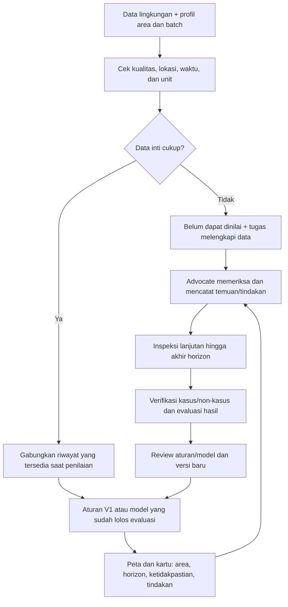

# Flow Model Proyek — Indikasi Risiko Ice-Ice

Untuk [issue #30](https://github.com/De-Voeux/c67-vault/issues/30): menyamakan konsep produk dan engineering sebelum interview ahli di issue #29. **Ini rancangan untuk diuji.** POC saat ini baru monitoring ocean; belum ada model penyakit atau dataset kasus lapangan siap training.

## 1. Keputusan pengguna dan output

Community advocate bersama petani menentukan **area mana yang perlu diperiksa lebih dulu dan apakah kondisi perlu dikonfirmasi sebelum melanjutkan rencana tanam**. Sistem memberi indikasi risiko kemunculan kasus baru pada suatu area, bukan diagnosis dari tanaman yang sudah terlihat sakit atau keputusan tanam otomatis.

Setiap hasil memuat:

| Isi | Rancangan V1 |
|---|---|
| Lokasi | ID dan batas area penilaian; tampilkan farm yang tercakup. Detail mengikuti dukungan data, bukan bentuk poligon semata |
| Waktu | Waktu penilaian, umur data, dan periode target. **Kandidat horizon 3 hari ke depan**, untuk dibahas dengan ahli/petani; belum lead time terbukti |
| Indikasi | Jika tervalidasi: kategori risiko sesuai hasil evaluasi. Selama pilot aturan: “perlu pemeriksaan”, “tidak ada pemicu aturan”, atau “belum dapat dinilai” |
| Ketidakpastian | Kelengkapan, kebaruan, cakupan spasial, serta batas validasi model. Tanpa kalibrasi, jangan tampilkan persen confidence/probabilitas penyakit |
| Langkah berikutnya | Ukur ulang kondisi air, inspeksi tanaman, catat temuan, dan konsultasikan keputusan tanam dengan pendamping |

Contoh kartu **skenario rancangan**: “Area A · perlu pemeriksaan · dinilai hari ini · target 3 hari berikutnya masih eksperimental · perubahan suhu/salinitas teramati · data lokal terbatas · ukur ulang dan inspeksi.” Tidak adanya pemicu tidak berarti area aman. Bila gejala sudah dilaporkan, arahkan ke pemeriksaan kondisi saat ini tanpa menunggu prediksi.

## 2. Alur dari data sampai verifikasi

**Cek kualitas:** koordinat/kedalaman, unit, kalibrasi atau flag QA sumber, duplikat, gap, lonjakan, dan data kedaluwarsa. Simpan data mentah dan asalnya; nilai kosong bukan nol. Satu piksel regional tidak boleh dianggap mengukur perbedaan antarpetak. Gunakan hanya input yang sudah tersedia ketika hasil diterbitkan; prakiraan dan observasi dibedakan.

Simpan setiap hasil beserta input, versi aturan/model, waktu terbit, dan targetnya. Feedback berisi lokasi, tanggal inspeksi, foto/gejala, jumlah diperiksa/terdampak, serta tindakan. **Inspeksi rutin tetap dilakukan pada area tanpa alert**, agar kasus yang terlewat dapat diketahui. Review label dan evaluasi dilakukan sebelum pembaruan model; feedback tidak langsung memicu retraining.

## 3. Inventaris kandidat data

Frekuensi di bawah adalah target pengumpulan awal, bukan komitmen layanan. Pemilik/pengelola sumber dibedakan dari izin penggunaan data yang masih harus disepakati.

| Input / sumber kandidat | Frekuensi dan detail spasial | Pemilik/pengelola | Ketersediaan dan gap |
|---|---|---|---|
| Suhu permukaan: NASA MUR | Harian; grid regional sekitar 1 km | NASA/JPL; tim mengelola salinan | Sampel nyata sudah masuk POC menurut log lokal; kelengkapan seri dan kesesuaian kedalaman tanaman **belum terverifikasi** |
| Suhu dan salinitas: alat manual/logger lokal | Usulan manual harian; logger 10–30 menit; titik pada kedalaman tanaman | Petani/mitra; penanggung jawab alat belum dipilih | **Belum terverifikasi:** alat, kalibrasi, pemasangan, biaya dan coverage |
| Hujan/angin: BMKG; arus/salinitas regional: Copernicus | Target ringkasan harian; mengikuti grid/wilayah dan jadwal produk yang dipilih | BMKG / Copernicus Marine | **Kandidat belum terverifikasi** untuk pipeline penyakit; akses, lisensi, latensi dan arsip perlu dicek. Bukan sumber aktif POC ocean-only |
| Chlorophyll, Kd490/Rrs: NASA VIIRS/PACE | Per lintasan/piksel valid; agregasi harian bila tersedia | NASA dan tim produk terkait | Sampel terbatas ada pada POC; gap awan/pesisir. Nilai tambah untuk prediksi **belum terverifikasi**; bukan ukuran langsung penyakit atau cahaya di tanaman |
| Batas area, spesies, bibit, tanggal tanam, kedalaman, perawatan | Awal batch dan setiap perubahan; farm/petak/batch | Petani/kelompok; tim sebagai pengelola sesuai persetujuan | **Belum terverifikasi:** koordinat farm nyata dan kelengkapan profil. Poligon POC masih contoh |
| Inspeksi, foto, kasus, tindakan dan hasil panen | Usulan harian selama pilot dan saat kejadian; sampel tanaman → petak → area | Petani/pemeriksa; akses dan izin disepakati | **Belum ada dataset label siap training**; definisi kasus, pemeriksa, cakupan dan arsip historis harus dikonfirmasi |

Inti awal: **profil area/batch + inspeksi + suhu/salinitas lokal**; satelit memberi konteks regional. Cuaca, arus dan optik ditambah bila tersedia dan terbukti membantu, bukan diwajibkan sekaligus.

## 4. Rencana training dan evaluasi awal

1. **Tetapkan label sebelum training.** Kandidat kasus: temuan baru yang memenuhi definisi operasional ice-ice hasil kesepakatan ahli, dengan lokasi dan waktu. Simpan pucat, lesi putih/lunak, fragmentasi dan diagnosis terkonfirmasi secara terpisah. Area yang sudah bergejala saat penilaian tidak masuk evaluasi prediksi onset baru.
2. **Tetapkan unit dan pembanding negatif.** Satu sampel = area pada tanggal penilaian; targetnya ada/tidak ada kasus baru dalam horizon. Usulan awal: minimal satu kasus baru terverifikasi pada petak sampel membuat label area positif. Non-kasus hanya jika inspeksi terjadwal mencakup area hingga akhir horizon tanpa kasus; tidak diperiksa = label tidak diketahui. Klaim berlaku pada cakupan sampel, bukan semua tanaman. Catat interval antara inspeksi terakhir tanpa gejala dan temuan pertama.
3. **Bangun riwayat berpasangan.** Butuh lingkungan sebelum onset, inspeksi positif/negatif, profil batch, tindakan dan outcome pada beberapa farm, musim dan siklus. Arsip tanpa tanggal/lokasi tidak cukup untuk memasangkan paparan dan kasus. Banyak baris sensor tidak sama dengan banyak kejadian independen; kecukupan data ditinjau dari jumlah kejadian dan variasinya.
4. **Bandingkan yang sederhana dulu.** Baseline: aturan perubahan/durasi suhu dan salinitas yang disepakati untuk pilot, dengan parameter dipilih pada training/validation. Jika label cukup, bandingkan regresi logistik sederhana memakai ringkasan riwayat dan konteks batch. Skor anomali lingkungan tetap diperlakukan sebagai anomali, bukan probabilitas ice-ice.
5. **Uji pada farm dan waktu lain.** Train pada periode awal, validation pada periode berikutnya, test pada waktu lebih akhir; tahan farm/siklus terpisah untuk uji generalisasi. Hindari window/kejadian yang sama melintasi split dan jangan memakai data masa depan. Laporkan precision/recall kasus, kejadian terlewat, false alert per area-minggu, lead time, serta kalibrasi jika menampilkan probabilitas; tampilkan hasil per farm/periode dan ketidakpastiannya. Catat tindakan setelah alert karena dapat mengubah outcome.

Model dipakai hanya bila memberi manfaat dibanding aturan pada batas false alarm dan lead time yang disepakati. Uji pemahaman kartu dan kemampuan bertindak juga diperlukan; akurasi prediksi belum membuktikan peningkatan panen.

## 5. Keputusan terbuka dan pertanyaan interview

Urutan pertanyaan untuk review tim dan interview [issue #29](https://github.com/De-Voeux/c67-vault/issues/29):

1. **Prioritas 1 — target dan label:** spesies/farm mana dulu; apa definisi kasus yang dapat diperiksa konsisten, siapa yang mengonfirmasi, dan bagaimana sampel petak mewakili area?
2. **Prioritas 1 — kegunaan:** apakah horizon 3 hari memberi waktu bertindak; tindakan apa yang realistis dan berapa false alarm yang masih dapat diterima?
3. **Prioritas 1 — kelayakan data:** adakah arsip kasus/non-kasus berlokasi dan bertanggal; bisakah inspeksi rutin serta pengukuran lokal dipertahankan dengan biaya/tenaga yang tersedia?
4. **Prioritas 2 — indikator:** faktor apa yang mendahului onset pada spesies/lokasi ini; bagaimana membedakan pengaruh lingkungan, bibit, praktik dan gejala yang sudah ada?
5. **Prioritas 2 — batas V1:** jika label atau cakupan belum cukup, sepakati **monitoring + aturan prioritas pemeriksaan + pencatatan outcome**. Jangan meluncurkannya sebagai prediksi risiko tervalidasi. Model terlatih menyusul setelah bukti cukup.

**Status review:** dokumen siap dibahas; review tim dan pengesahan daftar pertanyaan belum dilakukan. Issue #30 belum memenuhi seluruh “Done when” sampai langkah tersebut selesai.

Dasar internal: [[Challenge Response - Seaweed Ice-Ice]] · [[Kajian Indikator Warning Ice-Ice - Uji Asumsi Fitur]] · [[Riwayat Pengembangan POC - TidungMonitor]] · [[Rencana Pengukuran IoT Kondisi Laut - Diskusi Mas Ricky]]. Ini penyusunan requirement dari konteks vault, bukan review literatur baru.
