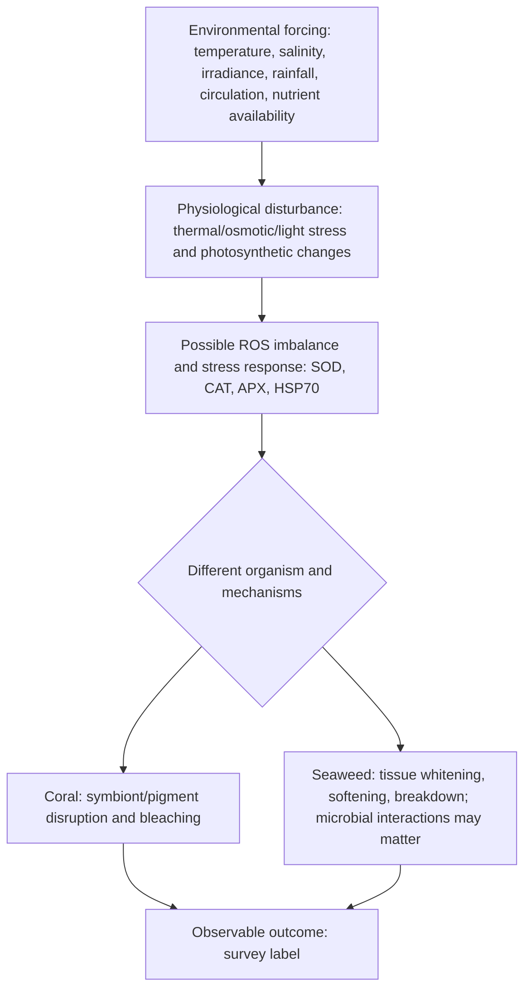
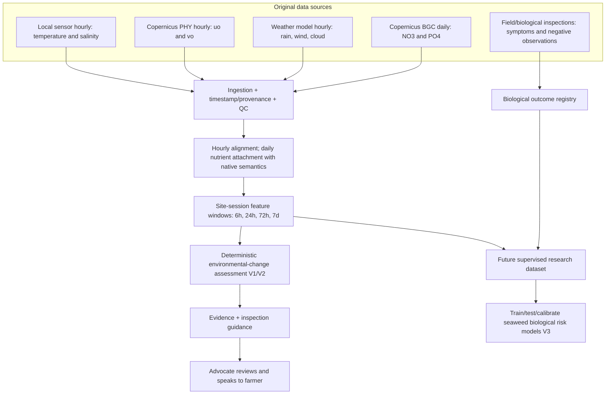
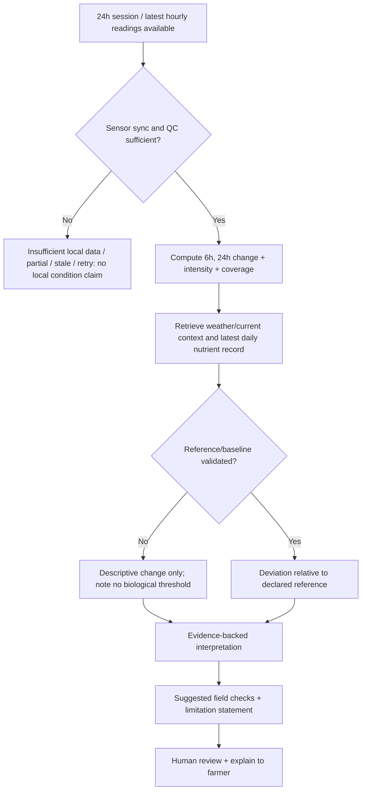
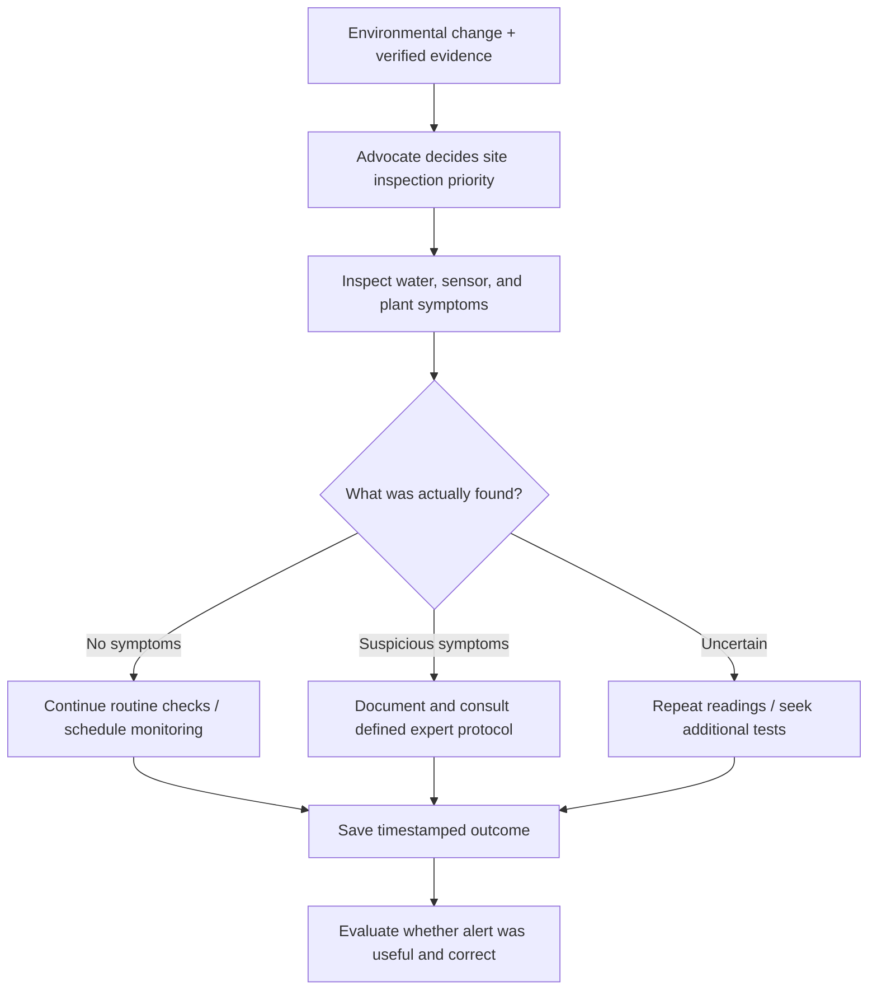
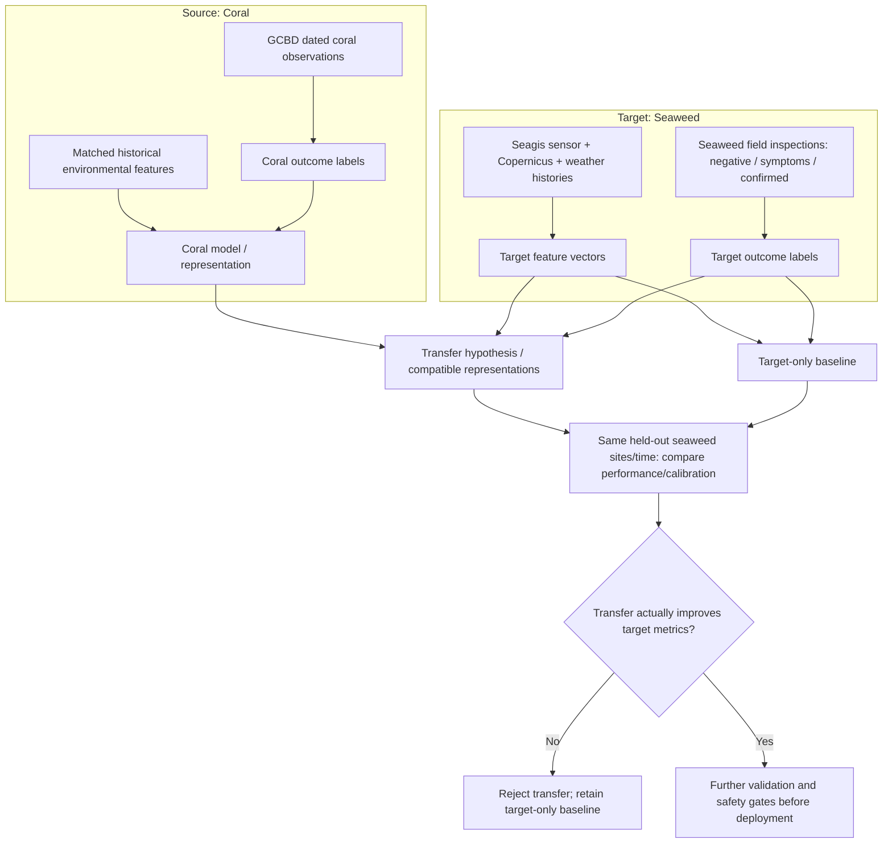
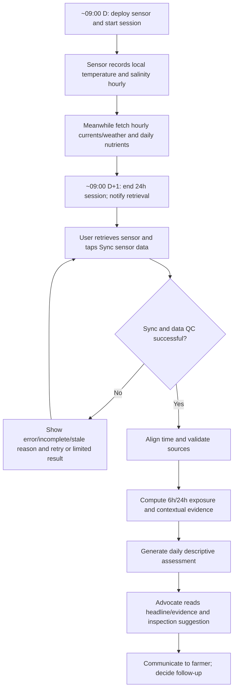
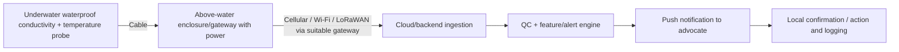

# SEAGIS — MASTER RESEARCH CONTEXT

> **Purpose:** Satu sumber konteks panjang, *agent-readable*, yang merekam evolusi masalah, hipotesis ilmiah, diskusi coral bleaching–ice-ice, studi yang dikutip, angka eksperimen, audit data, rancangan algoritma/ML, kontrak output, user flow, validasi, roadmap V1–V3, dan keputusan riset yang belum terjawab.
>
> **DO NOT TREAT THIS AS:** systematic review terdaftar, bukti klinis/biologis bahwa prediksi ice-ice sudah akurat, atau izin membuat probabilitas/ambang penyakit tanpa validasi. Banyak unsur dalam dokumen ini adalah *research hypotheses* atau rancangan.

## 0. How to read this document

### 0.1 Status klaim

- **[FIELD]** = laporan lapangan, wawancara, atau deskripsi fenomena; belum otomatis terverifikasi dengan instrumen.
- **[LITERATURE]** = temuan studi yang dirujuk; tetap terikat pada spesies, kondisi, periode, dan desain studi tersebut.
- **[AUDIT]** = hasil uji akses dan ekstraksi data Copernicus yang dilaporkan dalam percakapan; bukan verifikasi sensor in-situ.
- **[HYPOTHESIS]** = dugaan mekanistik atau hubungan yang patut diuji; bukan hasil pasti.
- **[DESIGN]** = keputusan/opsi arsitektur, UX, atau ML yang diusulkan.
- **[OPEN]** = belum ada data, keputusan, atau verifikasi yang mencukupi.

### 0.2 Non-negotiable rules

1. Jangan mengubah **coral bleaching prediction** menjadi **ice-ice disease probability** hanya dengan mengganti nama label.
2. Pemutihan thallus pada rumput laut bisa merupakan gejala ice-ice-like, **bukan diagnosis etiologi yang pasti**; pemutihan karang juga bukan mekanisme penyakit yang identik.
3. Angka suhu 26–28 °C dan salinitas 28–34 ppt yang sempat diajukan adalah **contoh rentang kerja/hipotesis**, bukan ambang aman universal untuk *K. alvarezii* dan bukan cutoff probabilitas penyakit.
4. NO₃ dan PO₄ dari model global **tidak mengukur total nitrogen tersedia, oksigen terlarut, atau kesehatan langsung rumput laut**. Jarak grid dan cakupan wajib dicantumkan.
5. `NO3 + NO2 + NH4` (dengan satuan nitrogen molar yang sebanding) dapat membentuk TIN/DIN; `NO3 + PO4` **bukan** TIN.
6. **Risk index** atau *inspection priority* tidak sama dengan **calibrated probability**. Jangan menampilkan “ice-ice risk 80%” tanpa label target dan pengujian kalibrasi.
7. Pisahkan *observed local*, *modelled regional*, *forecast*, *derived feature*, *interpretation*, dan *user action*.
8. Semua contoh output, UI, rule, dan angka buatan harus ditandai **simulasi**.
9. `verified:false` pada koordinat plot berarti **lokasi tambak contoh belum terverifikasi**.
10. Jika bukti dari suatu artikel tidak ditinjau langsung, tandai sebagai catatan percakapan dan **jangan menciptakan detail yang tidak tersedia**.

---

# PART I — THE RESEARCH PROBLEM

## 1. Origins, scope, and stakeholders

### 1.1 Evolusi proyek

Riset berawal dari eksplorasi aquaculture untuk NASA Space Apps Challenge 2026, lalu mengerucut ke budidaya rumput laut di **Pulau Tidung, Kepulauan Seribu**, terutama *Kappaphycus alvarezii*. Fokus bergeser:

1. Aquaculture umum dan pasokan/produksi wilayah;
2. Masalah petani terkait perubahan kondisi air (“air busuk”, “air putih”), tanaman rusak, dan ice-ice;
3. Interpretasi data Earth Observation dan local sensor;
4. Environmental-change detection untuk memandu inspeksi;
5. Hipotesis **environmental risk model / transfer learning** dari corpus coral bleaching;
6. Roadmap bertahap V1 (post-monitoring), V2 (continuous warning), V3 (validated predictive system).

**Current practical positioning:** Seagis membantu penyuluh menafsirkan perubahan lingkungan, memprioritaskan lokasi/periode pemeriksaan, mengomunikasikan temuan, dan mendokumentasikan tindak lanjut. Ini berbeda dari mengklaim “mencegah ice-ice”.

### 1.2 Primary users dan keputusan manusia

- **Penyuluh/advocate**: menerima assessment, melihat evidence, memutuskan prioritas inspeksi, menyampaikan pesan kepada petani, dan idealnya mencatat hasil tindak lanjut.
- **Petani**: memutuskan penanaman dan pengelolaan di lapangan. Penyuluh dipercaya, tetapi berdasarkan wawancara setempat belum tentu menjadi pihak yang langsung menentukan kapan/di mana menanam.
- **Research/AI team**: menguji sinyal lingkungan, menyusun dataset biologis, memisahkan korelasi dari kausalitas, mengukur kualitas peringatan.
- **IoT/product/iOS**: memastikan alur pengumpulan, transmisi/sinkronisasi, kualitas data, keterbacaan pesan, dan error states.

### 1.3 Field context and testimony [FIELD]

- Budidaya berada di perairan pantai dangkal, banyak tali bentang dalam kisaran sekitar 500 m dari pantai; akses berjalan kaki bergantung pasang surut.
- Penyuluh Fauzi menggambarkan air tertentu yang terasa hangat saat menyelam, lalu dingin setelah massa air berlalu, serta kondisi berubah sangat cepat.
- Pak Unin mengaitkan air yang kadang keruh/berbau dengan kerusakan rumput laut; kebutuhan ekonominya meliputi pembeli yang teratur.
- Ungkapan petani: rumput laut bisa tampak baik pada pagi hari lalu sangat rusak keesokan harinya. Ini **kesaksian kualitatif**, belum diubah menjadi distribusi waktu onset yang terukur.
- Angin dari barat laut dikaitkan dalam wawancara dengan air lebih bening; hubungan kausalnya belum dikonfirmasi.
- Istilah lokal *air busuk/air putih* tidak boleh diasumsikan punya satu definisi ilmiah; mungkin mencakup berbagai fenomena keruh, hangat, sirkulasi, bau, plume, atau proses biologis.
- Narasumber/kontak riset lain termasuk Pak Madnung dan ahli kelautan/GIS Aryo Damar Sadono. Jangan mencampurkan lokasi pengamatan mereka dengan pengukuran Pulau Tidung.
- Diskusi dengan Prof. **Michael Y. Roleda** terjadi sekitar 20 Oktober 2026 mengenai toleransi salinitas, kebutuhan suhu, interaksi nutrien, mekanisme fisiologis, dan kebutuhan logbook jangka panjang. Ini adalah **catatan percakapan/arah diskusi**, bukan paper threshold lokal atau transkrip verbatim.

### 1.4 Problem statements

**Practical:** Petani dan penyuluh sering mengetahui bahwa kondisi air buruk setelah perubahan fisik rumput laut telah terjadi. Pengukuran lingkungan lokal yang kontinu masih minim.

**Scientific:** Belum diketahui kombinasi, durasi, lag, dan interaksi perubahan salinitas, suhu, cahaya, sirkulasi, nutrien, curah hujan, serta mikroba yang cukup kuat untuk memprediksi gejala ice-ice di Pulau Tidung.

**ML:** Dataset berlabel kejadian dan non-kejadian ice-ice yang tersinkronisasi dengan histori lingkungan di area yang sama belum tersedia untuk sistem ini.

**Spatial:** Jarak antar tali/tambak lebih kecil daripada grid banyak model laut; nilai Copernicus tidak bisa diasumsikan mewakili setiap tali secara independen.

### 1.5 Lima pertanyaan riset fundamental

1. **Reality:** Apa fenomena kerusakan yang benar-benar terjadi, kapan, di mana, dan seberapa besar dampaknya?
2. **Precursor:** Perubahan lingkungan apa yang mendahului kejadian, dan selama berapa lama?
3. **Specificity:** Apakah gejala tersebut ice-ice atau stres/kerusakan lain yang tampak mirip?
4. **Observability:** Dapatkah perubahan itu diamati lewat sensor lokal dan sumber regional sebelum gejala muncul?
5. **Reproducibility:** Apakah hubungan yang ditemukan bertahan di lokasi, musim, strain, kedalaman, dan tahun lain?

---

# PART II — BIOLOGICAL MECHANISMS AND HYPOTHESES

## 2. What is ice-ice and what is coral bleaching?

### 2.1 Ice-ice syndrome in eucheumatoid seaweeds

[LITERATURE] Ice-ice secara umum dijelaskan sebagai **sindrom multifaktorial** pada eucheumatoid seaweeds (antara lain *Kappaphycus* dan *Eucheuma*) dengan tanda seperti pemutihan jaringan/thallus, pelunakan, kerusakan/fragmentasi, dan kehilangan biomassa. Lingkungan, fisiologi inang, dan komunitas mikroba dapat berinteraksi. Tidak ada pembenaran untuk menyederhanakannya menjadi “hanya disebabkan bakteri”. Rujukan: Ward et al., *Reviews in Aquaculture* (2022), DOI [10.1111/raq.12606](https://doi.org/10.1111/raq.12606).

[LITERATURE] Penelitian inokulasi *K. striatus* oleh Lestari et al. (2026) mendukung kemampuan beberapa bakteri terisolasi untuk menginduksi gejala dalam kondisi eksperimen, tetapi hasil ini tidak berarti prevalensi lapangan maupun threshold lingkungan telah diketahui. DOI [10.1007/s10811-025-03776-7](https://doi.org/10.1007/s10811-025-03776-7).

### 2.2 Coral bleaching

[LITERATURE] Coral bleaching terutama menggambarkan hilangnya simbion fotosintetik atau pigmennya dari karang pembentuk terumbu, sering dipicu stres termal/irradiance dan melibatkan gangguan fotosintesis serta respons stres oksidatif. Keadaan bleached **tidak selalu berarti karang mati**. Mechanism berbeda dari tissue whitening pada seaweed; kesamaan warna bukan bukti mekanisme yang identik.

### 2.3 The user's core insight: shared stress physiology

[HYPOTHESIS] Walaupun outcome berbeda, sebagian **upstream stress pathways** berpotensi serupa:

- Temperature anomalies/high heat, low salinity or strong osmotic changes, intense or insufficient light, nutrient availability, and water movement can disturb physiological homeostasis.
- Disruption of photosynthetic and cellular metabolism may increase **reactive oxygen species (ROS)** relative to cellular defenses.
- Stress responses can involve **SOD (superoxide dismutase), CAT (catalase), APX (ascorbate peroxidase)** and proteins such as **HSP70**.
- Bila kerusakan melampaui kapasitas aklimasi/perlindungan, gejala fisik mungkin terjadi; pada rumput laut interaksi mikroba dapat memperburuk jaringan.

**Scientific precision:** ROS adalah kelompok spesies oksigen reaktif, bukan satu bahan tunggal. SOD/CAT/APX adalah enzim antioksidan; HSP70 adalah molecular chaperone/stress protein, bukan enzim antioksidan identik. Adanya jalur seluler serupa **tidak membuktikan** bentuk respons, ambang, atau fungsi prediksi antarkelompok organisme sama. **ROS/HSP70/SOD/CAT/APX saat ini bukan fitur sensor Seagis**.

### 2.4 Biological hypothesis diagram



**Interpretation:** Diagram ini adalah *causal research hypothesis*, bukan rantai kausal yang telah divalidasi menyeluruh pada Pulau Tidung. Setiap panah dan lag membutuhkan pengujian.

### 2.5 What supports this mechanistic bridge?

- **Kumar et al. (2020)** menguji respons *K. alvarezii* terhadap kenaikan suhu akut. Peningkatan suhu menekan pertumbuhan/fotosintesis dan meningkatkan ROS; strain yang diuji mengalami gangguan pada 32–36 °C dan mortalitas tinggi pada suhu eksperimen paling ekstrem. **Ini bukan threshold ice-ice universal untuk lapangan.** DOI [10.1371/journal.pone.0239097](https://doi.org/10.1371/journal.pone.0239097).
- **Tabonda-Nabor et al. (2026)** mendokumentasikan perbedaan pertumbuhan, pigmen dan ekspresi gen *K. alvarezii* akibat irradiance, termasuk perubahan ekspresi jalur proteksi/antioksidan yang sejalan dengan respons stres. Studi tidak menyatakan “high light pasti menyebabkan ice-ice”. DOI [10.1111/jpy.70148](https://doi.org/10.1111/jpy.70148).
- **Ward et al. (2022)** menjelaskan ice-ice sebagai sindrom lingkungan–mikrobiologi, bukan hanya kejadian satu organisme patogen. DOI [10.1111/raq.12606](https://doi.org/10.1111/raq.12606).
- **Aguilar, Paras & Roleda (2026)** mempelajari bakteri yang berkaitan dengan kultur *K. alvarezii* sehat dan bergejala dalam kondisi ex situ. Perbedaan asosiasi tidak sendirinya membuktikan arah kausalitas ataupun kemampuan memprediksi field risk. DOI [10.1093/femsle/fnag080](https://doi.org/10.1093/femsle/fnag080).
- Bukti coral bleaching tentang ROS, photoinhibition, respons antioksidan, dan berbagai jalur proteksi biologis dipakai untuk membangun hipotesis **shared-response**, bukan untuk menyamakan penyebab akhir kedua fenomena.

## 3. Master hypothesis table

| ID | Hypothesis / question | Mechanism proposed | Measurements available now | Biological validation required | Evidence state / caveat |
|---|---|---|---|---|---|
| H01 | Suhu tinggi/berubah cepat meningkatkan physiological stress | Thermal/photosynthetic disturbance, ROS imbalance | IoT temp hourly; optional SST | Stres/fotosintesis/gejala bertanggal dan jenis strain | Eksperimen fisiologi mendukung pada konteks tertentu; cutoff lokal belum diketahui |
| H02 | Salinitas rendah/berubah mendadak meningkatkan stress susceptibility | Osmotic disturbance | IoT salinity hourly | Respons tanaman sebelum/sesudah perubahan, termasuk duration | Eksperimen mendukung dampak hiposalinitas, konteks nutrient matters |
| H03 | Nutrient availability memoderasi dampak penurunan salinitas | Nutrient uptake dan kompensasi metabolik | Copernicus `no3`,`po4` daily (regional); NH4/NO2 belum | Air lokal NH4, NO2, PO4, NO3, tissue nutrients/growth | Gacura menguji interaksi; regional NO3 tidak cukup untuk status nitrogen |
| H04 | Lemahnya pertukaran air meningkatkan paparan lokal | Limited transport/mixing of heat, nutrients and metabolites | Copernicus `uo`,`vo` hourly (regional) | Current meter dekat tali, bathymetry/tide, symptom timing | Belum ada validasi direct local; hasil studi lapangan tidak konsisten |
| H05 | Cahaya UV/PAR dan suhu berinteraksi | Photoinhibition/protection, ROS | Cloud model (proxy atmosfer), calon PAR lokal | PAR underwater + response fisiologis | Cloud != UV/PAR bawah air; high light bisa menaikkan growth dalam eksperimen |
| H06 | Hujan mendahului penurunan salinitas lokal tertentu | Freshwater influx + circulation | Weather rain hourly, IoT salinity | Jeda temporal, lokasi intensitas hujan dan perairan | Co-occurrence bukan kausalitas; ada korelasi hujan–keparahan pada studi lapangan |
| H07 | Multiple stressors lebih informatif dari single threshold | Nonlinear interactions and cumulative exposure | Semua input; time windows | Event/non-event labels; interaction tests | Layak diuji, belum ada angka kontribusi universal |
| H08 | Variasi musiman/kedalaman/strain memoderasi kejadian | Environment + host susceptibility | Musim, kedalaman deployment, strain logs | Survei lintas musim/site | Studi Tawi-Tawi mendukung peran musim dan kedalaman |
| H09 | Ice-ice dan coral bleaching berbagi *learnable* environmental stress representation | Shared oxidative/physiological response | Historical coral environment + survey labels; Seagis features | Paired seaweed biological outcomes | Plausible transfer-learning hypothesis, **not demonstrated** |
| H10 | BLEACHING label pada coral dapat menjadi proxy *early* seaweed stress | Similar visible phenotype | Coral labels | Seaweed-specific endpoint and temporal onset | **Not established; cannot relabel directly** |
| H11 | Model arus/nutrien regional bisa membedakan plot-plot sangat dekat | Gridded ocean interpolation | 9/28 km cells | Matched local variability | Audit **contradicts**: semua plot contoh berbagi sel yang sama |
| H12 | Akumulasi paparan lebih prediktif daripada snapshot | Duration, magnitude, recurrence | Hourly features and daily history | Event timing and controls | Strong modelling inspiration from coral DHW; seaweed windows/weights unknown |
| H13 | “Air busuk/putih” merupakan sinyal awal ice-ice | Water mass, turbidity, microbial or circulation changes | Terbatas: temp/salinity; optional optics/DO | Repeatable documented incidents and chemistry | FIELD hypothesis only; may describe multiple phenomena |
| H14 | Gejala mula-mula konsisten muncul di tengah/ujung tali | Micro-scale exposure pattern | Not resolved with regional grids | Georeferenced within-line surveillance | No confirmed universal pattern in discussed literature |
| H15 | Anomaly alert memperbaiki keputusan inspeksi | Better timing/priority | Assessment logs | Compare inspection outcomes, time-to-response, false alarms | Product hypothesis; needs field study |
| H16 | Forecast environment improves lead time versus post hoc explanation | Prediction before exposure | Provider forecast with issue+valid times | Compare against future observed readings | Feasible to test; doesn't imply disease prediction |

### 3.1 Findings that *challenge* simplistic theory

[LITERATURE] **Tahiluddin & Terzi (2024)** — survei 12 bulan di Tawi-Tawi — menemukan asosiasi dengan **musim** dan **kedalaman**, tetapi **tidak mendeteksi korelasi signifikan** untuk sebagian besar temperatur, salinitas, kecepatan arus, phosphate, nitrate, atau nitrite pada analisis tersebut. Hujan berkorelasi positif dengan panjang spot; ammonium berkorelasi negatif dengan beberapa ukuran intensitas. Temuan nol **tidak membuktikan** suhu/salinitas/arus mustahil berpengaruh; frekuensi pengukuran, definisi outcome, jumlah observasi, dan variasi lingkungan bisa memengaruhi hasil. DOI [10.3390/plants13152157](https://doi.org/10.3390/plants13152157).

**Consequence:** model single-threshold seperti “T>28 °C AND salinity<28 ppt = risk high” terlalu sederhana sebagai klaim penyakit, tanpa local evidence. Evaluasi exposure history, site effects, interaction, dan mikroba/host context lebih defensible.

---

# PART III — RESEARCH EVIDENCE AND NUMERICAL FINDINGS

## 4. Literature evidence matrix (verified sources and conversation references)

| Ref | Citation / source | Study type | Key findings discussed | Limitation for Seagis |
|---|---|---|---|---|
| [R01] | Ward et al. (2022), *Ice-Ice disease: An environmentally and microbiologically driven syndrome in tropical seaweed aquaculture*, *Reviews in Aquaculture*, [DOI](https://doi.org/10.1111/raq.12606) | Review | Ice-ice includes thallus bleaching/disintegration, environmental and microbial interactions | Not a Pulau Tidung predictor or universal weights |
| [R02] | Kumar et al. (2020), *Impact of elevated temperature on the physiological and biochemical responses of Kappaphycus alvarezii*, *PLOS ONE*, [DOI](https://doi.org/10.1371/journal.pone.0239097) | Laboratory physiology | Acute warming changed ROS, growth, pigment and photosynthetic performance | Extrapolation to field disease onset invalid |
| [R03] | Tahiluddin & Terzi (2024), *Ice-Ice Disease Prevalence and Intensity in Eucheumatoid Seaweed Farms*, *Plants*, [DOI](https://doi.org/10.3390/plants13152157) | 12-month field observation, Tawi-Tawi | Season, depth, species associations; many instantaneous physicochemical parameters non-significant; rainfall/ammonium relationships | Correlation != causation; temporal sampling limitations |
| [R04] | Gacura et al. (2025), *To plant or not to plant? Nutrient uptake, growth, and biochemistry of eucheumatoids under low salinity as influenced by nutrient-rich freshwater outflow*, *J. Phycology*, [DOI](https://doi.org/10.1111/jpy.70044) | Manipulative lab experiment | Nutrient-rich conditions can ameliorate some low-salinity impacts; NH4 uptake important | Mixed salinity–nutrient treatments; not disease-risk thresholds |
| [R05] | Tabonda-Nabor et al. (2026), *Light stress regulates pigment concentrations, growth, and gene expression in hatchery-cultivated K. alvarezii*, *J. Phycology*, [DOI](https://doi.org/10.1111/jpy.70148) | 28-day hatchery and transcriptomic experiment | Light changes growth, pigments, gene expression; high light produced highest mean growth in this setup | High-light response is not a universal disease sign; wild strains in hatchery |
| [R06] | Lestari et al. (2026), *Pathogenicity of culturable bacteria isolated from an ice-ice-disease-infected K. striatus green cultivar on the healthy brown cultivar*, *J. Applied Phycology*, [DOI](https://doi.org/10.1007/s10811-025-03776-7) | Bacterial challenge | Certain culturable bacterial isolates can induce ice-ice-like tissue symptoms in healthy cultivar | Not a quantified field transmission or prevalence study; species K. striatus |
| [R07] | Corr, Lowe & Vos (2026), *Bacterial disease in seaweed aquaculture: pathogen diversity and future solutions*, *J. Applied Phycology*, [DOI](https://doi.org/10.1007/s10811-026-03835-7) | Review | Host–microbiome complexity, challenges identifying pathogens, intervention candidates | Review is not validation of any site-specific predictor |
| [R08] | Aguilar, Paras & Roleda (2026), *The ice-ice disease black box: a disease complex triggered by bacterial associations in an ex situ milieu of biobanked K. alvarezii*, *FEMS Microbiology Letters*, [DOI](https://doi.org/10.1093/femsle/fnag080) | Ex-situ bacteria/community characterization | Associated bacteria differ between symptomatic vs apparently healthy stocks | Association != validated causality; no environmental probability curve |
| [R09] | Nguyen et al. (2026), *Sustainable seaweed aquaculture development in the Mekong Delta under climate change*, *Discover Environment*, [DOI](https://doi.org/10.1007/s44274-026-01089-1) | Structured narrative review | Environmental/economic/institutional seaweed opportunities in Mekong Delta | Not a direct ice-ice risk training dataset |
| [R10] | van Woesik & Kratochwill (2022), *A global coral-bleaching database, 1980–2020*, *Scientific Data*, [DOI](https://doi.org/10.1038/s41597-022-01121-y) | Global observational compilation | Bleaching presence/absence with site, SST and environmental covariates | Heterogeneous survey timing, coral outcome only |
| [R11] | NOAA Coral Reef Watch, [5-km methodology](https://www.coralreefwatch.noaa.gov/product/5km/methodology.php) | Operational monitoring method | Coral HotSpot, Degree Heating Weeks, exposure duration/accumulation | Coral-specific climatology, thresholds and time windows |
| [R12] | Caldwell et al. (2024), *Multi-Factor Coral Disease Risk: A new product for early warning and management*, *Ecological Applications*, [DOI](https://doi.org/10.1002/eap.2961) | Ecological ML forecast | Environmental/ecological predictors, quantile regression forests, withheld disease surveys, uncertainty and decision tool | Coral disease type/region/endpoint differs from seaweed ice-ice |
| [R13] | NOAA [HAB forecasts](https://coastalscience.noaa.gov/science-areas/habs/hab-forecasts/) | Operational warning ecosystem | Monitoring + modelling + stakeholder decision tools | Different organism, target and geography |
| [R14] | Prof. Michael Y. Roleda, research discussion ~20 Oct 2026 | Expert discussion | Need assess nutrient/salinity/temperature interactions and field validation | Treat as discussion notes, not quantitative published result |
| [R15] | 2021 Indonesia site-quality paper, DOI [10.1016/j.aqrep.2021.100685](https://doi.org/10.1016/j.aqrep.2021.100685) | Contextual aquaculture field study, cited in prior research report | Report summarized differing nitrate observations and older secondary quoted “optimal” ranges | Exact endpoint, nutrient species, units and original secondary sources need reinspection before cutoff use |

**PDF filename concordance from the discussion:** `plants-13-02157.pdf` → [R03]; `s10811-025-03776-7.pdf` → [R06]; `s10811-026-03835-7.pdf` → [R07]; `s44274-026-01089-1.pdf` → [R09]. Other locally discussed files include `2025_Gacura et al. 2025_Journal of Phycology.pdf` and `2026_Tabonda-Nabor et al. 2026_Journal of Phycology.pdf`.

## 5. Numerical evidence and cautions

### 5.1 Gacura et al. 2025: salinity–nutrient experiments

[LITERATURE] Study tested *K. alvarezii*, *K. striatus*, *Eucheuma denticulatum*. Six treatment groups with changed salinity and nutrient chemistry (approx. ten-day experiment). Values below from Table 1 (µM = µmol/L); TIN = NH4 + NO2 + NO3.

| Treatment | Salinity | PO₄ (µM) | NH₄ (µM) | NO₂ (µM) | NO₃ (µM) | TIN (µM) |
|---|---:|---:|---:|---:|---:|---:|
| O-LN-34 | 34 | 0.60 ± 0.04 | 1.45 ± 0.24 | 0.18 ± 0.04 | 0.72 ± 0.11 | 2.35 |
| O-MN-30 | 30 | 0.56 ± 0.09 | 1.25 ± 0.10 | 0.16 ± 0.05 | 3.89 ± 1.54 | 5.30 |
| O-HN-27 | 27 | 0.58 ± 0.10 | 2.30 ± 0.09 | 0.16 ± 0.03 | 9.41 ± 0.44 | 11.88 |
| N-MN-30 | 30 | 1.89 ± 0.09 | 5.50 ± 0.10 | 0.33 ± 0.04 | 0.47 ± 0.05 | 6.30 |
| N-HN-27 | 27 | 1.76 ± 0.08 | 5.41 ± 0.09 | 0.26 ± 0.05 | 8.26 ± 0.70 | 13.93 |
| N-HN-24 | 24 | 1.61 ± 0.24 | 5.44 ± 0.14 | 0.34 ± 0.05 | 8.76 ± 1.94 | 14.56 |

Study labels: LN = TIN <3 µM; MN ≈5–6 µM; HN ≈11–15 µM. **These are experimental grouping labels, not minimum acceptable levels at Pulau Tidung.** The source chemistry, water replacement regime, strain and timescale cannot be ignored. All studied species showed noteworthy ammonium uptake. No experiment independently varies every factor with a full factorial design for identifying a general causal surface. Ref: [R04].

### 5.2 Tabonda-Nabor et al. 2026: irradiance

[LITERATURE] Eight wild *K. alvarezii* strains, 28-day hatchery, low/medium/high lighting around **203 / 627 / 910 µmol photons m⁻² s⁻¹**. Reported mean daily growth ≈ **1.88 / 4.94 / 6.03% day⁻¹** for low/medium/high conditions (as summarized from prior full-text review). High light led to greater growth **and** upregulated some protective/antioxidant-related genetic pathways, illustrating physiological trade-offs. Low light produced more phycoerythrin in this experiment. No universal “high light causes ice-ice” cutoff can be extracted. Ref: [R05].

### 5.3 Kumar et al. 2020: temperature, stress and ROS

[LITERATURE] Acute temperature experiment with *K. alvarezii*: among evaluated thermal conditions, ~28 °C performed best in this particular setup; stress responses became evident at ~32–36 °C; extreme 40 °C treatment caused rapid severe loss and high ROS signal. **Not** evidence that temperatures just above 28 °C universally cause ice-ice or that falling temperature is always harmful. Ref: [R02].

### 5.4 Tahiluddin & Terzi 2024: field associations and negative results

[LITERATURE] Tawi-Tawi, observational sampling over 12 months and 12 farm sites. Summary from prior review: season difference p≈0.015; depth p<0.001; species-related lesion intensity p≈0.008; rainfall and lesion length r≈0.232 (p≈0.005); ammonium vs lesion counts r≈−0.422. Temperature r≈−0.157 (p≈0.060), salinity r≈−0.042 (p≈0.617), current speed r≈−0.052 (p≈0.536) were previously noted as not statistically significant on their analysed outcomes. **Exact comparison definitions, N and statistics should be cross-checked in Table/Results before analytical reuse; they are not causal weights.** Ref: [R03].

### 5.5 NOAA Coral Reef Watch: useful method, not seaweed cutoff

[LITERATURE] NOAA Coral Reef Watch defines coral thermal *HotSpot* relative to local maximum monthly mean SST reference (MMM). Operational DHW accumulates HotSpot exceeding specified bleaching threshold over a rolling **12-week** window. The coral system associates ~4 and ~8 °C-weeks with heightened coral bleaching risk/greater reef-scale severity in its methodological interpretation. **Never reuse these thresholds or 12-week horizon as ice-ice thresholds without target-species validation.** Source: [R11].

### 5.6 ML coral disease operational analogy

[LITERATURE] Caldwell et al. (2024) *Multi-Factor Coral Disease Risk* uses environmental/ecological data, quantile regression forests, ~5 km spatial resolution, weekly updates, and biological disease survey validation to produce ecological risk forecasts with uncertainties. The target is **coral disease syndromes (white syndromes, growth anomalies)**, which is not identical to heat-only coral bleaching or seaweed ice-ice. Model-development data included >42k coral disease surveys; exact site/survey inclusion and endpoint definitions belong to [R12].

## 6. Threshold, probability, contribution and evidence ledger

### 6.1 What the team repeatedly wanted to quantify

- “Jika salinitas turun 5 ppt, apakah ice-ice akan terjadi?”
- “Berapa persen kontribusi temperatur, salinitas, arus, cahaya, nutrien?”
- “Apakah kondisi 26–28 °C / 28–34 ppt normal?”
- “Bisakah model berkata potensi ice-ice 70%?”
- “Berapa jam/hari paparan hingga muncul gejala?”

**Current answer:** Tidak ada angka universal yang tervalidasi dari pembahasan ini untuk parameter-parameter tersebut di Pulau Tidung. Satu angka dari eksperimen suhu, studi coral, atau klasifikasi ML bukan probabilities site-specific.

### 6.2 Quantitative distinctions

| Quantity | Meaning | May be measured now? | Can be presented as disease probability? |
|---|---|---|---|
| Salinity delta, e.g. −4.6 ppt/24h | Measured environmental change | Yes if calibrated sensor and complete valid data | No |
| Temperature high/low 6h | Environmental exposure duration | Yes relative to declared reference and coverage | No |
| Nitrate 0.009 µmol/L in model grid | Model-derived regional nutrient concentration | Yes, with provenance and QC | No |
| Anomaly percentile | Position relative to historical distribution | Yes after adequate seasonal/site baseline | No |
| Isolation Forest score | Statistical unusualness under training distribution | Possibly with sufficient appropriate records | No |
| Coral bleaching classifier score | Model outcome for coral training domain | Yes after coral training + validation | **Not for seaweed** |
| Rule severity index 0–100 | Engineering transform of threshold violations | Can be defined but not an empirical risk | No |
| `P(ice-ice within 48h | X)` | Future calibrated biological outcome probability | Only with target labels and strong evaluation | Yes **only after validation** |
| Forecast current speed at T+24h | Modelled future environment | If provider forecast issued at T and checked | Not a biological risk probability |
| Feature importance 0.25 | Relative model attribution under chosen algorithm | After training | Not “25% of disease caused by factor” |
| Precision 80% | Among alerts, fraction truly positive in a defined test set | When labeled validation exists | Not 80% risk for one site |
| Recall 80% | Among cases, fraction identified at threshold | When labeled validation exists | Not 80% risk |

### 6.3 Probability notation and proposed future targets

To predict biological risk scientifically, define (for example):

`P(Y_site,t+24h = 1 | X_site,t−72h:t, location, season, model_version)`

where:
- `Y=1` means a **precisely defined and verified outcome** occurring within a future horizon (e.g. newly observed specific symptoms or confirmed ice-ice), not merely a subjective color assessment;
- `X` includes only features **available at forecast issue time**;
- positive and negative inspection outcomes are recorded;
- calibration and external validation have been performed.

A separate target might be **symptomatic whitening**, **severe tissue decay**, or **confirmed ice-ice disease**. These are not interchangeable labels. Unknown cases must not be silently labelled negative.

### 6.4 A hypothetical feature-exposure formula (NOT calibrated disease risk)

For a declared reference `T_ref`:

`HeatExposure_24h = Σ_hour max(0, T_hour − T_ref) × Δt`

Likewise for salinity (lower-tail illustration only):

`LowSalinityExposure_24h = Σ_hour max(0, S_ref − S_hour) × Δt`

Unit should be **°C·hour** and **ppt·hour**, respectively. These are mathematical exposure summaries; whether an exposure is harmful and what thresholds to use must be determined empirically. Do not treat “temperature dropped” and “temperature rose” as equally established causal risks.


## 6.5 Direct ROS/antioxidant and heat-shock literature for the mechanistic hypothesis

Additional publications directly address the proposed bridge. These help **substantiate candidate stress-response mechanisms**, but do not constitute evidence for a transferable quantitative risk model.

| Ref | Study / link | What it actually helps establish | What it does not establish |
|---|---|---|---|
| [R16] | *Kinetic study of the plastoquinone pool availability correlated with H₂O₂ release in seawater and antioxidant responses in the red alga Kappaphycus alvarezii exposed to single or combined high light, chilling and chemical stresses*; [PubMed](https://pubmed.ncbi.nlm.nih.gov/16904624/) | Directly measured photosynthetic redox kinetics, H₂O₂, SOD, CAT, APX and oxidation measures under manipulated stressors in **seaweed** | That every temperature/light anomaly induces ice-ice, or that CAT/APX move in a single monotonic direction |
| [R17] | *The Effects of Shade and Light on Corals in the Context of Coral Bleaching and Shading Technologies*, Frontiers in Marine Science (2022); [full text](https://www.frontiersin.org/journals/marine-science/articles/10.3389/fmars.2022.919382/full) | Review identifies coral biomarkers and study practices for ROS, SOD, CAT, APX and light-related stress | That all biomarkers were measured jointly in the same seaweed/coral dataset or are measurable by Seagis IoT |
| [R18] | *Transcription of genes involved in bleaching of a coral reef species Acropora downingi ... in response to high temperature*; [publisher](https://www.sciencedirect.com/science/article/abs/pii/S014111362500159X) | Experimental heat-stress coral study measuring expression of **Hsp70**, Hsp90, catalase, Mn-SOD and other markers | That mRNA expression directly implies bleaching onset or the same kinetic threshold in *Kappaphycus* |

**Interpretation of HSP70, SOD, CAT, APX**:

- **SOD** catalyses superoxide conversion; **CAT/APX** participate in hydrogen peroxide detoxification pathways. A stress marker may increase during an adaptive protective response; therefore **higher SOD/CAT/APX does not mean disease is already present**.
- **HSP70** participates in protein folding/chaperone stress response. Increased transcription is not interchangeable with ROS concentration.
- At least one *Kappaphycus* study reported different kinetics and non-significant correlations for some CAT/APX responses in its stress experiment; “all markers rise together” is not an evidence-based simplification. [R16]
- Seagis cannot infer ROS, HSP70 or enzyme activities from only temperature, salinity, currents, nutrients and weather without a validated predictive relationship and, ideally, independent experimental measurements.

## 6.6 Evidence-confidence table for research prioritization (qualitative, not computed risk)

| Statement | Research confidence (qualitative) | Main basis | Why it is not an ice-ice probability |
|---|---|---|---|
| Acute thermal stress can disturb *K. alvarezii* photosynthetic physiology and ROS | **Supported in controlled conditions** | [R02] | Disease onset was not the validated universal endpoint |
| Salinity–nutrient interaction can influence eucheumatoid growth | **Supported in a defined experiment** | [R04] | Site-specific salinity/nutrient chemistry and species matter |
| Light intensity alters growth and stress-related gene programs | **Supported in hatchery strains** | [R05] | Both adaptation and stress pathways can occur; not simple linear risk |
| Ice-ice can involve microbial associations and opportunistic pathogens | **Supported at syndrome/experimental level** | [R01], [R06], [R07], [R08] | No single bacteria-only onset rule established for Pulau Tidung |
| Coral and seaweed share broadly similar oxidative stress machinery | **Biologically plausible and partly demonstrated in separate organisms** | [R02], [R16]–[R18] | Cross-domain predictive transfer not yet tested |
| Low regional Copernicus nitrate means local seaweed is nutrient deficient | **Not established** | Global grid, missing NH4 | Direct nutrient status of cultivation site unknown |
| Weak Copernicus current means local rope water is stagnant | **Not established** | ~9 km grid and tide/bathymetry mismatch | No matching local current meter |
| Ice-ice probability can be computed from existing sensors alone | **Not established** | Outcome labels and validation missing | Score cannot be calibrated |


---

# PART IV — DATA SOURCES, RESOLUTION, AND ACTUAL AUDITS

## 7. Core dataset specification

| Layer | Field | Provider/product | Temporal granularity | Spatial support | Acquisition/status | Primary use |
|---|---|---|---|---|---|---|
| Local sensor | Water temperature (`°C`) | IoT probe | Target **hourly** | Actual sensor site/depth | Planned/instrument needs calibration; offline sync v1 | Primary local change |
| Local sensor | Salinity (ppt/PSU or conductivity-derived) | IoT conductivity+temperature probe | Target **hourly** | Actual sensor site/depth | Planned; calibration/temperature compensation critical | Primary local change |
| Marine physics | `uo` eastward, `vo` northward (m/s) | Copernicus global PHY hourly: `cmems_mod_glo_phy_anfc_0.083deg_PT1H-m` | **Hourly mean**, UTC | Grid 0.08333°, ≈9.3 km latitude scale; depth ~0.494 m | **Fetched successfully** in 18 Oct 2026 audit | Regional flow changes, direction, variability |
| Marine physics comparator | `uo`, `vo` | `cmems_mod_glo_phy-cur_anfc_0.083deg_P1D-m` | Daily mean | Same order grid | Fetched in comparison | Check hourly vs daily representation |
| Marine biogeochemistry | `no3`, `po4` (mmol/m³) | Copernicus BGC: `cmems_mod_glo_bgc-nut_anfc_0.25deg_P1D-m` | **Daily mean** | Grid 0.25°, ≈27.8 km latitude scale; depth ~0.494 m | **Fetched successfully** | Regional nutrient context |
| Weather | Precipitation | Weather model/provider TBD (Open-Meteo proposed) | Proposed hourly | Model grid, resolution varies | API planned, not audited in current report | Concurrent rain and possible freshwater context |
| Weather | Wind speed/direction | Weather model/provider TBD | Proposed hourly | Model grid | Planned | Atmospheric dynamics context |
| Weather | Cloud cover | Weather model/provider TBD | Proposed hourly | Model grid | Planned | Cloud context; **not underwater UV/PAR** |
| Optional SST | Sea surface temperature | NASA MUR L4 | Typically daily | ~1 km | Candidate, not integrated | Regional SST history/benchmark, not probe replacement |
| Optional rain satellite | Rainfall | NASA GPM IMERG | ~30-minute source / daily summaries | ~0.1°, ~10–11 km | Candidate | Independent rain data, latency/QC audit needed |
| Optional water optics | CHL, Kd490, clarity | Copernicus ocean color, VIIRS, OLCI, Sentinel-2 | Product dependent | Hundreds of m to km | Exploratory | Regional turbidity/light proxy; not tissue health |
| Optional local | PAR/underwater light, DO, NH4, NO2 | Dedicated local sensors/lab | Planned if scientifically justified | Point | Not available in v1 baseline | Validate hypothesized pathways and total nutrients |
| Biological labels | healthy/symptomatic/severe/confirmed, time | Field observation protocol | Inspections/events | Farm/rope/plant | **Needed for V3; outside current in-app v1 field flow** | Supervised risk model labels |

### 7.1 API/resource links

- Copernicus Marine portal: <https://marine.copernicus.eu/>.
- Copernicus Marine Toolbox docs: <https://help.marine.copernicus.eu/en/articles/7949409-copernicus-marine-toolbox-introduction>.
- Copernicus Toolbox subset: <https://help.marine.copernicus.eu/en/articles/8283072-copernicus-marine-toolbox-api-subset>.
- Weather API candidate Open-Meteo historical forecast: <https://open-meteo.com/en/docs/historical-forecast-api>.
- Open-Meteo historical weather: <https://open-meteo.com/en/docs/historical-weather-api>.
- BMKG maritim: <https://maritim.bmkg.go.id/apidoc> (location/product coverage must be checked).
- NOAA Coral Reef Watch: <https://www.coralreefwatch.noaa.gov/product/5km/index.php>.
- BCO-DMO GCBD CSV: <https://www.bco-dmo.org/dataset/773466/description>.

### 7.2 Required metadata fields

For every extracted record store source identity, dataset ID and version, variable, unit, `observed_at_utc` or `valid_at_utc`, `fetched_at_utc`, issue timestamp where forecast, `site_id`, nearest source grid center and distance, depth, quality flags, missingness, aggregation type, calibration info (local probe), source revision/run, and what kind of value (`observed`, `analysis`, `forecast`, `derived`). Do not let the UI show stale model data as freshly observed sensor data.

## 8. Copernicus daily audit [AUDIT]

**Dates sampled:** 12–18 October 2026, seven UTC daily timestamps. The audit fetched one NetCDF subset per dataset; size is file size, not transfer byte count.

- PHY dataset `cmems_mod_glo_phy-cur_anfc_0.083deg_P1D-m`, version `202406`.
  - `uo`,`vo`, `m/s`, depth **0.494025 m**.
  - Dimensions: `time=7,depth=1,lat=6,lon=7`, 42 cells/day, **41 valid** per variable/day in subset.
  - 7-day file: **28,706 bytes** (~28.7 kB).
- BGC `cmems_mod_glo_bgc-nut_anfc_0.25deg_P1D-m`, version `202311`.
  - `no3`,`po4` in **mmol/m³**, equal numerically to µmol/L.
  - Dimensions: `time=7,depth=1,lat=2,lon=3`, 6 cells/day, all valid.
  - 7-day file: **26,677 bytes** (~26.7 kB).
- Daily timestamp labels 00:00 UTC (=07:00 WIB); **not** instantaneous physical reading at that hour. Time bounds not present in subset; true averaging window and publication latency cannot be derived solely from those coordinates.
- All six unverified plot points selected one PHY cell **(-5.833328°, 106.500000°)** at distances **3.52–4.46 km**, and one BGC cell **(-5.750000°, 106.500000°)** at distances **5.12–6.15 km**.
- Thus there are **not six independent ocean-model observations for the six plots**.
- The existing project pipeline configured PHY daily current data via `Config/ocean_sources.json`; BGC was reportedly **not yet integrated into production** at audit time.

### 8.1 Seven-day site-cell values (12–18 October 2026)

| Date (UTC) | uo (m/s) | vo (m/s) | speed (m/s) | no3 (µmol/L) | po4 (µmol/L) |
|---|---:|---:|---:|---:|---:|
| Oct 12 | -0.44019 | 0.03091 | 0.44127 | 0.007689 | 0.115137 |
| Oct 13 | -0.40953 | 0.01868 | 0.40996 | 0.005953 | 0.116596 |
| Oct 14 | -0.44139 | 0.02053 | 0.44186 | 0.006468 | 0.117300 |
| Oct 15 | -0.48602 | 0.02321 | 0.48658 | 0.006473 | 0.117776 |
| Oct 16 | -0.44223 | 0.03045 | 0.44328 | 0.006554 | 0.118199 |
| Oct 17 | -0.32879 | 0.02813 | 0.32999 | 0.008527 | 0.118096 |
| Oct 18 | -0.49159 | 0.00009 | 0.49159 | 0.009114 | 0.116639 |

Aggregates reported: 7-day means `uo≈-0.43425`, `vo≈0.02171`, speed≈0.43493, no3≈0.007254, po4≈0.117106. 3-day means (16–18) `uo≈-0.42087`, `vo≈0.01956`, speed≈0.42162, no3≈0.008065, po4≈0.117645.

**Interpretive caution:** NO₃ very low in global coarse model relative to some experimental media cannot establish local N deficiency. Gacura experimentally discusses NH₄ uptake; Copernicus `no3`,`po4` do not cover NH₄. Compare to local water samples and longer model histories before assigning significance.

## 9. Copernicus hourly feasibility audit [AUDIT]

**Sample:** 18 October 2026, 00–23 UTC (18 Oct 07:00 through 19 Oct 06:00 WIB), retrieved 20 October 2026 with Copernicus Marine Toolbox 2.5.0.

| Data | Sample frequency | Spatial grid | NetCDF local subset | Plot valid values |
|---|---|---|---:|---|
| PHY hourly `cmems_mod_glo_phy_anfc_0.083deg_PT1H-m` (`202406`) | 24 hourly means | ~9.3 km | **34,648 bytes** | `uo`: 24/24; `vo`: 24/24 |
| PHY daily comparator (`202406`) | 1 daily mean | ~9.3 km | **26,365 bytes** | 1 daily plot value |
| BGC daily (`202311`) | 1 daily mean | ~27.8 km | **26,509 bytes** | `no3`,`po4`: 1 each |

Dimensions PHY hourly `time=24,depth=1,lat=6,lon=7`; 41/42 valid grid cells per hour, 1 masked cell, **no missing hour at plot cell**. Data were actual distinct hourly values, **not interpolated daily data**.

### 9.1 Actual hourly currents at shared PHY cell (18 Oct UTC)

| UTC | WIB | uo (m/s) | vo (m/s) | speed (m/s) | direction° (flow-to) |
|---|---|---:|---:|---:|---:|
| 00 | 07 | -0.409688 | 0.025067 | 0.410454 | 273.50 |
| 01 | 08 | -0.429519 | 0.029636 | 0.430540 | 273.95 |
| 02 | 09 | -0.459033 | 0.030707 | 0.460059 | 273.83 |
| 03 | 10 | -0.484069 | 0.022856 | 0.484608 | 272.70 |
| 04 | 11 | -0.506343 | 0.007501 | 0.506399 | 270.85 |
| 05 | 12 | -0.530242 | -0.016556 | 0.530500 | 268.21 |
| 06 | 13 | -0.537216 | -0.043570 | 0.538980 | 265.36 |
| 07 | 14 | -0.528529 | -0.062020 | 0.532156 | 263.31 |
| 08 | 15 | -0.524618 | -0.064364 | 0.528552 | 263.01 |
| 09 | 16 | -0.519688 | -0.054211 | 0.522508 | 264.04 |
| 10 | 17 | -0.507966 | -0.038202 | 0.509400 | 265.70 |
| 11 | 18 | -0.494051 | -0.021797 | 0.494531 | 267.47 |
| 12 | 19 | -0.483065 | -0.006931 | 0.483115 | 269.18 |
| 13 | 20 | -0.476290 | 0.003435 | 0.476303 | 270.41 |
| 14 | 21 | -0.476627 | 0.007121 | 0.476680 | 270.86 |
| 15 | 22 | -0.477552 | 0.008589 | 0.477630 | 271.03 |
| 16 | 23 | -0.478109 | 0.010478 | 0.478224 | 271.26 |
| 17 | 00+1d | -0.478745 | 0.011133 | 0.478875 | 271.33 |
| 18 | 01+1d | -0.480338 | 0.010024 | 0.480442 | 271.20 |
| 19 | 02+1d | -0.477506 | 0.011243 | 0.477638 | 271.35 |
| 20 | 03+1d | -0.472459 | 0.013876 | 0.472663 | 271.68 |
| 21 | 04+1d | -0.467345 | 0.014772 | 0.467579 | 271.81 |
| 22 | 05+1d | -0.463504 | 0.014554 | 0.463732 | 271.80 |
| 23 | 06+1d | -0.461493 | 0.015291 | 0.461746 | 271.90 |

- Observed range **0.410–0.539 m/s** and direction **263.01–273.95°** on one regional cell.
- Mean of 24 hourly speed values **0.485138 m/s**. Speed from daily mean components **0.491590 m/s**, difference ≈**1.3%**; vector-mean direction ~269.65° vs daily ~270.01°.
- Mean `uo` from hourly ~−0.484333; daily component −0.491590. Mean `vo` from hourly ~−0.002974; daily ~+0.000089.
- `speed = sqrt(uo² + vo²)` and `direction_flow_to = (degrees(atan2(uo,vo)) + 360) mod 360`. Speed of mean components **≠** arithmetic mean of hourly speeds.
- A ~31% increase from 07:00 WIB hourly speed to 13:00 WIB illustrates lost sub-daily variability in daily mean, **not proven local farm current change**.
- All six plot points still matched the same regional cell.
- `time_bnds` absent; hourly coordinate labels indicate sample times, but exact interval averaging bounds and publication latency are not proven from local NetCDF.

### 9.2 Practical temporal alignment rule

A monitoring session **09:00 WIB on day D → 09:00 WIB on day D+1** crosses TWO calendar dates. Align UTC measurement instants over an explicitly defined interval (e.g. half-open `[start,end)`), not by assuming one calendar-day daily nutrient value covers the entire session. Nutrient daily data must retain the product's native date, aggregation semantics and availability. A 24-hour sensor session may contain 24 samples depending on start/end inclusivity and actual sampling plan; do not overstate completeness without timestamps.

---

# PART V — ML DATA MODEL, FEATURE ENGINEERING, AND ASSESSMENT

## 10. Conceptual data architecture (raw → features → outcome)



**Core design decision:** Coral bleaching experiments reside in an **independent source-domain research workflow**; do not merge their labels with field outcome records as if equivalent.

## 11. Entity/data model

### 11.1 `sites`

`site_id, latitude, longitude, polygon?, owner_alias?, status_verified, bathymetry_estimate?, cultivation_depth, site_notes, created_at`

### 11.2 `sensor_devices`

`sensor_id, model, probe_type, install_depth_m, manufacturer_accuracy, calibration_timestamp, calibration_coefficients, deployment_history, firmware_version, battery_status, clock_drift_estimate`

### 11.3 `monitoring_sessions`

`session_id, site_id, start_at_utc, end_at_utc, deployment_method, retrieval_at_utc, sync_started_at, sync_completed_at, status, expected_samples, valid_samples, sensor_id`

### 11.4 `environmental_observations`

`observation_id, variable, value, unit, site_id?, source_id, source_type, observed_at_utc / valid_time, issued_at_utc?, ingested_at_utc, lat, lon, depth, grid_cell_id?, grid_distance_km?, quality_flag, dataset_version, aggregation_type, source_run`

Separate local `site_id` from gridded data matched to site; do not duplicate gridded values as independent samples in the ML split.

### 11.5 `assessment_features`

`session_id, site_id, feature_window_start, feature_window_end, feature_version, temp_* , salinity_* , current_* , rain_* , wind_* , cloud_* , nutrient_* , feature_coverage, data_age, qc_flags, sources_used`

### 11.6 `assessments`

`assessment_id, session_id, engine_type, engine_version, produced_at, data_cutoff_at, confidence_data?, status, findings[], evidence_refs[], context_refs[], limitations[], suggested_checks[], human_review_state`

### 11.7 `biological_inspections` (research track, may exist outside V1 app scope)

`inspection_id, site_id, observed_at_utc, observer_id, species, cultivar/strain, planting_date, plant_age_days, symptoms_whitening, softening, fragmentation, lesions_count, severity_protocol, photo_refs?, wet_weight/growth?, disease_diagnosis_status, diagnosis_method, healthy_negative_confirmed, verification_level, followup_time, uncertainty_reason`

**Labeling caution:** “No report” is not “confirmed no symptoms”. Establish actual negative observations, otherwise negative training labels will be contaminated.

## 12. Feature engineering specification (candidate features, not all approved)

### 12.1 Local temperature and salinity

| Feature | Calculation / question | Requirement |
|---|---|---|
| `temp_latest` | Last valid site sensor reading | Sensor current, calibrated |
| `temp_mean_24h`, `temp_max_24h`, `temp_min_24h` | Magnitude/distribution | Valid window coverage |
| `temp_delta_6h`, `temp_delta_24h` | Change versus earlier reading | Valid paired readings |
| `temp_slope_6h` | Rate of warming/cooling | Enough hourly points |
| `temp_rolling_std_24h` | Temporal variability | QC; define sensitivity to gaps |
| `temp_hours_outside_reference_24h` | Duration relative to documented reference | Valid reference; distinguish engineering/statistical/biological |
| `salinity_latest`, `salinity_min_24h`, `salinity_mean_24h` | State | Correct units/calibration |
| `salinity_drop_6h`, `salinity_drop_24h` | Osmotic change candidate | Avoid sign ambiguity |
| `salinity_hours_below_ref_24h` | Exposure | Reference rationale/version |
| `temp_salinity_cooccurrence` | Joint changes | Prespecified rule, not causal proof |

### 12.2 Regional currents

| Feature | Meaning / caution |
|---|---|
| `uo_mean_24h`, `vo_mean_24h` | Average vector components |
| `speed_mean_24h`, `speed_min_24h`, `speed_max_24h` | Regional current magnitude range |
| `speed_std_24h`, `speed_range_24h` | Intraday variability |
| `direction_vector_mean_24h` | Direction based on mean vector; circular statistics |
| `low_flow_hours_24h` | **Exploratory**, only with justified local/context baseline; global model does not diagnose stagnation at rope |
| `current_grid_distance_km` | Critical metadata; all six existing prototype plots share cell |

### 12.3 Nutrients and weather

| Feature | Native temporal support | Caveat |
|---|---|---|
| `no3_daily`, `po4_daily` | Daily regional model | Not hourly nor local biochemical truth |
| `no3_mean_7d`, `po4_mean_7d` | 7 daily records | Require coverage, handling delay/source version |
| `rain_sum_6h`, `rain_sum_24h` | Hourly model precipitation | Model estimate, not proof rain caused salinity drop |
| `wind_speed_mean_24h`, `wind_vector_*` | Hourly model | Winds can contextualize dynamics; no local-causation claim |
| `cloud_cover_mean_24h` | Hourly atmospheric model | Cloud cover **not** measured underwater PAR/UV |
| `observed_coverage_fraction` | Per source/window | Must be present in result |
| `source_age_hours` | Last valid time vs assessment | Stale sources cannot be presented as current |

**Cross-source time alignment:** Hourly measures can join on UTC with documented tolerance. The BGC record remains a daily datum attached as a *context item with date and age* rather than repeated as 24 independent measurements. Training algorithms must be told repeated identical regional cells/days are not independent samples.

## 13. Deterministic environmental-assessment engine (V1/V2)

### 13.1 Function, scope and non-goals

V1 should answer:

1. **What changed?** What measured local parameter changed and when?
2. **How significant in observable terms?** Magnitude, speed, duration, departure from reference, quality/coverage.
3. **What coincided?** What rain, regional current, nutrient context appeared in matching/nearby windows?
4. **What field check is warranted?** What should the advocate verify, without diagnosing plant disease?

Not goals: predict ice-ice with probabilities, claim that nutrients caused decline, recommend harvest/moving lines without validated SOP, or assert the biological status of uninspected plants.

### 13.2 Proposed deterministic decision pipeline



### 13.3 Proposed rule registry

Example rule, **not approved scientifically**:

```yaml
rule_id: SALINITY_CHANGE_24H_V0
purpose: flag measurable reduction in local salinity
input_fields: [salinity_hourly, sensor_qc, session_time]
window: 24h
statistic: "last_valid - first_valid"
trigger: "engineering threshold TBD from uncertainty and deployment baseline"
meaning: "large observed change by an operational definition"
prohibited_claims: ["ice-ice likelihood", "confirmed nutrient deficit", "caused by rain"]
output:
  headline_template: "Salinitas turun selama sesi pengamatan"
  evidence_required: [start_value, end_value, delta, window, timestamps, sensor_calibration]
  suggested_check: "Ukur ulang salinitas dan periksa tanaman secara visual"
version: v0_exploratory
```

Operational threshold is a QA/decision-design variable, **not automatically a biologically hazardous cutoff**.

### 13.4 Quality states

- `complete_valid` — readings valid, reference available, enough observations.
- `partial_valid` — some context missing; produce limited claims explicitly.
- `sensor_missing` — no local reading; can't conclude local condition.
- `sync_failed` / `retry_available` — guide hardware/data recovery.
- `stale_source` — distinguish stale regional dataset from recent sensor.
- `processing` — show progress and eventual outcome.
- `insufficient_coverage` — fail or downgrade features requiring long windows.
- `invalid_unit` / `calibration_due` / `device_drift_suspected` — don't produce misleading deltas.

### 13.5 Data-to-message traceability

Each sentence must cite internally its `feature_id`, source record IDs, values and units, source spatial support, time windows, QC and reference. Do not ask an LLM to freely invent causal explanations. If language generation is used later, it should verbalize **structured, checked claims only**, with constrained templates or post-generation validation.

## 14. Human decision support: beyond a dashboard

### 14.1 Example (SIMULATED, no clinical/biological inference)

**Raw data:** Site sensor salinity 31.4 → 26.8 ppt in 24h; a weather model reported rain 18 mm in the regional grid; current speed showed variability; NO3 daily available regionally.

**Interpretation:** “Salinitas di lokasi sensor turun 4.6 ppt dalam sesi ini. Hujan tercatat dalam periode yang sama. Penyebab langsung dan dampak terhadap rumput laut belum dapat dipastikan.”

**Suggested action for advocate:** Recheck local salinity/temperature; check clarity/odor and signs of whitening, softening or fragmentation; decide repeat monitoring or expert consultation; log what happened and the decision rationale.

**Message to farmer:** “Pak, kadar garam air pada titik pemantauan turun selama pengukuran dan semalam juga terpantau hujan di sekitar wilayah. Kita perlu cek ulang air dan kondisi tanaman hari ini. Ini belum berarti tanaman terkena ice-ice.”

### 14.2 Inspection prioritization flow



**Value proposition to test:** faster triage, more targeted inspections, structured record of decisions, reduced unsupported claims, improved follow-up. Do not assume that alert alone prevents crop damage.

---

# PART VI — CORAL BLEACHING DATASET AND TRANSFER LEARNING

## 15. Coral datasets and analogous warning systems

### 15.1 Global Coral-Bleaching Database (GCBD)

[LITERATURE/DATA] **van Woesik & Kratochwill (2022)**: **34,846** coral bleaching records from **14,405** sites in **93** countries (1980–2020). Includes bleaching presence/absence and environmental context such as SST-based metrics, proximity to land, site exposure, mean turbidity, cyclone frequency. Dataset from **BCO-DMO ID 773466**, file `global_bleaching_environmental.csv` about **16 MB**.

- Paper: <https://doi.org/10.1038/s41597-022-01121-y>.
- Dataset: <https://www.bco-dmo.org/dataset/773466/description>.
- **Supervised label**: observed bleaching presence/absence / severity fields where available.
- **Potential pitfall**: survey sample selection, missingness, repeated sites, heterogeneous reporting, interval between actual bleaching onset and survey date. Not a continuous hourly event-onset dataset.
- **Feature pitfall**: no reliable matched hourly local salinity/current/nitrate/phosphate for every coral survey record. Never assume all Seagis features are provided in GCBD.

### 15.2 NOAA Coral Reef Watch thermal stress data

Daily global ~**5 km** coral SST, SST anomaly, HotSpot, Degree Heating Week (DHW), Bleaching Alert Area, thermal history from 1985 onward.

- Data: <https://www.coralreefwatch.noaa.gov/product/5km/index.php>.
- Method: <https://www.coralreefwatch.noaa.gov/product/5km/methodology.php>.
- Valid use: learn **exposure accumulation methodology**; optional historical thermal context and coral baseline.
- Invalid use: claim coral Alert Area or DHW gives ice-ice probability in Pulau Tidung.
- If training a coral outcome model, do **not** use NOAA coral alert score itself as an independent *ground-truth* bleaching outcome; it is an SST-based indicator.

### 15.3 NOAA Multi-Factor Coral Disease Risk (Caldwell et al. 2024)

- Coral disease labels include **white syndromes** and **growth anomalies**, rather than simply thermal bleaching.
- Uses historical survey observations and multi-source environmental/ecological predictors, quantile regression forests, regional validation, uncertainty, and stakeholder-facing decisions.
- Forecasts reported weekly, ~5 km, multiple-month windows; see study for exact current operational product horizon and outcome unit (prevalence/density differ by region).
- Includes >42k coral disease surveys in optimization reported in paper; not transferable as ice-ice outcomes.
- Paper: <https://doi.org/10.1002/eap.2961>.
- Research code publication referenced in paper: <https://zenodo.org/records/10530327>.

### 15.4 Other analogies

- **NOAA Harmful Algal Bloom forecasting**: operational integration of observations, forecasts, expertise and action channels; a product/decision-design analogy, not a matching biological target.
- **BMKG maritime warnings**: meteorological warning can be displayed as official contextual information; do not recast official warning into a seaweed biological diagnosis.

## 16. What exactly can be transferred?

| Component from coral research | Transfer verdict | Implementation |
|---|---|---|
| Data ingestion / spatial-time joins | **Yes** | Reuse engineering patterns and provenance |
| Cumulative exposure, anomaly, baseline, duration features | **Yes as method** | Recompute with target-specific windows and calibration |
| Train/evaluation methodology and held-out-site testing | **Yes** | Reuse methodological standards |
| General model architecture (LogReg, boosting, NN) | **Yes** | Retrain under target distributions |
| ML weights learned from coral | **Research only** | Need compatible features + adaptation + target labels |
| Feature importance learned in coral | **Hypothesis generator only** | Re-evaluate with seaweed outcomes |
| Coral bleaching decision thresholds, DHW 4/8/12-week windows | **No direct transfer** | Coral-specific parameters |
| Coral model probability | **Never as ice-ice probability** | Endpoint and prevalence differ |
| Coral biological bleaching label | **Never rename as seaweed label** | Requires seaweed observations |
| ROS/HSP70/SOD/CAT/APX mechanism | **Biological hypothesis** | Add optional experimental biomarkers only if feasible |

### 16.1 Main concern: negative transfer

If the model learns correlation peculiar to coral, reefs, symbionts, historical survey practices or geography, its predictions may become meaningless or harmful for seaweed. Coral data can dominate while missing salinity, current and nutrients important to Seagis. Accuracy on coral test sets **does not validate seaweed inference**.

### 16.2 Proposed experiment set

**Experiment A — Coral source-domain benchmark**

- Load GCBD and audit labels/missingness, survey density and source biases.
- Train standard Logistic Regression and/or Random Forest/XGBoost with features available at survey time, explicitly distinguish **same-time classification** from actual **future prediction**.
- Use geospatially grouped and temporally held-out splits (not naive row random split).
- Report PR-AUC, ROC-AUC (with prevalence caveat), precision, recall, Brier/calibration and uncertainty.
- Evaluate which variables and histories are robust; never interpret model importance as causal contribution.

**Experiment B — Seagis environmental feature engine**

- Ingest real source streams, calculate physically meaningful time-window features, verify sensor QC.
- Use deterministic rules and simple robust anomaly detectors; output **unusual environmental condition**, not disease probability.
- Evaluate stability, false alarm volume, and within-source data quality.

**Experiment C — Seaweed target baseline** (only after biological labels)

- Create separate seaweed dataset of dated positives/negatives.
- Baselines: simple environmental rules, Logistic Regression, boosted trees trained from target alone.
- Test across unseen sites, periods and seasons, avoiding leakage.

**Experiment D — Transfer-learning comparison**

- Option 1: reuse *features/regularization/priors* suggested by coral data, not model weights.
- Option 2: shared-feature pretraining of an encoder with coral data and then target fine-tuning with compatible variables.
- Option 3: domain-adaptation/reweighting, if common feature semantics and coverage support it.
- Compare A/B against target-only model under identical holdout splits. Check **negative transfer**, calibration, and subgroup performance; abandon transfer if worse.

### 16.3 Joint ML diagram



## 17. Defining the *real* predictive ML problem

### 17.1 Three different targets, three different evidentiary demands

| Target | Input | Output | Training requirement |
|---|---|---|---|
| **Environmental anomaly** | Historical environmental readings | Unusual local change / deviation | Local baselines, QC; no disease labels necessary |
| **Environmental forecast** | Past environment and model forecast inputs | Future physical variable (e.g. salinity T+24h) | Historical env truth / backtesting; can leverage provider forecasts |
| **Biological risk forecast** | Past measured/forecast environment + host context | Future verified symptom/disease within horizon | Dated positive + negative seaweed outcomes; calibrated model and prospective evaluation |

“Detection” must also be qualified: **detect environmental change** from sensors vs **detect disease symptoms** from field observation/photo vs **forecast future disease** are different supervised targets. Current V1 excludes in-app photo/video inspection flow, but research may separately collect labels.

### 17.2 Time-horizon and onset ambiguity

A field observation on Wednesday does not prove symptom onset Wednesday; it may have begun hours earlier. Build `first_seen_at`, `last_confirmed_healthy_at`, `inspection_time`, `onset_interval`, and avoid false precision. For a true warning that claims lead time, define predictions issued at T, horizon H, and outcomes during `(T,T+H]` with dated follow-up.

### 17.3 Data leakage hazards

- Temporal features based on future days after forecast issue.
- Randomly splitting multiple measurements from one site/day or same Copernicus grid between train/test.
- Using post-outbreak environmental readings for “early warning.”
- Treating no inspection as negative.
- Using NOAA HotSpot or bleaching alert as a label if derived from the same SST used as predictor, then claiming external disease validation.
- Calibration on a different underlying seaweed species/strain or on a season not represented in testing.
- Imputation of missing daily nutrients as hourly independent measurements.
- Forecast hindcast output with different issue-time availability from the intended deployment.

### 17.4 Minimum metrics for model validation

- **Biological prediction:** PR-AUC, event recall, alert precision, false alarms per site-month, lead time, Brier score, calibration curves, spatial/temporal generalization, prevalence-stratified reporting.
- **Environmental forecasting:** MAE, RMSE, bias, persistence baseline skill, horizon-specific error, season and source performance.
- **Environmental anomaly:** stability to missingness/noise, relevance of flagged change, alert burden, baseline drift, expert usefulness.
- **Decision value:** percentage of inspections leading to actionable findings; time-to-triage, time-to-field-validation, farmer comprehension, actual changed decisions. Avoid implying crop-loss prevention without study.

---

# PART VII — PRODUCT FLOW V1 / V2 / V3 AND HARDWARE

## 18. Agreed V1 user flow (24-hour post-monitoring session)

**Scope:** Environmental observation with local sensor, Copernicus, weather; sensor deployment, recording, retrieval, sync, processing, farm detail, states (incomplete/stale/low quality/sync error/retry). **Excludes app field-observation photo/video flow**. Must be documented in Miro, reviewed by product, design, IoT, AI/data, iOS. Associated project tracking: [AI model technical requirements](https://github.com/De-Voeux/c67-vault/issues/30) and [app architecture integration](https://github.com/De-Voeux/AppPOC/issues/2).



**Value:** explain what *has happened* during session and guide next inspection; cannot call this 24/7 real-time warning when sensor data are only retrieved afterward.

## 19. V2 continuous monitoring and alerts

**Critical new capability:** A stationary or permanently deployed sensor continuously measures and automatically transmits readings to backend. **Continuous measurement alone does not create early warning**: need transport, data reliability, assessment triggering, alert policies and actionable response loop.

### 19.1 Hardware conceptual architecture



Salt water strongly attenuates RF signals; a fully submerged wireless antenna is generally impractical for ordinary Wi-Fi/BLE/LoRa. Use above-water antenna/gateway, cable, buoy or shore connection. Hardware considerations: marine-grade waterproofing, anti-biofouling maintenance, conductivity calibration and temperature compensation, reference validation, power autonomy, connectivity, offline buffering, clock synchronization, tamper/redeployment handling. **No final hardware model/cost has been approved**.

### 19.2 V2 software pipeline

- Ingest data automatically per new observation, idempotently and with device/site identities.
- Maintain rolling windows and source freshness.
- Trigger rules for persistent/extreme changes, with noise suppression and alert cooldown/deduplication.
- Send evidence-backed notification while event may be ongoing; provide acknowledgment and follow-up.
- On signal loss, notify `sensor offline/unknown` rather than *water conditions normal*.
- Use marine/weather forecasts as optional context, not the same as biological risk forecast.

## 20. V3 validated predictive environmental/biological system

**V3 readiness = not “enough rows” alone.** Need **representative labeled outcomes**, target definition, evaluated forecast lead time, uncertainty, and proven decision value.

| Milestone | What makes it possible? | Can start during V1? |
|---|---|---|
| Collect environmental histories | Sensor + Copernicus + weather, QC | **Yes** |
| Build deterministic/anomaly assessment | Data windows and QA | **Yes** |
| Train coral bleaching baseline | GCBD and historical features | **Yes, independent research** |
| Forecast environment | Forecast products / historic truth / backtest | **Yes as experimental layer**, subject to performance |
| Collect seaweed outcome labels | Field notes with positives and negatives | **Yes**, even with separate paper/forms |
| Predict future seaweed symptoms | Valid paired histories + labels | Only after enough relevant events and controls |
| Predict ice-ice probability | Verified disease target + representative independent validation + calibration | **Not yet** |

**Roadmap shorthand:**

- **V1: Understand** — post-session environmental explanation and inspection support.
- **V2: Detect & Alert** — 24/7 local observation and timely environmental warnings.
- **V3: Predict & Support Preventive Decisions** — validated forecast of defined environmental outcomes and potentially biological effects, without promising prevention.

---

# PART VIII — EXAMPLE OUTPUT CONTRACT AND SYSTEM CHECKS

## 21. App output schema (sample, not observed data)

```json
{
  "assessment_id": "A-20261021-001",
  "site_id": "plot_a1",
  "session_id": "S001",
  "assessment_type": "environmental_change",
  "model_kind": "deterministic_rules",
  "model_version": "environmental_rules_v1",
  "data_cutoff_utc": "2026-10-21T02:00:00Z",
  "quality_status": "partial_valid",
  "headline": "Salinitas menurun selama monitoring",
  "findings": [
    {
      "feature": "salinity_delta_24h",
      "value": -4.6,
      "unit": "ppt",
      "source_type": "local_sensor",
      "interval_hours": 24,
      "evidence_refs": ["local_s001_first", "local_s001_last"],
      "certainty": "measured_change_subject_to_sensor_QC"
    }
  ],
  "context": [
    {
      "feature": "rain_sum_24h",
      "value": 18.0,
      "unit": "mm",
      "source_type": "weather_model",
      "relationship": "temporally_concurrent_not_proven_causal"
    }
  ],
  "nutrient_context": {
    "status": "regional_daily_only",
    "grid_resolution_km_approx": 28,
    "not_sufficient_for_nutrient_deficiency_diagnosis": true
  },
  "inspection_guidance": [
    "Ukur ulang salinitas dan suhu menggunakan alat referensi bila tersedia",
    "Periksa kejernihan air, pemucatan, tekstur, dan kerusakan thallus",
    "Catat hasil pemeriksaan dan tentukan jadwal monitoring berikutnya"
  ],
  "prohibited_interpretations": [
    "Confirmed ice-ice disease",
    "Rain caused salinity change",
    "Low nitrate caused seaweed injury"
  ],
  "future_forecast": null
}
```

**Simulated fields and values.** A future predictor requires a **separate contract** including target endpoint, valid prediction horizon, issue time, forecast run, probability, validation dataset and calibration status; do not mutate this v1 schema into disease probability without gates.

## 22. Explicit readiness and acceptance checklist

### Data access and instrumentation

- [ ] Plot coordinates verified on site (all six test plots were `verified:false`).
- [ ] Temperature and salinity sensors specified, calibrated and compared to reference.
- [ ] Measurement depth and clock sync recorded.
- [ ] IoT sample and sync failure states working.
- [ ] Copernicus hourly PHY ingested with model/grid/version metadata.
- [ ] Copernicus BGC daily integrated, not synthesized to hourly.
- [ ] Weather provider selected, historical vs forecast fields and update cadence checked.
- [ ] Local environmental variables not replaced by regional proxy without notice.
- [ ] Historical archive available for feature baselines.

### Scientific rules and quantitative claims

- [ ] Label each threshold by origin: engineering QC / historical anomaly / experimental reference / site-validated biological relation.
- [ ] Include effects of season, cultivar, depth, and duration as candidate confounders/moderators.
- [ ] Investigate NH4/NO2 before interpreting regional NO3 as all available nitrogen.
- [ ] Audit whether local DO, PAR, turbidity and tide measurements add information.
- [ ] Include “not enough data” behavior without fabricated confidence.
- [ ] No made-up factor percentages or disease probabilities.

### ML research

- [ ] GCBD downloaded and full field/schema audit completed.
- [ ] Coral model establishes credible site/time-held-out performance on *coral labels*.
- [ ] Feature compatibility and distribution shifts documented before transfer.
- [ ] Paired seaweed positive/negative observations collected and versioned.
- [ ] Seaweed-specific baseline trained separately.
- [ ] Transfer vs no-transfer tested on identical target holdouts.
- [ ] Calibration and false alarm burden measured.
- [ ] No forecasting claims without an issue-time versus future-truth backtest.

### User/product

- [ ] Miro flow shows user actions, system actions, decision points, reminders, processing and error states.
- [ ] Report headline, evidence, context, suggested checks, uncertainty and update timestamps visible.
- [ ] Advocates understand difference between regional data and local measurements.
- [ ] Inspection outcomes can be recorded somewhere (even outside V1 app).
- [ ] V1 reviewed by product, design, IoT, AI/data and iOS stakeholders.
- [ ] Evaluate whether changed recommendations lead to better decisions, not just more alerts.

---

# PART IX — OPEN QUESTIONS, EVIDENCE PRIORITIES, AND DECISION RECORD

## 23. Open questions by domain

### 23.1 Biological

1. What precisely counts as *ice-ice* at Pulau Tidung versus generic thallus whitening or mechanical/epiphyte damage?
2. Which organism/strain, age and cultivation line histories are represented?
3. Does early oxidative stress reliably precede visible lesions, and can it be captured with low-cost non-invasive proxies?
4. Are ROS/HSP70/SOD/CAT/APX responses comparable enough in **feature-to-outcome dynamics** between coral and *Kappaphycus* for transfer learning?
5. Is the microbial contribution a triggering cause, opportunistic factor, or downstream correlate in each case?
6. What is the actual onset interval following salinity/temperature/current/rain changes?
7. Can repeated paired local salinity–nitrogen measurements confirm a Gacura-style interaction at the site?
8. Is there a reproducible within-rope spatial onset pattern? (So far: **no validated universal rule**.)

### 23.2 Physical oceanography / data

1. Does the coarse regional current vector reflect actual nearshore circulation, tidal flushing, and water exchange near rope depth?
2. How do wind/tides and shallow benthic conditions shape “air busuk/air putih” movement?
3. Are Copernicus BGC extremely low nitrate values locally plausible? How do they compare with field NH4, NO3, NO2, PO4 samples?
4. What are observed source latencies and missingness across seasons, beyond one successful hourly audit date?
5. Can optical products at ~300 m or finer coastal products provide a meaningful light/turbidity proxy while controlling shallow-bottom effects?
6. Is any environmental threshold stable across dry/rainy seasons and locations, or is a conditional anomaly baseline better?

### 23.3 ML / transfer learning

1. Which coral GCBD fields can be strictly time-aligned **before** coral survey date, rather than after or simultaneously?
2. Are enough GCBD true healthy controls present within target geographies/seasons and under comparable sampling?
3. Does coral-pretrained representation outperform seaweed-only baseline on independent target data?
4. Does adding coarse NO3/PO4 actually help? Ablate if not.
5. Can a model distinguish changing *environment* from predicting changing *biological condition*?
6. What actionable event horizon (6h/24h/72h/etc.) and false-alarm tolerance do advocates consider valuable?
7. Can predictions be understood without implying deterministic causation?

### 23.4 Design/field feasibility

1. How frequent can farmers/advocates maintain submerged sensor and calibration without high cost?
2. Is automatic transmission financially and operationally feasible with above-water gateway and reliable power?
3. Can a 24h post-session report realistically change cultivation decisions before damage, or only improve documentation and next-day inspection?
4. Which actions after inspection are genuinely supported by validated local SOP (monitor again, test local water, consult expert, change planting plan)?
5. Who verifies biological labels if in-app photo capture is excluded from the initial flow?

## 24. Practical evidence-building plan (non-binding)

**Phase 0 — Scientific/metadata audit:** confirm dataset schemas, source availability, biological protocol, sensor capability, paper-specific thresholds and uncertainties. Preserve original evidence references.

**Phase 1 — Controlled observational baseline:** collect repeated calibrated 24h local sensor sessions (temperature/salinity), current/weather context, and corresponding local inspection records. Log ordinary healthy-looking days too. Run simple change-detection and evidence dashboard.

**Phase 2 — First modelling experiments:** analyze normal variability and anomaly prevalence; train coral GCBD baseline separately; compare feature sets; do not deploy coral outputs as seaweed probabilities. Assess missingness, seasonality and whether sensor readings truly track local changes.

**Phase 3 — Real-time infrastructure:** explore continuous probe + above-water gateway, streaming, buffering, 6h/24h windows, duplicate/noise suppression, notification policies, and user-response tracking.

**Phase 4 — Biological target and transfer evaluation:** only after enough dated outcomes and negative controls; train target-only baselines and transfer experiments; evaluate prospec­tively before field claim. Continue keeping outputs modest if predictive performance is poor.


## 24.1 Previously explored POC, ecosystem and research alternatives (historical context)

These were discussed at different stages and **should not be treated as simultaneous current feature requirements**:

- **Water Detective:** extension-worker tool for early inspection and documentation of unusual water; closest conceptual ancestor of the current environmental report.
- **Regional Production Intelligence:** regional aggregation of what is grown, where, when, and how much; not necessarily a biological warning system.
- **Regional Supply Exposure:** visibility for regional harvest capacity and buyer matching, with significant implementation complexity; not the current research target.
- **PlanCards / knowledge vault:** retain past problems, responses and outcomes as decision knowledge; interesting for long-term learning, not required for the immediate sensor data pipeline.
- **Photo + geolocation + weather demo POC:** simple image upload and location to illustrate an ice-ice-like estimate; explicitly demo/synthetic at the time, not a trained disease model.
- **Apple/macOS/iOS experiments:** SwiftUI, MapKit, Charts, Vision, Core ML, WeatherKit and Core Bluetooth were considered. In an earlier challenge statement, the team sought only **one core and one supporting Apple framework**, and emphasized environmental water-change **warning/detection** rather than overclaiming disease prevention. Framework choice is secondary to actual research and data validity.
- **Low-cost hardware prototypes:** candidate DS18B20 temperature probe and conductivity-based salinity sensing with ESP32/BLE or wired phone link were explored. BLE/wired manual sync suits V1, not necessarily continuous underwater communications; salinity-from-EC requires adequate measurement range, temperature compensation, reference calibration, and protection from corrosion/biofouling. Models/prices are not finalized.
- **Nutrient/ice-ice CSV previously discussed:** a file called `Combined_Disease_and_Environment_Dataset.csv` was mentioned in conversations; its complete data contents and provenance are **not established in this master context**, so do not claim particular labels/features/quality without inspecting it.
- **Dataset candidates initially considered:** NASA MUR SST (~1 km), NASA GPM IMERG rainfall (~0.1°/30 min), NASA POWER shortwave (~0.5°/daily, too coarse for reef/rope), SMAP salinity (much too coarse for individual ropes), Sentinel-3 OLCI/VIIRS ocean colour, Copernicus global currents/nutrients, Open-Meteo marine/weather, and local probes. The team later prioritized marine-focused sources and hourly currents for the POC.
- **Environmental image interpretation:** photos alone can document visual whitening/fragmentation, but visual similarity does not identify microorganisms or guarantee a biological label; any vision flow would need its own data/annotation contract and is outside the specified V1 field-observation app scope.

## 24.2 Dataset strategy for the research program

Instead of assembling a single giant CSV immediately, maintain these four versioned datasets:

1. **Source-domain coral experiment table:** GCBD records, original labels, survey dates/locations, compatible historical features, split IDs and missingness.
2. **Target-domain environment table:** session/site/window × sensor features × Copernicus/weather contextual features with provenance, QC and missingness.
3. **Target-domain biological event registry:** explicit positive, explicit negative, unverified/unknown with inspection time and possible onset intervals, strain/age/depth, evidence method.
4. **Evaluation artifact registry:** target definition, preprocessing/splits, trained model code hash, calibration, metrics by held-out period/site, and human decision performance.

This avoids the mistake of treating millions of hourly observations as millions of independent coral/seaweed disease cases and protects the option of future research even if the current app remains strictly deterministic.


## 25. Decision log

| Decision / question | Current state | Rationale |
|---|---|---|
| Primary user | Advocate/extension worker who communicates to farmer | They can interpret evidence and prioritize field inspection |
| Focus organism/location | *Kappaphycus alvarezii* near Pulau Tidung | Research direction, field contacts |
| V1 detection target | Environmental changes, not ice-ice | No validated target labels/thresholds |
| Sensor | Hourly local temperature/salinity; 24h offline collection first | Cost/feasibility and direct local measurement |
| Current | Copernicus hourly `uo`,`vo` | 24/24 audit valid; captures within-day changes |
| Nutrients | Copernicus daily `no3`,`po4` | Regional context; cannot simulate hourly/claim deficiency |
| Weather | Hourly rain/wind/cloud, provider pending audit | Context, not cause or underwater light |
| Forecast feature | Unresolved V1; separate only if method/horizon verified | Need backtesting and issue-time history |
| Coral dataset | GCBD + CRW as ML research sources | Biological labels and cumulative-exposure methods |
| Transfer hypothesis | Mechanism-informed, unvalidated | Shared stress biology plausible; cross-species generalization unproven |
| Biological risk probability | Do not display yet | Target labels + calibration missing |
| V2 gate | Auto-transmitting 24/7 sensor + reliable alert engine | Time-sensitive action rather than day-old report |
| V3 gate | Robust labeled data + out-of-sample skill and decision benefit | Data quantity without outcomes is insufficient |

---

# PART X — REFERENCE REGISTRY, PROVENANCE AND HANDOFF

## 26. Reference registry — clickable verified/public links

**Seaweed and ice-ice**

1. **[R01]** Ward et al. (2022), *Ice-Ice disease: An environmentally and microbiologically driven syndrome in tropical seaweed aquaculture*. Reviews in Aquaculture. <https://doi.org/10.1111/raq.12606>
2. **[R02]** Kumar et al. (2020), *Impact of elevated temperature on the physiological and biochemical responses of Kappaphycus alvarezii*. PLOS ONE 15(9):e0239097. <https://doi.org/10.1371/journal.pone.0239097>
3. **[R03]** Tahiluddin & Terzi (2024), *Ice-Ice Disease Prevalence and Intensity in Eucheumatoid Seaweed Farms: Seasonal Variability and Relationship with Physicochemical and Meteorological Parameters*. Plants 13(15):2157. <https://doi.org/10.3390/plants13152157>
4. **[R04]** Gacura et al. (2025), *To plant or not to plant? Nutrient uptake, growth, and biochemistry of eucheumatoids under low salinity as influenced by nutrient-rich freshwater outflow*. Journal of Phycology 61:911–925. <https://doi.org/10.1111/jpy.70044>
5. **[R05]** Tabonda-Nabor et al. (2026), *Light stress regulates pigment concentrations, growth, and gene expression in hatchery-cultivated Kappaphycus alvarezii*. Journal of Phycology 62:568–588. <https://doi.org/10.1111/jpy.70148>
6. **[R06]** Lestari et al. (2026), *Pathogenicity of culturable bacteria isolated from an ice-ice-disease-infected Kappaphycus striatus green cultivar on the healthy brown cultivar*. Journal of Applied Phycology 38:1465–1477. <https://doi.org/10.1007/s10811-025-03776-7>
7. **[R07]** Corr, Lowe & Vos (2026), *Bacterial disease in seaweed aquaculture: pathogen diversity and future solutions*. Journal of Applied Phycology 38:2143–2162. <https://doi.org/10.1007/s10811-026-03835-7>
8. **[R08]** Aguilar, Paras & Roleda (2026), *The ice-ice disease black box: a disease complex triggered by bacterial associations in an ex situ milieu of biobanked Kappaphycus alvarezii*. FEMS Microbiology Letters 373:fnag080. <https://doi.org/10.1093/femsle/fnag080>
9. **[R09]** Nguyen et al. (2026), *Sustainable seaweed aquaculture development in the Mekong Delta under climate change*. Discover Environment 4:530. <https://doi.org/10.1007/s44274-026-01089-1>
10. **[R15]** Indonesian seaweed cultivation environmental context (2021): <https://doi.org/10.1016/j.aqrep.2021.100685> (recheck title/full article and secondary threshold citations before detailed interpretation).

**Coral bleaching / operational environmental warning**

11. **[R10]** van Woesik & Kratochwill (2022), *A global coral-bleaching database, 1980–2020*. Scientific Data 9:20. <https://doi.org/10.1038/s41597-022-01121-y>
12. **BCO-DMO dataset 773466:** <https://www.bco-dmo.org/dataset/773466/description>
13. **[R11] NOAA CRW 5-km daily products:** <https://www.coralreefwatch.noaa.gov/product/5km/index.php>
14. **NOAA CRW methodology, HotSpot and DHW:** <https://www.coralreefwatch.noaa.gov/product/5km/methodology.php>
15. **[R12]** Caldwell et al. (2024), *Multi-Factor Coral Disease Risk: A new product for early warning and management*. Ecological Applications 34(4):e2961. <https://doi.org/10.1002/eap.2961>
16. **Related research code:** <https://zenodo.org/records/10530327>
17. **[R13] NOAA HAB forecasts:** <https://coastalscience.noaa.gov/science-areas/habs/hab-forecasts/>
18. **BMKG maritime data API:** <https://maritim.bmkg.go.id/apidoc>

**Data access and operational tools**

19. Copernicus Marine Service: <https://marine.copernicus.eu/>
20. Copernicus Marine Toolbox: <https://help.marine.copernicus.eu/en/articles/7949409-copernicus-marine-toolbox-introduction>
21. Copernicus Marine Toolbox subset: <https://help.marine.copernicus.eu/en/articles/8283072-copernicus-marine-toolbox-api-subset>
22. Open-Meteo historical forecast: <https://open-meteo.com/en/docs/historical-forecast-api>
23. Open-Meteo historical archive: <https://open-meteo.com/en/docs/historical-weather-api>


**Physiological biomarkers / shared stress mechanism**

24. **[R16]** *Kinetic study of the plastoquinone pool availability correlated with H₂O₂ release ... in Kappaphycus alvarezii*. <https://pubmed.ncbi.nlm.nih.gov/16904624/>
25. **[R17]** *The Effects of Shade and Light on Corals in the Context of Coral Bleaching and Shading Technologies* (2022). <https://www.frontiersin.org/journals/marine-science/articles/10.3389/fmars.2022.919382/full>
26. **[R18]** *Transcription of genes involved in bleaching of a coral reef species Acropora downingi in response to high temperature*. <https://www.sciencedirect.com/science/article/abs/pii/S014111362500159X>

### 26.1 Internal/project-provided materials

- `seaweed_research_vault_context.md` (consolidated discussions 3–14 October 2026).
- `Seagis_Environmental_Stress_Model_Research_Report.pdf` (20 October 2026; detailed research/threshold discussion).
- `Seagis_Environmental_Stress_Model_Concise.pdf` (decision summary).
- `Seagis_Data_and_Insight_Contract_v1.pdf` (20 October 2026; 7-page data/source and app flow contract).
- User-provided `Copernicus Daily Data Audit` and `Copernicus Hourly Feasibility Test` (retrieved 20 October 2026; sample 18 October hourly).
- `Config/ocean_plots.json`, `Config/ocean_sources.json`, `Tools/ocean/copernicus.py`, `Tools/ocean/audit_environmental_coverage.py` mentioned in audit. Filesystem paths are **project-side references**, not guaranteed to be available in a new agent's environment.
- `plants-13-02157 (1).pdf`, `s10811-025-03776-7.pdf`, `s10811-026-03835-7.pdf`, `s44274-026-01089-1.pdf` and locally uploaded Gacura / Tabonda-Nabor scientific PDFs.
- Requirements trackers: <https://github.com/De-Voeux/c67-vault/issues/30> and <https://github.com/De-Voeux/AppPOC/issues/2>.

### 26.2 Provenance and verification notes

- Scientific bibliography DOI/title of the main papers above was verified against journal/official data pages on **21 October 2026**. Some very specific numerical figures (for instance Gacura Table 1 and study-derived r/p figures) were carried from prior document/source review and should be rechecked directly in original tables before publication.
- Copernicus data and file sizes reproduced from **user-provided audit reports**, not independently re-fetched here.
- Field reports are attributed to conversations and interviews, not presented as independent instrument measurements.
- Some previously mentioned papers/sources were general context only, not reviewed in enough detail to claim quantitative effects.
- GCBD was identified via source and documentation; **the CSV has not been downloaded, parsed, cleaned, or used to train an ML model in this work**.
- No local seaweed classifier, transfer model, forecast model, calibrated disease risk score, or prospective alert validation is reported as completed.

## 27. One-paragraph handoff for the next research agent

**SEAGIS** is a Pulau Tidung seaweed cultivation research/decision-support project focusing on environmental changes and potential ice-ice susceptibility in *Kappaphycus alvarezii*. Use calibrated **local hourly temperature/salinity** as primary evidence; **Copernicus hourly regional uo/vo**, **Copernicus daily regional no3/po4**, and **hourly weather rain/wind/cloud** as contextual data with explicit temporal/spatial limits. A completed audit found all six proposed sites share the same regional ocean cells (~9 km current, ~28 km nutrients) and hourly currents have 24/24 records for 18 Oct 2026. V1 uses 24h sensor deployment and offline sync to produce an evidence-based environmental change assessment and inspection suggestions; V2 adds permanent 24/7 sensor transmission and alerts; V3 may support biological forecast only after time-stamped positive and negative field labels, future-time evaluation, and calibration. Coral bleaching is a **plausible mechanistic analogue** because of shared environmental/oxidative-stress pathways, but not the same disease; GCBD and NOAA are research sources to develop exposure features and test transfer learning **without claiming coral probability is ice-ice probability**. Core literature: Ward 2022, Kumar 2020, Tahiluddin & Terzi 2024, Gacura 2025, Tabonda-Nabor 2026, Lestari 2026, Aguilar 2026, van Woesik & Kratochwill 2022, NOAA Coral Reef Watch, Caldwell 2024. The next task is to **audit/implement a defensible data model, collect paired biological outcomes, and experimentally compare target-only and coral-transfer models** while preserving interpretability, uncertainty, and limitations.

---

## Final synthesis

**What we know:** environmental change is measurable; several stress responses are scientifically plausible and supported in controlled studies; official coral systems demonstrate that exposure-based ecological warning can be engineered and validated; Seagis can already structure sensor/ocean/weather information into a credible post-monitoring environmental report.

**What we do not yet know:** how confidently specific changes predict *K. alvarezii* ice-ice at Pulau Tidung; exact local thresholds, lead times, causal contributions, false alarm rates, microbial conditions, and whether coral transfer improves seaweed prediction.

**What makes the idea worth testing:** a biologically motivated, falsifiable, cross-domain ML hypothesis exists: environmental exposure patterns associated with coral bleaching may contain reusable information about shared upstream physiological stress. That possibility justifies controlled experiments **now**, but it is not proof of a working disease warning system.

**How this becomes real value:** observation → evidence-backed interpretation → inspection priority → field verification → human decision → outcome logging → model improvement. Environmental monitoring alone describes water; validated decision support helps an advocate act on reliable information.
