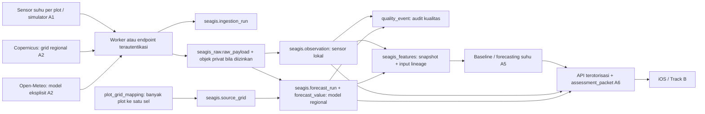

# Arsitektur A0

Status: rancangan v0.1.0, 21 Oktober 2026. A0 membangun kontrak dan penyimpanan. Endpoint ingestion, scheduler, QC operasional, feature builder, training, dan iOS belum diimplementasikan.

## Komponen yang sudah ada

Repo awal hanya memiliki `supabase/config.toml` dan ignore file. Tidak ada kode aplikasi, ingestion, data lapangan, atau model lama. Backend tujuan adalah project `kibztbeviortyvbedogg` di organisasi Seagis. PostgreSQL 17 dipakai untuk kompatibilitas lokal dan cloud.

Diagram menunjukkan alur target lintas fase. Tabel dan batas aksesnya dibuat di A0; kotak worker, QC otomatis, model, API, dan konsumen adalah komponen mendatang.

## Lifecycle dan identitas

1. **Raw:** `ingestion_run` mencatat dataset, versi adapter, request key, waktu mulai/selesai, serta status. `seagis_raw.raw_payload` menyimpan digest, waktu receipt, format, dan snapshot keterangan lisensi. Mode `object` menunjuk objek Storage privat; mode `metadata_only` mempertahankan provenance bila payload tidak boleh disimpan. Mode `inline` digunakan untuk fixture JSON sintetis. Baris raw tidak boleh diubah atau dihapus lewat operasi biasa.
2. **Normalized:** pembacaan sensor masuk `observation`, dengan FK sensor–plot–dataset dan satuan per field. Semua output model regional masuk `forecast_run`/`forecast_value`, termasuk analisis model (`run_kind=analysis`) bila nanti digunakan. Nilai regional tidak disalin menjadi observasi per plot. Grid memiliki dataset, versi, koordinat, dan kedalaman sendiri.
3. **Curated:** `feature_snapshot` menyimpan versi fitur/schema, cutoff `as_of`, JSON fitur, indikator konteks hilang, dan hash. `feature_input` memberi referensi FK ke input. Input hanya dapat ditambahkan saat draft. Sealing menggunakan hash manifest input yang diurutkan; snapshot sealed dan inputnya menjadi tetap. Perhitungan fitur baru dibangun pada A4.

Dataset, metode konversi, dan grid yang sudah merujuk data tidak boleh diganti maknanya. Buat identitas dataset/deployment baru untuk perubahan provider, versi, cadence, atau kedalaman sensor. Hanya flag enable/retention dataset dan status aktif sensor yang dapat diperbarui pada identitas tersebut.

## Semantik waktu

Semua waktu kontrak dikirim ISO 8601 UTC berakhiran `Z`; database menggunakan `timestamptz`. `source_timezone` pada dataset menyimpan konteks sumber.

| Field | Arti |
| --- | --- |
| `observed_at` | Waktu pengukuran sensor, dipertahankan saat paket terlambat |
| `valid_at` | Waktu representatif output forecast/model, bukan waktu fetch |
| `issued_at` | Waktu penerbitan provider yang terverifikasi; null bila tidak tersedia |
| `model_initialized_at` | Waktu inisialisasi model jika tersedia; berbeda dari publication/availability |
| `received_at` | Waktu worker menerima raw payload |
| `ingested_at` | Waktu record tersedia bagi sistem SEAGIS; tidak boleh mendahului receipt/upstream |
| `period_start_at`, `period_end_at` | Batas temporal mean/sum jika diketahui; status `unknown` menjaga ketidakpastian |
| `as_of` | Batas informasi yang diizinkan untuk snapshot fitur |

Observasi input harus sudah diukur **dan** di-ingest sebelum cutoff. Forecast boleh memiliki valid time di masa depan jika run dan nilainya sudah tersedia pada cutoff; waktu issue yang diketahui juga harus ≤ cutoff. Jika issuance tidak diketahui, waktu receipt/ingest menjadi batas konservatif ketersediaan, tanpa mengubahnya menjadi waktu issue. Join, pemilihan vintage, dan evaluasi backtest lengkap masih pekerjaan A3–A5.

## Idempotensi dan revisi

| Entitas | Kunci stabil |
| --- | --- |
| Ingestion | `(dataset_key, request_key)` untuk satu attempt logis/retry yang sama |
| Raw | `(ingestion_run_id, sha256)` |
| Observasi | `(sensor_id, parameter_code, source_record_key)`; key paket = boot ID + sequence |
| Forecast run | `(dataset_key, run_key)`; capture hash ditambahkan agar revisi tetap berbeda |
| Forecast value | `(forecast_run_id, source_grid_id, parameter_code, valid_at)` |
| Grid | `(dataset_key, grid_key, is_synthetic)`; grid key mencakup versi/sel/kedalaman |
| QC | `(ingestion_run_id, event_key)` |
| Snapshot sealed | `(plot_id, as_of, feature_version, input_manifest_sha256)` |

UNIQUE mencegah baris ganda. Adapter A1/A2 harus membandingkan isi/digest pada konflik: retry identik menjadi no-op, key sama dengan isi berbeda menjadi konflik yang dicatat. Jangan memakai upsert yang menimpa raw, observasi, atau forecast. Nilai yang dikoreksi membutuhkan record/revisi baru dengan lineage koreksi terdokumentasi; resolusi koreksi sensor belum diimplementasikan pada A0.

## Akses dan operasi

Schema `seagis`, `seagis_raw`, dan `seagis_features` tidak ditambahkan ke daftar schema Data API. Seluruh tabel memakai RLS; `anon`, `authenticated`, dan `PUBLIC` tidak memperoleh akses. `service_role` adalah akses backend tepercaya dengan kebijakan eksplisit; role ini melewati RLS pada Supabase, sehingga endpoint nanti wajib melakukan autentikasi perangkat dan otorisasi plot sebelum mengakses database. Kredensial backend tidak masuk iOS. Least-privilege login worker harus ditetapkan sebelum deployment A1; A0 tidak membuat password atau membuka akses publik.

Adapter Python dan training berat dijalankan di worker eksternal. Edge Functions/Cron hanya untuk pekerjaan ringan; belum ada scheduler atau bucket yang dibuat. Transaksi ingestion meliputi raw + normalized + QC, dengan error/status yang dapat diaudit. UI menampilkan stale/missing secara eksplisit. Indeks mendukung rentang waktu per plot, lookup grid/waktu, dan pemilihan run yang tersedia pada cutoff. Belum ada partitioning atau database kedua.

## Asumsi yang perlu diputuskan sebelum fase berikutnya

- Plot A/B dan simulator adalah data sintetis; lokasi lapangan dan kedalaman pemasangan belum tersedia.
- Layer Copernicus teratas sekitar 0,494 m adalah usulan regional, perlu validasi wet mask, jarak, dan representativitas per plot.
- Pin Open-Meteo `gfs_global` adalah pilihan awal untuk menghindari perubahan `best_match`; kesesuaian model di Pulau Tidung belum diuji.
- Entitlement API Open-Meteo dan izin retensi/redistribusi provider harus ditutup sebelum A2. Seluruh `real_ingestion_enabled=false`.
- Tidak ada probabilitas ice-ice, ambang biologis universal, atau klaim sensor lapangan tervalidasi dari A0.
