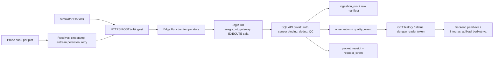

# Handover A1 — arsitektur data dan akses IoT

Tanggal: 22 Oktober 2026. Target: **Seagis / seagis-model-database** (`kibztbeviortyvbedogg`). Seluruh contoh dan data yang dikirim pada A1 berasal dari simulator. Sensor fisik belum dikomisioning.

## Alur yang tersedia



Simulator mengirim ke endpoint yang sama dengan perangkat nanti. Perangkat menyediakan pembacaan dan waktu pengukuran; server menetapkan plot, dataset dan `is_synthetic` berdasarkan sensor terdaftar. A0 feature/forecast tables tetap tersedia untuk fase berikutnya; A1 belum menghasilkan fitur atau prakiraan.

## Access point

Base URL development:

```text
https://kibztbeviortyvbedogg.supabase.co/functions/v1/temperature
```

| Method dan path sesudah base URL | Kredensial | Fungsi |
|---|---|---|
| `POST /v1/ingest` | Device token terikat ke satu sensor | Satu pembacaan per request |
| `GET /v1/plots/{plot_id}/temperature?from=...&to=...` | Reader token yang diberi akses plot | Riwayat, flags, gap dan pagination |
| `GET /v1/status` | Reader token | Waktu pengukuran terakhir, umur data, stale, jumlah masuk/rejected 24 jam |
| `GET /health` | Tidak diperlukan | Liveness proses dan versi; tidak membuktikan database sehat |

Authorization menggunakan `Bearer <device-or-reader-token>`. Token berbentuk opaque `sgi_...`; tidak memerlukan header `apikey`. JWT verification milik gateway Supabase dimatikan khusus fungsi ini karena autentikasi dilakukan SQL API. Semua route data tetap menolak token kosong/salah/kedaluwarsa. Reader token development adalah akses backend/operator; jangan menanam satu reader token bersama ke aplikasi produksi. Autentikasi pengguna iOS belum diintegrasikan pada A1.

## Paket perangkat

Kontrak executable: [iot-packet.schema.json](</Users/cindyram/Documents/Apple/Seagis-Model/contracts/iot-packet.schema.json>). Contoh berikut memerlukan UUID sensor hasil commissioning:

```json
{
  "schema_version": "1.0.0",
  "sensor_id": "<REGISTERED_SENSOR_UUID>",
  "boot_id": "receiver-boot-7b3b3f86",
  "sequence": 42,
  "observed_at": "2026-10-22T01:00:00Z",
  "water_temperature": 29.2,
  "unit": "degC",
  "value_status": "present"
}
```

- Semua delapan field wajib; field tambahan ditolak. `plot_id`, `is_synthetic` dan waktu penerimaan tidak diterima dari perangkat.
- `observed_at` adalah waktu pembacaan probe dalam UTC `Z`, dengan maksimal enam digit pecahan detik; bukan waktu upload. Tanggal/jam yang dinormalisasi seperti `24:00:00` ditolak.
- `boot_id` 1–64 karakter `[A-Za-z0-9._-]`; gunakan identitas baru untuk boot baru. Paket yang sudah diantrekan tetap membawa boot ID asalnya.
- `sequence` integer `0..4294967295`, meningkat dalam satu boot. Pasangan sensor + boot ID + sequence adalah identitas pembacaan sepanjang umur deployment. Jangan membuat sequence baru hanya karena retry.
- `water_temperature` adalah angka finite dalam `degC`. Bila alat secara eksplisit gagal membaca, kirim `null` dengan `value_status: "missing"`. Jam yang sama sekali tidak mengirim paket menjadi gap.
- Setiap paket berarti pembacaan instantaneous. Jika firmware nanti mengirim mean/min/max satu jam, semantik dan kontraknya perlu dibuat eksplisit terlebih dahulu.
- Maksimum body 8.192 byte, `Content-Type: application/json`. Satu receiver dengan beberapa sensor menggunakan token yang sesuai untuk masing-masing sensor; batch/multi-sensor token belum tersedia.

## Respons, antrean dan retry firmware

| HTTP / code | Tindakan receiver |
|---|---|
| `201 stored` | Simpan acknowledgement, keluarkan paket dari antrean. Periksa `quality_status`/`flags`; measurement yang ditolak QC tetap mendapat ID audit |
| `200 duplicate` | Paket sudah tersimpan; acknowledgement idempotent, ID observasi tetap sama |
| `409 packet_conflict` | Boot/sequence sama tetapi isi berubah; karantina paket, investigasi. Server tidak menimpa observasi |
| `400`, `413`, `415`, `422` | Perbaiki format/ukuran/unit/waktu; jangan retry tanpa perubahan yang benar |
| `401`, `403` | Periksa token, expiry/revocation, sensor ID dan status deployment; hentikan retry rutin |
| `429 rate_limited` | Tunggu `Retry-After` (60 detik) |
| `503 temporarily_unavailable` atau network timeout / `500/502/504` | Retry paket yang sama memakai backoff dan jitter, batas percobaan; pertahankan paket untuk dicoba kembali setelah koneksi pulih |
| `503 commissioning_disabled` | Minta operator menyelesaikan commissioning; retry otomatis tidak mengaktifkan sensor nyata |

Receiver perlu menyimpan paket secara persisten sebelum upload, termasuk timestamp dan pasangan boot/sequence, lalu menghapusnya sesudah acknowledgement. Jika koneksi putus setelah database commit, kirim ulang paket yang sama. Hash idempotensi membandingkan isi semantik; urutan key, format angka ekuivalen dan presisi timestamp ekuivalen tidak menggandakan observasi.

`request_id` berbeda untuk setiap respons/request, sedangkan `observation_id` dan `ingestion_run_id` tetap pada replay. Simpan request ID untuk troubleshooting. Simulator mempunyai retry terbatas empat percobaan untuk gangguan jaringan/HTTP sementara. Firmware perlu menjadwalkan percobaan berikutnya dari antrean setelah batas satu siklus habis; penyimpanan/daya hardware belum diuji.

## Data architecture

| Area | Isi dan hubungan |
|---|---|
| `seagis.plot` / `sensor` | Identitas deployment, pasangan sensor–plot, dataset, depth, status aktif dan sintetis |
| `seagis.ingestion_run` | Attempt logis per sensor/boot/sequence, versi adapter dan status transaksi |
| `seagis_raw.raw_payload` | Manifest raw, hash, waktu terima dan metadata. Payload sintetis disimpan sebagai JSONB |
| `seagis.observation` | Nilai native/normalized, unit, observed/ingested time, quality, FK raw dan ingestion |
| `seagis.quality_event` | Kejadian QC dengan versi policy dan threshold engineering yang digunakan |
| `seagis_api.packet_receipt` | Identitas paket, semantic digest dan ID observasi/run; append-only |
| `seagis_api.request_event` | Request terautentikasi, status dan code; tidak memuat token/body/IP |
| `seagis_api.credential` / `reader_plot` | Hash SHA-256 token acak, expiry/revocation, sensor binding atau hak baca per plot |
| `seagis_api.temperature_policy` | Konfigurasi pilot QC dan rate limit yang hanya dapat diubah operator |

Satu transaksi menyimpan ingestion → raw → observation → QC → receipt. Constraint dan advisory transaction lock mencegah duplikat saat request datang bersamaan. Key sama dengan isi berbeda menghasilkan `409`. Packet malformed atau akses yang ditolak dicatat sebagai request event bila actor terautentikasi; tidak dibuat observasi palsu. Kegagalan database menggulung balik transaksi dan tercatat sebagai error terstruktur Edge. Request tanpa autentikasi dan rate-limit denial hanya muncul pada log Edge untuk membatasi pertumbuhan log DB.

Synthetic raw memakai `jsonb_utf8_v1`: hash serialization JSONB UTF-8 PostgreSQL, dengan wire SHA-256 terpisah dalam metadata. Ini mempertahankan payload JSON secara semantik, bukan byte wire persis. Basis A0 `synthetic_json_canonical_v1` tetap didukung. Raw sensor nyata pada A1 hanya menyimpan hash wire/metadata, tanpa payload atau bucket. Mengaktifkan penyimpanan raw nyata memerlukan adapter/retensi yang ditinjau terpisah.

Semua schema aplikasi tetap privat dan memakai RLS. Role `seagis_iot_gateway` hanya mendapat schema usage dan EXECUTE `ingest/history/status`; tidak dapat membaca tabel credential/observasi, memanggil helper privat, atau TRUNCATE. SQL routines memakai `SECURITY DEFINER` dengan `search_path` tetap. Gateway terhubung melalui transaction pooler, tanpa named prepared statements, satu koneksi per instance, serta TLS dan hostname verification menggunakan Supabase root CA yang dipin. Password backend/PAT tidak diberikan kepada receiver.

## Quality dan query history

Policy `pilot-qc-1` adalah aturan engineering sementara, perlu disesuaikan dengan spesifikasi alat dan konteks pemasangan; tidak menyatakan kondisi biologis aman atau risiko ice-ice.

| Flag | Aturan A1 |
|---|---|
| `outside_pilot_envelope` | Nilai di luar −5..60°C → `rejected`; nilai asli tetap disimpan |
| `rapid_change` | Selisih >3°C dari pembacaan non-rejected sebelumnya dengan jarak ≤2 jam → `suspect` |
| `clock_in_future` | Timestamp >300 detik di depan penerimaan → `rejected` |
| `clock_ahead` | Timestamp sedikit di depan penerimaan → `suspect` |
| `delayed_packet` | Pengukuran berumur >7.200 detik saat diterima → `suspect` |
| `out_of_order` | Datang setelah pembacaan yang mempunyai observed time lebih baru; informasi audit |
| `gap_before` | Jarak >90 menit dari observed time terakhir saat paket diproses; informasi audit |
| `sensor_missing` | Nilai eksplisit null/missing → `suspect` |

History memakai `from` inklusif dan `to` eksklusif, keduanya UTC `Z`; maksimum tujuh hari per query. Limit default 200, maksimum 500; `next_cursor` adalah observation ID terakhir pada halaman, dikirim ulang sebagai query `cursor`. Urutan stabil `(observed_at,id)`; bukan snapshot isolation lintas request, sehingga backfill bersamaan sebaiknya diikuti re-query rentang.

`coverage` dihitung atas keseluruhan rentang, independen dari pagination, menggunakan bucket jam UTC. `missing_hours` berarti tidak ada paket; `unusable_hours` berarti ada paket tetapi semuanya missing/rejected. `hours_with_usable_values` mencakup accepted/suspect yang present dan bukan penetapan kelayakan training. Gunakan batas jam UTC penuh bila mengharapkan hitungan slot utuh. Tidak ada interpolasi atau pengisian nol. Status stale memakai waktu observasi terakhir yang present, non-rejected, dan tidak di masa depan; upload paket lama tidak membuat data segar.

## Handover untuk hardware yang belum ada

1. Pastikan probe/kalibrasi, titik/depth, catu daya, modem dan cakupan jaringan. Komunikasi probe–receiver serta jumlah receiver masih keputusan hardware tim.
2. Operator membuat plot dan deployment sensor **nyata baru**. Jangan mengubah label atau memakai ulang UUID Plot A/B dan simulator. Perubahan plot/depth memerlukan deployment sensor baru sesuai constraint A0.
3. Setelah metadata dan persetujuan data lapangan tersedia, operator mengaktifkan `real_ingestion_enabled` **khusus** dataset `sensor_temperature_v1`. Seluruh adapter regional tetap nonaktif.
4. Operator membuat device credential terikat ke sensor melalui `scripts/provision_a1.py device --sensor-id ... --out .env.device-...`. Berikan engineer hardware hanya base URL, sensor ID, device token dan expiry; bukan `.env.a1.gateway` atau reader token.
5. Implementasikan timestamp UTC, boot/sequence, antrean persisten dan penanganan respons di atas. Gunakan HTTPS dengan validasi sertifikat/hostname dan jam perangkat tersinkron; jangan memakai mode TLS insecure.
6. Uji pembacaan normal, koneksi terputus, kirim ulang, reboot dengan antrean lama, clock salah, dan token dicabut. Periksa history/status sebelum deployment lapangan.

A1 menyediakan interface yang sama untuk perangkat nanti. Uji fisik probe, firmware, daya, perendaman, radio dan modem tetap memerlukan hardware. [[Operasi A1 - Simulator dan Credentials]] memuat command provisioning, dummy data dan revocation; [[Review A1 - Temperature Vertical Slice]] memuat bukti pengujian/deployment.

Provenance snapshot: [[Provenance A1 - Paket Handover 22 Oktober 2026]].
