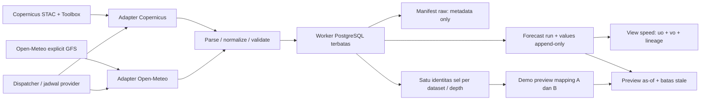

# A2 — Arsitektur ingestion lingkungan

## Cakupan

Copernicus Marine dan Open-Meteo masuk sebagai **keluaran model regional asli**, bukan pengukuran sensor air. Data IoT A1 tetap 136 observasi sintetis pada snapshot awal A2. Tidak ada training, alignment/interpolasi lintas sumber, atau probabilitas ice-ice pada A2.

Kode: `scripts/environmental/` menyediakan siklus `fetch`, `parse`, `normalize`, `validate`, `persist`. Dispatcher `scripts/ingest_environment.py` mengklaim lease per dataset sebelum network. Penyimpanan transaksi hanya melalui lima fungsi privat schema `seagis_environment`. Worker `seagis_environment_worker` tidak memiliki akses tabel, DDL, role administration, superuser, atau bypass RLS. Koneksi memakai IPv4 transaction pooler dan TLS `verify-full` dengan CA Supabase yang dipin.

## Dataset dan waktu

| Dataset key | Variabel | Versi / depth positif ke bawah | Cadence nilai / refresh |
|---|---|---|---|
| `cmems_salinity_6h` | `so` | 202406 / 0.49402499198913574 m | instantaneous 6 jam / harian |
| `cmems_currents_6h` | `uo`, `vo` | 202406 / 0.49402499198913574 m | instantaneous 6 jam / harian |
| `cmems_nutrients_daily` | `no3`, `po4` | 202311 / 0.4940253794193268 m | daily mean / harian |
| `open_meteo_gfs` | precipitation, wind speed/direction 10 m, cloud cover, UV, air temperature 2 m | explicit `gfs_global`, provider tidak memberi versi software per respons | output hourly / enam jam |

Exact product dan dataset ID berada di `config/a2_sources.json` dan registry database. Adapter memeriksa STAC ID/version, unit, cadence, depth, koordinat dan array yang diterima. Perubahan kontrak provider menghentikan ingestion agar membutuhkan review dan identitas dataset baru. Open-Meteo meminta UTC, m/s, Celsius, mm, nearest cell dan tanpa elevation downscaling. Grid yang dikembalikan API adalah identitas sampling; itu bukan bukti bahwa seluruh variabel GFS memakai native grid/resolusi yang identik.

Semua valid time disimpan UTC. Precipitation mencakup satu jam sebelum valid time. Nutrien tetap satu nilai harian dengan interval mean **unknown** jika batas interval tidak diberikan; tidak direplikasi menjadi 24 observasi. Salinitas mempertahankan `1e-3`; nutrien `mmol/m3`; tidak diasumsikan setara PSU/ppt atau diubah menjadi mg/L.

Copernicus yang diambil merupakan agregat mutable analysis/forecast: `run_kind=analysis_forecast_unspecified`. STAC `admp_updated_data` disimpan sebagai revisi katalog, **bukan** issue time. Respons Open-Meteo standar juga tidak mengikat data ke sebuah run/issue yang terverifikasi. Karena itu kedua adapter menyimpan `issued_at=null`, `model_initialized_at=null`, `issue_time_basis=unknown`. `generationtime_ms` tidak digunakan sebagai tanggal. A2 tidak mengklaim punya arsip forecast *as originally issued* sebelum pengambilan pertama.

## Vintage, availability, dan dedup

`forecast_run` dan `forecast_value` append-only. Run key adalah SHA-256 identitas semantik: dataset/version, sel, valid time, nilai/status/unit, parameter request dan revisi katalog Copernicus. Durasi pembuatan respons dan waktu pengambilan tidak masuk key. Respons berulang dengan isi sama menunjuk vintage pertama; perubahan isi/revisi menjadi run baru. Lease/advisory constraints dan unique keys melindungi retry dari duplikasi.

`ingested_at` memakai waktu server DB saat transaksi, bukan waktu model atau valid time. Preview as-of hanya memilih vintage yang sudah tersimpan pada cutoff dan belum melewati batas umur. Kegagalan provider tidak mengubah timestamp atau menciptakan nilai; status dapat `cached_after_failure`, lalu `stale_unusable`. Ini batas konservatif ketersediaan; pemeriksaan leakage dan alignment lengkap adalah A3.

Manifest `seagis_raw.raw_payload` menyimpan checksum, ukuran, request, katalog, selected depth, atribusi dan review lisensi. Retention A2 adalah **metadata_only**, tanpa full raw response/object. JSON Open-Meteo di-hash dari bytes respons; Copernicus memakai `toolbox_subset_json_v1`, yaitu JSON kanonik hasil ekstraksi Toolbox, bukan hash byte transfer NetCDF/Zarr asli. Normalized vintages tetap disimpan. Tidak ada raw bucket atau kredensial provider di database.

## Grid dan dua plot demo

A/B A1 belum punya koordinat survei dan tetap sintetis. Dua koordinat **contoh, belum disurvei**, dari konfigurasi POC terdahulu digunakan hanya dalam `seagis_environment.demo_grid_mapping`. Data regional dan grid tetap `is_synthetic=false`; mapping menandai plot sintetis dan `coordinate_status=example_not_surveyed` secara eksplisit.

Bridge ini terpisah dari `seagis.plot_grid_mapping`. Guard A0 untuk feature lineage tetap berlaku: bridge demo tidak dapat digunakan sebagai input feature/training. Jangan menganggap contoh ini lokasi farm tervalidasi. Commissioning lapangan perlu identitas plot nyata, koordinat/depth yang diverifikasi, dan mapping produksi baru.

Copernicus memilih satu sel geometris terdekat ke titik referensi rata-rata dua contoh plot dan menjaga sel itu untuk semua timestamp. Tidak ada pencarian sel valid yang berbeda per waktu atau interpolasi ke plot. Jika sel termask, nilai menjadi missing. Open-Meteo meminta kedua koordinat; bila sel yang dikembalikan sama, nilai hanya disimpan sekali. Jarak dihitung per plot untuk konteks regional, bukan klaim ketelitian lokal.

`seagis_environment.current_speed` menghitung `sqrt(uo² + vo²)` hanya untuk dua komponen present pada run, grid, dan valid time yang sama. View mempertahankan UUID kedua nilai; magnitude bukan observasi sensor baru atau model prediksi tambahan.

## Access point

- IoT A1 tetap melalui endpoint `temperature`; token device tidak memiliki akses worker A2.
- A2 backend: restricted PostgreSQL worker, credential lokal `.env.a2.worker` mode 0600. Jangan berikan DSN ini ke perangkat atau app.
- Preview untuk engineering: `ingest_environment.py preview --plot a|b [--as-of UTC]`, memanggil fungsi privat database; bukan endpoint publik iOS.
- Endpoint environmental context untuk aplikasi adalah cakupan A6. Integrasi data demo tidak menyatakan hardware sudah terpasang.

## Sumber metadata

- [Copernicus PHY: update harian sekitar 08:00 UTC](https://data.marine.copernicus.eu/product/GLOBAL_ANALYSISFORECAST_PHY_001_024/description).
- [Copernicus BGC: update harian sekitar 12:00 UTC](https://data.marine.copernicus.eu/product/GLOBAL_ANALYSISFORECAST_BGC_001_028/description).
- [Open-Meteo GFS: cadence dan resolusi](https://open-meteo.com/en/docs/gfs-api).
- [Open-Meteo: arti init/modification/availability serta eventual consistency](https://open-meteo.com/en/docs/model-updates).

Snapshot sumber dan batas lisensi: [licenses.md](</Users/cindyram/Documents/Second Brain/02-Projects/Challenge Final/Engineering/Seagis/A2/Lisensi A2 - Atribusi dan Retention.md>), [source_evidence_20261022.json](/Users/cindyram/Documents/Second Brain/02-Projects/Challenge Final/Engineering/Seagis/A2/source_evidence_20261022.json). Hasil cloud dan batas bukti: [review.md](</Users/cindyram/Documents/Second Brain/02-Projects/Challenge Final/Engineering/Seagis/A2/Review A2 - Hasil Ingestion Regional.md>).

## Provenance salinan

Sumber: [architecture.md](/Users/cindyram/Documents/Apple/Seagis-Model/docs/a2/architecture.md), commit `2474251`. Salinan catatan lengkap dengan tautan lokal yang disesuaikan. [[Provenance A2 - Paket Engineering 22 Oktober 2026]] · [[Indeks - Engineering]].
