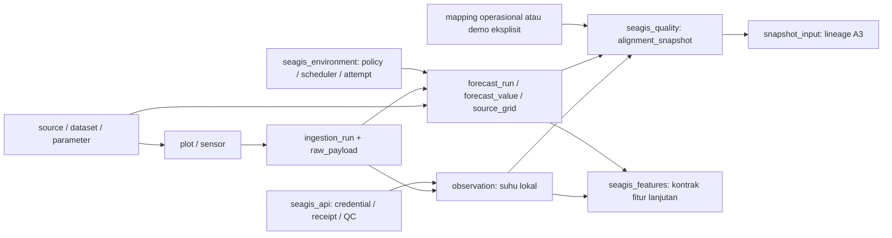
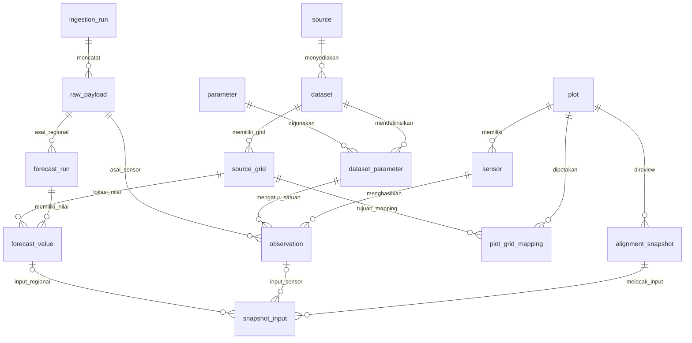

# Peta Database Supabase Seagis

Dokumentasi aktual database PostgreSQL project **seagis-model-database** (`kibztbeviortyvbedogg`): **28 tabel dan 1 view di 6 schema aplikasi**. Satu database menampung beberapa schema; hubungan yang dibahas di sini adalah foreign key antar tabel dalam database yang sama.

Metadata dibaca langsung dari catalog Supabase pada `2026-10-22T10:42:58.974431+00:00` (22 Oktober 2026, sekitar 17.43 WIB), melalui transaksi READ ONLY. Riwayat migrasi live: `0001`, `0002`, `0003`, `0004`, `0005`. Tidak membaca isi tabel atau menyalin token, password, maupun data pengguna ke dokumentasi. Snapshot ini mencakup schema aplikasi `seagis*`; schema bawaan Supabase seperti `auth`, `storage`, serta catalog PostgreSQL berada di luar inventaris ini.

## Mulai membaca

- Untuk contoh sensor “tambak A pukul 09.30 suhu 26°C”: mulai dari [[Supabase - seagis.plot|plot]], [[Supabase - seagis.sensor|sensor]], lalu [[Supabase - seagis.observation|observation]].
- Untuk menjawab asal nilai dan apakah pembacaannya layak dipakai: baca raw_payload, ingestion_run, quality_event dan temperature_policy.
- Untuk data regional yang menyertai sensor: baca source_grid, forecast_run dan forecast_value; hubungkan ke plot melalui mapping yang sesuai.
- Untuk hasil QC/alignment A3: baca seagis_quality. Untuk kontrak fitur lanjutan: baca seagis_features. Keduanya memiliki tujuan berbeda.

Suhu 26°C disimpan sebagai observasi dengan waktu dan provenance. Tabel QC maupun hasil alignment tidak otomatis mengartikan “rendah”, “aman”, “waspada” atau diagnosis ice-ice. Interpretasi biologis/FM memerlukan konteks dan knowledge yang tersendiri.

## Pembagian schema

| Schema | Peran | Tabel | View |
| --- | --- | --- | --- |
| `seagis` | Registri sumber, lokasi/sensor, observasi, nilai regional dan event kualitas. | 13 | 0 |
| `seagis_raw` | Manifest sumber raw, hash, lisensi dan pilihan retensi. | 1 | 0 |
| `seagis_api` | Credential, otorisasi, receipt paket, log dan QC API IoT A1. | 5 | 0 |
| `seagis_environment` | Kebijakan/state ingestion regional A2, mapping demo dan view arus. | 4 | 1 |
| `seagis_quality` | Versi kebijakan, hasil QC/alignment A3 dan lineage input. | 3 | 0 |
| `seagis_features` | Kontrak snapshot fitur dan lineage; terpisah dari hasil QC A3. | 2 | 0 |

## Jalur data utama

Diagram berikut menggambarkan aliran logis, bukan seluruh FK. Relasi fisik lengkap tercantum pada tabel di bawahnya dan halaman masing-masing objek.

## Inventaris dan catatan per tabel

| Objek | Jenis | Fungsi |
| --- | --- | --- |
| [[Supabase - seagis.dataset]] | Tabel | Registri produk/dataset: identitas provider, versi, cadence, resolusi, lisensi, dan izin ingestion. Dataset lokal dan model regional dibedakan lewat scope. |
| [[Supabase - seagis.dataset_parameter]] | Tabel | Penghubung dataset dan parameter; menyimpan nama variabel provider serta aturan konversi nilai/satuan ke kontrak Seagis. |
| [[Supabase - seagis.forecast_run]] | Tabel | Satu vintage/run model regional berikut asal ingestion/raw, jenis run dan waktu penerbitan yang diketahui. Nama forecast juga mencakup analysis dan analysis_forecast_unspecified. |
| [[Supabase - seagis.forecast_value]] | Tabel | Nilai parameter pada grid dan waktu berlaku dari satu run regional. Nilai ini merupakan konteks model regional; bukan pengukuran langsung di tambak. |
| [[Supabase - seagis.ingestion_run]] | Tabel | Catatan satu proses ingestion beserta identitas request, versi adapter, waktu, status dan penanda sintetis. Menjadi akar lineage data yang masuk. |
| [[Supabase - seagis.observation]] | Tabel | Nilai observasi sensor suhu air per plot dan waktu. Mempertahankan nilai asli/normalisasi, status ketersediaan, QC dan lineage raw. Tidak menyimpan kesimpulan biologis dari suhu. |
| [[Supabase - seagis.parameter]] | Tabel | Kamus parameter fisik/lingkungan dan satuan normalisasinya. Kode parameter menjadi kontrak lintas dataset. |
| [[Supabase - seagis.plot]] | Tabel | Identitas lokasi budidaya. Memisahkan lokasi contoh sintetis, belum disurvei, dan hasil survei; koordinat boleh belum diketahui. |
| [[Supabase - seagis.plot_grid_mapping]] | Tabel | Pemetaan operasional plot ke grid regional, dengan masa berlaku dan waktu pencatatan. Kelayakan kecocokan nyata/sintetis diperiksa lebih lanjut oleh guard aplikasi. |
| [[Supabase - seagis.quality_event]] | Tabel | Catatan event kualitas engineering pada ingestion, observasi atau nilai regional. Severity warning bukan label bahaya ice-ice. |
| [[Supabase - seagis.sensor]] | Tabel | Perangkat sensor suhu yang terikat ke plot, dataset dan parameter. Indeks parsial membatasi satu sensor suhu aktif per plot. |
| [[Supabase - seagis.source]] | Tabel | Katalog penyedia sumber data, beserta tautan dokumentasinya. Satu penyedia dapat memiliki beberapa dataset. |
| [[Supabase - seagis.source_grid]] | Tabel | Identitas sel/titik grid milik dataset regional, lengkap dengan koordinat, kedalaman, versi dan dasar identitas grid. |
| [[Supabase - seagis_api.credential]] | Tabel | Identitas akses device/reader: hash token, masa berlaku, pencabutan dan ikatan sensor untuk device. Tidak menyimpan token plaintext. Isi tabel tidak disalin ke dokumentasi. |
| [[Supabase - seagis_api.packet_receipt]] | Tabel | Bukti penerimaan paket sensor dan hash semantiknya, untuk idempotensi/deteksi konflik serta hubungan ke observation dan ingestion_run. |
| [[Supabase - seagis_api.reader_plot]] | Tabel | Daftar plot yang boleh diakses credential reader. Tabel penghubung credential dan plot; pemeriksaan jenis credential dilakukan pada jalur API. |
| [[Supabase - seagis_api.request_event]] | Tabel | Log request API yang dicatat rutin API: credential, sensor bila ada, HTTP status dan kode hasil. Bukan jaminan audit seluruh trafik karena ada cabang yang tidak dicatat. |
| [[Supabase - seagis_api.temperature_policy]] | Tabel | Konfigurasi tunggal QC engineering suhu dan batas operasional API: rentang nilai, langkah perubahan, toleransi waktu, stale dan rate limit. Angka ini bukan ambang biologis tervalidasi. |
| [[Supabase - seagis_environment.attempt]] | Tabel | Riwayat satu percobaan ingestion regional, beserta waktu, hasil/error dan run yang dihasilkan bila ada. ID juga digunakan dalam mekanisme lease worker. |
| [[Supabase - seagis_environment.current_speed]] | View | View turunan besar kecepatan arus sqrt(uo² + vo²), memasangkan komponen timur dan utara pada run, grid dan valid_at yang sama. Tidak menyimpan salinan baris hasil. |
| [[Supabase - seagis_environment.demo_grid_mapping]] | Tabel | Jembatan preview khusus plot A/B sintetis ke grid regional nyata dengan koordinat contoh belum disurvei. Terpisah dari mapping operasional agar konteks demo tidak berubah menjadi data lapangan. |
| [[Supabase - seagis_environment.policy]] | Tabel | Kebijakan ingestion per dataset regional: izin prototype, lisensi, atribusi, jadwal pembaruan, stale dan retention metadata_only. |
| [[Supabase - seagis_environment.schedule_state]] | Tabel | State mutable scheduler per dataset: lease, jadwal percobaan berikut, sukses terakhir, error dan hitungan kegagalan. Tabel ini bukan scheduler cloud yang berjalan sendiri. |
| [[Supabase - seagis_features.feature_input]] | Tabel | Lineage setiap input yang dipakai feature_snapshot: tepat satu observasi atau satu forecast_value per baris. |
| [[Supabase - seagis_features.feature_snapshot]] | Tabel | Kontrak penyimpanan fitur per plot dan cutoff as_of, dengan versi, status draft/sealed dan hash lineage. Keberadaan tabel tidak berarti pipeline fitur/model A4 sudah dijalankan. |
| [[Supabase - seagis_quality.alignment_snapshot]] | Tabel | Hasil QC dan alignment A3 per plot, mode dan rentang waktu. Body JSON menyimpan hasil review/coverage; berbeda dari feature_snapshot dan belum merupakan diagnosis atau prediksi penyakit. |
| [[Supabase - seagis_quality.policy]] | Tabel | Registri versi kebijakan QC/alignment A3, definisi JSON dan hash kebijakan/kode. Memungkinkan hasil ditelusuri ke versi pemeriksaannya. |
| [[Supabase - seagis_quality.snapshot_input]] | Tabel | Lineage input yang digunakan alignment_snapshot pada setiap waktu alignment. Setiap baris merujuk tepat satu observation atau forecast_value dan menyimpan source_ref yang konsisten. |
| [[Supabase - seagis_raw.raw_payload]] | Tabel | Manifest sumber raw: hash, waktu penerimaan, lisensi, metadata dan pilihan penyimpanan. Payload bisa inline, object reference, atau metadata_only; tidak selalu menyimpan bytes asli. |

## Diagram relasi inti

Diagram ER merangkum sebagian FK inti. Nama tanpa prefix di bawah berada pada schema seagis; raw_payload berada pada seagis_raw, sedangkan alignment_snapshot dan snapshot_input berada pada seagis_quality. Relasi opsional dan FK gabungan selengkapnya ada pada inventaris FK.

## Seluruh foreign key antar tabel

Arah: tabel anak menyimpan FK menuju identitas tabel induk. FK gabungan ditulis utuh: kolom dataset, unit dan is_synthetic ikut menjaga konsistensi, bukan sekadar ID UUID. Semua constraint di snapshot menggunakan perilaku referential action default PostgreSQL NO ACTION (tidak ada ON DELETE CASCADE yang dideklarasikan).

“Wajib” berarti semua kolom FK NOT NULL. Pada FK opsional dengan MATCH SIMPLE, adanya NULL pada bagian FK membuat pemeriksaan FK gabungan tidak dijalankan; CHECK/trigger dapat menambah aturan. “Maksimal 1 anak” di bawah hanya jika ada PK/unique penuh yang merupakan subset kolom FK; indeks parsial dan guard khusus dijelaskan pada catatan tabel. FK tidak mewajibkan sebuah induk mempunyai anak.

| Anak dan kolom FK | Induk dan kolom tujuan | Kewajiban / kardinalitas maksimum |
| --- | --- | --- |
| [[Supabase - seagis.dataset]] (source_key) | [[Supabase - seagis.source]] (source_key) | Wajib; 0..N anak per induk |
| [[Supabase - seagis.dataset_parameter]] (dataset_key) | [[Supabase - seagis.dataset]] (dataset_key) | Wajib; 0..N anak per induk |
| [[Supabase - seagis.dataset_parameter]] (parameter_code, unit) | [[Supabase - seagis.parameter]] (parameter_code, unit) | Wajib; 0..N anak per induk |
| [[Supabase - seagis.forecast_run]] (dataset_key, scope) | [[Supabase - seagis.dataset]] (dataset_key, scope) | Wajib; 0..N anak per induk |
| [[Supabase - seagis.forecast_run]] (raw_payload_id, ingestion_run_id, dataset_key, is_synthetic) | [[Supabase - seagis_raw.raw_payload]] (id, ingestion_run_id, dataset_key, is_synthetic) | Wajib; 0..N anak per induk |
| [[Supabase - seagis.forecast_value]] (dataset_key, parameter_code, native_unit, unit, conversion_code) | [[Supabase - seagis.dataset_parameter]] (dataset_key, parameter_code, native_unit, unit, conversion_code) | Wajib; 0..N anak per induk |
| [[Supabase - seagis.forecast_value]] (forecast_run_id, dataset_key, is_synthetic) | [[Supabase - seagis.forecast_run]] (id, dataset_key, is_synthetic) | Wajib; 0..N anak per induk |
| [[Supabase - seagis.forecast_value]] (source_grid_id, dataset_key, is_synthetic) | [[Supabase - seagis.source_grid]] (id, dataset_key, is_synthetic) | Wajib; 0..N anak per induk |
| [[Supabase - seagis.ingestion_run]] (dataset_key) | [[Supabase - seagis.dataset]] (dataset_key) | Wajib; 0..N anak per induk |
| [[Supabase - seagis.observation]] (dataset_key, parameter_code, native_unit, unit, conversion_code) | [[Supabase - seagis.dataset_parameter]] (dataset_key, parameter_code, native_unit, unit, conversion_code) | Wajib; 0..N anak per induk |
| [[Supabase - seagis.observation]] (raw_payload_id, ingestion_run_id, dataset_key, is_synthetic) | [[Supabase - seagis_raw.raw_payload]] (id, ingestion_run_id, dataset_key, is_synthetic) | Wajib; 0..N anak per induk |
| [[Supabase - seagis.observation]] (sensor_id, plot_id, dataset_key, is_synthetic) | [[Supabase - seagis.sensor]] (id, plot_id, dataset_key, is_synthetic) | Wajib; 0..N anak per induk |
| [[Supabase - seagis.plot_grid_mapping]] (plot_id, is_synthetic) | [[Supabase - seagis.plot]] (id, is_synthetic) | Wajib; 0..N anak per induk |
| [[Supabase - seagis.plot_grid_mapping]] (source_grid_id) | [[Supabase - seagis.source_grid]] (id) | Wajib; 0..N anak per induk |
| [[Supabase - seagis.quality_event]] (forecast_value_id, dataset_key, is_synthetic) | [[Supabase - seagis.forecast_value]] (id, dataset_key, is_synthetic) | Opsional / MATCH SIMPLE; 0..N anak per induk |
| [[Supabase - seagis.quality_event]] (ingestion_run_id, dataset_key, is_synthetic) | [[Supabase - seagis.ingestion_run]] (id, dataset_key, is_synthetic) | Wajib; 0..N anak per induk |
| [[Supabase - seagis.quality_event]] (observation_id, ingestion_run_id, dataset_key, is_synthetic) | [[Supabase - seagis.observation]] (id, ingestion_run_id, dataset_key, is_synthetic) | Opsional / MATCH SIMPLE; 0..N anak per induk |
| [[Supabase - seagis.sensor]] (dataset_key, parameter_code) | [[Supabase - seagis.dataset_parameter]] (dataset_key, parameter_code) | Wajib; 0..N anak per induk |
| [[Supabase - seagis.sensor]] (dataset_key, scope) | [[Supabase - seagis.dataset]] (dataset_key, scope) | Wajib; 0..N anak per induk |
| [[Supabase - seagis.sensor]] (plot_id, is_synthetic) | [[Supabase - seagis.plot]] (id, is_synthetic) | Wajib; 0..N anak per induk |
| [[Supabase - seagis.source_grid]] (dataset_key, scope) | [[Supabase - seagis.dataset]] (dataset_key, scope) | Wajib; 0..N anak per induk |
| [[Supabase - seagis_api.credential]] (sensor_id) | [[Supabase - seagis.sensor]] (id) | Opsional / MATCH SIMPLE; 0..N anak per induk |
| [[Supabase - seagis_api.packet_receipt]] (ingestion_run_id) | [[Supabase - seagis.ingestion_run]] (id) | Wajib; 0..N anak per induk |
| [[Supabase - seagis_api.packet_receipt]] (observation_id) | [[Supabase - seagis.observation]] (id) | Wajib; maksimal 1 anak per induk |
| [[Supabase - seagis_api.packet_receipt]] (sensor_id) | [[Supabase - seagis.sensor]] (id) | Wajib; 0..N anak per induk |
| [[Supabase - seagis_api.reader_plot]] (credential_id) | [[Supabase - seagis_api.credential]] (id) | Wajib; 0..N anak per induk |
| [[Supabase - seagis_api.reader_plot]] (plot_id) | [[Supabase - seagis.plot]] (id) | Wajib; 0..N anak per induk |
| [[Supabase - seagis_api.request_event]] (credential_id) | [[Supabase - seagis_api.credential]] (id) | Wajib; 0..N anak per induk |
| [[Supabase - seagis_api.request_event]] (sensor_id) | [[Supabase - seagis.sensor]] (id) | Opsional / MATCH SIMPLE; 0..N anak per induk |
| [[Supabase - seagis_environment.attempt]] (dataset_key) | [[Supabase - seagis_environment.policy]] (dataset_key) | Wajib; 0..N anak per induk |
| [[Supabase - seagis_environment.attempt]] (forecast_run_id) | [[Supabase - seagis.forecast_run]] (id) | Opsional / MATCH SIMPLE; 0..N anak per induk |
| [[Supabase - seagis_environment.demo_grid_mapping]] (dataset_key) | [[Supabase - seagis_environment.policy]] (dataset_key) | Wajib; 0..N anak per induk |
| [[Supabase - seagis_environment.demo_grid_mapping]] (plot_id, plot_is_synthetic) | [[Supabase - seagis.plot]] (id, is_synthetic) | Wajib; 0..N anak per induk |
| [[Supabase - seagis_environment.demo_grid_mapping]] (source_grid_id, dataset_key, grid_is_synthetic) | [[Supabase - seagis.source_grid]] (id, dataset_key, is_synthetic) | Wajib; 0..N anak per induk |
| [[Supabase - seagis_environment.policy]] (dataset_key) | [[Supabase - seagis.dataset]] (dataset_key) | Wajib; maksimal 1 anak per induk |
| [[Supabase - seagis_environment.schedule_state]] (dataset_key) | [[Supabase - seagis_environment.policy]] (dataset_key) | Wajib; maksimal 1 anak per induk |
| [[Supabase - seagis_environment.schedule_state]] (last_forecast_run_id) | [[Supabase - seagis.forecast_run]] (id) | Opsional / MATCH SIMPLE; 0..N anak per induk |
| [[Supabase - seagis_features.feature_input]] (forecast_value_id) | [[Supabase - seagis.forecast_value]] (id) | Opsional / MATCH SIMPLE; 0..N anak per induk |
| [[Supabase - seagis_features.feature_input]] (observation_id) | [[Supabase - seagis.observation]] (id) | Opsional / MATCH SIMPLE; 0..N anak per induk |
| [[Supabase - seagis_features.feature_input]] (snapshot_id) | [[Supabase - seagis_features.feature_snapshot]] (id) | Wajib; 0..N anak per induk |
| [[Supabase - seagis_features.feature_snapshot]] (plot_id, is_synthetic) | [[Supabase - seagis.plot]] (id, is_synthetic) | Wajib; 0..N anak per induk |
| [[Supabase - seagis_quality.alignment_snapshot]] (plot_id) | [[Supabase - seagis.plot]] (id) | Wajib; 0..N anak per induk |
| [[Supabase - seagis_quality.alignment_snapshot]] (policy_version) | [[Supabase - seagis_quality.policy]] (version) | Wajib; 0..N anak per induk |
| [[Supabase - seagis_quality.snapshot_input]] (forecast_value_id) | [[Supabase - seagis.forecast_value]] (id) | Opsional / MATCH SIMPLE; 0..N anak per induk |
| [[Supabase - seagis_quality.snapshot_input]] (observation_id) | [[Supabase - seagis.observation]] (id) | Opsional / MATCH SIMPLE; 0..N anak per induk |
| [[Supabase - seagis_quality.snapshot_input]] (snapshot_id) | [[Supabase - seagis_quality.alignment_snapshot]] (id) | Wajib; 0..N anak per induk |
| [[Supabase - seagis_raw.raw_payload]] (ingestion_run_id, dataset_key, is_synthetic) | [[Supabase - seagis.ingestion_run]] (id, dataset_key, is_synthetic) | Wajib; 0..N anak per induk |

## Aturan lintas tabel yang perlu dipahami

- **Sensor dan plot:** sensor terikat plot serta dataset; paling banyak satu sensor suhu aktif per plot. FK observasi gabungan menjaga plot/dataset/synthetic sesuai sensor.
- **Nilai dan satuan:** dataset_parameter mengikat parameter, satuan asli, satuan normalisasi dan kode konversi. NULL punya value_status; nilai hilang tidak sama dengan nol.
- **Lineage:** ingestion_run → raw_payload → observation atau forecast_run → forecast_value. Ada FK gabungan agar dataset dan status sintetis tidak tertukar.
- **Mapping:** plot_grid_mapping untuk jalur operasional; demo_grid_mapping secara eksplisit menghubungkan plot sintetis A/B ke grid nyata untuk preview. Koordinat demo bukan hasil survei.
- **Waktu:** observed_at, valid_at, issued_at, ingested_at, recorded_at dan as_of punya arti berbeda. Alignment historis tidak boleh memakai data/mapping yang belum diketahui pada cutoff.
- **Input snapshot:** feature_input dan snapshot_input masing-masing memilih tepat satu observation atau forecast_value. Kedua tabel lineage mengacu ke jenis snapshot yang berbeda.
- **QC dan model:** temperature_policy dan quality_event adalah pemeriksaan engineering. alignment_snapshot A3 berisi review kualitas/alignment; feature_snapshot adalah kontrak fitur terpisah. Belum ada tabel knowledge literatur/FM yang ditambahkan oleh tugas dokumentasi ini.
- **Immutability:** trigger append-only/guard tercantum pada halaman tiap tabel; sebagian tabel state/configuration memang dapat berubah. Jangan menganggap semua tabel append-only.

## Akses dan penggunaan dashboard

Semua 28 tabel aplikasi pada snapshot mengaktifkan RLS. View current_speed memakai security_invoker pada source A2. Pilih schema yang sesuai pada [Table Editor project](https://supabase.com/dashboard/project/kibztbeviortyvbedogg/editor); keberadaan tabel tidak berarti role anon/authenticated berhak membacanya.

Jalur runtime A1/A2/A3 menggunakan rutin privat dan role terbatas sebagaimana [[Handover A1 - Arsitektur Data dan Akses IoT]], [[Handover A2 - Ingestion Lingkungan dan Grid]] dan [[Handover A3 - Kualitas dan Alignment Data]]. Policy RLS per tabel tercantum dalam catatan ini; seluruh grants/role membership tidak diaudit ulang. Dokumentasi tidak berisi token atau contoh credential nyata.

## Sumber dan pemutakhiran

- [Snapshot metadata terstruktur](schema-metadata-20261022.json): objek, kolom, constraint, indeks, user trigger, policy RLS, definisi view dan nomor migrasi. Tidak menyertakan row data.
- Source migrasi: [Seagis-Model/supabase/migrations](https://github.com/De-Voeux/Seagis-Model/tree/e93a005c95d746e6e33a6adad12760e94eb8a6cf/supabase/migrations), commit `e93a005c95d746e6e33a6adad12760e94eb8a6cf`.
- Migrasi 0001 membentuk A0; 0002 menambah API A1 dan memperbarui constraint raw; 0003 menambah A2 dan memperbarui raw/run_kind; 0004 memperbarui fungsi kegagalan provider; 0005 menambah A3 dan recorded_at pada mapping operasional.
- Definisi live adalah acuan struktur snapshot ini. Penjelasan fungsi tabel berasal dari migrasi dan handover; status isi/row count dan hasil runtime terbaru tidak diperiksa dalam tugas ini.
- Untuk memperbarui, ambil ulang metadata catalog secara read-only, bandingkan semua kolom/FK/constraint/trigger dan riwayat migrasi, lalu revisi catatan terkait. Catatan ini tidak tersinkron otomatis.

Kembali ke [[Indeks - Engineering]].
