# SEAGIS Database Architecture, Data Lineage and Data Contracts

Version: 1.0.0 | Date: 2026-10-27 (Asia/Jakarta) | Catalog snapshot: 2026-10-22T10:42:58.974431+00:00

Status: code and historical-snapshot audit; current runtime UNVERIFIED.

| Label | Meaning |
| --- | --- |
| VERIFIED | Supported by code/inspection; not automatically runtime-tested |
| INFERRED | Reasonable interpretation, not explicit |
| UNVERIFIED | Not established with available access |
| NOT FOUND | Searched within the stated scope, not found |
| NOT APPLICABLE | Does not apply to component |

## Table of Contents

1. [Executive Summary](#1-executive-summary)
2. [System and Data Architecture Overview](#2-system-and-data-architecture-overview)
3. [Database and Schema Inventory](#3-database-and-schema-inventory)
4. [Complete Data Dictionary](#4-complete-data-dictionary)
5. [Entity Relationships](#5-entity-relationships)
6. [Data Sources and Lineage](#6-data-sources-and-lineage)
7. [Data Ingestion and Transformation](#7-data-ingestion-and-transformation)
8. [Data Contracts](#8-data-contracts)
9. [Data Lifecycle](#9-data-lifecycle)
10. [Application Data Dependencies](#10-application-data-dependencies)
11. [Data Quality and Architecture Audit](#11-data-quality-and-architecture-audit)
12. [Glossary](#12-glossary)
13. [Appendices](#13-appendices)

## 1 Executive Summary

This audit documents inspectable backend and local consumer implementations as of 27 October 2026. One application PostgreSQL database is identified through migrations and the 22 October catalog snapshot: six schemas, 28 tables, one view, 268 columns including nine view columns, and 47 foreign keys. No live database connection was made in this audit; row counts, current deployment, backups, role membership and post-snapshot drift remain UNVERIFIED.

A1 accepts temperature packets through an Edge Function, derives identity from credentials, atomically stores raw provenance, observations and QC, and recognizes semantic retries. A2 retrieves four regional datasets, preserves grids and native cadence, and persists immutable vintages. A3 builds hourly contexts using availability cutoffs and saves review snapshots. A3 is not a production feature builder or disease model.

The `Seagis` app and `AppPOC` prototype were inspected as separate consumers. `MockAssessmentRepository` produces synthetic assessments; no production assessment-to-backend-database path was found. QC state, regional model data and demo content must not be treated as ice-ice diagnosis or probability. This document is a versioned code-audit reference, not production-system certification.

Main implementation evidence: `Seagis-Model/supabase/migrations/0001_initial_schema.sql:1`; `Seagis-Model/supabase/migrations/0002_temperature_api.sql:1`; `Seagis-Model/supabase/migrations/0003_environment_ingestion.sql:1`; `Seagis-Model/supabase/migrations/0004_provider_update_status.sql:1`; `Seagis-Model/supabase/migrations/0005_quality_alignment.sql:1`.


## 2 System and Data Architecture Overview

PostgreSQL/Supabase is the backend persistence defined by code. Schema `seagis` owns registries, observations, forecasts and provenance; `seagis_raw` holds raw manifests; `seagis_api` bounds the IoT gateway; `seagis_environment` manages regional workers; `seagis_quality` stores QC reviews; `seagis_features` supplies containers not connected to a production feature builder. Supabase internal schemas such as auth/storage are not inventoried as application-owned: current catalog access is unavailable and they must not be assumed empty.

Python retrieves provider data outside the database. A2/A3 workers call stored functions through psycopg; the TypeScript handler invokes only ingest/history/status functions. No ORM was found on these paths. Mutation transactions live in SQL functions; fetch claiming is a separate transaction from persistence so network calls do not hold a database transaction.

The diagram contains disconnected components: the iOS mock has no backend edge. Future integration remains UNVERIFIED. Production Core ML, distributed caches, warehouses, queues and search indexes were NOT FOUND in inspected implementation files; that does not establish absence of services outside these checkouts.

Main implementation evidence: `Seagis-Model/supabase/migrations/0001_initial_schema.sql:1`; `Seagis-Model/supabase/migrations/0002_temperature_api.sql:1`; `Seagis-Model/supabase/migrations/0003_environment_ingestion.sql:1`; `Seagis-Model/supabase/migrations/0004_provider_update_status.sql:1`; `Seagis-Model/supabase/migrations/0005_quality_alignment.sql:1`.

Reproducible diagram: `assets/diagrams/architecture.mmd`.


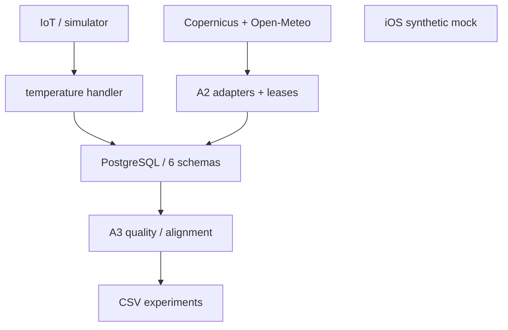


## 3 Database and Schema Inventory

PostgreSQL/Supabase is the backend persistence defined by code. Schema `seagis` owns registries, observations, forecasts and provenance; `seagis_raw` holds raw manifests; `seagis_api` bounds the IoT gateway; `seagis_environment` manages regional workers; `seagis_quality` stores QC reviews; `seagis_features` supplies containers not connected to a production feature builder. Supabase internal schemas such as auth/storage are not inventoried as application-owned: current catalog access is unavailable and they must not be assumed empty.

Python retrieves provider data outside the database. A2/A3 workers call stored functions through psycopg; the TypeScript handler invokes only ingest/history/status functions. No ORM was found on these paths. Mutation transactions live in SQL functions; fetch claiming is a separate transaction from persistence so network calls do not hold a database transaction.

The diagram contains disconnected components: the iOS mock has no backend edge. Future integration remains UNVERIFIED. Production Core ML, distributed caches, warehouses, queues and search indexes were NOT FOUND in inspected implementation files; that does not establish absence of services outside these checkouts.

| Store | Evidence status | Purpose/environment | Owner | Scope | Access | Authority | Evidence |
| --- | --- | --- | --- | --- | --- | --- | --- |
| PostgreSQL / Supabase | VERIFIED (repository + historical catalog) | Backend; current deployment environment UNVERIFIED | Seagis-Model | Registry, sensor, regional, QC, features | read/write via stored functions | Authoritative for persisted records; not a diagnosis | `Seagis-Model/supabase/migrations/0001_initial_schema.sql:1` |
| Supabase Storage | configured / UNVERIFIED usage | Local storage enabled; object_uri supported, application bucket NOT FOUND | Supabase | objects / metadata_only | configured | Not proven to be active raw storage | `Seagis-Model/supabase/config.toml:116` |
| UserDefaults / launch arguments | VERIFIED code | Preference/debug UI access; not plot persistence | AppPOC | initialPlot / initialFarmer / skipCaptureSteps / detailDay | read preference/argument values | Not authoritative for backend data | `AppPOC/POCApp/Features/FarmMap/ViewModels/FarmMapViewModel.swift:1` |
| legacy AR files | VERIFIED cleanup code | ar-site.json/ar-site.worldmap are only deleted at new AR session start | AppPOC | legacy local AR files | best-effort delete; active writer NOT FOUND | Not active persistence | `AppPOC/POCApp/Features/PlotCapture/ViewModels/ARCaptureViewModel.swift:1` |
| JSON / CSV files | VERIFIED code | Synthetic fixtures, policies, experimental exports and manifests | Python scripts | fixtures/config/export | file read/write | Authoritative only for that capture/fixture version | `Seagis-Model/scripts/export_experiment_csv.py:1` |
| in-memory Swift arrays | VERIFIED code | Prototype state; lost at process termination | AppPOC | Farmer / CultivationPlot | array append/remove | Local demo state | `AppPOC/POCApp/Shared/Data/FarmStore.swift:1` |

Supabase auth, vector and analytics service defaults appear in local configuration, but active application buckets/indexes/datasets are not established. These are service settings, not additional application databases. All table row counts are UNVERIFIED; fixtures are not used as runtime estimates.

| Schema | Objects | Tables | Views | Access boundary |
| --- | --- | --- | --- | --- |
| seagis | dataset, dataset_parameter, forecast_run, forecast_value, ingestion_run, observation, parameter, plot, plot_grid_mapping, quality_event, sensor, source, source_grid | 13 | 0 | Access through backend routines; live membership UNVERIFIED |
| seagis_api | credential, packet_receipt, reader_plot, request_event, temperature_policy | 5 | 0 | Access through backend routines; live membership UNVERIFIED |
| seagis_environment | attempt, current_speed, demo_grid_mapping, policy, schedule_state | 4 | 1 | Access through backend routines; live membership UNVERIFIED |
| seagis_features | feature_input, feature_snapshot | 2 | 0 | Access through backend routines; live membership UNVERIFIED |
| seagis_quality | alignment_snapshot, policy, snapshot_input | 3 | 0 | Access through backend routines; live membership UNVERIFIED |
| seagis_raw | raw_payload | 1 | 0 | Access through backend routines; live membership UNVERIFIED |

| Physical object | Purpose | Columns | Evidence |
| --- | --- | --- | --- |
| seagis.dataset | Dataset identity, version, cadence, licence and ingestion gates. | 15 | `Seagis-Model/supabase/migrations/0001_initial_schema.sql:17` |
| seagis.dataset_parameter | Source-variable to parameter contract and conversion rules. | 9 | `Seagis-Model/supabase/migrations/0001_initial_schema.sql:43` |
| seagis.forecast_run | Regional model capture/vintage; unknown publication time remains null. | 13 | `Seagis-Model/supabase/migrations/0001_initial_schema.sql:216` |
| seagis.forecast_value | Parameter value per run, grid and valid time; not duplicated per plot. | 20 | `Seagis-Model/supabase/migrations/0001_initial_schema.sql:241` |
| seagis.ingestion_run | Audit of a logical ingestion and its completion state. | 9 | `Seagis-Model/supabase/migrations/0001_initial_schema.sql:94` |
| seagis.observation | Local sensor water-temperature readings, retaining native values, QC and raw lineage. | 19 | `Seagis-Model/supabase/migrations/0001_initial_schema.sql:184` |
| seagis.parameter | Registry of parameters and normalized units. | 3 | `Seagis-Model/supabase/migrations/0001_initial_schema.sql:36` |
| seagis.plot | Plot identity and survey status; nullable coordinates are not evidence of a surveyed location. | 8 | `Seagis-Model/supabase/migrations/0001_initial_schema.sql:58` |
| seagis.plot_grid_mapping | Operational plot-to-grid mapping with effective and recorded times. | 10 | `Seagis-Model/supabase/migrations/0001_initial_schema.sql:152` |
| seagis.quality_event | Append-only QC log for ingestion or one measurement. | 11 | `Seagis-Model/supabase/migrations/0001_initial_schema.sql:273` |
| seagis.sensor | Temperature sensor deployment identity, plot, depth and active state. | 10 | `Seagis-Model/supabase/migrations/0001_initial_schema.sql:73` |
| seagis.source | Registry of dataset providers. | 3 | `Seagis-Model/supabase/migrations/0001_initial_schema.sql:11` |
| seagis.source_grid | Regional cell and depth-layer identity; distinct from cultivation plots. | 10 | `Seagis-Model/supabase/migrations/0001_initial_schema.sql:135` |
| seagis_api.credential | API actor identity using token hashes, expiry and revocation. | 8 | `Seagis-Model/supabase/migrations/0002_temperature_api.sql:27` |
| seagis_api.packet_receipt | Sensor-packet idempotency key and semantic digest. | 6 | `Seagis-Model/supabase/migrations/0002_temperature_api.sql:53` |
| seagis_api.reader_plot | Plot allowlist for a reader credential. | 2 | `Seagis-Model/supabase/migrations/0002_temperature_api.sql:39` |
| seagis_api.request_event | Authenticated API response audit and rate-limit basis. | 6 | `Seagis-Model/supabase/migrations/0002_temperature_api.sql:44` |
| seagis_api.temperature_policy | Pilot engineering QC settings and request limit; not disease thresholds. | 8 | `Seagis-Model/supabase/migrations/0002_temperature_api.sql:67` |
| seagis_environment.attempt | Audit of a fetch attempt, including duplicate and abandoned outcomes. | 7 | `Seagis-Model/supabase/migrations/0003_environment_ingestion.sql:57` |
| seagis_environment.current_speed | Current-magnitude view joining components from the same run, grid and time. | 9 | `Seagis-Model/supabase/migrations/0003_environment_ingestion.sql:89` |
| seagis_environment.demo_grid_mapping | Bridge from two fictional plots to real grids for preview, not training authorization. | 11 | `Seagis-Model/supabase/migrations/0003_environment_ingestion.sql:69` |
| seagis_environment.policy | Regional fetch, licence, scheduler cadence, staleness and retention policy. | 11 | `Seagis-Model/supabase/migrations/0003_environment_ingestion.sql:16` |
| seagis_environment.schedule_state | Mutable lease, due time, backoff and last-success state. | 9 | `Seagis-Model/supabase/migrations/0003_environment_ingestion.sql:45` |
| seagis_features.feature_input | Foreign-key input lineage and cutoff guards for feature snapshots. | 4 | `Seagis-Model/supabase/migrations/0001_initial_schema.sql:320` |
| seagis_features.feature_snapshot | Draft/sealed feature container with cutoff and hashes; no production builder found. | 12 | `Seagis-Model/supabase/migrations/0001_initial_schema.sql:301` |
| seagis_quality.alignment_snapshot | Immutable hourly QC/alignment document; always training_authorized=false. | 11 | `Seagis-Model/supabase/migrations/0005_quality_alignment.sql:21` |
| seagis_quality.policy | Immutable registry of QC policy versions and builder code hashes. | 5 | `Seagis-Model/supabase/migrations/0005_quality_alignment.sql:14` |
| seagis_quality.snapshot_input | Per-hour measurement lineage of an alignment snapshot. | 5 | `Seagis-Model/supabase/migrations/0005_quality_alignment.sql:35` |
| seagis_raw.raw_payload | Immutable raw manifest: digest, hash basis, licence and retention mode. | 14 | `Seagis-Model/supabase/migrations/0001_initial_schema.sql:110` |


## 4 Complete Data Dictionary

The seagis.finite_float domain is double precision rejecting NaN and infinity; column nullability remains separate. value_status present requires numbers; nonpresent statuses require null; valid_value/valid_support and SQL guards enforce cross-field rules. Precipitation mm is a one-hour total, salinity 1e-3 is not automatically PSU/ppt, and wind direction is the direction from in degrees. Type/null/default/constraint/index metadata comes from the 22 October catalog snapshot; SQL definitions were checked against the local 0001–0005 migration chain. View rows have no physical PK/FK even when fields originate from measurements. Examples are synthetic illustrations, not necessarily a valid complete INSERT row. NOT APPLICABLE means an attribute does not apply; UNVERIFIED means a specific meaning or derivation is not established.

### 4.1 `seagis.dataset`

Dataset identity, version, cadence, licence and ingestion gates.

| Attribute | Definition |
| --- | --- |
| Schema / domain | seagis |
| Kind | table |
| Primary key | PRIMARY KEY (dataset_key) |
| Unique | UNIQUE (dataset_key, scope) |
| Rows | UNVERIFIED |
| Writer | supabase/seed.sql; scripts/provision_a1.py; scripts/deploy_a2.py |
| Reader | A1 ingest/history; A2 persist/preview; A3 source_bundle |
| Authority | Records of this domain; registry/config or original source remains traceable |
| Lifecycle | See triggers below and Chapter 9; no verified TTL |
| Evidence | `Seagis-Model/supabase/migrations/0001_initial_schema.sql:17` |

#### `seagis.dataset.dataset_key`

| Attribute | Definition |
| --- | --- |
| Type / nullable | `text` / false |
| Default / generated | NOT FOUND |
| PK / unique | true / true (single-column uniqueness; composites below) |
| FK | NOT APPLICABLE |
| Business / technical meaning | Registered dataset key |
| Valid values / checks | No local CHECK; cross-table constraints/triggers still apply |
| Units / time | NOT APPLICABLE; NOT APPLICABLE |
| Example | See enum/CHECK below; arbitrary example is not presumed valid |
| Origin / transformation | `Seagis-Model/supabase/migrations/0001_initial_schema.sql:511` → `'sensor_temperature_v1'` (VERIFIED) |
| Mutation / consumers | Follows table triggers/mutations, not assumed mutable; A1 ingest/history; A2 persist/preview; A3 source_bundle |
| Evidence | `Seagis-Model/supabase/migrations/0001_initial_schema.sql:17`; catalog seagis.dataset.dataset_key |

#### `seagis.dataset.source_key`

| Attribute | Definition |
| --- | --- |
| Type / nullable | `text` / false |
| Default / generated | NOT FOUND |
| PK / unique | false / false (single-column uniqueness; composites below) |
| FK | FOREIGN KEY (source_key) REFERENCES seagis.source(source_key) |
| Business / technical meaning | Source-provider key |
| Valid values / checks | No local CHECK; cross-table constraints/triggers still apply |
| Units / time | NOT APPLICABLE; NOT APPLICABLE |
| Example | See enum/CHECK below; arbitrary example is not presumed valid |
| Origin / transformation | `Seagis-Model/supabase/migrations/0001_initial_schema.sql:511` → `'sensor'` (VERIFIED) |
| Mutation / consumers | Follows table triggers/mutations, not assumed mutable; A1 ingest/history; A2 persist/preview; A3 source_bundle |
| Evidence | `Seagis-Model/supabase/migrations/0001_initial_schema.sql:17`; catalog seagis.dataset.source_key |

#### `seagis.dataset.provider_product_id`

| Attribute | Definition |
| --- | --- |
| Type / nullable | `text` / true |
| Default / generated | NOT FOUND |
| PK / unique | false / false (single-column uniqueness; composites below) |
| FK | NOT APPLICABLE |
| Business / technical meaning | Provider product identity when available |
| Valid values / checks | No local CHECK; cross-table constraints/triggers still apply |
| Units / time | NOT APPLICABLE; NOT APPLICABLE |
| Example | See enum/CHECK below; arbitrary example is not presumed valid |
| Origin / transformation | `Seagis-Model/supabase/migrations/0001_initial_schema.sql:511` → `NULL` (VERIFIED) |
| Mutation / consumers | Follows table triggers/mutations, not assumed mutable; A1 ingest/history; A2 persist/preview; A3 source_bundle |
| Evidence | `Seagis-Model/supabase/migrations/0001_initial_schema.sql:17`; catalog seagis.dataset.provider_product_id |

#### `seagis.dataset.provider_dataset_id`

| Attribute | Definition |
| --- | --- |
| Type / nullable | `text` / false |
| Default / generated | NOT FOUND |
| PK / unique | false / false (single-column uniqueness; composites below) |
| FK | NOT APPLICABLE |
| Business / technical meaning | Original provider dataset identity |
| Valid values / checks | No local CHECK; cross-table constraints/triggers still apply |
| Units / time | NOT APPLICABLE; NOT APPLICABLE |
| Example | See enum/CHECK below; arbitrary example is not presumed valid |
| Origin / transformation | `Seagis-Model/supabase/migrations/0001_initial_schema.sql:511` → `'seagis-water-temperature'` (VERIFIED) |
| Mutation / consumers | Follows table triggers/mutations, not assumed mutable; A1 ingest/history; A2 persist/preview; A3 source_bundle |
| Evidence | `Seagis-Model/supabase/migrations/0001_initial_schema.sql:17`; catalog seagis.dataset.provider_dataset_id |

#### `seagis.dataset.dataset_version`

| Attribute | Definition |
| --- | --- |
| Type / nullable | `text` / false |
| Default / generated | NOT FOUND |
| PK / unique | false / false (single-column uniqueness; composites below) |
| FK | NOT APPLICABLE |
| Business / technical meaning | Pinned dataset version |
| Valid values / checks | No local CHECK; cross-table constraints/triggers still apply |
| Units / time | NOT APPLICABLE; NOT APPLICABLE |
| Example | See enum/CHECK below; arbitrary example is not presumed valid |
| Origin / transformation | `Seagis-Model/supabase/migrations/0001_initial_schema.sql:511` → `'v1'` (VERIFIED) |
| Mutation / consumers | Follows table triggers/mutations, not assumed mutable; A1 ingest/history; A2 persist/preview; A3 source_bundle |
| Evidence | `Seagis-Model/supabase/migrations/0001_initial_schema.sql:17`; catalog seagis.dataset.dataset_version |

#### `seagis.dataset.scope`

| Attribute | Definition |
| --- | --- |
| Type / nullable | `text` / false |
| Default / generated | NOT FOUND |
| PK / unique | false / false (single-column uniqueness; composites below) |
| FK | NOT APPLICABLE |
| Business / technical meaning | Origin: local_sensor or regional_model |
| Valid values / checks | CHECK (scope = ANY (ARRAY['local_sensor'::text, 'regional_model'::text])) |
| Units / time | NOT APPLICABLE; NOT APPLICABLE |
| Example | See enum/CHECK below; arbitrary example is not presumed valid |
| Origin / transformation | `Seagis-Model/supabase/migrations/0001_initial_schema.sql:511` → `'local_sensor'` (VERIFIED) |
| Mutation / consumers | Follows table triggers/mutations, not assumed mutable; A1 ingest/history; A2 persist/preview; A3 source_bundle |
| Evidence | `Seagis-Model/supabase/migrations/0001_initial_schema.sql:17`; catalog seagis.dataset.scope |

#### `seagis.dataset.native_cadence_seconds`

| Attribute | Definition |
| --- | --- |
| Type / nullable | `integer` / false |
| Default / generated | NOT FOUND |
| PK / unique | false / false (single-column uniqueness; composites below) |
| FK | NOT APPLICABLE |
| Business / technical meaning | Native sample cadence, distinct from fetch interval |
| Valid values / checks | CHECK (native_cadence_seconds > 0) |
| Units / time | s; NOT APPLICABLE |
| Example | 1 |
| Origin / transformation | `Seagis-Model/supabase/migrations/0001_initial_schema.sql:511` → `3600` (VERIFIED) |
| Mutation / consumers | Follows table triggers/mutations, not assumed mutable; A1 ingest/history; A2 persist/preview; A3 source_bundle |
| Evidence | `Seagis-Model/supabase/migrations/0001_initial_schema.sql:17`; catalog seagis.dataset.native_cadence_seconds |

#### `seagis.dataset.resolution_lat_deg`

| Attribute | Definition |
| --- | --- |
| Type / nullable | `seagis.finite_float` / true |
| Default / generated | NOT FOUND |
| PK / unique | false / false (single-column uniqueness; composites below) |
| FK | NOT APPLICABLE |
| Business / technical meaning | Latitude resolution in degrees when known |
| Valid values / checks | CHECK (resolution_lat_deg::double precision > 0::double precision) |
| Units / time | degree; NOT APPLICABLE |
| Example | 1 |
| Origin / transformation | `Seagis-Model/supabase/migrations/0001_initial_schema.sql:511` → `NULL` (VERIFIED) |
| Mutation / consumers | Follows table triggers/mutations, not assumed mutable; A1 ingest/history; A2 persist/preview; A3 source_bundle |
| Evidence | `Seagis-Model/supabase/migrations/0001_initial_schema.sql:17`; catalog seagis.dataset.resolution_lat_deg |

#### `seagis.dataset.resolution_lon_deg`

| Attribute | Definition |
| --- | --- |
| Type / nullable | `seagis.finite_float` / true |
| Default / generated | NOT FOUND |
| PK / unique | false / false (single-column uniqueness; composites below) |
| FK | NOT APPLICABLE |
| Business / technical meaning | Longitude resolution in degrees when known |
| Valid values / checks | CHECK (resolution_lon_deg::double precision > 0::double precision) |
| Units / time | degree; NOT APPLICABLE |
| Example | 1 |
| Origin / transformation | `Seagis-Model/supabase/migrations/0001_initial_schema.sql:511` → `NULL` (VERIFIED) |
| Mutation / consumers | Follows table triggers/mutations, not assumed mutable; A1 ingest/history; A2 persist/preview; A3 source_bundle |
| Evidence | `Seagis-Model/supabase/migrations/0001_initial_schema.sql:17`; catalog seagis.dataset.resolution_lon_deg |

#### `seagis.dataset.source_timezone`

| Attribute | Definition |
| --- | --- |
| Type / nullable | `text` / false |
| Default / generated | `'UTC'::text` |
| PK / unique | false / false (single-column uniqueness; composites below) |
| FK | NOT APPLICABLE |
| Business / technical meaning | Original source timezone context |
| Valid values / checks | No local CHECK; cross-table constraints/triggers still apply |
| Units / time | NOT APPLICABLE; NOT APPLICABLE |
| Example | See enum/CHECK below; arbitrary example is not presumed valid |
| Origin / transformation | caller / SQL default → `'UTC'::text` (VERIFIED) |
| Mutation / consumers | Follows table triggers/mutations, not assumed mutable; A1 ingest/history; A2 persist/preview; A3 source_bundle |
| Evidence | `Seagis-Model/supabase/migrations/0001_initial_schema.sql:17`; catalog seagis.dataset.source_timezone |

#### `seagis.dataset.licence_url`

| Attribute | Definition |
| --- | --- |
| Type / nullable | `text` / false |
| Default / generated | NOT FOUND |
| PK / unique | false / false (single-column uniqueness; composites below) |
| FK | NOT APPLICABLE |
| Business / technical meaning | Source licence reference |
| Valid values / checks | No local CHECK; cross-table constraints/triggers still apply |
| Units / time | NOT APPLICABLE; NOT APPLICABLE |
| Example | See enum/CHECK below; arbitrary example is not presumed valid |
| Origin / transformation | `Seagis-Model/supabase/migrations/0001_initial_schema.sql:511` → `'project-owned://sensor-data'` (VERIFIED) |
| Mutation / consumers | Follows table triggers/mutations, not assumed mutable; A1 ingest/history; A2 persist/preview; A3 source_bundle |
| Evidence | `Seagis-Model/supabase/migrations/0001_initial_schema.sql:17`; catalog seagis.dataset.licence_url |

#### `seagis.dataset.attribution`

| Attribute | Definition |
| --- | --- |
| Type / nullable | `text` / false |
| Default / generated | NOT FOUND |
| PK / unique | false / false (single-column uniqueness; composites below) |
| FK | NOT APPLICABLE |
| Business / technical meaning | Attribution text to preserve |
| Valid values / checks | No local CHECK; cross-table constraints/triggers still apply |
| Units / time | NOT APPLICABLE; NOT APPLICABLE |
| Example | See enum/CHECK below; arbitrary example is not presumed valid |
| Origin / transformation | `Seagis-Model/supabase/migrations/0001_initial_schema.sql:511` → `'SEAGIS; simulated until hardware commissioning'` (VERIFIED) |
| Mutation / consumers | Follows table triggers/mutations, not assumed mutable; A1 ingest/history; A2 persist/preview; A3 source_bundle |
| Evidence | `Seagis-Model/supabase/migrations/0001_initial_schema.sql:17`; catalog seagis.dataset.attribution |

#### `seagis.dataset.raw_storage_permitted`

| Attribute | Definition |
| --- | --- |
| Type / nullable | `boolean` / false |
| Default / generated | `false` |
| PK / unique | false / false (single-column uniqueness; composites below) |
| FK | NOT APPLICABLE |
| Business / technical meaning | Raw-retention permission gate, not proof of stored objects |
| Valid values / checks | No local CHECK; cross-table constraints/triggers still apply |
| Units / time | NOT APPLICABLE; NOT APPLICABLE |
| Example | true |
| Origin / transformation | caller / SQL default → `false` (VERIFIED) |
| Mutation / consumers | Follows table triggers/mutations, not assumed mutable; A1 ingest/history; A2 persist/preview; A3 source_bundle |
| Evidence | `Seagis-Model/supabase/migrations/0001_initial_schema.sql:17`; catalog seagis.dataset.raw_storage_permitted |

#### `seagis.dataset.real_ingestion_enabled`

| Attribute | Definition |
| --- | --- |
| Type / nullable | `boolean` / false |
| Default / generated | `false` |
| PK / unique | false / false (single-column uniqueness; composites below) |
| FK | NOT APPLICABLE |
| Business / technical meaning | Gate for nonsynthetic ingestion |
| Valid values / checks | No local CHECK; cross-table constraints/triggers still apply |
| Units / time | NOT APPLICABLE; NOT APPLICABLE |
| Example | true |
| Origin / transformation | caller / SQL default → `false` (VERIFIED) |
| Mutation / consumers | Follows table triggers/mutations, not assumed mutable; A1 ingest/history; A2 persist/preview; A3 source_bundle |
| Evidence | `Seagis-Model/supabase/migrations/0001_initial_schema.sql:17`; catalog seagis.dataset.real_ingestion_enabled |

#### `seagis.dataset.metadata_checked_at`

| Attribute | Definition |
| --- | --- |
| Type / nullable | `timestamp with time zone` / false |
| Default / generated | NOT FOUND |
| PK / unique | false / false (single-column uniqueness; composites below) |
| FK | NOT APPLICABLE |
| Business / technical meaning | Time source metadata was checked |
| Valid values / checks | No local CHECK; cross-table constraints/triggers still apply |
| Units / time | NOT APPLICABLE; timestamptz instant, PostgreSQL microsecond precision; display follows session. A1 API requires UTC Z. next_attempt_at supports -infinity. |
| Example | 2026-10-21T12:00:00Z |
| Origin / transformation | `Seagis-Model/supabase/migrations/0001_initial_schema.sql:511` → `'2026-10-21T00:00:00Z'` (VERIFIED) |
| Mutation / consumers | Follows table triggers/mutations, not assumed mutable; A1 ingest/history; A2 persist/preview; A3 source_bundle |
| Evidence | `Seagis-Model/supabase/migrations/0001_initial_schema.sql:17`; catalog seagis.dataset.metadata_checked_at |

#### Constraints, indexes and triggers

**constraints**

```sql
UNIQUE (dataset_key, scope);
CHECK (native_cadence_seconds > 0);
PRIMARY KEY (dataset_key);
CHECK (resolution_lat_deg::double precision > 0::double precision);
CHECK (resolution_lon_deg::double precision > 0::double precision);
CHECK (scope = ANY (ARRAY['local_sensor'::text, 'regional_model'::text]));
FOREIGN KEY (source_key) REFERENCES seagis.source(source_key);
```

**indexes**

```sql
CREATE UNIQUE INDEX dataset_dataset_key_scope_key ON seagis.dataset USING btree (dataset_key, scope);
CREATE UNIQUE INDEX dataset_pkey ON seagis.dataset USING btree (dataset_key);
```

**triggers**

```sql
CREATE TRIGGER guard_dataset_identity BEFORE UPDATE ON seagis.dataset FOR EACH ROW EXECUTE FUNCTION seagis.guard_dataset_identity();
```

RLS at snapshot: True; FORCE RLS: False. Current membership/grants UNVERIFIED.

### 4.2 `seagis.dataset_parameter`

Source-variable to parameter contract and conversion rules.

| Attribute | Definition |
| --- | --- |
| Schema / domain | seagis |
| Kind | table |
| Primary key | PRIMARY KEY (dataset_key, parameter_code) |
| Unique | UNIQUE (dataset_key, parameter_code, native_unit, unit, conversion_code) |
| Rows | UNVERIFIED |
| Writer | supabase/seed.sql; scripts/provision_a1.py; scripts/deploy_a2.py |
| Reader | A1 ingest/history; A2 persist/preview; A3 source_bundle |
| Authority | Records of this domain; registry/config or original source remains traceable |
| Lifecycle | See triggers below and Chapter 9; no verified TTL |
| Evidence | `Seagis-Model/supabase/migrations/0001_initial_schema.sql:43` |

#### `seagis.dataset_parameter.dataset_key`

| Attribute | Definition |
| --- | --- |
| Type / nullable | `text` / false |
| Default / generated | NOT FOUND |
| PK / unique | true / false (single-column uniqueness; composites below) |
| FK | FOREIGN KEY (dataset_key) REFERENCES seagis.dataset(dataset_key) |
| Business / technical meaning | Registered dataset key |
| Valid values / checks | No local CHECK; cross-table constraints/triggers still apply |
| Units / time | NOT APPLICABLE; NOT APPLICABLE |
| Example | See enum/CHECK below; arbitrary example is not presumed valid |
| Origin / transformation | `Seagis-Model/supabase/migrations/0001_initial_schema.sql:532` → `'sensor_temperature_v1'` (VERIFIED) |
| Mutation / consumers | Follows table triggers/mutations, not assumed mutable; A1 ingest/history; A2 persist/preview; A3 source_bundle |
| Evidence | `Seagis-Model/supabase/migrations/0001_initial_schema.sql:43`; catalog seagis.dataset_parameter.dataset_key |

#### `seagis.dataset_parameter.parameter_code`

| Attribute | Definition |
| --- | --- |
| Type / nullable | `text` / false |
| Default / generated | NOT FOUND |
| PK / unique | true / false (single-column uniqueness; composites below) |
| FK | FOREIGN KEY (parameter_code, unit) REFERENCES seagis.parameter(parameter_code, unit) |
| Business / technical meaning | Environmental parameter identity |
| Valid values / checks | No local CHECK; cross-table constraints/triggers still apply |
| Units / time | NOT APPLICABLE; NOT APPLICABLE |
| Example | See enum/CHECK below; arbitrary example is not presumed valid |
| Origin / transformation | `Seagis-Model/supabase/migrations/0001_initial_schema.sql:532` → `'water_temperature'` (VERIFIED) |
| Mutation / consumers | Follows table triggers/mutations, not assumed mutable; A1 ingest/history; A2 persist/preview; A3 source_bundle |
| Evidence | `Seagis-Model/supabase/migrations/0001_initial_schema.sql:43`; catalog seagis.dataset_parameter.parameter_code |

#### `seagis.dataset_parameter.source_variable`

| Attribute | Definition |
| --- | --- |
| Type / nullable | `text` / false |
| Default / generated | NOT FOUND |
| PK / unique | false / false (single-column uniqueness; composites below) |
| FK | NOT APPLICABLE |
| Business / technical meaning | Original provider variable name |
| Valid values / checks | No local CHECK; cross-table constraints/triggers still apply |
| Units / time | NOT APPLICABLE; NOT APPLICABLE |
| Example | See enum/CHECK below; arbitrary example is not presumed valid |
| Origin / transformation | `Seagis-Model/supabase/migrations/0001_initial_schema.sql:532` → `'water_temperature'` (VERIFIED) |
| Mutation / consumers | Follows table triggers/mutations, not assumed mutable; A1 ingest/history; A2 persist/preview; A3 source_bundle |
| Evidence | `Seagis-Model/supabase/migrations/0001_initial_schema.sql:43`; catalog seagis.dataset_parameter.source_variable |

#### `seagis.dataset_parameter.native_unit`

| Attribute | Definition |
| --- | --- |
| Type / nullable | `text` / false |
| Default / generated | NOT FOUND |
| PK / unique | false / false (single-column uniqueness; composites below) |
| FK | NOT APPLICABLE |
| Business / technical meaning | Original unit before normalization |
| Valid values / checks | No local CHECK; cross-table constraints/triggers still apply |
| Units / time | NOT APPLICABLE; NOT APPLICABLE |
| Example | See enum/CHECK below; arbitrary example is not presumed valid |
| Origin / transformation | `Seagis-Model/supabase/migrations/0001_initial_schema.sql:532` → `'degC'` (VERIFIED) |
| Mutation / consumers | Follows table triggers/mutations, not assumed mutable; A1 ingest/history; A2 persist/preview; A3 source_bundle |
| Evidence | `Seagis-Model/supabase/migrations/0001_initial_schema.sql:43`; catalog seagis.dataset_parameter.native_unit |

#### `seagis.dataset_parameter.unit`

| Attribute | Definition |
| --- | --- |
| Type / nullable | `text` / false |
| Default / generated | NOT FOUND |
| PK / unique | false / false (single-column uniqueness; composites below) |
| FK | FOREIGN KEY (parameter_code, unit) REFERENCES seagis.parameter(parameter_code, unit) |
| Business / technical meaning | Normalized value unit from registry |
| Valid values / checks | No local CHECK; cross-table constraints/triggers still apply |
| Units / time | NOT APPLICABLE; NOT APPLICABLE |
| Example | See enum/CHECK below; arbitrary example is not presumed valid |
| Origin / transformation | `Seagis-Model/supabase/migrations/0001_initial_schema.sql:532` → `'degC'` (VERIFIED) |
| Mutation / consumers | Follows table triggers/mutations, not assumed mutable; A1 ingest/history; A2 persist/preview; A3 source_bundle |
| Evidence | `Seagis-Model/supabase/migrations/0001_initial_schema.sql:43`; catalog seagis.dataset_parameter.unit |

#### `seagis.dataset_parameter.conversion_code`

| Attribute | Definition |
| --- | --- |
| Type / nullable | `text` / false |
| Default / generated | NOT FOUND |
| PK / unique | false / false (single-column uniqueness; composites below) |
| FK | NOT APPLICABLE |
| Business / technical meaning | Unit-conversion method identity |
| Valid values / checks | No local CHECK; cross-table constraints/triggers still apply |
| Units / time | NOT APPLICABLE; NOT APPLICABLE |
| Example | See enum/CHECK below; arbitrary example is not presumed valid |
| Origin / transformation | `Seagis-Model/supabase/migrations/0001_initial_schema.sql:532` → `'identity'` (VERIFIED) |
| Mutation / consumers | Follows table triggers/mutations, not assumed mutable; A1 ingest/history; A2 persist/preview; A3 source_bundle |
| Evidence | `Seagis-Model/supabase/migrations/0001_initial_schema.sql:43`; catalog seagis.dataset_parameter.conversion_code |

#### `seagis.dataset_parameter.conversion_factor`

| Attribute | Definition |
| --- | --- |
| Type / nullable | `seagis.finite_float` / false |
| Default / generated | `1` |
| PK / unique | false / false (single-column uniqueness; composites below) |
| FK | NOT APPLICABLE |
| Business / technical meaning | Multiplier in value=native_value*factor+offset |
| Valid values / checks | CHECK (conversion_factor::double precision <> 0::double precision) |
| Units / time | NOT APPLICABLE; NOT APPLICABLE |
| Example | 1 |
| Origin / transformation | caller / SQL default → `1` (VERIFIED) |
| Mutation / consumers | Follows table triggers/mutations, not assumed mutable; A1 ingest/history; A2 persist/preview; A3 source_bundle |
| Evidence | `Seagis-Model/supabase/migrations/0001_initial_schema.sql:43`; catalog seagis.dataset_parameter.conversion_factor |

#### `seagis.dataset_parameter.conversion_offset`

| Attribute | Definition |
| --- | --- |
| Type / nullable | `seagis.finite_float` / false |
| Default / generated | `0` |
| PK / unique | false / false (single-column uniqueness; composites below) |
| FK | NOT APPLICABLE |
| Business / technical meaning | Offset after multiplying by factor |
| Valid values / checks | No local CHECK; cross-table constraints/triggers still apply |
| Units / time | NOT APPLICABLE; NOT APPLICABLE |
| Example | 1 |
| Origin / transformation | caller / SQL default → `0` (VERIFIED) |
| Mutation / consumers | Follows table triggers/mutations, not assumed mutable; A1 ingest/history; A2 persist/preview; A3 source_bundle |
| Evidence | `Seagis-Model/supabase/migrations/0001_initial_schema.sql:43`; catalog seagis.dataset_parameter.conversion_offset |

#### `seagis.dataset_parameter.temporal_support`

| Attribute | Definition |
| --- | --- |
| Type / nullable | `text` / false |
| Default / generated | NOT FOUND |
| PK / unique | false / false (single-column uniqueness; composites below) |
| FK | NOT APPLICABLE |
| Business / technical meaning | Temporal support: instantaneous, mean or sum |
| Valid values / checks | CHECK (temporal_support = ANY (ARRAY['instantaneous'::text, 'mean'::text, 'sum'::text])) |
| Units / time | NOT APPLICABLE; NOT APPLICABLE |
| Example | See enum/CHECK below; arbitrary example is not presumed valid |
| Origin / transformation | `Seagis-Model/supabase/migrations/0001_initial_schema.sql:532` → `'instantaneous'` (VERIFIED) |
| Mutation / consumers | Follows table triggers/mutations, not assumed mutable; A1 ingest/history; A2 persist/preview; A3 source_bundle |
| Evidence | `Seagis-Model/supabase/migrations/0001_initial_schema.sql:43`; catalog seagis.dataset_parameter.temporal_support |

#### Constraints, indexes and triggers

**constraints**

```sql
CHECK (conversion_factor::double precision <> 0::double precision);
FOREIGN KEY (dataset_key) REFERENCES seagis.dataset(dataset_key);
UNIQUE (dataset_key, parameter_code, native_unit, unit, conversion_code);
FOREIGN KEY (parameter_code, unit) REFERENCES seagis.parameter(parameter_code, unit);
PRIMARY KEY (dataset_key, parameter_code);
CHECK (temporal_support = ANY (ARRAY['instantaneous'::text, 'mean'::text, 'sum'::text]));
```

**indexes**

```sql
CREATE UNIQUE INDEX dataset_parameter_dataset_key_parameter_code_native_unit_un_key ON seagis.dataset_parameter USING btree (dataset_key, parameter_code, native_unit, unit, conversion_code);
CREATE UNIQUE INDEX dataset_parameter_pkey ON seagis.dataset_parameter USING btree (dataset_key, parameter_code);
```

**triggers**

```sql
CREATE TRIGGER append_only BEFORE DELETE OR UPDATE ON seagis.dataset_parameter FOR EACH ROW EXECUTE FUNCTION seagis.reject_mutation();
```

RLS at snapshot: True; FORCE RLS: False. Current membership/grants UNVERIFIED.

### 4.3 `seagis.forecast_run`

Regional model capture/vintage; unknown publication time remains null.

| Attribute | Definition |
| --- | --- |
| Schema / domain | seagis |
| Kind | table |
| Primary key | PRIMARY KEY (id) |
| Unique | UNIQUE (dataset_key, run_key); UNIQUE (id, dataset_key, is_synthetic) |
| Rows | UNVERIFIED |
| Writer | seagis_environment.persist; A0 fixtures |
| Reader | seagis_environment.preview/current_speed; A3 source_bundle; CSV exporter |
| Authority | Records of this domain; registry/config or original source remains traceable |
| Lifecycle | See triggers below and Chapter 9; no verified TTL |
| Evidence | `Seagis-Model/supabase/migrations/0001_initial_schema.sql:216` |

#### `seagis.forecast_run.id`

| Attribute | Definition |
| --- | --- |
| Type / nullable | `uuid` / false |
| Default / generated | `gen_random_uuid()` |
| PK / unique | true / true (single-column uniqueness; composites below) |
| FK | NOT APPLICABLE |
| Business / technical meaning | Row identity under the table primary key |
| Valid values / checks | No local CHECK; cross-table constraints/triggers still apply |
| Units / time | NOT APPLICABLE; NOT APPLICABLE |
| Example | 00000000-0000-4000-8000-000000000001 |
| Origin / transformation | DB default / explicit UUID → `gen_random_uuid()` (VERIFIED) |
| Mutation / consumers | Follows table triggers/mutations, not assumed mutable; seagis_environment.preview/current_speed; A3 source_bundle; CSV exporter |
| Evidence | `Seagis-Model/supabase/migrations/0001_initial_schema.sql:216`; catalog seagis.forecast_run.id |

#### `seagis.forecast_run.dataset_key`

| Attribute | Definition |
| --- | --- |
| Type / nullable | `text` / false |
| Default / generated | NOT FOUND |
| PK / unique | false / false (single-column uniqueness; composites below) |
| FK | FOREIGN KEY (dataset_key, scope) REFERENCES seagis.dataset(dataset_key, scope); FOREIGN KEY (raw_payload_id, ingestion_run_id, dataset_key, is_synthetic) REFERENCES seagis_raw.raw_payload(id, ingestion_run_id, dataset_key, is_synthetic) |
| Business / technical meaning | Registered dataset key |
| Valid values / checks | No local CHECK; cross-table constraints/triggers still apply |
| Units / time | NOT APPLICABLE; NOT APPLICABLE |
| Example | See enum/CHECK below; arbitrary example is not presumed valid |
| Origin / transformation | `Seagis-Model/supabase/migrations/0003_environment_ingestion.sql:168` → `s.dataset_key` (VERIFIED) |
| Mutation / consumers | Follows table triggers/mutations, not assumed mutable; seagis_environment.preview/current_speed; A3 source_bundle; CSV exporter |
| Evidence | `Seagis-Model/supabase/migrations/0001_initial_schema.sql:216`; catalog seagis.forecast_run.dataset_key |

#### `seagis.forecast_run.scope`

| Attribute | Definition |
| --- | --- |
| Type / nullable | `text` / false |
| Default / generated | `'regional_model'::text` |
| PK / unique | false / false (single-column uniqueness; composites below) |
| FK | FOREIGN KEY (dataset_key, scope) REFERENCES seagis.dataset(dataset_key, scope) |
| Business / technical meaning | Origin: local_sensor or regional_model |
| Valid values / checks | CHECK (scope = 'regional_model'::text) |
| Units / time | NOT APPLICABLE; NOT APPLICABLE |
| Example | See enum/CHECK below; arbitrary example is not presumed valid |
| Origin / transformation | caller / SQL default → `'regional_model'::text` (VERIFIED) |
| Mutation / consumers | Follows table triggers/mutations, not assumed mutable; seagis_environment.preview/current_speed; A3 source_bundle; CSV exporter |
| Evidence | `Seagis-Model/supabase/migrations/0001_initial_schema.sql:216`; catalog seagis.forecast_run.scope |

#### `seagis.forecast_run.ingestion_run_id`

| Attribute | Definition |
| --- | --- |
| Type / nullable | `uuid` / false |
| Default / generated | NOT FOUND |
| PK / unique | false / false (single-column uniqueness; composites below) |
| FK | FOREIGN KEY (raw_payload_id, ingestion_run_id, dataset_key, is_synthetic) REFERENCES seagis_raw.raw_payload(id, ingestion_run_id, dataset_key, is_synthetic) |
| Business / technical meaning | Source ingestion reference |
| Valid values / checks | No local CHECK; cross-table constraints/triggers still apply |
| Units / time | NOT APPLICABLE; NOT APPLICABLE |
| Example | 00000000-0000-4000-8000-000000000001 |
| Origin / transformation | `Seagis-Model/supabase/migrations/0003_environment_ingestion.sql:168` → `ing` (VERIFIED) |
| Mutation / consumers | Follows table triggers/mutations, not assumed mutable; seagis_environment.preview/current_speed; A3 source_bundle; CSV exporter |
| Evidence | `Seagis-Model/supabase/migrations/0001_initial_schema.sql:216`; catalog seagis.forecast_run.ingestion_run_id |

#### `seagis.forecast_run.raw_payload_id`

| Attribute | Definition |
| --- | --- |
| Type / nullable | `uuid` / false |
| Default / generated | NOT FOUND |
| PK / unique | false / false (single-column uniqueness; composites below) |
| FK | FOREIGN KEY (raw_payload_id, ingestion_run_id, dataset_key, is_synthetic) REFERENCES seagis_raw.raw_payload(id, ingestion_run_id, dataset_key, is_synthetic) |
| Business / technical meaning | Source raw-manifest reference |
| Valid values / checks | No local CHECK; cross-table constraints/triggers still apply |
| Units / time | NOT APPLICABLE; NOT APPLICABLE |
| Example | 00000000-0000-4000-8000-000000000001 |
| Origin / transformation | `Seagis-Model/supabase/migrations/0003_environment_ingestion.sql:168` → `raw_id` (VERIFIED) |
| Mutation / consumers | Follows table triggers/mutations, not assumed mutable; seagis_environment.preview/current_speed; A3 source_bundle; CSV exporter |
| Evidence | `Seagis-Model/supabase/migrations/0001_initial_schema.sql:216`; catalog seagis.forecast_run.raw_payload_id |

#### `seagis.forecast_run.is_synthetic`

| Attribute | Definition |
| --- | --- |
| Type / nullable | `boolean` / false |
| Default / generated | NOT FOUND |
| PK / unique | false / false (single-column uniqueness; composites below) |
| FK | FOREIGN KEY (raw_payload_id, ingestion_run_id, dataset_key, is_synthetic) REFERENCES seagis_raw.raw_payload(id, ingestion_run_id, dataset_key, is_synthetic) |
| Business / technical meaning | Synthetic provenance flag, separate from QC |
| Valid values / checks | No local CHECK; cross-table constraints/triggers still apply |
| Units / time | NOT APPLICABLE; NOT APPLICABLE |
| Example | true |
| Origin / transformation | `Seagis-Model/supabase/migrations/0003_environment_ingestion.sql:168` → `false` (VERIFIED) |
| Mutation / consumers | Follows table triggers/mutations, not assumed mutable; seagis_environment.preview/current_speed; A3 source_bundle; CSV exporter |
| Evidence | `Seagis-Model/supabase/migrations/0001_initial_schema.sql:216`; catalog seagis.forecast_run.is_synthetic |

#### `seagis.forecast_run.run_key`

| Attribute | Definition |
| --- | --- |
| Type / nullable | `text` / false |
| Default / generated | NOT FOUND |
| PK / unique | false / false (single-column uniqueness; composites below) |
| FK | NOT APPLICABLE |
| Business / technical meaning | Semantic capture identity per dataset |
| Valid values / checks | No local CHECK; cross-table constraints/triggers still apply |
| Units / time | NOT APPLICABLE; NOT APPLICABLE |
| Example | See enum/CHECK below; arbitrary example is not presumed valid |
| Origin / transformation | `Seagis-Model/supabase/migrations/0003_environment_ingestion.sql:168` → `batch->>'run_key'` (VERIFIED) |
| Mutation / consumers | Follows table triggers/mutations, not assumed mutable; seagis_environment.preview/current_speed; A3 source_bundle; CSV exporter |
| Evidence | `Seagis-Model/supabase/migrations/0001_initial_schema.sql:216`; catalog seagis.forecast_run.run_key |

#### `seagis.forecast_run.run_kind`

| Attribute | Definition |
| --- | --- |
| Type / nullable | `text` / false |
| Default / generated | NOT FOUND |
| PK / unique | false / false (single-column uniqueness; composites below) |
| FK | NOT APPLICABLE |
| Business / technical meaning | forecast, analysis or analysis_forecast_unspecified |
| Valid values / checks | CHECK (run_kind = ANY (ARRAY['forecast'::text, 'analysis'::text, 'analysis_forecast_unspecified'::text])) |
| Units / time | NOT APPLICABLE; NOT APPLICABLE |
| Example | See enum/CHECK below; arbitrary example is not presumed valid |
| Origin / transformation | `Seagis-Model/supabase/migrations/0003_environment_ingestion.sql:168` → `CASE WHEN d.source_key='copernicus' THEN 'analysis_forecast_unspecified' ELSE 'forecast' END` (VERIFIED) |
| Mutation / consumers | Follows table triggers/mutations, not assumed mutable; seagis_environment.preview/current_speed; A3 source_bundle; CSV exporter |
| Evidence | `Seagis-Model/supabase/migrations/0001_initial_schema.sql:216`; catalog seagis.forecast_run.run_kind |

#### `seagis.forecast_run.provider_run_id`

| Attribute | Definition |
| --- | --- |
| Type / nullable | `text` / true |
| Default / generated | NOT FOUND |
| PK / unique | false / false (single-column uniqueness; composites below) |
| FK | NOT APPLICABLE |
| Business / technical meaning | Provider run ID only when actually available |
| Valid values / checks | No local CHECK; cross-table constraints/triggers still apply |
| Units / time | NOT APPLICABLE; NOT APPLICABLE |
| Example | See enum/CHECK below; arbitrary example is not presumed valid |
| Origin / transformation | active loader omits column / nullable schema → `NULL in inspected A1/A2 path; other callers may supply under schema guards` (VERIFIED) |
| Mutation / consumers | Follows table triggers/mutations, not assumed mutable; seagis_environment.preview/current_speed; A3 source_bundle; CSV exporter |
| Evidence | `Seagis-Model/supabase/migrations/0001_initial_schema.sql:216`; catalog seagis.forecast_run.provider_run_id |

#### `seagis.forecast_run.model_initialized_at`

| Attribute | Definition |
| --- | --- |
| Type / nullable | `timestamp with time zone` / true |
| Default / generated | NOT FOUND |
| PK / unique | false / false (single-column uniqueness; composites below) |
| FK | NOT APPLICABLE |
| Business / technical meaning | Model initialization instant when known |
| Valid values / checks | CHECK (model_initialized_at IS NULL OR model_initialized_at <= ingested_at) |
| Units / time | NOT APPLICABLE; timestamptz instant, PostgreSQL microsecond precision; display follows session. A1 API requires UTC Z. next_attempt_at supports -infinity. |
| Example | 2026-10-21T12:00:00Z |
| Origin / transformation | active loader omits column / nullable schema → `NULL in inspected A1/A2 path; other callers may supply under schema guards` (VERIFIED) |
| Mutation / consumers | Follows table triggers/mutations, not assumed mutable; seagis_environment.preview/current_speed; A3 source_bundle; CSV exporter |
| Evidence | `Seagis-Model/supabase/migrations/0001_initial_schema.sql:216`; catalog seagis.forecast_run.model_initialized_at |

#### `seagis.forecast_run.issued_at`

| Attribute | Definition |
| --- | --- |
| Type / nullable | `timestamp with time zone` / true |
| Default / generated | NOT FOUND |
| PK / unique | false / false (single-column uniqueness; composites below) |
| FK | NOT APPLICABLE |
| Business / technical meaning | Verified provider publication instant; null when unknown |
| Valid values / checks | CHECK ((issue_time_basis = 'unknown'::text) = (issued_at IS NULL)); CHECK (issued_at IS NULL OR issued_at <= ingested_at) |
| Units / time | NOT APPLICABLE; timestamptz instant, PostgreSQL microsecond precision; display follows session. A1 API requires UTC Z. next_attempt_at supports -infinity. |
| Example | 2026-10-21T12:00:00Z |
| Origin / transformation | active loader omits column / nullable schema → `NULL in inspected A1/A2 path; other callers may supply under schema guards` (VERIFIED) |
| Mutation / consumers | Follows table triggers/mutations, not assumed mutable; seagis_environment.preview/current_speed; A3 source_bundle; CSV exporter |
| Evidence | `Seagis-Model/supabase/migrations/0001_initial_schema.sql:216`; catalog seagis.forecast_run.issued_at |

#### `seagis.forecast_run.issue_time_basis`

| Attribute | Definition |
| --- | --- |
| Type / nullable | `text` / false |
| Default / generated | NOT FOUND |
| PK / unique | false / false (single-column uniqueness; composites below) |
| FK | NOT APPLICABLE |
| Business / technical meaning | Known/unknown publication-time basis |
| Valid values / checks | CHECK ((issue_time_basis = 'unknown'::text) = (issued_at IS NULL)); CHECK (issue_time_basis = ANY (ARRAY['provider_verified'::text, 'unknown'::text])) |
| Units / time | NOT APPLICABLE; NOT APPLICABLE |
| Example | See enum/CHECK below; arbitrary example is not presumed valid |
| Origin / transformation | `Seagis-Model/supabase/migrations/0003_environment_ingestion.sql:168` → `'unknown'` (VERIFIED) |
| Mutation / consumers | Follows table triggers/mutations, not assumed mutable; seagis_environment.preview/current_speed; A3 source_bundle; CSV exporter |
| Evidence | `Seagis-Model/supabase/migrations/0001_initial_schema.sql:216`; catalog seagis.forecast_run.issue_time_basis |

#### `seagis.forecast_run.ingested_at`

| Attribute | Definition |
| --- | --- |
| Type / nullable | `timestamp with time zone` / false |
| Default / generated | NOT FOUND |
| PK / unique | false / false (single-column uniqueness; composites below) |
| FK | NOT APPLICABLE |
| Business / technical meaning | Instant data became available to the system |
| Valid values / checks | CHECK (issued_at IS NULL OR issued_at <= ingested_at); CHECK (model_initialized_at IS NULL OR model_initialized_at <= ingested_at) |
| Units / time | NOT APPLICABLE; timestamptz instant, PostgreSQL microsecond precision; display follows session. A1 API requires UTC Z. next_attempt_at supports -infinity. |
| Example | 2026-10-21T12:00:00Z |
| Origin / transformation | `Seagis-Model/supabase/migrations/0003_environment_ingestion.sql:168` → `t` (VERIFIED) |
| Mutation / consumers | Follows table triggers/mutations, not assumed mutable; seagis_environment.preview/current_speed; A3 source_bundle; CSV exporter |
| Evidence | `Seagis-Model/supabase/migrations/0001_initial_schema.sql:216`; catalog seagis.forecast_run.ingested_at |

#### Constraints, indexes and triggers

**constraints**

```sql
CHECK ((issue_time_basis = 'unknown'::text) = (issued_at IS NULL));
CHECK (issued_at IS NULL OR issued_at <= ingested_at);
CHECK (model_initialized_at IS NULL OR model_initialized_at <= ingested_at);
UNIQUE (dataset_key, run_key);
FOREIGN KEY (dataset_key, scope) REFERENCES seagis.dataset(dataset_key, scope);
UNIQUE (id, dataset_key, is_synthetic);
CHECK (issue_time_basis = ANY (ARRAY['provider_verified'::text, 'unknown'::text]));
PRIMARY KEY (id);
FOREIGN KEY (raw_payload_id, ingestion_run_id, dataset_key, is_synthetic) REFERENCES seagis_raw.raw_payload(id, ingestion_run_id, dataset_key, is_synthetic);
CHECK (run_kind = ANY (ARRAY['forecast'::text, 'analysis'::text, 'analysis_forecast_unspecified'::text]));
CHECK (scope = 'regional_model'::text);
```

**indexes**

```sql
CREATE INDEX forecast_run_asof ON seagis.forecast_run USING btree (dataset_key, ingested_at DESC);
CREATE UNIQUE INDEX forecast_run_dataset_key_run_key_key ON seagis.forecast_run USING btree (dataset_key, run_key);
CREATE UNIQUE INDEX forecast_run_id_dataset_key_is_synthetic_key ON seagis.forecast_run USING btree (id, dataset_key, is_synthetic);
CREATE UNIQUE INDEX forecast_run_pkey ON seagis.forecast_run USING btree (id);
```

**triggers**

```sql
CREATE TRIGGER append_only BEFORE DELETE OR UPDATE ON seagis.forecast_run FOR EACH ROW EXECUTE FUNCTION seagis.reject_mutation();
CREATE TRIGGER guard_run BEFORE INSERT ON seagis.forecast_run FOR EACH ROW EXECUTE FUNCTION seagis.guard_run();
```

RLS at snapshot: True; FORCE RLS: False. Current membership/grants UNVERIFIED.

### 4.4 `seagis.forecast_value`

Parameter value per run, grid and valid time; not duplicated per plot.

| Attribute | Definition |
| --- | --- |
| Schema / domain | seagis |
| Kind | table |
| Primary key | PRIMARY KEY (id) |
| Unique | UNIQUE (forecast_run_id, source_grid_id, parameter_code, valid_at); UNIQUE (id, dataset_key, is_synthetic) |
| Rows | UNVERIFIED |
| Writer | seagis_environment.persist; A0 fixtures |
| Reader | seagis_environment.preview/current_speed; A3 source_bundle; CSV exporter |
| Authority | Records of this domain; registry/config or original source remains traceable |
| Lifecycle | See triggers below and Chapter 9; no verified TTL |
| Evidence | `Seagis-Model/supabase/migrations/0001_initial_schema.sql:241` |

#### `seagis.forecast_value.id`

| Attribute | Definition |
| --- | --- |
| Type / nullable | `uuid` / false |
| Default / generated | `gen_random_uuid()` |
| PK / unique | true / true (single-column uniqueness; composites below) |
| FK | NOT APPLICABLE |
| Business / technical meaning | Row identity under the table primary key |
| Valid values / checks | No local CHECK; cross-table constraints/triggers still apply |
| Units / time | NOT APPLICABLE; NOT APPLICABLE |
| Example | 00000000-0000-4000-8000-000000000001 |
| Origin / transformation | DB default / explicit UUID → `gen_random_uuid()` (VERIFIED) |
| Mutation / consumers | Follows table triggers/mutations, not assumed mutable; seagis_environment.preview/current_speed; A3 source_bundle; CSV exporter |
| Evidence | `Seagis-Model/supabase/migrations/0001_initial_schema.sql:241`; catalog seagis.forecast_value.id |

#### `seagis.forecast_value.forecast_run_id`

| Attribute | Definition |
| --- | --- |
| Type / nullable | `uuid` / false |
| Default / generated | NOT FOUND |
| PK / unique | false / false (single-column uniqueness; composites below) |
| FK | FOREIGN KEY (forecast_run_id, dataset_key, is_synthetic) REFERENCES seagis.forecast_run(id, dataset_key, is_synthetic) |
| Business / technical meaning | Regional model capture/vintage reference |
| Valid values / checks | No local CHECK; cross-table constraints/triggers still apply |
| Units / time | NOT APPLICABLE; NOT APPLICABLE |
| Example | 00000000-0000-4000-8000-000000000001 |
| Origin / transformation | A2 adapter batch → `persist run_id` (VERIFIED) |
| Mutation / consumers | Follows table triggers/mutations, not assumed mutable; seagis_environment.preview/current_speed; A3 source_bundle; CSV exporter |
| Evidence | `Seagis-Model/supabase/migrations/0001_initial_schema.sql:241`; catalog seagis.forecast_value.forecast_run_id |

#### `seagis.forecast_value.source_grid_id`

| Attribute | Definition |
| --- | --- |
| Type / nullable | `uuid` / false |
| Default / generated | NOT FOUND |
| PK / unique | false / false (single-column uniqueness; composites below) |
| FK | FOREIGN KEY (source_grid_id, dataset_key, is_synthetic) REFERENCES seagis.source_grid(id, dataset_key, is_synthetic) |
| Business / technical meaning | Regional cell and layer reference |
| Valid values / checks | No local CHECK; cross-table constraints/triggers still apply |
| Units / time | NOT APPLICABLE; NOT APPLICABLE |
| Example | 00000000-0000-4000-8000-000000000001 |
| Origin / transformation | A2 adapter batch → `grid lookup by dataset/key/synthetic` (VERIFIED) |
| Mutation / consumers | Follows table triggers/mutations, not assumed mutable; seagis_environment.preview/current_speed; A3 source_bundle; CSV exporter |
| Evidence | `Seagis-Model/supabase/migrations/0001_initial_schema.sql:241`; catalog seagis.forecast_value.source_grid_id |

#### `seagis.forecast_value.dataset_key`

| Attribute | Definition |
| --- | --- |
| Type / nullable | `text` / false |
| Default / generated | NOT FOUND |
| PK / unique | false / false (single-column uniqueness; composites below) |
| FK | FOREIGN KEY (dataset_key, parameter_code, native_unit, unit, conversion_code) REFERENCES seagis.dataset_parameter(dataset_key, parameter_code, native_unit, unit, conversion_code); FOREIGN KEY (forecast_run_id, dataset_key, is_synthetic) REFERENCES seagis.forecast_run(id, dataset_key, is_synthetic); FOREIGN KEY (source_grid_id, dataset_key, is_synthetic) REFERENCES seagis.source_grid(id, dataset_key, is_synthetic) |
| Business / technical meaning | Registered dataset key |
| Valid values / checks | No local CHECK; cross-table constraints/triggers still apply |
| Units / time | NOT APPLICABLE; NOT APPLICABLE |
| Example | See enum/CHECK below; arbitrary example is not presumed valid |
| Origin / transformation | A2 adapter batch → `leased dataset` (VERIFIED) |
| Mutation / consumers | Follows table triggers/mutations, not assumed mutable; seagis_environment.preview/current_speed; A3 source_bundle; CSV exporter |
| Evidence | `Seagis-Model/supabase/migrations/0001_initial_schema.sql:241`; catalog seagis.forecast_value.dataset_key |

#### `seagis.forecast_value.is_synthetic`

| Attribute | Definition |
| --- | --- |
| Type / nullable | `boolean` / false |
| Default / generated | NOT FOUND |
| PK / unique | false / false (single-column uniqueness; composites below) |
| FK | FOREIGN KEY (forecast_run_id, dataset_key, is_synthetic) REFERENCES seagis.forecast_run(id, dataset_key, is_synthetic); FOREIGN KEY (source_grid_id, dataset_key, is_synthetic) REFERENCES seagis.source_grid(id, dataset_key, is_synthetic) |
| Business / technical meaning | Synthetic provenance flag, separate from QC |
| Valid values / checks | No local CHECK; cross-table constraints/triggers still apply |
| Units / time | NOT APPLICABLE; NOT APPLICABLE |
| Example | true |
| Origin / transformation | A2 adapter batch → `false` (VERIFIED) |
| Mutation / consumers | Follows table triggers/mutations, not assumed mutable; seagis_environment.preview/current_speed; A3 source_bundle; CSV exporter |
| Evidence | `Seagis-Model/supabase/migrations/0001_initial_schema.sql:241`; catalog seagis.forecast_value.is_synthetic |

#### `seagis.forecast_value.parameter_code`

| Attribute | Definition |
| --- | --- |
| Type / nullable | `text` / false |
| Default / generated | NOT FOUND |
| PK / unique | false / false (single-column uniqueness; composites below) |
| FK | FOREIGN KEY (dataset_key, parameter_code, native_unit, unit, conversion_code) REFERENCES seagis.dataset_parameter(dataset_key, parameter_code, native_unit, unit, conversion_code) |
| Business / technical meaning | Environmental parameter identity |
| Valid values / checks | No local CHECK; cross-table constraints/triggers still apply |
| Units / time | NOT APPLICABLE; NOT APPLICABLE |
| Example | See enum/CHECK below; arbitrary example is not presumed valid |
| Origin / transformation | A2 adapter batch → `batch.values[].parameter` (VERIFIED) |
| Mutation / consumers | Follows table triggers/mutations, not assumed mutable; seagis_environment.preview/current_speed; A3 source_bundle; CSV exporter |
| Evidence | `Seagis-Model/supabase/migrations/0001_initial_schema.sql:241`; catalog seagis.forecast_value.parameter_code |

#### `seagis.forecast_value.native_value`

| Attribute | Definition |
| --- | --- |
| Type / nullable | `seagis.finite_float` / true |
| Default / generated | NOT FOUND |
| PK / unique | false / false (single-column uniqueness; composites below) |
| FK | NOT APPLICABLE |
| Business / technical meaning | Physical value in source units |
| Valid values / checks | CHECK (seagis.valid_value(value::double precision, native_value::double precision, value_status, detection_limit::double precision)) |
| Units / time | Defined by unit/native_unit and dataset_parameter; NOT APPLICABLE |
| Example | 1 |
| Origin / transformation | A2 adapter batch → `batch.values[].value` (VERIFIED) |
| Mutation / consumers | Follows table triggers/mutations, not assumed mutable; seagis_environment.preview/current_speed; A3 source_bundle; CSV exporter |
| Evidence | `Seagis-Model/supabase/migrations/0001_initial_schema.sql:241`; catalog seagis.forecast_value.native_value |

#### `seagis.forecast_value.native_unit`

| Attribute | Definition |
| --- | --- |
| Type / nullable | `text` / false |
| Default / generated | NOT FOUND |
| PK / unique | false / false (single-column uniqueness; composites below) |
| FK | FOREIGN KEY (dataset_key, parameter_code, native_unit, unit, conversion_code) REFERENCES seagis.dataset_parameter(dataset_key, parameter_code, native_unit, unit, conversion_code) |
| Business / technical meaning | Original unit before normalization |
| Valid values / checks | No local CHECK; cross-table constraints/triggers still apply |
| Units / time | NOT APPLICABLE; NOT APPLICABLE |
| Example | See enum/CHECK below; arbitrary example is not presumed valid |
| Origin / transformation | registered seagis.dataset_parameter par → `par.native_unit` (VERIFIED) |
| Mutation / consumers | Follows table triggers/mutations, not assumed mutable; seagis_environment.preview/current_speed; A3 source_bundle; CSV exporter |
| Evidence | `Seagis-Model/supabase/migrations/0001_initial_schema.sql:241`; catalog seagis.forecast_value.native_unit |

#### `seagis.forecast_value.value`

| Attribute | Definition |
| --- | --- |
| Type / nullable | `seagis.finite_float` / true |
| Default / generated | NOT FOUND |
| PK / unique | false / false (single-column uniqueness; composites below) |
| FK | NOT APPLICABLE |
| Business / technical meaning | Normalized value; null follows value_status |
| Valid values / checks | CHECK (seagis.valid_value(value::double precision, native_value::double precision, value_status, detection_limit::double precision)) |
| Units / time | Defined by unit/native_unit and dataset_parameter; NOT APPLICABLE |
| Example | 1 |
| Origin / transformation | A2 adapter batch → `batch.values[].value` (VERIFIED) |
| Mutation / consumers | Follows table triggers/mutations, not assumed mutable; seagis_environment.preview/current_speed; A3 source_bundle; CSV exporter |
| Evidence | `Seagis-Model/supabase/migrations/0001_initial_schema.sql:241`; catalog seagis.forecast_value.value |

#### `seagis.forecast_value.unit`

| Attribute | Definition |
| --- | --- |
| Type / nullable | `text` / false |
| Default / generated | NOT FOUND |
| PK / unique | false / false (single-column uniqueness; composites below) |
| FK | FOREIGN KEY (dataset_key, parameter_code, native_unit, unit, conversion_code) REFERENCES seagis.dataset_parameter(dataset_key, parameter_code, native_unit, unit, conversion_code) |
| Business / technical meaning | Normalized value unit from registry |
| Valid values / checks | No local CHECK; cross-table constraints/triggers still apply |
| Units / time | NOT APPLICABLE; NOT APPLICABLE |
| Example | See enum/CHECK below; arbitrary example is not presumed valid |
| Origin / transformation | registered seagis.dataset_parameter par → `par.unit` (VERIFIED) |
| Mutation / consumers | Follows table triggers/mutations, not assumed mutable; seagis_environment.preview/current_speed; A3 source_bundle; CSV exporter |
| Evidence | `Seagis-Model/supabase/migrations/0001_initial_schema.sql:241`; catalog seagis.forecast_value.unit |

#### `seagis.forecast_value.conversion_code`

| Attribute | Definition |
| --- | --- |
| Type / nullable | `text` / false |
| Default / generated | NOT FOUND |
| PK / unique | false / false (single-column uniqueness; composites below) |
| FK | FOREIGN KEY (dataset_key, parameter_code, native_unit, unit, conversion_code) REFERENCES seagis.dataset_parameter(dataset_key, parameter_code, native_unit, unit, conversion_code) |
| Business / technical meaning | Unit-conversion method identity |
| Valid values / checks | No local CHECK; cross-table constraints/triggers still apply |
| Units / time | NOT APPLICABLE; NOT APPLICABLE |
| Example | See enum/CHECK below; arbitrary example is not presumed valid |
| Origin / transformation | registered seagis.dataset_parameter par → `par.conversion_code` (VERIFIED) |
| Mutation / consumers | Follows table triggers/mutations, not assumed mutable; seagis_environment.preview/current_speed; A3 source_bundle; CSV exporter |
| Evidence | `Seagis-Model/supabase/migrations/0001_initial_schema.sql:241`; catalog seagis.forecast_value.conversion_code |

#### `seagis.forecast_value.value_status`

| Attribute | Definition |
| --- | --- |
| Type / nullable | `text` / false |
| Default / generated | NOT FOUND |
| PK / unique | false / false (single-column uniqueness; composites below) |
| FK | NOT APPLICABLE |
| Business / technical meaning | Numeric availability, separate from quality |
| Valid values / checks | CHECK (seagis.valid_value(value::double precision, native_value::double precision, value_status, detection_limit::double precision)) |
| Units / time | NOT APPLICABLE; NOT APPLICABLE |
| Example | See enum/CHECK below; arbitrary example is not presumed valid |
| Origin / transformation | A2 adapter batch → `v.value_status` (VERIFIED) |
| Mutation / consumers | Follows table triggers/mutations, not assumed mutable; seagis_environment.preview/current_speed; A3 source_bundle; CSV exporter |
| Evidence | `Seagis-Model/supabase/migrations/0001_initial_schema.sql:241`; catalog seagis.forecast_value.value_status |

#### `seagis.forecast_value.detection_limit`

| Attribute | Definition |
| --- | --- |
| Type / nullable | `seagis.finite_float` / true |
| Default / generated | NOT FOUND |
| PK / unique | false / false (single-column uniqueness; composites below) |
| FK | NOT APPLICABLE |
| Business / technical meaning | Detection limit in normalized units when applicable |
| Valid values / checks | CHECK (seagis.valid_value(value::double precision, native_value::double precision, value_status, detection_limit::double precision)) |
| Units / time | Defined by unit/native_unit and dataset_parameter; NOT APPLICABLE |
| Example | 1 |
| Origin / transformation | A2 adapter batch → `omitted -> SQL NULL` (VERIFIED) |
| Mutation / consumers | Follows table triggers/mutations, not assumed mutable; seagis_environment.preview/current_speed; A3 source_bundle; CSV exporter |
| Evidence | `Seagis-Model/supabase/migrations/0001_initial_schema.sql:241`; catalog seagis.forecast_value.detection_limit |

#### `seagis.forecast_value.valid_at`

| Attribute | Definition |
| --- | --- |
| Type / nullable | `timestamp with time zone` / false |
| Default / generated | NOT FOUND |
| PK / unique | false / false (single-column uniqueness; composites below) |
| FK | NOT APPLICABLE |
| Business / technical meaning | Representative time of model value |
| Valid values / checks | CHECK (seagis.valid_support(valid_at, temporal_support, interval_status, period_start_at, period_end_at)) |
| Units / time | NOT APPLICABLE; timestamptz instant, PostgreSQL microsecond precision; display follows session. A1 API requires UTC Z. next_attempt_at supports -infinity. |
| Example | 2026-10-21T12:00:00Z |
| Origin / transformation | A2 adapter batch → `v.valid_at::timestamptz` (VERIFIED) |
| Mutation / consumers | Follows table triggers/mutations, not assumed mutable; seagis_environment.preview/current_speed; A3 source_bundle; CSV exporter |
| Evidence | `Seagis-Model/supabase/migrations/0001_initial_schema.sql:241`; catalog seagis.forecast_value.valid_at |

#### `seagis.forecast_value.ingested_at`

| Attribute | Definition |
| --- | --- |
| Type / nullable | `timestamp with time zone` / false |
| Default / generated | NOT FOUND |
| PK / unique | false / false (single-column uniqueness; composites below) |
| FK | NOT APPLICABLE |
| Business / technical meaning | Instant data became available to the system |
| Valid values / checks | No local CHECK; cross-table constraints/triggers still apply |
| Units / time | NOT APPLICABLE; timestamptz instant, PostgreSQL microsecond precision; display follows session. A1 API requires UTC Z. next_attempt_at supports -infinity. |
| Example | 2026-10-21T12:00:00Z |
| Origin / transformation | A2 adapter batch → `persist t = clock_timestamp()` (VERIFIED) |
| Mutation / consumers | Follows table triggers/mutations, not assumed mutable; seagis_environment.preview/current_speed; A3 source_bundle; CSV exporter |
| Evidence | `Seagis-Model/supabase/migrations/0001_initial_schema.sql:241`; catalog seagis.forecast_value.ingested_at |

#### `seagis.forecast_value.temporal_support`

| Attribute | Definition |
| --- | --- |
| Type / nullable | `text` / false |
| Default / generated | NOT FOUND |
| PK / unique | false / false (single-column uniqueness; composites below) |
| FK | NOT APPLICABLE |
| Business / technical meaning | Temporal support: instantaneous, mean or sum |
| Valid values / checks | CHECK (seagis.valid_support(valid_at, temporal_support, interval_status, period_start_at, period_end_at)) |
| Units / time | NOT APPLICABLE; NOT APPLICABLE |
| Example | See enum/CHECK below; arbitrary example is not presumed valid |
| Origin / transformation | registered seagis.dataset_parameter par → `par.temporal_support` (VERIFIED) |
| Mutation / consumers | Follows table triggers/mutations, not assumed mutable; seagis_environment.preview/current_speed; A3 source_bundle; CSV exporter |
| Evidence | `Seagis-Model/supabase/migrations/0001_initial_schema.sql:241`; catalog seagis.forecast_value.temporal_support |

#### `seagis.forecast_value.interval_status`

| Attribute | Definition |
| --- | --- |
| Type / nullable | `text` / false |
| Default / generated | NOT FOUND |
| PK / unique | false / false (single-column uniqueness; composites below) |
| FK | NOT APPLICABLE |
| Business / technical meaning | known, unknown or not_applicable interval status |
| Valid values / checks | CHECK (seagis.valid_support(valid_at, temporal_support, interval_status, period_start_at, period_end_at)) |
| Units / time | NOT APPLICABLE; NOT APPLICABLE |
| Example | See enum/CHECK below; arbitrary example is not presumed valid |
| Origin / transformation | A2 adapter batch → `v.interval_status` (VERIFIED) |
| Mutation / consumers | Follows table triggers/mutations, not assumed mutable; seagis_environment.preview/current_speed; A3 source_bundle; CSV exporter |
| Evidence | `Seagis-Model/supabase/migrations/0001_initial_schema.sql:241`; catalog seagis.forecast_value.interval_status |

#### `seagis.forecast_value.period_start_at`

| Attribute | Definition |
| --- | --- |
| Type / nullable | `timestamp with time zone` / true |
| Default / generated | NOT FOUND |
| PK / unique | false / false (single-column uniqueness; composites below) |
| FK | NOT APPLICABLE |
| Business / technical meaning | Mean/sum interval start when known |
| Valid values / checks | CHECK (seagis.valid_support(valid_at, temporal_support, interval_status, period_start_at, period_end_at)) |
| Units / time | NOT APPLICABLE; timestamptz instant, PostgreSQL microsecond precision; display follows session. A1 API requires UTC Z. next_attempt_at supports -infinity. |
| Example | 2026-10-21T12:00:00Z |
| Origin / transformation | A2 adapter batch → `v.period_start_at::timestamptz` (VERIFIED) |
| Mutation / consumers | Follows table triggers/mutations, not assumed mutable; seagis_environment.preview/current_speed; A3 source_bundle; CSV exporter |
| Evidence | `Seagis-Model/supabase/migrations/0001_initial_schema.sql:241`; catalog seagis.forecast_value.period_start_at |

#### `seagis.forecast_value.period_end_at`

| Attribute | Definition |
| --- | --- |
| Type / nullable | `timestamp with time zone` / true |
| Default / generated | NOT FOUND |
| PK / unique | false / false (single-column uniqueness; composites below) |
| FK | NOT APPLICABLE |
| Business / technical meaning | Mean/sum interval end when known |
| Valid values / checks | CHECK (seagis.valid_support(valid_at, temporal_support, interval_status, period_start_at, period_end_at)) |
| Units / time | NOT APPLICABLE; timestamptz instant, PostgreSQL microsecond precision; display follows session. A1 API requires UTC Z. next_attempt_at supports -infinity. |
| Example | 2026-10-21T12:00:00Z |
| Origin / transformation | A2 adapter batch → `v.period_end_at::timestamptz` (VERIFIED) |
| Mutation / consumers | Follows table triggers/mutations, not assumed mutable; seagis_environment.preview/current_speed; A3 source_bundle; CSV exporter |
| Evidence | `Seagis-Model/supabase/migrations/0001_initial_schema.sql:241`; catalog seagis.forecast_value.period_end_at |

#### `seagis.forecast_value.quality_status`

| Attribute | Definition |
| --- | --- |
| Type / nullable | `text` / false |
| Default / generated | NOT FOUND |
| PK / unique | false / false (single-column uniqueness; composites below) |
| FK | NOT APPLICABLE |
| Business / technical meaning | QC state unreviewed, accepted, suspect or rejected; not a diagnosis |
| Valid values / checks | CHECK (quality_status = ANY (ARRAY['unreviewed'::text, 'accepted'::text, 'suspect'::text, 'rejected'::text])) |
| Units / time | NOT APPLICABLE; NOT APPLICABLE |
| Example | See enum/CHECK below; arbitrary example is not presumed valid |
| Origin / transformation | A2 adapter batch → `default unreviewed` (VERIFIED) |
| Mutation / consumers | Follows table triggers/mutations, not assumed mutable; seagis_environment.preview/current_speed; A3 source_bundle; CSV exporter |
| Evidence | `Seagis-Model/supabase/migrations/0001_initial_schema.sql:241`; catalog seagis.forecast_value.quality_status |

#### Constraints, indexes and triggers

**constraints**

```sql
CHECK (seagis.valid_value(value::double precision, native_value::double precision, value_status, detection_limit::double precision));
CHECK (seagis.valid_support(valid_at, temporal_support, interval_status, period_start_at, period_end_at));
FOREIGN KEY (dataset_key, parameter_code, native_unit, unit, conversion_code) REFERENCES seagis.dataset_parameter(dataset_key, parameter_code, native_unit, unit, conversion_code);
FOREIGN KEY (forecast_run_id, dataset_key, is_synthetic) REFERENCES seagis.forecast_run(id, dataset_key, is_synthetic);
UNIQUE (forecast_run_id, source_grid_id, parameter_code, valid_at);
UNIQUE (id, dataset_key, is_synthetic);
PRIMARY KEY (id);
CHECK (quality_status = ANY (ARRAY['unreviewed'::text, 'accepted'::text, 'suspect'::text, 'rejected'::text]));
FOREIGN KEY (source_grid_id, dataset_key, is_synthetic) REFERENCES seagis.source_grid(id, dataset_key, is_synthetic);
```

**indexes**

```sql
CREATE INDEX forecast_grid_time ON seagis.forecast_value USING btree (source_grid_id, parameter_code, valid_at DESC);
CREATE UNIQUE INDEX forecast_value_forecast_run_id_source_grid_id_parameter_cod_key ON seagis.forecast_value USING btree (forecast_run_id, source_grid_id, parameter_code, valid_at);
CREATE UNIQUE INDEX forecast_value_id_dataset_key_is_synthetic_key ON seagis.forecast_value USING btree (id, dataset_key, is_synthetic);
CREATE UNIQUE INDEX forecast_value_pkey ON seagis.forecast_value USING btree (id);
```

**triggers**

```sql
CREATE TRIGGER append_only BEFORE DELETE OR UPDATE ON seagis.forecast_value FOR EACH ROW EXECUTE FUNCTION seagis.reject_mutation();
CREATE TRIGGER guard_forecast_value BEFORE INSERT ON seagis.forecast_value FOR EACH ROW EXECUTE FUNCTION seagis.guard_measurement();
```

RLS at snapshot: True; FORCE RLS: False. Current membership/grants UNVERIFIED.

### 4.5 `seagis.ingestion_run`

Audit of a logical ingestion and its completion state.

| Attribute | Definition |
| --- | --- |
| Schema / domain | seagis |
| Kind | table |
| Primary key | PRIMARY KEY (id) |
| Unique | UNIQUE (dataset_key, request_key); UNIQUE (id, dataset_key, is_synthetic) |
| Rows | UNVERIFIED |
| Writer | seagis_api.ingest; seagis_environment.persist; A0 fixtures |
| Reader | A3 source_bundle; provenance guards |
| Authority | Records of this domain; registry/config or original source remains traceable |
| Lifecycle | See triggers below and Chapter 9; no verified TTL |
| Evidence | `Seagis-Model/supabase/migrations/0001_initial_schema.sql:94` |

#### `seagis.ingestion_run.id`

| Attribute | Definition |
| --- | --- |
| Type / nullable | `uuid` / false |
| Default / generated | `gen_random_uuid()` |
| PK / unique | true / true (single-column uniqueness; composites below) |
| FK | NOT APPLICABLE |
| Business / technical meaning | Row identity under the table primary key |
| Valid values / checks | No local CHECK; cross-table constraints/triggers still apply |
| Units / time | NOT APPLICABLE; NOT APPLICABLE |
| Example | 00000000-0000-4000-8000-000000000001 |
| Origin / transformation | DB default / explicit UUID → `gen_random_uuid()` (VERIFIED) |
| Mutation / consumers | Follows table triggers/mutations, not assumed mutable; A3 source_bundle; provenance guards |
| Evidence | `Seagis-Model/supabase/migrations/0001_initial_schema.sql:94`; catalog seagis.ingestion_run.id |

#### `seagis.ingestion_run.dataset_key`

| Attribute | Definition |
| --- | --- |
| Type / nullable | `text` / false |
| Default / generated | NOT FOUND |
| PK / unique | false / false (single-column uniqueness; composites below) |
| FK | FOREIGN KEY (dataset_key) REFERENCES seagis.dataset(dataset_key) |
| Business / technical meaning | Registered dataset key |
| Valid values / checks | No local CHECK; cross-table constraints/triggers still apply |
| Units / time | NOT APPLICABLE; NOT APPLICABLE |
| Example | See enum/CHECK below; arbitrary example is not presumed valid |
| Origin / transformation | `Seagis-Model/supabase/migrations/0002_temperature_api.sql:191` → `s.dataset_key` (VERIFIED) |
| Mutation / consumers | Follows table triggers/mutations, not assumed mutable; A3 source_bundle; provenance guards |
| Evidence | `Seagis-Model/supabase/migrations/0001_initial_schema.sql:94`; catalog seagis.ingestion_run.dataset_key |

#### `seagis.ingestion_run.request_key`

| Attribute | Definition |
| --- | --- |
| Type / nullable | `text` / false |
| Default / generated | NOT FOUND |
| PK / unique | false / false (single-column uniqueness; composites below) |
| FK | NOT APPLICABLE |
| Business / technical meaning | Logical ingestion retry key per dataset |
| Valid values / checks | No local CHECK; cross-table constraints/triggers still apply |
| Units / time | NOT APPLICABLE; NOT APPLICABLE |
| Example | See enum/CHECK below; arbitrary example is not presumed valid |
| Origin / transformation | `Seagis-Model/supabase/migrations/0002_temperature_api.sql:191` → `'a1:'&#124;&#124;s.id&#124;&#124;':'&#124;&#124;key` (VERIFIED) |
| Mutation / consumers | Follows table triggers/mutations, not assumed mutable; A3 source_bundle; provenance guards |
| Evidence | `Seagis-Model/supabase/migrations/0001_initial_schema.sql:94`; catalog seagis.ingestion_run.request_key |

#### `seagis.ingestion_run.adapter_version`

| Attribute | Definition |
| --- | --- |
| Type / nullable | `text` / false |
| Default / generated | NOT FOUND |
| PK / unique | false / false (single-column uniqueness; composites below) |
| FK | NOT APPLICABLE |
| Business / technical meaning | Ingestion adapter implementation version |
| Valid values / checks | No local CHECK; cross-table constraints/triggers still apply |
| Units / time | NOT APPLICABLE; NOT APPLICABLE |
| Example | See enum/CHECK below; arbitrary example is not presumed valid |
| Origin / transformation | `Seagis-Model/supabase/migrations/0002_temperature_api.sql:191` → `'temperature-1.0.0'` (VERIFIED) |
| Mutation / consumers | Follows table triggers/mutations, not assumed mutable; A3 source_bundle; provenance guards |
| Evidence | `Seagis-Model/supabase/migrations/0001_initial_schema.sql:94`; catalog seagis.ingestion_run.adapter_version |

#### `seagis.ingestion_run.started_at`

| Attribute | Definition |
| --- | --- |
| Type / nullable | `timestamp with time zone` / false |
| Default / generated | NOT FOUND |
| PK / unique | false / false (single-column uniqueness; composites below) |
| FK | NOT APPLICABLE |
| Business / technical meaning | Ingestion or attempt start instant |
| Valid values / checks | CHECK (completed_at IS NULL OR completed_at >= started_at) |
| Units / time | NOT APPLICABLE; timestamptz instant, PostgreSQL microsecond precision; display follows session. A1 API requires UTC Z. next_attempt_at supports -infinity. |
| Example | 2026-10-21T12:00:00Z |
| Origin / transformation | `Seagis-Model/supabase/migrations/0002_temperature_api.sql:191` → `received` (VERIFIED) |
| Mutation / consumers | Follows table triggers/mutations, not assumed mutable; A3 source_bundle; provenance guards |
| Evidence | `Seagis-Model/supabase/migrations/0001_initial_schema.sql:94`; catalog seagis.ingestion_run.started_at |

#### `seagis.ingestion_run.completed_at`

| Attribute | Definition |
| --- | --- |
| Type / nullable | `timestamp with time zone` / true |
| Default / generated | NOT FOUND |
| PK / unique | false / false (single-column uniqueness; composites below) |
| FK | NOT APPLICABLE |
| Business / technical meaning | Completion instant; null while running |
| Valid values / checks | CHECK (completed_at IS NULL OR completed_at >= started_at); CHECK ((status = 'running'::text) = (completed_at IS NULL)) |
| Units / time | NOT APPLICABLE; timestamptz instant, PostgreSQL microsecond precision; display follows session. A1 API requires UTC Z. next_attempt_at supports -infinity. |
| Example | 2026-10-21T12:00:00Z |
| Origin / transformation | owning routine / caller → `UPDATE at end of A1/A2: clock_timestamp(); NULL while running` (VERIFIED) |
| Mutation / consumers | Follows table triggers/mutations, not assumed mutable; A3 source_bundle; provenance guards |
| Evidence | `Seagis-Model/supabase/migrations/0001_initial_schema.sql:94`; catalog seagis.ingestion_run.completed_at |

#### `seagis.ingestion_run.status`

| Attribute | Definition |
| --- | --- |
| Type / nullable | `text` / false |
| Default / generated | NOT FOUND |
| PK / unique | false / false (single-column uniqueness; composites below) |
| FK | NOT APPLICABLE |
| Business / technical meaning | running/succeeded/failed/partial together with completed_at |
| Valid values / checks | CHECK ((status = 'running'::text) = (completed_at IS NULL)); CHECK (status = ANY (ARRAY['running'::text, 'succeeded'::text, 'partial'::text, 'failed'::text])) |
| Units / time | NOT APPLICABLE; NOT APPLICABLE |
| Example | See enum/CHECK below; arbitrary example is not presumed valid |
| Origin / transformation | `Seagis-Model/supabase/migrations/0002_temperature_api.sql:191` → `'running'` (VERIFIED) |
| Mutation / consumers | Follows table triggers/mutations, not assumed mutable; A3 source_bundle; provenance guards |
| Evidence | `Seagis-Model/supabase/migrations/0001_initial_schema.sql:94`; catalog seagis.ingestion_run.status |

#### `seagis.ingestion_run.is_synthetic`

| Attribute | Definition |
| --- | --- |
| Type / nullable | `boolean` / false |
| Default / generated | NOT FOUND |
| PK / unique | false / false (single-column uniqueness; composites below) |
| FK | NOT APPLICABLE |
| Business / technical meaning | Synthetic provenance flag, separate from QC |
| Valid values / checks | No local CHECK; cross-table constraints/triggers still apply |
| Units / time | NOT APPLICABLE; NOT APPLICABLE |
| Example | true |
| Origin / transformation | `Seagis-Model/supabase/migrations/0002_temperature_api.sql:191` → `s.is_synthetic` (VERIFIED) |
| Mutation / consumers | Follows table triggers/mutations, not assumed mutable; A3 source_bundle; provenance guards |
| Evidence | `Seagis-Model/supabase/migrations/0001_initial_schema.sql:94`; catalog seagis.ingestion_run.is_synthetic |

#### `seagis.ingestion_run.error_code`

| Attribute | Definition |
| --- | --- |
| Type / nullable | `text` / true |
| Default / generated | NOT FOUND |
| PK / unique | false / false (single-column uniqueness; composites below) |
| FK | NOT APPLICABLE |
| Business / technical meaning | Sanitized failure code |
| Valid values / checks | No local CHECK; cross-table constraints/triggers still apply |
| Units / time | NOT APPLICABLE; NOT APPLICABLE |
| Example | See enum/CHECK below; arbitrary example is not presumed valid |
| Origin / transformation | owning routine / caller → `A1/A2 successful rows omit -> NULL; failure codes tracked in environment.attempt` (VERIFIED) |
| Mutation / consumers | Follows table triggers/mutations, not assumed mutable; A3 source_bundle; provenance guards |
| Evidence | `Seagis-Model/supabase/migrations/0001_initial_schema.sql:94`; catalog seagis.ingestion_run.error_code |

#### Constraints, indexes and triggers

**constraints**

```sql
CHECK (completed_at IS NULL OR completed_at >= started_at);
CHECK ((status = 'running'::text) = (completed_at IS NULL));
FOREIGN KEY (dataset_key) REFERENCES seagis.dataset(dataset_key);
UNIQUE (dataset_key, request_key);
UNIQUE (id, dataset_key, is_synthetic);
PRIMARY KEY (id);
CHECK (status = ANY (ARRAY['running'::text, 'succeeded'::text, 'partial'::text, 'failed'::text]));
```

**indexes**

```sql
CREATE UNIQUE INDEX ingestion_run_dataset_key_request_key_key ON seagis.ingestion_run USING btree (dataset_key, request_key);
CREATE UNIQUE INDEX ingestion_run_id_dataset_key_is_synthetic_key ON seagis.ingestion_run USING btree (id, dataset_key, is_synthetic);
CREATE UNIQUE INDEX ingestion_run_pkey ON seagis.ingestion_run USING btree (id);
```

**triggers**

```sql
CREATE TRIGGER guard_ingestion BEFORE INSERT OR UPDATE ON seagis.ingestion_run FOR EACH ROW EXECUTE FUNCTION seagis.guard_ingestion();
```

RLS at snapshot: True; FORCE RLS: False. Current membership/grants UNVERIFIED.

### 4.6 `seagis.observation`

Local sensor water-temperature readings, retaining native values, QC and raw lineage.

| Attribute | Definition |
| --- | --- |
| Schema / domain | seagis |
| Kind | table |
| Primary key | PRIMARY KEY (id) |
| Unique | UNIQUE (id, ingestion_run_id, dataset_key, is_synthetic); UNIQUE (sensor_id, parameter_code, source_record_key) |
| Rows | UNVERIFIED |
| Writer | seagis_api.ingest; A0 fixtures |
| Reader | seagis_api.history/status; A3 source_bundle; export_experiment_csv.py |
| Authority | Records of this domain; registry/config or original source remains traceable |
| Lifecycle | See triggers below and Chapter 9; no verified TTL |
| Evidence | `Seagis-Model/supabase/migrations/0001_initial_schema.sql:184` |

#### `seagis.observation.id`

| Attribute | Definition |
| --- | --- |
| Type / nullable | `uuid` / false |
| Default / generated | `gen_random_uuid()` |
| PK / unique | true / true (single-column uniqueness; composites below) |
| FK | NOT APPLICABLE |
| Business / technical meaning | Row identity under the table primary key |
| Valid values / checks | No local CHECK; cross-table constraints/triggers still apply |
| Units / time | NOT APPLICABLE; NOT APPLICABLE |
| Example | 00000000-0000-4000-8000-000000000001 |
| Origin / transformation | DB default / explicit UUID → `gen_random_uuid()` (VERIFIED) |
| Mutation / consumers | Follows table triggers/mutations, not assumed mutable; seagis_api.history/status; A3 source_bundle; export_experiment_csv.py |
| Evidence | `Seagis-Model/supabase/migrations/0001_initial_schema.sql:184`; catalog seagis.observation.id |

#### `seagis.observation.plot_id`

| Attribute | Definition |
| --- | --- |
| Type / nullable | `uuid` / false |
| Default / generated | NOT FOUND |
| PK / unique | false / false (single-column uniqueness; composites below) |
| FK | FOREIGN KEY (sensor_id, plot_id, dataset_key, is_synthetic) REFERENCES seagis.sensor(id, plot_id, dataset_key, is_synthetic) |
| Business / technical meaning | Cultivation plot reference |
| Valid values / checks | No local CHECK; cross-table constraints/triggers still apply |
| Units / time | NOT APPLICABLE; NOT APPLICABLE |
| Example | 00000000-0000-4000-8000-000000000001 |
| Origin / transformation | A1 packet + registered identity + server → `registered sensor.plot_id` (VERIFIED) |
| Mutation / consumers | Follows table triggers/mutations, not assumed mutable; seagis_api.history/status; A3 source_bundle; export_experiment_csv.py |
| Evidence | `Seagis-Model/supabase/migrations/0001_initial_schema.sql:184`; catalog seagis.observation.plot_id |

#### `seagis.observation.sensor_id`

| Attribute | Definition |
| --- | --- |
| Type / nullable | `uuid` / false |
| Default / generated | NOT FOUND |
| PK / unique | false / false (single-column uniqueness; composites below) |
| FK | FOREIGN KEY (sensor_id, plot_id, dataset_key, is_synthetic) REFERENCES seagis.sensor(id, plot_id, dataset_key, is_synthetic) |
| Business / technical meaning | Sensor deployment reference |
| Valid values / checks | No local CHECK; cross-table constraints/triggers still apply |
| Units / time | NOT APPLICABLE; NOT APPLICABLE |
| Example | 00000000-0000-4000-8000-000000000001 |
| Origin / transformation | A1 packet + registered identity + server → `authenticated credential.sensor_id` (VERIFIED) |
| Mutation / consumers | Follows table triggers/mutations, not assumed mutable; seagis_api.history/status; A3 source_bundle; export_experiment_csv.py |
| Evidence | `Seagis-Model/supabase/migrations/0001_initial_schema.sql:184`; catalog seagis.observation.sensor_id |

#### `seagis.observation.dataset_key`

| Attribute | Definition |
| --- | --- |
| Type / nullable | `text` / false |
| Default / generated | NOT FOUND |
| PK / unique | false / false (single-column uniqueness; composites below) |
| FK | FOREIGN KEY (dataset_key, parameter_code, native_unit, unit, conversion_code) REFERENCES seagis.dataset_parameter(dataset_key, parameter_code, native_unit, unit, conversion_code); FOREIGN KEY (raw_payload_id, ingestion_run_id, dataset_key, is_synthetic) REFERENCES seagis_raw.raw_payload(id, ingestion_run_id, dataset_key, is_synthetic); FOREIGN KEY (sensor_id, plot_id, dataset_key, is_synthetic) REFERENCES seagis.sensor(id, plot_id, dataset_key, is_synthetic) |
| Business / technical meaning | Registered dataset key |
| Valid values / checks | No local CHECK; cross-table constraints/triggers still apply |
| Units / time | NOT APPLICABLE; NOT APPLICABLE |
| Example | See enum/CHECK below; arbitrary example is not presumed valid |
| Origin / transformation | A1 packet + registered identity + server → `registered sensor.dataset_key` (VERIFIED) |
| Mutation / consumers | Follows table triggers/mutations, not assumed mutable; seagis_api.history/status; A3 source_bundle; export_experiment_csv.py |
| Evidence | `Seagis-Model/supabase/migrations/0001_initial_schema.sql:184`; catalog seagis.observation.dataset_key |

#### `seagis.observation.ingestion_run_id`

| Attribute | Definition |
| --- | --- |
| Type / nullable | `uuid` / false |
| Default / generated | NOT FOUND |
| PK / unique | false / false (single-column uniqueness; composites below) |
| FK | FOREIGN KEY (raw_payload_id, ingestion_run_id, dataset_key, is_synthetic) REFERENCES seagis_raw.raw_payload(id, ingestion_run_id, dataset_key, is_synthetic) |
| Business / technical meaning | Source ingestion reference |
| Valid values / checks | No local CHECK; cross-table constraints/triggers still apply |
| Units / time | NOT APPLICABLE; NOT APPLICABLE |
| Example | 00000000-0000-4000-8000-000000000001 |
| Origin / transformation | A1 packet + registered identity + server → `ingest-generated run_id` (VERIFIED) |
| Mutation / consumers | Follows table triggers/mutations, not assumed mutable; seagis_api.history/status; A3 source_bundle; export_experiment_csv.py |
| Evidence | `Seagis-Model/supabase/migrations/0001_initial_schema.sql:184`; catalog seagis.observation.ingestion_run_id |

#### `seagis.observation.raw_payload_id`

| Attribute | Definition |
| --- | --- |
| Type / nullable | `uuid` / false |
| Default / generated | NOT FOUND |
| PK / unique | false / false (single-column uniqueness; composites below) |
| FK | FOREIGN KEY (raw_payload_id, ingestion_run_id, dataset_key, is_synthetic) REFERENCES seagis_raw.raw_payload(id, ingestion_run_id, dataset_key, is_synthetic) |
| Business / technical meaning | Source raw-manifest reference |
| Valid values / checks | No local CHECK; cross-table constraints/triggers still apply |
| Units / time | NOT APPLICABLE; NOT APPLICABLE |
| Example | 00000000-0000-4000-8000-000000000001 |
| Origin / transformation | A1 packet + registered identity + server → `ingest-generated raw_id` (VERIFIED) |
| Mutation / consumers | Follows table triggers/mutations, not assumed mutable; seagis_api.history/status; A3 source_bundle; export_experiment_csv.py |
| Evidence | `Seagis-Model/supabase/migrations/0001_initial_schema.sql:184`; catalog seagis.observation.raw_payload_id |

#### `seagis.observation.is_synthetic`

| Attribute | Definition |
| --- | --- |
| Type / nullable | `boolean` / false |
| Default / generated | NOT FOUND |
| PK / unique | false / false (single-column uniqueness; composites below) |
| FK | FOREIGN KEY (raw_payload_id, ingestion_run_id, dataset_key, is_synthetic) REFERENCES seagis_raw.raw_payload(id, ingestion_run_id, dataset_key, is_synthetic); FOREIGN KEY (sensor_id, plot_id, dataset_key, is_synthetic) REFERENCES seagis.sensor(id, plot_id, dataset_key, is_synthetic) |
| Business / technical meaning | Synthetic provenance flag, separate from QC |
| Valid values / checks | No local CHECK; cross-table constraints/triggers still apply |
| Units / time | NOT APPLICABLE; NOT APPLICABLE |
| Example | true |
| Origin / transformation | A1 packet + registered identity + server → `registered sensor.is_synthetic` (VERIFIED) |
| Mutation / consumers | Follows table triggers/mutations, not assumed mutable; seagis_api.history/status; A3 source_bundle; export_experiment_csv.py |
| Evidence | `Seagis-Model/supabase/migrations/0001_initial_schema.sql:184`; catalog seagis.observation.is_synthetic |

#### `seagis.observation.source_record_key`

| Attribute | Definition |
| --- | --- |
| Type / nullable | `text` / false |
| Default / generated | NOT FOUND |
| PK / unique | false / false (single-column uniqueness; composites below) |
| FK | NOT APPLICABLE |
| Business / technical meaning | boot_id:sequence for A1 packets |
| Valid values / checks | No local CHECK; cross-table constraints/triggers still apply |
| Units / time | NOT APPLICABLE; NOT APPLICABLE |
| Example | See enum/CHECK below; arbitrary example is not presumed valid |
| Origin / transformation | A1 packet + registered identity + server → `boot_id &#124;&#124; : &#124;&#124; sequence` (VERIFIED) |
| Mutation / consumers | Follows table triggers/mutations, not assumed mutable; seagis_api.history/status; A3 source_bundle; export_experiment_csv.py |
| Evidence | `Seagis-Model/supabase/migrations/0001_initial_schema.sql:184`; catalog seagis.observation.source_record_key |

#### `seagis.observation.parameter_code`

| Attribute | Definition |
| --- | --- |
| Type / nullable | `text` / false |
| Default / generated | NOT FOUND |
| PK / unique | false / false (single-column uniqueness; composites below) |
| FK | FOREIGN KEY (dataset_key, parameter_code, native_unit, unit, conversion_code) REFERENCES seagis.dataset_parameter(dataset_key, parameter_code, native_unit, unit, conversion_code) |
| Business / technical meaning | Environmental parameter identity |
| Valid values / checks | CHECK (parameter_code = 'water_temperature'::text) |
| Units / time | NOT APPLICABLE; NOT APPLICABLE |
| Example | See enum/CHECK below; arbitrary example is not presumed valid |
| Origin / transformation | A1 packet + registered identity + server → `constant water_temperature` (VERIFIED) |
| Mutation / consumers | Follows table triggers/mutations, not assumed mutable; seagis_api.history/status; A3 source_bundle; export_experiment_csv.py |
| Evidence | `Seagis-Model/supabase/migrations/0001_initial_schema.sql:184`; catalog seagis.observation.parameter_code |

#### `seagis.observation.native_value`

| Attribute | Definition |
| --- | --- |
| Type / nullable | `seagis.finite_float` / true |
| Default / generated | NOT FOUND |
| PK / unique | false / false (single-column uniqueness; composites below) |
| FK | NOT APPLICABLE |
| Business / technical meaning | Physical value in source units |
| Valid values / checks | CHECK (seagis.valid_value(value::double precision, native_value::double precision, value_status, detection_limit::double precision)) |
| Units / time | Defined by unit/native_unit and dataset_parameter; NOT APPLICABLE |
| Example | 1 |
| Origin / transformation | A1 packet + registered identity + server → `packet.water_temperature` (VERIFIED) |
| Mutation / consumers | Follows table triggers/mutations, not assumed mutable; seagis_api.history/status; A3 source_bundle; export_experiment_csv.py |
| Evidence | `Seagis-Model/supabase/migrations/0001_initial_schema.sql:184`; catalog seagis.observation.native_value |

#### `seagis.observation.native_unit`

| Attribute | Definition |
| --- | --- |
| Type / nullable | `text` / false |
| Default / generated | NOT FOUND |
| PK / unique | false / false (single-column uniqueness; composites below) |
| FK | FOREIGN KEY (dataset_key, parameter_code, native_unit, unit, conversion_code) REFERENCES seagis.dataset_parameter(dataset_key, parameter_code, native_unit, unit, conversion_code) |
| Business / technical meaning | Original unit before normalization |
| Valid values / checks | No local CHECK; cross-table constraints/triggers still apply |
| Units / time | NOT APPLICABLE; NOT APPLICABLE |
| Example | See enum/CHECK below; arbitrary example is not presumed valid |
| Origin / transformation | A1 packet + registered identity + server → `constant degC` (VERIFIED) |
| Mutation / consumers | Follows table triggers/mutations, not assumed mutable; seagis_api.history/status; A3 source_bundle; export_experiment_csv.py |
| Evidence | `Seagis-Model/supabase/migrations/0001_initial_schema.sql:184`; catalog seagis.observation.native_unit |

#### `seagis.observation.value`

| Attribute | Definition |
| --- | --- |
| Type / nullable | `seagis.finite_float` / true |
| Default / generated | NOT FOUND |
| PK / unique | false / false (single-column uniqueness; composites below) |
| FK | NOT APPLICABLE |
| Business / technical meaning | Normalized value; null follows value_status |
| Valid values / checks | CHECK (seagis.valid_value(value::double precision, native_value::double precision, value_status, detection_limit::double precision)) |
| Units / time | Defined by unit/native_unit and dataset_parameter; NOT APPLICABLE |
| Example | 1 |
| Origin / transformation | A1 packet + registered identity + server → `packet.water_temperature (identity)` (VERIFIED) |
| Mutation / consumers | Follows table triggers/mutations, not assumed mutable; seagis_api.history/status; A3 source_bundle; export_experiment_csv.py |
| Evidence | `Seagis-Model/supabase/migrations/0001_initial_schema.sql:184`; catalog seagis.observation.value |

#### `seagis.observation.unit`

| Attribute | Definition |
| --- | --- |
| Type / nullable | `text` / false |
| Default / generated | NOT FOUND |
| PK / unique | false / false (single-column uniqueness; composites below) |
| FK | FOREIGN KEY (dataset_key, parameter_code, native_unit, unit, conversion_code) REFERENCES seagis.dataset_parameter(dataset_key, parameter_code, native_unit, unit, conversion_code) |
| Business / technical meaning | Normalized value unit from registry |
| Valid values / checks | No local CHECK; cross-table constraints/triggers still apply |
| Units / time | NOT APPLICABLE; NOT APPLICABLE |
| Example | See enum/CHECK below; arbitrary example is not presumed valid |
| Origin / transformation | A1 packet + registered identity + server → `constant degC` (VERIFIED) |
| Mutation / consumers | Follows table triggers/mutations, not assumed mutable; seagis_api.history/status; A3 source_bundle; export_experiment_csv.py |
| Evidence | `Seagis-Model/supabase/migrations/0001_initial_schema.sql:184`; catalog seagis.observation.unit |

#### `seagis.observation.conversion_code`

| Attribute | Definition |
| --- | --- |
| Type / nullable | `text` / false |
| Default / generated | NOT FOUND |
| PK / unique | false / false (single-column uniqueness; composites below) |
| FK | FOREIGN KEY (dataset_key, parameter_code, native_unit, unit, conversion_code) REFERENCES seagis.dataset_parameter(dataset_key, parameter_code, native_unit, unit, conversion_code) |
| Business / technical meaning | Unit-conversion method identity |
| Valid values / checks | No local CHECK; cross-table constraints/triggers still apply |
| Units / time | NOT APPLICABLE; NOT APPLICABLE |
| Example | See enum/CHECK below; arbitrary example is not presumed valid |
| Origin / transformation | A1 packet + registered identity + server → `constant identity` (VERIFIED) |
| Mutation / consumers | Follows table triggers/mutations, not assumed mutable; seagis_api.history/status; A3 source_bundle; export_experiment_csv.py |
| Evidence | `Seagis-Model/supabase/migrations/0001_initial_schema.sql:184`; catalog seagis.observation.conversion_code |

#### `seagis.observation.value_status`

| Attribute | Definition |
| --- | --- |
| Type / nullable | `text` / false |
| Default / generated | NOT FOUND |
| PK / unique | false / false (single-column uniqueness; composites below) |
| FK | NOT APPLICABLE |
| Business / technical meaning | Numeric availability, separate from quality |
| Valid values / checks | CHECK (seagis.valid_value(value::double precision, native_value::double precision, value_status, detection_limit::double precision)) |
| Units / time | NOT APPLICABLE; NOT APPLICABLE |
| Example | See enum/CHECK below; arbitrary example is not presumed valid |
| Origin / transformation | A1 packet + registered identity + server → `packet.value_status` (VERIFIED) |
| Mutation / consumers | Follows table triggers/mutations, not assumed mutable; seagis_api.history/status; A3 source_bundle; export_experiment_csv.py |
| Evidence | `Seagis-Model/supabase/migrations/0001_initial_schema.sql:184`; catalog seagis.observation.value_status |

#### `seagis.observation.detection_limit`

| Attribute | Definition |
| --- | --- |
| Type / nullable | `seagis.finite_float` / true |
| Default / generated | NOT FOUND |
| PK / unique | false / false (single-column uniqueness; composites below) |
| FK | NOT APPLICABLE |
| Business / technical meaning | Detection limit in normalized units when applicable |
| Valid values / checks | CHECK (seagis.valid_value(value::double precision, native_value::double precision, value_status, detection_limit::double precision)) |
| Units / time | Defined by unit/native_unit and dataset_parameter; NOT APPLICABLE |
| Example | 1 |
| Origin / transformation | A1 packet + registered identity + server → `omitted -> SQL NULL` (VERIFIED) |
| Mutation / consumers | Follows table triggers/mutations, not assumed mutable; seagis_api.history/status; A3 source_bundle; export_experiment_csv.py |
| Evidence | `Seagis-Model/supabase/migrations/0001_initial_schema.sql:184`; catalog seagis.observation.detection_limit |

#### `seagis.observation.observed_at`

| Attribute | Definition |
| --- | --- |
| Type / nullable | `timestamp with time zone` / false |
| Default / generated | NOT FOUND |
| PK / unique | false / false (single-column uniqueness; composites below) |
| FK | NOT APPLICABLE |
| Business / technical meaning | Sensor measurement instant, distinct from receipt |
| Valid values / checks | No local CHECK; cross-table constraints/triggers still apply |
| Units / time | NOT APPLICABLE; timestamptz instant, PostgreSQL microsecond precision; display follows session. A1 API requires UTC Z. next_attempt_at supports -infinity. |
| Example | 2026-10-21T12:00:00Z |
| Origin / transformation | A1 packet + registered identity + server → `packet.observed_at cast timestamptz` (VERIFIED) |
| Mutation / consumers | Follows table triggers/mutations, not assumed mutable; seagis_api.history/status; A3 source_bundle; export_experiment_csv.py |
| Evidence | `Seagis-Model/supabase/migrations/0001_initial_schema.sql:184`; catalog seagis.observation.observed_at |

#### `seagis.observation.ingested_at`

| Attribute | Definition |
| --- | --- |
| Type / nullable | `timestamp with time zone` / false |
| Default / generated | NOT FOUND |
| PK / unique | false / false (single-column uniqueness; composites below) |
| FK | NOT APPLICABLE |
| Business / technical meaning | Instant data became available to the system |
| Valid values / checks | No local CHECK; cross-table constraints/triggers still apply |
| Units / time | NOT APPLICABLE; timestamptz instant, PostgreSQL microsecond precision; display follows session. A1 API requires UTC Z. next_attempt_at supports -infinity. |
| Example | 2026-10-21T12:00:00Z |
| Origin / transformation | A1 packet + registered identity + server → `server received = clock_timestamp()` (VERIFIED) |
| Mutation / consumers | Follows table triggers/mutations, not assumed mutable; seagis_api.history/status; A3 source_bundle; export_experiment_csv.py |
| Evidence | `Seagis-Model/supabase/migrations/0001_initial_schema.sql:184`; catalog seagis.observation.ingested_at |

#### `seagis.observation.quality_status`

| Attribute | Definition |
| --- | --- |
| Type / nullable | `text` / false |
| Default / generated | NOT FOUND |
| PK / unique | false / false (single-column uniqueness; composites below) |
| FK | NOT APPLICABLE |
| Business / technical meaning | QC state unreviewed, accepted, suspect or rejected; not a diagnosis |
| Valid values / checks | CHECK (quality_status = ANY (ARRAY['unreviewed'::text, 'accepted'::text, 'suspect'::text, 'rejected'::text])) |
| Units / time | NOT APPLICABLE; NOT APPLICABLE |
| Example | See enum/CHECK below; arbitrary example is not presumed valid |
| Origin / transformation | A1 packet + registered identity + server → `pilot policy + flags` (VERIFIED) |
| Mutation / consumers | Follows table triggers/mutations, not assumed mutable; seagis_api.history/status; A3 source_bundle; export_experiment_csv.py |
| Evidence | `Seagis-Model/supabase/migrations/0001_initial_schema.sql:184`; catalog seagis.observation.quality_status |

#### Constraints, indexes and triggers

**constraints**

```sql
CHECK (seagis.valid_value(value::double precision, native_value::double precision, value_status, detection_limit::double precision));
FOREIGN KEY (dataset_key, parameter_code, native_unit, unit, conversion_code) REFERENCES seagis.dataset_parameter(dataset_key, parameter_code, native_unit, unit, conversion_code);
UNIQUE (id, ingestion_run_id, dataset_key, is_synthetic);
CHECK (parameter_code = 'water_temperature'::text);
PRIMARY KEY (id);
CHECK (quality_status = ANY (ARRAY['unreviewed'::text, 'accepted'::text, 'suspect'::text, 'rejected'::text]));
FOREIGN KEY (raw_payload_id, ingestion_run_id, dataset_key, is_synthetic) REFERENCES seagis_raw.raw_payload(id, ingestion_run_id, dataset_key, is_synthetic);
UNIQUE (sensor_id, parameter_code, source_record_key);
FOREIGN KEY (sensor_id, plot_id, dataset_key, is_synthetic) REFERENCES seagis.sensor(id, plot_id, dataset_key, is_synthetic);
```

**indexes**

```sql
CREATE UNIQUE INDEX observation_id_ingestion_run_id_dataset_key_is_synthetic_key ON seagis.observation USING btree (id, ingestion_run_id, dataset_key, is_synthetic);
CREATE INDEX observation_ingestion ON seagis.observation USING btree (ingestion_run_id);
CREATE UNIQUE INDEX observation_pkey ON seagis.observation USING btree (id);
CREATE INDEX observation_plot_time ON seagis.observation USING btree (plot_id, parameter_code, observed_at DESC);
CREATE UNIQUE INDEX observation_sensor_id_parameter_code_source_record_key_key ON seagis.observation USING btree (sensor_id, parameter_code, source_record_key);
```

**triggers**

```sql
CREATE TRIGGER append_only BEFORE DELETE OR UPDATE ON seagis.observation FOR EACH ROW EXECUTE FUNCTION seagis.reject_mutation();
CREATE TRIGGER guard_observation BEFORE INSERT ON seagis.observation FOR EACH ROW EXECUTE FUNCTION seagis.guard_measurement();
```

RLS at snapshot: True; FORCE RLS: False. Current membership/grants UNVERIFIED.

### 4.7 `seagis.parameter`

Registry of parameters and normalized units.

| Attribute | Definition |
| --- | --- |
| Schema / domain | seagis |
| Kind | table |
| Primary key | PRIMARY KEY (parameter_code) |
| Unique | UNIQUE (parameter_code, unit) |
| Rows | UNVERIFIED |
| Writer | supabase/seed.sql; scripts/provision_a1.py; scripts/deploy_a2.py |
| Reader | A1 ingest/history; A2 persist/preview; A3 source_bundle |
| Authority | Records of this domain; registry/config or original source remains traceable |
| Lifecycle | See triggers below and Chapter 9; no verified TTL |
| Evidence | `Seagis-Model/supabase/migrations/0001_initial_schema.sql:36` |

#### `seagis.parameter.parameter_code`

| Attribute | Definition |
| --- | --- |
| Type / nullable | `text` / false |
| Default / generated | NOT FOUND |
| PK / unique | true / true (single-column uniqueness; composites below) |
| FK | NOT APPLICABLE |
| Business / technical meaning | Environmental parameter identity |
| Valid values / checks | No local CHECK; cross-table constraints/triggers still apply |
| Units / time | NOT APPLICABLE; NOT APPLICABLE |
| Example | See enum/CHECK below; arbitrary example is not presumed valid |
| Origin / transformation | `Seagis-Model/supabase/migrations/0001_initial_schema.sql:518` → `'water_temperature'` (VERIFIED) |
| Mutation / consumers | Follows table triggers/mutations, not assumed mutable; A1 ingest/history; A2 persist/preview; A3 source_bundle |
| Evidence | `Seagis-Model/supabase/migrations/0001_initial_schema.sql:36`; catalog seagis.parameter.parameter_code |

#### `seagis.parameter.unit`

| Attribute | Definition |
| --- | --- |
| Type / nullable | `text` / false |
| Default / generated | NOT FOUND |
| PK / unique | false / false (single-column uniqueness; composites below) |
| FK | NOT APPLICABLE |
| Business / technical meaning | Normalized value unit from registry |
| Valid values / checks | No local CHECK; cross-table constraints/triggers still apply |
| Units / time | NOT APPLICABLE; NOT APPLICABLE |
| Example | See enum/CHECK below; arbitrary example is not presumed valid |
| Origin / transformation | `Seagis-Model/supabase/migrations/0001_initial_schema.sql:518` → `'degC'` (VERIFIED) |
| Mutation / consumers | Follows table triggers/mutations, not assumed mutable; A1 ingest/history; A2 persist/preview; A3 source_bundle |
| Evidence | `Seagis-Model/supabase/migrations/0001_initial_schema.sql:36`; catalog seagis.parameter.unit |

#### `seagis.parameter.description`

| Attribute | Definition |
| --- | --- |
| Type / nullable | `text` / false |
| Default / generated | NOT FOUND |
| PK / unique | false / false (single-column uniqueness; composites below) |
| FK | NOT APPLICABLE |
| Business / technical meaning | Parameter registry description |
| Valid values / checks | No local CHECK; cross-table constraints/triggers still apply |
| Units / time | NOT APPLICABLE; NOT APPLICABLE |
| Example | See enum/CHECK below; arbitrary example is not presumed valid |
| Origin / transformation | `Seagis-Model/supabase/migrations/0001_initial_schema.sql:518` → `'Submerged local sensor temperature; distinct from air temperature'` (VERIFIED) |
| Mutation / consumers | Follows table triggers/mutations, not assumed mutable; A1 ingest/history; A2 persist/preview; A3 source_bundle |
| Evidence | `Seagis-Model/supabase/migrations/0001_initial_schema.sql:36`; catalog seagis.parameter.description |

#### Constraints, indexes and triggers

**constraints**

```sql
UNIQUE (parameter_code, unit);
PRIMARY KEY (parameter_code);
```

**indexes**

```sql
CREATE UNIQUE INDEX parameter_parameter_code_unit_key ON seagis.parameter USING btree (parameter_code, unit);
CREATE UNIQUE INDEX parameter_pkey ON seagis.parameter USING btree (parameter_code);
```

**triggers**
NOT APPLICABLE / NOT FOUND

RLS at snapshot: True; FORCE RLS: False. Current membership/grants UNVERIFIED.

### 4.8 `seagis.plot`

Plot identity and survey status; nullable coordinates are not evidence of a surveyed location.

| Attribute | Definition |
| --- | --- |
| Schema / domain | seagis |
| Kind | table |
| Primary key | PRIMARY KEY (id) |
| Unique | UNIQUE (id, is_synthetic); UNIQUE (plot_code) |
| Rows | UNVERIFIED |
| Writer | supabase/seed.sql; scripts/provision_a1.py; scripts/deploy_a2.py |
| Reader | A1 ingest/history; A2 persist/preview; A3 source_bundle |
| Authority | Records of this domain; registry/config or original source remains traceable |
| Lifecycle | See triggers below and Chapter 9; no verified TTL |
| Evidence | `Seagis-Model/supabase/migrations/0001_initial_schema.sql:58` |

#### `seagis.plot.id`

| Attribute | Definition |
| --- | --- |
| Type / nullable | `uuid` / false |
| Default / generated | `gen_random_uuid()` |
| PK / unique | true / true (single-column uniqueness; composites below) |
| FK | NOT APPLICABLE |
| Business / technical meaning | Row identity under the table primary key |
| Valid values / checks | No local CHECK; cross-table constraints/triggers still apply |
| Units / time | NOT APPLICABLE; NOT APPLICABLE |
| Example | 00000000-0000-4000-8000-000000000001 |
| Origin / transformation | DB default / explicit UUID → `gen_random_uuid()` (VERIFIED) |
| Mutation / consumers | Follows table triggers/mutations, not assumed mutable; A1 ingest/history; A2 persist/preview; A3 source_bundle |
| Evidence | `Seagis-Model/supabase/migrations/0001_initial_schema.sql:58`; catalog seagis.plot.id |

#### `seagis.plot.plot_code`

| Attribute | Definition |
| --- | --- |
| Type / nullable | `text` / false |
| Default / generated | NOT FOUND |
| PK / unique | false / true (single-column uniqueness; composites below) |
| FK | NOT APPLICABLE |
| Business / technical meaning | Unique human-readable plot code |
| Valid values / checks | No local CHECK; cross-table constraints/triggers still apply |
| Units / time | NOT APPLICABLE; NOT APPLICABLE |
| Example | See enum/CHECK below; arbitrary example is not presumed valid |
| Origin / transformation | `Seagis-Model/supabase/seed.sql:2` → `'plot-a'` (VERIFIED) |
| Mutation / consumers | Follows table triggers/mutations, not assumed mutable; A1 ingest/history; A2 persist/preview; A3 source_bundle |
| Evidence | `Seagis-Model/supabase/migrations/0001_initial_schema.sql:58`; catalog seagis.plot.plot_code |

#### `seagis.plot.name`

| Attribute | Definition |
| --- | --- |
| Type / nullable | `text` / false |
| Default / generated | NOT FOUND |
| PK / unique | false / false (single-column uniqueness; composites below) |
| FK | NOT APPLICABLE |
| Business / technical meaning | Plot display name |
| Valid values / checks | No local CHECK; cross-table constraints/triggers still apply |
| Units / time | NOT APPLICABLE; NOT APPLICABLE |
| Example | See enum/CHECK below; arbitrary example is not presumed valid |
| Origin / transformation | `Seagis-Model/supabase/seed.sql:2` → `'Plot A (synthetic)'` (VERIFIED) |
| Mutation / consumers | Follows table triggers/mutations, not assumed mutable; A1 ingest/history; A2 persist/preview; A3 source_bundle |
| Evidence | `Seagis-Model/supabase/migrations/0001_initial_schema.sql:58`; catalog seagis.plot.name |

#### `seagis.plot.latitude`

| Attribute | Definition |
| --- | --- |
| Type / nullable | `seagis.finite_float` / true |
| Default / generated | NOT FOUND |
| PK / unique | false / false (single-column uniqueness; composites below) |
| FK | NOT APPLICABLE |
| Business / technical meaning | WGS84 latitude in degrees |
| Valid values / checks | CHECK ((latitude IS NULL) = (longitude IS NULL)); CHECK (location_status <> 'surveyed'::text OR latitude IS NOT NULL); CHECK (latitude::double precision >= '-90'::integer::double precision AND latitude::double precision <= 90::double precision) |
| Units / time | degree; NOT APPLICABLE |
| Example | 1 |
| Origin / transformation | active loader omits column / nullable schema → `NULL in inspected A1/A2 path; other callers may supply under schema guards` (VERIFIED) |
| Mutation / consumers | Follows table triggers/mutations, not assumed mutable; A1 ingest/history; A2 persist/preview; A3 source_bundle |
| Evidence | `Seagis-Model/supabase/migrations/0001_initial_schema.sql:58`; catalog seagis.plot.latitude |

#### `seagis.plot.longitude`

| Attribute | Definition |
| --- | --- |
| Type / nullable | `seagis.finite_float` / true |
| Default / generated | NOT FOUND |
| PK / unique | false / false (single-column uniqueness; composites below) |
| FK | NOT APPLICABLE |
| Business / technical meaning | WGS84 longitude in degrees |
| Valid values / checks | CHECK ((latitude IS NULL) = (longitude IS NULL)); CHECK (longitude::double precision >= '-180'::integer::double precision AND longitude::double precision <= 180::double precision) |
| Units / time | degree; NOT APPLICABLE |
| Example | 1 |
| Origin / transformation | active loader omits column / nullable schema → `NULL in inspected A1/A2 path; other callers may supply under schema guards` (VERIFIED) |
| Mutation / consumers | Follows table triggers/mutations, not assumed mutable; A1 ingest/history; A2 persist/preview; A3 source_bundle |
| Evidence | `Seagis-Model/supabase/migrations/0001_initial_schema.sql:58`; catalog seagis.plot.longitude |

#### `seagis.plot.is_synthetic`

| Attribute | Definition |
| --- | --- |
| Type / nullable | `boolean` / false |
| Default / generated | NOT FOUND |
| PK / unique | false / false (single-column uniqueness; composites below) |
| FK | NOT APPLICABLE |
| Business / technical meaning | Synthetic provenance flag, separate from QC |
| Valid values / checks | CHECK ((location_status = 'synthetic'::text) = is_synthetic) |
| Units / time | NOT APPLICABLE; NOT APPLICABLE |
| Example | true |
| Origin / transformation | `Seagis-Model/supabase/seed.sql:2` → `true` (VERIFIED) |
| Mutation / consumers | Follows table triggers/mutations, not assumed mutable; A1 ingest/history; A2 persist/preview; A3 source_bundle |
| Evidence | `Seagis-Model/supabase/migrations/0001_initial_schema.sql:58`; catalog seagis.plot.is_synthetic |

#### `seagis.plot.location_status`

| Attribute | Definition |
| --- | --- |
| Type / nullable | `text` / false |
| Default / generated | NOT FOUND |
| PK / unique | false / false (single-column uniqueness; composites below) |
| FK | NOT APPLICABLE |
| Business / technical meaning | Location state: synthetic, not_surveyed or surveyed |
| Valid values / checks | CHECK ((location_status = 'synthetic'::text) = is_synthetic); CHECK (location_status <> 'surveyed'::text OR latitude IS NOT NULL); CHECK (location_status = ANY (ARRAY['not_surveyed'::text, 'surveyed'::text, 'synthetic'::text])) |
| Units / time | NOT APPLICABLE; NOT APPLICABLE |
| Example | See enum/CHECK below; arbitrary example is not presumed valid |
| Origin / transformation | `Seagis-Model/supabase/seed.sql:2` → `'synthetic'` (VERIFIED) |
| Mutation / consumers | Follows table triggers/mutations, not assumed mutable; A1 ingest/history; A2 persist/preview; A3 source_bundle |
| Evidence | `Seagis-Model/supabase/migrations/0001_initial_schema.sql:58`; catalog seagis.plot.location_status |

#### `seagis.plot.created_at`

| Attribute | Definition |
| --- | --- |
| Type / nullable | `timestamp with time zone` / false |
| Default / generated | `now()` |
| PK / unique | false / false (single-column uniqueness; composites below) |
| FK | NOT APPLICABLE |
| Business / technical meaning | Row creation instant |
| Valid values / checks | No local CHECK; cross-table constraints/triggers still apply |
| Units / time | NOT APPLICABLE; timestamptz instant, PostgreSQL microsecond precision; display follows session. A1 API requires UTC Z. next_attempt_at supports -infinity. |
| Example | 2026-10-21T12:00:00Z |
| Origin / transformation | caller / SQL default → `now()` (VERIFIED) |
| Mutation / consumers | Follows table triggers/mutations, not assumed mutable; A1 ingest/history; A2 persist/preview; A3 source_bundle |
| Evidence | `Seagis-Model/supabase/migrations/0001_initial_schema.sql:58`; catalog seagis.plot.created_at |

#### Constraints, indexes and triggers

**constraints**

```sql
CHECK ((latitude IS NULL) = (longitude IS NULL));
CHECK ((location_status = 'synthetic'::text) = is_synthetic);
CHECK (location_status <> 'surveyed'::text OR latitude IS NOT NULL);
UNIQUE (id, is_synthetic);
CHECK (latitude::double precision >= '-90'::integer::double precision AND latitude::double precision <= 90::double precision);
CHECK (location_status = ANY (ARRAY['not_surveyed'::text, 'surveyed'::text, 'synthetic'::text]));
CHECK (longitude::double precision >= '-180'::integer::double precision AND longitude::double precision <= 180::double precision);
PRIMARY KEY (id);
UNIQUE (plot_code);
```

**indexes**

```sql
CREATE UNIQUE INDEX plot_id_is_synthetic_key ON seagis.plot USING btree (id, is_synthetic);
CREATE UNIQUE INDEX plot_pkey ON seagis.plot USING btree (id);
CREATE UNIQUE INDEX plot_plot_code_key ON seagis.plot USING btree (plot_code);
```

**triggers**
NOT APPLICABLE / NOT FOUND

RLS at snapshot: True; FORCE RLS: False. Current membership/grants UNVERIFIED.

### 4.9 `seagis.plot_grid_mapping`

Operational plot-to-grid mapping with effective and recorded times.

| Attribute | Definition |
| --- | --- |
| Schema / domain | seagis |
| Kind | table |
| Primary key | PRIMARY KEY (id) |
| Unique | UNIQUE (plot_id, source_grid_id, effective_from) |
| Rows | UNVERIFIED |
| Writer | A0 fixture/admin SQL |
| Reader | A3 source_bundle; feature_input guards |
| Authority | Records of this domain; registry/config or original source remains traceable |
| Lifecycle | See triggers below and Chapter 9; no verified TTL |
| Evidence | `Seagis-Model/supabase/migrations/0001_initial_schema.sql:152` |

#### `seagis.plot_grid_mapping.id`

| Attribute | Definition |
| --- | --- |
| Type / nullable | `uuid` / false |
| Default / generated | `gen_random_uuid()` |
| PK / unique | true / true (single-column uniqueness; composites below) |
| FK | NOT APPLICABLE |
| Business / technical meaning | Row identity under the table primary key |
| Valid values / checks | No local CHECK; cross-table constraints/triggers still apply |
| Units / time | NOT APPLICABLE; NOT APPLICABLE |
| Example | 00000000-0000-4000-8000-000000000001 |
| Origin / transformation | DB default / explicit UUID → `gen_random_uuid()` (VERIFIED) |
| Mutation / consumers | Follows table triggers/mutations, not assumed mutable; A3 source_bundle; feature_input guards |
| Evidence | `Seagis-Model/supabase/migrations/0001_initial_schema.sql:152`; catalog seagis.plot_grid_mapping.id |

#### `seagis.plot_grid_mapping.plot_id`

| Attribute | Definition |
| --- | --- |
| Type / nullable | `uuid` / false |
| Default / generated | NOT FOUND |
| PK / unique | false / false (single-column uniqueness; composites below) |
| FK | FOREIGN KEY (plot_id, is_synthetic) REFERENCES seagis.plot(id, is_synthetic) |
| Business / technical meaning | Cultivation plot reference |
| Valid values / checks | No local CHECK; cross-table constraints/triggers still apply |
| Units / time | NOT APPLICABLE; NOT APPLICABLE |
| Example | 00000000-0000-4000-8000-000000000001 |
| Origin / transformation | A0 fixtures/test SQL; operational creator NOT FOUND → `caller-supplied plot_id subject to FK/CHECK/guard_mapping; recorded_at SQL default` (VERIFIED) |
| Mutation / consumers | Follows table triggers/mutations, not assumed mutable; A3 source_bundle; feature_input guards |
| Evidence | `Seagis-Model/supabase/migrations/0001_initial_schema.sql:152`; catalog seagis.plot_grid_mapping.plot_id |

#### `seagis.plot_grid_mapping.source_grid_id`

| Attribute | Definition |
| --- | --- |
| Type / nullable | `uuid` / false |
| Default / generated | NOT FOUND |
| PK / unique | false / false (single-column uniqueness; composites below) |
| FK | FOREIGN KEY (source_grid_id) REFERENCES seagis.source_grid(id) |
| Business / technical meaning | Regional cell and layer reference |
| Valid values / checks | No local CHECK; cross-table constraints/triggers still apply |
| Units / time | NOT APPLICABLE; NOT APPLICABLE |
| Example | 00000000-0000-4000-8000-000000000001 |
| Origin / transformation | A0 fixtures/test SQL; operational creator NOT FOUND → `caller-supplied source_grid_id subject to FK/CHECK/guard_mapping; recorded_at SQL default` (VERIFIED) |
| Mutation / consumers | Follows table triggers/mutations, not assumed mutable; A3 source_bundle; feature_input guards |
| Evidence | `Seagis-Model/supabase/migrations/0001_initial_schema.sql:152`; catalog seagis.plot_grid_mapping.source_grid_id |

#### `seagis.plot_grid_mapping.is_synthetic`

| Attribute | Definition |
| --- | --- |
| Type / nullable | `boolean` / false |
| Default / generated | NOT FOUND |
| PK / unique | false / false (single-column uniqueness; composites below) |
| FK | FOREIGN KEY (plot_id, is_synthetic) REFERENCES seagis.plot(id, is_synthetic) |
| Business / technical meaning | Synthetic provenance flag, separate from QC |
| Valid values / checks | No local CHECK; cross-table constraints/triggers still apply |
| Units / time | NOT APPLICABLE; NOT APPLICABLE |
| Example | true |
| Origin / transformation | A0 fixtures/test SQL; operational creator NOT FOUND → `caller-supplied is_synthetic subject to FK/CHECK/guard_mapping; recorded_at SQL default` (VERIFIED) |
| Mutation / consumers | Follows table triggers/mutations, not assumed mutable; A3 source_bundle; feature_input guards |
| Evidence | `Seagis-Model/supabase/migrations/0001_initial_schema.sql:152`; catalog seagis.plot_grid_mapping.is_synthetic |

#### `seagis.plot_grid_mapping.sampling_method`

| Attribute | Definition |
| --- | --- |
| Type / nullable | `text` / false |
| Default / generated | NOT FOUND |
| PK / unique | false / false (single-column uniqueness; composites below) |
| FK | NOT APPLICABLE |
| Business / technical meaning | Grid selection method for plot |
| Valid values / checks | CHECK (sampling_method = ANY (ARRAY['nearest_wet_cell'::text, 'nearest_cell'::text, 'provider_returned_coordinate'::text, 'synthetic'::text])) |
| Units / time | NOT APPLICABLE; NOT APPLICABLE |
| Example | See enum/CHECK below; arbitrary example is not presumed valid |
| Origin / transformation | A0 fixtures/test SQL; operational creator NOT FOUND → `caller-supplied sampling_method subject to FK/CHECK/guard_mapping; recorded_at SQL default` (VERIFIED) |
| Mutation / consumers | Follows table triggers/mutations, not assumed mutable; A3 source_bundle; feature_input guards |
| Evidence | `Seagis-Model/supabase/migrations/0001_initial_schema.sql:152`; catalog seagis.plot_grid_mapping.sampling_method |

#### `seagis.plot_grid_mapping.distance_m`

| Attribute | Definition |
| --- | --- |
| Type / nullable | `seagis.finite_float` / true |
| Default / generated | NOT FOUND |
| PK / unique | false / false (single-column uniqueness; composites below) |
| FK | NOT APPLICABLE |
| Business / technical meaning | Plot-to-cell distance in metres |
| Valid values / checks | CHECK (distance_m::double precision >= 0::double precision) |
| Units / time | m; NOT APPLICABLE |
| Example | 1 |
| Origin / transformation | A0 fixtures/test SQL; operational creator NOT FOUND → `caller-supplied distance_m subject to FK/CHECK/guard_mapping; recorded_at SQL default` (VERIFIED) |
| Mutation / consumers | Follows table triggers/mutations, not assumed mutable; A3 source_bundle; feature_input guards |
| Evidence | `Seagis-Model/supabase/migrations/0001_initial_schema.sql:152`; catalog seagis.plot_grid_mapping.distance_m |

#### `seagis.plot_grid_mapping.representativeness`

| Attribute | Definition |
| --- | --- |
| Type / nullable | `text` / false |
| Default / generated | NOT FOUND |
| PK / unique | false / false (single-column uniqueness; composites below) |
| FK | NOT APPLICABLE |
| Business / technical meaning | Regional representativeness status, not proof of local validity |
| Valid values / checks | CHECK (representativeness = ANY (ARRAY['unverified'::text, 'regional_only'::text, 'land_mask_issue'::text])) |
| Units / time | NOT APPLICABLE; NOT APPLICABLE |
| Example | See enum/CHECK below; arbitrary example is not presumed valid |
| Origin / transformation | A0 fixtures/test SQL; operational creator NOT FOUND → `caller-supplied representativeness subject to FK/CHECK/guard_mapping; recorded_at SQL default` (VERIFIED) |
| Mutation / consumers | Follows table triggers/mutations, not assumed mutable; A3 source_bundle; feature_input guards |
| Evidence | `Seagis-Model/supabase/migrations/0001_initial_schema.sql:152`; catalog seagis.plot_grid_mapping.representativeness |

#### `seagis.plot_grid_mapping.effective_from`

| Attribute | Definition |
| --- | --- |
| Type / nullable | `timestamp with time zone` / false |
| Default / generated | NOT FOUND |
| PK / unique | false / false (single-column uniqueness; composites below) |
| FK | NOT APPLICABLE |
| Business / technical meaning | Inclusive mapping interval start |
| Valid values / checks | CHECK (effective_until IS NULL OR effective_until > effective_from) |
| Units / time | NOT APPLICABLE; timestamptz instant, PostgreSQL microsecond precision; display follows session. A1 API requires UTC Z. next_attempt_at supports -infinity. |
| Example | 2026-10-21T12:00:00Z |
| Origin / transformation | A0 fixtures/test SQL; operational creator NOT FOUND → `caller-supplied effective_from subject to FK/CHECK/guard_mapping; recorded_at SQL default` (VERIFIED) |
| Mutation / consumers | Follows table triggers/mutations, not assumed mutable; A3 source_bundle; feature_input guards |
| Evidence | `Seagis-Model/supabase/migrations/0001_initial_schema.sql:152`; catalog seagis.plot_grid_mapping.effective_from |

#### `seagis.plot_grid_mapping.effective_until`

| Attribute | Definition |
| --- | --- |
| Type / nullable | `timestamp with time zone` / true |
| Default / generated | NOT FOUND |
| PK / unique | false / false (single-column uniqueness; composites below) |
| FK | NOT APPLICABLE |
| Business / technical meaning | Exclusive mapping end; null means open-ended |
| Valid values / checks | CHECK (effective_until IS NULL OR effective_until > effective_from) |
| Units / time | NOT APPLICABLE; timestamptz instant, PostgreSQL microsecond precision; display follows session. A1 API requires UTC Z. next_attempt_at supports -infinity. |
| Example | 2026-10-21T12:00:00Z |
| Origin / transformation | A0 fixtures/test SQL; operational creator NOT FOUND → `caller-supplied effective_until subject to FK/CHECK/guard_mapping; recorded_at SQL default` (VERIFIED) |
| Mutation / consumers | Follows table triggers/mutations, not assumed mutable; A3 source_bundle; feature_input guards |
| Evidence | `Seagis-Model/supabase/migrations/0001_initial_schema.sql:152`; catalog seagis.plot_grid_mapping.effective_until |

#### `seagis.plot_grid_mapping.recorded_at`

| Attribute | Definition |
| --- | --- |
| Type / nullable | `timestamp with time zone` / false |
| Default / generated | `clock_timestamp()` |
| PK / unique | false / false (single-column uniqueness; composites below) |
| FK | NOT APPLICABLE |
| Business / technical meaning | Instant mapping first became known to the system |
| Valid values / checks | No local CHECK; cross-table constraints/triggers still apply |
| Units / time | NOT APPLICABLE; timestamptz instant, PostgreSQL microsecond precision; display follows session. A1 API requires UTC Z. next_attempt_at supports -infinity. |
| Example | 2026-10-21T12:00:00Z |
| Origin / transformation | caller / SQL default → `clock_timestamp()` (VERIFIED) |
| Mutation / consumers | Follows table triggers/mutations, not assumed mutable; A3 source_bundle; feature_input guards |
| Evidence | `Seagis-Model/supabase/migrations/0001_initial_schema.sql:152`; catalog seagis.plot_grid_mapping.recorded_at |

#### Constraints, indexes and triggers

**constraints**

```sql
CHECK (effective_until IS NULL OR effective_until > effective_from);
CHECK (distance_m::double precision >= 0::double precision);
PRIMARY KEY (id);
FOREIGN KEY (plot_id, is_synthetic) REFERENCES seagis.plot(id, is_synthetic);
UNIQUE (plot_id, source_grid_id, effective_from);
CHECK (representativeness = ANY (ARRAY['unverified'::text, 'regional_only'::text, 'land_mask_issue'::text]));
CHECK (sampling_method = ANY (ARRAY['nearest_wet_cell'::text, 'nearest_cell'::text, 'provider_returned_coordinate'::text, 'synthetic'::text]));
FOREIGN KEY (source_grid_id) REFERENCES seagis.source_grid(id);
```

**indexes**

```sql
CREATE INDEX mapping_grid_plot ON seagis.plot_grid_mapping USING btree (source_grid_id, plot_id);
CREATE UNIQUE INDEX plot_grid_mapping_pkey ON seagis.plot_grid_mapping USING btree (id);
CREATE UNIQUE INDEX plot_grid_mapping_plot_id_source_grid_id_effective_from_key ON seagis.plot_grid_mapping USING btree (plot_id, source_grid_id, effective_from);
```

**triggers**

```sql
CREATE TRIGGER guard_mapping BEFORE INSERT OR UPDATE ON seagis.plot_grid_mapping FOR EACH ROW EXECUTE FUNCTION seagis.guard_mapping();
CREATE TRIGGER immutable_alignment_mapping BEFORE DELETE OR UPDATE ON seagis.plot_grid_mapping FOR EACH ROW EXECUTE FUNCTION seagis.reject_mutation();
```

RLS at snapshot: True; FORCE RLS: False. Current membership/grants UNVERIFIED.

### 4.10 `seagis.quality_event`

Append-only QC log for ingestion or one measurement.

| Attribute | Definition |
| --- | --- |
| Schema / domain | seagis |
| Kind | table |
| Primary key | PRIMARY KEY (id) |
| Unique | UNIQUE (ingestion_run_id, event_key) |
| Rows | UNVERIFIED |
| Writer | seagis_api.ingest; A0 fixtures |
| Reader | A3 source_bundle/alignment |
| Authority | Records of this domain; registry/config or original source remains traceable |
| Lifecycle | See triggers below and Chapter 9; no verified TTL |
| Evidence | `Seagis-Model/supabase/migrations/0001_initial_schema.sql:273` |

#### `seagis.quality_event.id`

| Attribute | Definition |
| --- | --- |
| Type / nullable | `uuid` / false |
| Default / generated | `gen_random_uuid()` |
| PK / unique | true / true (single-column uniqueness; composites below) |
| FK | NOT APPLICABLE |
| Business / technical meaning | Row identity under the table primary key |
| Valid values / checks | No local CHECK; cross-table constraints/triggers still apply |
| Units / time | NOT APPLICABLE; NOT APPLICABLE |
| Example | 00000000-0000-4000-8000-000000000001 |
| Origin / transformation | DB default / explicit UUID → `gen_random_uuid()` (VERIFIED) |
| Mutation / consumers | Follows table triggers/mutations, not assumed mutable; A3 source_bundle/alignment |
| Evidence | `Seagis-Model/supabase/migrations/0001_initial_schema.sql:273`; catalog seagis.quality_event.id |

#### `seagis.quality_event.ingestion_run_id`

| Attribute | Definition |
| --- | --- |
| Type / nullable | `uuid` / false |
| Default / generated | NOT FOUND |
| PK / unique | false / false (single-column uniqueness; composites below) |
| FK | FOREIGN KEY (ingestion_run_id, dataset_key, is_synthetic) REFERENCES seagis.ingestion_run(id, dataset_key, is_synthetic); FOREIGN KEY (observation_id, ingestion_run_id, dataset_key, is_synthetic) REFERENCES seagis.observation(id, ingestion_run_id, dataset_key, is_synthetic) |
| Business / technical meaning | Source ingestion reference |
| Valid values / checks | No local CHECK; cross-table constraints/triggers still apply |
| Units / time | NOT APPLICABLE; NOT APPLICABLE |
| Example | 00000000-0000-4000-8000-000000000001 |
| Origin / transformation | `Seagis-Model/supabase/migrations/0002_temperature_api.sql:208` → `run_id` (VERIFIED) |
| Mutation / consumers | Follows table triggers/mutations, not assumed mutable; A3 source_bundle/alignment |
| Evidence | `Seagis-Model/supabase/migrations/0001_initial_schema.sql:273`; catalog seagis.quality_event.ingestion_run_id |

#### `seagis.quality_event.dataset_key`

| Attribute | Definition |
| --- | --- |
| Type / nullable | `text` / false |
| Default / generated | NOT FOUND |
| PK / unique | false / false (single-column uniqueness; composites below) |
| FK | FOREIGN KEY (forecast_value_id, dataset_key, is_synthetic) REFERENCES seagis.forecast_value(id, dataset_key, is_synthetic); FOREIGN KEY (ingestion_run_id, dataset_key, is_synthetic) REFERENCES seagis.ingestion_run(id, dataset_key, is_synthetic); FOREIGN KEY (observation_id, ingestion_run_id, dataset_key, is_synthetic) REFERENCES seagis.observation(id, ingestion_run_id, dataset_key, is_synthetic) |
| Business / technical meaning | Registered dataset key |
| Valid values / checks | No local CHECK; cross-table constraints/triggers still apply |
| Units / time | NOT APPLICABLE; NOT APPLICABLE |
| Example | See enum/CHECK below; arbitrary example is not presumed valid |
| Origin / transformation | `Seagis-Model/supabase/migrations/0002_temperature_api.sql:208` → `s.dataset_key` (VERIFIED) |
| Mutation / consumers | Follows table triggers/mutations, not assumed mutable; A3 source_bundle/alignment |
| Evidence | `Seagis-Model/supabase/migrations/0001_initial_schema.sql:273`; catalog seagis.quality_event.dataset_key |

#### `seagis.quality_event.is_synthetic`

| Attribute | Definition |
| --- | --- |
| Type / nullable | `boolean` / false |
| Default / generated | NOT FOUND |
| PK / unique | false / false (single-column uniqueness; composites below) |
| FK | FOREIGN KEY (forecast_value_id, dataset_key, is_synthetic) REFERENCES seagis.forecast_value(id, dataset_key, is_synthetic); FOREIGN KEY (ingestion_run_id, dataset_key, is_synthetic) REFERENCES seagis.ingestion_run(id, dataset_key, is_synthetic); FOREIGN KEY (observation_id, ingestion_run_id, dataset_key, is_synthetic) REFERENCES seagis.observation(id, ingestion_run_id, dataset_key, is_synthetic) |
| Business / technical meaning | Synthetic provenance flag, separate from QC |
| Valid values / checks | No local CHECK; cross-table constraints/triggers still apply |
| Units / time | NOT APPLICABLE; NOT APPLICABLE |
| Example | true |
| Origin / transformation | `Seagis-Model/supabase/migrations/0002_temperature_api.sql:208` → `s.is_synthetic` (VERIFIED) |
| Mutation / consumers | Follows table triggers/mutations, not assumed mutable; A3 source_bundle/alignment |
| Evidence | `Seagis-Model/supabase/migrations/0001_initial_schema.sql:273`; catalog seagis.quality_event.is_synthetic |

#### `seagis.quality_event.event_key`

| Attribute | Definition |
| --- | --- |
| Type / nullable | `text` / false |
| Default / generated | NOT FOUND |
| PK / unique | false / false (single-column uniqueness; composites below) |
| FK | NOT APPLICABLE |
| Business / technical meaning | Unique event identity per ingestion |
| Valid values / checks | No local CHECK; cross-table constraints/triggers still apply |
| Units / time | NOT APPLICABLE; NOT APPLICABLE |
| Example | See enum/CHECK below; arbitrary example is not presumed valid |
| Origin / transformation | `Seagis-Model/supabase/migrations/0002_temperature_api.sql:208` → `flag` (VERIFIED) |
| Mutation / consumers | Follows table triggers/mutations, not assumed mutable; A3 source_bundle/alignment |
| Evidence | `Seagis-Model/supabase/migrations/0001_initial_schema.sql:273`; catalog seagis.quality_event.event_key |

#### `seagis.quality_event.observation_id`

| Attribute | Definition |
| --- | --- |
| Type / nullable | `uuid` / true |
| Default / generated | NOT FOUND |
| PK / unique | false / false (single-column uniqueness; composites below) |
| FK | FOREIGN KEY (observation_id, ingestion_run_id, dataset_key, is_synthetic) REFERENCES seagis.observation(id, ingestion_run_id, dataset_key, is_synthetic) |
| Business / technical meaning | Local sensor reading reference |
| Valid values / checks | CHECK (num_nonnulls(observation_id, forecast_value_id) <= 1) |
| Units / time | NOT APPLICABLE; NOT APPLICABLE |
| Example | 00000000-0000-4000-8000-000000000001 |
| Origin / transformation | `Seagis-Model/supabase/migrations/0002_temperature_api.sql:208` → `observation_id` (VERIFIED) |
| Mutation / consumers | Follows table triggers/mutations, not assumed mutable; A3 source_bundle/alignment |
| Evidence | `Seagis-Model/supabase/migrations/0001_initial_schema.sql:273`; catalog seagis.quality_event.observation_id |

#### `seagis.quality_event.forecast_value_id`

| Attribute | Definition |
| --- | --- |
| Type / nullable | `uuid` / true |
| Default / generated | NOT FOUND |
| PK / unique | false / false (single-column uniqueness; composites below) |
| FK | FOREIGN KEY (forecast_value_id, dataset_key, is_synthetic) REFERENCES seagis.forecast_value(id, dataset_key, is_synthetic) |
| Business / technical meaning | Single regional model value reference |
| Valid values / checks | CHECK (num_nonnulls(observation_id, forecast_value_id) <= 1) |
| Units / time | NOT APPLICABLE; NOT APPLICABLE |
| Example | 00000000-0000-4000-8000-000000000001 |
| Origin / transformation | active loader omits column / nullable schema → `NULL in inspected A1/A2 path; other callers may supply under schema guards` (VERIFIED) |
| Mutation / consumers | Follows table triggers/mutations, not assumed mutable; A3 source_bundle/alignment |
| Evidence | `Seagis-Model/supabase/migrations/0001_initial_schema.sql:273`; catalog seagis.quality_event.forecast_value_id |

#### `seagis.quality_event.event_code`

| Attribute | Definition |
| --- | --- |
| Type / nullable | `text` / false |
| Default / generated | NOT FOUND |
| PK / unique | false / false (single-column uniqueness; composites below) |
| FK | NOT APPLICABLE |
| Business / technical meaning | QC event-type code |
| Valid values / checks | No local CHECK; cross-table constraints/triggers still apply |
| Units / time | NOT APPLICABLE; NOT APPLICABLE |
| Example | See enum/CHECK below; arbitrary example is not presumed valid |
| Origin / transformation | `Seagis-Model/supabase/migrations/0002_temperature_api.sql:208` → `flag` (VERIFIED) |
| Mutation / consumers | Follows table triggers/mutations, not assumed mutable; A3 source_bundle/alignment |
| Evidence | `Seagis-Model/supabase/migrations/0001_initial_schema.sql:273`; catalog seagis.quality_event.event_code |

#### `seagis.quality_event.severity`

| Attribute | Definition |
| --- | --- |
| Type / nullable | `text` / false |
| Default / generated | NOT FOUND |
| PK / unique | false / false (single-column uniqueness; composites below) |
| FK | NOT APPLICABLE |
| Business / technical meaning | Event level info, warning or error; not disease risk |
| Valid values / checks | CHECK (severity = ANY (ARRAY['info'::text, 'warning'::text, 'error'::text])) |
| Units / time | NOT APPLICABLE; NOT APPLICABLE |
| Example | See enum/CHECK below; arbitrary example is not presumed valid |
| Origin / transformation | `Seagis-Model/supabase/migrations/0002_temperature_api.sql:208` → `CASE WHEN quality='rejected' THEN 'error' WHEN flag IN ('gap_before','out_of_order') THEN 'info' ELSE 'warning' END` (VERIFIED) |
| Mutation / consumers | Follows table triggers/mutations, not assumed mutable; A3 source_bundle/alignment |
| Evidence | `Seagis-Model/supabase/migrations/0001_initial_schema.sql:273`; catalog seagis.quality_event.severity |

#### `seagis.quality_event.details`

| Attribute | Definition |
| --- | --- |
| Type / nullable | `jsonb` / false |
| Default / generated | `'{}'::jsonb` |
| PK / unique | false / false (single-column uniqueness; composites below) |
| FK | NOT APPLICABLE |
| Business / technical meaning | QC JSON details without secrets |
| Valid values / checks | CHECK (jsonb_typeof(details) = 'object'::text) |
| Units / time | NOT APPLICABLE; NOT APPLICABLE |
| Example | {} |
| Origin / transformation | caller / SQL default → `'{}'::jsonb` (VERIFIED) |
| Mutation / consumers | Follows table triggers/mutations, not assumed mutable; A3 source_bundle/alignment |
| Evidence | `Seagis-Model/supabase/migrations/0001_initial_schema.sql:273`; catalog seagis.quality_event.details |

#### `seagis.quality_event.created_at`

| Attribute | Definition |
| --- | --- |
| Type / nullable | `timestamp with time zone` / false |
| Default / generated | `now()` |
| PK / unique | false / false (single-column uniqueness; composites below) |
| FK | NOT APPLICABLE |
| Business / technical meaning | Row creation instant |
| Valid values / checks | No local CHECK; cross-table constraints/triggers still apply |
| Units / time | NOT APPLICABLE; timestamptz instant, PostgreSQL microsecond precision; display follows session. A1 API requires UTC Z. next_attempt_at supports -infinity. |
| Example | 2026-10-21T12:00:00Z |
| Origin / transformation | caller / SQL default → `now()` (VERIFIED) |
| Mutation / consumers | Follows table triggers/mutations, not assumed mutable; A3 source_bundle/alignment |
| Evidence | `Seagis-Model/supabase/migrations/0001_initial_schema.sql:273`; catalog seagis.quality_event.created_at |

#### Constraints, indexes and triggers

**constraints**

```sql
CHECK (num_nonnulls(observation_id, forecast_value_id) <= 1);
CHECK (jsonb_typeof(details) = 'object'::text);
FOREIGN KEY (forecast_value_id, dataset_key, is_synthetic) REFERENCES seagis.forecast_value(id, dataset_key, is_synthetic);
FOREIGN KEY (ingestion_run_id, dataset_key, is_synthetic) REFERENCES seagis.ingestion_run(id, dataset_key, is_synthetic);
UNIQUE (ingestion_run_id, event_key);
FOREIGN KEY (observation_id, ingestion_run_id, dataset_key, is_synthetic) REFERENCES seagis.observation(id, ingestion_run_id, dataset_key, is_synthetic);
PRIMARY KEY (id);
CHECK (severity = ANY (ARRAY['info'::text, 'warning'::text, 'error'::text]));
```

**indexes**

```sql
CREATE INDEX quality_event_forecast ON seagis.quality_event USING btree (forecast_value_id) WHERE (forecast_value_id IS NOT NULL);
CREATE UNIQUE INDEX quality_event_ingestion_run_id_event_key_key ON seagis.quality_event USING btree (ingestion_run_id, event_key);
CREATE INDEX quality_event_observation ON seagis.quality_event USING btree (observation_id) WHERE (observation_id IS NOT NULL);
CREATE UNIQUE INDEX quality_event_pkey ON seagis.quality_event USING btree (id);
```

**triggers**

```sql
CREATE TRIGGER append_only BEFORE DELETE OR UPDATE ON seagis.quality_event FOR EACH ROW EXECUTE FUNCTION seagis.reject_mutation();
CREATE TRIGGER guard_quality BEFORE INSERT ON seagis.quality_event FOR EACH ROW EXECUTE FUNCTION seagis.guard_quality_event();
```

RLS at snapshot: True; FORCE RLS: False. Current membership/grants UNVERIFIED.

### 4.11 `seagis.sensor`

Temperature sensor deployment identity, plot, depth and active state.

| Attribute | Definition |
| --- | --- |
| Schema / domain | seagis |
| Kind | table |
| Primary key | PRIMARY KEY (id) |
| Unique | UNIQUE (id, plot_id, dataset_key, is_synthetic); UNIQUE (sensor_code) |
| Rows | UNVERIFIED |
| Writer | supabase/seed.sql; scripts/provision_a1.py; scripts/deploy_a2.py |
| Reader | A1 ingest/history; A2 persist/preview; A3 source_bundle |
| Authority | Records of this domain; registry/config or original source remains traceable |
| Lifecycle | See triggers below and Chapter 9; no verified TTL |
| Evidence | `Seagis-Model/supabase/migrations/0001_initial_schema.sql:73` |

#### `seagis.sensor.id`

| Attribute | Definition |
| --- | --- |
| Type / nullable | `uuid` / false |
| Default / generated | `gen_random_uuid()` |
| PK / unique | true / true (single-column uniqueness; composites below) |
| FK | NOT APPLICABLE |
| Business / technical meaning | Row identity under the table primary key |
| Valid values / checks | No local CHECK; cross-table constraints/triggers still apply |
| Units / time | NOT APPLICABLE; NOT APPLICABLE |
| Example | 00000000-0000-4000-8000-000000000001 |
| Origin / transformation | DB default / explicit UUID → `gen_random_uuid()` (VERIFIED) |
| Mutation / consumers | Follows table triggers/mutations, not assumed mutable; A1 ingest/history; A2 persist/preview; A3 source_bundle |
| Evidence | `Seagis-Model/supabase/migrations/0001_initial_schema.sql:73`; catalog seagis.sensor.id |

#### `seagis.sensor.sensor_code`

| Attribute | Definition |
| --- | --- |
| Type / nullable | `text` / false |
| Default / generated | NOT FOUND |
| PK / unique | false / true (single-column uniqueness; composites below) |
| FK | NOT APPLICABLE |
| Business / technical meaning | Unique sensor-deployment code |
| Valid values / checks | No local CHECK; cross-table constraints/triggers still apply |
| Units / time | NOT APPLICABLE; NOT APPLICABLE |
| Example | See enum/CHECK below; arbitrary example is not presumed valid |
| Origin / transformation | `Seagis-Model/supabase/seed.sql:7` → `'simulator-a'` (VERIFIED) |
| Mutation / consumers | Follows table triggers/mutations, not assumed mutable; A1 ingest/history; A2 persist/preview; A3 source_bundle |
| Evidence | `Seagis-Model/supabase/migrations/0001_initial_schema.sql:73`; catalog seagis.sensor.sensor_code |

#### `seagis.sensor.plot_id`

| Attribute | Definition |
| --- | --- |
| Type / nullable | `uuid` / false |
| Default / generated | NOT FOUND |
| PK / unique | false / false (single-column uniqueness; composites below) |
| FK | FOREIGN KEY (plot_id, is_synthetic) REFERENCES seagis.plot(id, is_synthetic) |
| Business / technical meaning | Cultivation plot reference |
| Valid values / checks | No local CHECK; cross-table constraints/triggers still apply |
| Units / time | NOT APPLICABLE; NOT APPLICABLE |
| Example | 00000000-0000-4000-8000-000000000001 |
| Origin / transformation | `Seagis-Model/supabase/seed.sql:7` → `'00000000-0000-4000-8000-000000000001'` (VERIFIED) |
| Mutation / consumers | Follows table triggers/mutations, not assumed mutable; A1 ingest/history; A2 persist/preview; A3 source_bundle |
| Evidence | `Seagis-Model/supabase/migrations/0001_initial_schema.sql:73`; catalog seagis.sensor.plot_id |

#### `seagis.sensor.dataset_key`

| Attribute | Definition |
| --- | --- |
| Type / nullable | `text` / false |
| Default / generated | NOT FOUND |
| PK / unique | false / false (single-column uniqueness; composites below) |
| FK | FOREIGN KEY (dataset_key, parameter_code) REFERENCES seagis.dataset_parameter(dataset_key, parameter_code); FOREIGN KEY (dataset_key, scope) REFERENCES seagis.dataset(dataset_key, scope) |
| Business / technical meaning | Registered dataset key |
| Valid values / checks | No local CHECK; cross-table constraints/triggers still apply |
| Units / time | NOT APPLICABLE; NOT APPLICABLE |
| Example | See enum/CHECK below; arbitrary example is not presumed valid |
| Origin / transformation | `Seagis-Model/supabase/seed.sql:7` → `'sensor_temperature_v1'` (VERIFIED) |
| Mutation / consumers | Follows table triggers/mutations, not assumed mutable; A1 ingest/history; A2 persist/preview; A3 source_bundle |
| Evidence | `Seagis-Model/supabase/migrations/0001_initial_schema.sql:73`; catalog seagis.sensor.dataset_key |

#### `seagis.sensor.scope`

| Attribute | Definition |
| --- | --- |
| Type / nullable | `text` / false |
| Default / generated | `'local_sensor'::text` |
| PK / unique | false / false (single-column uniqueness; composites below) |
| FK | FOREIGN KEY (dataset_key, scope) REFERENCES seagis.dataset(dataset_key, scope) |
| Business / technical meaning | Origin: local_sensor or regional_model |
| Valid values / checks | CHECK (scope = 'local_sensor'::text) |
| Units / time | NOT APPLICABLE; NOT APPLICABLE |
| Example | See enum/CHECK below; arbitrary example is not presumed valid |
| Origin / transformation | caller / SQL default → `'local_sensor'::text` (VERIFIED) |
| Mutation / consumers | Follows table triggers/mutations, not assumed mutable; A1 ingest/history; A2 persist/preview; A3 source_bundle |
| Evidence | `Seagis-Model/supabase/migrations/0001_initial_schema.sql:73`; catalog seagis.sensor.scope |

#### `seagis.sensor.parameter_code`

| Attribute | Definition |
| --- | --- |
| Type / nullable | `text` / false |
| Default / generated | `'water_temperature'::text` |
| PK / unique | false / false (single-column uniqueness; composites below) |
| FK | FOREIGN KEY (dataset_key, parameter_code) REFERENCES seagis.dataset_parameter(dataset_key, parameter_code) |
| Business / technical meaning | Environmental parameter identity |
| Valid values / checks | CHECK (parameter_code = 'water_temperature'::text) |
| Units / time | NOT APPLICABLE; NOT APPLICABLE |
| Example | See enum/CHECK below; arbitrary example is not presumed valid |
| Origin / transformation | caller / SQL default → `'water_temperature'::text` (VERIFIED) |
| Mutation / consumers | Follows table triggers/mutations, not assumed mutable; A1 ingest/history; A2 persist/preview; A3 source_bundle |
| Evidence | `Seagis-Model/supabase/migrations/0001_initial_schema.sql:73`; catalog seagis.sensor.parameter_code |

#### `seagis.sensor.depth_m`

| Attribute | Definition |
| --- | --- |
| Type / nullable | `seagis.finite_float` / true |
| Default / generated | NOT FOUND |
| PK / unique | false / false (single-column uniqueness; composites below) |
| FK | NOT APPLICABLE |
| Business / technical meaning | Depth positive downward in metres |
| Valid values / checks | CHECK (depth_status <> 'unknown'::text OR depth_m IS NULL); CHECK (depth_status = 'unknown'::text OR depth_m IS NOT NULL); CHECK (depth_m::double precision >= 0::double precision) |
| Units / time | m; NOT APPLICABLE |
| Example | 1 |
| Origin / transformation | active loader omits column / nullable schema → `NULL in inspected A1/A2 path; other callers may supply under schema guards` (VERIFIED) |
| Mutation / consumers | Follows table triggers/mutations, not assumed mutable; A1 ingest/history; A2 persist/preview; A3 source_bundle |
| Evidence | `Seagis-Model/supabase/migrations/0001_initial_schema.sql:73`; catalog seagis.sensor.depth_m |

#### `seagis.sensor.depth_status`

| Attribute | Definition |
| --- | --- |
| Type / nullable | `text` / false |
| Default / generated | NOT FOUND |
| PK / unique | false / false (single-column uniqueness; composites below) |
| FK | NOT APPLICABLE |
| Business / technical meaning | Sensor-depth knowledge status |
| Valid values / checks | CHECK (depth_status <> 'unknown'::text OR depth_m IS NULL); CHECK (depth_status = 'unknown'::text OR depth_m IS NOT NULL); CHECK (depth_status <> 'synthetic'::text OR is_synthetic); CHECK (depth_status = ANY (ARRAY['unknown'::text, 'measured'::text, 'synthetic'::text])) |
| Units / time | NOT APPLICABLE; NOT APPLICABLE |
| Example | See enum/CHECK below; arbitrary example is not presumed valid |
| Origin / transformation | `Seagis-Model/supabase/seed.sql:7` → `'unknown'` (VERIFIED) |
| Mutation / consumers | Follows table triggers/mutations, not assumed mutable; A1 ingest/history; A2 persist/preview; A3 source_bundle |
| Evidence | `Seagis-Model/supabase/migrations/0001_initial_schema.sql:73`; catalog seagis.sensor.depth_status |

#### `seagis.sensor.is_synthetic`

| Attribute | Definition |
| --- | --- |
| Type / nullable | `boolean` / false |
| Default / generated | NOT FOUND |
| PK / unique | false / false (single-column uniqueness; composites below) |
| FK | FOREIGN KEY (plot_id, is_synthetic) REFERENCES seagis.plot(id, is_synthetic) |
| Business / technical meaning | Synthetic provenance flag, separate from QC |
| Valid values / checks | CHECK (depth_status <> 'synthetic'::text OR is_synthetic) |
| Units / time | NOT APPLICABLE; NOT APPLICABLE |
| Example | true |
| Origin / transformation | `Seagis-Model/supabase/seed.sql:7` → `true` (VERIFIED) |
| Mutation / consumers | Follows table triggers/mutations, not assumed mutable; A1 ingest/history; A2 persist/preview; A3 source_bundle |
| Evidence | `Seagis-Model/supabase/migrations/0001_initial_schema.sql:73`; catalog seagis.sensor.is_synthetic |

#### `seagis.sensor.active`

| Attribute | Definition |
| --- | --- |
| Type / nullable | `boolean` / false |
| Default / generated | `true` |
| PK / unique | false / false (single-column uniqueness; composites below) |
| FK | NOT APPLICABLE |
| Business / technical meaning | Whether the sensor deployment remains active |
| Valid values / checks | No local CHECK; cross-table constraints/triggers still apply |
| Units / time | NOT APPLICABLE; NOT APPLICABLE |
| Example | true |
| Origin / transformation | caller / SQL default → `true` (VERIFIED) |
| Mutation / consumers | Follows table triggers/mutations, not assumed mutable; A1 ingest/history; A2 persist/preview; A3 source_bundle |
| Evidence | `Seagis-Model/supabase/migrations/0001_initial_schema.sql:73`; catalog seagis.sensor.active |

#### Constraints, indexes and triggers

**constraints**

```sql
CHECK (depth_status <> 'unknown'::text OR depth_m IS NULL);
CHECK (depth_status = 'unknown'::text OR depth_m IS NOT NULL);
CHECK (depth_status <> 'synthetic'::text OR is_synthetic);
FOREIGN KEY (dataset_key, parameter_code) REFERENCES seagis.dataset_parameter(dataset_key, parameter_code);
FOREIGN KEY (dataset_key, scope) REFERENCES seagis.dataset(dataset_key, scope);
CHECK (depth_m::double precision >= 0::double precision);
CHECK (depth_status = ANY (ARRAY['unknown'::text, 'measured'::text, 'synthetic'::text]));
UNIQUE (id, plot_id, dataset_key, is_synthetic);
CHECK (parameter_code = 'water_temperature'::text);
PRIMARY KEY (id);
FOREIGN KEY (plot_id, is_synthetic) REFERENCES seagis.plot(id, is_synthetic);
CHECK (scope = 'local_sensor'::text);
UNIQUE (sensor_code);
```

**indexes**

```sql
CREATE UNIQUE INDEX one_active_temperature_sensor_per_plot ON seagis.sensor USING btree (plot_id) WHERE active;
CREATE UNIQUE INDEX sensor_id_plot_id_dataset_key_is_synthetic_key ON seagis.sensor USING btree (id, plot_id, dataset_key, is_synthetic);
CREATE UNIQUE INDEX sensor_pkey ON seagis.sensor USING btree (id);
CREATE UNIQUE INDEX sensor_sensor_code_key ON seagis.sensor USING btree (sensor_code);
```

**triggers**

```sql
CREATE TRIGGER guard_sensor_deployment BEFORE UPDATE ON seagis.sensor FOR EACH ROW EXECUTE FUNCTION seagis.guard_sensor_deployment();
```

RLS at snapshot: True; FORCE RLS: False. Current membership/grants UNVERIFIED.

### 4.12 `seagis.source`

Registry of dataset providers.

| Attribute | Definition |
| --- | --- |
| Schema / domain | seagis |
| Kind | table |
| Primary key | PRIMARY KEY (source_key) |
| Unique | NOT FOUND |
| Rows | UNVERIFIED |
| Writer | supabase/seed.sql; scripts/provision_a1.py; scripts/deploy_a2.py |
| Reader | A1 ingest/history; A2 persist/preview; A3 source_bundle |
| Authority | Records of this domain; registry/config or original source remains traceable |
| Lifecycle | See triggers below and Chapter 9; no verified TTL |
| Evidence | `Seagis-Model/supabase/migrations/0001_initial_schema.sql:11` |

#### `seagis.source.source_key`

| Attribute | Definition |
| --- | --- |
| Type / nullable | `text` / false |
| Default / generated | NOT FOUND |
| PK / unique | true / true (single-column uniqueness; composites below) |
| FK | NOT APPLICABLE |
| Business / technical meaning | Source-provider key |
| Valid values / checks | No local CHECK; cross-table constraints/triggers still apply |
| Units / time | NOT APPLICABLE; NOT APPLICABLE |
| Example | See enum/CHECK below; arbitrary example is not presumed valid |
| Origin / transformation | `Seagis-Model/supabase/migrations/0001_initial_schema.sql:506` → `'sensor'` (VERIFIED) |
| Mutation / consumers | Follows table triggers/mutations, not assumed mutable; A1 ingest/history; A2 persist/preview; A3 source_bundle |
| Evidence | `Seagis-Model/supabase/migrations/0001_initial_schema.sql:11`; catalog seagis.source.source_key |

#### `seagis.source.provider`

| Attribute | Definition |
| --- | --- |
| Type / nullable | `text` / false |
| Default / generated | NOT FOUND |
| PK / unique | false / false (single-column uniqueness; composites below) |
| FK | NOT APPLICABLE |
| Business / technical meaning | Dataset provider name |
| Valid values / checks | No local CHECK; cross-table constraints/triggers still apply |
| Units / time | NOT APPLICABLE; NOT APPLICABLE |
| Example | See enum/CHECK below; arbitrary example is not presumed valid |
| Origin / transformation | `Seagis-Model/supabase/migrations/0001_initial_schema.sql:506` → `'SEAGIS local sensor / simulator'` (VERIFIED) |
| Mutation / consumers | Follows table triggers/mutations, not assumed mutable; A1 ingest/history; A2 persist/preview; A3 source_bundle |
| Evidence | `Seagis-Model/supabase/migrations/0001_initial_schema.sql:11`; catalog seagis.source.provider |

#### `seagis.source.documentation_url`

| Attribute | Definition |
| --- | --- |
| Type / nullable | `text` / false |
| Default / generated | NOT FOUND |
| PK / unique | false / false (single-column uniqueness; composites below) |
| FK | NOT APPLICABLE |
| Business / technical meaning | Provider documentation URL |
| Valid values / checks | No local CHECK; cross-table constraints/triggers still apply |
| Units / time | NOT APPLICABLE; NOT APPLICABLE |
| Example | See enum/CHECK below; arbitrary example is not presumed valid |
| Origin / transformation | `Seagis-Model/supabase/migrations/0001_initial_schema.sql:506` → `'https://github.com/De-Voeux/Seagis-Model'` (VERIFIED) |
| Mutation / consumers | Follows table triggers/mutations, not assumed mutable; A1 ingest/history; A2 persist/preview; A3 source_bundle |
| Evidence | `Seagis-Model/supabase/migrations/0001_initial_schema.sql:11`; catalog seagis.source.documentation_url |

#### Constraints, indexes and triggers

**constraints**

```sql
PRIMARY KEY (source_key);
```

**indexes**

```sql
CREATE UNIQUE INDEX source_pkey ON seagis.source USING btree (source_key);
```

**triggers**
NOT APPLICABLE / NOT FOUND

RLS at snapshot: True; FORCE RLS: False. Current membership/grants UNVERIFIED.

### 4.13 `seagis.source_grid`

Regional cell and depth-layer identity; distinct from cultivation plots.

| Attribute | Definition |
| --- | --- |
| Schema / domain | seagis |
| Kind | table |
| Primary key | PRIMARY KEY (id) |
| Unique | UNIQUE (dataset_key, grid_key, is_synthetic); UNIQUE (id, dataset_key, is_synthetic) |
| Rows | UNVERIFIED |
| Writer | seagis_environment.persist; A0 fixtures |
| Reader | seagis_environment.preview/current_speed; A3 source_bundle; CSV exporter |
| Authority | Records of this domain; registry/config or original source remains traceable |
| Lifecycle | See triggers below and Chapter 9; no verified TTL |
| Evidence | `Seagis-Model/supabase/migrations/0001_initial_schema.sql:135` |

#### `seagis.source_grid.id`

| Attribute | Definition |
| --- | --- |
| Type / nullable | `uuid` / false |
| Default / generated | `gen_random_uuid()` |
| PK / unique | true / true (single-column uniqueness; composites below) |
| FK | NOT APPLICABLE |
| Business / technical meaning | Row identity under the table primary key |
| Valid values / checks | No local CHECK; cross-table constraints/triggers still apply |
| Units / time | NOT APPLICABLE; NOT APPLICABLE |
| Example | 00000000-0000-4000-8000-000000000001 |
| Origin / transformation | DB default / explicit UUID → `gen_random_uuid()` (VERIFIED) |
| Mutation / consumers | Follows table triggers/mutations, not assumed mutable; seagis_environment.preview/current_speed; A3 source_bundle; CSV exporter |
| Evidence | `Seagis-Model/supabase/migrations/0001_initial_schema.sql:135`; catalog seagis.source_grid.id |

#### `seagis.source_grid.dataset_key`

| Attribute | Definition |
| --- | --- |
| Type / nullable | `text` / false |
| Default / generated | NOT FOUND |
| PK / unique | false / false (single-column uniqueness; composites below) |
| FK | FOREIGN KEY (dataset_key, scope) REFERENCES seagis.dataset(dataset_key, scope) |
| Business / technical meaning | Registered dataset key |
| Valid values / checks | No local CHECK; cross-table constraints/triggers still apply |
| Units / time | NOT APPLICABLE; NOT APPLICABLE |
| Example | See enum/CHECK below; arbitrary example is not presumed valid |
| Origin / transformation | `Seagis-Model/supabase/migrations/0003_environment_ingestion.sql:173` → `s.dataset_key` (VERIFIED) |
| Mutation / consumers | Follows table triggers/mutations, not assumed mutable; seagis_environment.preview/current_speed; A3 source_bundle; CSV exporter |
| Evidence | `Seagis-Model/supabase/migrations/0001_initial_schema.sql:135`; catalog seagis.source_grid.dataset_key |

#### `seagis.source_grid.scope`

| Attribute | Definition |
| --- | --- |
| Type / nullable | `text` / false |
| Default / generated | `'regional_model'::text` |
| PK / unique | false / false (single-column uniqueness; composites below) |
| FK | FOREIGN KEY (dataset_key, scope) REFERENCES seagis.dataset(dataset_key, scope) |
| Business / technical meaning | Origin: local_sensor or regional_model |
| Valid values / checks | CHECK (scope = 'regional_model'::text) |
| Units / time | NOT APPLICABLE; NOT APPLICABLE |
| Example | See enum/CHECK below; arbitrary example is not presumed valid |
| Origin / transformation | caller / SQL default → `'regional_model'::text` (VERIFIED) |
| Mutation / consumers | Follows table triggers/mutations, not assumed mutable; seagis_environment.preview/current_speed; A3 source_bundle; CSV exporter |
| Evidence | `Seagis-Model/supabase/migrations/0001_initial_schema.sql:135`; catalog seagis.source_grid.scope |

#### `seagis.source_grid.grid_key`

| Attribute | Definition |
| --- | --- |
| Type / nullable | `text` / false |
| Default / generated | NOT FOUND |
| PK / unique | false / false (single-column uniqueness; composites below) |
| FK | NOT APPLICABLE |
| Business / technical meaning | Cell key based on coordinates/depth or fixture |
| Valid values / checks | No local CHECK; cross-table constraints/triggers still apply |
| Units / time | NOT APPLICABLE; NOT APPLICABLE |
| Example | See enum/CHECK below; arbitrary example is not presumed valid |
| Origin / transformation | `Seagis-Model/supabase/migrations/0003_environment_ingestion.sql:173` → `g->>'key'` (VERIFIED) |
| Mutation / consumers | Follows table triggers/mutations, not assumed mutable; seagis_environment.preview/current_speed; A3 source_bundle; CSV exporter |
| Evidence | `Seagis-Model/supabase/migrations/0001_initial_schema.sql:135`; catalog seagis.source_grid.grid_key |

#### `seagis.source_grid.grid_version`

| Attribute | Definition |
| --- | --- |
| Type / nullable | `text` / false |
| Default / generated | NOT FOUND |
| PK / unique | false / false (single-column uniqueness; composites below) |
| FK | NOT APPLICABLE |
| Business / technical meaning | Grid identity version |
| Valid values / checks | No local CHECK; cross-table constraints/triggers still apply |
| Units / time | NOT APPLICABLE; NOT APPLICABLE |
| Example | See enum/CHECK below; arbitrary example is not presumed valid |
| Origin / transformation | `Seagis-Model/supabase/migrations/0003_environment_ingestion.sql:173` → `d.dataset_version` (VERIFIED) |
| Mutation / consumers | Follows table triggers/mutations, not assumed mutable; seagis_environment.preview/current_speed; A3 source_bundle; CSV exporter |
| Evidence | `Seagis-Model/supabase/migrations/0001_initial_schema.sql:135`; catalog seagis.source_grid.grid_version |

#### `seagis.source_grid.identity_basis`

| Attribute | Definition |
| --- | --- |
| Type / nullable | `text` / false |
| Default / generated | NOT FOUND |
| PK / unique | false / false (single-column uniqueness; composites below) |
| FK | NOT APPLICABLE |
| Business / technical meaning | Identity basis: native cell, response coordinate or synthetic |
| Valid values / checks | CHECK (identity_basis <> 'synthetic'::text OR is_synthetic); CHECK (identity_basis = ANY (ARRAY['provider_cell'::text, 'provider_returned_coordinate'::text, 'synthetic'::text])) |
| Units / time | NOT APPLICABLE; NOT APPLICABLE |
| Example | See enum/CHECK below; arbitrary example is not presumed valid |
| Origin / transformation | `Seagis-Model/supabase/migrations/0003_environment_ingestion.sql:173` → `g->>'identity_basis'` (VERIFIED) |
| Mutation / consumers | Follows table triggers/mutations, not assumed mutable; seagis_environment.preview/current_speed; A3 source_bundle; CSV exporter |
| Evidence | `Seagis-Model/supabase/migrations/0001_initial_schema.sql:135`; catalog seagis.source_grid.identity_basis |

#### `seagis.source_grid.latitude`

| Attribute | Definition |
| --- | --- |
| Type / nullable | `seagis.finite_float` / false |
| Default / generated | NOT FOUND |
| PK / unique | false / false (single-column uniqueness; composites below) |
| FK | NOT APPLICABLE |
| Business / technical meaning | WGS84 latitude in degrees |
| Valid values / checks | CHECK (latitude::double precision >= '-90'::integer::double precision AND latitude::double precision <= 90::double precision) |
| Units / time | degree; NOT APPLICABLE |
| Example | 1 |
| Origin / transformation | `Seagis-Model/supabase/migrations/0003_environment_ingestion.sql:173` → `(g->>'latitude')::float8` (VERIFIED) |
| Mutation / consumers | Follows table triggers/mutations, not assumed mutable; seagis_environment.preview/current_speed; A3 source_bundle; CSV exporter |
| Evidence | `Seagis-Model/supabase/migrations/0001_initial_schema.sql:135`; catalog seagis.source_grid.latitude |

#### `seagis.source_grid.longitude`

| Attribute | Definition |
| --- | --- |
| Type / nullable | `seagis.finite_float` / false |
| Default / generated | NOT FOUND |
| PK / unique | false / false (single-column uniqueness; composites below) |
| FK | NOT APPLICABLE |
| Business / technical meaning | WGS84 longitude in degrees |
| Valid values / checks | CHECK (longitude::double precision >= '-180'::integer::double precision AND longitude::double precision <= 180::double precision) |
| Units / time | degree; NOT APPLICABLE |
| Example | 1 |
| Origin / transformation | `Seagis-Model/supabase/migrations/0003_environment_ingestion.sql:173` → `(g->>'longitude')::float8` (VERIFIED) |
| Mutation / consumers | Follows table triggers/mutations, not assumed mutable; seagis_environment.preview/current_speed; A3 source_bundle; CSV exporter |
| Evidence | `Seagis-Model/supabase/migrations/0001_initial_schema.sql:135`; catalog seagis.source_grid.longitude |

#### `seagis.source_grid.depth_m`

| Attribute | Definition |
| --- | --- |
| Type / nullable | `seagis.finite_float` / false |
| Default / generated | NOT FOUND |
| PK / unique | false / false (single-column uniqueness; composites below) |
| FK | NOT APPLICABLE |
| Business / technical meaning | Depth positive downward in metres |
| Valid values / checks | CHECK (depth_m::double precision >= 0::double precision) |
| Units / time | m; NOT APPLICABLE |
| Example | 1 |
| Origin / transformation | `Seagis-Model/supabase/migrations/0003_environment_ingestion.sql:173` → `(g->>'depth_m')::float8` (VERIFIED) |
| Mutation / consumers | Follows table triggers/mutations, not assumed mutable; seagis_environment.preview/current_speed; A3 source_bundle; CSV exporter |
| Evidence | `Seagis-Model/supabase/migrations/0001_initial_schema.sql:135`; catalog seagis.source_grid.depth_m |

#### `seagis.source_grid.is_synthetic`

| Attribute | Definition |
| --- | --- |
| Type / nullable | `boolean` / false |
| Default / generated | NOT FOUND |
| PK / unique | false / false (single-column uniqueness; composites below) |
| FK | NOT APPLICABLE |
| Business / technical meaning | Synthetic provenance flag, separate from QC |
| Valid values / checks | CHECK (identity_basis <> 'synthetic'::text OR is_synthetic) |
| Units / time | NOT APPLICABLE; NOT APPLICABLE |
| Example | true |
| Origin / transformation | `Seagis-Model/supabase/migrations/0003_environment_ingestion.sql:173` → `false` (VERIFIED) |
| Mutation / consumers | Follows table triggers/mutations, not assumed mutable; seagis_environment.preview/current_speed; A3 source_bundle; CSV exporter |
| Evidence | `Seagis-Model/supabase/migrations/0001_initial_schema.sql:135`; catalog seagis.source_grid.is_synthetic |

#### Constraints, indexes and triggers

**constraints**

```sql
CHECK (identity_basis <> 'synthetic'::text OR is_synthetic);
UNIQUE (dataset_key, grid_key, is_synthetic);
FOREIGN KEY (dataset_key, scope) REFERENCES seagis.dataset(dataset_key, scope);
CHECK (depth_m::double precision >= 0::double precision);
UNIQUE (id, dataset_key, is_synthetic);
CHECK (identity_basis = ANY (ARRAY['provider_cell'::text, 'provider_returned_coordinate'::text, 'synthetic'::text]));
CHECK (latitude::double precision >= '-90'::integer::double precision AND latitude::double precision <= 90::double precision);
CHECK (longitude::double precision >= '-180'::integer::double precision AND longitude::double precision <= 180::double precision);
PRIMARY KEY (id);
CHECK (scope = 'regional_model'::text);
```

**indexes**

```sql
CREATE UNIQUE INDEX source_grid_dataset_key_grid_key_is_synthetic_key ON seagis.source_grid USING btree (dataset_key, grid_key, is_synthetic);
CREATE UNIQUE INDEX source_grid_id_dataset_key_is_synthetic_key ON seagis.source_grid USING btree (id, dataset_key, is_synthetic);
CREATE UNIQUE INDEX source_grid_pkey ON seagis.source_grid USING btree (id);
```

**triggers**

```sql
CREATE TRIGGER append_only BEFORE DELETE OR UPDATE ON seagis.source_grid FOR EACH ROW EXECUTE FUNCTION seagis.reject_mutation();
```

RLS at snapshot: True; FORCE RLS: False. Current membership/grants UNVERIFIED.

### 4.14 `seagis_api.credential`

API actor identity using token hashes, expiry and revocation.

| Attribute | Definition |
| --- | --- |
| Schema / domain | seagis_api |
| Kind | table |
| Primary key | PRIMARY KEY (id) |
| Unique | UNIQUE (token_sha256) |
| Rows | UNVERIFIED |
| Writer | scripts/provision_a1.py; migration 0002 |
| Reader | seagis_api.actor/rate_ok/ingest/history/status |
| Authority | Records of this domain; registry/config or original source remains traceable |
| Lifecycle | See triggers below and Chapter 9; no verified TTL |
| Evidence | `Seagis-Model/supabase/migrations/0002_temperature_api.sql:27` |

#### `seagis_api.credential.id`

| Attribute | Definition |
| --- | --- |
| Type / nullable | `uuid` / false |
| Default / generated | `gen_random_uuid()` |
| PK / unique | true / true (single-column uniqueness; composites below) |
| FK | NOT APPLICABLE |
| Business / technical meaning | Row identity under the table primary key |
| Valid values / checks | No local CHECK; cross-table constraints/triggers still apply |
| Units / time | NOT APPLICABLE; NOT APPLICABLE |
| Example | 00000000-0000-4000-8000-000000000001 |
| Origin / transformation | DB default / explicit UUID → `gen_random_uuid()` (VERIFIED) |
| Mutation / consumers | Follows table triggers/mutations, not assumed mutable; seagis_api.actor/rate_ok/ingest/history/status |
| Evidence | `Seagis-Model/supabase/migrations/0002_temperature_api.sql:27`; catalog seagis_api.credential.id |

#### `seagis_api.credential.label`

| Attribute | Definition |
| --- | --- |
| Type / nullable | `text` / false |
| Default / generated | NOT FOUND |
| PK / unique | false / false (single-column uniqueness; composites below) |
| FK | NOT APPLICABLE |
| Business / technical meaning | Administrative credential label |
| Valid values / checks | No local CHECK; cross-table constraints/triggers still apply |
| Units / time | NOT APPLICABLE; NOT APPLICABLE |
| Example | See enum/CHECK below; arbitrary example is not presumed valid |
| Origin / transformation | owning routine / caller → `provision_a1.create(label) CLI --label` (VERIFIED) |
| Mutation / consumers | Follows table triggers/mutations, not assumed mutable; seagis_api.actor/rate_ok/ingest/history/status |
| Evidence | `Seagis-Model/supabase/migrations/0002_temperature_api.sql:27`; catalog seagis_api.credential.label |

#### `seagis_api.credential.token_sha256`

| Attribute | Definition |
| --- | --- |
| Type / nullable | `text` / false |
| Default / generated | NOT FOUND |
| PK / unique | false / true (single-column uniqueness; composites below) |
| FK | NOT APPLICABLE |
| Business / technical meaning | Bearer token hash; original token not stored in column |
| Valid values / checks | CHECK (token_sha256 ~ '^[0-9a-f]{64}$'::text) |
| Units / time | NOT APPLICABLE; NOT APPLICABLE |
| Example | See enum/CHECK below; arbitrary example is not presumed valid |
| Origin / transformation | owning routine / caller → `sha256((sgi_ + secrets.token_urlsafe(32)).encode()).hexdigest(); original token excluded` (VERIFIED) |
| Mutation / consumers | Follows table triggers/mutations, not assumed mutable; seagis_api.actor/rate_ok/ingest/history/status |
| Evidence | `Seagis-Model/supabase/migrations/0002_temperature_api.sql:27`; catalog seagis_api.credential.token_sha256 |

#### `seagis_api.credential.kind`

| Attribute | Definition |
| --- | --- |
| Type / nullable | `text` / false |
| Default / generated | NOT FOUND |
| PK / unique | false / false (single-column uniqueness; composites below) |
| FK | NOT APPLICABLE |
| Business / technical meaning | Actor kind device or reader |
| Valid values / checks | CHECK ((kind = 'device'::text) = (sensor_id IS NOT NULL)); CHECK (kind = ANY (ARRAY['device'::text, 'reader'::text])) |
| Units / time | NOT APPLICABLE; NOT APPLICABLE |
| Example | See enum/CHECK below; arbitrary example is not presumed valid |
| Origin / transformation | owning routine / caller → `provision_a1.create(kind), CLI device/reader` (VERIFIED) |
| Mutation / consumers | Follows table triggers/mutations, not assumed mutable; seagis_api.actor/rate_ok/ingest/history/status |
| Evidence | `Seagis-Model/supabase/migrations/0002_temperature_api.sql:27`; catalog seagis_api.credential.kind |

#### `seagis_api.credential.sensor_id`

| Attribute | Definition |
| --- | --- |
| Type / nullable | `uuid` / true |
| Default / generated | NOT FOUND |
| PK / unique | false / false (single-column uniqueness; composites below) |
| FK | FOREIGN KEY (sensor_id) REFERENCES seagis.sensor(id) |
| Business / technical meaning | Sensor deployment reference |
| Valid values / checks | CHECK ((kind = 'device'::text) = (sensor_id IS NOT NULL)) |
| Units / time | NOT APPLICABLE; NOT APPLICABLE |
| Example | 00000000-0000-4000-8000-000000000001 |
| Origin / transformation | owning routine / caller → `validated CLI sensor UUID for device, NULL for reader` (VERIFIED) |
| Mutation / consumers | Follows table triggers/mutations, not assumed mutable; seagis_api.actor/rate_ok/ingest/history/status |
| Evidence | `Seagis-Model/supabase/migrations/0002_temperature_api.sql:27`; catalog seagis_api.credential.sensor_id |

#### `seagis_api.credential.created_at`

| Attribute | Definition |
| --- | --- |
| Type / nullable | `timestamp with time zone` / false |
| Default / generated | `now()` |
| PK / unique | false / false (single-column uniqueness; composites below) |
| FK | NOT APPLICABLE |
| Business / technical meaning | Row creation instant |
| Valid values / checks | CHECK (expires_at > created_at) |
| Units / time | NOT APPLICABLE; timestamptz instant, PostgreSQL microsecond precision; display follows session. A1 API requires UTC Z. next_attempt_at supports -infinity. |
| Example | 2026-10-21T12:00:00Z |
| Origin / transformation | caller / SQL default → `now()` (VERIFIED) |
| Mutation / consumers | Follows table triggers/mutations, not assumed mutable; seagis_api.actor/rate_ok/ingest/history/status |
| Evidence | `Seagis-Model/supabase/migrations/0002_temperature_api.sql:27`; catalog seagis_api.credential.created_at |

#### `seagis_api.credential.expires_at`

| Attribute | Definition |
| --- | --- |
| Type / nullable | `timestamp with time zone` / false |
| Default / generated | NOT FOUND |
| PK / unique | false / false (single-column uniqueness; composites below) |
| FK | NOT APPLICABLE |
| Business / technical meaning | Instant credential expires |
| Valid values / checks | CHECK (expires_at > created_at) |
| Units / time | NOT APPLICABLE; timestamptz instant, PostgreSQL microsecond precision; display follows session. A1 API requires UTC Z. next_attempt_at supports -infinity. |
| Example | 2026-10-21T12:00:00Z |
| Origin / transformation | owning routine / caller → `now()+make_interval(days=>days); CLI 1..365, default 30` (VERIFIED) |
| Mutation / consumers | Follows table triggers/mutations, not assumed mutable; seagis_api.actor/rate_ok/ingest/history/status |
| Evidence | `Seagis-Model/supabase/migrations/0002_temperature_api.sql:27`; catalog seagis_api.credential.expires_at |

#### `seagis_api.credential.revoked_at`

| Attribute | Definition |
| --- | --- |
| Type / nullable | `timestamp with time zone` / true |
| Default / generated | NOT FOUND |
| PK / unique | false / false (single-column uniqueness; composites below) |
| FK | NOT APPLICABLE |
| Business / technical meaning | Revocation instant; null if not revoked |
| Valid values / checks | No local CHECK; cross-table constraints/triggers still apply |
| Units / time | NOT APPLICABLE; timestamptz instant, PostgreSQL microsecond precision; display follows session. A1 API requires UTC Z. next_attempt_at supports -infinity. |
| Example | 2026-10-21T12:00:00Z |
| Origin / transformation | owning routine / caller → `NULL initially; revoke command UPDATE revoked_at=now()` (VERIFIED) |
| Mutation / consumers | Follows table triggers/mutations, not assumed mutable; seagis_api.actor/rate_ok/ingest/history/status |
| Evidence | `Seagis-Model/supabase/migrations/0002_temperature_api.sql:27`; catalog seagis_api.credential.revoked_at |

#### Constraints, indexes and triggers

**constraints**

```sql
CHECK ((kind = 'device'::text) = (sensor_id IS NOT NULL));
CHECK (expires_at > created_at);
CHECK (kind = ANY (ARRAY['device'::text, 'reader'::text]));
PRIMARY KEY (id);
FOREIGN KEY (sensor_id) REFERENCES seagis.sensor(id);
CHECK (token_sha256 ~ '^[0-9a-f]{64}$'::text);
UNIQUE (token_sha256);
```

**indexes**

```sql
CREATE UNIQUE INDEX credential_pkey ON seagis_api.credential USING btree (id);
CREATE UNIQUE INDEX credential_token_sha256_key ON seagis_api.credential USING btree (token_sha256);
```

**triggers**
NOT APPLICABLE / NOT FOUND

RLS at snapshot: True; FORCE RLS: False. Current membership/grants UNVERIFIED.

### 4.15 `seagis_api.packet_receipt`

Sensor-packet idempotency key and semantic digest.

| Attribute | Definition |
| --- | --- |
| Schema / domain | seagis_api |
| Kind | table |
| Primary key | PRIMARY KEY (sensor_id, source_record_key) |
| Unique | UNIQUE (observation_id) |
| Rows | UNVERIFIED |
| Writer | seagis_api.ingest/reply |
| Reader | seagis_api.actor/rate_ok/ingest/history/status |
| Authority | Records of this domain; registry/config or original source remains traceable |
| Lifecycle | See triggers below and Chapter 9; no verified TTL |
| Evidence | `Seagis-Model/supabase/migrations/0002_temperature_api.sql:53` |

#### `seagis_api.packet_receipt.sensor_id`

| Attribute | Definition |
| --- | --- |
| Type / nullable | `uuid` / false |
| Default / generated | NOT FOUND |
| PK / unique | true / false (single-column uniqueness; composites below) |
| FK | FOREIGN KEY (sensor_id) REFERENCES seagis.sensor(id) |
| Business / technical meaning | Sensor deployment reference |
| Valid values / checks | No local CHECK; cross-table constraints/triggers still apply |
| Units / time | NOT APPLICABLE; NOT APPLICABLE |
| Example | 00000000-0000-4000-8000-000000000001 |
| Origin / transformation | `Seagis-Model/supabase/migrations/0002_temperature_api.sql:215` → `s.id` (VERIFIED) |
| Mutation / consumers | Follows table triggers/mutations, not assumed mutable; seagis_api.actor/rate_ok/ingest/history/status |
| Evidence | `Seagis-Model/supabase/migrations/0002_temperature_api.sql:53`; catalog seagis_api.packet_receipt.sensor_id |

#### `seagis_api.packet_receipt.source_record_key`

| Attribute | Definition |
| --- | --- |
| Type / nullable | `text` / false |
| Default / generated | NOT FOUND |
| PK / unique | true / false (single-column uniqueness; composites below) |
| FK | NOT APPLICABLE |
| Business / technical meaning | boot_id:sequence for A1 packets |
| Valid values / checks | No local CHECK; cross-table constraints/triggers still apply |
| Units / time | NOT APPLICABLE; NOT APPLICABLE |
| Example | See enum/CHECK below; arbitrary example is not presumed valid |
| Origin / transformation | `Seagis-Model/supabase/migrations/0002_temperature_api.sql:215` → `key` (VERIFIED) |
| Mutation / consumers | Follows table triggers/mutations, not assumed mutable; seagis_api.actor/rate_ok/ingest/history/status |
| Evidence | `Seagis-Model/supabase/migrations/0002_temperature_api.sql:53`; catalog seagis_api.packet_receipt.source_record_key |

#### `seagis_api.packet_receipt.semantic_sha256`

| Attribute | Definition |
| --- | --- |
| Type / nullable | `text` / false |
| Default / generated | NOT FOUND |
| PK / unique | false / false (single-column uniqueness; composites below) |
| FK | NOT APPLICABLE |
| Business / technical meaning | Packet hash after retry-safe semantic normalization |
| Valid values / checks | CHECK (semantic_sha256 ~ '^[0-9a-f]{64}$'::text) |
| Units / time | NOT APPLICABLE; NOT APPLICABLE |
| Example | See enum/CHECK below; arbitrary example is not presumed valid |
| Origin / transformation | `Seagis-Model/supabase/migrations/0002_temperature_api.sql:215` → `digest` (VERIFIED) |
| Mutation / consumers | Follows table triggers/mutations, not assumed mutable; seagis_api.actor/rate_ok/ingest/history/status |
| Evidence | `Seagis-Model/supabase/migrations/0002_temperature_api.sql:53`; catalog seagis_api.packet_receipt.semantic_sha256 |

#### `seagis_api.packet_receipt.observation_id`

| Attribute | Definition |
| --- | --- |
| Type / nullable | `uuid` / false |
| Default / generated | NOT FOUND |
| PK / unique | false / true (single-column uniqueness; composites below) |
| FK | FOREIGN KEY (observation_id) REFERENCES seagis.observation(id) |
| Business / technical meaning | Local sensor reading reference |
| Valid values / checks | No local CHECK; cross-table constraints/triggers still apply |
| Units / time | NOT APPLICABLE; NOT APPLICABLE |
| Example | 00000000-0000-4000-8000-000000000001 |
| Origin / transformation | `Seagis-Model/supabase/migrations/0002_temperature_api.sql:215` → `observation_id` (VERIFIED) |
| Mutation / consumers | Follows table triggers/mutations, not assumed mutable; seagis_api.actor/rate_ok/ingest/history/status |
| Evidence | `Seagis-Model/supabase/migrations/0002_temperature_api.sql:53`; catalog seagis_api.packet_receipt.observation_id |

#### `seagis_api.packet_receipt.ingestion_run_id`

| Attribute | Definition |
| --- | --- |
| Type / nullable | `uuid` / false |
| Default / generated | NOT FOUND |
| PK / unique | false / false (single-column uniqueness; composites below) |
| FK | FOREIGN KEY (ingestion_run_id) REFERENCES seagis.ingestion_run(id) |
| Business / technical meaning | Source ingestion reference |
| Valid values / checks | No local CHECK; cross-table constraints/triggers still apply |
| Units / time | NOT APPLICABLE; NOT APPLICABLE |
| Example | 00000000-0000-4000-8000-000000000001 |
| Origin / transformation | `Seagis-Model/supabase/migrations/0002_temperature_api.sql:215` → `run_id` (VERIFIED) |
| Mutation / consumers | Follows table triggers/mutations, not assumed mutable; seagis_api.actor/rate_ok/ingest/history/status |
| Evidence | `Seagis-Model/supabase/migrations/0002_temperature_api.sql:53`; catalog seagis_api.packet_receipt.ingestion_run_id |

#### `seagis_api.packet_receipt.flags`

| Attribute | Definition |
| --- | --- |
| Type / nullable | `text[]` / false |
| Default / generated | NOT FOUND |
| PK / unique | false / false (single-column uniqueness; composites below) |
| FK | NOT APPLICABLE |
| Business / technical meaning | QC codes from packet acceptance |
| Valid values / checks | No local CHECK; cross-table constraints/triggers still apply |
| Units / time | NOT APPLICABLE; NOT APPLICABLE |
| Example | [] |
| Origin / transformation | `Seagis-Model/supabase/migrations/0002_temperature_api.sql:215` → `flags` (VERIFIED) |
| Mutation / consumers | Follows table triggers/mutations, not assumed mutable; seagis_api.actor/rate_ok/ingest/history/status |
| Evidence | `Seagis-Model/supabase/migrations/0002_temperature_api.sql:53`; catalog seagis_api.packet_receipt.flags |

#### Constraints, indexes and triggers

**constraints**

```sql
FOREIGN KEY (ingestion_run_id) REFERENCES seagis.ingestion_run(id);
FOREIGN KEY (observation_id) REFERENCES seagis.observation(id);
UNIQUE (observation_id);
PRIMARY KEY (sensor_id, source_record_key);
CHECK (semantic_sha256 ~ '^[0-9a-f]{64}$'::text);
FOREIGN KEY (sensor_id) REFERENCES seagis.sensor(id);
```

**indexes**

```sql
CREATE UNIQUE INDEX packet_receipt_observation_id_key ON seagis_api.packet_receipt USING btree (observation_id);
CREATE UNIQUE INDEX packet_receipt_pkey ON seagis_api.packet_receipt USING btree (sensor_id, source_record_key);
```

**triggers**

```sql
CREATE TRIGGER receipt_append_only BEFORE DELETE OR UPDATE ON seagis_api.packet_receipt FOR EACH ROW EXECUTE FUNCTION seagis.reject_mutation();
```

RLS at snapshot: True; FORCE RLS: False. Current membership/grants UNVERIFIED.

### 4.16 `seagis_api.reader_plot`

Plot allowlist for a reader credential.

| Attribute | Definition |
| --- | --- |
| Schema / domain | seagis_api |
| Kind | table |
| Primary key | PRIMARY KEY (credential_id, plot_id) |
| Unique | NOT FOUND |
| Rows | UNVERIFIED |
| Writer | scripts/provision_a1.py; migration 0002 |
| Reader | seagis_api.actor/rate_ok/ingest/history/status |
| Authority | Records of this domain; registry/config or original source remains traceable |
| Lifecycle | See triggers below and Chapter 9; no verified TTL |
| Evidence | `Seagis-Model/supabase/migrations/0002_temperature_api.sql:39` |

#### `seagis_api.reader_plot.credential_id`

| Attribute | Definition |
| --- | --- |
| Type / nullable | `uuid` / false |
| Default / generated | NOT FOUND |
| PK / unique | true / false (single-column uniqueness; composites below) |
| FK | FOREIGN KEY (credential_id) REFERENCES seagis_api.credential(id) |
| Business / technical meaning | Registered API actor reference |
| Valid values / checks | No local CHECK; cross-table constraints/triggers still apply |
| Units / time | NOT APPLICABLE; NOT APPLICABLE |
| Example | 00000000-0000-4000-8000-000000000001 |
| Origin / transformation | owning routine / caller → `provision_a1.create generated credential UUID` (VERIFIED) |
| Mutation / consumers | Follows table triggers/mutations, not assumed mutable; seagis_api.actor/rate_ok/ingest/history/status |
| Evidence | `Seagis-Model/supabase/migrations/0002_temperature_api.sql:39`; catalog seagis_api.reader_plot.credential_id |

#### `seagis_api.reader_plot.plot_id`

| Attribute | Definition |
| --- | --- |
| Type / nullable | `uuid` / false |
| Default / generated | NOT FOUND |
| PK / unique | true / false (single-column uniqueness; composites below) |
| FK | FOREIGN KEY (plot_id) REFERENCES seagis.plot(id) |
| Business / technical meaning | Cultivation plot reference |
| Valid values / checks | No local CHECK; cross-table constraints/triggers still apply |
| Units / time | NOT APPLICABLE; NOT APPLICABLE |
| Example | 00000000-0000-4000-8000-000000000001 |
| Origin / transformation | owning routine / caller → `CLI plots validated with UUID(), FK checked by database` (VERIFIED) |
| Mutation / consumers | Follows table triggers/mutations, not assumed mutable; seagis_api.actor/rate_ok/ingest/history/status |
| Evidence | `Seagis-Model/supabase/migrations/0002_temperature_api.sql:39`; catalog seagis_api.reader_plot.plot_id |

#### Constraints, indexes and triggers

**constraints**

```sql
FOREIGN KEY (credential_id) REFERENCES seagis_api.credential(id);
PRIMARY KEY (credential_id, plot_id);
FOREIGN KEY (plot_id) REFERENCES seagis.plot(id);
```

**indexes**

```sql
CREATE UNIQUE INDEX reader_plot_pkey ON seagis_api.reader_plot USING btree (credential_id, plot_id);
```

**triggers**
NOT APPLICABLE / NOT FOUND

RLS at snapshot: True; FORCE RLS: False. Current membership/grants UNVERIFIED.

### 4.17 `seagis_api.request_event`

Authenticated API response audit and rate-limit basis.

| Attribute | Definition |
| --- | --- |
| Schema / domain | seagis_api |
| Kind | table |
| Primary key | PRIMARY KEY (id) |
| Unique | NOT FOUND |
| Rows | UNVERIFIED |
| Writer | seagis_api.ingest/reply |
| Reader | seagis_api.actor/rate_ok/ingest/history/status |
| Authority | Records of this domain; registry/config or original source remains traceable |
| Lifecycle | See triggers below and Chapter 9; no verified TTL |
| Evidence | `Seagis-Model/supabase/migrations/0002_temperature_api.sql:44` |

#### `seagis_api.request_event.id`

| Attribute | Definition |
| --- | --- |
| Type / nullable | `uuid` / false |
| Default / generated | `gen_random_uuid()` |
| PK / unique | true / true (single-column uniqueness; composites below) |
| FK | NOT APPLICABLE |
| Business / technical meaning | Row identity under the table primary key |
| Valid values / checks | No local CHECK; cross-table constraints/triggers still apply |
| Units / time | NOT APPLICABLE; NOT APPLICABLE |
| Example | 00000000-0000-4000-8000-000000000001 |
| Origin / transformation | DB default / explicit UUID → `gen_random_uuid()` (VERIFIED) |
| Mutation / consumers | Follows table triggers/mutations, not assumed mutable; seagis_api.actor/rate_ok/ingest/history/status |
| Evidence | `Seagis-Model/supabase/migrations/0002_temperature_api.sql:44`; catalog seagis_api.request_event.id |

#### `seagis_api.request_event.credential_id`

| Attribute | Definition |
| --- | --- |
| Type / nullable | `uuid` / false |
| Default / generated | NOT FOUND |
| PK / unique | false / false (single-column uniqueness; composites below) |
| FK | FOREIGN KEY (credential_id) REFERENCES seagis_api.credential(id) |
| Business / technical meaning | Registered API actor reference |
| Valid values / checks | No local CHECK; cross-table constraints/triggers still apply |
| Units / time | NOT APPLICABLE; NOT APPLICABLE |
| Example | 00000000-0000-4000-8000-000000000001 |
| Origin / transformation | `Seagis-Model/supabase/migrations/0002_temperature_api.sql:100` → `actor_id` (VERIFIED) |
| Mutation / consumers | Follows table triggers/mutations, not assumed mutable; seagis_api.actor/rate_ok/ingest/history/status |
| Evidence | `Seagis-Model/supabase/migrations/0002_temperature_api.sql:44`; catalog seagis_api.request_event.credential_id |

#### `seagis_api.request_event.sensor_id`

| Attribute | Definition |
| --- | --- |
| Type / nullable | `uuid` / true |
| Default / generated | NOT FOUND |
| PK / unique | false / false (single-column uniqueness; composites below) |
| FK | FOREIGN KEY (sensor_id) REFERENCES seagis.sensor(id) |
| Business / technical meaning | Sensor deployment reference |
| Valid values / checks | No local CHECK; cross-table constraints/triggers still apply |
| Units / time | NOT APPLICABLE; NOT APPLICABLE |
| Example | 00000000-0000-4000-8000-000000000001 |
| Origin / transformation | `Seagis-Model/supabase/migrations/0002_temperature_api.sql:100` → `sensor` (VERIFIED) |
| Mutation / consumers | Follows table triggers/mutations, not assumed mutable; seagis_api.actor/rate_ok/ingest/history/status |
| Evidence | `Seagis-Model/supabase/migrations/0002_temperature_api.sql:44`; catalog seagis_api.request_event.sensor_id |

#### `seagis_api.request_event.http_status`

| Attribute | Definition |
| --- | --- |
| Type / nullable | `integer` / false |
| Default / generated | NOT FOUND |
| PK / unique | false / false (single-column uniqueness; composites below) |
| FK | NOT APPLICABLE |
| Business / technical meaning | Audited response HTTP status |
| Valid values / checks | No local CHECK; cross-table constraints/triggers still apply |
| Units / time | NOT APPLICABLE; NOT APPLICABLE |
| Example | 1 |
| Origin / transformation | `Seagis-Model/supabase/migrations/0002_temperature_api.sql:100` → `status` (VERIFIED) |
| Mutation / consumers | Follows table triggers/mutations, not assumed mutable; seagis_api.actor/rate_ok/ingest/history/status |
| Evidence | `Seagis-Model/supabase/migrations/0002_temperature_api.sql:44`; catalog seagis_api.request_event.http_status |

#### `seagis_api.request_event.code`

| Attribute | Definition |
| --- | --- |
| Type / nullable | `text` / false |
| Default / generated | NOT FOUND |
| PK / unique | false / false (single-column uniqueness; composites below) |
| FK | NOT APPLICABLE |
| Business / technical meaning | API response code |
| Valid values / checks | No local CHECK; cross-table constraints/triggers still apply |
| Units / time | NOT APPLICABLE; NOT APPLICABLE |
| Example | See enum/CHECK below; arbitrary example is not presumed valid |
| Origin / transformation | `Seagis-Model/supabase/migrations/0002_temperature_api.sql:100` → `code` (VERIFIED) |
| Mutation / consumers | Follows table triggers/mutations, not assumed mutable; seagis_api.actor/rate_ok/ingest/history/status |
| Evidence | `Seagis-Model/supabase/migrations/0002_temperature_api.sql:44`; catalog seagis_api.request_event.code |

#### `seagis_api.request_event.created_at`

| Attribute | Definition |
| --- | --- |
| Type / nullable | `timestamp with time zone` / false |
| Default / generated | `clock_timestamp()` |
| PK / unique | false / false (single-column uniqueness; composites below) |
| FK | NOT APPLICABLE |
| Business / technical meaning | Row creation instant |
| Valid values / checks | No local CHECK; cross-table constraints/triggers still apply |
| Units / time | NOT APPLICABLE; timestamptz instant, PostgreSQL microsecond precision; display follows session. A1 API requires UTC Z. next_attempt_at supports -infinity. |
| Example | 2026-10-21T12:00:00Z |
| Origin / transformation | caller / SQL default → `clock_timestamp()` (VERIFIED) |
| Mutation / consumers | Follows table triggers/mutations, not assumed mutable; seagis_api.actor/rate_ok/ingest/history/status |
| Evidence | `Seagis-Model/supabase/migrations/0002_temperature_api.sql:44`; catalog seagis_api.request_event.created_at |

#### Constraints, indexes and triggers

**constraints**

```sql
FOREIGN KEY (credential_id) REFERENCES seagis_api.credential(id);
PRIMARY KEY (id);
FOREIGN KEY (sensor_id) REFERENCES seagis.sensor(id);
```

**indexes**

```sql
CREATE INDEX request_event_actor_time ON seagis_api.request_event USING btree (credential_id, created_at DESC);
CREATE UNIQUE INDEX request_event_pkey ON seagis_api.request_event USING btree (id);
```

**triggers**

```sql
CREATE TRIGGER request_event_append_only BEFORE DELETE OR UPDATE ON seagis_api.request_event FOR EACH ROW EXECUTE FUNCTION seagis.reject_mutation();
```

RLS at snapshot: True; FORCE RLS: False. Current membership/grants UNVERIFIED.

### 4.18 `seagis_api.temperature_policy`

Pilot engineering QC settings and request limit; not disease thresholds.

| Attribute | Definition |
| --- | --- |
| Schema / domain | seagis_api |
| Kind | table |
| Primary key | PRIMARY KEY (id) |
| Unique | NOT FOUND |
| Rows | UNVERIFIED |
| Writer | scripts/provision_a1.py; migration 0002 |
| Reader | seagis_api.actor/rate_ok/ingest/history/status |
| Authority | Records of this domain; registry/config or original source remains traceable |
| Lifecycle | See triggers below and Chapter 9; no verified TTL |
| Evidence | `Seagis-Model/supabase/migrations/0002_temperature_api.sql:67` |

#### `seagis_api.temperature_policy.id`

| Attribute | Definition |
| --- | --- |
| Type / nullable | `boolean` / false |
| Default / generated | `true` |
| PK / unique | true / true (single-column uniqueness; composites below) |
| FK | NOT APPLICABLE |
| Business / technical meaning | Singleton boolean must be true; not a UUID |
| Valid values / checks | CHECK (id) |
| Units / time | NOT APPLICABLE; NOT APPLICABLE |
| Example | true |
| Origin / transformation | DB default / explicit UUID → `true` (VERIFIED) |
| Mutation / consumers | Follows table triggers/mutations, not assumed mutable; seagis_api.actor/rate_ok/ingest/history/status |
| Evidence | `Seagis-Model/supabase/migrations/0002_temperature_api.sql:67`; catalog seagis_api.temperature_policy.id |

#### `seagis_api.temperature_policy.version`

| Attribute | Definition |
| --- | --- |
| Type / nullable | `text` / false |
| Default / generated | NOT FOUND |
| PK / unique | false / false (single-column uniqueness; composites below) |
| FK | NOT APPLICABLE |
| Business / technical meaning | Policy version identity |
| Valid values / checks | No local CHECK; cross-table constraints/triggers still apply |
| Units / time | NOT APPLICABLE; NOT APPLICABLE |
| Example | See enum/CHECK below; arbitrary example is not presumed valid |
| Origin / transformation | `Seagis-Model/supabase/migrations/0002_temperature_api.sql:80` → `'pilot-qc-1'` (VERIFIED) |
| Mutation / consumers | Follows table triggers/mutations, not assumed mutable; seagis_api.actor/rate_ok/ingest/history/status |
| Evidence | `Seagis-Model/supabase/migrations/0002_temperature_api.sql:67`; catalog seagis_api.temperature_policy.version |

#### `seagis_api.temperature_policy.min_degc`

| Attribute | Definition |
| --- | --- |
| Type / nullable | `double precision` / false |
| Default / generated | NOT FOUND |
| PK / unique | false / false (single-column uniqueness; composites below) |
| FK | NOT APPLICABLE |
| Business / technical meaning | Pilot engineering QC lower envelope in degC |
| Valid values / checks | CHECK (min_degc < max_degc AND max_step_degc > 0::double precision AND future_tolerance_seconds > 0 AND stale_after_seconds > 0 AND requests_per_minute > 0) |
| Units / time | degC; NOT APPLICABLE |
| Example | 1 |
| Origin / transformation | `Seagis-Model/supabase/migrations/0002_temperature_api.sql:80` → `-5` (VERIFIED) |
| Mutation / consumers | Follows table triggers/mutations, not assumed mutable; seagis_api.actor/rate_ok/ingest/history/status |
| Evidence | `Seagis-Model/supabase/migrations/0002_temperature_api.sql:67`; catalog seagis_api.temperature_policy.min_degc |

#### `seagis_api.temperature_policy.max_degc`

| Attribute | Definition |
| --- | --- |
| Type / nullable | `double precision` / false |
| Default / generated | NOT FOUND |
| PK / unique | false / false (single-column uniqueness; composites below) |
| FK | NOT APPLICABLE |
| Business / technical meaning | Pilot engineering QC upper envelope in degC |
| Valid values / checks | CHECK (min_degc < max_degc AND max_step_degc > 0::double precision AND future_tolerance_seconds > 0 AND stale_after_seconds > 0 AND requests_per_minute > 0) |
| Units / time | degC; NOT APPLICABLE |
| Example | 1 |
| Origin / transformation | `Seagis-Model/supabase/migrations/0002_temperature_api.sql:80` → `60` (VERIFIED) |
| Mutation / consumers | Follows table triggers/mutations, not assumed mutable; seagis_api.actor/rate_ok/ingest/history/status |
| Evidence | `Seagis-Model/supabase/migrations/0002_temperature_api.sql:67`; catalog seagis_api.temperature_policy.max_degc |

#### `seagis_api.temperature_policy.max_step_degc`

| Attribute | Definition |
| --- | --- |
| Type / nullable | `double precision` / false |
| Default / generated | NOT FOUND |
| PK / unique | false / false (single-column uniqueness; composites below) |
| FK | NOT APPLICABLE |
| Business / technical meaning | Pilot temperature-step limit in degC |
| Valid values / checks | CHECK (min_degc < max_degc AND max_step_degc > 0::double precision AND future_tolerance_seconds > 0 AND stale_after_seconds > 0 AND requests_per_minute > 0) |
| Units / time | degC; NOT APPLICABLE |
| Example | 1 |
| Origin / transformation | `Seagis-Model/supabase/migrations/0002_temperature_api.sql:80` → `3` (VERIFIED) |
| Mutation / consumers | Follows table triggers/mutations, not assumed mutable; seagis_api.actor/rate_ok/ingest/history/status |
| Evidence | `Seagis-Model/supabase/migrations/0002_temperature_api.sql:67`; catalog seagis_api.temperature_policy.max_step_degc |

#### `seagis_api.temperature_policy.future_tolerance_seconds`

| Attribute | Definition |
| --- | --- |
| Type / nullable | `integer` / false |
| Default / generated | NOT FOUND |
| PK / unique | false / false (single-column uniqueness; composites below) |
| FK | NOT APPLICABLE |
| Business / technical meaning | Future sensor-clock tolerance in seconds |
| Valid values / checks | CHECK (min_degc < max_degc AND max_step_degc > 0::double precision AND future_tolerance_seconds > 0 AND stale_after_seconds > 0 AND requests_per_minute > 0) |
| Units / time | s; NOT APPLICABLE |
| Example | 1 |
| Origin / transformation | `Seagis-Model/supabase/migrations/0002_temperature_api.sql:80` → `300` (VERIFIED) |
| Mutation / consumers | Follows table triggers/mutations, not assumed mutable; seagis_api.actor/rate_ok/ingest/history/status |
| Evidence | `Seagis-Model/supabase/migrations/0002_temperature_api.sql:67`; catalog seagis_api.temperature_policy.future_tolerance_seconds |

#### `seagis_api.temperature_policy.stale_after_seconds`

| Attribute | Definition |
| --- | --- |
| Type / nullable | `integer` / false |
| Default / generated | NOT FOUND |
| PK / unique | false / false (single-column uniqueness; composites below) |
| FK | NOT APPLICABLE |
| Business / technical meaning | Sensor delay boundary in seconds |
| Valid values / checks | CHECK (min_degc < max_degc AND max_step_degc > 0::double precision AND future_tolerance_seconds > 0 AND stale_after_seconds > 0 AND requests_per_minute > 0) |
| Units / time | s; NOT APPLICABLE |
| Example | 1 |
| Origin / transformation | `Seagis-Model/supabase/migrations/0002_temperature_api.sql:80` → `7200` (VERIFIED) |
| Mutation / consumers | Follows table triggers/mutations, not assumed mutable; seagis_api.actor/rate_ok/ingest/history/status |
| Evidence | `Seagis-Model/supabase/migrations/0002_temperature_api.sql:67`; catalog seagis_api.temperature_policy.stale_after_seconds |

#### `seagis_api.temperature_policy.requests_per_minute`

| Attribute | Definition |
| --- | --- |
| Type / nullable | `integer` / false |
| Default / generated | NOT FOUND |
| PK / unique | false / false (single-column uniqueness; composites below) |
| FK | NOT APPLICABLE |
| Business / technical meaning | Request limit per actor per one-minute window |
| Valid values / checks | CHECK (min_degc < max_degc AND max_step_degc > 0::double precision AND future_tolerance_seconds > 0 AND stale_after_seconds > 0 AND requests_per_minute > 0) |
| Units / time | NOT APPLICABLE; NOT APPLICABLE |
| Example | 1 |
| Origin / transformation | `Seagis-Model/supabase/migrations/0002_temperature_api.sql:80` → `120` (VERIFIED) |
| Mutation / consumers | Follows table triggers/mutations, not assumed mutable; seagis_api.actor/rate_ok/ingest/history/status |
| Evidence | `Seagis-Model/supabase/migrations/0002_temperature_api.sql:67`; catalog seagis_api.temperature_policy.requests_per_minute |

#### Constraints, indexes and triggers

**constraints**

```sql
CHECK (min_degc < max_degc AND max_step_degc > 0::double precision AND future_tolerance_seconds > 0 AND stale_after_seconds > 0 AND requests_per_minute > 0);
CHECK (id);
PRIMARY KEY (id);
```

**indexes**

```sql
CREATE UNIQUE INDEX temperature_policy_pkey ON seagis_api.temperature_policy USING btree (id);
```

**triggers**
NOT APPLICABLE / NOT FOUND

RLS at snapshot: True; FORCE RLS: False. Current membership/grants UNVERIFIED.

### 4.19 `seagis_environment.attempt`

Audit of a fetch attempt, including duplicate and abandoned outcomes.

| Attribute | Definition |
| --- | --- |
| Schema / domain | seagis_environment |
| Kind | table |
| Primary key | PRIMARY KEY (id) |
| Unique | NOT FOUND |
| Rows | UNVERIFIED |
| Writer | seagis_environment.claim/persist/finish_failure; migration 0003 |
| Reader | A2 status/preview; A3 source_bundle |
| Authority | Records of this domain; registry/config or original source remains traceable |
| Lifecycle | See triggers below and Chapter 9; no verified TTL |
| Evidence | `Seagis-Model/supabase/migrations/0003_environment_ingestion.sql:57` |

#### `seagis_environment.attempt.id`

| Attribute | Definition |
| --- | --- |
| Type / nullable | `uuid` / false |
| Default / generated | NOT FOUND |
| PK / unique | true / true (single-column uniqueness; composites below) |
| FK | NOT APPLICABLE |
| Business / technical meaning | Row identity under the table primary key |
| Valid values / checks | No local CHECK; cross-table constraints/triggers still apply |
| Units / time | NOT APPLICABLE; NOT APPLICABLE |
| Example | 00000000-0000-4000-8000-000000000001 |
| Origin / transformation | `Seagis-Model/supabase/migrations/0003_environment_ingestion.sql:113` → `lease` (VERIFIED) |
| Mutation / consumers | Follows table triggers/mutations, not assumed mutable; A2 status/preview; A3 source_bundle |
| Evidence | `Seagis-Model/supabase/migrations/0003_environment_ingestion.sql:57`; catalog seagis_environment.attempt.id |

#### `seagis_environment.attempt.dataset_key`

| Attribute | Definition |
| --- | --- |
| Type / nullable | `text` / false |
| Default / generated | NOT FOUND |
| PK / unique | false / false (single-column uniqueness; composites below) |
| FK | FOREIGN KEY (dataset_key) REFERENCES seagis_environment.policy(dataset_key) |
| Business / technical meaning | Registered dataset key |
| Valid values / checks | No local CHECK; cross-table constraints/triggers still apply |
| Units / time | NOT APPLICABLE; NOT APPLICABLE |
| Example | See enum/CHECK below; arbitrary example is not presumed valid |
| Origin / transformation | `Seagis-Model/supabase/migrations/0003_environment_ingestion.sql:113` → `k` (VERIFIED) |
| Mutation / consumers | Follows table triggers/mutations, not assumed mutable; A2 status/preview; A3 source_bundle |
| Evidence | `Seagis-Model/supabase/migrations/0003_environment_ingestion.sql:57`; catalog seagis_environment.attempt.dataset_key |

#### `seagis_environment.attempt.started_at`

| Attribute | Definition |
| --- | --- |
| Type / nullable | `timestamp with time zone` / false |
| Default / generated | NOT FOUND |
| PK / unique | false / false (single-column uniqueness; composites below) |
| FK | NOT APPLICABLE |
| Business / technical meaning | Ingestion or attempt start instant |
| Valid values / checks | No local CHECK; cross-table constraints/triggers still apply |
| Units / time | NOT APPLICABLE; timestamptz instant, PostgreSQL microsecond precision; display follows session. A1 API requires UTC Z. next_attempt_at supports -infinity. |
| Example | 2026-10-21T12:00:00Z |
| Origin / transformation | `Seagis-Model/supabase/migrations/0003_environment_ingestion.sql:113` → `clock_timestamp()` (VERIFIED) |
| Mutation / consumers | Follows table triggers/mutations, not assumed mutable; A2 status/preview; A3 source_bundle |
| Evidence | `Seagis-Model/supabase/migrations/0003_environment_ingestion.sql:57`; catalog seagis_environment.attempt.started_at |

#### `seagis_environment.attempt.completed_at`

| Attribute | Definition |
| --- | --- |
| Type / nullable | `timestamp with time zone` / true |
| Default / generated | NOT FOUND |
| PK / unique | false / false (single-column uniqueness; composites below) |
| FK | NOT APPLICABLE |
| Business / technical meaning | Completion instant; null while running |
| Valid values / checks | CHECK ((completed_at IS NULL) = (status = 'running'::text)) |
| Units / time | NOT APPLICABLE; timestamptz instant, PostgreSQL microsecond precision; display follows session. A1 API requires UTC Z. next_attempt_at supports -infinity. |
| Example | 2026-10-21T12:00:00Z |
| Origin / transformation | owning routine / caller → `clock_timestamp() at persist/failure/abandon; initially NULL` (VERIFIED) |
| Mutation / consumers | Follows table triggers/mutations, not assumed mutable; A2 status/preview; A3 source_bundle |
| Evidence | `Seagis-Model/supabase/migrations/0003_environment_ingestion.sql:57`; catalog seagis_environment.attempt.completed_at |

#### `seagis_environment.attempt.status`

| Attribute | Definition |
| --- | --- |
| Type / nullable | `text` / false |
| Default / generated | NOT FOUND |
| PK / unique | false / false (single-column uniqueness; composites below) |
| FK | NOT APPLICABLE |
| Business / technical meaning | running/succeeded/duplicate/failed/abandoned fetch-attempt state |
| Valid values / checks | CHECK ((completed_at IS NULL) = (status = 'running'::text)); CHECK (status = ANY (ARRAY['running'::text, 'succeeded'::text, 'duplicate'::text, 'failed'::text, 'abandoned'::text])) |
| Units / time | NOT APPLICABLE; NOT APPLICABLE |
| Example | See enum/CHECK below; arbitrary example is not presumed valid |
| Origin / transformation | `Seagis-Model/supabase/migrations/0003_environment_ingestion.sql:113` → `'running'` (VERIFIED) |
| Mutation / consumers | Follows table triggers/mutations, not assumed mutable; A2 status/preview; A3 source_bundle |
| Evidence | `Seagis-Model/supabase/migrations/0003_environment_ingestion.sql:57`; catalog seagis_environment.attempt.status |

#### `seagis_environment.attempt.error_code`

| Attribute | Definition |
| --- | --- |
| Type / nullable | `text` / true |
| Default / generated | NOT FOUND |
| PK / unique | false / false (single-column uniqueness; composites below) |
| FK | NOT APPLICABLE |
| Business / technical meaning | Sanitized failure code |
| Valid values / checks | No local CHECK; cross-table constraints/triggers still apply |
| Units / time | NOT APPLICABLE; NOT APPLICABLE |
| Example | See enum/CHECK below; arbitrary example is not presumed valid |
| Origin / transformation | owning routine / caller → `finish_failure sanitized code or lease_expired on abandoned; otherwise NULL` (VERIFIED) |
| Mutation / consumers | Follows table triggers/mutations, not assumed mutable; A2 status/preview; A3 source_bundle |
| Evidence | `Seagis-Model/supabase/migrations/0003_environment_ingestion.sql:57`; catalog seagis_environment.attempt.error_code |

#### `seagis_environment.attempt.forecast_run_id`

| Attribute | Definition |
| --- | --- |
| Type / nullable | `uuid` / true |
| Default / generated | NOT FOUND |
| PK / unique | false / false (single-column uniqueness; composites below) |
| FK | FOREIGN KEY (forecast_run_id) REFERENCES seagis.forecast_run(id) |
| Business / technical meaning | Regional model capture/vintage reference |
| Valid values / checks | No local CHECK; cross-table constraints/triggers still apply |
| Units / time | NOT APPLICABLE; NOT APPLICABLE |
| Example | 00000000-0000-4000-8000-000000000001 |
| Origin / transformation | owning routine / caller → `persist run_id, also on duplicate; NULL before completion` (VERIFIED) |
| Mutation / consumers | Follows table triggers/mutations, not assumed mutable; A2 status/preview; A3 source_bundle |
| Evidence | `Seagis-Model/supabase/migrations/0003_environment_ingestion.sql:57`; catalog seagis_environment.attempt.forecast_run_id |

#### Constraints, indexes and triggers

**constraints**

```sql
CHECK ((completed_at IS NULL) = (status = 'running'::text));
FOREIGN KEY (dataset_key) REFERENCES seagis_environment.policy(dataset_key);
FOREIGN KEY (forecast_run_id) REFERENCES seagis.forecast_run(id);
PRIMARY KEY (id);
CHECK (status = ANY (ARRAY['running'::text, 'succeeded'::text, 'duplicate'::text, 'failed'::text, 'abandoned'::text]));
```

**indexes**

```sql
CREATE UNIQUE INDEX attempt_pkey ON seagis_environment.attempt USING btree (id);
```

**triggers**
NOT APPLICABLE / NOT FOUND

RLS at snapshot: True; FORCE RLS: False. Current membership/grants UNVERIFIED.

### 4.20 `seagis_environment.current_speed`

Current-magnitude view joining components from the same run, grid and time.

| Attribute | Definition |
| --- | --- |
| Schema / domain | seagis_environment |
| Kind | view |
| Primary key | NOT APPLICABLE: view |
| Unique | NOT FOUND |
| Rows | UNVERIFIED |
| Writer | NOT APPLICABLE: view |
| Reader | A2 status/preview; A3 source_bundle |
| Authority | Records of this domain; registry/config or original source remains traceable |
| Lifecycle | See triggers below and Chapter 9; no verified TTL |
| Evidence | `Seagis-Model/supabase/migrations/0003_environment_ingestion.sql:89` |

#### `seagis_environment.current_speed.eastward_value_id`

| Attribute | Definition |
| --- | --- |
| Type / nullable | `uuid` / true |
| Default / generated | NOT FOUND |
| PK / unique | false / false (single-column uniqueness; composites below) |
| FK | NOT APPLICABLE |
| Business / technical meaning | current_eastward component ID in view |
| Valid values / checks | No local CHECK; cross-table constraints/triggers still apply |
| Units / time | NOT APPLICABLE; NOT APPLICABLE |
| Example | 00000000-0000-4000-8000-000000000001 |
| Origin / transformation | seagis.forecast_value u/v → `u.id` (VERIFIED) |
| Mutation / consumers | Follows table triggers/mutations, not assumed mutable; A2 status/preview; A3 source_bundle |
| Evidence | `Seagis-Model/supabase/migrations/0003_environment_ingestion.sql:89`; catalog seagis_environment.current_speed.eastward_value_id |

#### `seagis_environment.current_speed.northward_value_id`

| Attribute | Definition |
| --- | --- |
| Type / nullable | `uuid` / true |
| Default / generated | NOT FOUND |
| PK / unique | false / false (single-column uniqueness; composites below) |
| FK | NOT APPLICABLE |
| Business / technical meaning | current_northward component ID in view |
| Valid values / checks | No local CHECK; cross-table constraints/triggers still apply |
| Units / time | NOT APPLICABLE; NOT APPLICABLE |
| Example | 00000000-0000-4000-8000-000000000001 |
| Origin / transformation | seagis.forecast_value u/v → `v.id` (VERIFIED) |
| Mutation / consumers | Follows table triggers/mutations, not assumed mutable; A2 status/preview; A3 source_bundle |
| Evidence | `Seagis-Model/supabase/migrations/0003_environment_ingestion.sql:89`; catalog seagis_environment.current_speed.northward_value_id |

#### `seagis_environment.current_speed.forecast_run_id`

| Attribute | Definition |
| --- | --- |
| Type / nullable | `uuid` / true |
| Default / generated | NOT FOUND |
| PK / unique | false / false (single-column uniqueness; composites below) |
| FK | NOT APPLICABLE |
| Business / technical meaning | Regional model capture/vintage reference |
| Valid values / checks | No local CHECK; cross-table constraints/triggers still apply |
| Units / time | NOT APPLICABLE; NOT APPLICABLE |
| Example | 00000000-0000-4000-8000-000000000001 |
| Origin / transformation | seagis.forecast_value u/v → `u.forecast_run_id` (VERIFIED) |
| Mutation / consumers | Follows table triggers/mutations, not assumed mutable; A2 status/preview; A3 source_bundle |
| Evidence | `Seagis-Model/supabase/migrations/0003_environment_ingestion.sql:89`; catalog seagis_environment.current_speed.forecast_run_id |

#### `seagis_environment.current_speed.source_grid_id`

| Attribute | Definition |
| --- | --- |
| Type / nullable | `uuid` / true |
| Default / generated | NOT FOUND |
| PK / unique | false / false (single-column uniqueness; composites below) |
| FK | NOT APPLICABLE |
| Business / technical meaning | Regional cell and layer reference |
| Valid values / checks | No local CHECK; cross-table constraints/triggers still apply |
| Units / time | NOT APPLICABLE; NOT APPLICABLE |
| Example | 00000000-0000-4000-8000-000000000001 |
| Origin / transformation | seagis.forecast_value u/v → `u.source_grid_id` (VERIFIED) |
| Mutation / consumers | Follows table triggers/mutations, not assumed mutable; A2 status/preview; A3 source_bundle |
| Evidence | `Seagis-Model/supabase/migrations/0003_environment_ingestion.sql:89`; catalog seagis_environment.current_speed.source_grid_id |

#### `seagis_environment.current_speed.valid_at`

| Attribute | Definition |
| --- | --- |
| Type / nullable | `timestamp with time zone` / true |
| Default / generated | NOT FOUND |
| PK / unique | false / false (single-column uniqueness; composites below) |
| FK | NOT APPLICABLE |
| Business / technical meaning | Representative time of model value |
| Valid values / checks | No local CHECK; cross-table constraints/triggers still apply |
| Units / time | NOT APPLICABLE; timestamptz instant, PostgreSQL microsecond precision; display follows session. A1 API requires UTC Z. next_attempt_at supports -infinity. |
| Example | 2026-10-21T12:00:00Z |
| Origin / transformation | seagis.forecast_value u/v → `u.valid_at` (VERIFIED) |
| Mutation / consumers | Follows table triggers/mutations, not assumed mutable; A2 status/preview; A3 source_bundle |
| Evidence | `Seagis-Model/supabase/migrations/0003_environment_ingestion.sql:89`; catalog seagis_environment.current_speed.valid_at |

#### `seagis_environment.current_speed.ingested_at`

| Attribute | Definition |
| --- | --- |
| Type / nullable | `timestamp with time zone` / true |
| Default / generated | NOT FOUND |
| PK / unique | false / false (single-column uniqueness; composites below) |
| FK | NOT APPLICABLE |
| Business / technical meaning | Instant data became available to the system |
| Valid values / checks | No local CHECK; cross-table constraints/triggers still apply |
| Units / time | NOT APPLICABLE; timestamptz instant, PostgreSQL microsecond precision; display follows session. A1 API requires UTC Z. next_attempt_at supports -infinity. |
| Example | 2026-10-21T12:00:00Z |
| Origin / transformation | seagis.forecast_value u/v → `u.ingested_at` (VERIFIED) |
| Mutation / consumers | Follows table triggers/mutations, not assumed mutable; A2 status/preview; A3 source_bundle |
| Evidence | `Seagis-Model/supabase/migrations/0003_environment_ingestion.sql:89`; catalog seagis_environment.current_speed.ingested_at |

#### `seagis_environment.current_speed.available_at`

| Attribute | Definition |
| --- | --- |
| Type / nullable | `timestamp with time zone` / true |
| Default / generated | NOT FOUND |
| PK / unique | false / false (single-column uniqueness; composites below) |
| FK | NOT APPLICABLE |
| Business / technical meaning | Conservative input availability time |
| Valid values / checks | No local CHECK; cross-table constraints/triggers still apply |
| Units / time | NOT APPLICABLE; timestamptz instant, PostgreSQL microsecond precision; display follows session. A1 API requires UTC Z. next_attempt_at supports -infinity. |
| Example | 2026-10-21T12:00:00Z |
| Origin / transformation | seagis.forecast_value u/v → `greatest(u.ingested_at,v.ingested_at)` (VERIFIED) |
| Mutation / consumers | Follows table triggers/mutations, not assumed mutable; A2 status/preview; A3 source_bundle |
| Evidence | `Seagis-Model/supabase/migrations/0003_environment_ingestion.sql:89`; catalog seagis_environment.current_speed.available_at |

#### `seagis_environment.current_speed.speed_m_s`

| Attribute | Definition |
| --- | --- |
| Type / nullable | `double precision` / true |
| Default / generated | NOT FOUND |
| PK / unique | false / false (single-column uniqueness; composites below) |
| FK | NOT APPLICABLE |
| Business / technical meaning | sqrt(uo²+vo²), null unless both components are present |
| Valid values / checks | No local CHECK; cross-table constraints/triggers still apply |
| Units / time | m/s; NOT APPLICABLE |
| Example | 1 |
| Origin / transformation | seagis.forecast_value u/v → `CASE WHEN both value_status='present' THEN sqrt(u.value*u.value+v.value*v.value) END` (VERIFIED) |
| Mutation / consumers | Follows table triggers/mutations, not assumed mutable; A2 status/preview; A3 source_bundle |
| Evidence | `Seagis-Model/supabase/migrations/0003_environment_ingestion.sql:89`; catalog seagis_environment.current_speed.speed_m_s |

#### `seagis_environment.current_speed.derivation`

| Attribute | Definition |
| --- | --- |
| Type / nullable | `text` / true |
| Default / generated | NOT FOUND |
| PK / unique | false / false (single-column uniqueness; composites below) |
| FK | NOT APPLICABLE |
| Business / technical meaning | Current-magnitude formula and version label |
| Valid values / checks | No local CHECK; cross-table constraints/triggers still apply |
| Units / time | NOT APPLICABLE; NOT APPLICABLE |
| Example | See enum/CHECK below; arbitrary example is not presumed valid |
| Origin / transformation | seagis.forecast_value u/v → `'sqrt(uo^2+vo^2); a2-vector-magnitude-v1'` (VERIFIED) |
| Mutation / consumers | Follows table triggers/mutations, not assumed mutable; A2 status/preview; A3 source_bundle |
| Evidence | `Seagis-Model/supabase/migrations/0003_environment_ingestion.sql:89`; catalog seagis_environment.current_speed.derivation |

#### Constraints, indexes and triggers

**constraints**
NOT APPLICABLE / NOT FOUND

**indexes**
NOT APPLICABLE / NOT FOUND

**triggers**
NOT APPLICABLE / NOT FOUND


```sql
SELECT u.id AS eastward_value_id,
    v.id AS northward_value_id,
    u.forecast_run_id,
    u.source_grid_id,
    u.valid_at,
    u.ingested_at,
    GREATEST(u.ingested_at, v.ingested_at) AS available_at,
        CASE
            WHEN ((u.value_status = 'present'::text) AND (v.value_status = 'present'::text)) THEN sqrt((((u.value)::double precision * (u.value)::double precision) + ((v.value)::double precision * (v.value)::double precision)))
            ELSE NULL::double precision
        END AS speed_m_s,
    'sqrt(uo^2+vo^2); a2-vector-magnitude-v1'::text AS derivation
   FROM (seagis.forecast_value u
     JOIN seagis.forecast_value v ON (((u.forecast_run_id = v.forecast_run_id) AND (u.source_grid_id = v.source_grid_id) AND (u.valid_at = v.valid_at))))
  WHERE ((u.parameter_code = 'current_eastward'::text) AND (v.parameter_code = 'current_northward'::text));
```

### 4.21 `seagis_environment.demo_grid_mapping`

Bridge from two fictional plots to real grids for preview, not training authorization.

| Attribute | Definition |
| --- | --- |
| Schema / domain | seagis_environment |
| Kind | table |
| Primary key | PRIMARY KEY (plot_id, source_grid_id) |
| Unique | NOT FOUND |
| Rows | UNVERIFIED |
| Writer | seagis_environment.claim/persist/finish_failure; migration 0003 |
| Reader | A2 status/preview; A3 source_bundle |
| Authority | Records of this domain; registry/config or original source remains traceable |
| Lifecycle | See triggers below and Chapter 9; no verified TTL |
| Evidence | `Seagis-Model/supabase/migrations/0003_environment_ingestion.sql:69` |

#### `seagis_environment.demo_grid_mapping.plot_id`

| Attribute | Definition |
| --- | --- |
| Type / nullable | `uuid` / false |
| Default / generated | NOT FOUND |
| PK / unique | true / false (single-column uniqueness; composites below) |
| FK | FOREIGN KEY (plot_id, plot_is_synthetic) REFERENCES seagis.plot(id, is_synthetic) |
| Business / technical meaning | Cultivation plot reference |
| Valid values / checks | CHECK (plot_id = ANY (ARRAY['00000000-0000-4000-8000-000000000001'::uuid, '00000000-0000-4000-8000-000000000002'::uuid])) |
| Units / time | NOT APPLICABLE; NOT APPLICABLE |
| Example | 00000000-0000-4000-8000-000000000001 |
| Origin / transformation | `Seagis-Model/supabase/migrations/0003_environment_ingestion.sql:197` → `(m->>'plot_id')::uuid` (VERIFIED) |
| Mutation / consumers | Follows table triggers/mutations, not assumed mutable; A2 status/preview; A3 source_bundle |
| Evidence | `Seagis-Model/supabase/migrations/0003_environment_ingestion.sql:69`; catalog seagis_environment.demo_grid_mapping.plot_id |

#### `seagis_environment.demo_grid_mapping.plot_is_synthetic`

| Attribute | Definition |
| --- | --- |
| Type / nullable | `boolean` / false |
| Default / generated | `true` |
| PK / unique | false / false (single-column uniqueness; composites below) |
| FK | FOREIGN KEY (plot_id, plot_is_synthetic) REFERENCES seagis.plot(id, is_synthetic) |
| Business / technical meaning | Must be true for demo bridge |
| Valid values / checks | CHECK (plot_is_synthetic) |
| Units / time | NOT APPLICABLE; NOT APPLICABLE |
| Example | true |
| Origin / transformation | caller / SQL default → `true` (VERIFIED) |
| Mutation / consumers | Follows table triggers/mutations, not assumed mutable; A2 status/preview; A3 source_bundle |
| Evidence | `Seagis-Model/supabase/migrations/0003_environment_ingestion.sql:69`; catalog seagis_environment.demo_grid_mapping.plot_is_synthetic |

#### `seagis_environment.demo_grid_mapping.source_grid_id`

| Attribute | Definition |
| --- | --- |
| Type / nullable | `uuid` / false |
| Default / generated | NOT FOUND |
| PK / unique | true / false (single-column uniqueness; composites below) |
| FK | FOREIGN KEY (source_grid_id, dataset_key, grid_is_synthetic) REFERENCES seagis.source_grid(id, dataset_key, is_synthetic) |
| Business / technical meaning | Regional cell and layer reference |
| Valid values / checks | No local CHECK; cross-table constraints/triggers still apply |
| Units / time | NOT APPLICABLE; NOT APPLICABLE |
| Example | 00000000-0000-4000-8000-000000000001 |
| Origin / transformation | `Seagis-Model/supabase/migrations/0003_environment_ingestion.sql:197` → `grid_id` (VERIFIED) |
| Mutation / consumers | Follows table triggers/mutations, not assumed mutable; A2 status/preview; A3 source_bundle |
| Evidence | `Seagis-Model/supabase/migrations/0003_environment_ingestion.sql:69`; catalog seagis_environment.demo_grid_mapping.source_grid_id |

#### `seagis_environment.demo_grid_mapping.dataset_key`

| Attribute | Definition |
| --- | --- |
| Type / nullable | `text` / false |
| Default / generated | NOT FOUND |
| PK / unique | false / false (single-column uniqueness; composites below) |
| FK | FOREIGN KEY (dataset_key) REFERENCES seagis_environment.policy(dataset_key); FOREIGN KEY (source_grid_id, dataset_key, grid_is_synthetic) REFERENCES seagis.source_grid(id, dataset_key, is_synthetic) |
| Business / technical meaning | Registered dataset key |
| Valid values / checks | No local CHECK; cross-table constraints/triggers still apply |
| Units / time | NOT APPLICABLE; NOT APPLICABLE |
| Example | See enum/CHECK below; arbitrary example is not presumed valid |
| Origin / transformation | `Seagis-Model/supabase/migrations/0003_environment_ingestion.sql:197` → `s.dataset_key` (VERIFIED) |
| Mutation / consumers | Follows table triggers/mutations, not assumed mutable; A2 status/preview; A3 source_bundle |
| Evidence | `Seagis-Model/supabase/migrations/0003_environment_ingestion.sql:69`; catalog seagis_environment.demo_grid_mapping.dataset_key |

#### `seagis_environment.demo_grid_mapping.grid_is_synthetic`

| Attribute | Definition |
| --- | --- |
| Type / nullable | `boolean` / false |
| Default / generated | `false` |
| PK / unique | false / false (single-column uniqueness; composites below) |
| FK | FOREIGN KEY (source_grid_id, dataset_key, grid_is_synthetic) REFERENCES seagis.source_grid(id, dataset_key, is_synthetic) |
| Business / technical meaning | Must be false for real grid in demo bridge |
| Valid values / checks | CHECK (NOT grid_is_synthetic) |
| Units / time | NOT APPLICABLE; NOT APPLICABLE |
| Example | true |
| Origin / transformation | caller / SQL default → `false` (VERIFIED) |
| Mutation / consumers | Follows table triggers/mutations, not assumed mutable; A2 status/preview; A3 source_bundle |
| Evidence | `Seagis-Model/supabase/migrations/0003_environment_ingestion.sql:69`; catalog seagis_environment.demo_grid_mapping.grid_is_synthetic |

#### `seagis_environment.demo_grid_mapping.example_latitude`

| Attribute | Definition |
| --- | --- |
| Type / nullable | `seagis.finite_float` / false |
| Default / generated | NOT FOUND |
| PK / unique | false / false (single-column uniqueness; composites below) |
| FK | NOT APPLICABLE |
| Business / technical meaning | Fictional example latitude, not a survey |
| Valid values / checks | CHECK (example_latitude::double precision >= '-90'::integer::double precision AND example_latitude::double precision <= 90::double precision) |
| Units / time | degree; NOT APPLICABLE |
| Example | 1 |
| Origin / transformation | `Seagis-Model/supabase/migrations/0003_environment_ingestion.sql:197` → `(m->>'latitude')::float8` (VERIFIED) |
| Mutation / consumers | Follows table triggers/mutations, not assumed mutable; A2 status/preview; A3 source_bundle |
| Evidence | `Seagis-Model/supabase/migrations/0003_environment_ingestion.sql:69`; catalog seagis_environment.demo_grid_mapping.example_latitude |

#### `seagis_environment.demo_grid_mapping.example_longitude`

| Attribute | Definition |
| --- | --- |
| Type / nullable | `seagis.finite_float` / false |
| Default / generated | NOT FOUND |
| PK / unique | false / false (single-column uniqueness; composites below) |
| FK | NOT APPLICABLE |
| Business / technical meaning | Fictional example longitude, not a survey |
| Valid values / checks | CHECK (example_longitude::double precision >= '-180'::integer::double precision AND example_longitude::double precision <= 180::double precision) |
| Units / time | degree; NOT APPLICABLE |
| Example | 1 |
| Origin / transformation | `Seagis-Model/supabase/migrations/0003_environment_ingestion.sql:197` → `(m->>'longitude')::float8` (VERIFIED) |
| Mutation / consumers | Follows table triggers/mutations, not assumed mutable; A2 status/preview; A3 source_bundle |
| Evidence | `Seagis-Model/supabase/migrations/0003_environment_ingestion.sql:69`; catalog seagis_environment.demo_grid_mapping.example_longitude |

#### `seagis_environment.demo_grid_mapping.coordinate_status`

| Attribute | Definition |
| --- | --- |
| Type / nullable | `text` / false |
| Default / generated | NOT FOUND |
| PK / unique | false / false (single-column uniqueness; composites below) |
| FK | NOT APPLICABLE |
| Business / technical meaning | example_not_surveyed in demo bridge |
| Valid values / checks | CHECK (coordinate_status = 'example_not_surveyed'::text) |
| Units / time | NOT APPLICABLE; NOT APPLICABLE |
| Example | See enum/CHECK below; arbitrary example is not presumed valid |
| Origin / transformation | `Seagis-Model/supabase/migrations/0003_environment_ingestion.sql:197` → `m->>'coordinate_status'` (VERIFIED) |
| Mutation / consumers | Follows table triggers/mutations, not assumed mutable; A2 status/preview; A3 source_bundle |
| Evidence | `Seagis-Model/supabase/migrations/0003_environment_ingestion.sql:69`; catalog seagis_environment.demo_grid_mapping.coordinate_status |

#### `seagis_environment.demo_grid_mapping.distance_m`

| Attribute | Definition |
| --- | --- |
| Type / nullable | `seagis.finite_float` / false |
| Default / generated | NOT FOUND |
| PK / unique | false / false (single-column uniqueness; composites below) |
| FK | NOT APPLICABLE |
| Business / technical meaning | Plot-to-cell distance in metres |
| Valid values / checks | CHECK (distance_m::double precision >= 0::double precision AND distance_m::double precision <= 30000::double precision) |
| Units / time | m; NOT APPLICABLE |
| Example | 1 |
| Origin / transformation | `Seagis-Model/supabase/migrations/0003_environment_ingestion.sql:197` → `(m->>'distance_m')::float8` (VERIFIED) |
| Mutation / consumers | Follows table triggers/mutations, not assumed mutable; A2 status/preview; A3 source_bundle |
| Evidence | `Seagis-Model/supabase/migrations/0003_environment_ingestion.sql:69`; catalog seagis_environment.demo_grid_mapping.distance_m |

#### `seagis_environment.demo_grid_mapping.sampling_method`

| Attribute | Definition |
| --- | --- |
| Type / nullable | `text` / false |
| Default / generated | NOT FOUND |
| PK / unique | false / false (single-column uniqueness; composites below) |
| FK | NOT APPLICABLE |
| Business / technical meaning | Grid selection method for plot |
| Valid values / checks | CHECK (sampling_method = ANY (ARRAY['nearest_cell'::text, 'provider_returned_coordinate'::text])) |
| Units / time | NOT APPLICABLE; NOT APPLICABLE |
| Example | See enum/CHECK below; arbitrary example is not presumed valid |
| Origin / transformation | `Seagis-Model/supabase/migrations/0003_environment_ingestion.sql:197` → `m->>'sampling_method'` (VERIFIED) |
| Mutation / consumers | Follows table triggers/mutations, not assumed mutable; A2 status/preview; A3 source_bundle |
| Evidence | `Seagis-Model/supabase/migrations/0003_environment_ingestion.sql:69`; catalog seagis_environment.demo_grid_mapping.sampling_method |

#### `seagis_environment.demo_grid_mapping.created_at`

| Attribute | Definition |
| --- | --- |
| Type / nullable | `timestamp with time zone` / false |
| Default / generated | `now()` |
| PK / unique | false / false (single-column uniqueness; composites below) |
| FK | NOT APPLICABLE |
| Business / technical meaning | Row creation instant |
| Valid values / checks | No local CHECK; cross-table constraints/triggers still apply |
| Units / time | NOT APPLICABLE; timestamptz instant, PostgreSQL microsecond precision; display follows session. A1 API requires UTC Z. next_attempt_at supports -infinity. |
| Example | 2026-10-21T12:00:00Z |
| Origin / transformation | caller / SQL default → `now()` (VERIFIED) |
| Mutation / consumers | Follows table triggers/mutations, not assumed mutable; A2 status/preview; A3 source_bundle |
| Evidence | `Seagis-Model/supabase/migrations/0003_environment_ingestion.sql:69`; catalog seagis_environment.demo_grid_mapping.created_at |

#### Constraints, indexes and triggers

**constraints**

```sql
CHECK (coordinate_status = 'example_not_surveyed'::text);
FOREIGN KEY (dataset_key) REFERENCES seagis_environment.policy(dataset_key);
CHECK (distance_m::double precision >= 0::double precision AND distance_m::double precision <= 30000::double precision);
CHECK (example_latitude::double precision >= '-90'::integer::double precision AND example_latitude::double precision <= 90::double precision);
CHECK (example_longitude::double precision >= '-180'::integer::double precision AND example_longitude::double precision <= 180::double precision);
CHECK (NOT grid_is_synthetic);
PRIMARY KEY (plot_id, source_grid_id);
CHECK (plot_id = ANY (ARRAY['00000000-0000-4000-8000-000000000001'::uuid, '00000000-0000-4000-8000-000000000002'::uuid]));
FOREIGN KEY (plot_id, plot_is_synthetic) REFERENCES seagis.plot(id, is_synthetic);
CHECK (plot_is_synthetic);
CHECK (sampling_method = ANY (ARRAY['nearest_cell'::text, 'provider_returned_coordinate'::text]));
FOREIGN KEY (source_grid_id, dataset_key, grid_is_synthetic) REFERENCES seagis.source_grid(id, dataset_key, is_synthetic);
```

**indexes**

```sql
CREATE UNIQUE INDEX demo_grid_mapping_pkey ON seagis_environment.demo_grid_mapping USING btree (plot_id, source_grid_id);
```

**triggers**

```sql
CREATE TRIGGER immutable_demo_mapping BEFORE DELETE OR UPDATE ON seagis_environment.demo_grid_mapping FOR EACH ROW EXECUTE FUNCTION seagis.reject_mutation();
```

RLS at snapshot: True; FORCE RLS: False. Current membership/grants UNVERIFIED.

### 4.22 `seagis_environment.policy`

Regional fetch, licence, scheduler cadence, staleness and retention policy.

| Attribute | Definition |
| --- | --- |
| Schema / domain | seagis_environment |
| Kind | table |
| Primary key | PRIMARY KEY (dataset_key) |
| Unique | NOT FOUND |
| Rows | UNVERIFIED |
| Writer | seagis_environment.claim/persist/finish_failure; migration 0003 |
| Reader | A2 status/preview; A3 source_bundle |
| Authority | Records of this domain; registry/config or original source remains traceable |
| Lifecycle | See triggers below and Chapter 9; no verified TTL |
| Evidence | `Seagis-Model/supabase/migrations/0003_environment_ingestion.sql:16` |

#### `seagis_environment.policy.dataset_key`

| Attribute | Definition |
| --- | --- |
| Type / nullable | `text` / false |
| Default / generated | NOT FOUND |
| PK / unique | true / true (single-column uniqueness; composites below) |
| FK | FOREIGN KEY (dataset_key) REFERENCES seagis.dataset(dataset_key) |
| Business / technical meaning | Registered dataset key |
| Valid values / checks | No local CHECK; cross-table constraints/triggers still apply |
| Units / time | NOT APPLICABLE; NOT APPLICABLE |
| Example | See enum/CHECK below; arbitrary example is not presumed valid |
| Origin / transformation | `Seagis-Model/supabase/migrations/0003_environment_ingestion.sql:30` → `dataset_key` (VERIFIED) |
| Mutation / consumers | Follows table triggers/mutations, not assumed mutable; A2 status/preview; A3 source_bundle |
| Evidence | `Seagis-Model/supabase/migrations/0003_environment_ingestion.sql:16`; catalog seagis_environment.policy.dataset_key |

#### `seagis_environment.policy.enabled`

| Attribute | Definition |
| --- | --- |
| Type / nullable | `boolean` / false |
| Default / generated | `true` |
| PK / unique | false / false (single-column uniqueness; composites below) |
| FK | NOT APPLICABLE |
| Business / technical meaning | Whether regional policy enables fetching |
| Valid values / checks | No local CHECK; cross-table constraints/triggers still apply |
| Units / time | NOT APPLICABLE; NOT APPLICABLE |
| Example | true |
| Origin / transformation | caller / SQL default → `true` (VERIFIED) |
| Mutation / consumers | Follows table triggers/mutations, not assumed mutable; A2 status/preview; A3 source_bundle |
| Evidence | `Seagis-Model/supabase/migrations/0003_environment_ingestion.sql:16`; catalog seagis_environment.policy.enabled |

#### `seagis_environment.policy.purpose`

| Attribute | Definition |
| --- | --- |
| Type / nullable | `text` / false |
| Default / generated | NOT FOUND |
| PK / unique | false / false (single-column uniqueness; composites below) |
| FK | NOT APPLICABLE |
| Business / technical meaning | Purpose noncommercial_educational_prototype |
| Valid values / checks | CHECK (purpose = 'noncommercial_educational_prototype'::text) |
| Units / time | NOT APPLICABLE; NOT APPLICABLE |
| Example | See enum/CHECK below; arbitrary example is not presumed valid |
| Origin / transformation | `Seagis-Model/supabase/migrations/0003_environment_ingestion.sql:30` → `'noncommercial_educational_prototype'` (VERIFIED) |
| Mutation / consumers | Follows table triggers/mutations, not assumed mutable; A2 status/preview; A3 source_bundle |
| Evidence | `Seagis-Model/supabase/migrations/0003_environment_ingestion.sql:16`; catalog seagis_environment.policy.purpose |

#### `seagis_environment.policy.licence_url`

| Attribute | Definition |
| --- | --- |
| Type / nullable | `text` / false |
| Default / generated | NOT FOUND |
| PK / unique | false / false (single-column uniqueness; composites below) |
| FK | NOT APPLICABLE |
| Business / technical meaning | Source licence reference |
| Valid values / checks | No local CHECK; cross-table constraints/triggers still apply |
| Units / time | NOT APPLICABLE; NOT APPLICABLE |
| Example | See enum/CHECK below; arbitrary example is not presumed valid |
| Origin / transformation | `Seagis-Model/supabase/migrations/0003_environment_ingestion.sql:30` → `licence_url` (VERIFIED) |
| Mutation / consumers | Follows table triggers/mutations, not assumed mutable; A2 status/preview; A3 source_bundle |
| Evidence | `Seagis-Model/supabase/migrations/0003_environment_ingestion.sql:16`; catalog seagis_environment.policy.licence_url |

#### `seagis_environment.policy.terms_review`

| Attribute | Definition |
| --- | --- |
| Type / nullable | `text` / false |
| Default / generated | NOT FOUND |
| PK / unique | false / false (single-column uniqueness; composites below) |
| FK | NOT APPLICABLE |
| Business / technical meaning | Provider terms review identity |
| Valid values / checks | No local CHECK; cross-table constraints/triggers still apply |
| Units / time | NOT APPLICABLE; NOT APPLICABLE |
| Example | See enum/CHECK below; arbitrary example is not presumed valid |
| Origin / transformation | `Seagis-Model/supabase/migrations/0003_environment_ingestion.sql:30` → `CASE WHEN source_key='copernicus' THEN 'cmems-licence-20261022-sections-2.2-2.4-2.6' ELSE 'open-meteo-terms-20261022-noncommercial-cc-by-4.0' END` (VERIFIED) |
| Mutation / consumers | Follows table triggers/mutations, not assumed mutable; A2 status/preview; A3 source_bundle |
| Evidence | `Seagis-Model/supabase/migrations/0003_environment_ingestion.sql:16`; catalog seagis_environment.policy.terms_review |

#### `seagis_environment.policy.attribution`

| Attribute | Definition |
| --- | --- |
| Type / nullable | `text` / false |
| Default / generated | NOT FOUND |
| PK / unique | false / false (single-column uniqueness; composites below) |
| FK | NOT APPLICABLE |
| Business / technical meaning | Attribution text to preserve |
| Valid values / checks | No local CHECK; cross-table constraints/triggers still apply |
| Units / time | NOT APPLICABLE; NOT APPLICABLE |
| Example | See enum/CHECK below; arbitrary example is not presumed valid |
| Origin / transformation | `Seagis-Model/supabase/migrations/0003_environment_ingestion.sql:30` → `attribution` (VERIFIED) |
| Mutation / consumers | Follows table triggers/mutations, not assumed mutable; A2 status/preview; A3 source_bundle |
| Evidence | `Seagis-Model/supabase/migrations/0003_environment_ingestion.sql:16`; catalog seagis_environment.policy.attribution |

#### `seagis_environment.policy.update_seconds`

| Attribute | Definition |
| --- | --- |
| Type / nullable | `integer` / false |
| Default / generated | NOT FOUND |
| PK / unique | false / false (single-column uniqueness; composites below) |
| FK | NOT APPLICABLE |
| Business / technical meaning | Nominal per-provider scheduler interval in seconds |
| Valid values / checks | CHECK (release_offset_seconds >= 0 AND release_offset_seconds < update_seconds); CHECK (stale_seconds >= update_seconds); CHECK (update_seconds >= 21600) |
| Units / time | s; NOT APPLICABLE |
| Example | 1 |
| Origin / transformation | `Seagis-Model/supabase/migrations/0003_environment_ingestion.sql:30` → `CASE WHEN source_key='copernicus' THEN 86400 ELSE 21600 END` (VERIFIED) |
| Mutation / consumers | Follows table triggers/mutations, not assumed mutable; A2 status/preview; A3 source_bundle |
| Evidence | `Seagis-Model/supabase/migrations/0003_environment_ingestion.sql:16`; catalog seagis_environment.policy.update_seconds |

#### `seagis_environment.policy.release_offset_seconds`

| Attribute | Definition |
| --- | --- |
| Type / nullable | `integer` / false |
| Default / generated | NOT FOUND |
| PK / unique | false / false (single-column uniqueness; composites below) |
| FK | NOT APPLICABLE |
| Business / technical meaning | Schedule phase offset in seconds |
| Valid values / checks | CHECK (release_offset_seconds >= 0 AND release_offset_seconds < update_seconds) |
| Units / time | s; NOT APPLICABLE |
| Example | 1 |
| Origin / transformation | `Seagis-Model/supabase/migrations/0003_environment_ingestion.sql:30` → `CASE WHEN dataset_key='cmems_nutrients_daily' THEN 45000 WHEN source_key='copernicus' THEN 30600 ELSE 16200 END` (VERIFIED) |
| Mutation / consumers | Follows table triggers/mutations, not assumed mutable; A2 status/preview; A3 source_bundle |
| Evidence | `Seagis-Model/supabase/migrations/0003_environment_ingestion.sql:16`; catalog seagis_environment.policy.release_offset_seconds |

#### `seagis_environment.policy.stale_seconds`

| Attribute | Definition |
| --- | --- |
| Type / nullable | `integer` / false |
| Default / generated | NOT FOUND |
| PK / unique | false / false (single-column uniqueness; composites below) |
| FK | NOT APPLICABLE |
| Business / technical meaning | Maximum vintage age under policy in seconds |
| Valid values / checks | CHECK (stale_seconds >= update_seconds) |
| Units / time | s; NOT APPLICABLE |
| Example | 1 |
| Origin / transformation | `Seagis-Model/supabase/migrations/0003_environment_ingestion.sql:30` → `CASE WHEN source_key='copernicus' THEN 172800 ELSE 43200 END` (VERIFIED) |
| Mutation / consumers | Follows table triggers/mutations, not assumed mutable; A2 status/preview; A3 source_bundle |
| Evidence | `Seagis-Model/supabase/migrations/0003_environment_ingestion.sql:16`; catalog seagis_environment.policy.stale_seconds |

#### `seagis_environment.policy.retention_mode`

| Attribute | Definition |
| --- | --- |
| Type / nullable | `text` / false |
| Default / generated | `'metadata_only'::text` |
| PK / unique | false / false (single-column uniqueness; composites below) |
| FK | NOT APPLICABLE |
| Business / technical meaning | metadata_only retention policy in A2 |
| Valid values / checks | CHECK (retention_mode = 'metadata_only'::text) |
| Units / time | NOT APPLICABLE; NOT APPLICABLE |
| Example | See enum/CHECK below; arbitrary example is not presumed valid |
| Origin / transformation | caller / SQL default → `'metadata_only'::text` (VERIFIED) |
| Mutation / consumers | Follows table triggers/mutations, not assumed mutable; A2 status/preview; A3 source_bundle |
| Evidence | `Seagis-Model/supabase/migrations/0003_environment_ingestion.sql:16`; catalog seagis_environment.policy.retention_mode |

#### `seagis_environment.policy.reviewed_at`

| Attribute | Definition |
| --- | --- |
| Type / nullable | `timestamp with time zone` / false |
| Default / generated | `now()` |
| PK / unique | false / false (single-column uniqueness; composites below) |
| FK | NOT APPLICABLE |
| Business / technical meaning | Policy review instant |
| Valid values / checks | No local CHECK; cross-table constraints/triggers still apply |
| Units / time | NOT APPLICABLE; timestamptz instant, PostgreSQL microsecond precision; display follows session. A1 API requires UTC Z. next_attempt_at supports -infinity. |
| Example | 2026-10-21T12:00:00Z |
| Origin / transformation | caller / SQL default → `now()` (VERIFIED) |
| Mutation / consumers | Follows table triggers/mutations, not assumed mutable; A2 status/preview; A3 source_bundle |
| Evidence | `Seagis-Model/supabase/migrations/0003_environment_ingestion.sql:16`; catalog seagis_environment.policy.reviewed_at |

#### Constraints, indexes and triggers

**constraints**

```sql
CHECK (release_offset_seconds >= 0 AND release_offset_seconds < update_seconds);
CHECK (stale_seconds >= update_seconds);
FOREIGN KEY (dataset_key) REFERENCES seagis.dataset(dataset_key);
PRIMARY KEY (dataset_key);
CHECK (purpose = 'noncommercial_educational_prototype'::text);
CHECK (retention_mode = 'metadata_only'::text);
CHECK (update_seconds >= 21600);
```

**indexes**

```sql
CREATE UNIQUE INDEX policy_pkey ON seagis_environment.policy USING btree (dataset_key);
```

**triggers**
NOT APPLICABLE / NOT FOUND

RLS at snapshot: True; FORCE RLS: False. Current membership/grants UNVERIFIED.

### 4.23 `seagis_environment.schedule_state`

Mutable lease, due time, backoff and last-success state.

| Attribute | Definition |
| --- | --- |
| Schema / domain | seagis_environment |
| Kind | table |
| Primary key | PRIMARY KEY (dataset_key) |
| Unique | NOT FOUND |
| Rows | UNVERIFIED |
| Writer | seagis_environment.claim/persist/finish_failure; migration 0003 |
| Reader | A2 status/preview; A3 source_bundle |
| Authority | Records of this domain; registry/config or original source remains traceable |
| Lifecycle | See triggers below and Chapter 9; no verified TTL |
| Evidence | `Seagis-Model/supabase/migrations/0003_environment_ingestion.sql:45` |

#### `seagis_environment.schedule_state.dataset_key`

| Attribute | Definition |
| --- | --- |
| Type / nullable | `text` / false |
| Default / generated | NOT FOUND |
| PK / unique | true / true (single-column uniqueness; composites below) |
| FK | FOREIGN KEY (dataset_key) REFERENCES seagis_environment.policy(dataset_key) |
| Business / technical meaning | Registered dataset key |
| Valid values / checks | No local CHECK; cross-table constraints/triggers still apply |
| Units / time | NOT APPLICABLE; NOT APPLICABLE |
| Example | See enum/CHECK below; arbitrary example is not presumed valid |
| Origin / transformation | `Seagis-Model/supabase/migrations/0003_environment_ingestion.sql:56` → `dataset_key` (VERIFIED) |
| Mutation / consumers | Follows table triggers/mutations, not assumed mutable; A2 status/preview; A3 source_bundle |
| Evidence | `Seagis-Model/supabase/migrations/0003_environment_ingestion.sql:45`; catalog seagis_environment.schedule_state.dataset_key |

#### `seagis_environment.schedule_state.lease_id`

| Attribute | Definition |
| --- | --- |
| Type / nullable | `uuid` / true |
| Default / generated | NOT FOUND |
| PK / unique | false / false (single-column uniqueness; composites below) |
| FK | NOT APPLICABLE |
| Business / technical meaning | Active fetch lease identity |
| Valid values / checks | No local CHECK; cross-table constraints/triggers still apply |
| Units / time | NOT APPLICABLE; NOT APPLICABLE |
| Example | 00000000-0000-4000-8000-000000000001 |
| Origin / transformation | owning routine / caller → `claim gen_random_uuid(); cleared after persist/failure` (VERIFIED) |
| Mutation / consumers | Follows table triggers/mutations, not assumed mutable; A2 status/preview; A3 source_bundle |
| Evidence | `Seagis-Model/supabase/migrations/0003_environment_ingestion.sql:45`; catalog seagis_environment.schedule_state.lease_id |

#### `seagis_environment.schedule_state.lease_until`

| Attribute | Definition |
| --- | --- |
| Type / nullable | `timestamp with time zone` / true |
| Default / generated | NOT FOUND |
| PK / unique | false / false (single-column uniqueness; composites below) |
| FK | NOT APPLICABLE |
| Business / technical meaning | Lease expiry instant |
| Valid values / checks | No local CHECK; cross-table constraints/triggers still apply |
| Units / time | NOT APPLICABLE; timestamptz instant, PostgreSQL microsecond precision; display follows session. A1 API requires UTC Z. next_attempt_at supports -infinity. |
| Example | 2026-10-21T12:00:00Z |
| Origin / transformation | owning routine / caller → `claim clock_timestamp()+interval 20 minutes; cleared after persist/failure` (VERIFIED) |
| Mutation / consumers | Follows table triggers/mutations, not assumed mutable; A2 status/preview; A3 source_bundle |
| Evidence | `Seagis-Model/supabase/migrations/0003_environment_ingestion.sql:45`; catalog seagis_environment.schedule_state.lease_until |

#### `seagis_environment.schedule_state.next_attempt_at`

| Attribute | Definition |
| --- | --- |
| Type / nullable | `timestamp with time zone` / false |
| Default / generated | `'-infinity'::timestamp with time zone` |
| PK / unique | false / false (single-column uniqueness; composites below) |
| FK | NOT APPLICABLE |
| Business / technical meaning | Earliest next fetch; may initially be -infinity |
| Valid values / checks | No local CHECK; cross-table constraints/triggers still apply |
| Units / time | NOT APPLICABLE; timestamptz instant, PostgreSQL microsecond precision; display follows session. A1 API requires UTC Z. next_attempt_at supports -infinity. |
| Example | 2026-10-21T12:00:00Z |
| Origin / transformation | caller / SQL default → `'-infinity'::timestamp with time zone` (VERIFIED) |
| Mutation / consumers | Follows table triggers/mutations, not assumed mutable; A2 status/preview; A3 source_bundle |
| Evidence | `Seagis-Model/supabase/migrations/0003_environment_ingestion.sql:45`; catalog seagis_environment.schedule_state.next_attempt_at |

#### `seagis_environment.schedule_state.last_success_at`

| Attribute | Definition |
| --- | --- |
| Type / nullable | `timestamp with time zone` / true |
| Default / generated | NOT FOUND |
| PK / unique | false / false (single-column uniqueness; composites below) |
| FK | NOT APPLICABLE |
| Business / technical meaning | Last successful fetch/persist instant |
| Valid values / checks | No local CHECK; cross-table constraints/triggers still apply |
| Units / time | NOT APPLICABLE; timestamptz instant, PostgreSQL microsecond precision; display follows session. A1 API requires UTC Z. next_attempt_at supports -infinity. |
| Example | 2026-10-21T12:00:00Z |
| Origin / transformation | owning routine / caller → `persist t=clock_timestamp()` (VERIFIED) |
| Mutation / consumers | Follows table triggers/mutations, not assumed mutable; A2 status/preview; A3 source_bundle |
| Evidence | `Seagis-Model/supabase/migrations/0003_environment_ingestion.sql:45`; catalog seagis_environment.schedule_state.last_success_at |

#### `seagis_environment.schedule_state.last_attempt_at`

| Attribute | Definition |
| --- | --- |
| Type / nullable | `timestamp with time zone` / true |
| Default / generated | NOT FOUND |
| PK / unique | false / false (single-column uniqueness; composites below) |
| FK | NOT APPLICABLE |
| Business / technical meaning | Last attempt start instant |
| Valid values / checks | No local CHECK; cross-table constraints/triggers still apply |
| Units / time | NOT APPLICABLE; timestamptz instant, PostgreSQL microsecond precision; display follows session. A1 API requires UTC Z. next_attempt_at supports -infinity. |
| Example | 2026-10-21T12:00:00Z |
| Origin / transformation | owning routine / caller → `claim clock_timestamp()` (VERIFIED) |
| Mutation / consumers | Follows table triggers/mutations, not assumed mutable; A2 status/preview; A3 source_bundle |
| Evidence | `Seagis-Model/supabase/migrations/0003_environment_ingestion.sql:45`; catalog seagis_environment.schedule_state.last_attempt_at |

#### `seagis_environment.schedule_state.last_error_code`

| Attribute | Definition |
| --- | --- |
| Type / nullable | `text` / true |
| Default / generated | NOT FOUND |
| PK / unique | false / false (single-column uniqueness; composites below) |
| FK | NOT APPLICABLE |
| Business / technical meaning | Last attempt failure code |
| Valid values / checks | No local CHECK; cross-table constraints/triggers still apply |
| Units / time | NOT APPLICABLE; NOT APPLICABLE |
| Example | See enum/CHECK below; arbitrary example is not presumed valid |
| Origin / transformation | owning routine / caller → `finish_failure sanitized code; cleared on success` (VERIFIED) |
| Mutation / consumers | Follows table triggers/mutations, not assumed mutable; A2 status/preview; A3 source_bundle |
| Evidence | `Seagis-Model/supabase/migrations/0003_environment_ingestion.sql:45`; catalog seagis_environment.schedule_state.last_error_code |

#### `seagis_environment.schedule_state.failures`

| Attribute | Definition |
| --- | --- |
| Type / nullable | `integer` / false |
| Default / generated | `0` |
| PK / unique | false / false (single-column uniqueness; composites below) |
| FK | NOT APPLICABLE |
| Business / technical meaning | Failure count used for backoff |
| Valid values / checks | CHECK (failures >= 0) |
| Units / time | NOT APPLICABLE; NOT APPLICABLE |
| Example | 1 |
| Origin / transformation | caller / SQL default → `0` (VERIFIED) |
| Mutation / consumers | Follows table triggers/mutations, not assumed mutable; A2 status/preview; A3 source_bundle |
| Evidence | `Seagis-Model/supabase/migrations/0003_environment_ingestion.sql:45`; catalog seagis_environment.schedule_state.failures |

#### `seagis_environment.schedule_state.last_forecast_run_id`

| Attribute | Definition |
| --- | --- |
| Type / nullable | `uuid` / true |
| Default / generated | NOT FOUND |
| PK / unique | false / false (single-column uniqueness; composites below) |
| FK | FOREIGN KEY (last_forecast_run_id) REFERENCES seagis.forecast_run(id) |
| Business / technical meaning | Last successful vintage reference |
| Valid values / checks | No local CHECK; cross-table constraints/triggers still apply |
| Units / time | NOT APPLICABLE; NOT APPLICABLE |
| Example | 00000000-0000-4000-8000-000000000001 |
| Origin / transformation | owning routine / caller → `persist run_id` (VERIFIED) |
| Mutation / consumers | Follows table triggers/mutations, not assumed mutable; A2 status/preview; A3 source_bundle |
| Evidence | `Seagis-Model/supabase/migrations/0003_environment_ingestion.sql:45`; catalog seagis_environment.schedule_state.last_forecast_run_id |

#### Constraints, indexes and triggers

**constraints**

```sql
FOREIGN KEY (dataset_key) REFERENCES seagis_environment.policy(dataset_key);
CHECK (failures >= 0);
FOREIGN KEY (last_forecast_run_id) REFERENCES seagis.forecast_run(id);
PRIMARY KEY (dataset_key);
```

**indexes**

```sql
CREATE UNIQUE INDEX schedule_state_pkey ON seagis_environment.schedule_state USING btree (dataset_key);
```

**triggers**
NOT APPLICABLE / NOT FOUND

RLS at snapshot: True; FORCE RLS: False. Current membership/grants UNVERIFIED.

### 4.24 `seagis_features.feature_input`

Foreign-key input lineage and cutoff guards for feature snapshots.

| Attribute | Definition |
| --- | --- |
| Schema / domain | seagis_features |
| Kind | table |
| Primary key | PRIMARY KEY (id) |
| Unique | NOT FOUND |
| Rows | UNVERIFIED |
| Writer | A0 fixture/test inserts; production builder NOT FOUND |
| Reader | snapshot/input guards; production ML consumer NOT FOUND |
| Authority | Records of this domain; registry/config or original source remains traceable |
| Lifecycle | See triggers below and Chapter 9; no verified TTL |
| Evidence | `Seagis-Model/supabase/migrations/0001_initial_schema.sql:320` |

#### `seagis_features.feature_input.id`

| Attribute | Definition |
| --- | --- |
| Type / nullable | `uuid` / false |
| Default / generated | `gen_random_uuid()` |
| PK / unique | true / true (single-column uniqueness; composites below) |
| FK | NOT APPLICABLE |
| Business / technical meaning | Row identity under the table primary key |
| Valid values / checks | No local CHECK; cross-table constraints/triggers still apply |
| Units / time | NOT APPLICABLE; NOT APPLICABLE |
| Example | 00000000-0000-4000-8000-000000000001 |
| Origin / transformation | DB default / explicit UUID → `gen_random_uuid()` (VERIFIED) |
| Mutation / consumers | Follows table triggers/mutations, not assumed mutable; snapshot/input guards; production ML consumer NOT FOUND |
| Evidence | `Seagis-Model/supabase/migrations/0001_initial_schema.sql:320`; catalog seagis_features.feature_input.id |

#### `seagis_features.feature_input.snapshot_id`

| Attribute | Definition |
| --- | --- |
| Type / nullable | `uuid` / false |
| Default / generated | NOT FOUND |
| PK / unique | false / false (single-column uniqueness; composites below) |
| FK | FOREIGN KEY (snapshot_id) REFERENCES seagis_features.feature_snapshot(id) |
| Business / technical meaning | Parent snapshot reference |
| Valid values / checks | No local CHECK; cross-table constraints/triggers still apply |
| Units / time | NOT APPLICABLE; NOT APPLICABLE |
| Example | 00000000-0000-4000-8000-000000000001 |
| Origin / transformation | A0 fixtures/tests; production builder NOT FOUND → `caller-supplied snapshot_id subject to guard_input/guard_snapshot; no production derivation claimed` (VERIFIED) |
| Mutation / consumers | Follows table triggers/mutations, not assumed mutable; snapshot/input guards; production ML consumer NOT FOUND |
| Evidence | `Seagis-Model/supabase/migrations/0001_initial_schema.sql:320`; catalog seagis_features.feature_input.snapshot_id |

#### `seagis_features.feature_input.observation_id`

| Attribute | Definition |
| --- | --- |
| Type / nullable | `uuid` / true |
| Default / generated | NOT FOUND |
| PK / unique | false / false (single-column uniqueness; composites below) |
| FK | FOREIGN KEY (observation_id) REFERENCES seagis.observation(id) |
| Business / technical meaning | Local sensor reading reference |
| Valid values / checks | CHECK (num_nonnulls(observation_id, forecast_value_id) = 1) |
| Units / time | NOT APPLICABLE; NOT APPLICABLE |
| Example | 00000000-0000-4000-8000-000000000001 |
| Origin / transformation | A0 fixtures/tests; production builder NOT FOUND → `caller-supplied observation_id subject to guard_input/guard_snapshot; no production derivation claimed` (VERIFIED) |
| Mutation / consumers | Follows table triggers/mutations, not assumed mutable; snapshot/input guards; production ML consumer NOT FOUND |
| Evidence | `Seagis-Model/supabase/migrations/0001_initial_schema.sql:320`; catalog seagis_features.feature_input.observation_id |

#### `seagis_features.feature_input.forecast_value_id`

| Attribute | Definition |
| --- | --- |
| Type / nullable | `uuid` / true |
| Default / generated | NOT FOUND |
| PK / unique | false / false (single-column uniqueness; composites below) |
| FK | FOREIGN KEY (forecast_value_id) REFERENCES seagis.forecast_value(id) |
| Business / technical meaning | Single regional model value reference |
| Valid values / checks | CHECK (num_nonnulls(observation_id, forecast_value_id) = 1) |
| Units / time | NOT APPLICABLE; NOT APPLICABLE |
| Example | 00000000-0000-4000-8000-000000000001 |
| Origin / transformation | A0 fixtures/tests; production builder NOT FOUND → `caller-supplied forecast_value_id subject to guard_input/guard_snapshot; no production derivation claimed` (VERIFIED) |
| Mutation / consumers | Follows table triggers/mutations, not assumed mutable; snapshot/input guards; production ML consumer NOT FOUND |
| Evidence | `Seagis-Model/supabase/migrations/0001_initial_schema.sql:320`; catalog seagis_features.feature_input.forecast_value_id |

#### Constraints, indexes and triggers

**constraints**

```sql
CHECK (num_nonnulls(observation_id, forecast_value_id) = 1);
FOREIGN KEY (forecast_value_id) REFERENCES seagis.forecast_value(id);
FOREIGN KEY (observation_id) REFERENCES seagis.observation(id);
PRIMARY KEY (id);
FOREIGN KEY (snapshot_id) REFERENCES seagis_features.feature_snapshot(id);
```

**indexes**

```sql
CREATE UNIQUE INDEX feature_input_forecast ON seagis_features.feature_input USING btree (snapshot_id, forecast_value_id) WHERE (forecast_value_id IS NOT NULL);
CREATE UNIQUE INDEX feature_input_observation ON seagis_features.feature_input USING btree (snapshot_id, observation_id) WHERE (observation_id IS NOT NULL);
CREATE UNIQUE INDEX feature_input_pkey ON seagis_features.feature_input USING btree (id);
```

**triggers**

```sql
CREATE TRIGGER append_only BEFORE DELETE OR UPDATE ON seagis_features.feature_input FOR EACH ROW EXECUTE FUNCTION seagis.reject_mutation();
CREATE TRIGGER guard_feature_input BEFORE INSERT ON seagis_features.feature_input FOR EACH ROW EXECUTE FUNCTION seagis_features.guard_input();
```

RLS at snapshot: True; FORCE RLS: False. Current membership/grants UNVERIFIED.

### 4.25 `seagis_features.feature_snapshot`

Draft/sealed feature container with cutoff and hashes; no production builder found.

| Attribute | Definition |
| --- | --- |
| Schema / domain | seagis_features |
| Kind | table |
| Primary key | PRIMARY KEY (id) |
| Unique | UNIQUE (plot_id, as_of, feature_version, input_manifest_sha256) |
| Rows | UNVERIFIED |
| Writer | A0 fixture/test inserts; production builder NOT FOUND |
| Reader | snapshot/input guards; production ML consumer NOT FOUND |
| Authority | Records of this domain; registry/config or original source remains traceable |
| Lifecycle | See triggers below and Chapter 9; no verified TTL |
| Evidence | `Seagis-Model/supabase/migrations/0001_initial_schema.sql:301` |

#### `seagis_features.feature_snapshot.id`

| Attribute | Definition |
| --- | --- |
| Type / nullable | `uuid` / false |
| Default / generated | `gen_random_uuid()` |
| PK / unique | true / true (single-column uniqueness; composites below) |
| FK | NOT APPLICABLE |
| Business / technical meaning | Row identity under the table primary key |
| Valid values / checks | No local CHECK; cross-table constraints/triggers still apply |
| Units / time | NOT APPLICABLE; NOT APPLICABLE |
| Example | 00000000-0000-4000-8000-000000000001 |
| Origin / transformation | DB default / explicit UUID → `gen_random_uuid()` (VERIFIED) |
| Mutation / consumers | Follows table triggers/mutations, not assumed mutable; snapshot/input guards; production ML consumer NOT FOUND |
| Evidence | `Seagis-Model/supabase/migrations/0001_initial_schema.sql:301`; catalog seagis_features.feature_snapshot.id |

#### `seagis_features.feature_snapshot.plot_id`

| Attribute | Definition |
| --- | --- |
| Type / nullable | `uuid` / false |
| Default / generated | NOT FOUND |
| PK / unique | false / false (single-column uniqueness; composites below) |
| FK | FOREIGN KEY (plot_id, is_synthetic) REFERENCES seagis.plot(id, is_synthetic) |
| Business / technical meaning | Cultivation plot reference |
| Valid values / checks | No local CHECK; cross-table constraints/triggers still apply |
| Units / time | NOT APPLICABLE; NOT APPLICABLE |
| Example | 00000000-0000-4000-8000-000000000001 |
| Origin / transformation | A0 fixtures/tests; production builder NOT FOUND → `caller-supplied plot_id subject to guard_input/guard_snapshot; no production derivation claimed` (VERIFIED) |
| Mutation / consumers | Follows table triggers/mutations, not assumed mutable; snapshot/input guards; production ML consumer NOT FOUND |
| Evidence | `Seagis-Model/supabase/migrations/0001_initial_schema.sql:301`; catalog seagis_features.feature_snapshot.plot_id |

#### `seagis_features.feature_snapshot.is_synthetic`

| Attribute | Definition |
| --- | --- |
| Type / nullable | `boolean` / false |
| Default / generated | NOT FOUND |
| PK / unique | false / false (single-column uniqueness; composites below) |
| FK | FOREIGN KEY (plot_id, is_synthetic) REFERENCES seagis.plot(id, is_synthetic) |
| Business / technical meaning | Synthetic provenance flag, separate from QC |
| Valid values / checks | No local CHECK; cross-table constraints/triggers still apply |
| Units / time | NOT APPLICABLE; NOT APPLICABLE |
| Example | true |
| Origin / transformation | A0 fixtures/tests; production builder NOT FOUND → `caller-supplied is_synthetic subject to guard_input/guard_snapshot; no production derivation claimed` (VERIFIED) |
| Mutation / consumers | Follows table triggers/mutations, not assumed mutable; snapshot/input guards; production ML consumer NOT FOUND |
| Evidence | `Seagis-Model/supabase/migrations/0001_initial_schema.sql:301`; catalog seagis_features.feature_snapshot.is_synthetic |

#### `seagis_features.feature_snapshot.as_of`

| Attribute | Definition |
| --- | --- |
| Type / nullable | `timestamp with time zone` / false |
| Default / generated | NOT FOUND |
| PK / unique | false / false (single-column uniqueness; composites below) |
| FK | NOT APPLICABLE |
| Business / technical meaning | Information cutoff for feature snapshot |
| Valid values / checks | CHECK (generated_at >= as_of) |
| Units / time | NOT APPLICABLE; timestamptz instant, PostgreSQL microsecond precision; display follows session. A1 API requires UTC Z. next_attempt_at supports -infinity. |
| Example | 2026-10-21T12:00:00Z |
| Origin / transformation | A0 fixtures/tests; production builder NOT FOUND → `caller-supplied as_of subject to guard_input/guard_snapshot; no production derivation claimed` (VERIFIED) |
| Mutation / consumers | Follows table triggers/mutations, not assumed mutable; snapshot/input guards; production ML consumer NOT FOUND |
| Evidence | `Seagis-Model/supabase/migrations/0001_initial_schema.sql:301`; catalog seagis_features.feature_snapshot.as_of |

#### `seagis_features.feature_snapshot.generated_at`

| Attribute | Definition |
| --- | --- |
| Type / nullable | `timestamp with time zone` / false |
| Default / generated | NOT FOUND |
| PK / unique | false / false (single-column uniqueness; composites below) |
| FK | NOT APPLICABLE |
| Business / technical meaning | Feature snapshot generation instant |
| Valid values / checks | CHECK (generated_at >= as_of) |
| Units / time | NOT APPLICABLE; timestamptz instant, PostgreSQL microsecond precision; display follows session. A1 API requires UTC Z. next_attempt_at supports -infinity. |
| Example | 2026-10-21T12:00:00Z |
| Origin / transformation | A0 fixtures/tests; production builder NOT FOUND → `caller-supplied generated_at subject to guard_input/guard_snapshot; no production derivation claimed` (VERIFIED) |
| Mutation / consumers | Follows table triggers/mutations, not assumed mutable; snapshot/input guards; production ML consumer NOT FOUND |
| Evidence | `Seagis-Model/supabase/migrations/0001_initial_schema.sql:301`; catalog seagis_features.feature_snapshot.generated_at |

#### `seagis_features.feature_snapshot.feature_version`

| Attribute | Definition |
| --- | --- |
| Type / nullable | `text` / false |
| Default / generated | NOT FOUND |
| PK / unique | false / false (single-column uniqueness; composites below) |
| FK | NOT APPLICABLE |
| Business / technical meaning | Feature definition or builder version |
| Valid values / checks | No local CHECK; cross-table constraints/triggers still apply |
| Units / time | NOT APPLICABLE; NOT APPLICABLE |
| Example | See enum/CHECK below; arbitrary example is not presumed valid |
| Origin / transformation | A0 fixtures/tests; production builder NOT FOUND → `caller-supplied feature_version subject to guard_input/guard_snapshot; no production derivation claimed` (VERIFIED) |
| Mutation / consumers | Follows table triggers/mutations, not assumed mutable; snapshot/input guards; production ML consumer NOT FOUND |
| Evidence | `Seagis-Model/supabase/migrations/0001_initial_schema.sql:301`; catalog seagis_features.feature_snapshot.feature_version |

#### `seagis_features.feature_snapshot.feature_schema_version`

| Attribute | Definition |
| --- | --- |
| Type / nullable | `text` / false |
| Default / generated | NOT FOUND |
| PK / unique | false / false (single-column uniqueness; composites below) |
| FK | NOT APPLICABLE |
| Business / technical meaning | Feature JSON structure version |
| Valid values / checks | No local CHECK; cross-table constraints/triggers still apply |
| Units / time | NOT APPLICABLE; NOT APPLICABLE |
| Example | See enum/CHECK below; arbitrary example is not presumed valid |
| Origin / transformation | A0 fixtures/tests; production builder NOT FOUND → `caller-supplied feature_schema_version subject to guard_input/guard_snapshot; no production derivation claimed` (VERIFIED) |
| Mutation / consumers | Follows table triggers/mutations, not assumed mutable; snapshot/input guards; production ML consumer NOT FOUND |
| Evidence | `Seagis-Model/supabase/migrations/0001_initial_schema.sql:301`; catalog seagis_features.feature_snapshot.feature_schema_version |

#### `seagis_features.feature_snapshot.features`

| Attribute | Definition |
| --- | --- |
| Type / nullable | `jsonb` / false |
| Default / generated | NOT FOUND |
| PK / unique | false / false (single-column uniqueness; composites below) |
| FK | NOT APPLICABLE |
| Business / technical meaning | Feature JSON object; container does not prove calculation correctness |
| Valid values / checks | CHECK (jsonb_typeof(features) = 'object'::text) |
| Units / time | NOT APPLICABLE; NOT APPLICABLE |
| Example | {} |
| Origin / transformation | A0 fixtures/tests; production builder NOT FOUND → `caller-supplied features subject to guard_input/guard_snapshot; no production derivation claimed` (VERIFIED) |
| Mutation / consumers | Follows table triggers/mutations, not assumed mutable; snapshot/input guards; production ML consumer NOT FOUND |
| Evidence | `Seagis-Model/supabase/migrations/0001_initial_schema.sql:301`; catalog seagis_features.feature_snapshot.features |

#### `seagis_features.feature_snapshot.missing_context`

| Attribute | Definition |
| --- | --- |
| Type / nullable | `text[]` / false |
| Default / generated | `'{}'::text[]` |
| PK / unique | false / false (single-column uniqueness; composites below) |
| FK | NOT APPLICABLE |
| Business / technical meaning | List of unavailable context |
| Valid values / checks | No local CHECK; cross-table constraints/triggers still apply |
| Units / time | NOT APPLICABLE; NOT APPLICABLE |
| Example | [] |
| Origin / transformation | caller / SQL default → `'{}'::text[]` (VERIFIED) |
| Mutation / consumers | Follows table triggers/mutations, not assumed mutable; snapshot/input guards; production ML consumer NOT FOUND |
| Evidence | `Seagis-Model/supabase/migrations/0001_initial_schema.sql:301`; catalog seagis_features.feature_snapshot.missing_context |

#### `seagis_features.feature_snapshot.status`

| Attribute | Definition |
| --- | --- |
| Type / nullable | `text` / false |
| Default / generated | `'draft'::text` |
| PK / unique | false / false (single-column uniqueness; composites below) |
| FK | NOT APPLICABLE |
| Business / technical meaning | draft before sealing, sealed after manifest verification |
| Valid values / checks | CHECK ((status = 'draft'::text) = (input_manifest_sha256 IS NULL)); CHECK (status = ANY (ARRAY['draft'::text, 'sealed'::text])) |
| Units / time | NOT APPLICABLE; NOT APPLICABLE |
| Example | See enum/CHECK below; arbitrary example is not presumed valid |
| Origin / transformation | caller / SQL default → `'draft'::text` (VERIFIED) |
| Mutation / consumers | Follows table triggers/mutations, not assumed mutable; snapshot/input guards; production ML consumer NOT FOUND |
| Evidence | `Seagis-Model/supabase/migrations/0001_initial_schema.sql:301`; catalog seagis_features.feature_snapshot.status |

#### `seagis_features.feature_snapshot.input_manifest_sha256`

| Attribute | Definition |
| --- | --- |
| Type / nullable | `text` / true |
| Default / generated | NOT FOUND |
| PK / unique | false / false (single-column uniqueness; composites below) |
| FK | NOT APPLICABLE |
| Business / technical meaning | Digest of ordered lineage-input manifest |
| Valid values / checks | CHECK ((status = 'draft'::text) = (input_manifest_sha256 IS NULL)); CHECK (input_manifest_sha256 ~ '^[0-9a-f]{64}$'::text) |
| Units / time | NOT APPLICABLE; NOT APPLICABLE |
| Example | See enum/CHECK below; arbitrary example is not presumed valid |
| Origin / transformation | seagis_features.manifest_hash(snapshot) → `SHA256 sorted input references at draft -> sealed` (VERIFIED) |
| Mutation / consumers | Follows table triggers/mutations, not assumed mutable; snapshot/input guards; production ML consumer NOT FOUND |
| Evidence | `Seagis-Model/supabase/migrations/0001_initial_schema.sql:301`; catalog seagis_features.feature_snapshot.input_manifest_sha256 |

#### `seagis_features.feature_snapshot.features_sha256`

| Attribute | Definition |
| --- | --- |
| Type / nullable | `text` / true |
| Default / generated | `seagis.jsonb_sha256(features)` |
| PK / unique | false / false (single-column uniqueness; composites below) |
| FK | NOT APPLICABLE |
| Business / technical meaning | PostgreSQL JSONB feature digest |
| Valid values / checks | No local CHECK; cross-table constraints/triggers still apply |
| Units / time | NOT APPLICABLE; NOT APPLICABLE |
| Example | See enum/CHECK below; arbitrary example is not presumed valid |
| Origin / transformation | DB generated → `seagis.jsonb_sha256(features)` (VERIFIED) |
| Mutation / consumers | Follows table triggers/mutations, not assumed mutable; snapshot/input guards; production ML consumer NOT FOUND |
| Evidence | `Seagis-Model/supabase/migrations/0001_initial_schema.sql:301`; catalog seagis_features.feature_snapshot.features_sha256 |

#### Constraints, indexes and triggers

**constraints**

```sql
CHECK (generated_at >= as_of);
CHECK ((status = 'draft'::text) = (input_manifest_sha256 IS NULL));
CHECK (jsonb_typeof(features) = 'object'::text);
CHECK (input_manifest_sha256 ~ '^[0-9a-f]{64}$'::text);
PRIMARY KEY (id);
UNIQUE (plot_id, as_of, feature_version, input_manifest_sha256);
FOREIGN KEY (plot_id, is_synthetic) REFERENCES seagis.plot(id, is_synthetic);
CHECK (status = ANY (ARRAY['draft'::text, 'sealed'::text]));
```

**indexes**

```sql
CREATE UNIQUE INDEX feature_snapshot_pkey ON seagis_features.feature_snapshot USING btree (id);
CREATE UNIQUE INDEX feature_snapshot_plot_id_as_of_feature_version_input_manife_key ON seagis_features.feature_snapshot USING btree (plot_id, as_of, feature_version, input_manifest_sha256);
```

**triggers**

```sql
CREATE TRIGGER guard_snapshot BEFORE INSERT OR UPDATE ON seagis_features.feature_snapshot FOR EACH ROW EXECUTE FUNCTION seagis_features.guard_snapshot();
CREATE TRIGGER no_snapshot_delete BEFORE DELETE ON seagis_features.feature_snapshot FOR EACH ROW EXECUTE FUNCTION seagis.reject_mutation();
```

RLS at snapshot: True; FORCE RLS: False. Current membership/grants UNVERIFIED.

### 4.26 `seagis_quality.alignment_snapshot`

Immutable hourly QC/alignment document; always training_authorized=false.

| Attribute | Definition |
| --- | --- |
| Schema / domain | seagis_quality |
| Kind | table |
| Primary key | PRIMARY KEY (id) |
| Unique | UNIQUE (plot_id, mode, start_at, end_at, policy_version, source_sha256) |
| Rows | UNVERIFIED |
| Writer | seagis_quality.save_snapshot |
| Reader | seagis_quality.source_bundle/save_snapshot/snapshot; curate_environment.py |
| Authority | Records of this domain; registry/config or original source remains traceable |
| Lifecycle | See triggers below and Chapter 9; no verified TTL |
| Evidence | `Seagis-Model/supabase/migrations/0005_quality_alignment.sql:21` |

#### `seagis_quality.alignment_snapshot.id`

| Attribute | Definition |
| --- | --- |
| Type / nullable | `uuid` / false |
| Default / generated | `gen_random_uuid()` |
| PK / unique | true / true (single-column uniqueness; composites below) |
| FK | NOT APPLICABLE |
| Business / technical meaning | Row identity under the table primary key |
| Valid values / checks | No local CHECK; cross-table constraints/triggers still apply |
| Units / time | NOT APPLICABLE; NOT APPLICABLE |
| Example | 00000000-0000-4000-8000-000000000001 |
| Origin / transformation | DB default / explicit UUID → `gen_random_uuid()` (VERIFIED) |
| Mutation / consumers | Follows table triggers/mutations, not assumed mutable; seagis_quality.source_bundle/save_snapshot/snapshot; curate_environment.py |
| Evidence | `Seagis-Model/supabase/migrations/0005_quality_alignment.sql:21`; catalog seagis_quality.alignment_snapshot.id |

#### `seagis_quality.alignment_snapshot.plot_id`

| Attribute | Definition |
| --- | --- |
| Type / nullable | `uuid` / false |
| Default / generated | NOT FOUND |
| PK / unique | false / false (single-column uniqueness; composites below) |
| FK | FOREIGN KEY (plot_id) REFERENCES seagis.plot(id) |
| Business / technical meaning | Cultivation plot reference |
| Valid values / checks | No local CHECK; cross-table constraints/triggers still apply |
| Units / time | NOT APPLICABLE; NOT APPLICABLE |
| Example | 00000000-0000-4000-8000-000000000001 |
| Origin / transformation | A3 build -> save_snapshot → `document.plot_id` (VERIFIED) |
| Mutation / consumers | Follows table triggers/mutations, not assumed mutable; seagis_quality.source_bundle/save_snapshot/snapshot; curate_environment.py |
| Evidence | `Seagis-Model/supabase/migrations/0005_quality_alignment.sql:21`; catalog seagis_quality.alignment_snapshot.plot_id |

#### `seagis_quality.alignment_snapshot.mode`

| Attribute | Definition |
| --- | --- |
| Type / nullable | `text` / false |
| Default / generated | NOT FOUND |
| PK / unique | false / false (single-column uniqueness; composites below) |
| FK | NOT APPLICABLE |
| Business / technical meaning | demo_review or operational_review according to plot provenance |
| Valid values / checks | CHECK (mode = ANY (ARRAY['demo_review'::text, 'operational_review'::text])) |
| Units / time | NOT APPLICABLE; NOT APPLICABLE |
| Example | See enum/CHECK below; arbitrary example is not presumed valid |
| Origin / transformation | A3 build -> save_snapshot → `document.mode` (VERIFIED) |
| Mutation / consumers | Follows table triggers/mutations, not assumed mutable; seagis_quality.source_bundle/save_snapshot/snapshot; curate_environment.py |
| Evidence | `Seagis-Model/supabase/migrations/0005_quality_alignment.sql:21`; catalog seagis_quality.alignment_snapshot.mode |

#### `seagis_quality.alignment_snapshot.start_at`

| Attribute | Definition |
| --- | --- |
| Type / nullable | `timestamp with time zone` / false |
| Default / generated | NOT FOUND |
| PK / unique | false / false (single-column uniqueness; composites below) |
| FK | NOT APPLICABLE |
| Business / technical meaning | Inclusive alignment-window start |
| Valid values / checks | CHECK (end_at > start_at AND (end_at - start_at) <= '7 days'::interval) |
| Units / time | NOT APPLICABLE; timestamptz instant, PostgreSQL microsecond precision; display follows session. A1 API requires UTC Z. next_attempt_at supports -infinity. |
| Example | 2026-10-21T12:00:00Z |
| Origin / transformation | A3 build -> save_snapshot → `document.start_at` (VERIFIED) |
| Mutation / consumers | Follows table triggers/mutations, not assumed mutable; seagis_quality.source_bundle/save_snapshot/snapshot; curate_environment.py |
| Evidence | `Seagis-Model/supabase/migrations/0005_quality_alignment.sql:21`; catalog seagis_quality.alignment_snapshot.start_at |

#### `seagis_quality.alignment_snapshot.end_at`

| Attribute | Definition |
| --- | --- |
| Type / nullable | `timestamp with time zone` / false |
| Default / generated | NOT FOUND |
| PK / unique | false / false (single-column uniqueness; composites below) |
| FK | NOT APPLICABLE |
| Business / technical meaning | Exclusive alignment-window end |
| Valid values / checks | CHECK (end_at > start_at AND (end_at - start_at) <= '7 days'::interval) |
| Units / time | NOT APPLICABLE; timestamptz instant, PostgreSQL microsecond precision; display follows session. A1 API requires UTC Z. next_attempt_at supports -infinity. |
| Example | 2026-10-21T12:00:00Z |
| Origin / transformation | A3 build -> save_snapshot → `document.end_at` (VERIFIED) |
| Mutation / consumers | Follows table triggers/mutations, not assumed mutable; seagis_quality.source_bundle/save_snapshot/snapshot; curate_environment.py |
| Evidence | `Seagis-Model/supabase/migrations/0005_quality_alignment.sql:21`; catalog seagis_quality.alignment_snapshot.end_at |

#### `seagis_quality.alignment_snapshot.policy_version`

| Attribute | Definition |
| --- | --- |
| Type / nullable | `text` / false |
| Default / generated | NOT FOUND |
| PK / unique | false / false (single-column uniqueness; composites below) |
| FK | FOREIGN KEY (policy_version) REFERENCES seagis_quality.policy(version) |
| Business / technical meaning | QC policy version reference |
| Valid values / checks | No local CHECK; cross-table constraints/triggers still apply |
| Units / time | NOT APPLICABLE; NOT APPLICABLE |
| Example | See enum/CHECK below; arbitrary example is not presumed valid |
| Origin / transformation | A3 build -> save_snapshot → `registered policy.version` (VERIFIED) |
| Mutation / consumers | Follows table triggers/mutations, not assumed mutable; seagis_quality.source_bundle/save_snapshot/snapshot; curate_environment.py |
| Evidence | `Seagis-Model/supabase/migrations/0005_quality_alignment.sql:21`; catalog seagis_quality.alignment_snapshot.policy_version |

#### `seagis_quality.alignment_snapshot.source_sha256`

| Attribute | Definition |
| --- | --- |
| Type / nullable | `text` / false |
| Default / generated | NOT FOUND |
| PK / unique | false / false (single-column uniqueness; composites below) |
| FK | NOT APPLICABLE |
| Business / technical meaning | Source-bundle digest for source-change detection |
| Valid values / checks | CHECK (source_sha256 ~ '^[0-9a-f]{64}$'::text) |
| Units / time | NOT APPLICABLE; NOT APPLICABLE |
| Example | See enum/CHECK below; arbitrary example is not presumed valid |
| Origin / transformation | A3 build -> save_snapshot → `document.source_sha256 checked against fresh source_bundle` (VERIFIED) |
| Mutation / consumers | Follows table triggers/mutations, not assumed mutable; seagis_quality.source_bundle/save_snapshot/snapshot; curate_environment.py |
| Evidence | `Seagis-Model/supabase/migrations/0005_quality_alignment.sql:21`; catalog seagis_quality.alignment_snapshot.source_sha256 |

#### `seagis_quality.alignment_snapshot.input_manifest_sha256`

| Attribute | Definition |
| --- | --- |
| Type / nullable | `text` / false |
| Default / generated | NOT FOUND |
| PK / unique | false / false (single-column uniqueness; composites below) |
| FK | NOT APPLICABLE |
| Business / technical meaning | Digest of ordered lineage-input manifest |
| Valid values / checks | CHECK (input_manifest_sha256 ~ '^[0-9a-f]{64}$'::text) |
| Units / time | NOT APPLICABLE; NOT APPLICABLE |
| Example | See enum/CHECK below; arbitrary example is not presumed valid |
| Origin / transformation | A3 build -> save_snapshot → `SHA256 sorted distinct at&#124;source_ref lines` (VERIFIED) |
| Mutation / consumers | Follows table triggers/mutations, not assumed mutable; seagis_quality.source_bundle/save_snapshot/snapshot; curate_environment.py |
| Evidence | `Seagis-Model/supabase/migrations/0005_quality_alignment.sql:21`; catalog seagis_quality.alignment_snapshot.input_manifest_sha256 |

#### `seagis_quality.alignment_snapshot.body`

| Attribute | Definition |
| --- | --- |
| Type / nullable | `jsonb` / false |
| Default / generated | NOT FOUND |
| PK / unique | false / false (single-column uniqueness; composites below) |
| FK | NOT APPLICABLE |
| Business / technical meaning | Complete alignment document, including rows and QC report |
| Valid values / checks | CHECK (jsonb_typeof(body) = 'object'::text) |
| Units / time | NOT APPLICABLE; NOT APPLICABLE |
| Example | {} |
| Origin / transformation | A3 build -> save_snapshot → `document` (VERIFIED) |
| Mutation / consumers | Follows table triggers/mutations, not assumed mutable; seagis_quality.source_bundle/save_snapshot/snapshot; curate_environment.py |
| Evidence | `Seagis-Model/supabase/migrations/0005_quality_alignment.sql:21`; catalog seagis_quality.alignment_snapshot.body |

#### `seagis_quality.alignment_snapshot.body_sha256`

| Attribute | Definition |
| --- | --- |
| Type / nullable | `text` / true |
| Default / generated | `seagis.jsonb_sha256(body)` |
| PK / unique | false / false (single-column uniqueness; composites below) |
| FK | NOT APPLICABLE |
| Business / technical meaning | Generated digest of JSONB body |
| Valid values / checks | No local CHECK; cross-table constraints/triggers still apply |
| Units / time | NOT APPLICABLE; NOT APPLICABLE |
| Example | See enum/CHECK below; arbitrary example is not presumed valid |
| Origin / transformation | DB generated → `seagis.jsonb_sha256(body)` (VERIFIED) |
| Mutation / consumers | Follows table triggers/mutations, not assumed mutable; seagis_quality.source_bundle/save_snapshot/snapshot; curate_environment.py |
| Evidence | `Seagis-Model/supabase/migrations/0005_quality_alignment.sql:21`; catalog seagis_quality.alignment_snapshot.body_sha256 |

#### `seagis_quality.alignment_snapshot.created_at`

| Attribute | Definition |
| --- | --- |
| Type / nullable | `timestamp with time zone` / false |
| Default / generated | `clock_timestamp()` |
| PK / unique | false / false (single-column uniqueness; composites below) |
| FK | NOT APPLICABLE |
| Business / technical meaning | Row creation instant |
| Valid values / checks | No local CHECK; cross-table constraints/triggers still apply |
| Units / time | NOT APPLICABLE; timestamptz instant, PostgreSQL microsecond precision; display follows session. A1 API requires UTC Z. next_attempt_at supports -infinity. |
| Example | 2026-10-21T12:00:00Z |
| Origin / transformation | A3 build -> save_snapshot → `SQL default clock_timestamp()` (VERIFIED) |
| Mutation / consumers | Follows table triggers/mutations, not assumed mutable; seagis_quality.source_bundle/save_snapshot/snapshot; curate_environment.py |
| Evidence | `Seagis-Model/supabase/migrations/0005_quality_alignment.sql:21`; catalog seagis_quality.alignment_snapshot.created_at |

#### Constraints, indexes and triggers

**constraints**

```sql
CHECK (jsonb_typeof(body) = 'object'::text);
CHECK (end_at > start_at AND (end_at - start_at) <= '7 days'::interval);
CHECK (input_manifest_sha256 ~ '^[0-9a-f]{64}$'::text);
CHECK (mode = ANY (ARRAY['demo_review'::text, 'operational_review'::text]));
PRIMARY KEY (id);
FOREIGN KEY (plot_id) REFERENCES seagis.plot(id);
UNIQUE (plot_id, mode, start_at, end_at, policy_version, source_sha256);
FOREIGN KEY (policy_version) REFERENCES seagis_quality.policy(version);
CHECK (source_sha256 ~ '^[0-9a-f]{64}$'::text);
```

**indexes**

```sql
CREATE UNIQUE INDEX alignment_snapshot_pkey ON seagis_quality.alignment_snapshot USING btree (id);
CREATE UNIQUE INDEX alignment_snapshot_plot_id_mode_start_at_end_at_policy_vers_key ON seagis_quality.alignment_snapshot USING btree (plot_id, mode, start_at, end_at, policy_version, source_sha256);
```

**triggers**

```sql
CREATE TRIGGER append_only BEFORE DELETE OR UPDATE ON seagis_quality.alignment_snapshot FOR EACH ROW EXECUTE FUNCTION seagis.reject_mutation();
```

RLS at snapshot: True; FORCE RLS: False. Current membership/grants UNVERIFIED.

### 4.27 `seagis_quality.policy`

Immutable registry of QC policy versions and builder code hashes.

| Attribute | Definition |
| --- | --- |
| Schema / domain | seagis_quality |
| Kind | table |
| Primary key | PRIMARY KEY (version) |
| Unique | NOT FOUND |
| Rows | UNVERIFIED |
| Writer | scripts/quality/store.py::register_policy |
| Reader | seagis_quality.source_bundle/save_snapshot/snapshot; curate_environment.py |
| Authority | Records of this domain; registry/config or original source remains traceable |
| Lifecycle | See triggers below and Chapter 9; no verified TTL |
| Evidence | `Seagis-Model/supabase/migrations/0005_quality_alignment.sql:14` |

#### `seagis_quality.policy.version`

| Attribute | Definition |
| --- | --- |
| Type / nullable | `text` / false |
| Default / generated | NOT FOUND |
| PK / unique | true / true (single-column uniqueness; composites below) |
| FK | NOT APPLICABLE |
| Business / technical meaning | Policy version identity |
| Valid values / checks | No local CHECK; cross-table constraints/triggers still apply |
| Units / time | NOT APPLICABLE; NOT APPLICABLE |
| Example | See enum/CHECK below; arbitrary example is not presumed valid |
| Origin / transformation | owning routine / caller → `register_policy policy[version]` (VERIFIED) |
| Mutation / consumers | Follows table triggers/mutations, not assumed mutable; seagis_quality.source_bundle/save_snapshot/snapshot; curate_environment.py |
| Evidence | `Seagis-Model/supabase/migrations/0005_quality_alignment.sql:14`; catalog seagis_quality.policy.version |

#### `seagis_quality.policy.definition`

| Attribute | Definition |
| --- | --- |
| Type / nullable | `jsonb` / false |
| Default / generated | NOT FOUND |
| PK / unique | false / false (single-column uniqueness; composites below) |
| FK | NOT APPLICABLE |
| Business / technical meaning | Registered QC policy document |
| Valid values / checks | CHECK (jsonb_typeof(definition) = 'object'::text) |
| Units / time | NOT APPLICABLE; NOT APPLICABLE |
| Example | {} |
| Origin / transformation | owning routine / caller → `register_policy JSON policy argument (config/a3_quality.json)` (VERIFIED) |
| Mutation / consumers | Follows table triggers/mutations, not assumed mutable; seagis_quality.source_bundle/save_snapshot/snapshot; curate_environment.py |
| Evidence | `Seagis-Model/supabase/migrations/0005_quality_alignment.sql:14`; catalog seagis_quality.policy.definition |

#### `seagis_quality.policy.policy_sha256`

| Attribute | Definition |
| --- | --- |
| Type / nullable | `text` / false |
| Default / generated | NOT FOUND |
| PK / unique | false / false (single-column uniqueness; composites below) |
| FK | NOT APPLICABLE |
| Business / technical meaning | Policy-content digest |
| Valid values / checks | CHECK (policy_sha256 ~ '^[0-9a-f]{64}$'::text) |
| Units / time | NOT APPLICABLE; NOT APPLICABLE |
| Example | See enum/CHECK below; arbitrary example is not presumed valid |
| Origin / transformation | owning routine / caller → `register_policy policy_hash from digest(policy)` (VERIFIED) |
| Mutation / consumers | Follows table triggers/mutations, not assumed mutable; seagis_quality.source_bundle/save_snapshot/snapshot; curate_environment.py |
| Evidence | `Seagis-Model/supabase/migrations/0005_quality_alignment.sql:14`; catalog seagis_quality.policy.policy_sha256 |

#### `seagis_quality.policy.code_sha256`

| Attribute | Definition |
| --- | --- |
| Type / nullable | `text` / false |
| Default / generated | NOT FOUND |
| PK / unique | false / false (single-column uniqueness; composites below) |
| FK | NOT APPLICABLE |
| Business / technical meaning | Alignment-builder source digest |
| Valid values / checks | CHECK (code_sha256 ~ '^[0-9a-f]{64}$'::text) |
| Units / time | NOT APPLICABLE; NOT APPLICABLE |
| Example | See enum/CHECK below; arbitrary example is not presumed valid |
| Origin / transformation | owning routine / caller → `register_policy builder_hash from code_hash()` (VERIFIED) |
| Mutation / consumers | Follows table triggers/mutations, not assumed mutable; seagis_quality.source_bundle/save_snapshot/snapshot; curate_environment.py |
| Evidence | `Seagis-Model/supabase/migrations/0005_quality_alignment.sql:14`; catalog seagis_quality.policy.code_sha256 |

#### `seagis_quality.policy.registered_at`

| Attribute | Definition |
| --- | --- |
| Type / nullable | `timestamp with time zone` / false |
| Default / generated | `clock_timestamp()` |
| PK / unique | false / false (single-column uniqueness; composites below) |
| FK | NOT APPLICABLE |
| Business / technical meaning | Immutable policy registration instant |
| Valid values / checks | No local CHECK; cross-table constraints/triggers still apply |
| Units / time | NOT APPLICABLE; timestamptz instant, PostgreSQL microsecond precision; display follows session. A1 API requires UTC Z. next_attempt_at supports -infinity. |
| Example | 2026-10-21T12:00:00Z |
| Origin / transformation | caller / SQL default → `clock_timestamp()` (VERIFIED) |
| Mutation / consumers | Follows table triggers/mutations, not assumed mutable; seagis_quality.source_bundle/save_snapshot/snapshot; curate_environment.py |
| Evidence | `Seagis-Model/supabase/migrations/0005_quality_alignment.sql:14`; catalog seagis_quality.policy.registered_at |

#### Constraints, indexes and triggers

**constraints**

```sql
CHECK (code_sha256 ~ '^[0-9a-f]{64}$'::text);
CHECK (jsonb_typeof(definition) = 'object'::text);
PRIMARY KEY (version);
CHECK (policy_sha256 ~ '^[0-9a-f]{64}$'::text);
```

**indexes**

```sql
CREATE UNIQUE INDEX policy_pkey ON seagis_quality.policy USING btree (version);
```

**triggers**

```sql
CREATE TRIGGER append_only BEFORE DELETE OR UPDATE ON seagis_quality.policy FOR EACH ROW EXECUTE FUNCTION seagis.reject_mutation();
```

RLS at snapshot: True; FORCE RLS: False. Current membership/grants UNVERIFIED.

### 4.28 `seagis_quality.snapshot_input`

Per-hour measurement lineage of an alignment snapshot.

| Attribute | Definition |
| --- | --- |
| Schema / domain | seagis_quality |
| Kind | table |
| Primary key | PRIMARY KEY (snapshot_id, aligned_at, source_ref) |
| Unique | NOT FOUND |
| Rows | UNVERIFIED |
| Writer | seagis_quality.save_snapshot |
| Reader | seagis_quality.source_bundle/save_snapshot/snapshot; curate_environment.py |
| Authority | Records of this domain; registry/config or original source remains traceable |
| Lifecycle | See triggers below and Chapter 9; no verified TTL |
| Evidence | `Seagis-Model/supabase/migrations/0005_quality_alignment.sql:35` |

#### `seagis_quality.snapshot_input.snapshot_id`

| Attribute | Definition |
| --- | --- |
| Type / nullable | `uuid` / false |
| Default / generated | NOT FOUND |
| PK / unique | true / false (single-column uniqueness; composites below) |
| FK | FOREIGN KEY (snapshot_id) REFERENCES seagis_quality.alignment_snapshot(id) |
| Business / technical meaning | Parent snapshot reference |
| Valid values / checks | No local CHECK; cross-table constraints/triggers still apply |
| Units / time | NOT APPLICABLE; NOT APPLICABLE |
| Example | 00000000-0000-4000-8000-000000000001 |
| Origin / transformation | A3 document.rows[].cells[].lineage → `saved snapshot UUID` (VERIFIED) |
| Mutation / consumers | Follows table triggers/mutations, not assumed mutable; seagis_quality.source_bundle/save_snapshot/snapshot; curate_environment.py |
| Evidence | `Seagis-Model/supabase/migrations/0005_quality_alignment.sql:35`; catalog seagis_quality.snapshot_input.snapshot_id |

#### `seagis_quality.snapshot_input.aligned_at`

| Attribute | Definition |
| --- | --- |
| Type / nullable | `timestamp with time zone` / false |
| Default / generated | NOT FOUND |
| PK / unique | true / false (single-column uniqueness; composites below) |
| FK | NOT APPLICABLE |
| Business / technical meaning | UTC hour of alignment row |
| Valid values / checks | No local CHECK; cross-table constraints/triggers still apply |
| Units / time | NOT APPLICABLE; timestamptz instant, PostgreSQL microsecond precision; display follows session. A1 API requires UTC Z. next_attempt_at supports -infinity. |
| Example | 2026-10-21T12:00:00Z |
| Origin / transformation | A3 document.rows[].cells[].lineage → `row.at::timestamptz` (VERIFIED) |
| Mutation / consumers | Follows table triggers/mutations, not assumed mutable; seagis_quality.source_bundle/save_snapshot/snapshot; curate_environment.py |
| Evidence | `Seagis-Model/supabase/migrations/0005_quality_alignment.sql:35`; catalog seagis_quality.snapshot_input.aligned_at |

#### `seagis_quality.snapshot_input.source_ref`

| Attribute | Definition |
| --- | --- |
| Type / nullable | `text` / false |
| Default / generated | NOT FOUND |
| PK / unique | true / false (single-column uniqueness; composites below) |
| FK | NOT APPLICABLE |
| Business / technical meaning | Typed reference observation:uuid or forecast_value:uuid |
| Valid values / checks | CHECK (source_ref =<br>CASE<br>    WHEN observation_id IS NOT NULL THEN 'observation:'::text &#124;&#124; observation_id<br>    ELSE 'forecast_value:'::text &#124;&#124; forecast_value_id<br>END) |
| Units / time | NOT APPLICABLE; NOT APPLICABLE |
| Example | See enum/CHECK below; arbitrary example is not presumed valid |
| Origin / transformation | A3 document.rows[].cells[].lineage → `lineage ref` (VERIFIED) |
| Mutation / consumers | Follows table triggers/mutations, not assumed mutable; seagis_quality.source_bundle/save_snapshot/snapshot; curate_environment.py |
| Evidence | `Seagis-Model/supabase/migrations/0005_quality_alignment.sql:35`; catalog seagis_quality.snapshot_input.source_ref |

#### `seagis_quality.snapshot_input.observation_id`

| Attribute | Definition |
| --- | --- |
| Type / nullable | `uuid` / true |
| Default / generated | NOT FOUND |
| PK / unique | false / false (single-column uniqueness; composites below) |
| FK | FOREIGN KEY (observation_id) REFERENCES seagis.observation(id) |
| Business / technical meaning | Local sensor reading reference |
| Valid values / checks | CHECK (num_nonnulls(observation_id, forecast_value_id) = 1); CHECK (source_ref =<br>CASE<br>    WHEN observation_id IS NOT NULL THEN 'observation:'::text &#124;&#124; observation_id<br>    ELSE 'forecast_value:'::text &#124;&#124; forecast_value_id<br>END) |
| Units / time | NOT APPLICABLE; NOT APPLICABLE |
| Example | 00000000-0000-4000-8000-000000000001 |
| Origin / transformation | A3 document.rows[].cells[].lineage → `UUID if ref prefix observation else NULL` (VERIFIED) |
| Mutation / consumers | Follows table triggers/mutations, not assumed mutable; seagis_quality.source_bundle/save_snapshot/snapshot; curate_environment.py |
| Evidence | `Seagis-Model/supabase/migrations/0005_quality_alignment.sql:35`; catalog seagis_quality.snapshot_input.observation_id |

#### `seagis_quality.snapshot_input.forecast_value_id`

| Attribute | Definition |
| --- | --- |
| Type / nullable | `uuid` / true |
| Default / generated | NOT FOUND |
| PK / unique | false / false (single-column uniqueness; composites below) |
| FK | FOREIGN KEY (forecast_value_id) REFERENCES seagis.forecast_value(id) |
| Business / technical meaning | Single regional model value reference |
| Valid values / checks | CHECK (num_nonnulls(observation_id, forecast_value_id) = 1); CHECK (source_ref =<br>CASE<br>    WHEN observation_id IS NOT NULL THEN 'observation:'::text &#124;&#124; observation_id<br>    ELSE 'forecast_value:'::text &#124;&#124; forecast_value_id<br>END) |
| Units / time | NOT APPLICABLE; NOT APPLICABLE |
| Example | 00000000-0000-4000-8000-000000000001 |
| Origin / transformation | A3 document.rows[].cells[].lineage → `UUID if ref prefix forecast_value else NULL` (VERIFIED) |
| Mutation / consumers | Follows table triggers/mutations, not assumed mutable; seagis_quality.source_bundle/save_snapshot/snapshot; curate_environment.py |
| Evidence | `Seagis-Model/supabase/migrations/0005_quality_alignment.sql:35`; catalog seagis_quality.snapshot_input.forecast_value_id |

#### Constraints, indexes and triggers

**constraints**

```sql
CHECK (num_nonnulls(observation_id, forecast_value_id) = 1);
CHECK (source_ref =
CASE
    WHEN observation_id IS NOT NULL THEN 'observation:'::text || observation_id
    ELSE 'forecast_value:'::text || forecast_value_id
END);
FOREIGN KEY (forecast_value_id) REFERENCES seagis.forecast_value(id);
FOREIGN KEY (observation_id) REFERENCES seagis.observation(id);
PRIMARY KEY (snapshot_id, aligned_at, source_ref);
FOREIGN KEY (snapshot_id) REFERENCES seagis_quality.alignment_snapshot(id);
```

**indexes**

```sql
CREATE UNIQUE INDEX snapshot_input_pkey ON seagis_quality.snapshot_input USING btree (snapshot_id, aligned_at, source_ref);
```

**triggers**

```sql
CREATE TRIGGER append_only BEFORE DELETE OR UPDATE ON seagis_quality.snapshot_input FOR EACH ROW EXECUTE FUNCTION seagis.reject_mutation();
```

RLS at snapshot: True; FORCE RLS: False. Current membership/grants UNVERIFIED.

### 4.29 `seagis_raw.raw_payload`

Immutable raw manifest: digest, hash basis, licence and retention mode.

| Attribute | Definition |
| --- | --- |
| Schema / domain | seagis_raw |
| Kind | table |
| Primary key | PRIMARY KEY (id) |
| Unique | UNIQUE (id, ingestion_run_id, dataset_key, is_synthetic); UNIQUE (ingestion_run_id, sha256) |
| Rows | UNVERIFIED |
| Writer | seagis_api.ingest; seagis_environment.persist; A0 fixtures |
| Reader | A3 source_bundle; provenance guards |
| Authority | Records of this domain; registry/config or original source remains traceable |
| Lifecycle | See triggers below and Chapter 9; no verified TTL |
| Evidence | `Seagis-Model/supabase/migrations/0001_initial_schema.sql:110` |

#### `seagis_raw.raw_payload.id`

| Attribute | Definition |
| --- | --- |
| Type / nullable | `uuid` / false |
| Default / generated | `gen_random_uuid()` |
| PK / unique | true / true (single-column uniqueness; composites below) |
| FK | NOT APPLICABLE |
| Business / technical meaning | Row identity under the table primary key |
| Valid values / checks | No local CHECK; cross-table constraints/triggers still apply |
| Units / time | NOT APPLICABLE; NOT APPLICABLE |
| Example | 00000000-0000-4000-8000-000000000001 |
| Origin / transformation | DB default / explicit UUID → `gen_random_uuid()` (VERIFIED) |
| Mutation / consumers | Follows table triggers/mutations, not assumed mutable; A3 source_bundle; provenance guards |
| Evidence | `Seagis-Model/supabase/migrations/0001_initial_schema.sql:110`; catalog seagis_raw.raw_payload.id |

#### `seagis_raw.raw_payload.ingestion_run_id`

| Attribute | Definition |
| --- | --- |
| Type / nullable | `uuid` / false |
| Default / generated | NOT FOUND |
| PK / unique | false / false (single-column uniqueness; composites below) |
| FK | FOREIGN KEY (ingestion_run_id, dataset_key, is_synthetic) REFERENCES seagis.ingestion_run(id, dataset_key, is_synthetic) |
| Business / technical meaning | Source ingestion reference |
| Valid values / checks | No local CHECK; cross-table constraints/triggers still apply |
| Units / time | NOT APPLICABLE; NOT APPLICABLE |
| Example | 00000000-0000-4000-8000-000000000001 |
| Origin / transformation | `Seagis-Model/supabase/migrations/0002_temperature_api.sql:193` → `run_id` (VERIFIED) |
| Mutation / consumers | Follows table triggers/mutations, not assumed mutable; A3 source_bundle; provenance guards |
| Evidence | `Seagis-Model/supabase/migrations/0001_initial_schema.sql:110`; catalog seagis_raw.raw_payload.ingestion_run_id |

#### `seagis_raw.raw_payload.dataset_key`

| Attribute | Definition |
| --- | --- |
| Type / nullable | `text` / false |
| Default / generated | NOT FOUND |
| PK / unique | false / false (single-column uniqueness; composites below) |
| FK | FOREIGN KEY (ingestion_run_id, dataset_key, is_synthetic) REFERENCES seagis.ingestion_run(id, dataset_key, is_synthetic) |
| Business / technical meaning | Registered dataset key |
| Valid values / checks | No local CHECK; cross-table constraints/triggers still apply |
| Units / time | NOT APPLICABLE; NOT APPLICABLE |
| Example | See enum/CHECK below; arbitrary example is not presumed valid |
| Origin / transformation | `Seagis-Model/supabase/migrations/0002_temperature_api.sql:193` → `s.dataset_key` (VERIFIED) |
| Mutation / consumers | Follows table triggers/mutations, not assumed mutable; A3 source_bundle; provenance guards |
| Evidence | `Seagis-Model/supabase/migrations/0001_initial_schema.sql:110`; catalog seagis_raw.raw_payload.dataset_key |

#### `seagis_raw.raw_payload.is_synthetic`

| Attribute | Definition |
| --- | --- |
| Type / nullable | `boolean` / false |
| Default / generated | NOT FOUND |
| PK / unique | false / false (single-column uniqueness; composites below) |
| FK | FOREIGN KEY (ingestion_run_id, dataset_key, is_synthetic) REFERENCES seagis.ingestion_run(id, dataset_key, is_synthetic) |
| Business / technical meaning | Synthetic provenance flag, separate from QC |
| Valid values / checks | CHECK (storage_mode <> 'inline'::text OR is_synthetic AND (hash_basis = ANY (ARRAY['synthetic_json_canonical_v1'::text, 'jsonb_utf8_v1'::text]))) |
| Units / time | NOT APPLICABLE; NOT APPLICABLE |
| Example | true |
| Origin / transformation | `Seagis-Model/supabase/migrations/0002_temperature_api.sql:193` → `s.is_synthetic` (VERIFIED) |
| Mutation / consumers | Follows table triggers/mutations, not assumed mutable; A3 source_bundle; provenance guards |
| Evidence | `Seagis-Model/supabase/migrations/0001_initial_schema.sql:110`; catalog seagis_raw.raw_payload.is_synthetic |

#### `seagis_raw.raw_payload.sha256`

| Attribute | Definition |
| --- | --- |
| Type / nullable | `text` / false |
| Default / generated | NOT FOUND |
| PK / unique | false / false (single-column uniqueness; composites below) |
| FK | NOT APPLICABLE |
| Business / technical meaning | Raw digest under hash_basis, not necessarily network bytes |
| Valid values / checks | CHECK (sha256 ~ '^[0-9a-f]{64}$'::text) |
| Units / time | NOT APPLICABLE; NOT APPLICABLE |
| Example | See enum/CHECK below; arbitrary example is not presumed valid |
| Origin / transformation | `Seagis-Model/supabase/migrations/0002_temperature_api.sql:193` → `CASE WHEN s.is_synthetic THEN seagis.jsonb_sha256(packet) ELSE wire_sha256 END` (VERIFIED) |
| Mutation / consumers | Follows table triggers/mutations, not assumed mutable; A3 source_bundle; provenance guards |
| Evidence | `Seagis-Model/supabase/migrations/0001_initial_schema.sql:110`; catalog seagis_raw.raw_payload.sha256 |

#### `seagis_raw.raw_payload.hash_basis`

| Attribute | Definition |
| --- | --- |
| Type / nullable | `text` / false |
| Default / generated | `'source_bytes'::text` |
| PK / unique | false / false (single-column uniqueness; composites below) |
| FK | NOT APPLICABLE |
| Business / technical meaning | Byte or serialization convention used for hashing |
| Valid values / checks | CHECK (hash_basis = ANY (ARRAY['source_bytes'::text, 'synthetic_json_canonical_v1'::text, 'jsonb_utf8_v1'::text, 'toolbox_subset_json_v1'::text])); CHECK (storage_mode <> 'inline'::text OR is_synthetic AND (hash_basis = ANY (ARRAY['synthetic_json_canonical_v1'::text, 'jsonb_utf8_v1'::text]))) |
| Units / time | NOT APPLICABLE; NOT APPLICABLE |
| Example | See enum/CHECK below; arbitrary example is not presumed valid |
| Origin / transformation | caller / SQL default → `'source_bytes'::text` (VERIFIED) |
| Mutation / consumers | Follows table triggers/mutations, not assumed mutable; A3 source_bundle; provenance guards |
| Evidence | `Seagis-Model/supabase/migrations/0001_initial_schema.sql:110`; catalog seagis_raw.raw_payload.hash_basis |

#### `seagis_raw.raw_payload.received_at`

| Attribute | Definition |
| --- | --- |
| Type / nullable | `timestamp with time zone` / false |
| Default / generated | NOT FOUND |
| PK / unique | false / false (single-column uniqueness; composites below) |
| FK | NOT APPLICABLE |
| Business / technical meaning | Raw receipt instant at worker |
| Valid values / checks | No local CHECK; cross-table constraints/triggers still apply |
| Units / time | NOT APPLICABLE; timestamptz instant, PostgreSQL microsecond precision; display follows session. A1 API requires UTC Z. next_attempt_at supports -infinity. |
| Example | 2026-10-21T12:00:00Z |
| Origin / transformation | `Seagis-Model/supabase/migrations/0002_temperature_api.sql:193` → `received` (VERIFIED) |
| Mutation / consumers | Follows table triggers/mutations, not assumed mutable; A3 source_bundle; provenance guards |
| Evidence | `Seagis-Model/supabase/migrations/0001_initial_schema.sql:110`; catalog seagis_raw.raw_payload.received_at |

#### `seagis_raw.raw_payload.storage_mode`

| Attribute | Definition |
| --- | --- |
| Type / nullable | `text` / false |
| Default / generated | NOT FOUND |
| PK / unique | false / false (single-column uniqueness; composites below) |
| FK | NOT APPLICABLE |
| Business / technical meaning | inline, object or metadata_only determines content location |
| Valid values / checks | CHECK (storage_mode = 'inline'::text AND payload IS NOT NULL AND object_uri IS NULL OR storage_mode = 'object'::text AND payload IS NULL AND object_uri IS NOT NULL AND object_uri ~~ 'storage://%'::text OR storage_mode = 'metadata_only'::text AND payload IS NULL AND object_uri IS NULL); CHECK (storage_mode <> 'inline'::text OR is_synthetic AND (hash_basis = ANY (ARRAY['synthetic_json_canonical_v1'::text, 'jsonb_utf8_v1'::text]))); CHECK (storage_mode = ANY (ARRAY['inline'::text, 'object'::text, 'metadata_only'::text])) |
| Units / time | NOT APPLICABLE; NOT APPLICABLE |
| Example | See enum/CHECK below; arbitrary example is not presumed valid |
| Origin / transformation | `Seagis-Model/supabase/migrations/0002_temperature_api.sql:193` → `CASE WHEN s.is_synthetic THEN 'inline' ELSE 'metadata_only' END` (VERIFIED) |
| Mutation / consumers | Follows table triggers/mutations, not assumed mutable; A3 source_bundle; provenance guards |
| Evidence | `Seagis-Model/supabase/migrations/0001_initial_schema.sql:110`; catalog seagis_raw.raw_payload.storage_mode |

#### `seagis_raw.raw_payload.payload`

| Attribute | Definition |
| --- | --- |
| Type / nullable | `jsonb` / true |
| Default / generated | NOT FOUND |
| PK / unique | false / false (single-column uniqueness; composites below) |
| FK | NOT APPLICABLE |
| Business / technical meaning | Synthetic raw JSON content when inline |
| Valid values / checks | CHECK (storage_mode = 'inline'::text AND payload IS NOT NULL AND object_uri IS NULL OR storage_mode = 'object'::text AND payload IS NULL AND object_uri IS NOT NULL AND object_uri ~~ 'storage://%'::text OR storage_mode = 'metadata_only'::text AND payload IS NULL AND object_uri IS NULL) |
| Units / time | NOT APPLICABLE; NOT APPLICABLE |
| Example | {} |
| Origin / transformation | `Seagis-Model/supabase/migrations/0002_temperature_api.sql:193` → `CASE WHEN s.is_synthetic THEN packet ELSE NULL END` (VERIFIED) |
| Mutation / consumers | Follows table triggers/mutations, not assumed mutable; A3 source_bundle; provenance guards |
| Evidence | `Seagis-Model/supabase/migrations/0001_initial_schema.sql:110`; catalog seagis_raw.raw_payload.payload |

#### `seagis_raw.raw_payload.object_uri`

| Attribute | Definition |
| --- | --- |
| Type / nullable | `text` / true |
| Default / generated | NOT FOUND |
| PK / unique | false / false (single-column uniqueness; composites below) |
| FK | NOT APPLICABLE |
| Business / technical meaning | Private object reference in object mode |
| Valid values / checks | CHECK (storage_mode = 'inline'::text AND payload IS NOT NULL AND object_uri IS NULL OR storage_mode = 'object'::text AND payload IS NULL AND object_uri IS NOT NULL AND object_uri ~~ 'storage://%'::text OR storage_mode = 'metadata_only'::text AND payload IS NULL AND object_uri IS NULL) |
| Units / time | NOT APPLICABLE; NOT APPLICABLE |
| Example | See enum/CHECK below; arbitrary example is not presumed valid |
| Origin / transformation | active loader omits column / nullable schema → `NULL in inspected A1/A2 path; other callers may supply under schema guards` (VERIFIED) |
| Mutation / consumers | Follows table triggers/mutations, not assumed mutable; A3 source_bundle; provenance guards |
| Evidence | `Seagis-Model/supabase/migrations/0001_initial_schema.sql:110`; catalog seagis_raw.raw_payload.object_uri |

#### `seagis_raw.raw_payload.byte_size`

| Attribute | Definition |
| --- | --- |
| Type / nullable | `bigint` / false |
| Default / generated | NOT FOUND |
| PK / unique | false / false (single-column uniqueness; composites below) |
| FK | NOT APPLICABLE |
| Business / technical meaning | Byte count reported at capture |
| Valid values / checks | CHECK (byte_size >= 0) |
| Units / time | NOT APPLICABLE; NOT APPLICABLE |
| Example | 1 |
| Origin / transformation | `Seagis-Model/supabase/migrations/0002_temperature_api.sql:193` → `wire_bytes` (VERIFIED) |
| Mutation / consumers | Follows table triggers/mutations, not assumed mutable; A3 source_bundle; provenance guards |
| Evidence | `Seagis-Model/supabase/migrations/0001_initial_schema.sql:110`; catalog seagis_raw.raw_payload.byte_size |

#### `seagis_raw.raw_payload.format`

| Attribute | Definition |
| --- | --- |
| Type / nullable | `text` / false |
| Default / generated | NOT FOUND |
| PK / unique | false / false (single-column uniqueness; composites below) |
| FK | NOT APPLICABLE |
| Business / technical meaning | Raw representation media type or format |
| Valid values / checks | No local CHECK; cross-table constraints/triggers still apply |
| Units / time | NOT APPLICABLE; NOT APPLICABLE |
| Example | See enum/CHECK below; arbitrary example is not presumed valid |
| Origin / transformation | `Seagis-Model/supabase/migrations/0002_temperature_api.sql:193` → `'application/json'` (VERIFIED) |
| Mutation / consumers | Follows table triggers/mutations, not assumed mutable; A3 source_bundle; provenance guards |
| Evidence | `Seagis-Model/supabase/migrations/0001_initial_schema.sql:110`; catalog seagis_raw.raw_payload.format |

#### `seagis_raw.raw_payload.licence_snapshot`

| Attribute | Definition |
| --- | --- |
| Type / nullable | `text` / false |
| Default / generated | NOT FOUND |
| PK / unique | false / false (single-column uniqueness; composites below) |
| FK | NOT APPLICABLE |
| Business / technical meaning | Licence statement at capture |
| Valid values / checks | No local CHECK; cross-table constraints/triggers still apply |
| Units / time | NOT APPLICABLE; NOT APPLICABLE |
| Example | See enum/CHECK below; arbitrary example is not presumed valid |
| Origin / transformation | `Seagis-Model/supabase/migrations/0002_temperature_api.sql:193` → `'project-owned; A1 synthetic development / real retention gated'` (VERIFIED) |
| Mutation / consumers | Follows table triggers/mutations, not assumed mutable; A3 source_bundle; provenance guards |
| Evidence | `Seagis-Model/supabase/migrations/0001_initial_schema.sql:110`; catalog seagis_raw.raw_payload.licence_snapshot |

#### `seagis_raw.raw_payload.provider_metadata`

| Attribute | Definition |
| --- | --- |
| Type / nullable | `jsonb` / false |
| Default / generated | `'{}'::jsonb` |
| PK / unique | false / false (single-column uniqueness; composites below) |
| FK | NOT APPLICABLE |
| Business / technical meaning | Sanitized provider and request metadata |
| Valid values / checks | CHECK (jsonb_typeof(provider_metadata) = 'object'::text) |
| Units / time | NOT APPLICABLE; NOT APPLICABLE |
| Example | {} |
| Origin / transformation | caller / SQL default → `'{}'::jsonb` (VERIFIED) |
| Mutation / consumers | Follows table triggers/mutations, not assumed mutable; A3 source_bundle; provenance guards |
| Evidence | `Seagis-Model/supabase/migrations/0001_initial_schema.sql:110`; catalog seagis_raw.raw_payload.provider_metadata |

#### Constraints, indexes and triggers

**constraints**

```sql
CHECK (byte_size >= 0);
CHECK (storage_mode = 'inline'::text AND payload IS NOT NULL AND object_uri IS NULL OR storage_mode = 'object'::text AND payload IS NULL AND object_uri IS NOT NULL AND object_uri ~~ 'storage://%'::text OR storage_mode = 'metadata_only'::text AND payload IS NULL AND object_uri IS NULL);
CHECK (hash_basis = ANY (ARRAY['source_bytes'::text, 'synthetic_json_canonical_v1'::text, 'jsonb_utf8_v1'::text, 'toolbox_subset_json_v1'::text]));
UNIQUE (id, ingestion_run_id, dataset_key, is_synthetic);
FOREIGN KEY (ingestion_run_id, dataset_key, is_synthetic) REFERENCES seagis.ingestion_run(id, dataset_key, is_synthetic);
UNIQUE (ingestion_run_id, sha256);
CHECK (storage_mode <> 'inline'::text OR is_synthetic AND (hash_basis = ANY (ARRAY['synthetic_json_canonical_v1'::text, 'jsonb_utf8_v1'::text])));
PRIMARY KEY (id);
CHECK (jsonb_typeof(provider_metadata) = 'object'::text);
CHECK (sha256 ~ '^[0-9a-f]{64}$'::text);
CHECK (storage_mode = ANY (ARRAY['inline'::text, 'object'::text, 'metadata_only'::text]));
```

**indexes**

```sql
CREATE UNIQUE INDEX raw_payload_id_ingestion_run_id_dataset_key_is_synthetic_key ON seagis_raw.raw_payload USING btree (id, ingestion_run_id, dataset_key, is_synthetic);
CREATE UNIQUE INDEX raw_payload_ingestion_run_id_sha256_key ON seagis_raw.raw_payload USING btree (ingestion_run_id, sha256);
CREATE UNIQUE INDEX raw_payload_pkey ON seagis_raw.raw_payload USING btree (id);
```

**triggers**

```sql
CREATE TRIGGER append_only BEFORE DELETE OR UPDATE ON seagis_raw.raw_payload FOR EACH ROW EXECUTE FUNCTION seagis.reject_mutation();
CREATE TRIGGER guard_raw BEFORE INSERT ON seagis_raw.raw_payload FOR EACH ROW EXECUTE FUNCTION seagis.guard_raw();
```

RLS at snapshot: True; FORCE RLS: False. Current membership/grants UNVERIFIED.


## 5 Entity Relationships

All relationships below are physical foreign keys from the historical catalog and migrations. A parent has 0..N children unless the child join key is unique, limiting it to 0..1; a child references exactly one parent when all columns are NOT NULL, or 0..1 when nullable under MATCH SIMPLE. Composite foreign keys bind dataset/synthetic flags to prevent lineage mixing. A foreign key does not require a parent to have children.

### FK1 `seagis.source` → `seagis.dataset`

| Attribute | Definition |
| --- | --- |
| Constraint | dataset_source_key_fkey |
| Join | (source_key) → (source_key) |
| Cardinality | 1:0..N; child → parent 1 |
| Optional | false |
| ON DELETE / ON UPDATE | NO ACTION / NO ACTION (default) |
| Meaning | Dataset identity, version, cadence, licence and ingestion gates. |
| Integrity risk | FK rejects orphans; nullable composites use MATCH SIMPLE. QC/time semantics need additional guards. |
| Evidence | `Seagis-Model/supabase/migrations/0001_initial_schema.sql:17` |


```sql
FOREIGN KEY (source_key) REFERENCES seagis.source(source_key);
```

### FK2 `seagis.dataset` → `seagis.dataset_parameter`

| Attribute | Definition |
| --- | --- |
| Constraint | dataset_parameter_dataset_key_fkey |
| Join | (dataset_key) → (dataset_key) |
| Cardinality | 1:0..N; child → parent 1 |
| Optional | false |
| ON DELETE / ON UPDATE | NO ACTION / NO ACTION (default) |
| Meaning | Source-variable to parameter contract and conversion rules. |
| Integrity risk | FK rejects orphans; nullable composites use MATCH SIMPLE. QC/time semantics need additional guards. |
| Evidence | `Seagis-Model/supabase/migrations/0001_initial_schema.sql:43` |


```sql
FOREIGN KEY (dataset_key) REFERENCES seagis.dataset(dataset_key);
```

### FK3 `seagis.parameter` → `seagis.dataset_parameter`

| Attribute | Definition |
| --- | --- |
| Constraint | dataset_parameter_parameter_code_unit_fkey |
| Join | (parameter_code,unit) → (parameter_code,unit) |
| Cardinality | 1:0..N; child → parent 1 |
| Optional | false |
| ON DELETE / ON UPDATE | NO ACTION / NO ACTION (default) |
| Meaning | Source-variable to parameter contract and conversion rules. |
| Integrity risk | FK rejects orphans; nullable composites use MATCH SIMPLE. QC/time semantics need additional guards. |
| Evidence | `Seagis-Model/supabase/migrations/0001_initial_schema.sql:43` |


```sql
FOREIGN KEY (parameter_code, unit) REFERENCES seagis.parameter(parameter_code, unit);
```

### FK4 `seagis.dataset` → `seagis.forecast_run`

| Attribute | Definition |
| --- | --- |
| Constraint | forecast_run_dataset_key_scope_fkey |
| Join | (dataset_key,scope) → (dataset_key,scope) |
| Cardinality | 1:0..N; child → parent 1 |
| Optional | false |
| ON DELETE / ON UPDATE | NO ACTION / NO ACTION (default) |
| Meaning | Regional model capture/vintage; unknown publication time remains null. |
| Integrity risk | FK rejects orphans; nullable composites use MATCH SIMPLE. QC/time semantics need additional guards. |
| Evidence | `Seagis-Model/supabase/migrations/0001_initial_schema.sql:216` |


```sql
FOREIGN KEY (dataset_key, scope) REFERENCES seagis.dataset(dataset_key, scope);
```

### FK5 `seagis_raw.raw_payload` → `seagis.forecast_run`

| Attribute | Definition |
| --- | --- |
| Constraint | forecast_run_raw_payload_id_ingestion_run_id_dataset_key_i_fkey |
| Join | (raw_payload_id,ingestion_run_id,dataset_key,is_synthetic) → (id,ingestion_run_id,dataset_key,is_synthetic) |
| Cardinality | 1:0..N; child → parent 1 |
| Optional | false |
| ON DELETE / ON UPDATE | NO ACTION / NO ACTION (default) |
| Meaning | Regional model capture/vintage; unknown publication time remains null. |
| Integrity risk | FK rejects orphans; nullable composites use MATCH SIMPLE. QC/time semantics need additional guards. |
| Evidence | `Seagis-Model/supabase/migrations/0001_initial_schema.sql:216` |


```sql
FOREIGN KEY (raw_payload_id, ingestion_run_id, dataset_key, is_synthetic) REFERENCES seagis_raw.raw_payload(id, ingestion_run_id, dataset_key, is_synthetic);
```

### FK6 `seagis.dataset_parameter` → `seagis.forecast_value`

| Attribute | Definition |
| --- | --- |
| Constraint | forecast_value_dataset_key_parameter_code_native_unit_unit_fkey |
| Join | (dataset_key,parameter_code,native_unit,unit,conversion_code) → (dataset_key,parameter_code,native_unit,unit,conversion_code) |
| Cardinality | 1:0..N; child → parent 1 |
| Optional | false |
| ON DELETE / ON UPDATE | NO ACTION / NO ACTION (default) |
| Meaning | Parameter value per run, grid and valid time; not duplicated per plot. |
| Integrity risk | FK rejects orphans; nullable composites use MATCH SIMPLE. QC/time semantics need additional guards. |
| Evidence | `Seagis-Model/supabase/migrations/0001_initial_schema.sql:241` |


```sql
FOREIGN KEY (dataset_key, parameter_code, native_unit, unit, conversion_code) REFERENCES seagis.dataset_parameter(dataset_key, parameter_code, native_unit, unit, conversion_code);
```

### FK7 `seagis.forecast_run` → `seagis.forecast_value`

| Attribute | Definition |
| --- | --- |
| Constraint | forecast_value_forecast_run_id_dataset_key_is_synthetic_fkey |
| Join | (forecast_run_id,dataset_key,is_synthetic) → (id,dataset_key,is_synthetic) |
| Cardinality | 1:0..N; child → parent 1 |
| Optional | false |
| ON DELETE / ON UPDATE | NO ACTION / NO ACTION (default) |
| Meaning | Parameter value per run, grid and valid time; not duplicated per plot. |
| Integrity risk | FK rejects orphans; nullable composites use MATCH SIMPLE. QC/time semantics need additional guards. |
| Evidence | `Seagis-Model/supabase/migrations/0001_initial_schema.sql:241` |


```sql
FOREIGN KEY (forecast_run_id, dataset_key, is_synthetic) REFERENCES seagis.forecast_run(id, dataset_key, is_synthetic);
```

### FK8 `seagis.source_grid` → `seagis.forecast_value`

| Attribute | Definition |
| --- | --- |
| Constraint | forecast_value_source_grid_id_dataset_key_is_synthetic_fkey |
| Join | (source_grid_id,dataset_key,is_synthetic) → (id,dataset_key,is_synthetic) |
| Cardinality | 1:0..N; child → parent 1 |
| Optional | false |
| ON DELETE / ON UPDATE | NO ACTION / NO ACTION (default) |
| Meaning | Parameter value per run, grid and valid time; not duplicated per plot. |
| Integrity risk | FK rejects orphans; nullable composites use MATCH SIMPLE. QC/time semantics need additional guards. |
| Evidence | `Seagis-Model/supabase/migrations/0001_initial_schema.sql:241` |


```sql
FOREIGN KEY (source_grid_id, dataset_key, is_synthetic) REFERENCES seagis.source_grid(id, dataset_key, is_synthetic);
```

### FK9 `seagis.dataset` → `seagis.ingestion_run`

| Attribute | Definition |
| --- | --- |
| Constraint | ingestion_run_dataset_key_fkey |
| Join | (dataset_key) → (dataset_key) |
| Cardinality | 1:0..N; child → parent 1 |
| Optional | false |
| ON DELETE / ON UPDATE | NO ACTION / NO ACTION (default) |
| Meaning | Audit of a logical ingestion and its completion state. |
| Integrity risk | FK rejects orphans; nullable composites use MATCH SIMPLE. QC/time semantics need additional guards. |
| Evidence | `Seagis-Model/supabase/migrations/0001_initial_schema.sql:94` |


```sql
FOREIGN KEY (dataset_key) REFERENCES seagis.dataset(dataset_key);
```

### FK10 `seagis.dataset_parameter` → `seagis.observation`

| Attribute | Definition |
| --- | --- |
| Constraint | observation_dataset_key_parameter_code_native_unit_unit_co_fkey |
| Join | (dataset_key,parameter_code,native_unit,unit,conversion_code) → (dataset_key,parameter_code,native_unit,unit,conversion_code) |
| Cardinality | 1:0..N; child → parent 1 |
| Optional | false |
| ON DELETE / ON UPDATE | NO ACTION / NO ACTION (default) |
| Meaning | Local sensor water-temperature readings, retaining native values, QC and raw lineage. |
| Integrity risk | FK rejects orphans; nullable composites use MATCH SIMPLE. QC/time semantics need additional guards. |
| Evidence | `Seagis-Model/supabase/migrations/0001_initial_schema.sql:184` |


```sql
FOREIGN KEY (dataset_key, parameter_code, native_unit, unit, conversion_code) REFERENCES seagis.dataset_parameter(dataset_key, parameter_code, native_unit, unit, conversion_code);
```

### FK11 `seagis_raw.raw_payload` → `seagis.observation`

| Attribute | Definition |
| --- | --- |
| Constraint | observation_raw_payload_id_ingestion_run_id_dataset_key_is_fkey |
| Join | (raw_payload_id,ingestion_run_id,dataset_key,is_synthetic) → (id,ingestion_run_id,dataset_key,is_synthetic) |
| Cardinality | 1:0..N; child → parent 1 |
| Optional | false |
| ON DELETE / ON UPDATE | NO ACTION / NO ACTION (default) |
| Meaning | Local sensor water-temperature readings, retaining native values, QC and raw lineage. |
| Integrity risk | FK rejects orphans; nullable composites use MATCH SIMPLE. QC/time semantics need additional guards. |
| Evidence | `Seagis-Model/supabase/migrations/0001_initial_schema.sql:184` |


```sql
FOREIGN KEY (raw_payload_id, ingestion_run_id, dataset_key, is_synthetic) REFERENCES seagis_raw.raw_payload(id, ingestion_run_id, dataset_key, is_synthetic);
```

### FK12 `seagis.sensor` → `seagis.observation`

| Attribute | Definition |
| --- | --- |
| Constraint | observation_sensor_id_plot_id_dataset_key_is_synthetic_fkey |
| Join | (sensor_id,plot_id,dataset_key,is_synthetic) → (id,plot_id,dataset_key,is_synthetic) |
| Cardinality | 1:0..N; child → parent 1 |
| Optional | false |
| ON DELETE / ON UPDATE | NO ACTION / NO ACTION (default) |
| Meaning | Local sensor water-temperature readings, retaining native values, QC and raw lineage. |
| Integrity risk | FK rejects orphans; nullable composites use MATCH SIMPLE. QC/time semantics need additional guards. |
| Evidence | `Seagis-Model/supabase/migrations/0001_initial_schema.sql:184` |


```sql
FOREIGN KEY (sensor_id, plot_id, dataset_key, is_synthetic) REFERENCES seagis.sensor(id, plot_id, dataset_key, is_synthetic);
```

### FK13 `seagis.plot` → `seagis.plot_grid_mapping`

| Attribute | Definition |
| --- | --- |
| Constraint | plot_grid_mapping_plot_id_is_synthetic_fkey |
| Join | (plot_id,is_synthetic) → (id,is_synthetic) |
| Cardinality | 1:0..N; child → parent 1 |
| Optional | false |
| ON DELETE / ON UPDATE | NO ACTION / NO ACTION (default) |
| Meaning | Operational plot-to-grid mapping with effective and recorded times. |
| Integrity risk | FK rejects orphans; nullable composites use MATCH SIMPLE. QC/time semantics need additional guards. |
| Evidence | `Seagis-Model/supabase/migrations/0001_initial_schema.sql:152` |


```sql
FOREIGN KEY (plot_id, is_synthetic) REFERENCES seagis.plot(id, is_synthetic);
```

### FK14 `seagis.source_grid` → `seagis.plot_grid_mapping`

| Attribute | Definition |
| --- | --- |
| Constraint | plot_grid_mapping_source_grid_id_fkey |
| Join | (source_grid_id) → (id) |
| Cardinality | 1:0..N; child → parent 1 |
| Optional | false |
| ON DELETE / ON UPDATE | NO ACTION / NO ACTION (default) |
| Meaning | Operational plot-to-grid mapping with effective and recorded times. |
| Integrity risk | FK rejects orphans; nullable composites use MATCH SIMPLE. QC/time semantics need additional guards. |
| Evidence | `Seagis-Model/supabase/migrations/0001_initial_schema.sql:152` |


```sql
FOREIGN KEY (source_grid_id) REFERENCES seagis.source_grid(id);
```

### FK15 `seagis.forecast_value` → `seagis.quality_event`

| Attribute | Definition |
| --- | --- |
| Constraint | quality_event_forecast_value_id_dataset_key_is_synthetic_fkey |
| Join | (forecast_value_id,dataset_key,is_synthetic) → (id,dataset_key,is_synthetic) |
| Cardinality | 1:0..N; child → parent 0..1 |
| Optional | true |
| ON DELETE / ON UPDATE | NO ACTION / NO ACTION (default) |
| Meaning | Append-only QC log for ingestion or one measurement. |
| Integrity risk | FK rejects orphans; nullable composites use MATCH SIMPLE. QC/time semantics need additional guards. |
| Evidence | `Seagis-Model/supabase/migrations/0001_initial_schema.sql:273` |


```sql
FOREIGN KEY (forecast_value_id, dataset_key, is_synthetic) REFERENCES seagis.forecast_value(id, dataset_key, is_synthetic);
```

### FK16 `seagis.ingestion_run` → `seagis.quality_event`

| Attribute | Definition |
| --- | --- |
| Constraint | quality_event_ingestion_run_id_dataset_key_is_synthetic_fkey |
| Join | (ingestion_run_id,dataset_key,is_synthetic) → (id,dataset_key,is_synthetic) |
| Cardinality | 1:0..N; child → parent 1 |
| Optional | false |
| ON DELETE / ON UPDATE | NO ACTION / NO ACTION (default) |
| Meaning | Append-only QC log for ingestion or one measurement. |
| Integrity risk | FK rejects orphans; nullable composites use MATCH SIMPLE. QC/time semantics need additional guards. |
| Evidence | `Seagis-Model/supabase/migrations/0001_initial_schema.sql:273` |


```sql
FOREIGN KEY (ingestion_run_id, dataset_key, is_synthetic) REFERENCES seagis.ingestion_run(id, dataset_key, is_synthetic);
```

### FK17 `seagis.observation` → `seagis.quality_event`

| Attribute | Definition |
| --- | --- |
| Constraint | quality_event_observation_id_ingestion_run_id_dataset_key__fkey |
| Join | (observation_id,ingestion_run_id,dataset_key,is_synthetic) → (id,ingestion_run_id,dataset_key,is_synthetic) |
| Cardinality | 1:0..N; child → parent 0..1 |
| Optional | true |
| ON DELETE / ON UPDATE | NO ACTION / NO ACTION (default) |
| Meaning | Append-only QC log for ingestion or one measurement. |
| Integrity risk | FK rejects orphans; nullable composites use MATCH SIMPLE. QC/time semantics need additional guards. |
| Evidence | `Seagis-Model/supabase/migrations/0001_initial_schema.sql:273` |


```sql
FOREIGN KEY (observation_id, ingestion_run_id, dataset_key, is_synthetic) REFERENCES seagis.observation(id, ingestion_run_id, dataset_key, is_synthetic);
```

### FK18 `seagis.dataset_parameter` → `seagis.sensor`

| Attribute | Definition |
| --- | --- |
| Constraint | sensor_dataset_key_parameter_code_fkey |
| Join | (dataset_key,parameter_code) → (dataset_key,parameter_code) |
| Cardinality | 1:0..N; child → parent 1 |
| Optional | false |
| ON DELETE / ON UPDATE | NO ACTION / NO ACTION (default) |
| Meaning | Temperature sensor deployment identity, plot, depth and active state. |
| Integrity risk | FK rejects orphans; nullable composites use MATCH SIMPLE. QC/time semantics need additional guards. |
| Evidence | `Seagis-Model/supabase/migrations/0001_initial_schema.sql:73` |


```sql
FOREIGN KEY (dataset_key, parameter_code) REFERENCES seagis.dataset_parameter(dataset_key, parameter_code);
```

### FK19 `seagis.dataset` → `seagis.sensor`

| Attribute | Definition |
| --- | --- |
| Constraint | sensor_dataset_key_scope_fkey |
| Join | (dataset_key,scope) → (dataset_key,scope) |
| Cardinality | 1:0..N; child → parent 1 |
| Optional | false |
| ON DELETE / ON UPDATE | NO ACTION / NO ACTION (default) |
| Meaning | Temperature sensor deployment identity, plot, depth and active state. |
| Integrity risk | FK rejects orphans; nullable composites use MATCH SIMPLE. QC/time semantics need additional guards. |
| Evidence | `Seagis-Model/supabase/migrations/0001_initial_schema.sql:73` |


```sql
FOREIGN KEY (dataset_key, scope) REFERENCES seagis.dataset(dataset_key, scope);
```

### FK20 `seagis.plot` → `seagis.sensor`

| Attribute | Definition |
| --- | --- |
| Constraint | sensor_plot_id_is_synthetic_fkey |
| Join | (plot_id,is_synthetic) → (id,is_synthetic) |
| Cardinality | 1:0..N; child → parent 1 |
| Optional | false |
| ON DELETE / ON UPDATE | NO ACTION / NO ACTION (default) |
| Meaning | Temperature sensor deployment identity, plot, depth and active state. |
| Integrity risk | FK rejects orphans; nullable composites use MATCH SIMPLE. QC/time semantics need additional guards. |
| Evidence | `Seagis-Model/supabase/migrations/0001_initial_schema.sql:73` |


```sql
FOREIGN KEY (plot_id, is_synthetic) REFERENCES seagis.plot(id, is_synthetic);
```

### FK21 `seagis.dataset` → `seagis.source_grid`

| Attribute | Definition |
| --- | --- |
| Constraint | source_grid_dataset_key_scope_fkey |
| Join | (dataset_key,scope) → (dataset_key,scope) |
| Cardinality | 1:0..N; child → parent 1 |
| Optional | false |
| ON DELETE / ON UPDATE | NO ACTION / NO ACTION (default) |
| Meaning | Regional cell and depth-layer identity; distinct from cultivation plots. |
| Integrity risk | FK rejects orphans; nullable composites use MATCH SIMPLE. QC/time semantics need additional guards. |
| Evidence | `Seagis-Model/supabase/migrations/0001_initial_schema.sql:135` |


```sql
FOREIGN KEY (dataset_key, scope) REFERENCES seagis.dataset(dataset_key, scope);
```

### FK22 `seagis.sensor` → `seagis_api.credential`

| Attribute | Definition |
| --- | --- |
| Constraint | credential_sensor_id_fkey |
| Join | (sensor_id) → (id) |
| Cardinality | 1:0..N; child → parent 0..1 |
| Optional | true |
| ON DELETE / ON UPDATE | NO ACTION / NO ACTION (default) |
| Meaning | API actor identity using token hashes, expiry and revocation. |
| Integrity risk | FK rejects orphans; nullable composites use MATCH SIMPLE. QC/time semantics need additional guards. |
| Evidence | `Seagis-Model/supabase/migrations/0002_temperature_api.sql:27` |


```sql
FOREIGN KEY (sensor_id) REFERENCES seagis.sensor(id);
```

### FK23 `seagis.ingestion_run` → `seagis_api.packet_receipt`

| Attribute | Definition |
| --- | --- |
| Constraint | packet_receipt_ingestion_run_id_fkey |
| Join | (ingestion_run_id) → (id) |
| Cardinality | 1:0..N; child → parent 1 |
| Optional | false |
| ON DELETE / ON UPDATE | NO ACTION / NO ACTION (default) |
| Meaning | Sensor-packet idempotency key and semantic digest. |
| Integrity risk | FK rejects orphans; nullable composites use MATCH SIMPLE. QC/time semantics need additional guards. |
| Evidence | `Seagis-Model/supabase/migrations/0002_temperature_api.sql:53` |


```sql
FOREIGN KEY (ingestion_run_id) REFERENCES seagis.ingestion_run(id);
```

### FK24 `seagis.observation` → `seagis_api.packet_receipt`

| Attribute | Definition |
| --- | --- |
| Constraint | packet_receipt_observation_id_fkey |
| Join | (observation_id) → (id) |
| Cardinality | 1:0..1; child → parent 1 |
| Optional | false |
| ON DELETE / ON UPDATE | NO ACTION / NO ACTION (default) |
| Meaning | Sensor-packet idempotency key and semantic digest. |
| Integrity risk | FK rejects orphans; nullable composites use MATCH SIMPLE. QC/time semantics need additional guards. |
| Evidence | `Seagis-Model/supabase/migrations/0002_temperature_api.sql:53` |


```sql
FOREIGN KEY (observation_id) REFERENCES seagis.observation(id);
```

### FK25 `seagis.sensor` → `seagis_api.packet_receipt`

| Attribute | Definition |
| --- | --- |
| Constraint | packet_receipt_sensor_id_fkey |
| Join | (sensor_id) → (id) |
| Cardinality | 1:0..N; child → parent 1 |
| Optional | false |
| ON DELETE / ON UPDATE | NO ACTION / NO ACTION (default) |
| Meaning | Sensor-packet idempotency key and semantic digest. |
| Integrity risk | FK rejects orphans; nullable composites use MATCH SIMPLE. QC/time semantics need additional guards. |
| Evidence | `Seagis-Model/supabase/migrations/0002_temperature_api.sql:53` |


```sql
FOREIGN KEY (sensor_id) REFERENCES seagis.sensor(id);
```

### FK26 `seagis_api.credential` → `seagis_api.reader_plot`

| Attribute | Definition |
| --- | --- |
| Constraint | reader_plot_credential_id_fkey |
| Join | (credential_id) → (id) |
| Cardinality | 1:0..N; child → parent 1 |
| Optional | false |
| ON DELETE / ON UPDATE | NO ACTION / NO ACTION (default) |
| Meaning | Plot allowlist for a reader credential. |
| Integrity risk | FK rejects orphans; nullable composites use MATCH SIMPLE. QC/time semantics need additional guards. |
| Evidence | `Seagis-Model/supabase/migrations/0002_temperature_api.sql:39` |


```sql
FOREIGN KEY (credential_id) REFERENCES seagis_api.credential(id);
```

### FK27 `seagis.plot` → `seagis_api.reader_plot`

| Attribute | Definition |
| --- | --- |
| Constraint | reader_plot_plot_id_fkey |
| Join | (plot_id) → (id) |
| Cardinality | 1:0..N; child → parent 1 |
| Optional | false |
| ON DELETE / ON UPDATE | NO ACTION / NO ACTION (default) |
| Meaning | Plot allowlist for a reader credential. |
| Integrity risk | FK rejects orphans; nullable composites use MATCH SIMPLE. QC/time semantics need additional guards. |
| Evidence | `Seagis-Model/supabase/migrations/0002_temperature_api.sql:39` |


```sql
FOREIGN KEY (plot_id) REFERENCES seagis.plot(id);
```

### FK28 `seagis_api.credential` → `seagis_api.request_event`

| Attribute | Definition |
| --- | --- |
| Constraint | request_event_credential_id_fkey |
| Join | (credential_id) → (id) |
| Cardinality | 1:0..N; child → parent 1 |
| Optional | false |
| ON DELETE / ON UPDATE | NO ACTION / NO ACTION (default) |
| Meaning | Authenticated API response audit and rate-limit basis. |
| Integrity risk | FK rejects orphans; nullable composites use MATCH SIMPLE. QC/time semantics need additional guards. |
| Evidence | `Seagis-Model/supabase/migrations/0002_temperature_api.sql:44` |


```sql
FOREIGN KEY (credential_id) REFERENCES seagis_api.credential(id);
```

### FK29 `seagis.sensor` → `seagis_api.request_event`

| Attribute | Definition |
| --- | --- |
| Constraint | request_event_sensor_id_fkey |
| Join | (sensor_id) → (id) |
| Cardinality | 1:0..N; child → parent 0..1 |
| Optional | true |
| ON DELETE / ON UPDATE | NO ACTION / NO ACTION (default) |
| Meaning | Authenticated API response audit and rate-limit basis. |
| Integrity risk | FK rejects orphans; nullable composites use MATCH SIMPLE. QC/time semantics need additional guards. |
| Evidence | `Seagis-Model/supabase/migrations/0002_temperature_api.sql:44` |


```sql
FOREIGN KEY (sensor_id) REFERENCES seagis.sensor(id);
```

### FK30 `seagis_environment.policy` → `seagis_environment.attempt`

| Attribute | Definition |
| --- | --- |
| Constraint | attempt_dataset_key_fkey |
| Join | (dataset_key) → (dataset_key) |
| Cardinality | 1:0..N; child → parent 1 |
| Optional | false |
| ON DELETE / ON UPDATE | NO ACTION / NO ACTION (default) |
| Meaning | Audit of a fetch attempt, including duplicate and abandoned outcomes. |
| Integrity risk | FK rejects orphans; nullable composites use MATCH SIMPLE. QC/time semantics need additional guards. |
| Evidence | `Seagis-Model/supabase/migrations/0003_environment_ingestion.sql:57` |


```sql
FOREIGN KEY (dataset_key) REFERENCES seagis_environment.policy(dataset_key);
```

### FK31 `seagis.forecast_run` → `seagis_environment.attempt`

| Attribute | Definition |
| --- | --- |
| Constraint | attempt_forecast_run_id_fkey |
| Join | (forecast_run_id) → (id) |
| Cardinality | 1:0..N; child → parent 0..1 |
| Optional | true |
| ON DELETE / ON UPDATE | NO ACTION / NO ACTION (default) |
| Meaning | Audit of a fetch attempt, including duplicate and abandoned outcomes. |
| Integrity risk | FK rejects orphans; nullable composites use MATCH SIMPLE. QC/time semantics need additional guards. |
| Evidence | `Seagis-Model/supabase/migrations/0003_environment_ingestion.sql:57` |


```sql
FOREIGN KEY (forecast_run_id) REFERENCES seagis.forecast_run(id);
```

### FK32 `seagis_environment.policy` → `seagis_environment.demo_grid_mapping`

| Attribute | Definition |
| --- | --- |
| Constraint | demo_grid_mapping_dataset_key_fkey |
| Join | (dataset_key) → (dataset_key) |
| Cardinality | 1:0..N; child → parent 1 |
| Optional | false |
| ON DELETE / ON UPDATE | NO ACTION / NO ACTION (default) |
| Meaning | Bridge from two fictional plots to real grids for preview, not training authorization. |
| Integrity risk | FK rejects orphans; nullable composites use MATCH SIMPLE. QC/time semantics need additional guards. |
| Evidence | `Seagis-Model/supabase/migrations/0003_environment_ingestion.sql:69` |


```sql
FOREIGN KEY (dataset_key) REFERENCES seagis_environment.policy(dataset_key);
```

### FK33 `seagis.plot` → `seagis_environment.demo_grid_mapping`

| Attribute | Definition |
| --- | --- |
| Constraint | demo_grid_mapping_plot_id_plot_is_synthetic_fkey |
| Join | (plot_id,plot_is_synthetic) → (id,is_synthetic) |
| Cardinality | 1:0..N; child → parent 1 |
| Optional | false |
| ON DELETE / ON UPDATE | NO ACTION / NO ACTION (default) |
| Meaning | Bridge from two fictional plots to real grids for preview, not training authorization. |
| Integrity risk | FK rejects orphans; nullable composites use MATCH SIMPLE. QC/time semantics need additional guards. |
| Evidence | `Seagis-Model/supabase/migrations/0003_environment_ingestion.sql:69` |


```sql
FOREIGN KEY (plot_id, plot_is_synthetic) REFERENCES seagis.plot(id, is_synthetic);
```

### FK34 `seagis.source_grid` → `seagis_environment.demo_grid_mapping`

| Attribute | Definition |
| --- | --- |
| Constraint | demo_grid_mapping_source_grid_id_dataset_key_grid_is_synth_fkey |
| Join | (source_grid_id,dataset_key,grid_is_synthetic) → (id,dataset_key,is_synthetic) |
| Cardinality | 1:0..N; child → parent 1 |
| Optional | false |
| ON DELETE / ON UPDATE | NO ACTION / NO ACTION (default) |
| Meaning | Bridge from two fictional plots to real grids for preview, not training authorization. |
| Integrity risk | FK rejects orphans; nullable composites use MATCH SIMPLE. QC/time semantics need additional guards. |
| Evidence | `Seagis-Model/supabase/migrations/0003_environment_ingestion.sql:69` |


```sql
FOREIGN KEY (source_grid_id, dataset_key, grid_is_synthetic) REFERENCES seagis.source_grid(id, dataset_key, is_synthetic);
```

### FK35 `seagis.dataset` → `seagis_environment.policy`

| Attribute | Definition |
| --- | --- |
| Constraint | policy_dataset_key_fkey |
| Join | (dataset_key) → (dataset_key) |
| Cardinality | 1:0..1; child → parent 1 |
| Optional | false |
| ON DELETE / ON UPDATE | NO ACTION / NO ACTION (default) |
| Meaning | Regional fetch, licence, scheduler cadence, staleness and retention policy. |
| Integrity risk | FK rejects orphans; nullable composites use MATCH SIMPLE. QC/time semantics need additional guards. |
| Evidence | `Seagis-Model/supabase/migrations/0003_environment_ingestion.sql:16` |


```sql
FOREIGN KEY (dataset_key) REFERENCES seagis.dataset(dataset_key);
```

### FK36 `seagis_environment.policy` → `seagis_environment.schedule_state`

| Attribute | Definition |
| --- | --- |
| Constraint | schedule_state_dataset_key_fkey |
| Join | (dataset_key) → (dataset_key) |
| Cardinality | 1:0..1; child → parent 1 |
| Optional | false |
| ON DELETE / ON UPDATE | NO ACTION / NO ACTION (default) |
| Meaning | Mutable lease, due time, backoff and last-success state. |
| Integrity risk | FK rejects orphans; nullable composites use MATCH SIMPLE. QC/time semantics need additional guards. |
| Evidence | `Seagis-Model/supabase/migrations/0003_environment_ingestion.sql:45` |


```sql
FOREIGN KEY (dataset_key) REFERENCES seagis_environment.policy(dataset_key);
```

### FK37 `seagis.forecast_run` → `seagis_environment.schedule_state`

| Attribute | Definition |
| --- | --- |
| Constraint | schedule_state_last_forecast_run_id_fkey |
| Join | (last_forecast_run_id) → (id) |
| Cardinality | 1:0..N; child → parent 0..1 |
| Optional | true |
| ON DELETE / ON UPDATE | NO ACTION / NO ACTION (default) |
| Meaning | Mutable lease, due time, backoff and last-success state. |
| Integrity risk | FK rejects orphans; nullable composites use MATCH SIMPLE. QC/time semantics need additional guards. |
| Evidence | `Seagis-Model/supabase/migrations/0003_environment_ingestion.sql:45` |


```sql
FOREIGN KEY (last_forecast_run_id) REFERENCES seagis.forecast_run(id);
```

### FK38 `seagis.forecast_value` → `seagis_features.feature_input`

| Attribute | Definition |
| --- | --- |
| Constraint | feature_input_forecast_value_id_fkey |
| Join | (forecast_value_id) → (id) |
| Cardinality | 1:0..N; child → parent 0..1 |
| Optional | true |
| ON DELETE / ON UPDATE | NO ACTION / NO ACTION (default) |
| Meaning | Foreign-key input lineage and cutoff guards for feature snapshots. |
| Integrity risk | FK rejects orphans; nullable composites use MATCH SIMPLE. QC/time semantics need additional guards. |
| Evidence | `Seagis-Model/supabase/migrations/0001_initial_schema.sql:320` |


```sql
FOREIGN KEY (forecast_value_id) REFERENCES seagis.forecast_value(id);
```

### FK39 `seagis.observation` → `seagis_features.feature_input`

| Attribute | Definition |
| --- | --- |
| Constraint | feature_input_observation_id_fkey |
| Join | (observation_id) → (id) |
| Cardinality | 1:0..N; child → parent 0..1 |
| Optional | true |
| ON DELETE / ON UPDATE | NO ACTION / NO ACTION (default) |
| Meaning | Foreign-key input lineage and cutoff guards for feature snapshots. |
| Integrity risk | FK rejects orphans; nullable composites use MATCH SIMPLE. QC/time semantics need additional guards. |
| Evidence | `Seagis-Model/supabase/migrations/0001_initial_schema.sql:320` |


```sql
FOREIGN KEY (observation_id) REFERENCES seagis.observation(id);
```

### FK40 `seagis_features.feature_snapshot` → `seagis_features.feature_input`

| Attribute | Definition |
| --- | --- |
| Constraint | feature_input_snapshot_id_fkey |
| Join | (snapshot_id) → (id) |
| Cardinality | 1:0..N; child → parent 1 |
| Optional | false |
| ON DELETE / ON UPDATE | NO ACTION / NO ACTION (default) |
| Meaning | Foreign-key input lineage and cutoff guards for feature snapshots. |
| Integrity risk | FK rejects orphans; nullable composites use MATCH SIMPLE. QC/time semantics need additional guards. |
| Evidence | `Seagis-Model/supabase/migrations/0001_initial_schema.sql:320` |


```sql
FOREIGN KEY (snapshot_id) REFERENCES seagis_features.feature_snapshot(id);
```

### FK41 `seagis.plot` → `seagis_features.feature_snapshot`

| Attribute | Definition |
| --- | --- |
| Constraint | feature_snapshot_plot_id_is_synthetic_fkey |
| Join | (plot_id,is_synthetic) → (id,is_synthetic) |
| Cardinality | 1:0..N; child → parent 1 |
| Optional | false |
| ON DELETE / ON UPDATE | NO ACTION / NO ACTION (default) |
| Meaning | Draft/sealed feature container with cutoff and hashes; no production builder found. |
| Integrity risk | FK rejects orphans; nullable composites use MATCH SIMPLE. QC/time semantics need additional guards. |
| Evidence | `Seagis-Model/supabase/migrations/0001_initial_schema.sql:301` |


```sql
FOREIGN KEY (plot_id, is_synthetic) REFERENCES seagis.plot(id, is_synthetic);
```

### FK42 `seagis.plot` → `seagis_quality.alignment_snapshot`

| Attribute | Definition |
| --- | --- |
| Constraint | alignment_snapshot_plot_id_fkey |
| Join | (plot_id) → (id) |
| Cardinality | 1:0..N; child → parent 1 |
| Optional | false |
| ON DELETE / ON UPDATE | NO ACTION / NO ACTION (default) |
| Meaning | Immutable hourly QC/alignment document; always training_authorized=false. |
| Integrity risk | FK rejects orphans; nullable composites use MATCH SIMPLE. QC/time semantics need additional guards. |
| Evidence | `Seagis-Model/supabase/migrations/0005_quality_alignment.sql:21` |


```sql
FOREIGN KEY (plot_id) REFERENCES seagis.plot(id);
```

### FK43 `seagis_quality.policy` → `seagis_quality.alignment_snapshot`

| Attribute | Definition |
| --- | --- |
| Constraint | alignment_snapshot_policy_version_fkey |
| Join | (policy_version) → (version) |
| Cardinality | 1:0..N; child → parent 1 |
| Optional | false |
| ON DELETE / ON UPDATE | NO ACTION / NO ACTION (default) |
| Meaning | Immutable hourly QC/alignment document; always training_authorized=false. |
| Integrity risk | FK rejects orphans; nullable composites use MATCH SIMPLE. QC/time semantics need additional guards. |
| Evidence | `Seagis-Model/supabase/migrations/0005_quality_alignment.sql:21` |


```sql
FOREIGN KEY (policy_version) REFERENCES seagis_quality.policy(version);
```

### FK44 `seagis.forecast_value` → `seagis_quality.snapshot_input`

| Attribute | Definition |
| --- | --- |
| Constraint | snapshot_input_forecast_value_id_fkey |
| Join | (forecast_value_id) → (id) |
| Cardinality | 1:0..N; child → parent 0..1 |
| Optional | true |
| ON DELETE / ON UPDATE | NO ACTION / NO ACTION (default) |
| Meaning | Per-hour measurement lineage of an alignment snapshot. |
| Integrity risk | FK rejects orphans; nullable composites use MATCH SIMPLE. QC/time semantics need additional guards. |
| Evidence | `Seagis-Model/supabase/migrations/0005_quality_alignment.sql:35` |


```sql
FOREIGN KEY (forecast_value_id) REFERENCES seagis.forecast_value(id);
```

### FK45 `seagis.observation` → `seagis_quality.snapshot_input`

| Attribute | Definition |
| --- | --- |
| Constraint | snapshot_input_observation_id_fkey |
| Join | (observation_id) → (id) |
| Cardinality | 1:0..N; child → parent 0..1 |
| Optional | true |
| ON DELETE / ON UPDATE | NO ACTION / NO ACTION (default) |
| Meaning | Per-hour measurement lineage of an alignment snapshot. |
| Integrity risk | FK rejects orphans; nullable composites use MATCH SIMPLE. QC/time semantics need additional guards. |
| Evidence | `Seagis-Model/supabase/migrations/0005_quality_alignment.sql:35` |


```sql
FOREIGN KEY (observation_id) REFERENCES seagis.observation(id);
```

### FK46 `seagis_quality.alignment_snapshot` → `seagis_quality.snapshot_input`

| Attribute | Definition |
| --- | --- |
| Constraint | snapshot_input_snapshot_id_fkey |
| Join | (snapshot_id) → (id) |
| Cardinality | 1:0..N; child → parent 1 |
| Optional | false |
| ON DELETE / ON UPDATE | NO ACTION / NO ACTION (default) |
| Meaning | Per-hour measurement lineage of an alignment snapshot. |
| Integrity risk | FK rejects orphans; nullable composites use MATCH SIMPLE. QC/time semantics need additional guards. |
| Evidence | `Seagis-Model/supabase/migrations/0005_quality_alignment.sql:35` |


```sql
FOREIGN KEY (snapshot_id) REFERENCES seagis_quality.alignment_snapshot(id);
```

### FK47 `seagis.ingestion_run` → `seagis_raw.raw_payload`

| Attribute | Definition |
| --- | --- |
| Constraint | raw_payload_ingestion_run_id_dataset_key_is_synthetic_fkey |
| Join | (ingestion_run_id,dataset_key,is_synthetic) → (id,dataset_key,is_synthetic) |
| Cardinality | 1:0..N; child → parent 1 |
| Optional | false |
| ON DELETE / ON UPDATE | NO ACTION / NO ACTION (default) |
| Meaning | Immutable raw manifest: digest, hash basis, licence and retention mode. |
| Integrity risk | FK rejects orphans; nullable composites use MATCH SIMPLE. QC/time semantics need additional guards. |
| Evidence | `Seagis-Model/supabase/migrations/0001_initial_schema.sql:110` |


```sql
FOREIGN KEY (ingestion_run_id, dataset_key, is_synthetic) REFERENCES seagis.ingestion_run(id, dataset_key, is_synthetic);
```

Additional logical relationships: two forecast_value aliases in current_speed join on forecast_run_id, source_grid_id and valid_at; parameter_code distinguishes u/v. This is a view join, not a new FK. source_ref uses typed prefixes, a CHECK and two alternative FKs; no invented FK targets a polymorphic string. No self-referencing FK was found. reader_plot, dataset_parameter, feature_input and snapshot_input act as association/lineage entities, with composite keys/uniqueness recorded in the dictionary. AppPOC Farmer→CultivationPlot is an in-memory relationship and is excluded from the 47 PostgreSQL FKs.

Full and per-schema ERDs are in architecture/ERD.md.

The complete ERD contains every physical-table column; PK/FK/UK retain physical names. FK1–FK47 are explained in Chapter 5. Node IDs use underscores for Mermaid syntax only; labels retain schema.table. current_speed is documented separately because it has no physical FKs.


```mermaid
erDiagram
    seagis_dataset["seagis.dataset"] {
        text dataset_key PK
        text source_key FK
        text provider_product_id
        text provider_dataset_id
        text dataset_version
        text scope
        integer native_cadence_seconds
        seagis_finite_float resolution_lat_deg
        seagis_finite_float resolution_lon_deg
        text source_timezone
        text licence_url
        text attribution
        boolean raw_storage_permitted
        boolean real_ingestion_enabled
        timestamp_with_time_zone metadata_checked_at
    }
    seagis_dataset_parameter["seagis.dataset_parameter"] {
        text dataset_key PK,FK
        text parameter_code PK,FK
        text source_variable
        text native_unit
        text unit FK
        text conversion_code
        seagis_finite_float conversion_factor
        seagis_finite_float conversion_offset
        text temporal_support
    }
    seagis_forecast_run["seagis.forecast_run"] {
        uuid id PK
        text dataset_key FK
        text scope FK
        uuid ingestion_run_id FK
        uuid raw_payload_id FK
        boolean is_synthetic FK
        text run_key
        text run_kind
        text provider_run_id
        timestamp_with_time_zone model_initialized_at
        timestamp_with_time_zone issued_at
        text issue_time_basis
        timestamp_with_time_zone ingested_at
    }
    seagis_forecast_value["seagis.forecast_value"] {
        uuid id PK
        uuid forecast_run_id FK
        uuid source_grid_id FK
        text dataset_key FK
        boolean is_synthetic FK
        text parameter_code FK
        seagis_finite_float native_value
        text native_unit FK
        seagis_finite_float value
        text unit FK
        text conversion_code FK
        text value_status
        seagis_finite_float detection_limit
        timestamp_with_time_zone valid_at
        timestamp_with_time_zone ingested_at
        text temporal_support
        text interval_status
        timestamp_with_time_zone period_start_at
        timestamp_with_time_zone period_end_at
        text quality_status
    }
    seagis_ingestion_run["seagis.ingestion_run"] {
        uuid id PK
        text dataset_key FK
        text request_key
        text adapter_version
        timestamp_with_time_zone started_at
        timestamp_with_time_zone completed_at
        text status
        boolean is_synthetic
        text error_code
    }
    seagis_observation["seagis.observation"] {
        uuid id PK
        uuid plot_id FK
        uuid sensor_id FK
        text dataset_key FK
        uuid ingestion_run_id FK
        uuid raw_payload_id FK
        boolean is_synthetic FK
        text source_record_key
        text parameter_code FK
        seagis_finite_float native_value
        text native_unit FK
        seagis_finite_float value
        text unit FK
        text conversion_code FK
        text value_status
        seagis_finite_float detection_limit
        timestamp_with_time_zone observed_at
        timestamp_with_time_zone ingested_at
        text quality_status
    }
    seagis_parameter["seagis.parameter"] {
        text parameter_code PK
        text unit
        text description
    }
    seagis_plot["seagis.plot"] {
        uuid id PK
        text plot_code UK
        text name
        seagis_finite_float latitude
        seagis_finite_float longitude
        boolean is_synthetic
        text location_status
        timestamp_with_time_zone created_at
    }
    seagis_plot_grid_mapping["seagis.plot_grid_mapping"] {
        uuid id PK
        uuid plot_id FK
        uuid source_grid_id FK
        boolean is_synthetic FK
        text sampling_method
        seagis_finite_float distance_m
        text representativeness
        timestamp_with_time_zone effective_from
        timestamp_with_time_zone effective_until
        timestamp_with_time_zone recorded_at
    }
    seagis_quality_event["seagis.quality_event"] {
        uuid id PK
        uuid ingestion_run_id FK
        text dataset_key FK
        boolean is_synthetic FK
        text event_key
        uuid observation_id FK
        uuid forecast_value_id FK
        text event_code
        text severity
        jsonb details
        timestamp_with_time_zone created_at
    }
    seagis_sensor["seagis.sensor"] {
        uuid id PK
        text sensor_code UK
        uuid plot_id FK
        text dataset_key FK
        text scope FK
        text parameter_code FK
        seagis_finite_float depth_m
        text depth_status
        boolean is_synthetic FK
        boolean active
    }
    seagis_source["seagis.source"] {
        text source_key PK
        text provider
        text documentation_url
    }
    seagis_source_grid["seagis.source_grid"] {
        uuid id PK
        text dataset_key FK
        text scope FK
        text grid_key
        text grid_version
        text identity_basis
        seagis_finite_float latitude
        seagis_finite_float longitude
        seagis_finite_float depth_m
        boolean is_synthetic
    }
    seagis_api_credential["seagis_api.credential"] {
        uuid id PK
        text label
        text token_sha256 UK
        text kind
        uuid sensor_id FK
        timestamp_with_time_zone created_at
        timestamp_with_time_zone expires_at
        timestamp_with_time_zone revoked_at
    }
    seagis_api_packet_receipt["seagis_api.packet_receipt"] {
        uuid sensor_id PK,FK
        text source_record_key PK
        text semantic_sha256
        uuid observation_id FK,UK
        uuid ingestion_run_id FK
        text__ flags
    }
    seagis_api_reader_plot["seagis_api.reader_plot"] {
        uuid credential_id PK,FK
        uuid plot_id PK,FK
    }
    seagis_api_request_event["seagis_api.request_event"] {
        uuid id PK
        uuid credential_id FK
        uuid sensor_id FK
        integer http_status
        text code
        timestamp_with_time_zone created_at
    }
    seagis_api_temperature_policy["seagis_api.temperature_policy"] {
        boolean id PK
        text version
        double_precision min_degc
        double_precision max_degc
        double_precision max_step_degc
        integer future_tolerance_seconds
        integer stale_after_seconds
        integer requests_per_minute
    }
    seagis_environment_attempt["seagis_environment.attempt"] {
        uuid id PK
        text dataset_key FK
        timestamp_with_time_zone started_at
        timestamp_with_time_zone completed_at
        text status
        text error_code
        uuid forecast_run_id FK
    }
    seagis_environment_demo_grid_mapping["seagis_environment.demo_grid_mapping"] {
        uuid plot_id PK,FK
        boolean plot_is_synthetic FK
        uuid source_grid_id PK,FK
        text dataset_key FK
        boolean grid_is_synthetic FK
        seagis_finite_float example_latitude
        seagis_finite_float example_longitude
        text coordinate_status
        seagis_finite_float distance_m
        text sampling_method
        timestamp_with_time_zone created_at
    }
    seagis_environment_policy["seagis_environment.policy"] {
        text dataset_key PK,FK
        boolean enabled
        text purpose
        text licence_url
        text terms_review
        text attribution
        integer update_seconds
        integer release_offset_seconds
        integer stale_seconds
        text retention_mode
        timestamp_with_time_zone reviewed_at
    }
    seagis_environment_schedule_state["seagis_environment.schedule_state"] {
        text dataset_key PK,FK
        uuid lease_id
        timestamp_with_time_zone lease_until
        timestamp_with_time_zone next_attempt_at
        timestamp_with_time_zone last_success_at
        timestamp_with_time_zone last_attempt_at
        text last_error_code
        integer failures
        uuid last_forecast_run_id FK
    }
    seagis_features_feature_input["seagis_features.feature_input"] {
        uuid id PK
        uuid snapshot_id FK
        uuid observation_id FK
        uuid forecast_value_id FK
    }
    seagis_features_feature_snapshot["seagis_features.feature_snapshot"] {
        uuid id PK
        uuid plot_id FK
        boolean is_synthetic FK
        timestamp_with_time_zone as_of
        timestamp_with_time_zone generated_at
        text feature_version
        text feature_schema_version
        jsonb features
        text__ missing_context
        text status
        text input_manifest_sha256
        text features_sha256
    }
    seagis_quality_alignment_snapshot["seagis_quality.alignment_snapshot"] {
        uuid id PK
        uuid plot_id FK
        text mode
        timestamp_with_time_zone start_at
        timestamp_with_time_zone end_at
        text policy_version FK
        text source_sha256
        text input_manifest_sha256
        jsonb body
        text body_sha256
        timestamp_with_time_zone created_at
    }
    seagis_quality_policy["seagis_quality.policy"] {
        text version PK
        jsonb definition
        text policy_sha256
        text code_sha256
        timestamp_with_time_zone registered_at
    }
    seagis_quality_snapshot_input["seagis_quality.snapshot_input"] {
        uuid snapshot_id PK,FK
        timestamp_with_time_zone aligned_at PK
        text source_ref PK
        uuid observation_id FK
        uuid forecast_value_id FK
    }
    seagis_raw_raw_payload["seagis_raw.raw_payload"] {
        uuid id PK
        uuid ingestion_run_id FK
        text dataset_key FK
        boolean is_synthetic FK
        text sha256
        text hash_basis
        timestamp_with_time_zone received_at
        text storage_mode
        jsonb payload
        text object_uri
        bigint byte_size
        text format
        text licence_snapshot
        jsonb provider_metadata
    }
    seagis_source ||--o{ seagis_dataset : "FK1"
    seagis_dataset ||--o{ seagis_dataset_parameter : "FK2"
    seagis_parameter ||--o{ seagis_dataset_parameter : "FK3"
    seagis_dataset ||--o{ seagis_forecast_run : "FK4"
    seagis_raw_raw_payload ||--o{ seagis_forecast_run : "FK5"
    seagis_dataset_parameter ||--o{ seagis_forecast_value : "FK6"
    seagis_forecast_run ||--o{ seagis_forecast_value : "FK7"
    seagis_source_grid ||--o{ seagis_forecast_value : "FK8"
    seagis_dataset ||--o{ seagis_ingestion_run : "FK9"
    seagis_dataset_parameter ||--o{ seagis_observation : "FK10"
    seagis_raw_raw_payload ||--o{ seagis_observation : "FK11"
    seagis_sensor ||--o{ seagis_observation : "FK12"
    seagis_plot ||--o{ seagis_plot_grid_mapping : "FK13"
    seagis_source_grid ||--o{ seagis_plot_grid_mapping : "FK14"
    seagis_forecast_value |o--o{ seagis_quality_event : "FK15"
    seagis_ingestion_run ||--o{ seagis_quality_event : "FK16"
    seagis_observation |o--o{ seagis_quality_event : "FK17"
    seagis_dataset_parameter ||--o{ seagis_sensor : "FK18"
    seagis_dataset ||--o{ seagis_sensor : "FK19"
    seagis_plot ||--o{ seagis_sensor : "FK20"
    seagis_dataset ||--o{ seagis_source_grid : "FK21"
    seagis_sensor |o--o{ seagis_api_credential : "FK22"
    seagis_ingestion_run ||--o{ seagis_api_packet_receipt : "FK23"
    seagis_observation ||--o| seagis_api_packet_receipt : "FK24"
    seagis_sensor ||--o{ seagis_api_packet_receipt : "FK25"
    seagis_api_credential ||--o{ seagis_api_reader_plot : "FK26"
    seagis_plot ||--o{ seagis_api_reader_plot : "FK27"
    seagis_api_credential ||--o{ seagis_api_request_event : "FK28"
    seagis_sensor |o--o{ seagis_api_request_event : "FK29"
    seagis_environment_policy ||--o{ seagis_environment_attempt : "FK30"
    seagis_forecast_run |o--o{ seagis_environment_attempt : "FK31"
    seagis_environment_policy ||--o{ seagis_environment_demo_grid_mapping : "FK32"
    seagis_plot ||--o{ seagis_environment_demo_grid_mapping : "FK33"
    seagis_source_grid ||--o{ seagis_environment_demo_grid_mapping : "FK34"
    seagis_dataset ||--o| seagis_environment_policy : "FK35"
    seagis_environment_policy ||--o| seagis_environment_schedule_state : "FK36"
    seagis_forecast_run |o--o{ seagis_environment_schedule_state : "FK37"
    seagis_forecast_value |o--o{ seagis_features_feature_input : "FK38"
    seagis_observation |o--o{ seagis_features_feature_input : "FK39"
    seagis_features_feature_snapshot ||--o{ seagis_features_feature_input : "FK40"
    seagis_plot ||--o{ seagis_features_feature_snapshot : "FK41"
    seagis_plot ||--o{ seagis_quality_alignment_snapshot : "FK42"
    seagis_quality_policy ||--o{ seagis_quality_alignment_snapshot : "FK43"
    seagis_forecast_value |o--o{ seagis_quality_snapshot_input : "FK44"
    seagis_observation |o--o{ seagis_quality_snapshot_input : "FK45"
    seagis_quality_alignment_snapshot ||--o{ seagis_quality_snapshot_input : "FK46"
    seagis_ingestion_run ||--o{ seagis_raw_raw_payload : "FK47"
```

### seagis


```mermaid
erDiagram
    seagis_dataset["seagis.dataset"] {
        text dataset_key PK
        text source_key FK
        text provider_product_id
        text provider_dataset_id
        text dataset_version
        text scope
        integer native_cadence_seconds
        seagis_finite_float resolution_lat_deg
        seagis_finite_float resolution_lon_deg
        text source_timezone
        text licence_url
        text attribution
        boolean raw_storage_permitted
        boolean real_ingestion_enabled
        timestamp_with_time_zone metadata_checked_at
    }
    seagis_dataset_parameter["seagis.dataset_parameter"] {
        text dataset_key PK,FK
        text parameter_code PK,FK
        text source_variable
        text native_unit
        text unit FK
        text conversion_code
        seagis_finite_float conversion_factor
        seagis_finite_float conversion_offset
        text temporal_support
    }
    seagis_forecast_run["seagis.forecast_run"] {
        uuid id PK
        text dataset_key FK
        text scope FK
        uuid ingestion_run_id FK
        uuid raw_payload_id FK
        boolean is_synthetic FK
        text run_key
        text run_kind
        text provider_run_id
        timestamp_with_time_zone model_initialized_at
        timestamp_with_time_zone issued_at
        text issue_time_basis
        timestamp_with_time_zone ingested_at
    }
    seagis_forecast_value["seagis.forecast_value"] {
        uuid id PK
        uuid forecast_run_id FK
        uuid source_grid_id FK
        text dataset_key FK
        boolean is_synthetic FK
        text parameter_code FK
        seagis_finite_float native_value
        text native_unit FK
        seagis_finite_float value
        text unit FK
        text conversion_code FK
        text value_status
        seagis_finite_float detection_limit
        timestamp_with_time_zone valid_at
        timestamp_with_time_zone ingested_at
        text temporal_support
        text interval_status
        timestamp_with_time_zone period_start_at
        timestamp_with_time_zone period_end_at
        text quality_status
    }
    seagis_ingestion_run["seagis.ingestion_run"] {
        uuid id PK
        text dataset_key FK
        text request_key
        text adapter_version
        timestamp_with_time_zone started_at
        timestamp_with_time_zone completed_at
        text status
        boolean is_synthetic
        text error_code
    }
    seagis_observation["seagis.observation"] {
        uuid id PK
        uuid plot_id FK
        uuid sensor_id FK
        text dataset_key FK
        uuid ingestion_run_id FK
        uuid raw_payload_id FK
        boolean is_synthetic FK
        text source_record_key
        text parameter_code FK
        seagis_finite_float native_value
        text native_unit FK
        seagis_finite_float value
        text unit FK
        text conversion_code FK
        text value_status
        seagis_finite_float detection_limit
        timestamp_with_time_zone observed_at
        timestamp_with_time_zone ingested_at
        text quality_status
    }
    seagis_parameter["seagis.parameter"] {
        text parameter_code PK
        text unit
        text description
    }
    seagis_plot["seagis.plot"] {
        uuid id PK
        text plot_code UK
        text name
        seagis_finite_float latitude
        seagis_finite_float longitude
        boolean is_synthetic
        text location_status
        timestamp_with_time_zone created_at
    }
    seagis_plot_grid_mapping["seagis.plot_grid_mapping"] {
        uuid id PK
        uuid plot_id FK
        uuid source_grid_id FK
        boolean is_synthetic FK
        text sampling_method
        seagis_finite_float distance_m
        text representativeness
        timestamp_with_time_zone effective_from
        timestamp_with_time_zone effective_until
        timestamp_with_time_zone recorded_at
    }
    seagis_quality_event["seagis.quality_event"] {
        uuid id PK
        uuid ingestion_run_id FK
        text dataset_key FK
        boolean is_synthetic FK
        text event_key
        uuid observation_id FK
        uuid forecast_value_id FK
        text event_code
        text severity
        jsonb details
        timestamp_with_time_zone created_at
    }
    seagis_sensor["seagis.sensor"] {
        uuid id PK
        text sensor_code UK
        uuid plot_id FK
        text dataset_key FK
        text scope FK
        text parameter_code FK
        seagis_finite_float depth_m
        text depth_status
        boolean is_synthetic FK
        boolean active
    }
    seagis_source["seagis.source"] {
        text source_key PK
        text provider
        text documentation_url
    }
    seagis_source_grid["seagis.source_grid"] {
        uuid id PK
        text dataset_key FK
        text scope FK
        text grid_key
        text grid_version
        text identity_basis
        seagis_finite_float latitude
        seagis_finite_float longitude
        seagis_finite_float depth_m
        boolean is_synthetic
    }
    seagis_raw_raw_payload["seagis_raw.raw_payload"] {
        uuid id PK
        uuid ingestion_run_id FK
        text dataset_key FK
        boolean is_synthetic FK
        text sha256
        text hash_basis
        timestamp_with_time_zone received_at
        text storage_mode
        jsonb payload
        text object_uri
        bigint byte_size
        text format
        text licence_snapshot
        jsonb provider_metadata
    }
    seagis_source ||--o{ seagis_dataset : "FK1"
    seagis_dataset ||--o{ seagis_dataset_parameter : "FK2"
    seagis_parameter ||--o{ seagis_dataset_parameter : "FK3"
    seagis_dataset ||--o{ seagis_forecast_run : "FK4"
    seagis_raw_raw_payload ||--o{ seagis_forecast_run : "FK5"
    seagis_dataset_parameter ||--o{ seagis_forecast_value : "FK6"
    seagis_forecast_run ||--o{ seagis_forecast_value : "FK7"
    seagis_source_grid ||--o{ seagis_forecast_value : "FK8"
    seagis_dataset ||--o{ seagis_ingestion_run : "FK9"
    seagis_dataset_parameter ||--o{ seagis_observation : "FK10"
    seagis_raw_raw_payload ||--o{ seagis_observation : "FK11"
    seagis_sensor ||--o{ seagis_observation : "FK12"
    seagis_plot ||--o{ seagis_plot_grid_mapping : "FK13"
    seagis_source_grid ||--o{ seagis_plot_grid_mapping : "FK14"
    seagis_forecast_value |o--o{ seagis_quality_event : "FK15"
    seagis_ingestion_run ||--o{ seagis_quality_event : "FK16"
    seagis_observation |o--o{ seagis_quality_event : "FK17"
    seagis_dataset_parameter ||--o{ seagis_sensor : "FK18"
    seagis_dataset ||--o{ seagis_sensor : "FK19"
    seagis_plot ||--o{ seagis_sensor : "FK20"
    seagis_dataset ||--o{ seagis_source_grid : "FK21"
    seagis_ingestion_run ||--o{ seagis_raw_raw_payload : "FK47"
```

### seagis_api


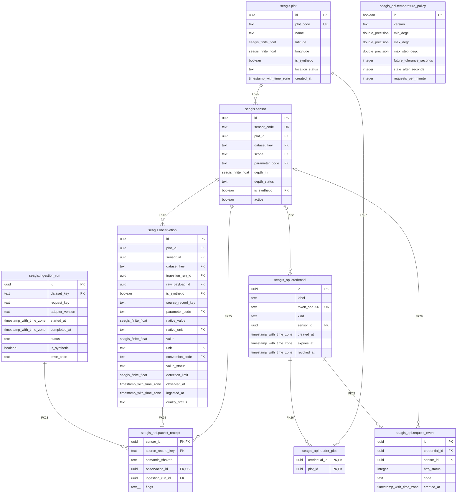

### seagis_environment


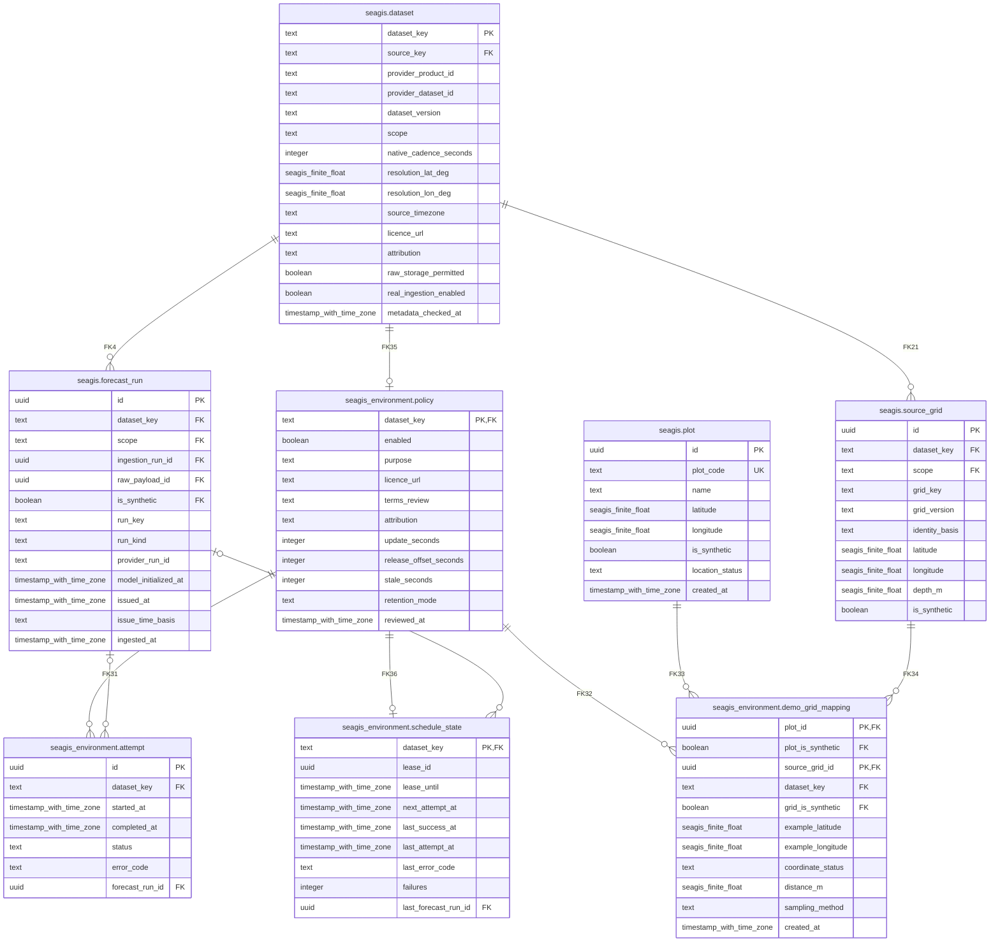

### seagis_features


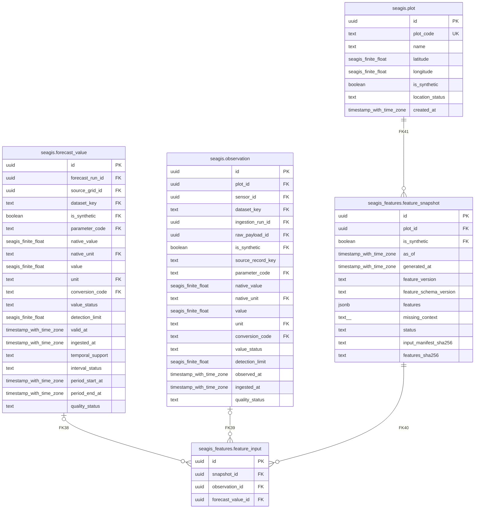

### seagis_quality


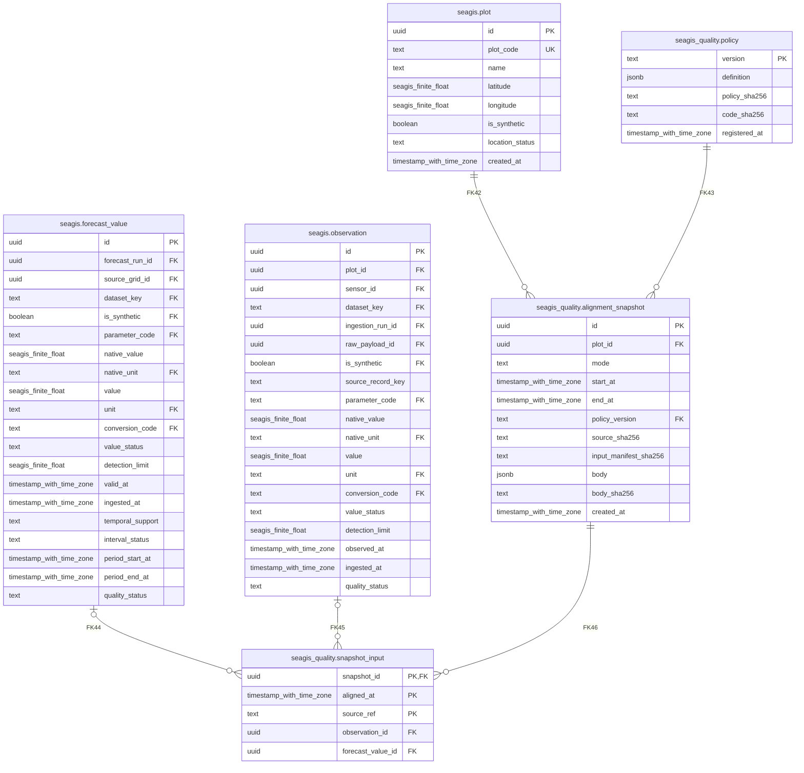

### seagis_raw


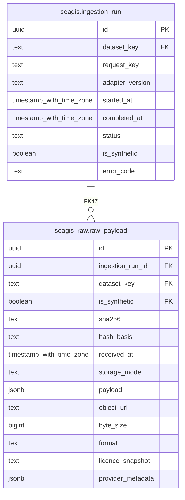


## 6 Data Sources and Lineage

A1: simulator/device → JSON bytes → HTTP validation → authentication and sensor identity → SQL validation → semantic digest → raw manifest + observation + quality_event + packet_receipt → history/status. Sensor identity, plot and synthetic provenance are verified against credentials and deployment rather than accepted as arbitrary input. Missing packets do not create zero observations.

A2: registry/config → lease claim → provider fetch → metadata/unit/cadence/coordinate checks → one Copernicus cell/layer or Open-Meteo response coordinate → deduplication → semantic run_key → metadata_only manifest → forecast_run + source_grid + forecast_value + demo bridge → preview or A3. Open-Meteo source bytes and the canonical Copernicus logical subset have different hash bases. Neither STAC updates nor generationtime_ms become issued_at.

A3: source_bundle joins sensors, parameters, mappings, records and QC events; the maximum window is seven days with a 72-hour lookback and an older sensor sentinel when needed. The builder filters source_time and available_at at each cutoff, selects context, and records spatial metadata, flags and lineage. Persistence rebuilds the source bundle, verifies source/policy/code hashes, and saves a snapshot with hourly inputs. Source changes require a rebuild.

CSV export reads source_bundle in REPEATABLE READ READ ONLY or uses an offline JSON capture. Only two demo plots are supported. Regional CSV selects the latest vintage at capture time, while alignment JSON retains historical cutoffs. These representations are not interchangeable for backtesting. Every exporter output declares training_authorized=false.

Main implementation evidence: `Seagis-Model/supabase/functions/temperature/handler.ts:1`; `Seagis-Model/scripts/environmental/copernicus.py:1`; `Seagis-Model/scripts/environmental/open_meteo.py:1`; `Seagis-Model/scripts/quality/alignment.py:1`; `Seagis-Model/scripts/export_experiment_csv.py:1`.

Reproducible diagram: `assets/diagrams/lineage.mmd`.


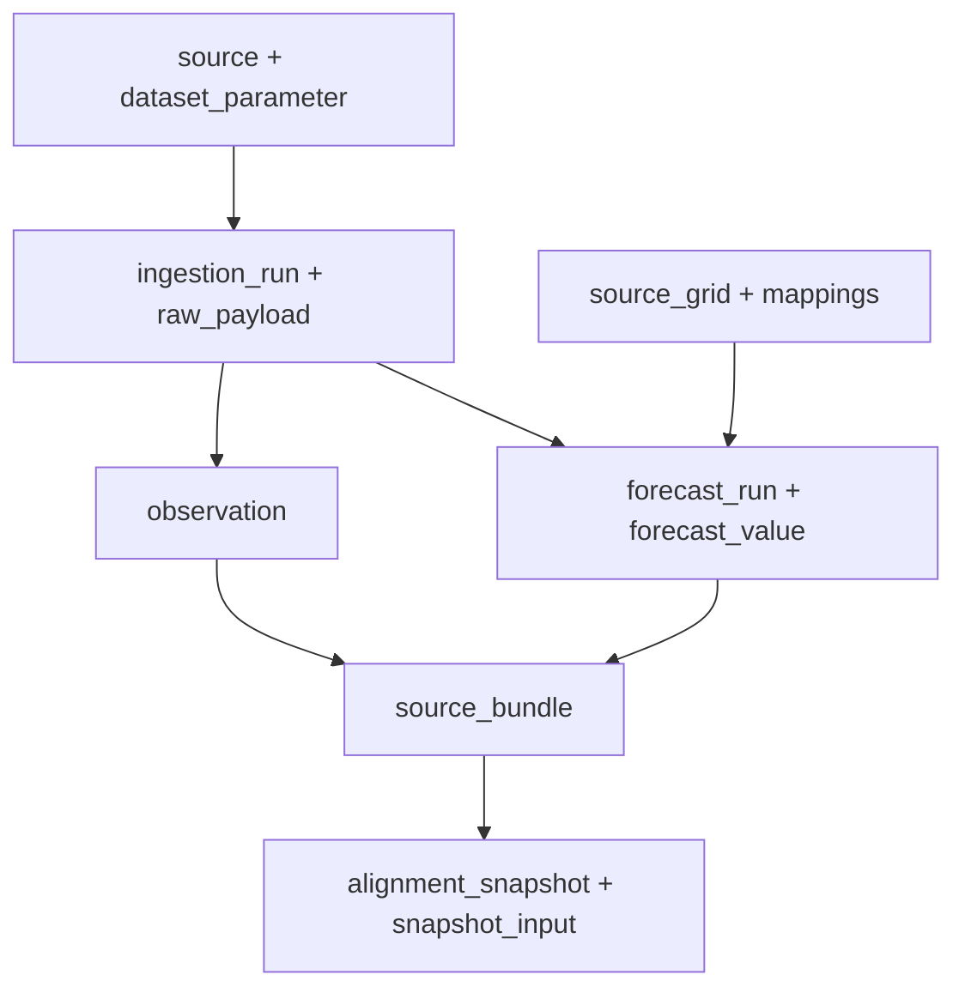

| Dataset | Owner / source | Field | Native unit | Unit | Cadence s | Support | Target |
| --- | --- | --- | --- | --- | --- | --- | --- |
| sensor_temperature_v1 | device/simulator | water_temperature | degC | degC | 3600 | instantaneous | seagis.observation.value |
| cmems_salinity_6h | copernicus | so | 1e-3 | 1e-3 | 21600 | instantaneous | seagis.forecast_value.value (salinity) |
| cmems_currents_6h | copernicus | uo | m s-1 | m/s | 21600 | instantaneous | seagis.forecast_value.value (current_eastward) |
| cmems_currents_6h | copernicus | vo | m s-1 | m/s | 21600 | instantaneous | seagis.forecast_value.value (current_northward) |
| cmems_nutrients_daily | copernicus | no3 | mmol m-3 | mmol/m3 | 86400 | mean | seagis.forecast_value.value (nitrate) |
| cmems_nutrients_daily | copernicus | po4 | mmol m-3 | mmol/m3 | 86400 | mean | seagis.forecast_value.value (phosphate) |
| open_meteo_gfs | open_meteo | precipitation | mm | mm | 3600 | sum | seagis.forecast_value.value (precipitation) |
| open_meteo_gfs | open_meteo | wind_speed_10m | m/s | m/s | 3600 | instantaneous | seagis.forecast_value.value (wind_speed_10m) |
| open_meteo_gfs | open_meteo | wind_direction_10m | ° | degree | 3600 | instantaneous | seagis.forecast_value.value (wind_direction_10m) |
| open_meteo_gfs | open_meteo | cloud_cover | % | percent | 3600 | instantaneous | seagis.forecast_value.value (cloud_cover) |
| open_meteo_gfs | open_meteo | uv_index |  | 1 | 3600 | instantaneous | seagis.forecast_value.value (uv_index) |
| open_meteo_gfs | open_meteo | temperature_2m | °C | degC | 3600 | instantaneous | seagis.forecast_value.value (air_temperature_2m) |

The 3600-second sensor cadence comes from the pilot seed contract, not proof that every device always transmits on time. Provider reliability was not remeasured; retries/validation do not guarantee an SLA.

Main implementation evidence: `Seagis-Model/supabase/seed.sql:1`; `Seagis-Model/config/a2_sources.json:1`.


## 7 Data Ingestion and Transformation

A1 makes one SQL function call per request. The handler accepts application/json up to 8192 bytes and hashes the bytes with SHA-256 before passing JSON to SQL. SQL requires exactly eight fields, schema_version=1.0.0, degC, a uint32 sequence and UTC Z timestamps with up to six fractional digits. An actor advisory transaction lock protects rate limiting, followed by a sensor lock protecting deduplication and QC. An identical retry returns 200 duplicate; changed content under the same boot/sequence returns 409 packet_conflict. New records return 201 stored. QC may persist a rejected reading; rejected does not automatically mean HTTP rejection.

A2 claims each dataset by locking schedule_state, creating a 20-minute lease and a running attempt. The launchd installer configures a 900-second tick; this is installer configuration, not proof of an active job. Nominal policy fetch intervals are 86400 seconds for Copernicus and 21600 for Open-Meteo; native value cadence remains six-hourly/daily/hourly. Offsets are 30600 seconds for salinity/currents, 45000 for nutrients and 16200 for weather. The worker wrapper has a 900-second timeout; HTTP timeout is 40 seconds, response cap four million bytes, and three retry attempts handle network/timeouts/429/selected 5xx with backoff and jitter. Long Retry-After delays are delegated to scheduler backoff.

Open-Meteo pins gfs_global, UTC, wind_speed_unit=ms and forecast_days=3. Its parser checks units, aligned arrays and timezone before assigning UTC to suffix-free labels. Shared returned cells are deduplicated. Copernicus checks product/dataset/version, STAC cadence/grid/depth/units, loads a fixed nearest cell for the two example plots' centroid, checks catalog revision before/after fetching, and decodes through Toolbox/xarray. Nonfinite/extreme fill values become null missing; daily means are not converted into 24 independent samples.

The adapter validates 1–4 grids, exactly two mappings, nonempty values and unique keys; SQL caps batches at two million bytes and 1–5000 values. persist checks lease, policy, dataset version and receipt time before inserting atomically. An existing run_key means duplicate; content changes that alter semantic identity create a new vintage. Grid and demo mapping use ON CONFLICT DO NOTHING with grid identity checks. Statement failure rolls back the entire persistence transaction; claim/attempt state remains and finish_failure is called separately. Lost commit acknowledgement requires status inspection before manual retry.

A3 neither fetches providers nor mutates observations/forecasts. build creates hourly context and detects unit mismatch, missing values, rapid change, flatline candidates, staleness and spatial uncertainty. pilot-quality-2 is an engineering policy. SQL checks lineage, cutoff, selected values, mapping and deterministic output on conflict; it does not rerun all Python QC decisions. This path has no imputation or automatic training.

Main implementation evidence: `Seagis-Model/supabase/migrations/0001_initial_schema.sql:1`; `Seagis-Model/supabase/migrations/0002_temperature_api.sql:1`; `Seagis-Model/supabase/migrations/0003_environment_ingestion.sql:1`; `Seagis-Model/supabase/migrations/0004_provider_update_status.sql:1`; `Seagis-Model/supabase/migrations/0005_quality_alignment.sql:1`.

Main implementation evidence: `Seagis-Model/scripts/ingest_environment.py:1`; `Seagis-Model/scripts/environmental/common.py:1`; `Seagis-Model/scripts/install_a2_scheduler.py:1`; `Seagis-Model/scripts/run_a2_worker.py:1`; `Seagis-Model/scripts/curate_environment.py:1`.

Reproducible diagram: `assets/diagrams/a1.mmd`.


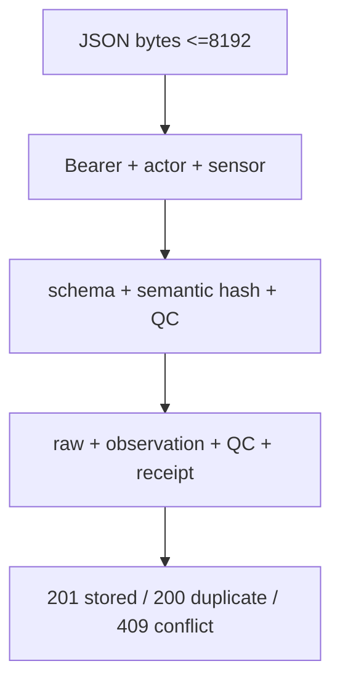

Reproducible diagram: `assets/diagrams/a2.mmd`.


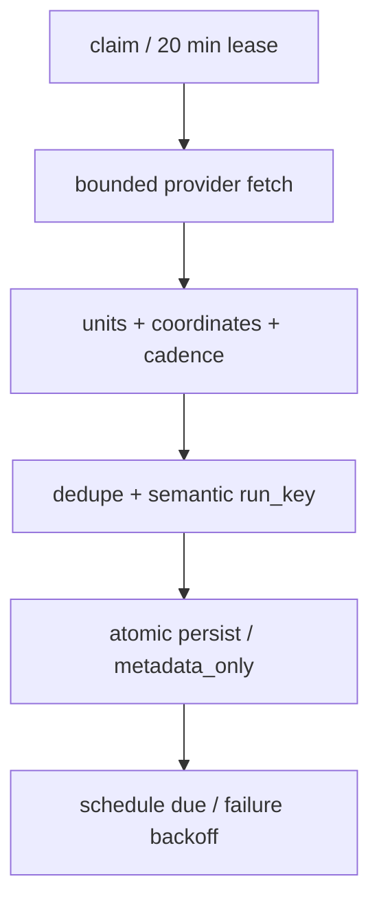

Reproducible diagram: `assets/diagrams/a3.mmd`.


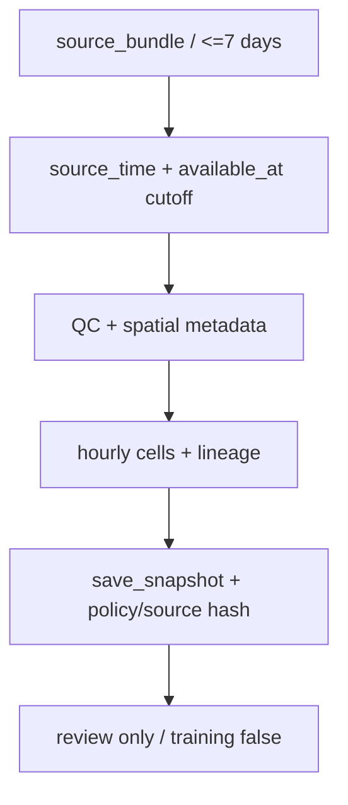

### 7.1 Source-to-Target Mapping

Every destination column has a mapping row. VERIFIED means an expression/default/join has evidence; an administrative/fixture mapping does not imply a production loader. UNVERIFIED marks unresolved derivations and is counted as a gap. Consult the dictionary for types, meanings and guards; SQL expressions retain original identifiers.

| Destination table | Column | Source / field | Transformation | Loader / trigger | Status | Evidence |
| --- | --- | --- | --- | --- | --- | --- |
| seagis.dataset | dataset_key | `Seagis-Model/supabase/migrations/0001_initial_schema.sql:511` | 'sensor_temperature_v1' | supabase/seed.sql; scripts/provision_a1.py; scripts/deploy_a2.py | VERIFIED | `Seagis-Model/supabase/migrations/0001_initial_schema.sql:17` |
| seagis.dataset | source_key | `Seagis-Model/supabase/migrations/0001_initial_schema.sql:511` | 'sensor' | supabase/seed.sql; scripts/provision_a1.py; scripts/deploy_a2.py | VERIFIED | `Seagis-Model/supabase/migrations/0001_initial_schema.sql:17` |
| seagis.dataset | provider_product_id | `Seagis-Model/supabase/migrations/0001_initial_schema.sql:511` | NULL | supabase/seed.sql; scripts/provision_a1.py; scripts/deploy_a2.py | VERIFIED | `Seagis-Model/supabase/migrations/0001_initial_schema.sql:17` |
| seagis.dataset | provider_dataset_id | `Seagis-Model/supabase/migrations/0001_initial_schema.sql:511` | 'seagis-water-temperature' | supabase/seed.sql; scripts/provision_a1.py; scripts/deploy_a2.py | VERIFIED | `Seagis-Model/supabase/migrations/0001_initial_schema.sql:17` |
| seagis.dataset | dataset_version | `Seagis-Model/supabase/migrations/0001_initial_schema.sql:511` | 'v1' | supabase/seed.sql; scripts/provision_a1.py; scripts/deploy_a2.py | VERIFIED | `Seagis-Model/supabase/migrations/0001_initial_schema.sql:17` |
| seagis.dataset | scope | `Seagis-Model/supabase/migrations/0001_initial_schema.sql:511` | 'local_sensor' | supabase/seed.sql; scripts/provision_a1.py; scripts/deploy_a2.py | VERIFIED | `Seagis-Model/supabase/migrations/0001_initial_schema.sql:17` |
| seagis.dataset | native_cadence_seconds | `Seagis-Model/supabase/migrations/0001_initial_schema.sql:511` | 3600 | supabase/seed.sql; scripts/provision_a1.py; scripts/deploy_a2.py | VERIFIED | `Seagis-Model/supabase/migrations/0001_initial_schema.sql:17` |
| seagis.dataset | resolution_lat_deg | `Seagis-Model/supabase/migrations/0001_initial_schema.sql:511` | NULL | supabase/seed.sql; scripts/provision_a1.py; scripts/deploy_a2.py | VERIFIED | `Seagis-Model/supabase/migrations/0001_initial_schema.sql:17` |
| seagis.dataset | resolution_lon_deg | `Seagis-Model/supabase/migrations/0001_initial_schema.sql:511` | NULL | supabase/seed.sql; scripts/provision_a1.py; scripts/deploy_a2.py | VERIFIED | `Seagis-Model/supabase/migrations/0001_initial_schema.sql:17` |
| seagis.dataset | source_timezone | caller / SQL default | 'UTC'::text | supabase/seed.sql; scripts/provision_a1.py; scripts/deploy_a2.py | VERIFIED | `Seagis-Model/supabase/migrations/0001_initial_schema.sql:17` |
| seagis.dataset | licence_url | `Seagis-Model/supabase/migrations/0001_initial_schema.sql:511` | 'project-owned://sensor-data' | supabase/seed.sql; scripts/provision_a1.py; scripts/deploy_a2.py | VERIFIED | `Seagis-Model/supabase/migrations/0001_initial_schema.sql:17` |
| seagis.dataset | attribution | `Seagis-Model/supabase/migrations/0001_initial_schema.sql:511` | 'SEAGIS; simulated until hardware commissioning' | supabase/seed.sql; scripts/provision_a1.py; scripts/deploy_a2.py | VERIFIED | `Seagis-Model/supabase/migrations/0001_initial_schema.sql:17` |
| seagis.dataset | raw_storage_permitted | caller / SQL default | false | supabase/seed.sql; scripts/provision_a1.py; scripts/deploy_a2.py | VERIFIED | `Seagis-Model/supabase/migrations/0001_initial_schema.sql:17` |
| seagis.dataset | real_ingestion_enabled | caller / SQL default | false | supabase/seed.sql; scripts/provision_a1.py; scripts/deploy_a2.py | VERIFIED | `Seagis-Model/supabase/migrations/0001_initial_schema.sql:17` |
| seagis.dataset | metadata_checked_at | `Seagis-Model/supabase/migrations/0001_initial_schema.sql:511` | '2026-10-21T00:00:00Z' | supabase/seed.sql; scripts/provision_a1.py; scripts/deploy_a2.py | VERIFIED | `Seagis-Model/supabase/migrations/0001_initial_schema.sql:17` |
| seagis.dataset_parameter | dataset_key | `Seagis-Model/supabase/migrations/0001_initial_schema.sql:532` | 'sensor_temperature_v1' | supabase/seed.sql; scripts/provision_a1.py; scripts/deploy_a2.py | VERIFIED | `Seagis-Model/supabase/migrations/0001_initial_schema.sql:43` |
| seagis.dataset_parameter | parameter_code | `Seagis-Model/supabase/migrations/0001_initial_schema.sql:532` | 'water_temperature' | supabase/seed.sql; scripts/provision_a1.py; scripts/deploy_a2.py | VERIFIED | `Seagis-Model/supabase/migrations/0001_initial_schema.sql:43` |
| seagis.dataset_parameter | source_variable | `Seagis-Model/supabase/migrations/0001_initial_schema.sql:532` | 'water_temperature' | supabase/seed.sql; scripts/provision_a1.py; scripts/deploy_a2.py | VERIFIED | `Seagis-Model/supabase/migrations/0001_initial_schema.sql:43` |
| seagis.dataset_parameter | native_unit | `Seagis-Model/supabase/migrations/0001_initial_schema.sql:532` | 'degC' | supabase/seed.sql; scripts/provision_a1.py; scripts/deploy_a2.py | VERIFIED | `Seagis-Model/supabase/migrations/0001_initial_schema.sql:43` |
| seagis.dataset_parameter | unit | `Seagis-Model/supabase/migrations/0001_initial_schema.sql:532` | 'degC' | supabase/seed.sql; scripts/provision_a1.py; scripts/deploy_a2.py | VERIFIED | `Seagis-Model/supabase/migrations/0001_initial_schema.sql:43` |
| seagis.dataset_parameter | conversion_code | `Seagis-Model/supabase/migrations/0001_initial_schema.sql:532` | 'identity' | supabase/seed.sql; scripts/provision_a1.py; scripts/deploy_a2.py | VERIFIED | `Seagis-Model/supabase/migrations/0001_initial_schema.sql:43` |
| seagis.dataset_parameter | conversion_factor | caller / SQL default | 1 | supabase/seed.sql; scripts/provision_a1.py; scripts/deploy_a2.py | VERIFIED | `Seagis-Model/supabase/migrations/0001_initial_schema.sql:43` |
| seagis.dataset_parameter | conversion_offset | caller / SQL default | 0 | supabase/seed.sql; scripts/provision_a1.py; scripts/deploy_a2.py | VERIFIED | `Seagis-Model/supabase/migrations/0001_initial_schema.sql:43` |
| seagis.dataset_parameter | temporal_support | `Seagis-Model/supabase/migrations/0001_initial_schema.sql:532` | 'instantaneous' | supabase/seed.sql; scripts/provision_a1.py; scripts/deploy_a2.py | VERIFIED | `Seagis-Model/supabase/migrations/0001_initial_schema.sql:43` |
| seagis.forecast_run | id | DB default / explicit UUID | gen_random_uuid() | seagis_environment.persist; A0 fixtures | VERIFIED | `Seagis-Model/supabase/migrations/0001_initial_schema.sql:216` |
| seagis.forecast_run | dataset_key | `Seagis-Model/supabase/migrations/0003_environment_ingestion.sql:168` | s.dataset_key | seagis_environment.persist; A0 fixtures | VERIFIED | `Seagis-Model/supabase/migrations/0001_initial_schema.sql:216` |
| seagis.forecast_run | scope | caller / SQL default | 'regional_model'::text | seagis_environment.persist; A0 fixtures | VERIFIED | `Seagis-Model/supabase/migrations/0001_initial_schema.sql:216` |
| seagis.forecast_run | ingestion_run_id | `Seagis-Model/supabase/migrations/0003_environment_ingestion.sql:168` | ing | seagis_environment.persist; A0 fixtures | VERIFIED | `Seagis-Model/supabase/migrations/0001_initial_schema.sql:216` |
| seagis.forecast_run | raw_payload_id | `Seagis-Model/supabase/migrations/0003_environment_ingestion.sql:168` | raw_id | seagis_environment.persist; A0 fixtures | VERIFIED | `Seagis-Model/supabase/migrations/0001_initial_schema.sql:216` |
| seagis.forecast_run | is_synthetic | `Seagis-Model/supabase/migrations/0003_environment_ingestion.sql:168` | false | seagis_environment.persist; A0 fixtures | VERIFIED | `Seagis-Model/supabase/migrations/0001_initial_schema.sql:216` |
| seagis.forecast_run | run_key | `Seagis-Model/supabase/migrations/0003_environment_ingestion.sql:168` | batch->>'run_key' | seagis_environment.persist; A0 fixtures | VERIFIED | `Seagis-Model/supabase/migrations/0001_initial_schema.sql:216` |
| seagis.forecast_run | run_kind | `Seagis-Model/supabase/migrations/0003_environment_ingestion.sql:168` | CASE WHEN d.source_key='copernicus' THEN 'analysis_forecast_unspecified' ELSE 'forecast' END | seagis_environment.persist; A0 fixtures | VERIFIED | `Seagis-Model/supabase/migrations/0001_initial_schema.sql:216` |
| seagis.forecast_run | provider_run_id | active loader omits column / nullable schema | NULL in inspected A1/A2 path; other callers may supply under schema guards | seagis_environment.persist; A0 fixtures | VERIFIED | `Seagis-Model/supabase/migrations/0001_initial_schema.sql:216` |
| seagis.forecast_run | model_initialized_at | active loader omits column / nullable schema | NULL in inspected A1/A2 path; other callers may supply under schema guards | seagis_environment.persist; A0 fixtures | VERIFIED | `Seagis-Model/supabase/migrations/0001_initial_schema.sql:216` |
| seagis.forecast_run | issued_at | active loader omits column / nullable schema | NULL in inspected A1/A2 path; other callers may supply under schema guards | seagis_environment.persist; A0 fixtures | VERIFIED | `Seagis-Model/supabase/migrations/0001_initial_schema.sql:216` |
| seagis.forecast_run | issue_time_basis | `Seagis-Model/supabase/migrations/0003_environment_ingestion.sql:168` | 'unknown' | seagis_environment.persist; A0 fixtures | VERIFIED | `Seagis-Model/supabase/migrations/0001_initial_schema.sql:216` |
| seagis.forecast_run | ingested_at | `Seagis-Model/supabase/migrations/0003_environment_ingestion.sql:168` | t | seagis_environment.persist; A0 fixtures | VERIFIED | `Seagis-Model/supabase/migrations/0001_initial_schema.sql:216` |
| seagis.forecast_value | id | DB default / explicit UUID | gen_random_uuid() | seagis_environment.persist; A0 fixtures | VERIFIED | `Seagis-Model/supabase/migrations/0001_initial_schema.sql:241` |
| seagis.forecast_value | forecast_run_id | A2 adapter batch | persist run_id | seagis_environment.persist; A0 fixtures | VERIFIED | `Seagis-Model/supabase/migrations/0001_initial_schema.sql:241` |
| seagis.forecast_value | source_grid_id | A2 adapter batch | grid lookup by dataset/key/synthetic | seagis_environment.persist; A0 fixtures | VERIFIED | `Seagis-Model/supabase/migrations/0001_initial_schema.sql:241` |
| seagis.forecast_value | dataset_key | A2 adapter batch | leased dataset | seagis_environment.persist; A0 fixtures | VERIFIED | `Seagis-Model/supabase/migrations/0001_initial_schema.sql:241` |
| seagis.forecast_value | is_synthetic | A2 adapter batch | false | seagis_environment.persist; A0 fixtures | VERIFIED | `Seagis-Model/supabase/migrations/0001_initial_schema.sql:241` |
| seagis.forecast_value | parameter_code | A2 adapter batch | batch.values[].parameter | seagis_environment.persist; A0 fixtures | VERIFIED | `Seagis-Model/supabase/migrations/0001_initial_schema.sql:241` |
| seagis.forecast_value | native_value | A2 adapter batch | batch.values[].value | seagis_environment.persist; A0 fixtures | VERIFIED | `Seagis-Model/supabase/migrations/0001_initial_schema.sql:241` |
| seagis.forecast_value | native_unit | registered seagis.dataset_parameter par | par.native_unit | seagis_environment.persist; A0 fixtures | VERIFIED | `Seagis-Model/supabase/migrations/0001_initial_schema.sql:241` |
| seagis.forecast_value | value | A2 adapter batch | batch.values[].value | seagis_environment.persist; A0 fixtures | VERIFIED | `Seagis-Model/supabase/migrations/0001_initial_schema.sql:241` |
| seagis.forecast_value | unit | registered seagis.dataset_parameter par | par.unit | seagis_environment.persist; A0 fixtures | VERIFIED | `Seagis-Model/supabase/migrations/0001_initial_schema.sql:241` |
| seagis.forecast_value | conversion_code | registered seagis.dataset_parameter par | par.conversion_code | seagis_environment.persist; A0 fixtures | VERIFIED | `Seagis-Model/supabase/migrations/0001_initial_schema.sql:241` |
| seagis.forecast_value | value_status | A2 adapter batch | v.value_status | seagis_environment.persist; A0 fixtures | VERIFIED | `Seagis-Model/supabase/migrations/0001_initial_schema.sql:241` |
| seagis.forecast_value | detection_limit | A2 adapter batch | omitted -> SQL NULL | seagis_environment.persist; A0 fixtures | VERIFIED | `Seagis-Model/supabase/migrations/0001_initial_schema.sql:241` |
| seagis.forecast_value | valid_at | A2 adapter batch | v.valid_at::timestamptz | seagis_environment.persist; A0 fixtures | VERIFIED | `Seagis-Model/supabase/migrations/0001_initial_schema.sql:241` |
| seagis.forecast_value | ingested_at | A2 adapter batch | persist t = clock_timestamp() | seagis_environment.persist; A0 fixtures | VERIFIED | `Seagis-Model/supabase/migrations/0001_initial_schema.sql:241` |
| seagis.forecast_value | temporal_support | registered seagis.dataset_parameter par | par.temporal_support | seagis_environment.persist; A0 fixtures | VERIFIED | `Seagis-Model/supabase/migrations/0001_initial_schema.sql:241` |
| seagis.forecast_value | interval_status | A2 adapter batch | v.interval_status | seagis_environment.persist; A0 fixtures | VERIFIED | `Seagis-Model/supabase/migrations/0001_initial_schema.sql:241` |
| seagis.forecast_value | period_start_at | A2 adapter batch | v.period_start_at::timestamptz | seagis_environment.persist; A0 fixtures | VERIFIED | `Seagis-Model/supabase/migrations/0001_initial_schema.sql:241` |
| seagis.forecast_value | period_end_at | A2 adapter batch | v.period_end_at::timestamptz | seagis_environment.persist; A0 fixtures | VERIFIED | `Seagis-Model/supabase/migrations/0001_initial_schema.sql:241` |
| seagis.forecast_value | quality_status | A2 adapter batch | default unreviewed | seagis_environment.persist; A0 fixtures | VERIFIED | `Seagis-Model/supabase/migrations/0001_initial_schema.sql:241` |
| seagis.ingestion_run | id | DB default / explicit UUID | gen_random_uuid() | seagis_api.ingest; seagis_environment.persist; A0 fixtures | VERIFIED | `Seagis-Model/supabase/migrations/0001_initial_schema.sql:94` |
| seagis.ingestion_run | dataset_key | `Seagis-Model/supabase/migrations/0002_temperature_api.sql:191` | s.dataset_key | seagis_api.ingest; seagis_environment.persist; A0 fixtures | VERIFIED | `Seagis-Model/supabase/migrations/0001_initial_schema.sql:94` |
| seagis.ingestion_run | request_key | `Seagis-Model/supabase/migrations/0002_temperature_api.sql:191` | 'a1:'&#124;&#124;s.id&#124;&#124;':'&#124;&#124;key | seagis_api.ingest; seagis_environment.persist; A0 fixtures | VERIFIED | `Seagis-Model/supabase/migrations/0001_initial_schema.sql:94` |
| seagis.ingestion_run | adapter_version | `Seagis-Model/supabase/migrations/0002_temperature_api.sql:191` | 'temperature-1.0.0' | seagis_api.ingest; seagis_environment.persist; A0 fixtures | VERIFIED | `Seagis-Model/supabase/migrations/0001_initial_schema.sql:94` |
| seagis.ingestion_run | started_at | `Seagis-Model/supabase/migrations/0002_temperature_api.sql:191` | received | seagis_api.ingest; seagis_environment.persist; A0 fixtures | VERIFIED | `Seagis-Model/supabase/migrations/0001_initial_schema.sql:94` |
| seagis.ingestion_run | completed_at | owning routine / caller | UPDATE at end of A1/A2: clock_timestamp(); NULL while running | seagis_api.ingest; seagis_environment.persist; A0 fixtures | VERIFIED | `Seagis-Model/supabase/migrations/0001_initial_schema.sql:94` |
| seagis.ingestion_run | status | `Seagis-Model/supabase/migrations/0002_temperature_api.sql:191` | 'running' | seagis_api.ingest; seagis_environment.persist; A0 fixtures | VERIFIED | `Seagis-Model/supabase/migrations/0001_initial_schema.sql:94` |
| seagis.ingestion_run | is_synthetic | `Seagis-Model/supabase/migrations/0002_temperature_api.sql:191` | s.is_synthetic | seagis_api.ingest; seagis_environment.persist; A0 fixtures | VERIFIED | `Seagis-Model/supabase/migrations/0001_initial_schema.sql:94` |
| seagis.ingestion_run | error_code | owning routine / caller | A1/A2 successful rows omit -> NULL; failure codes tracked in environment.attempt | seagis_api.ingest; seagis_environment.persist; A0 fixtures | VERIFIED | `Seagis-Model/supabase/migrations/0001_initial_schema.sql:94` |
| seagis.observation | id | DB default / explicit UUID | gen_random_uuid() | seagis_api.ingest; A0 fixtures | VERIFIED | `Seagis-Model/supabase/migrations/0001_initial_schema.sql:184` |
| seagis.observation | plot_id | A1 packet + registered identity + server | registered sensor.plot_id | seagis_api.ingest; A0 fixtures | VERIFIED | `Seagis-Model/supabase/migrations/0001_initial_schema.sql:184` |
| seagis.observation | sensor_id | A1 packet + registered identity + server | authenticated credential.sensor_id | seagis_api.ingest; A0 fixtures | VERIFIED | `Seagis-Model/supabase/migrations/0001_initial_schema.sql:184` |
| seagis.observation | dataset_key | A1 packet + registered identity + server | registered sensor.dataset_key | seagis_api.ingest; A0 fixtures | VERIFIED | `Seagis-Model/supabase/migrations/0001_initial_schema.sql:184` |
| seagis.observation | ingestion_run_id | A1 packet + registered identity + server | ingest-generated run_id | seagis_api.ingest; A0 fixtures | VERIFIED | `Seagis-Model/supabase/migrations/0001_initial_schema.sql:184` |
| seagis.observation | raw_payload_id | A1 packet + registered identity + server | ingest-generated raw_id | seagis_api.ingest; A0 fixtures | VERIFIED | `Seagis-Model/supabase/migrations/0001_initial_schema.sql:184` |
| seagis.observation | is_synthetic | A1 packet + registered identity + server | registered sensor.is_synthetic | seagis_api.ingest; A0 fixtures | VERIFIED | `Seagis-Model/supabase/migrations/0001_initial_schema.sql:184` |
| seagis.observation | source_record_key | A1 packet + registered identity + server | boot_id &#124;&#124; : &#124;&#124; sequence | seagis_api.ingest; A0 fixtures | VERIFIED | `Seagis-Model/supabase/migrations/0001_initial_schema.sql:184` |
| seagis.observation | parameter_code | A1 packet + registered identity + server | constant water_temperature | seagis_api.ingest; A0 fixtures | VERIFIED | `Seagis-Model/supabase/migrations/0001_initial_schema.sql:184` |
| seagis.observation | native_value | A1 packet + registered identity + server | packet.water_temperature | seagis_api.ingest; A0 fixtures | VERIFIED | `Seagis-Model/supabase/migrations/0001_initial_schema.sql:184` |
| seagis.observation | native_unit | A1 packet + registered identity + server | constant degC | seagis_api.ingest; A0 fixtures | VERIFIED | `Seagis-Model/supabase/migrations/0001_initial_schema.sql:184` |
| seagis.observation | value | A1 packet + registered identity + server | packet.water_temperature (identity) | seagis_api.ingest; A0 fixtures | VERIFIED | `Seagis-Model/supabase/migrations/0001_initial_schema.sql:184` |
| seagis.observation | unit | A1 packet + registered identity + server | constant degC | seagis_api.ingest; A0 fixtures | VERIFIED | `Seagis-Model/supabase/migrations/0001_initial_schema.sql:184` |
| seagis.observation | conversion_code | A1 packet + registered identity + server | constant identity | seagis_api.ingest; A0 fixtures | VERIFIED | `Seagis-Model/supabase/migrations/0001_initial_schema.sql:184` |
| seagis.observation | value_status | A1 packet + registered identity + server | packet.value_status | seagis_api.ingest; A0 fixtures | VERIFIED | `Seagis-Model/supabase/migrations/0001_initial_schema.sql:184` |
| seagis.observation | detection_limit | A1 packet + registered identity + server | omitted -> SQL NULL | seagis_api.ingest; A0 fixtures | VERIFIED | `Seagis-Model/supabase/migrations/0001_initial_schema.sql:184` |
| seagis.observation | observed_at | A1 packet + registered identity + server | packet.observed_at cast timestamptz | seagis_api.ingest; A0 fixtures | VERIFIED | `Seagis-Model/supabase/migrations/0001_initial_schema.sql:184` |
| seagis.observation | ingested_at | A1 packet + registered identity + server | server received = clock_timestamp() | seagis_api.ingest; A0 fixtures | VERIFIED | `Seagis-Model/supabase/migrations/0001_initial_schema.sql:184` |
| seagis.observation | quality_status | A1 packet + registered identity + server | pilot policy + flags | seagis_api.ingest; A0 fixtures | VERIFIED | `Seagis-Model/supabase/migrations/0001_initial_schema.sql:184` |
| seagis.parameter | parameter_code | `Seagis-Model/supabase/migrations/0001_initial_schema.sql:518` | 'water_temperature' | supabase/seed.sql; scripts/provision_a1.py; scripts/deploy_a2.py | VERIFIED | `Seagis-Model/supabase/migrations/0001_initial_schema.sql:36` |
| seagis.parameter | unit | `Seagis-Model/supabase/migrations/0001_initial_schema.sql:518` | 'degC' | supabase/seed.sql; scripts/provision_a1.py; scripts/deploy_a2.py | VERIFIED | `Seagis-Model/supabase/migrations/0001_initial_schema.sql:36` |
| seagis.parameter | description | `Seagis-Model/supabase/migrations/0001_initial_schema.sql:518` | 'Submerged local sensor temperature; distinct from air temperature' | supabase/seed.sql; scripts/provision_a1.py; scripts/deploy_a2.py | VERIFIED | `Seagis-Model/supabase/migrations/0001_initial_schema.sql:36` |
| seagis.plot | id | DB default / explicit UUID | gen_random_uuid() | supabase/seed.sql; scripts/provision_a1.py; scripts/deploy_a2.py | VERIFIED | `Seagis-Model/supabase/migrations/0001_initial_schema.sql:58` |
| seagis.plot | plot_code | `Seagis-Model/supabase/seed.sql:2` | 'plot-a' | supabase/seed.sql; scripts/provision_a1.py; scripts/deploy_a2.py | VERIFIED | `Seagis-Model/supabase/migrations/0001_initial_schema.sql:58` |
| seagis.plot | name | `Seagis-Model/supabase/seed.sql:2` | 'Plot A (synthetic)' | supabase/seed.sql; scripts/provision_a1.py; scripts/deploy_a2.py | VERIFIED | `Seagis-Model/supabase/migrations/0001_initial_schema.sql:58` |
| seagis.plot | latitude | active loader omits column / nullable schema | NULL in inspected A1/A2 path; other callers may supply under schema guards | supabase/seed.sql; scripts/provision_a1.py; scripts/deploy_a2.py | VERIFIED | `Seagis-Model/supabase/migrations/0001_initial_schema.sql:58` |
| seagis.plot | longitude | active loader omits column / nullable schema | NULL in inspected A1/A2 path; other callers may supply under schema guards | supabase/seed.sql; scripts/provision_a1.py; scripts/deploy_a2.py | VERIFIED | `Seagis-Model/supabase/migrations/0001_initial_schema.sql:58` |
| seagis.plot | is_synthetic | `Seagis-Model/supabase/seed.sql:2` | true | supabase/seed.sql; scripts/provision_a1.py; scripts/deploy_a2.py | VERIFIED | `Seagis-Model/supabase/migrations/0001_initial_schema.sql:58` |
| seagis.plot | location_status | `Seagis-Model/supabase/seed.sql:2` | 'synthetic' | supabase/seed.sql; scripts/provision_a1.py; scripts/deploy_a2.py | VERIFIED | `Seagis-Model/supabase/migrations/0001_initial_schema.sql:58` |
| seagis.plot | created_at | caller / SQL default | now() | supabase/seed.sql; scripts/provision_a1.py; scripts/deploy_a2.py | VERIFIED | `Seagis-Model/supabase/migrations/0001_initial_schema.sql:58` |
| seagis.plot_grid_mapping | id | DB default / explicit UUID | gen_random_uuid() | A0 fixture/admin SQL | VERIFIED | `Seagis-Model/supabase/migrations/0001_initial_schema.sql:152` |
| seagis.plot_grid_mapping | plot_id | A0 fixtures/test SQL; operational creator NOT FOUND | caller-supplied plot_id subject to FK/CHECK/guard_mapping; recorded_at SQL default | A0 fixture/admin SQL | VERIFIED | `Seagis-Model/supabase/migrations/0001_initial_schema.sql:152` |
| seagis.plot_grid_mapping | source_grid_id | A0 fixtures/test SQL; operational creator NOT FOUND | caller-supplied source_grid_id subject to FK/CHECK/guard_mapping; recorded_at SQL default | A0 fixture/admin SQL | VERIFIED | `Seagis-Model/supabase/migrations/0001_initial_schema.sql:152` |
| seagis.plot_grid_mapping | is_synthetic | A0 fixtures/test SQL; operational creator NOT FOUND | caller-supplied is_synthetic subject to FK/CHECK/guard_mapping; recorded_at SQL default | A0 fixture/admin SQL | VERIFIED | `Seagis-Model/supabase/migrations/0001_initial_schema.sql:152` |
| seagis.plot_grid_mapping | sampling_method | A0 fixtures/test SQL; operational creator NOT FOUND | caller-supplied sampling_method subject to FK/CHECK/guard_mapping; recorded_at SQL default | A0 fixture/admin SQL | VERIFIED | `Seagis-Model/supabase/migrations/0001_initial_schema.sql:152` |
| seagis.plot_grid_mapping | distance_m | A0 fixtures/test SQL; operational creator NOT FOUND | caller-supplied distance_m subject to FK/CHECK/guard_mapping; recorded_at SQL default | A0 fixture/admin SQL | VERIFIED | `Seagis-Model/supabase/migrations/0001_initial_schema.sql:152` |
| seagis.plot_grid_mapping | representativeness | A0 fixtures/test SQL; operational creator NOT FOUND | caller-supplied representativeness subject to FK/CHECK/guard_mapping; recorded_at SQL default | A0 fixture/admin SQL | VERIFIED | `Seagis-Model/supabase/migrations/0001_initial_schema.sql:152` |
| seagis.plot_grid_mapping | effective_from | A0 fixtures/test SQL; operational creator NOT FOUND | caller-supplied effective_from subject to FK/CHECK/guard_mapping; recorded_at SQL default | A0 fixture/admin SQL | VERIFIED | `Seagis-Model/supabase/migrations/0001_initial_schema.sql:152` |
| seagis.plot_grid_mapping | effective_until | A0 fixtures/test SQL; operational creator NOT FOUND | caller-supplied effective_until subject to FK/CHECK/guard_mapping; recorded_at SQL default | A0 fixture/admin SQL | VERIFIED | `Seagis-Model/supabase/migrations/0001_initial_schema.sql:152` |
| seagis.plot_grid_mapping | recorded_at | caller / SQL default | clock_timestamp() | A0 fixture/admin SQL | VERIFIED | `Seagis-Model/supabase/migrations/0001_initial_schema.sql:152` |
| seagis.quality_event | id | DB default / explicit UUID | gen_random_uuid() | seagis_api.ingest; A0 fixtures | VERIFIED | `Seagis-Model/supabase/migrations/0001_initial_schema.sql:273` |
| seagis.quality_event | ingestion_run_id | `Seagis-Model/supabase/migrations/0002_temperature_api.sql:208` | run_id | seagis_api.ingest; A0 fixtures | VERIFIED | `Seagis-Model/supabase/migrations/0001_initial_schema.sql:273` |
| seagis.quality_event | dataset_key | `Seagis-Model/supabase/migrations/0002_temperature_api.sql:208` | s.dataset_key | seagis_api.ingest; A0 fixtures | VERIFIED | `Seagis-Model/supabase/migrations/0001_initial_schema.sql:273` |
| seagis.quality_event | is_synthetic | `Seagis-Model/supabase/migrations/0002_temperature_api.sql:208` | s.is_synthetic | seagis_api.ingest; A0 fixtures | VERIFIED | `Seagis-Model/supabase/migrations/0001_initial_schema.sql:273` |
| seagis.quality_event | event_key | `Seagis-Model/supabase/migrations/0002_temperature_api.sql:208` | flag | seagis_api.ingest; A0 fixtures | VERIFIED | `Seagis-Model/supabase/migrations/0001_initial_schema.sql:273` |
| seagis.quality_event | observation_id | `Seagis-Model/supabase/migrations/0002_temperature_api.sql:208` | observation_id | seagis_api.ingest; A0 fixtures | VERIFIED | `Seagis-Model/supabase/migrations/0001_initial_schema.sql:273` |
| seagis.quality_event | forecast_value_id | active loader omits column / nullable schema | NULL in inspected A1/A2 path; other callers may supply under schema guards | seagis_api.ingest; A0 fixtures | VERIFIED | `Seagis-Model/supabase/migrations/0001_initial_schema.sql:273` |
| seagis.quality_event | event_code | `Seagis-Model/supabase/migrations/0002_temperature_api.sql:208` | flag | seagis_api.ingest; A0 fixtures | VERIFIED | `Seagis-Model/supabase/migrations/0001_initial_schema.sql:273` |
| seagis.quality_event | severity | `Seagis-Model/supabase/migrations/0002_temperature_api.sql:208` | CASE WHEN quality='rejected' THEN 'error' WHEN flag IN ('gap_before','out_of_order') THEN 'info' ELSE 'warning' END | seagis_api.ingest; A0 fixtures | VERIFIED | `Seagis-Model/supabase/migrations/0001_initial_schema.sql:273` |
| seagis.quality_event | details | caller / SQL default | '{}'::jsonb | seagis_api.ingest; A0 fixtures | VERIFIED | `Seagis-Model/supabase/migrations/0001_initial_schema.sql:273` |
| seagis.quality_event | created_at | caller / SQL default | now() | seagis_api.ingest; A0 fixtures | VERIFIED | `Seagis-Model/supabase/migrations/0001_initial_schema.sql:273` |
| seagis.sensor | id | DB default / explicit UUID | gen_random_uuid() | supabase/seed.sql; scripts/provision_a1.py; scripts/deploy_a2.py | VERIFIED | `Seagis-Model/supabase/migrations/0001_initial_schema.sql:73` |
| seagis.sensor | sensor_code | `Seagis-Model/supabase/seed.sql:7` | 'simulator-a' | supabase/seed.sql; scripts/provision_a1.py; scripts/deploy_a2.py | VERIFIED | `Seagis-Model/supabase/migrations/0001_initial_schema.sql:73` |
| seagis.sensor | plot_id | `Seagis-Model/supabase/seed.sql:7` | '00000000-0000-4000-8000-000000000001' | supabase/seed.sql; scripts/provision_a1.py; scripts/deploy_a2.py | VERIFIED | `Seagis-Model/supabase/migrations/0001_initial_schema.sql:73` |
| seagis.sensor | dataset_key | `Seagis-Model/supabase/seed.sql:7` | 'sensor_temperature_v1' | supabase/seed.sql; scripts/provision_a1.py; scripts/deploy_a2.py | VERIFIED | `Seagis-Model/supabase/migrations/0001_initial_schema.sql:73` |
| seagis.sensor | scope | caller / SQL default | 'local_sensor'::text | supabase/seed.sql; scripts/provision_a1.py; scripts/deploy_a2.py | VERIFIED | `Seagis-Model/supabase/migrations/0001_initial_schema.sql:73` |
| seagis.sensor | parameter_code | caller / SQL default | 'water_temperature'::text | supabase/seed.sql; scripts/provision_a1.py; scripts/deploy_a2.py | VERIFIED | `Seagis-Model/supabase/migrations/0001_initial_schema.sql:73` |
| seagis.sensor | depth_m | active loader omits column / nullable schema | NULL in inspected A1/A2 path; other callers may supply under schema guards | supabase/seed.sql; scripts/provision_a1.py; scripts/deploy_a2.py | VERIFIED | `Seagis-Model/supabase/migrations/0001_initial_schema.sql:73` |
| seagis.sensor | depth_status | `Seagis-Model/supabase/seed.sql:7` | 'unknown' | supabase/seed.sql; scripts/provision_a1.py; scripts/deploy_a2.py | VERIFIED | `Seagis-Model/supabase/migrations/0001_initial_schema.sql:73` |
| seagis.sensor | is_synthetic | `Seagis-Model/supabase/seed.sql:7` | true | supabase/seed.sql; scripts/provision_a1.py; scripts/deploy_a2.py | VERIFIED | `Seagis-Model/supabase/migrations/0001_initial_schema.sql:73` |
| seagis.sensor | active | caller / SQL default | true | supabase/seed.sql; scripts/provision_a1.py; scripts/deploy_a2.py | VERIFIED | `Seagis-Model/supabase/migrations/0001_initial_schema.sql:73` |
| seagis.source | source_key | `Seagis-Model/supabase/migrations/0001_initial_schema.sql:506` | 'sensor' | supabase/seed.sql; scripts/provision_a1.py; scripts/deploy_a2.py | VERIFIED | `Seagis-Model/supabase/migrations/0001_initial_schema.sql:11` |
| seagis.source | provider | `Seagis-Model/supabase/migrations/0001_initial_schema.sql:506` | 'SEAGIS local sensor / simulator' | supabase/seed.sql; scripts/provision_a1.py; scripts/deploy_a2.py | VERIFIED | `Seagis-Model/supabase/migrations/0001_initial_schema.sql:11` |
| seagis.source | documentation_url | `Seagis-Model/supabase/migrations/0001_initial_schema.sql:506` | 'https://github.com/De-Voeux/Seagis-Model' | supabase/seed.sql; scripts/provision_a1.py; scripts/deploy_a2.py | VERIFIED | `Seagis-Model/supabase/migrations/0001_initial_schema.sql:11` |
| seagis.source_grid | id | DB default / explicit UUID | gen_random_uuid() | seagis_environment.persist; A0 fixtures | VERIFIED | `Seagis-Model/supabase/migrations/0001_initial_schema.sql:135` |
| seagis.source_grid | dataset_key | `Seagis-Model/supabase/migrations/0003_environment_ingestion.sql:173` | s.dataset_key | seagis_environment.persist; A0 fixtures | VERIFIED | `Seagis-Model/supabase/migrations/0001_initial_schema.sql:135` |
| seagis.source_grid | scope | caller / SQL default | 'regional_model'::text | seagis_environment.persist; A0 fixtures | VERIFIED | `Seagis-Model/supabase/migrations/0001_initial_schema.sql:135` |
| seagis.source_grid | grid_key | `Seagis-Model/supabase/migrations/0003_environment_ingestion.sql:173` | g->>'key' | seagis_environment.persist; A0 fixtures | VERIFIED | `Seagis-Model/supabase/migrations/0001_initial_schema.sql:135` |
| seagis.source_grid | grid_version | `Seagis-Model/supabase/migrations/0003_environment_ingestion.sql:173` | d.dataset_version | seagis_environment.persist; A0 fixtures | VERIFIED | `Seagis-Model/supabase/migrations/0001_initial_schema.sql:135` |
| seagis.source_grid | identity_basis | `Seagis-Model/supabase/migrations/0003_environment_ingestion.sql:173` | g->>'identity_basis' | seagis_environment.persist; A0 fixtures | VERIFIED | `Seagis-Model/supabase/migrations/0001_initial_schema.sql:135` |
| seagis.source_grid | latitude | `Seagis-Model/supabase/migrations/0003_environment_ingestion.sql:173` | (g->>'latitude')::float8 | seagis_environment.persist; A0 fixtures | VERIFIED | `Seagis-Model/supabase/migrations/0001_initial_schema.sql:135` |
| seagis.source_grid | longitude | `Seagis-Model/supabase/migrations/0003_environment_ingestion.sql:173` | (g->>'longitude')::float8 | seagis_environment.persist; A0 fixtures | VERIFIED | `Seagis-Model/supabase/migrations/0001_initial_schema.sql:135` |
| seagis.source_grid | depth_m | `Seagis-Model/supabase/migrations/0003_environment_ingestion.sql:173` | (g->>'depth_m')::float8 | seagis_environment.persist; A0 fixtures | VERIFIED | `Seagis-Model/supabase/migrations/0001_initial_schema.sql:135` |
| seagis.source_grid | is_synthetic | `Seagis-Model/supabase/migrations/0003_environment_ingestion.sql:173` | false | seagis_environment.persist; A0 fixtures | VERIFIED | `Seagis-Model/supabase/migrations/0001_initial_schema.sql:135` |
| seagis_api.credential | id | DB default / explicit UUID | gen_random_uuid() | scripts/provision_a1.py; migration 0002 | VERIFIED | `Seagis-Model/supabase/migrations/0002_temperature_api.sql:27` |
| seagis_api.credential | label | owning routine / caller | provision_a1.create(label) CLI --label | scripts/provision_a1.py; migration 0002 | VERIFIED | `Seagis-Model/supabase/migrations/0002_temperature_api.sql:27` |
| seagis_api.credential | token_sha256 | owning routine / caller | sha256((sgi_ + secrets.token_urlsafe(32)).encode()).hexdigest(); original token excluded | scripts/provision_a1.py; migration 0002 | VERIFIED | `Seagis-Model/supabase/migrations/0002_temperature_api.sql:27` |
| seagis_api.credential | kind | owning routine / caller | provision_a1.create(kind), CLI device/reader | scripts/provision_a1.py; migration 0002 | VERIFIED | `Seagis-Model/supabase/migrations/0002_temperature_api.sql:27` |
| seagis_api.credential | sensor_id | owning routine / caller | validated CLI sensor UUID for device, NULL for reader | scripts/provision_a1.py; migration 0002 | VERIFIED | `Seagis-Model/supabase/migrations/0002_temperature_api.sql:27` |
| seagis_api.credential | created_at | caller / SQL default | now() | scripts/provision_a1.py; migration 0002 | VERIFIED | `Seagis-Model/supabase/migrations/0002_temperature_api.sql:27` |
| seagis_api.credential | expires_at | owning routine / caller | now()+make_interval(days=>days); CLI 1..365, default 30 | scripts/provision_a1.py; migration 0002 | VERIFIED | `Seagis-Model/supabase/migrations/0002_temperature_api.sql:27` |
| seagis_api.credential | revoked_at | owning routine / caller | NULL initially; revoke command UPDATE revoked_at=now() | scripts/provision_a1.py; migration 0002 | VERIFIED | `Seagis-Model/supabase/migrations/0002_temperature_api.sql:27` |
| seagis_api.packet_receipt | sensor_id | `Seagis-Model/supabase/migrations/0002_temperature_api.sql:215` | s.id | seagis_api.ingest/reply | VERIFIED | `Seagis-Model/supabase/migrations/0002_temperature_api.sql:53` |
| seagis_api.packet_receipt | source_record_key | `Seagis-Model/supabase/migrations/0002_temperature_api.sql:215` | key | seagis_api.ingest/reply | VERIFIED | `Seagis-Model/supabase/migrations/0002_temperature_api.sql:53` |
| seagis_api.packet_receipt | semantic_sha256 | `Seagis-Model/supabase/migrations/0002_temperature_api.sql:215` | digest | seagis_api.ingest/reply | VERIFIED | `Seagis-Model/supabase/migrations/0002_temperature_api.sql:53` |
| seagis_api.packet_receipt | observation_id | `Seagis-Model/supabase/migrations/0002_temperature_api.sql:215` | observation_id | seagis_api.ingest/reply | VERIFIED | `Seagis-Model/supabase/migrations/0002_temperature_api.sql:53` |
| seagis_api.packet_receipt | ingestion_run_id | `Seagis-Model/supabase/migrations/0002_temperature_api.sql:215` | run_id | seagis_api.ingest/reply | VERIFIED | `Seagis-Model/supabase/migrations/0002_temperature_api.sql:53` |
| seagis_api.packet_receipt | flags | `Seagis-Model/supabase/migrations/0002_temperature_api.sql:215` | flags | seagis_api.ingest/reply | VERIFIED | `Seagis-Model/supabase/migrations/0002_temperature_api.sql:53` |
| seagis_api.reader_plot | credential_id | owning routine / caller | provision_a1.create generated credential UUID | scripts/provision_a1.py; migration 0002 | VERIFIED | `Seagis-Model/supabase/migrations/0002_temperature_api.sql:39` |
| seagis_api.reader_plot | plot_id | owning routine / caller | CLI plots validated with UUID(), FK checked by database | scripts/provision_a1.py; migration 0002 | VERIFIED | `Seagis-Model/supabase/migrations/0002_temperature_api.sql:39` |
| seagis_api.request_event | id | DB default / explicit UUID | gen_random_uuid() | seagis_api.ingest/reply | VERIFIED | `Seagis-Model/supabase/migrations/0002_temperature_api.sql:44` |
| seagis_api.request_event | credential_id | `Seagis-Model/supabase/migrations/0002_temperature_api.sql:100` | actor_id | seagis_api.ingest/reply | VERIFIED | `Seagis-Model/supabase/migrations/0002_temperature_api.sql:44` |
| seagis_api.request_event | sensor_id | `Seagis-Model/supabase/migrations/0002_temperature_api.sql:100` | sensor | seagis_api.ingest/reply | VERIFIED | `Seagis-Model/supabase/migrations/0002_temperature_api.sql:44` |
| seagis_api.request_event | http_status | `Seagis-Model/supabase/migrations/0002_temperature_api.sql:100` | status | seagis_api.ingest/reply | VERIFIED | `Seagis-Model/supabase/migrations/0002_temperature_api.sql:44` |
| seagis_api.request_event | code | `Seagis-Model/supabase/migrations/0002_temperature_api.sql:100` | code | seagis_api.ingest/reply | VERIFIED | `Seagis-Model/supabase/migrations/0002_temperature_api.sql:44` |
| seagis_api.request_event | created_at | caller / SQL default | clock_timestamp() | seagis_api.ingest/reply | VERIFIED | `Seagis-Model/supabase/migrations/0002_temperature_api.sql:44` |
| seagis_api.temperature_policy | id | DB default / explicit UUID | true | scripts/provision_a1.py; migration 0002 | VERIFIED | `Seagis-Model/supabase/migrations/0002_temperature_api.sql:67` |
| seagis_api.temperature_policy | version | `Seagis-Model/supabase/migrations/0002_temperature_api.sql:80` | 'pilot-qc-1' | scripts/provision_a1.py; migration 0002 | VERIFIED | `Seagis-Model/supabase/migrations/0002_temperature_api.sql:67` |
| seagis_api.temperature_policy | min_degc | `Seagis-Model/supabase/migrations/0002_temperature_api.sql:80` | -5 | scripts/provision_a1.py; migration 0002 | VERIFIED | `Seagis-Model/supabase/migrations/0002_temperature_api.sql:67` |
| seagis_api.temperature_policy | max_degc | `Seagis-Model/supabase/migrations/0002_temperature_api.sql:80` | 60 | scripts/provision_a1.py; migration 0002 | VERIFIED | `Seagis-Model/supabase/migrations/0002_temperature_api.sql:67` |
| seagis_api.temperature_policy | max_step_degc | `Seagis-Model/supabase/migrations/0002_temperature_api.sql:80` | 3 | scripts/provision_a1.py; migration 0002 | VERIFIED | `Seagis-Model/supabase/migrations/0002_temperature_api.sql:67` |
| seagis_api.temperature_policy | future_tolerance_seconds | `Seagis-Model/supabase/migrations/0002_temperature_api.sql:80` | 300 | scripts/provision_a1.py; migration 0002 | VERIFIED | `Seagis-Model/supabase/migrations/0002_temperature_api.sql:67` |
| seagis_api.temperature_policy | stale_after_seconds | `Seagis-Model/supabase/migrations/0002_temperature_api.sql:80` | 7200 | scripts/provision_a1.py; migration 0002 | VERIFIED | `Seagis-Model/supabase/migrations/0002_temperature_api.sql:67` |
| seagis_api.temperature_policy | requests_per_minute | `Seagis-Model/supabase/migrations/0002_temperature_api.sql:80` | 120 | scripts/provision_a1.py; migration 0002 | VERIFIED | `Seagis-Model/supabase/migrations/0002_temperature_api.sql:67` |
| seagis_environment.attempt | id | `Seagis-Model/supabase/migrations/0003_environment_ingestion.sql:113` | lease | seagis_environment.claim/persist/finish_failure; migration 0003 | VERIFIED | `Seagis-Model/supabase/migrations/0003_environment_ingestion.sql:57` |
| seagis_environment.attempt | dataset_key | `Seagis-Model/supabase/migrations/0003_environment_ingestion.sql:113` | k | seagis_environment.claim/persist/finish_failure; migration 0003 | VERIFIED | `Seagis-Model/supabase/migrations/0003_environment_ingestion.sql:57` |
| seagis_environment.attempt | started_at | `Seagis-Model/supabase/migrations/0003_environment_ingestion.sql:113` | clock_timestamp() | seagis_environment.claim/persist/finish_failure; migration 0003 | VERIFIED | `Seagis-Model/supabase/migrations/0003_environment_ingestion.sql:57` |
| seagis_environment.attempt | completed_at | owning routine / caller | clock_timestamp() at persist/failure/abandon; initially NULL | seagis_environment.claim/persist/finish_failure; migration 0003 | VERIFIED | `Seagis-Model/supabase/migrations/0003_environment_ingestion.sql:57` |
| seagis_environment.attempt | status | `Seagis-Model/supabase/migrations/0003_environment_ingestion.sql:113` | 'running' | seagis_environment.claim/persist/finish_failure; migration 0003 | VERIFIED | `Seagis-Model/supabase/migrations/0003_environment_ingestion.sql:57` |
| seagis_environment.attempt | error_code | owning routine / caller | finish_failure sanitized code or lease_expired on abandoned; otherwise NULL | seagis_environment.claim/persist/finish_failure; migration 0003 | VERIFIED | `Seagis-Model/supabase/migrations/0003_environment_ingestion.sql:57` |
| seagis_environment.attempt | forecast_run_id | owning routine / caller | persist run_id, also on duplicate; NULL before completion | seagis_environment.claim/persist/finish_failure; migration 0003 | VERIFIED | `Seagis-Model/supabase/migrations/0003_environment_ingestion.sql:57` |
| seagis_environment.current_speed | eastward_value_id | seagis.forecast_value u/v | u.id | NOT APPLICABLE: view | VERIFIED | `Seagis-Model/supabase/migrations/0003_environment_ingestion.sql:89` |
| seagis_environment.current_speed | northward_value_id | seagis.forecast_value u/v | v.id | NOT APPLICABLE: view | VERIFIED | `Seagis-Model/supabase/migrations/0003_environment_ingestion.sql:89` |
| seagis_environment.current_speed | forecast_run_id | seagis.forecast_value u/v | u.forecast_run_id | NOT APPLICABLE: view | VERIFIED | `Seagis-Model/supabase/migrations/0003_environment_ingestion.sql:89` |
| seagis_environment.current_speed | source_grid_id | seagis.forecast_value u/v | u.source_grid_id | NOT APPLICABLE: view | VERIFIED | `Seagis-Model/supabase/migrations/0003_environment_ingestion.sql:89` |
| seagis_environment.current_speed | valid_at | seagis.forecast_value u/v | u.valid_at | NOT APPLICABLE: view | VERIFIED | `Seagis-Model/supabase/migrations/0003_environment_ingestion.sql:89` |
| seagis_environment.current_speed | ingested_at | seagis.forecast_value u/v | u.ingested_at | NOT APPLICABLE: view | VERIFIED | `Seagis-Model/supabase/migrations/0003_environment_ingestion.sql:89` |
| seagis_environment.current_speed | available_at | seagis.forecast_value u/v | greatest(u.ingested_at,v.ingested_at) | NOT APPLICABLE: view | VERIFIED | `Seagis-Model/supabase/migrations/0003_environment_ingestion.sql:89` |
| seagis_environment.current_speed | speed_m_s | seagis.forecast_value u/v | CASE WHEN both value_status='present' THEN sqrt(u.value*u.value+v.value*v.value) END | NOT APPLICABLE: view | VERIFIED | `Seagis-Model/supabase/migrations/0003_environment_ingestion.sql:89` |
| seagis_environment.current_speed | derivation | seagis.forecast_value u/v | 'sqrt(uo^2+vo^2); a2-vector-magnitude-v1' | NOT APPLICABLE: view | VERIFIED | `Seagis-Model/supabase/migrations/0003_environment_ingestion.sql:89` |
| seagis_environment.demo_grid_mapping | plot_id | `Seagis-Model/supabase/migrations/0003_environment_ingestion.sql:197` | (m->>'plot_id')::uuid | seagis_environment.claim/persist/finish_failure; migration 0003 | VERIFIED | `Seagis-Model/supabase/migrations/0003_environment_ingestion.sql:69` |
| seagis_environment.demo_grid_mapping | plot_is_synthetic | caller / SQL default | true | seagis_environment.claim/persist/finish_failure; migration 0003 | VERIFIED | `Seagis-Model/supabase/migrations/0003_environment_ingestion.sql:69` |
| seagis_environment.demo_grid_mapping | source_grid_id | `Seagis-Model/supabase/migrations/0003_environment_ingestion.sql:197` | grid_id | seagis_environment.claim/persist/finish_failure; migration 0003 | VERIFIED | `Seagis-Model/supabase/migrations/0003_environment_ingestion.sql:69` |
| seagis_environment.demo_grid_mapping | dataset_key | `Seagis-Model/supabase/migrations/0003_environment_ingestion.sql:197` | s.dataset_key | seagis_environment.claim/persist/finish_failure; migration 0003 | VERIFIED | `Seagis-Model/supabase/migrations/0003_environment_ingestion.sql:69` |
| seagis_environment.demo_grid_mapping | grid_is_synthetic | caller / SQL default | false | seagis_environment.claim/persist/finish_failure; migration 0003 | VERIFIED | `Seagis-Model/supabase/migrations/0003_environment_ingestion.sql:69` |
| seagis_environment.demo_grid_mapping | example_latitude | `Seagis-Model/supabase/migrations/0003_environment_ingestion.sql:197` | (m->>'latitude')::float8 | seagis_environment.claim/persist/finish_failure; migration 0003 | VERIFIED | `Seagis-Model/supabase/migrations/0003_environment_ingestion.sql:69` |
| seagis_environment.demo_grid_mapping | example_longitude | `Seagis-Model/supabase/migrations/0003_environment_ingestion.sql:197` | (m->>'longitude')::float8 | seagis_environment.claim/persist/finish_failure; migration 0003 | VERIFIED | `Seagis-Model/supabase/migrations/0003_environment_ingestion.sql:69` |
| seagis_environment.demo_grid_mapping | coordinate_status | `Seagis-Model/supabase/migrations/0003_environment_ingestion.sql:197` | m->>'coordinate_status' | seagis_environment.claim/persist/finish_failure; migration 0003 | VERIFIED | `Seagis-Model/supabase/migrations/0003_environment_ingestion.sql:69` |
| seagis_environment.demo_grid_mapping | distance_m | `Seagis-Model/supabase/migrations/0003_environment_ingestion.sql:197` | (m->>'distance_m')::float8 | seagis_environment.claim/persist/finish_failure; migration 0003 | VERIFIED | `Seagis-Model/supabase/migrations/0003_environment_ingestion.sql:69` |
| seagis_environment.demo_grid_mapping | sampling_method | `Seagis-Model/supabase/migrations/0003_environment_ingestion.sql:197` | m->>'sampling_method' | seagis_environment.claim/persist/finish_failure; migration 0003 | VERIFIED | `Seagis-Model/supabase/migrations/0003_environment_ingestion.sql:69` |
| seagis_environment.demo_grid_mapping | created_at | caller / SQL default | now() | seagis_environment.claim/persist/finish_failure; migration 0003 | VERIFIED | `Seagis-Model/supabase/migrations/0003_environment_ingestion.sql:69` |
| seagis_environment.policy | dataset_key | `Seagis-Model/supabase/migrations/0003_environment_ingestion.sql:30` | dataset_key | seagis_environment.claim/persist/finish_failure; migration 0003 | VERIFIED | `Seagis-Model/supabase/migrations/0003_environment_ingestion.sql:16` |
| seagis_environment.policy | enabled | caller / SQL default | true | seagis_environment.claim/persist/finish_failure; migration 0003 | VERIFIED | `Seagis-Model/supabase/migrations/0003_environment_ingestion.sql:16` |
| seagis_environment.policy | purpose | `Seagis-Model/supabase/migrations/0003_environment_ingestion.sql:30` | 'noncommercial_educational_prototype' | seagis_environment.claim/persist/finish_failure; migration 0003 | VERIFIED | `Seagis-Model/supabase/migrations/0003_environment_ingestion.sql:16` |
| seagis_environment.policy | licence_url | `Seagis-Model/supabase/migrations/0003_environment_ingestion.sql:30` | licence_url | seagis_environment.claim/persist/finish_failure; migration 0003 | VERIFIED | `Seagis-Model/supabase/migrations/0003_environment_ingestion.sql:16` |
| seagis_environment.policy | terms_review | `Seagis-Model/supabase/migrations/0003_environment_ingestion.sql:30` | CASE WHEN source_key='copernicus' THEN 'cmems-licence-20261022-sections-2.2-2.4-2.6' ELSE 'open-meteo-terms-20261022-noncommercial-cc-by-4.0' END | seagis_environment.claim/persist/finish_failure; migration 0003 | VERIFIED | `Seagis-Model/supabase/migrations/0003_environment_ingestion.sql:16` |
| seagis_environment.policy | attribution | `Seagis-Model/supabase/migrations/0003_environment_ingestion.sql:30` | attribution | seagis_environment.claim/persist/finish_failure; migration 0003 | VERIFIED | `Seagis-Model/supabase/migrations/0003_environment_ingestion.sql:16` |
| seagis_environment.policy | update_seconds | `Seagis-Model/supabase/migrations/0003_environment_ingestion.sql:30` | CASE WHEN source_key='copernicus' THEN 86400 ELSE 21600 END | seagis_environment.claim/persist/finish_failure; migration 0003 | VERIFIED | `Seagis-Model/supabase/migrations/0003_environment_ingestion.sql:16` |
| seagis_environment.policy | release_offset_seconds | `Seagis-Model/supabase/migrations/0003_environment_ingestion.sql:30` | CASE WHEN dataset_key='cmems_nutrients_daily' THEN 45000 WHEN source_key='copernicus' THEN 30600 ELSE 16200 END | seagis_environment.claim/persist/finish_failure; migration 0003 | VERIFIED | `Seagis-Model/supabase/migrations/0003_environment_ingestion.sql:16` |
| seagis_environment.policy | stale_seconds | `Seagis-Model/supabase/migrations/0003_environment_ingestion.sql:30` | CASE WHEN source_key='copernicus' THEN 172800 ELSE 43200 END | seagis_environment.claim/persist/finish_failure; migration 0003 | VERIFIED | `Seagis-Model/supabase/migrations/0003_environment_ingestion.sql:16` |
| seagis_environment.policy | retention_mode | caller / SQL default | 'metadata_only'::text | seagis_environment.claim/persist/finish_failure; migration 0003 | VERIFIED | `Seagis-Model/supabase/migrations/0003_environment_ingestion.sql:16` |
| seagis_environment.policy | reviewed_at | caller / SQL default | now() | seagis_environment.claim/persist/finish_failure; migration 0003 | VERIFIED | `Seagis-Model/supabase/migrations/0003_environment_ingestion.sql:16` |
| seagis_environment.schedule_state | dataset_key | `Seagis-Model/supabase/migrations/0003_environment_ingestion.sql:56` | dataset_key | seagis_environment.claim/persist/finish_failure; migration 0003 | VERIFIED | `Seagis-Model/supabase/migrations/0003_environment_ingestion.sql:45` |
| seagis_environment.schedule_state | lease_id | owning routine / caller | claim gen_random_uuid(); cleared after persist/failure | seagis_environment.claim/persist/finish_failure; migration 0003 | VERIFIED | `Seagis-Model/supabase/migrations/0003_environment_ingestion.sql:45` |
| seagis_environment.schedule_state | lease_until | owning routine / caller | claim clock_timestamp()+interval 20 minutes; cleared after persist/failure | seagis_environment.claim/persist/finish_failure; migration 0003 | VERIFIED | `Seagis-Model/supabase/migrations/0003_environment_ingestion.sql:45` |
| seagis_environment.schedule_state | next_attempt_at | caller / SQL default | '-infinity'::timestamp with time zone | seagis_environment.claim/persist/finish_failure; migration 0003 | VERIFIED | `Seagis-Model/supabase/migrations/0003_environment_ingestion.sql:45` |
| seagis_environment.schedule_state | last_success_at | owning routine / caller | persist t=clock_timestamp() | seagis_environment.claim/persist/finish_failure; migration 0003 | VERIFIED | `Seagis-Model/supabase/migrations/0003_environment_ingestion.sql:45` |
| seagis_environment.schedule_state | last_attempt_at | owning routine / caller | claim clock_timestamp() | seagis_environment.claim/persist/finish_failure; migration 0003 | VERIFIED | `Seagis-Model/supabase/migrations/0003_environment_ingestion.sql:45` |
| seagis_environment.schedule_state | last_error_code | owning routine / caller | finish_failure sanitized code; cleared on success | seagis_environment.claim/persist/finish_failure; migration 0003 | VERIFIED | `Seagis-Model/supabase/migrations/0003_environment_ingestion.sql:45` |
| seagis_environment.schedule_state | failures | caller / SQL default | 0 | seagis_environment.claim/persist/finish_failure; migration 0003 | VERIFIED | `Seagis-Model/supabase/migrations/0003_environment_ingestion.sql:45` |
| seagis_environment.schedule_state | last_forecast_run_id | owning routine / caller | persist run_id | seagis_environment.claim/persist/finish_failure; migration 0003 | VERIFIED | `Seagis-Model/supabase/migrations/0003_environment_ingestion.sql:45` |
| seagis_features.feature_input | id | DB default / explicit UUID | gen_random_uuid() | A0 fixture/test inserts; production builder NOT FOUND | VERIFIED | `Seagis-Model/supabase/migrations/0001_initial_schema.sql:320` |
| seagis_features.feature_input | snapshot_id | A0 fixtures/tests; production builder NOT FOUND | caller-supplied snapshot_id subject to guard_input/guard_snapshot; no production derivation claimed | A0 fixture/test inserts; production builder NOT FOUND | VERIFIED | `Seagis-Model/supabase/migrations/0001_initial_schema.sql:320` |
| seagis_features.feature_input | observation_id | A0 fixtures/tests; production builder NOT FOUND | caller-supplied observation_id subject to guard_input/guard_snapshot; no production derivation claimed | A0 fixture/test inserts; production builder NOT FOUND | VERIFIED | `Seagis-Model/supabase/migrations/0001_initial_schema.sql:320` |
| seagis_features.feature_input | forecast_value_id | A0 fixtures/tests; production builder NOT FOUND | caller-supplied forecast_value_id subject to guard_input/guard_snapshot; no production derivation claimed | A0 fixture/test inserts; production builder NOT FOUND | VERIFIED | `Seagis-Model/supabase/migrations/0001_initial_schema.sql:320` |
| seagis_features.feature_snapshot | id | DB default / explicit UUID | gen_random_uuid() | A0 fixture/test inserts; production builder NOT FOUND | VERIFIED | `Seagis-Model/supabase/migrations/0001_initial_schema.sql:301` |
| seagis_features.feature_snapshot | plot_id | A0 fixtures/tests; production builder NOT FOUND | caller-supplied plot_id subject to guard_input/guard_snapshot; no production derivation claimed | A0 fixture/test inserts; production builder NOT FOUND | VERIFIED | `Seagis-Model/supabase/migrations/0001_initial_schema.sql:301` |
| seagis_features.feature_snapshot | is_synthetic | A0 fixtures/tests; production builder NOT FOUND | caller-supplied is_synthetic subject to guard_input/guard_snapshot; no production derivation claimed | A0 fixture/test inserts; production builder NOT FOUND | VERIFIED | `Seagis-Model/supabase/migrations/0001_initial_schema.sql:301` |
| seagis_features.feature_snapshot | as_of | A0 fixtures/tests; production builder NOT FOUND | caller-supplied as_of subject to guard_input/guard_snapshot; no production derivation claimed | A0 fixture/test inserts; production builder NOT FOUND | VERIFIED | `Seagis-Model/supabase/migrations/0001_initial_schema.sql:301` |
| seagis_features.feature_snapshot | generated_at | A0 fixtures/tests; production builder NOT FOUND | caller-supplied generated_at subject to guard_input/guard_snapshot; no production derivation claimed | A0 fixture/test inserts; production builder NOT FOUND | VERIFIED | `Seagis-Model/supabase/migrations/0001_initial_schema.sql:301` |
| seagis_features.feature_snapshot | feature_version | A0 fixtures/tests; production builder NOT FOUND | caller-supplied feature_version subject to guard_input/guard_snapshot; no production derivation claimed | A0 fixture/test inserts; production builder NOT FOUND | VERIFIED | `Seagis-Model/supabase/migrations/0001_initial_schema.sql:301` |
| seagis_features.feature_snapshot | feature_schema_version | A0 fixtures/tests; production builder NOT FOUND | caller-supplied feature_schema_version subject to guard_input/guard_snapshot; no production derivation claimed | A0 fixture/test inserts; production builder NOT FOUND | VERIFIED | `Seagis-Model/supabase/migrations/0001_initial_schema.sql:301` |
| seagis_features.feature_snapshot | features | A0 fixtures/tests; production builder NOT FOUND | caller-supplied features subject to guard_input/guard_snapshot; no production derivation claimed | A0 fixture/test inserts; production builder NOT FOUND | VERIFIED | `Seagis-Model/supabase/migrations/0001_initial_schema.sql:301` |
| seagis_features.feature_snapshot | missing_context | caller / SQL default | '{}'::text[] | A0 fixture/test inserts; production builder NOT FOUND | VERIFIED | `Seagis-Model/supabase/migrations/0001_initial_schema.sql:301` |
| seagis_features.feature_snapshot | status | caller / SQL default | 'draft'::text | A0 fixture/test inserts; production builder NOT FOUND | VERIFIED | `Seagis-Model/supabase/migrations/0001_initial_schema.sql:301` |
| seagis_features.feature_snapshot | input_manifest_sha256 | seagis_features.manifest_hash(snapshot) | SHA256 sorted input references at draft -> sealed | A0 fixture/test inserts; production builder NOT FOUND | VERIFIED | `Seagis-Model/supabase/migrations/0001_initial_schema.sql:301` |
| seagis_features.feature_snapshot | features_sha256 | DB generated | seagis.jsonb_sha256(features) | A0 fixture/test inserts; production builder NOT FOUND | VERIFIED | `Seagis-Model/supabase/migrations/0001_initial_schema.sql:301` |
| seagis_quality.alignment_snapshot | id | DB default / explicit UUID | gen_random_uuid() | seagis_quality.save_snapshot | VERIFIED | `Seagis-Model/supabase/migrations/0005_quality_alignment.sql:21` |
| seagis_quality.alignment_snapshot | plot_id | A3 build -> save_snapshot | document.plot_id | seagis_quality.save_snapshot | VERIFIED | `Seagis-Model/supabase/migrations/0005_quality_alignment.sql:21` |
| seagis_quality.alignment_snapshot | mode | A3 build -> save_snapshot | document.mode | seagis_quality.save_snapshot | VERIFIED | `Seagis-Model/supabase/migrations/0005_quality_alignment.sql:21` |
| seagis_quality.alignment_snapshot | start_at | A3 build -> save_snapshot | document.start_at | seagis_quality.save_snapshot | VERIFIED | `Seagis-Model/supabase/migrations/0005_quality_alignment.sql:21` |
| seagis_quality.alignment_snapshot | end_at | A3 build -> save_snapshot | document.end_at | seagis_quality.save_snapshot | VERIFIED | `Seagis-Model/supabase/migrations/0005_quality_alignment.sql:21` |
| seagis_quality.alignment_snapshot | policy_version | A3 build -> save_snapshot | registered policy.version | seagis_quality.save_snapshot | VERIFIED | `Seagis-Model/supabase/migrations/0005_quality_alignment.sql:21` |
| seagis_quality.alignment_snapshot | source_sha256 | A3 build -> save_snapshot | document.source_sha256 checked against fresh source_bundle | seagis_quality.save_snapshot | VERIFIED | `Seagis-Model/supabase/migrations/0005_quality_alignment.sql:21` |
| seagis_quality.alignment_snapshot | input_manifest_sha256 | A3 build -> save_snapshot | SHA256 sorted distinct at&#124;source_ref lines | seagis_quality.save_snapshot | VERIFIED | `Seagis-Model/supabase/migrations/0005_quality_alignment.sql:21` |
| seagis_quality.alignment_snapshot | body | A3 build -> save_snapshot | document | seagis_quality.save_snapshot | VERIFIED | `Seagis-Model/supabase/migrations/0005_quality_alignment.sql:21` |
| seagis_quality.alignment_snapshot | body_sha256 | DB generated | seagis.jsonb_sha256(body) | seagis_quality.save_snapshot | VERIFIED | `Seagis-Model/supabase/migrations/0005_quality_alignment.sql:21` |
| seagis_quality.alignment_snapshot | created_at | A3 build -> save_snapshot | SQL default clock_timestamp() | seagis_quality.save_snapshot | VERIFIED | `Seagis-Model/supabase/migrations/0005_quality_alignment.sql:21` |
| seagis_quality.policy | version | owning routine / caller | register_policy policy[version] | scripts/quality/store.py::register_policy | VERIFIED | `Seagis-Model/supabase/migrations/0005_quality_alignment.sql:14` |
| seagis_quality.policy | definition | owning routine / caller | register_policy JSON policy argument (config/a3_quality.json) | scripts/quality/store.py::register_policy | VERIFIED | `Seagis-Model/supabase/migrations/0005_quality_alignment.sql:14` |
| seagis_quality.policy | policy_sha256 | owning routine / caller | register_policy policy_hash from digest(policy) | scripts/quality/store.py::register_policy | VERIFIED | `Seagis-Model/supabase/migrations/0005_quality_alignment.sql:14` |
| seagis_quality.policy | code_sha256 | owning routine / caller | register_policy builder_hash from code_hash() | scripts/quality/store.py::register_policy | VERIFIED | `Seagis-Model/supabase/migrations/0005_quality_alignment.sql:14` |
| seagis_quality.policy | registered_at | caller / SQL default | clock_timestamp() | scripts/quality/store.py::register_policy | VERIFIED | `Seagis-Model/supabase/migrations/0005_quality_alignment.sql:14` |
| seagis_quality.snapshot_input | snapshot_id | A3 document.rows[].cells[].lineage | saved snapshot UUID | seagis_quality.save_snapshot | VERIFIED | `Seagis-Model/supabase/migrations/0005_quality_alignment.sql:35` |
| seagis_quality.snapshot_input | aligned_at | A3 document.rows[].cells[].lineage | row.at::timestamptz | seagis_quality.save_snapshot | VERIFIED | `Seagis-Model/supabase/migrations/0005_quality_alignment.sql:35` |
| seagis_quality.snapshot_input | source_ref | A3 document.rows[].cells[].lineage | lineage ref | seagis_quality.save_snapshot | VERIFIED | `Seagis-Model/supabase/migrations/0005_quality_alignment.sql:35` |
| seagis_quality.snapshot_input | observation_id | A3 document.rows[].cells[].lineage | UUID if ref prefix observation else NULL | seagis_quality.save_snapshot | VERIFIED | `Seagis-Model/supabase/migrations/0005_quality_alignment.sql:35` |
| seagis_quality.snapshot_input | forecast_value_id | A3 document.rows[].cells[].lineage | UUID if ref prefix forecast_value else NULL | seagis_quality.save_snapshot | VERIFIED | `Seagis-Model/supabase/migrations/0005_quality_alignment.sql:35` |
| seagis_raw.raw_payload | id | DB default / explicit UUID | gen_random_uuid() | seagis_api.ingest; seagis_environment.persist; A0 fixtures | VERIFIED | `Seagis-Model/supabase/migrations/0001_initial_schema.sql:110` |
| seagis_raw.raw_payload | ingestion_run_id | `Seagis-Model/supabase/migrations/0002_temperature_api.sql:193` | run_id | seagis_api.ingest; seagis_environment.persist; A0 fixtures | VERIFIED | `Seagis-Model/supabase/migrations/0001_initial_schema.sql:110` |
| seagis_raw.raw_payload | dataset_key | `Seagis-Model/supabase/migrations/0002_temperature_api.sql:193` | s.dataset_key | seagis_api.ingest; seagis_environment.persist; A0 fixtures | VERIFIED | `Seagis-Model/supabase/migrations/0001_initial_schema.sql:110` |
| seagis_raw.raw_payload | is_synthetic | `Seagis-Model/supabase/migrations/0002_temperature_api.sql:193` | s.is_synthetic | seagis_api.ingest; seagis_environment.persist; A0 fixtures | VERIFIED | `Seagis-Model/supabase/migrations/0001_initial_schema.sql:110` |
| seagis_raw.raw_payload | sha256 | `Seagis-Model/supabase/migrations/0002_temperature_api.sql:193` | CASE WHEN s.is_synthetic THEN seagis.jsonb_sha256(packet) ELSE wire_sha256 END | seagis_api.ingest; seagis_environment.persist; A0 fixtures | VERIFIED | `Seagis-Model/supabase/migrations/0001_initial_schema.sql:110` |
| seagis_raw.raw_payload | hash_basis | caller / SQL default | 'source_bytes'::text | seagis_api.ingest; seagis_environment.persist; A0 fixtures | VERIFIED | `Seagis-Model/supabase/migrations/0001_initial_schema.sql:110` |
| seagis_raw.raw_payload | received_at | `Seagis-Model/supabase/migrations/0002_temperature_api.sql:193` | received | seagis_api.ingest; seagis_environment.persist; A0 fixtures | VERIFIED | `Seagis-Model/supabase/migrations/0001_initial_schema.sql:110` |
| seagis_raw.raw_payload | storage_mode | `Seagis-Model/supabase/migrations/0002_temperature_api.sql:193` | CASE WHEN s.is_synthetic THEN 'inline' ELSE 'metadata_only' END | seagis_api.ingest; seagis_environment.persist; A0 fixtures | VERIFIED | `Seagis-Model/supabase/migrations/0001_initial_schema.sql:110` |
| seagis_raw.raw_payload | payload | `Seagis-Model/supabase/migrations/0002_temperature_api.sql:193` | CASE WHEN s.is_synthetic THEN packet ELSE NULL END | seagis_api.ingest; seagis_environment.persist; A0 fixtures | VERIFIED | `Seagis-Model/supabase/migrations/0001_initial_schema.sql:110` |
| seagis_raw.raw_payload | object_uri | active loader omits column / nullable schema | NULL in inspected A1/A2 path; other callers may supply under schema guards | seagis_api.ingest; seagis_environment.persist; A0 fixtures | VERIFIED | `Seagis-Model/supabase/migrations/0001_initial_schema.sql:110` |
| seagis_raw.raw_payload | byte_size | `Seagis-Model/supabase/migrations/0002_temperature_api.sql:193` | wire_bytes | seagis_api.ingest; seagis_environment.persist; A0 fixtures | VERIFIED | `Seagis-Model/supabase/migrations/0001_initial_schema.sql:110` |
| seagis_raw.raw_payload | format | `Seagis-Model/supabase/migrations/0002_temperature_api.sql:193` | 'application/json' | seagis_api.ingest; seagis_environment.persist; A0 fixtures | VERIFIED | `Seagis-Model/supabase/migrations/0001_initial_schema.sql:110` |
| seagis_raw.raw_payload | licence_snapshot | `Seagis-Model/supabase/migrations/0002_temperature_api.sql:193` | 'project-owned; A1 synthetic development / real retention gated' | seagis_api.ingest; seagis_environment.persist; A0 fixtures | VERIFIED | `Seagis-Model/supabase/migrations/0001_initial_schema.sql:110` |
| seagis_raw.raw_payload | provider_metadata | caller / SQL default | '{}'::jsonb | seagis_api.ingest; seagis_environment.persist; A0 fixtures | VERIFIED | `Seagis-Model/supabase/migrations/0001_initial_schema.sql:110` |


## 8 Data Contracts

Four contracts are explicit JSON Schemas; seven additional contracts are implementation-derived. This classification does not make them all public endpoints. No general version negotiation was found; mismatched constant versions/schemas are rejected. Breaking changes need a new version and consumer review, not assumed automatic compatibility. JSON errors below come from handler/SQL, not an invented standard error format.

| ID | Contract | Producer | Consumer | Interface | Class | Database | Evidence |
| --- | --- | --- | --- | --- | --- | --- | --- |
| C01 | A0 source envelope | fixture/provider logical extract | validate_source | JSON / Draft 2020-12 | explicit | seagis.ingestion_run + seagis_raw.raw_payload | `Seagis-Model/scripts/validate_contracts.py:1` |
| C02 | A0 normalized envelope | fixture normalization | validate_normalized + SQL guards | JSON / Draft 2020-12 | explicit | observation / forecast_run / forecast_value / source_grid | `Seagis-Model/scripts/validate_contracts.py:1` |
| C03 | A1 device packet | device/simulator | temperature handler + seagis_api.ingest | JSON / HTTP POST | explicit | observation + raw_payload + packet_receipt + quality_event | `Seagis-Model/supabase/functions/temperature/handler.ts:1` |
| C04 | A3 alignment document | scripts/quality/alignment.py::build | seagis_quality.save_snapshot | JSON / SQL jsonb | explicit | seagis_quality.alignment_snapshot + snapshot_input | `Seagis-Model/scripts/curate_environment.py:1` |
| C05 | A1 history/status/replies | seagis_api.history/status/reply | authorized reader | JSON / HTTP GET | implementation-derived | observation + sensor + packet_receipt | `Seagis-Model/supabase/migrations/0002_temperature_api.sql:1` |
| C06 | A2 adapter batch/lease | Adapter.envelope + claim | seagis_environment.persist | JSON / SQL jsonb | implementation-derived | raw_payload + forecast_run + forecast_value + source_grid + demo_grid_mapping | `Seagis-Model/scripts/environmental/common.py:1` |
| C07 | A3 source_bundle | seagis_quality.source_bundle | build / CSV exporter | JSON / SQL jsonb | implementation-derived | plot + sensor + dataset_parameter + mappings + observation + forecast_value | `Seagis-Model/supabase/migrations/0005_quality_alignment.sql:1` |
| C08 | CSV experiment-csv-2 | export_experiment_csv.py::export | offline experiments / developer | CSV + JSON manifest | implementation-derived | derived files; no database writes | `Seagis-Model/scripts/export_experiment_csv.py:1` |
| C09 | iOS Assessment domain | MockAssessmentRepository | LoadDemoAssessment / ViewModel | Swift structs | implementation-derived / mock | NOT APPLICABLE: no backend mapping | `Seagis/Seagis/Models/Shared/Assessment.swift:1` |
| C10 | Open-Meteo response | Open-Meteo forecast API | OpenMeteo.parse/normalize | JSON hourly arrays | implementation-derived | forecast_value + grid + raw manifest | `Seagis-Model/scripts/environmental/open_meteo.py:1` |
| C11 | Copernicus subset | Copernicus Toolbox/xarray + STAC | Copernicus.parse/normalize | xarray + canonical logical JSON subset | implementation-derived | forecast_value + grid + raw manifest | `Seagis-Model/scripts/environmental/copernicus.py:1` |

### C01 A0 source envelope

| Attribute | Definition |
| --- | --- |
| Producer → consumer | fixture/provider logical extract → validate_source |
| Interface / format | JSON / Draft 2020-12 |
| Classification | explicit |
| Database mapping | seagis.ingestion_run + seagis_raw.raw_payload |
| Compatibility | Constant version where defined; general negotiation NOT FOUND |
| Evidence | `Seagis-Model/scripts/validate_contracts.py:1` |

| Field | Type / ref | Required | Nullable | Default | Meaning | Validation / allowed values | Units / timestamp | Example (illustrative) | DB mapping (boundary) |
| --- | --- | --- | --- | --- | --- | --- | --- | --- | --- |
| schema_version | "const/enum" | True | False | NOT FOUND | Contract structure version; not a biological model version | {"const": "0.1.0"} | NOT APPLICABLE / schema | "0.1.0" | seagis.ingestion_run + seagis_raw.raw_payload |
| source_type | "const/enum" | True | False | NOT FOUND | Source adapter kind determining the fixture payload | {"enum": ["sensor", "copernicus", "open_meteo"]} | NOT APPLICABLE / schema | "sensor" | seagis.ingestion_run + seagis_raw.raw_payload |
| dataset_key | "const/enum" | True | False | NOT FOUND | Registered dataset key | {"enum": ["sensor_temperature_v1", "cmems_salinity_6h", "cmems_currents_6h", "cmems_nutrients_daily", "open_meteo_gfs"]} | NOT APPLICABLE / schema | "sensor_temperature_v1" | seagis.ingestion_run + seagis_raw.raw_payload |
| is_synthetic | "boolean" | True | False | NOT FOUND | Synthetic provenance flag, separate from QC | {"type": "boolean"} | NOT APPLICABLE / schema | false | seagis.ingestion_run + seagis_raw.raw_payload |
| received_at | "string" | True | False | NOT FOUND | Raw receipt instant at worker | {"type": "string", "format": "date-time", "pattern": "Z$"} | Units/time follow unit and parameter registry; UTC for normalized envelopes. | "2026-10-21T12:00:00Z" | seagis.ingestion_run + seagis_raw.raw_payload |
| provider_metadata | "object" | True | False | NOT FOUND | Sanitized provider and request metadata | {"type": "object"} | NOT APPLICABLE / schema | {} | seagis.ingestion_run + seagis_raw.raw_payload |
| payload | "object" | True | False | NOT FOUND | Synthetic raw JSON content when inline | {"type": "object"} | NOT APPLICABLE / schema | {} | seagis.ingestion_run + seagis_raw.raw_payload |

Complete schema for conditional rules and polymorphic structures (required above applies within each parent):

```json
{
  "type": "object",
  "additionalProperties": false,
  "properties": {
    "schema_version": {
      "const": "0.1.0"
    },
    "source_type": {
      "enum": [
        "sensor",
        "copernicus",
        "open_meteo"
      ]
    },
    "dataset_key": {
      "enum": [
        "sensor_temperature_v1",
        "cmems_salinity_6h",
        "cmems_currents_6h",
        "cmems_nutrients_daily",
        "open_meteo_gfs"
      ]
    },
    "is_synthetic": {
      "type": "boolean"
    },
    "received_at": {
      "type": "string",
      "format": "date-time",
      "pattern": "Z$"
    },
    "provider_metadata": {
      "type": "object"
    },
    "payload": {
      "type": "object"
    }
  },
  "required": [
    "schema_version",
    "source_type",
    "dataset_key",
    "is_synthetic",
    "received_at",
    "provider_metadata",
    "payload"
  ],
  "$schema": "https://json-schema.org/draft/2020-12/schema",
  "$id": "https://seagis.local/contracts/source.schema.json",
  "title": "SEAGIS source envelopes v0.1.0",
  "allOf": [
    {
      "if": {
        "properties": {
          "source_type": {
            "const": "sensor"
          }
        }
      },
      "then": {
        "properties": {
          "payload": {
            "type": "object",
            "additionalProperties": false,
            "properties": {
              "sensor_id": {
                "type": "string",
                "format": "uuid"
              },
              "boot_id": {
                "type": "string",
                "minLength": 1
              },
              "sequence": {
                "type": "integer",
                "minimum": 0
              },
              "observed_at": {
                "type": "string",
                "format": "date-time",
                "pattern": "Z$"
              },
              "water_temperature": {
                "type": [
                  "number",
                  "null"
                ]
              },
              "unit": {
                "const": "degC"
              },
              "value_status": {
                "enum": [
                  "present",
                  "missing",
                  "below_detection_limit",
                  "not_available"
                ]
              },
              "detection_limit": {
                "type": [
                  "number",
                  "null"
                ]
              }
            },
            "required": [
              "sensor_id",
              "boot_id",
              "sequence",
              "observed_at",
              "water_temperature",
              "unit",
              "value_status",
              "detection_limit"
            ]
          },
          "dataset_key": {
            "enum": [
              "sensor_temperature_v1"
            ]
          }
        }
      }
    },
    {
      "if": {
        "properties": {
          "source_type": {
            "const": "copernicus"
          }
        }
      },
      "then": {
        "properties": {
          "payload": {
            "type": "object",
            "additionalProperties": false,
            "properties": {
              "representation": {
                "const": "netcdf-logical-extract"
              },
              "coordinates": {
                "type": "object",
                "additionalProperties": false,
                "properties": {
                  "time": {
                    "type": "array",
                    "minItems": 1,
                    "items": {
                      "type": "string",
                      "format": "date-time",
                      "pattern": "Z$"
                    }
                  },
                  "depth": {
                    "type": "array",
                    "minItems": 1,
                    "items": {
                      "type": "number",
                      "minimum": 0
                    }
                  },
                  "latitude": {
                    "type": "array",
                    "minItems": 1,
                    "items": {
                      "type": "number",
                      "minimum": -90,
                      "maximum": 90
                    }
                  },
                  "longitude": {
                    "type": "array",
                    "minItems": 1,
                    "items": {
                      "type": "number",
                      "minimum": -180,
                      "maximum": 180
                    }
                  }
                },
                "required": [
                  "time",
                  "depth",
                  "latitude",
                  "longitude"
                ]
              },
              "variables": {
                "type": "object",
                "additionalProperties": false,
                "properties": {
                  "so": {
                    "type": "object",
                    "additionalProperties": false,
                    "properties": {
                      "unit": {
                        "const": "1e-3"
                      },
                      "fill_value": {
                        "type": "number"
                      },
                      "values": {
                        "type": "array",
                        "minItems": 1,
                        "items": {
                          "type": [
                            "number",
                            "null"
                          ]
                        }
                      }
                    },
                    "required": [
                      "unit",
                      "fill_value",
                      "values"
                    ]
                  },
                  "uo": {
                    "type": "object",
                    "additionalProperties": false,
                    "properties": {
                      "unit": {
                        "const": "m s-1"
                      },
                      "fill_value": {
                        "type": "number"
                      },
                      "values": {
                        "type": "array",
                        "minItems": 1,
                        "items": {
                          "type": [
                            "number",
                            "null"
                          ]
                        }
                      }
                    },
                    "required": [
                      "unit",
                      "fill_value",
                      "values"
                    ]
                  },
                  "vo": {
                    "type": "object",
                    "additionalProperties": false,
                    "properties": {
                      "unit": {
                        "const": "m s-1"
                      },
                      "fill_value": {
                        "type": "number"
                      },
                      "values": {
                        "type": "array",
                        "minItems": 1,
                        "items": {
                          "type": [
                            "number",
                            "null"
                          ]
                        }
                      }
                    },
                    "required": [
                      "unit",
                      "fill_value",
                      "values"
                    ]
                  },
                  "no3": {
                    "type": "object",
                    "additionalProperties": false,
                    "properties": {
                      "unit": {
                        "const": "mmol m-3"
                      },
                      "fill_value": {
                        "type": "number"
                      },
                      "values": {
                        "type": "array",
                        "minItems": 1,
                        "items": {
                          "type": [
                            "number",
                            "null"
                          ]
                        }
                      }
                    },
                    "required": [
                      "unit",
                      "fill_value",
                      "values"
                    ]
                  },
                  "po4": {
                    "type": "object",
                    "additionalProperties": false,
                    "properties": {
                      "unit": {
                        "const": "mmol m-3"
                      },
                      "fill_value": {
                        "type": "number"
                      },
                      "values": {
                        "type": "array",
                        "minItems": 1,
                        "items": {
                          "type": [
                            "number",
                            "null"
                          ]
                        }
                      }
                    },
                    "required": [
                      "unit",
                      "fill_value",
                      "values"
                    ]
                  }
                },
                "minProperties": 1
              }
            },
            "required": [
              "representation",
              "coordinates",
              "variables"
            ]
          },
          "dataset_key": {
            "enum": [
              "cmems_salinity_6h",
              "cmems_currents_6h",
              "cmems_nutrients_daily"
            ]
          }
        }
      }
    },
    {
      "if": {
        "properties": {
          "source_type": {
            "const": "open_meteo"
          }
        }
      },
      "then": {
        "properties": {
          "payload": {
            "type": "object",
            "additionalProperties": false,
            "properties": {
              "latitude": {
                "type": "number"
              },
              "longitude": {
                "type": "number"
              },
              "generationtime_ms": {
                "type": "number"
              },
              "utc_offset_seconds": {
                "const": 0
              },
              "timezone": {
                "enum": [
                  "GMT",
                  "UTC"
                ]
              },
              "timezone_abbreviation": {
                "enum": [
                  "GMT",
                  "UTC"
                ]
              },
              "hourly_units": {
                "type": "object",
                "additionalProperties": false,
                "properties": {
                  "time": {
                    "const": "iso8601"
                  },
                  "precipitation": {
                    "const": "mm"
                  },
                  "wind_speed_10m": {
                    "const": "m/s"
                  },
                  "wind_direction_10m": {
                    "const": "°"
                  },
                  "cloud_cover": {
                    "const": "%"
                  },
                  "uv_index": {
                    "const": ""
                  },
                  "temperature_2m": {
                    "const": "°C"
                  }
                },
                "required": [
                  "time",
                  "precipitation",
                  "wind_speed_10m",
                  "wind_direction_10m",
                  "cloud_cover",
                  "uv_index",
                  "temperature_2m"
                ]
              },
              "hourly": {
                "type": "object",
                "additionalProperties": false,
                "properties": {
                  "time": {
                    "type": "array",
                    "minItems": 1,
                    "items": {
                      "type": "string",
                      "pattern": "^\\d{4}-\\d{2}-\\d{2}T\\d{2}:\\d{2}$"
                    }
                  },
                  "precipitation": {
                    "type": "array",
                    "minItems": 1,
                    "items": {
                      "type": [
                        "number",
                        "null"
                      ]
                    }
                  },
                  "wind_speed_10m": {
                    "type": "array",
                    "minItems": 1,
                    "items": {
                      "type": [
                        "number",
                        "null"
                      ]
                    }
                  },
                  "wind_direction_10m": {
                    "type": "array",
                    "minItems": 1,
                    "items": {
                      "type": [
                        "number",
                        "null"
                      ]
                    }
                  },
                  "cloud_cover": {
                    "type": "array",
                    "minItems": 1,
                    "items": {
                      "type": [
                        "number",
                        "null"
                      ]
                    }
                  },
                  "uv_index": {
                    "type": "array",
                    "minItems": 1,
                    "items": {
                      "type": [
                        "number",
                        "null"
                      ]
                    }
                  },
                  "temperature_2m": {
                    "type": "array",
                    "minItems": 1,
                    "items": {
                      "type": [
                        "number",
                        "null"
                      ]
                    }
                  }
                },
                "required": [
                  "time",
                  "precipitation",
                  "wind_speed_10m",
                  "wind_direction_10m",
                  "cloud_cover",
                  "uv_index",
                  "temperature_2m"
                ]
              }
            },
            "required": [
              "latitude",
              "longitude",
              "generationtime_ms",
              "utc_offset_seconds",
              "timezone",
              "timezone_abbreviation",
              "hourly_units",
              "hourly"
            ]
          },
          "dataset_key": {
            "enum": [
              "open_meteo_gfs"
            ]
          }
        }
      }
    }
  ]
}
```

### C02 A0 normalized envelope

| Attribute | Definition |
| --- | --- |
| Producer → consumer | fixture normalization → validate_normalized + SQL guards |
| Interface / format | JSON / Draft 2020-12 |
| Classification | explicit |
| Database mapping | observation / forecast_run / forecast_value / source_grid |
| Compatibility | Constant version where defined; general negotiation NOT FOUND |
| Evidence | `Seagis-Model/scripts/validate_contracts.py:1` |

| Field | Type / ref | Required | Nullable | Default | Meaning | Validation / allowed values | Units / timestamp | Example (illustrative) | DB mapping (boundary) |
| --- | --- | --- | --- | --- | --- | --- | --- | --- | --- |
| schema_version | "const/enum" | True | False | NOT FOUND | Contract structure version; not a biological model version | {"const": "0.1.0"} | NOT APPLICABLE / schema | "0.1.0" | observation / forecast_run / forecast_value / source_grid |
| dataset_key | "const/enum" | True | False | NOT FOUND | Registered dataset key | {"enum": ["sensor_temperature_v1", "cmems_salinity_6h", "cmems_currents_6h", "cmems_nutrients_daily", "open_meteo_gfs"]} | NOT APPLICABLE / schema | "sensor_temperature_v1" | observation / forecast_run / forecast_value / source_grid |
| ingestion_run | "object" | True | False | NOT FOUND | UNVERIFIED: contract structure/field; detailed meaning follows validator and source examples, not fully verified | {"type": "object", "additionalProperties": false, "required": ["id", "request_key", "adapter_version", "started_at", "completed_at", "status", "is_synthetic"]} | NOT APPLICABLE / schema | {} | observation / forecast_run / forecast_value / source_grid |
| ingestion_run.id | "string" | True | False | NOT FOUND | Row identity under the table primary key | {"type": "string", "format": "uuid"} | NOT APPLICABLE / schema | "00000000-0000-4000-8000-000000000001" | observation / forecast_run / forecast_value / source_grid |
| ingestion_run.request_key | "string" | True | False | NOT FOUND | Logical ingestion retry key per dataset | {"type": "string", "minLength": 1} | NOT APPLICABLE / schema | "See complete fixture/schema; standalone field example unverified" | observation / forecast_run / forecast_value / source_grid |
| ingestion_run.adapter_version | "string" | True | False | NOT FOUND | Ingestion adapter implementation version | {"type": "string", "minLength": 1} | NOT APPLICABLE / schema | "See complete fixture/schema; standalone field example unverified" | observation / forecast_run / forecast_value / source_grid |
| ingestion_run.started_at | "string" | True | False | NOT FOUND | Ingestion or attempt start instant | {"type": "string", "format": "date-time", "pattern": "Z$"} | NOT APPLICABLE / schema | "2026-10-21T12:00:00Z" | observation / forecast_run / forecast_value / source_grid |
| ingestion_run.completed_at | "string" | True | False | NOT FOUND | Completion instant; null while running | {"type": "string", "format": "date-time", "pattern": "Z$"} | NOT APPLICABLE / schema | "2026-10-21T12:00:00Z" | observation / forecast_run / forecast_value / source_grid |
| ingestion_run.status | "const/enum" | True | False | NOT FOUND | UNVERIFIED: contract structure/field; detailed meaning follows validator and source examples, not fully verified | {"const": "succeeded"} | NOT APPLICABLE / schema | "succeeded" | observation / forecast_run / forecast_value / source_grid |
| ingestion_run.is_synthetic | "boolean" | True | False | NOT FOUND | Synthetic provenance flag, separate from QC | {"type": "boolean"} | NOT APPLICABLE / schema | false | observation / forecast_run / forecast_value / source_grid |
| raw_payload | "object" | True | False | NOT FOUND | UNVERIFIED: contract structure/field; detailed meaning follows validator and source examples, not fully verified | {"type": "object", "additionalProperties": false, "required": ["id", "sha256", "received_at", "format", "licence_snapshot"]} | NOT APPLICABLE / schema | {} | observation / forecast_run / forecast_value / source_grid |
| raw_payload.id | "string" | True | False | NOT FOUND | Row identity under the table primary key | {"type": "string", "format": "uuid"} | NOT APPLICABLE / schema | "00000000-0000-4000-8000-000000000001" | observation / forecast_run / forecast_value / source_grid |
| raw_payload.sha256 | "string" | True | False | NOT FOUND | Raw digest under hash_basis, not necessarily network bytes | {"type": "string", "pattern": "^[0-9a-f]{64}$"} | NOT APPLICABLE / schema | "See complete fixture/schema; standalone field example unverified" | observation / forecast_run / forecast_value / source_grid |
| raw_payload.received_at | "string" | True | False | NOT FOUND | Raw receipt instant at worker | {"type": "string", "format": "date-time", "pattern": "Z$"} | Units/time follow unit and parameter registry; UTC for normalized envelopes. | "2026-10-21T12:00:00Z" | observation / forecast_run / forecast_value / source_grid |
| raw_payload.format | "string" | True | False | NOT FOUND | Raw representation media type or format | {"type": "string", "minLength": 1} | NOT APPLICABLE / schema | "See complete fixture/schema; standalone field example unverified" | observation / forecast_run / forecast_value / source_grid |
| raw_payload.licence_snapshot | "string" | True | False | NOT FOUND | Licence statement at capture | {"type": "string", "minLength": 1} | NOT APPLICABLE / schema | "See complete fixture/schema; standalone field example unverified" | observation / forecast_run / forecast_value / source_grid |
| forecast_run/anyOf/0 | "object" | False | False | NOT FOUND | UNVERIFIED: contract structure/field; detailed meaning follows validator and source examples, not fully verified | {"type": "object", "additionalProperties": false, "required": ["id", "run_key", "run_kind", "provider_run_id", "model_initialized_at", "issued_at", "issue_time_basis", "ingested_at"]} | NOT APPLICABLE / schema | {} | observation / forecast_run / forecast_value / source_grid |
| forecast_run/anyOf/0.id | "string" | True | False | NOT FOUND | Row identity under the table primary key | {"type": "string", "format": "uuid"} | NOT APPLICABLE / schema | "00000000-0000-4000-8000-000000000001" | observation / forecast_run / forecast_value / source_grid |
| forecast_run/anyOf/0.run_key | "string" | True | False | NOT FOUND | Semantic capture identity per dataset | {"type": "string", "minLength": 1} | NOT APPLICABLE / schema | "See complete fixture/schema; standalone field example unverified" | observation / forecast_run / forecast_value / source_grid |
| forecast_run/anyOf/0.run_kind | "const/enum" | True | False | NOT FOUND | forecast, analysis or analysis_forecast_unspecified | {"enum": ["forecast", "analysis"]} | NOT APPLICABLE / schema | "forecast" | observation / forecast_run / forecast_value / source_grid |
| forecast_run/anyOf/0.provider_run_id | ["string", "null"] | True | True | NOT FOUND | Provider run ID only when actually available | {"type": ["string", "null"]} | NOT APPLICABLE / schema | null | observation / forecast_run / forecast_value / source_grid |
| forecast_run/anyOf/0.model_initialized_at/anyOf/0 | "string" | False | False | NOT FOUND | UNVERIFIED: contract structure/field; detailed meaning follows validator and source examples, not fully verified | {"type": "string", "format": "date-time", "pattern": "Z$"} | NOT APPLICABLE / schema | "2026-10-21T12:00:00Z" | observation / forecast_run / forecast_value / source_grid |
| forecast_run/anyOf/0.model_initialized_at/anyOf/1 | "null" | False | True | NOT FOUND | UNVERIFIED: contract structure/field; detailed meaning follows validator and source examples, not fully verified | {"type": "null"} | NOT APPLICABLE / schema | null | observation / forecast_run / forecast_value / source_grid |
| forecast_run/anyOf/0.issued_at/anyOf/0 | "string" | False | False | NOT FOUND | UNVERIFIED: contract structure/field; detailed meaning follows validator and source examples, not fully verified | {"type": "string", "format": "date-time", "pattern": "Z$"} | NOT APPLICABLE / schema | "2026-10-21T12:00:00Z" | observation / forecast_run / forecast_value / source_grid |
| forecast_run/anyOf/0.issued_at/anyOf/1 | "null" | False | True | NOT FOUND | UNVERIFIED: contract structure/field; detailed meaning follows validator and source examples, not fully verified | {"type": "null"} | NOT APPLICABLE / schema | null | observation / forecast_run / forecast_value / source_grid |
| forecast_run/anyOf/0.issue_time_basis | "const/enum" | True | False | NOT FOUND | Known/unknown publication-time basis | {"enum": ["provider_verified", "unknown"]} | NOT APPLICABLE / schema | "provider_verified" | observation / forecast_run / forecast_value / source_grid |
| forecast_run/anyOf/0.ingested_at | "string" | True | False | NOT FOUND | Instant data became available to the system | {"type": "string", "format": "date-time", "pattern": "Z$"} | NOT APPLICABLE / schema | "2026-10-21T12:00:00Z" | observation / forecast_run / forecast_value / source_grid |
| forecast_run/anyOf/1 | "null" | False | True | NOT FOUND | UNVERIFIED: contract structure/field; detailed meaning follows validator and source examples, not fully verified | {"type": "null"} | NOT APPLICABLE / schema | null | observation / forecast_run / forecast_value / source_grid |
| source_grid/anyOf/0 | "object" | False | False | NOT FOUND | UNVERIFIED: contract structure/field; detailed meaning follows validator and source examples, not fully verified | {"type": "object", "additionalProperties": false, "required": ["id", "grid_key", "grid_version", "identity_basis", "latitude", "longitude", "depth_m"]} | NOT APPLICABLE / schema | {} | observation / forecast_run / forecast_value / source_grid |
| source_grid/anyOf/0.id | "string" | True | False | NOT FOUND | Row identity under the table primary key | {"type": "string", "format": "uuid"} | NOT APPLICABLE / schema | "00000000-0000-4000-8000-000000000001" | observation / forecast_run / forecast_value / source_grid |
| source_grid/anyOf/0.grid_key | "string" | True | False | NOT FOUND | Cell key based on coordinates/depth or fixture | {"type": "string", "minLength": 1} | NOT APPLICABLE / schema | "See complete fixture/schema; standalone field example unverified" | observation / forecast_run / forecast_value / source_grid |
| source_grid/anyOf/0.grid_version | "string" | True | False | NOT FOUND | Grid identity version | {"type": "string", "minLength": 1} | NOT APPLICABLE / schema | "See complete fixture/schema; standalone field example unverified" | observation / forecast_run / forecast_value / source_grid |
| source_grid/anyOf/0.identity_basis | "const/enum" | True | False | NOT FOUND | Identity basis: native cell, response coordinate or synthetic | {"enum": ["provider_cell", "provider_returned_coordinate", "synthetic"]} | NOT APPLICABLE / schema | "provider_cell" | observation / forecast_run / forecast_value / source_grid |
| source_grid/anyOf/0.latitude | "number" | True | False | NOT FOUND | WGS84 latitude in degrees | {"type": "number", "minimum": -90, "maximum": 90} | NOT APPLICABLE / schema | 0 | observation / forecast_run / forecast_value / source_grid |
| source_grid/anyOf/0.longitude | "number" | True | False | NOT FOUND | WGS84 longitude in degrees | {"type": "number", "minimum": -180, "maximum": 180} | NOT APPLICABLE / schema | 0 | observation / forecast_run / forecast_value / source_grid |
| source_grid/anyOf/0.depth_m | "number" | True | False | NOT FOUND | Depth positive downward in metres | {"type": "number", "minimum": 0} | NOT APPLICABLE / schema | 0 | observation / forecast_run / forecast_value / source_grid |
| source_grid/anyOf/1 | "null" | False | True | NOT FOUND | UNVERIFIED: contract structure/field; detailed meaning follows validator and source examples, not fully verified | {"type": "null"} | NOT APPLICABLE / schema | null | observation / forecast_run / forecast_value / source_grid |
| measurements | "array" | True | False | NOT FOUND | Cross-field-validated observation/forecast_value list | {"type": "array", "minItems": 1} | NOT APPLICABLE / schema | [] | observation / forecast_run / forecast_value / source_grid |
| measurements[]/oneOf/0 | "object" | False | False | NOT FOUND | UNVERIFIED: contract structure/field; detailed meaning follows validator and source examples, not fully verified | {"type": "object", "additionalProperties": false, "required": ["id", "parameter_code", "native_value", "native_unit", "value", "unit", "conversion_code", "value_status", "detection_limit", "ingested_at", "quality_status", "kind", "plot_id", "sensor_id", "source_record_key", "observed_at"]} | NOT APPLICABLE / schema | {} | observation / forecast_run / forecast_value / source_grid |
| measurements[]/oneOf/0.id | "string" | True | False | NOT FOUND | Row identity under the table primary key | {"type": "string", "format": "uuid"} | NOT APPLICABLE / schema | "00000000-0000-4000-8000-000000000001" | observation / forecast_run / forecast_value / source_grid |
| measurements[]/oneOf/0.parameter_code | "const/enum" | True | False | NOT FOUND | Environmental parameter identity | {"enum": ["water_temperature", "salinity", "current_eastward", "current_northward", "nitrate", "phosphate", "precipitation", "wind_speed_10m", "wind_direction_10m", "cloud_cover", "uv_index", "air_temperature_2m"]} | NOT APPLICABLE / schema | "water_temperature" | observation / forecast_run / forecast_value / source_grid |
| measurements[]/oneOf/0.native_value | ["number", "null"] | True | True | NOT FOUND | Physical value in source units | {"type": ["number", "null"]} | Units/time follow unit and parameter registry; UTC for normalized envelopes. | null | observation / forecast_run / forecast_value / source_grid |
| measurements[]/oneOf/0.native_unit | "string" | True | False | NOT FOUND | Original unit before normalization | {"type": "string"} | NOT APPLICABLE / schema | "See complete fixture/schema; standalone field example unverified" | observation / forecast_run / forecast_value / source_grid |
| measurements[]/oneOf/0.value | ["number", "null"] | True | True | NOT FOUND | Normalized value; null follows value_status | {"type": ["number", "null"]} | Units/time follow unit and parameter registry; UTC for normalized envelopes. | null | observation / forecast_run / forecast_value / source_grid |
| measurements[]/oneOf/0.unit | "string" | True | False | NOT FOUND | Normalized value unit from registry | {"type": "string", "minLength": 1} | NOT APPLICABLE / schema | "See complete fixture/schema; standalone field example unverified" | observation / forecast_run / forecast_value / source_grid |
| measurements[]/oneOf/0.conversion_code | "const/enum" | True | False | NOT FOUND | Unit-conversion method identity | {"enum": ["identity", "unit_notation"]} | NOT APPLICABLE / schema | "identity" | observation / forecast_run / forecast_value / source_grid |
| measurements[]/oneOf/0.value_status | "const/enum" | True | False | NOT FOUND | Numeric availability, separate from quality | {"enum": ["present", "missing", "below_detection_limit", "not_available"]} | NOT APPLICABLE / schema | "present" | observation / forecast_run / forecast_value / source_grid |
| measurements[]/oneOf/0.detection_limit | ["number", "null"] | True | True | NOT FOUND | Detection limit in normalized units when applicable | {"type": ["number", "null"]} | Units/time follow unit and parameter registry; UTC for normalized envelopes. | null | observation / forecast_run / forecast_value / source_grid |
| measurements[]/oneOf/0.ingested_at | "string" | True | False | NOT FOUND | Instant data became available to the system | {"type": "string", "format": "date-time", "pattern": "Z$"} | NOT APPLICABLE / schema | "2026-10-21T12:00:00Z" | observation / forecast_run / forecast_value / source_grid |
| measurements[]/oneOf/0.quality_status | "const/enum" | True | False | NOT FOUND | QC state unreviewed, accepted, suspect or rejected; not a diagnosis | {"enum": ["unreviewed", "accepted", "suspect", "rejected"]} | NOT APPLICABLE / schema | "unreviewed" | observation / forecast_run / forecast_value / source_grid |
| measurements[]/oneOf/0.kind | "const/enum" | True | False | NOT FOUND | Actor kind device or reader | {"const": "observation"} | NOT APPLICABLE / schema | "observation" | observation / forecast_run / forecast_value / source_grid |
| measurements[]/oneOf/0.plot_id | "string" | True | False | NOT FOUND | Cultivation plot reference | {"type": "string", "format": "uuid"} | NOT APPLICABLE / schema | "00000000-0000-4000-8000-000000000001" | observation / forecast_run / forecast_value / source_grid |
| measurements[]/oneOf/0.sensor_id | "string" | True | False | NOT FOUND | Sensor deployment reference | {"type": "string", "format": "uuid"} | NOT APPLICABLE / schema | "00000000-0000-4000-8000-000000000001" | observation / forecast_run / forecast_value / source_grid |
| measurements[]/oneOf/0.source_record_key | "string" | True | False | NOT FOUND | boot_id:sequence for A1 packets | {"type": "string", "minLength": 1} | NOT APPLICABLE / schema | "See complete fixture/schema; standalone field example unverified" | observation / forecast_run / forecast_value / source_grid |
| measurements[]/oneOf/0.observed_at | "string" | True | False | NOT FOUND | Sensor measurement instant, distinct from receipt | {"type": "string", "format": "date-time", "pattern": "Z$"} | Units/time follow unit and parameter registry; UTC for normalized envelopes. | "2026-10-21T12:00:00Z" | observation / forecast_run / forecast_value / source_grid |
| measurements[]/oneOf/1 | "object" | False | False | NOT FOUND | UNVERIFIED: contract structure/field; detailed meaning follows validator and source examples, not fully verified | {"type": "object", "additionalProperties": false, "required": ["id", "parameter_code", "native_value", "native_unit", "value", "unit", "conversion_code", "value_status", "detection_limit", "ingested_at", "quality_status", "kind", "valid_at", "temporal_support", "interval_status", "period_start_at", "period_end_at"]} | NOT APPLICABLE / schema | {} | observation / forecast_run / forecast_value / source_grid |
| measurements[]/oneOf/1.id | "string" | True | False | NOT FOUND | Row identity under the table primary key | {"type": "string", "format": "uuid"} | NOT APPLICABLE / schema | "00000000-0000-4000-8000-000000000001" | observation / forecast_run / forecast_value / source_grid |
| measurements[]/oneOf/1.parameter_code | "const/enum" | True | False | NOT FOUND | Environmental parameter identity | {"enum": ["water_temperature", "salinity", "current_eastward", "current_northward", "nitrate", "phosphate", "precipitation", "wind_speed_10m", "wind_direction_10m", "cloud_cover", "uv_index", "air_temperature_2m"]} | NOT APPLICABLE / schema | "water_temperature" | observation / forecast_run / forecast_value / source_grid |
| measurements[]/oneOf/1.native_value | ["number", "null"] | True | True | NOT FOUND | Physical value in source units | {"type": ["number", "null"]} | Units/time follow unit and parameter registry; UTC for normalized envelopes. | null | observation / forecast_run / forecast_value / source_grid |
| measurements[]/oneOf/1.native_unit | "string" | True | False | NOT FOUND | Original unit before normalization | {"type": "string"} | NOT APPLICABLE / schema | "See complete fixture/schema; standalone field example unverified" | observation / forecast_run / forecast_value / source_grid |
| measurements[]/oneOf/1.value | ["number", "null"] | True | True | NOT FOUND | Normalized value; null follows value_status | {"type": ["number", "null"]} | Units/time follow unit and parameter registry; UTC for normalized envelopes. | null | observation / forecast_run / forecast_value / source_grid |
| measurements[]/oneOf/1.unit | "string" | True | False | NOT FOUND | Normalized value unit from registry | {"type": "string", "minLength": 1} | NOT APPLICABLE / schema | "See complete fixture/schema; standalone field example unverified" | observation / forecast_run / forecast_value / source_grid |
| measurements[]/oneOf/1.conversion_code | "const/enum" | True | False | NOT FOUND | Unit-conversion method identity | {"enum": ["identity", "unit_notation"]} | NOT APPLICABLE / schema | "identity" | observation / forecast_run / forecast_value / source_grid |
| measurements[]/oneOf/1.value_status | "const/enum" | True | False | NOT FOUND | Numeric availability, separate from quality | {"enum": ["present", "missing", "below_detection_limit", "not_available"]} | NOT APPLICABLE / schema | "present" | observation / forecast_run / forecast_value / source_grid |
| measurements[]/oneOf/1.detection_limit | ["number", "null"] | True | True | NOT FOUND | Detection limit in normalized units when applicable | {"type": ["number", "null"]} | Units/time follow unit and parameter registry; UTC for normalized envelopes. | null | observation / forecast_run / forecast_value / source_grid |
| measurements[]/oneOf/1.ingested_at | "string" | True | False | NOT FOUND | Instant data became available to the system | {"type": "string", "format": "date-time", "pattern": "Z$"} | NOT APPLICABLE / schema | "2026-10-21T12:00:00Z" | observation / forecast_run / forecast_value / source_grid |
| measurements[]/oneOf/1.quality_status | "const/enum" | True | False | NOT FOUND | QC state unreviewed, accepted, suspect or rejected; not a diagnosis | {"enum": ["unreviewed", "accepted", "suspect", "rejected"]} | NOT APPLICABLE / schema | "unreviewed" | observation / forecast_run / forecast_value / source_grid |
| measurements[]/oneOf/1.kind | "const/enum" | True | False | NOT FOUND | Actor kind device or reader | {"const": "forecast_value"} | NOT APPLICABLE / schema | "forecast_value" | observation / forecast_run / forecast_value / source_grid |
| measurements[]/oneOf/1.valid_at | "string" | True | False | NOT FOUND | Representative time of model value | {"type": "string", "format": "date-time", "pattern": "Z$"} | Units/time follow unit and parameter registry; UTC for normalized envelopes. | "2026-10-21T12:00:00Z" | observation / forecast_run / forecast_value / source_grid |
| measurements[]/oneOf/1.temporal_support | "const/enum" | True | False | NOT FOUND | Temporal support: instantaneous, mean or sum | {"enum": ["instantaneous", "mean", "sum"]} | NOT APPLICABLE / schema | "instantaneous" | observation / forecast_run / forecast_value / source_grid |
| measurements[]/oneOf/1.interval_status | "const/enum" | True | False | NOT FOUND | known, unknown or not_applicable interval status | {"enum": ["not_applicable", "known", "unknown"]} | NOT APPLICABLE / schema | "not_applicable" | observation / forecast_run / forecast_value / source_grid |
| measurements[]/oneOf/1.period_start_at/anyOf/0 | "string" | False | False | NOT FOUND | UNVERIFIED: contract structure/field; detailed meaning follows validator and source examples, not fully verified | {"type": "string", "format": "date-time", "pattern": "Z$"} | NOT APPLICABLE / schema | "2026-10-21T12:00:00Z" | observation / forecast_run / forecast_value / source_grid |
| measurements[]/oneOf/1.period_start_at/anyOf/1 | "null" | False | True | NOT FOUND | UNVERIFIED: contract structure/field; detailed meaning follows validator and source examples, not fully verified | {"type": "null"} | NOT APPLICABLE / schema | null | observation / forecast_run / forecast_value / source_grid |
| measurements[]/oneOf/1.period_end_at/anyOf/0 | "string" | False | False | NOT FOUND | UNVERIFIED: contract structure/field; detailed meaning follows validator and source examples, not fully verified | {"type": "string", "format": "date-time", "pattern": "Z$"} | NOT APPLICABLE / schema | "2026-10-21T12:00:00Z" | observation / forecast_run / forecast_value / source_grid |
| measurements[]/oneOf/1.period_end_at/anyOf/1 | "null" | False | True | NOT FOUND | UNVERIFIED: contract structure/field; detailed meaning follows validator and source examples, not fully verified | {"type": "null"} | NOT APPLICABLE / schema | null | observation / forecast_run / forecast_value / source_grid |

Complete schema for conditional rules and polymorphic structures (required above applies within each parent):

```json
{
  "type": "object",
  "additionalProperties": false,
  "properties": {
    "schema_version": {
      "const": "0.1.0"
    },
    "dataset_key": {
      "enum": [
        "sensor_temperature_v1",
        "cmems_salinity_6h",
        "cmems_currents_6h",
        "cmems_nutrients_daily",
        "open_meteo_gfs"
      ]
    },
    "ingestion_run": {
      "type": "object",
      "additionalProperties": false,
      "properties": {
        "id": {
          "type": "string",
          "format": "uuid"
        },
        "request_key": {
          "type": "string",
          "minLength": 1
        },
        "adapter_version": {
          "type": "string",
          "minLength": 1
        },
        "started_at": {
          "type": "string",
          "format": "date-time",
          "pattern": "Z$"
        },
        "completed_at": {
          "type": "string",
          "format": "date-time",
          "pattern": "Z$"
        },
        "status": {
          "const": "succeeded"
        },
        "is_synthetic": {
          "type": "boolean"
        }
      },
      "required": [
        "id",
        "request_key",
        "adapter_version",
        "started_at",
        "completed_at",
        "status",
        "is_synthetic"
      ]
    },
    "raw_payload": {
      "type": "object",
      "additionalProperties": false,
      "properties": {
        "id": {
          "type": "string",
          "format": "uuid"
        },
        "sha256": {
          "type": "string",
          "pattern": "^[0-9a-f]{64}$"
        },
        "received_at": {
          "type": "string",
          "format": "date-time",
          "pattern": "Z$"
        },
        "format": {
          "type": "string",
          "minLength": 1
        },
        "licence_snapshot": {
          "type": "string",
          "minLength": 1
        }
      },
      "required": [
        "id",
        "sha256",
        "received_at",
        "format",
        "licence_snapshot"
      ]
    },
    "forecast_run": {
      "anyOf": [
        {
          "type": "object",
          "additionalProperties": false,
          "properties": {
            "id": {
              "type": "string",
              "format": "uuid"
            },
            "run_key": {
              "type": "string",
              "minLength": 1
            },
            "run_kind": {
              "enum": [
                "forecast",
                "analysis"
              ]
            },
            "provider_run_id": {
              "type": [
                "string",
                "null"
              ]
            },
            "model_initialized_at": {
              "anyOf": [
                {
                  "type": "string",
                  "format": "date-time",
                  "pattern": "Z$"
                },
                {
                  "type": "null"
                }
              ]
            },
            "issued_at": {
              "anyOf": [
                {
                  "type": "string",
                  "format": "date-time",
                  "pattern": "Z$"
                },
                {
                  "type": "null"
                }
              ]
            },
            "issue_time_basis": {
              "enum": [
                "provider_verified",
                "unknown"
              ]
            },
            "ingested_at": {
              "type": "string",
              "format": "date-time",
              "pattern": "Z$"
            }
          },
          "required": [
            "id",
            "run_key",
            "run_kind",
            "provider_run_id",
            "model_initialized_at",
            "issued_at",
            "issue_time_basis",
            "ingested_at"
          ]
        },
        {
          "type": "null"
        }
      ]
    },
    "source_grid": {
      "anyOf": [
        {
          "type": "object",
          "additionalProperties": false,
          "properties": {
            "id": {
              "type": "string",
              "format": "uuid"
            },
            "grid_key": {
              "type": "string",
              "minLength": 1
            },
            "grid_version": {
              "type": "string",
              "minLength": 1
            },
            "identity_basis": {
              "enum": [
                "provider_cell",
                "provider_returned_coordinate",
                "synthetic"
              ]
            },
            "latitude": {
              "type": "number",
              "minimum": -90,
              "maximum": 90
            },
            "longitude": {
              "type": "number",
              "minimum": -180,
              "maximum": 180
            },
            "depth_m": {
              "type": "number",
              "minimum": 0
            }
          },
          "required": [
            "id",
            "grid_key",
            "grid_version",
            "identity_basis",
            "latitude",
            "longitude",
            "depth_m"
          ]
        },
        {
          "type": "null"
        }
      ]
    },
    "measurements": {
      "type": "array",
      "minItems": 1,
      "items": {
        "oneOf": [
          {
            "type": "object",
            "additionalProperties": false,
            "properties": {
              "id": {
                "type": "string",
                "format": "uuid"
              },
              "parameter_code": {
                "enum": [
                  "water_temperature",
                  "salinity",
                  "current_eastward",
                  "current_northward",
                  "nitrate",
                  "phosphate",
                  "precipitation",
                  "wind_speed_10m",
                  "wind_direction_10m",
                  "cloud_cover",
                  "uv_index",
                  "air_temperature_2m"
                ]
              },
              "native_value": {
                "type": [
                  "number",
                  "null"
                ]
              },
              "native_unit": {
                "type": "string"
              },
              "value": {
                "type": [
                  "number",
                  "null"
                ]
              },
              "unit": {
                "type": "string",
                "minLength": 1
              },
              "conversion_code": {
                "enum": [
                  "identity",
                  "unit_notation"
                ]
              },
              "value_status": {
                "enum": [
                  "present",
                  "missing",
                  "below_detection_limit",
                  "not_available"
                ]
              },
              "detection_limit": {
                "type": [
                  "number",
                  "null"
                ]
              },
              "ingested_at": {
                "type": "string",
                "format": "date-time",
                "pattern": "Z$"
              },
              "quality_status": {
                "enum": [
                  "unreviewed",
                  "accepted",
                  "suspect",
                  "rejected"
                ]
              },
              "kind": {
                "const": "observation"
              },
              "plot_id": {
                "type": "string",
                "format": "uuid"
              },
              "sensor_id": {
                "type": "string",
                "format": "uuid"
              },
              "source_record_key": {
                "type": "string",
                "minLength": 1
              },
              "observed_at": {
                "type": "string",
                "format": "date-time",
                "pattern": "Z$"
              }
            },
            "required": [
              "id",
              "parameter_code",
              "native_value",
              "native_unit",
              "value",
              "unit",
              "conversion_code",
              "value_status",
              "detection_limit",
              "ingested_at",
              "quality_status",
              "kind",
              "plot_id",
              "sensor_id",
              "source_record_key",
              "observed_at"
            ]
          },
          {
            "type": "object",
            "additionalProperties": false,
            "properties": {
              "id": {
                "type": "string",
                "format": "uuid"
              },
              "parameter_code": {
                "enum": [
                  "water_temperature",
                  "salinity",
                  "current_eastward",
                  "current_northward",
                  "nitrate",
                  "phosphate",
                  "precipitation",
                  "wind_speed_10m",
                  "wind_direction_10m",
                  "cloud_cover",
                  "uv_index",
                  "air_temperature_2m"
                ]
              },
              "native_value": {
                "type": [
                  "number",
                  "null"
                ]
              },
              "native_unit": {
                "type": "string"
              },
              "value": {
                "type": [
                  "number",
                  "null"
                ]
              },
              "unit": {
                "type": "string",
                "minLength": 1
              },
              "conversion_code": {
                "enum": [
                  "identity",
                  "unit_notation"
                ]
              },
              "value_status": {
                "enum": [
                  "present",
                  "missing",
                  "below_detection_limit",
                  "not_available"
                ]
              },
              "detection_limit": {
                "type": [
                  "number",
                  "null"
                ]
              },
              "ingested_at": {
                "type": "string",
                "format": "date-time",
                "pattern": "Z$"
              },
              "quality_status": {
                "enum": [
                  "unreviewed",
                  "accepted",
                  "suspect",
                  "rejected"
                ]
              },
              "kind": {
                "const": "forecast_value"
              },
              "valid_at": {
                "type": "string",
                "format": "date-time",
                "pattern": "Z$"
              },
              "temporal_support": {
                "enum": [
                  "instantaneous",
                  "mean",
                  "sum"
                ]
              },
              "interval_status": {
                "enum": [
                  "not_applicable",
                  "known",
                  "unknown"
                ]
              },
              "period_start_at": {
                "anyOf": [
                  {
                    "type": "string",
                    "format": "date-time",
                    "pattern": "Z$"
                  },
                  {
                    "type": "null"
                  }
                ]
              },
              "period_end_at": {
                "anyOf": [
                  {
                    "type": "string",
                    "format": "date-time",
                    "pattern": "Z$"
                  },
                  {
                    "type": "null"
                  }
                ]
              }
            },
            "required": [
              "id",
              "parameter_code",
              "native_value",
              "native_unit",
              "value",
              "unit",
              "conversion_code",
              "value_status",
              "detection_limit",
              "ingested_at",
              "quality_status",
              "kind",
              "valid_at",
              "temporal_support",
              "interval_status",
              "period_start_at",
              "period_end_at"
            ]
          }
        ]
      }
    }
  },
  "required": [
    "schema_version",
    "dataset_key",
    "ingestion_run",
    "raw_payload",
    "forecast_run",
    "source_grid",
    "measurements"
  ],
  "$schema": "https://json-schema.org/draft/2020-12/schema",
  "$id": "https://seagis.local/contracts/normalized.schema.json",
  "title": "SEAGIS normalized envelope v0.1.0",
  "allOf": [
    {
      "if": {
        "properties": {
          "dataset_key": {
            "const": "sensor_temperature_v1"
          }
        }
      },
      "then": {
        "properties": {
          "forecast_run": {
            "type": "null"
          },
          "source_grid": {
            "type": "null"
          },
          "measurements": {
            "type": "array",
            "minItems": 1,
            "items": {
              "type": "object",
              "additionalProperties": false,
              "properties": {
                "id": {
                  "type": "string",
                  "format": "uuid"
                },
                "parameter_code": {
                  "enum": [
                    "water_temperature",
                    "salinity",
                    "current_eastward",
                    "current_northward",
                    "nitrate",
                    "phosphate",
                    "precipitation",
                    "wind_speed_10m",
                    "wind_direction_10m",
                    "cloud_cover",
                    "uv_index",
                    "air_temperature_2m"
                  ]
                },
                "native_value": {
                  "type": [
                    "number",
                    "null"
                  ]
                },
                "native_unit": {
                  "type": "string"
                },
                "value": {
                  "type": [
                    "number",
                    "null"
                  ]
                },
                "unit": {
                  "type": "string",
                  "minLength": 1
                },
                "conversion_code": {
                  "enum": [
                    "identity",
                    "unit_notation"
                  ]
                },
                "value_status": {
                  "enum": [
                    "present",
                    "missing",
                    "below_detection_limit",
                    "not_available"
                  ]
                },
                "detection_limit": {
                  "type": [
                    "number",
                    "null"
                  ]
                },
                "ingested_at": {
                  "type": "string",
                  "format": "date-time",
                  "pattern": "Z$"
                },
                "quality_status": {
                  "enum": [
                    "unreviewed",
                    "accepted",
                    "suspect",
                    "rejected"
                  ]
                },
                "kind": {
                  "const": "observation"
                },
                "plot_id": {
                  "type": "string",
                  "format": "uuid"
                },
                "sensor_id": {
                  "type": "string",
                  "format": "uuid"
                },
                "source_record_key": {
                  "type": "string",
                  "minLength": 1
                },
                "observed_at": {
                  "type": "string",
                  "format": "date-time",
                  "pattern": "Z$"
                }
              },
              "required": [
                "id",
                "parameter_code",
                "native_value",
                "native_unit",
                "value",
                "unit",
                "conversion_code",
                "value_status",
                "detection_limit",
                "ingested_at",
                "quality_status",
                "kind",
                "plot_id",
                "sensor_id",
                "source_record_key",
                "observed_at"
              ]
            }
          }
        }
      },
      "else": {
        "properties": {
          "forecast_run": {
            "type": "object",
            "additionalProperties": false,
            "properties": {
              "id": {
                "type": "string",
                "format": "uuid"
              },
              "run_key": {
                "type": "string",
                "minLength": 1
              },
              "run_kind": {
                "enum": [
                  "forecast",
                  "analysis"
                ]
              },
              "provider_run_id": {
                "type": [
                  "string",
                  "null"
                ]
              },
              "model_initialized_at": {
                "anyOf": [
                  {
                    "type": "string",
                    "format": "date-time",
                    "pattern": "Z$"
                  },
                  {
                    "type": "null"
                  }
                ]
              },
              "issued_at": {
                "anyOf": [
                  {
                    "type": "string",
                    "format": "date-time",
                    "pattern": "Z$"
                  },
                  {
                    "type": "null"
                  }
                ]
              },
              "issue_time_basis": {
                "enum": [
                  "provider_verified",
                  "unknown"
                ]
              },
              "ingested_at": {
                "type": "string",
                "format": "date-time",
                "pattern": "Z$"
              }
            },
            "required": [
              "id",
              "run_key",
              "run_kind",
              "provider_run_id",
              "model_initialized_at",
              "issued_at",
              "issue_time_basis",
              "ingested_at"
            ]
          },
          "source_grid": {
            "type": "object",
            "additionalProperties": false,
            "properties": {
              "id": {
                "type": "string",
                "format": "uuid"
              },
              "grid_key": {
                "type": "string",
                "minLength": 1
              },
              "grid_version": {
                "type": "string",
                "minLength": 1
              },
              "identity_basis": {
                "enum": [
                  "provider_cell",
                  "provider_returned_coordinate",
                  "synthetic"
                ]
              },
              "latitude": {
                "type": "number",
                "minimum": -90,
                "maximum": 90
              },
              "longitude": {
                "type": "number",
                "minimum": -180,
                "maximum": 180
              },
              "depth_m": {
                "type": "number",
                "minimum": 0
              }
            },
            "required": [
              "id",
              "grid_key",
              "grid_version",
              "identity_basis",
              "latitude",
              "longitude",
              "depth_m"
            ]
          },
          "measurements": {
            "type": "array",
            "minItems": 1,
            "items": {
              "type": "object",
              "additionalProperties": false,
              "properties": {
                "id": {
                  "type": "string",
                  "format": "uuid"
                },
                "parameter_code": {
                  "enum": [
                    "water_temperature",
                    "salinity",
                    "current_eastward",
                    "current_northward",
                    "nitrate",
                    "phosphate",
                    "precipitation",
                    "wind_speed_10m",
                    "wind_direction_10m",
                    "cloud_cover",
                    "uv_index",
                    "air_temperature_2m"
                  ]
                },
                "native_value": {
                  "type": [
                    "number",
                    "null"
                  ]
                },
                "native_unit": {
                  "type": "string"
                },
                "value": {
                  "type": [
                    "number",
                    "null"
                  ]
                },
                "unit": {
                  "type": "string",
                  "minLength": 1
                },
                "conversion_code": {
                  "enum": [
                    "identity",
                    "unit_notation"
                  ]
                },
                "value_status": {
                  "enum": [
                    "present",
                    "missing",
                    "below_detection_limit",
                    "not_available"
                  ]
                },
                "detection_limit": {
                  "type": [
                    "number",
                    "null"
                  ]
                },
                "ingested_at": {
                  "type": "string",
                  "format": "date-time",
                  "pattern": "Z$"
                },
                "quality_status": {
                  "enum": [
                    "unreviewed",
                    "accepted",
                    "suspect",
                    "rejected"
                  ]
                },
                "kind": {
                  "const": "forecast_value"
                },
                "valid_at": {
                  "type": "string",
                  "format": "date-time",
                  "pattern": "Z$"
                },
                "temporal_support": {
                  "enum": [
                    "instantaneous",
                    "mean",
                    "sum"
                  ]
                },
                "interval_status": {
                  "enum": [
                    "not_applicable",
                    "known",
                    "unknown"
                  ]
                },
                "period_start_at": {
                  "anyOf": [
                    {
                      "type": "string",
                      "format": "date-time",
                      "pattern": "Z$"
                    },
                    {
                      "type": "null"
                    }
                  ]
                },
                "period_end_at": {
                  "anyOf": [
                    {
                      "type": "string",
                      "format": "date-time",
                      "pattern": "Z$"
                    },
                    {
                      "type": "null"
                    }
                  ]
                }
              },
              "required": [
                "id",
                "parameter_code",
                "native_value",
                "native_unit",
                "value",
                "unit",
                "conversion_code",
                "value_status",
                "detection_limit",
                "ingested_at",
                "quality_status",
                "kind",
                "valid_at",
                "temporal_support",
                "interval_status",
                "period_start_at",
                "period_end_at"
              ]
            }
          }
        }
      }
    }
  ]
}
```

### C03 A1 device packet

| Attribute | Definition |
| --- | --- |
| Producer → consumer | device/simulator → temperature handler + seagis_api.ingest |
| Interface / format | JSON / HTTP POST |
| Classification | explicit |
| Database mapping | observation + raw_payload + packet_receipt + quality_event |
| Compatibility | Constant version where defined; general negotiation NOT FOUND |
| Evidence | `Seagis-Model/supabase/functions/temperature/handler.ts:1` |

| Field | Type / ref | Required | Nullable | Default | Meaning | Validation / allowed values | Units / timestamp | Example (illustrative) | DB mapping (boundary) |
| --- | --- | --- | --- | --- | --- | --- | --- | --- | --- |
| schema_version | "const/enum" | True | False | NOT FOUND | Contract structure version; not a biological model version | {"const": "1.0.0"} | NOT APPLICABLE / schema | "1.0.0" | observation + raw_payload + packet_receipt + quality_event |
| sensor_id | "string" | True | False | NOT FOUND | Sensor deployment reference | {"type": "string", "format": "uuid"} | NOT APPLICABLE / schema | "00000000-0000-4000-8000-000000000001" | observation + raw_payload + packet_receipt + quality_event |
| boot_id | "string" | True | False | NOT FOUND | Sensor boot-session identity for idempotency | {"type": "string", "pattern": "^[A-Za-z0-9._-]{1,64}$"} | NOT APPLICABLE / schema | "See complete fixture/schema; standalone field example unverified" | observation + raw_payload + packet_receipt + quality_event |
| sequence | "integer" | True | False | NOT FOUND | uint32 counter within one boot; key combined with boot_id | {"type": "integer", "minimum": 0, "maximum": 4294967295} | NOT APPLICABLE / schema | 1 | observation + raw_payload + packet_receipt + quality_event |
| observed_at | "string" | True | False | NOT FOUND | Sensor measurement instant, distinct from receipt | {"type": "string", "format": "date-time", "pattern": "^\\d{4}-\\d{2}-\\d{2}T\\d{2}:\\d{2}:\\d{2}(\\.\\d{1,6})?Z$"} | Units/time follow unit and parameter registry; UTC for normalized envelopes. | "2026-10-21T12:00:00Z" | observation + raw_payload + packet_receipt + quality_event |
| water_temperature | ["number", "null"] | True | True | NOT FOUND | Water temperature in degC or null missing; distinct from air temperature | {"type": ["number", "null"]} | NOT APPLICABLE / schema | null | observation + raw_payload + packet_receipt + quality_event |
| unit | "const/enum" | True | False | NOT FOUND | Normalized value unit from registry | {"const": "degC"} | NOT APPLICABLE / schema | "degC" | observation + raw_payload + packet_receipt + quality_event |
| value_status | "const/enum" | True | False | NOT FOUND | Numeric availability, separate from quality | {"enum": ["present", "missing"]} | NOT APPLICABLE / schema | "present" | observation + raw_payload + packet_receipt + quality_event |

Complete schema for conditional rules and polymorphic structures (required above applies within each parent):

```json
{
  "$schema": "https://json-schema.org/draft/2020-12/schema",
  "$id": "https://seagis.local/contracts/iot-packet/1.0.0",
  "title": "SEAGIS temperature packet 1.0.0",
  "type": "object",
  "additionalProperties": false,
  "required": [
    "schema_version",
    "sensor_id",
    "boot_id",
    "sequence",
    "observed_at",
    "water_temperature",
    "unit",
    "value_status"
  ],
  "properties": {
    "schema_version": {
      "const": "1.0.0"
    },
    "sensor_id": {
      "type": "string",
      "format": "uuid"
    },
    "boot_id": {
      "type": "string",
      "pattern": "^[A-Za-z0-9._-]{1,64}$"
    },
    "sequence": {
      "type": "integer",
      "minimum": 0,
      "maximum": 4294967295
    },
    "observed_at": {
      "type": "string",
      "format": "date-time",
      "pattern": "^\\d{4}-\\d{2}-\\d{2}T\\d{2}:\\d{2}:\\d{2}(\\.\\d{1,6})?Z$"
    },
    "water_temperature": {
      "type": [
        "number",
        "null"
      ]
    },
    "unit": {
      "const": "degC"
    },
    "value_status": {
      "enum": [
        "present",
        "missing"
      ]
    }
  },
  "allOf": [
    {
      "if": {
        "properties": {
          "value_status": {
            "const": "present"
          }
        }
      },
      "then": {
        "properties": {
          "water_temperature": {
            "type": "number"
          }
        }
      },
      "else": {
        "properties": {
          "water_temperature": {
            "type": "null"
          }
        }
      }
    }
  ]
}
```

### C04 A3 alignment document

| Attribute | Definition |
| --- | --- |
| Producer → consumer | scripts/quality/alignment.py::build → seagis_quality.save_snapshot |
| Interface / format | JSON / SQL jsonb |
| Classification | explicit |
| Database mapping | seagis_quality.alignment_snapshot + snapshot_input |
| Compatibility | Constant version where defined; general negotiation NOT FOUND |
| Evidence | `Seagis-Model/scripts/curate_environment.py:1` |

| Field | Type / ref | Required | Nullable | Default | Meaning | Validation / allowed values | Units / timestamp | Example (illustrative) | DB mapping (boundary) |
| --- | --- | --- | --- | --- | --- | --- | --- | --- | --- |
| schema_version | "const/enum" | True | False | NOT FOUND | Contract structure version; not a biological model version | {"const": "a3-alignment-1"} | NOT APPLICABLE / schema | "a3-alignment-1" | seagis_quality.alignment_snapshot + snapshot_input |
| builder_version | "string" | True | False | NOT FOUND | UNVERIFIED: contract structure/field; detailed meaning follows validator and source examples, not fully verified | {"type": "string", "minLength": 1} | NOT APPLICABLE / schema | "See complete fixture/schema; standalone field example unverified" | seagis_quality.alignment_snapshot + snapshot_input |
| policy_version | "string" | True | False | NOT FOUND | QC policy version reference | {"type": "string", "minLength": 1} | NOT APPLICABLE / schema | "See complete fixture/schema; standalone field example unverified" | seagis_quality.alignment_snapshot + snapshot_input |
| policy_sha256 | "#/$defs/hash" | True | False | NOT FOUND | Policy-content digest | {"$ref": "#/$defs/hash"} | NOT APPLICABLE / schema | "See complete fixture/schema; standalone field example unverified" | seagis_quality.alignment_snapshot + snapshot_input |
| code_sha256 | "#/$defs/hash" | True | False | NOT FOUND | Alignment-builder source digest | {"$ref": "#/$defs/hash"} | NOT APPLICABLE / schema | "See complete fixture/schema; standalone field example unverified" | seagis_quality.alignment_snapshot + snapshot_input |
| source_sha256 | "#/$defs/hash" | True | False | NOT FOUND | Source-bundle digest for source-change detection | {"$ref": "#/$defs/hash"} | NOT APPLICABLE / schema | "See complete fixture/schema; standalone field example unverified" | seagis_quality.alignment_snapshot + snapshot_input |
| plot_id | "string" | True | False | NOT FOUND | Cultivation plot reference | {"type": "string", "format": "uuid"} | NOT APPLICABLE / schema | "00000000-0000-4000-8000-000000000001" | seagis_quality.alignment_snapshot + snapshot_input |
| mode | "const/enum" | True | False | NOT FOUND | demo_review or operational_review according to plot provenance | {"enum": ["demo_review", "operational_review"]} | NOT APPLICABLE / schema | "demo_review" | seagis_quality.alignment_snapshot + snapshot_input |
| use | "const/enum" | True | False | NOT FOUND | Document use restriction quality_alignment_review | {"const": "quality_alignment_review"} | NOT APPLICABLE / schema | "quality_alignment_review" | seagis_quality.alignment_snapshot + snapshot_input |
| training_authorized | "const/enum" | True | False | NOT FOUND | Must be false; review/demo is not an approved training dataset | {"const": false} | NOT APPLICABLE / schema | false | seagis_quality.alignment_snapshot + snapshot_input |
| source_registry | "array" | True | False | NOT FOUND | Parameter-contract copy checked against the SQL bundle | {"type": "array", "minItems": 1} | NOT APPLICABLE / schema | [] | seagis_quality.alignment_snapshot + snapshot_input |
| source_registry[] | "object" | True | False | NOT FOUND | Parameter-contract copy checked against the SQL bundle | {"type": "object", "required": ["dataset_key", "parameter_code", "native_unit", "unit", "conversion_code", "native_cadence_seconds", "attribution", "licence_url"]} | NOT APPLICABLE / schema | {} | seagis_quality.alignment_snapshot + snapshot_input |
| sensor_deployments | "array" | True | False | NOT FOUND | Deployment-identity copy for consistency checks | {"type": "array"} | NOT APPLICABLE / schema | [] | seagis_quality.alignment_snapshot + snapshot_input |
| sensor_deployments[] | "object" | True | False | NOT FOUND | Deployment-identity copy for consistency checks | {"type": "object"} | NOT APPLICABLE / schema | {} | seagis_quality.alignment_snapshot + snapshot_input |
| start_at | "string" | True | False | NOT FOUND | Inclusive alignment-window start | {"type": "string", "format": "date-time"} | Units/time follow unit and parameter registry; UTC for normalized envelopes. | "2026-10-21T12:00:00Z" | seagis_quality.alignment_snapshot + snapshot_input |
| end_at | "string" | True | False | NOT FOUND | Exclusive alignment-window end | {"type": "string", "format": "date-time"} | Units/time follow unit and parameter registry; UTC for normalized envelopes. | "2026-10-21T12:00:00Z" | seagis_quality.alignment_snapshot + snapshot_input |
| rows | "array" | True | False | NOT FOUND | UTC hourly context rows; not additional independent samples | {"type": "array", "minItems": 1, "maxItems": 168} | NOT APPLICABLE / schema | [] | seagis_quality.alignment_snapshot + snapshot_input |
| rows[] | "object" | True | False | NOT FOUND | UTC hourly context rows; not additional independent samples | {"type": "object", "required": ["at", "cells"], "additionalProperties": false} | NOT APPLICABLE / schema | {} | seagis_quality.alignment_snapshot + snapshot_input |
| rows[].at | "string" | True | False | NOT FOUND | UTC hourly cutoff for context selection | {"type": "string", "format": "date-time"} | NOT APPLICABLE / schema | "2026-10-21T12:00:00Z" | seagis_quality.alignment_snapshot + snapshot_input |
| rows[].cells | "array" | True | False | NOT FOUND | Per-dataset/parameter context at the hourly cutoff | {"type": "array", "minItems": 1} | NOT APPLICABLE / schema | [] | seagis_quality.alignment_snapshot + snapshot_input |
| rows[].cells[] | "#/$defs/cell" | True | False | NOT FOUND | Per-dataset/parameter context at the hourly cutoff | {"$ref": "#/$defs/cell"} | NOT APPLICABLE / schema | {} | seagis_quality.alignment_snapshot + snapshot_input |
| quality_report | "object" | True | False | NOT FOUND | QC summary and coverage based on hourly context | {"type": "object", "required": ["plot_id", "start_at", "end_at", "coverage_basis", "drift_assessment", "parameters"]} | NOT APPLICABLE / schema | {} | seagis_quality.alignment_snapshot + snapshot_input |
| quality_report.plot_id | "string" | True | False | NOT FOUND | Cultivation plot reference | {"type": "string", "format": "uuid"} | NOT APPLICABLE / schema | "00000000-0000-4000-8000-000000000001" | seagis_quality.alignment_snapshot + snapshot_input |
| quality_report.start_at | "string" | True | False | NOT FOUND | Inclusive alignment-window start | {"type": "string", "format": "date-time"} | Units/time follow unit and parameter registry; UTC for normalized envelopes. | "2026-10-21T12:00:00Z" | seagis_quality.alignment_snapshot + snapshot_input |
| quality_report.end_at | "string" | True | False | NOT FOUND | Exclusive alignment-window end | {"type": "string", "format": "date-time"} | Units/time follow unit and parameter registry; UTC for normalized envelopes. | "2026-10-21T12:00:00Z" | seagis_quality.alignment_snapshot + snapshot_input |
| quality_report.coverage_basis | "string" | True | False | NOT FOUND | UNVERIFIED: contract structure/field; detailed meaning follows validator and source examples, not fully verified | {"type": "string"} | NOT APPLICABLE / schema | "See complete fixture/schema; standalone field example unverified" | seagis_quality.alignment_snapshot + snapshot_input |
| quality_report.drift_assessment | "const/enum" | True | False | NOT FOUND | UNVERIFIED: contract structure/field; detailed meaning follows validator and source examples, not fully verified | {"const": "not_assessable_without_calibrated_colocated_reference"} | NOT APPLICABLE / schema | "not_assessable_without_calibrated_colocated_reference" | seagis_quality.alignment_snapshot + snapshot_input |
| quality_report.parameters | "array" | True | False | NOT FOUND | UNVERIFIED: contract structure/field; detailed meaning follows validator and source examples, not fully verified | {"type": "array"} | NOT APPLICABLE / schema | [] | seagis_quality.alignment_snapshot + snapshot_input |
| quality_report.parameters[] | "object" | True | False | NOT FOUND | UNVERIFIED: contract structure/field; detailed meaning follows validator and source examples, not fully verified | {"type": "object", "required": ["dataset_key", "parameter_code", "expected_hourly_contexts", "usable_contexts", "unique_selected_source_records", "native_cadence_seconds", "coverage_fraction", "value_status_counts", "flag_counts", "input_qc_flag_counts_at_final_cutoff"]} | NOT APPLICABLE / schema | {} | seagis_quality.alignment_snapshot + snapshot_input |
| quality_report.parameters[].expected_hourly_contexts | "integer" | True | False | NOT FOUND | Hourly slots in window, not native sample count | {"type": "integer", "minimum": 1} | NOT APPLICABLE / schema | 1 | seagis_quality.alignment_snapshot + snapshot_input |
| quality_report.parameters[].usable_contexts | "integer" | True | False | NOT FOUND | UNVERIFIED: contract structure/field; detailed meaning follows validator and source examples, not fully verified | {"type": "integer", "minimum": 0} | NOT APPLICABLE / schema | 1 | seagis_quality.alignment_snapshot + snapshot_input |
| quality_report.parameters[].unique_selected_source_records | "integer" | True | False | NOT FOUND | Count of distinct selected source records | {"type": "integer", "minimum": 0} | NOT APPLICABLE / schema | 1 | seagis_quality.alignment_snapshot + snapshot_input |
| quality_report.parameters[].coverage_fraction | "number" | True | False | NOT FOUND | usable_contexts / expected_hourly_contexts | {"type": "number", "minimum": 0, "maximum": 1} | NOT APPLICABLE / schema | 0 | seagis_quality.alignment_snapshot + snapshot_input |
| $defs.hash | "string" | False | False | NOT FOUND | UNVERIFIED: contract structure/field; detailed meaning follows validator and source examples, not fully verified | {"type": "string", "pattern": "^[0-9a-f]{64}$"} | NOT APPLICABLE / schema | "See complete fixture/schema; standalone field example unverified" | seagis_quality.alignment_snapshot + snapshot_input |
| $defs.nullableTime | ["string", "null"] | False | True | NOT FOUND | UNVERIFIED: contract structure/field; detailed meaning follows validator and source examples, not fully verified | {"type": ["string", "null"], "format": "date-time"} | NOT APPLICABLE / schema | null | seagis_quality.alignment_snapshot + snapshot_input |
| $defs.cell | "object" | False | False | NOT FOUND | UNVERIFIED: contract structure/field; detailed meaning follows validator and source examples, not fully verified | {"type": "object", "required": ["dataset_key", "parameter_code", "scope", "native_cadence_seconds", "source_id", "value", "value_status", "unit", "source_time", "available_at", "age_seconds", "vintage_age_seconds", "lineage", "spatial", "flags", "blocking_flags", "usable_context"]} | NOT APPLICABLE / schema | {} | seagis_quality.alignment_snapshot + snapshot_input |
| $defs.cell.dataset_key | "string" | True | False | NOT FOUND | Registered dataset key | {"type": "string"} | NOT APPLICABLE / schema | "See complete fixture/schema; standalone field example unverified" | seagis_quality.alignment_snapshot + snapshot_input |
| $defs.cell.parameter_code | "string" | True | False | NOT FOUND | Environmental parameter identity | {"type": "string"} | NOT APPLICABLE / schema | "See complete fixture/schema; standalone field example unverified" | seagis_quality.alignment_snapshot + snapshot_input |
| $defs.cell.scope | "const/enum" | True | False | NOT FOUND | Origin: local_sensor or regional_model | {"enum": ["local_sensor", "regional_model"]} | NOT APPLICABLE / schema | "local_sensor" | seagis_quality.alignment_snapshot + snapshot_input |
| $defs.cell.native_cadence_seconds | "integer" | True | False | NOT FOUND | Native sample cadence, distinct from fetch interval | {"type": "integer", "minimum": 1} | NOT APPLICABLE / schema | 1 | seagis_quality.alignment_snapshot + snapshot_input |
| $defs.cell.source_id | ["string", "null"] | True | True | NOT FOUND | Typed reference to selected source record, or null | {"type": ["string", "null"], "pattern": "^(observation&#124;forecast_value):[0-9a-f-]{36}$"} | NOT APPLICABLE / schema | null | seagis_quality.alignment_snapshot + snapshot_input |
| $defs.cell.value | ["number", "null"] | True | True | NOT FOUND | Normalized value; null follows value_status | {"type": ["number", "null"]} | Units/time follow unit and parameter registry; UTC for normalized envelopes. | null | seagis_quality.alignment_snapshot + snapshot_input |
| $defs.cell.native_value | ["number", "null"] | False | True | NOT FOUND | Physical value in source units | {"type": ["number", "null"]} | Units/time follow unit and parameter registry; UTC for normalized envelopes. | null | seagis_quality.alignment_snapshot + snapshot_input |
| $defs.cell.value_status | "const/enum" | True | False | NOT FOUND | Numeric availability, separate from quality | {"enum": ["present", "missing", "below_detection_limit", "not_available"]} | NOT APPLICABLE / schema | "present" | seagis_quality.alignment_snapshot + snapshot_input |
| $defs.cell.unit | "string" | True | False | NOT FOUND | Normalized value unit from registry | {"type": "string"} | NOT APPLICABLE / schema | "See complete fixture/schema; standalone field example unverified" | seagis_quality.alignment_snapshot + snapshot_input |
| $defs.cell.source_time | "#/$defs/nullableTime" | True | True | NOT FOUND | Sensor observed_at or model valid_at | {"$ref": "#/$defs/nullableTime"} | Units/time follow unit and parameter registry; UTC for normalized envelopes. | null | seagis_quality.alignment_snapshot + snapshot_input |
| $defs.cell.available_at | "#/$defs/nullableTime" | True | True | NOT FOUND | Conservative input availability time | {"$ref": "#/$defs/nullableTime"} | Units/time follow unit and parameter registry; UTC for normalized envelopes. | null | seagis_quality.alignment_snapshot + snapshot_input |
| $defs.cell.age_seconds | ["number", "null"] | True | True | NOT FOUND | Age of source_time relative to cutoff in seconds | {"type": ["number", "null"], "minimum": 0} | NOT APPLICABLE / schema | null | seagis_quality.alignment_snapshot + snapshot_input |
| $defs.cell.vintage_age_seconds | ["number", "null"] | True | True | NOT FOUND | Run age relative to cutoff in seconds | {"type": ["number", "null"], "minimum": 0} | NOT APPLICABLE / schema | null | seagis_quality.alignment_snapshot + snapshot_input |
| $defs.cell.lineage | "array" | True | False | NOT FOUND | Typed references to selected records and supporting QC inputs | {"type": "array", "uniqueItems": true} | NOT APPLICABLE / schema | [] | seagis_quality.alignment_snapshot + snapshot_input |
| $defs.cell.lineage[] | "string" | True | False | NOT FOUND | Typed references to selected records and supporting QC inputs | {"type": "string", "pattern": "^(observation&#124;forecast_value):[0-9a-f-]{36}$"} | NOT APPLICABLE / schema | "See complete fixture/schema; standalone field example unverified" | seagis_quality.alignment_snapshot + snapshot_input |
| $defs.cell.spatial | ["object", "null"] | True | True | NOT FOUND | Grid mapping, resolution, distance and depth metadata | {"type": ["object", "null"]} | NOT APPLICABLE / schema | null | seagis_quality.alignment_snapshot + snapshot_input |
| $defs.cell.flags | "array" | True | False | NOT FOUND | QC codes from packet acceptance | {"type": "array", "uniqueItems": true} | NOT APPLICABLE / schema | [] | seagis_quality.alignment_snapshot + snapshot_input |
| $defs.cell.flags[] | "string" | True | False | NOT FOUND | QC codes from packet acceptance | {"type": "string"} | NOT APPLICABLE / schema | "See complete fixture/schema; standalone field example unverified" | seagis_quality.alignment_snapshot + snapshot_input |
| $defs.cell.blocking_flags | "array" | True | False | NOT FOUND | Reasons context is unusable under the builder | {"type": "array", "uniqueItems": true} | NOT APPLICABLE / schema | [] | seagis_quality.alignment_snapshot + snapshot_input |
| $defs.cell.blocking_flags[] | "string" | True | False | NOT FOUND | Reasons context is unusable under the builder | {"type": "string"} | NOT APPLICABLE / schema | "See complete fixture/schema; standalone field example unverified" | seagis_quality.alignment_snapshot + snapshot_input |
| $defs.cell.usable_context | "boolean" | True | False | NOT FOUND | Builder QC decision for review; not training authorization | {"type": "boolean"} | NOT APPLICABLE / schema | false | seagis_quality.alignment_snapshot + snapshot_input |

Complete schema for conditional rules and polymorphic structures (required above applies within each parent):

```json
{
  "$schema": "https://json-schema.org/draft/2020-12/schema",
  "$id": "https://seagis.local/contracts/alignment.schema.json",
  "title": "A3 quality and hourly alignment snapshot",
  "type": "object",
  "required": [
    "schema_version",
    "builder_version",
    "policy_version",
    "policy_sha256",
    "code_sha256",
    "source_sha256",
    "plot_id",
    "mode",
    "use",
    "training_authorized",
    "source_registry",
    "sensor_deployments",
    "start_at",
    "end_at",
    "rows",
    "quality_report"
  ],
  "additionalProperties": false,
  "properties": {
    "schema_version": {
      "const": "a3-alignment-1"
    },
    "builder_version": {
      "type": "string",
      "minLength": 1
    },
    "policy_version": {
      "type": "string",
      "minLength": 1
    },
    "policy_sha256": {
      "$ref": "#/$defs/hash"
    },
    "code_sha256": {
      "$ref": "#/$defs/hash"
    },
    "source_sha256": {
      "$ref": "#/$defs/hash"
    },
    "plot_id": {
      "type": "string",
      "format": "uuid"
    },
    "mode": {
      "enum": [
        "demo_review",
        "operational_review"
      ]
    },
    "use": {
      "const": "quality_alignment_review"
    },
    "training_authorized": {
      "const": false
    },
    "source_registry": {
      "type": "array",
      "minItems": 1,
      "items": {
        "type": "object",
        "required": [
          "dataset_key",
          "parameter_code",
          "native_unit",
          "unit",
          "conversion_code",
          "native_cadence_seconds",
          "attribution",
          "licence_url"
        ]
      }
    },
    "sensor_deployments": {
      "type": "array",
      "items": {
        "type": "object"
      }
    },
    "start_at": {
      "type": "string",
      "format": "date-time"
    },
    "end_at": {
      "type": "string",
      "format": "date-time"
    },
    "rows": {
      "type": "array",
      "minItems": 1,
      "maxItems": 168,
      "items": {
        "type": "object",
        "required": [
          "at",
          "cells"
        ],
        "additionalProperties": false,
        "properties": {
          "at": {
            "type": "string",
            "format": "date-time"
          },
          "cells": {
            "type": "array",
            "minItems": 1,
            "items": {
              "$ref": "#/$defs/cell"
            }
          }
        }
      }
    },
    "quality_report": {
      "type": "object",
      "required": [
        "plot_id",
        "start_at",
        "end_at",
        "coverage_basis",
        "drift_assessment",
        "parameters"
      ],
      "properties": {
        "plot_id": {
          "type": "string",
          "format": "uuid"
        },
        "start_at": {
          "type": "string",
          "format": "date-time"
        },
        "end_at": {
          "type": "string",
          "format": "date-time"
        },
        "coverage_basis": {
          "type": "string"
        },
        "drift_assessment": {
          "const": "not_assessable_without_calibrated_colocated_reference"
        },
        "parameters": {
          "type": "array",
          "items": {
            "type": "object",
            "required": [
              "dataset_key",
              "parameter_code",
              "expected_hourly_contexts",
              "usable_contexts",
              "unique_selected_source_records",
              "native_cadence_seconds",
              "coverage_fraction",
              "value_status_counts",
              "flag_counts",
              "input_qc_flag_counts_at_final_cutoff"
            ],
            "properties": {
              "expected_hourly_contexts": {
                "type": "integer",
                "minimum": 1
              },
              "usable_contexts": {
                "type": "integer",
                "minimum": 0
              },
              "unique_selected_source_records": {
                "type": "integer",
                "minimum": 0
              },
              "coverage_fraction": {
                "type": "number",
                "minimum": 0,
                "maximum": 1
              }
            }
          }
        }
      }
    }
  },
  "$defs": {
    "hash": {
      "type": "string",
      "pattern": "^[0-9a-f]{64}$"
    },
    "nullableTime": {
      "type": [
        "string",
        "null"
      ],
      "format": "date-time"
    },
    "cell": {
      "type": "object",
      "required": [
        "dataset_key",
        "parameter_code",
        "scope",
        "native_cadence_seconds",
        "source_id",
        "value",
        "value_status",
        "unit",
        "source_time",
        "available_at",
        "age_seconds",
        "vintage_age_seconds",
        "lineage",
        "spatial",
        "flags",
        "blocking_flags",
        "usable_context"
      ],
      "properties": {
        "dataset_key": {
          "type": "string"
        },
        "parameter_code": {
          "type": "string"
        },
        "scope": {
          "enum": [
            "local_sensor",
            "regional_model"
          ]
        },
        "native_cadence_seconds": {
          "type": "integer",
          "minimum": 1
        },
        "source_id": {
          "type": [
            "string",
            "null"
          ],
          "pattern": "^(observation|forecast_value):[0-9a-f-]{36}$"
        },
        "value": {
          "type": [
            "number",
            "null"
          ]
        },
        "native_value": {
          "type": [
            "number",
            "null"
          ]
        },
        "value_status": {
          "enum": [
            "present",
            "missing",
            "below_detection_limit",
            "not_available"
          ]
        },
        "unit": {
          "type": "string"
        },
        "source_time": {
          "$ref": "#/$defs/nullableTime"
        },
        "available_at": {
          "$ref": "#/$defs/nullableTime"
        },
        "age_seconds": {
          "type": [
            "number",
            "null"
          ],
          "minimum": 0
        },
        "vintage_age_seconds": {
          "type": [
            "number",
            "null"
          ],
          "minimum": 0
        },
        "lineage": {
          "type": "array",
          "uniqueItems": true,
          "items": {
            "type": "string",
            "pattern": "^(observation|forecast_value):[0-9a-f-]{36}$"
          }
        },
        "spatial": {
          "type": [
            "object",
            "null"
          ]
        },
        "flags": {
          "type": "array",
          "uniqueItems": true,
          "items": {
            "type": "string"
          }
        },
        "blocking_flags": {
          "type": "array",
          "uniqueItems": true,
          "items": {
            "type": "string"
          }
        },
        "usable_context": {
          "type": "boolean"
        }
      }
    }
  }
}
```

### C05 A1 history/status/replies

| Attribute | Definition |
| --- | --- |
| Producer → consumer | seagis_api.history/status/reply → authorized reader |
| Interface / format | JSON / HTTP GET |
| Classification | implementation-derived |
| Database mapping | observation + sensor + packet_receipt |
| Compatibility | Constant version where defined; general negotiation NOT FOUND |
| Evidence | `Seagis-Model/supabase/migrations/0002_temperature_api.sql:1` |

| Field / group | Type / required | Meaning / validation / mapping |
| --- | --- | --- |
| from, to | string / required | UTC Z; from<to; <=7 days; observation.observed_at [from,to) |
| limit | integer string / optional; default 200 | 1..500 |
| cursor | UUID / optional | observation.id inside plot/window; ordering observed_at,id |
| code, request_id | string, UUID / response | SQL reply / handler error |
| observations[] | array / history response | id,sensor_id,value,unit,value_status,observed_at,ingested_at,quality_status,flags,ingestion_run_id,is_synthetic |
| coverage | object | expected_hours,hours_with_packets,hours_with_usable_values,missing_hours,unusable_hours |
| next_cursor | UUID&#124;null | last returned row if another page exists |

### C06 A2 adapter batch/lease

| Attribute | Definition |
| --- | --- |
| Producer → consumer | Adapter.envelope + claim → seagis_environment.persist |
| Interface / format | JSON / SQL jsonb |
| Classification | implementation-derived |
| Database mapping | raw_payload + forecast_run + forecast_value + source_grid + demo_grid_mapping |
| Compatibility | Constant version where defined; general negotiation NOT FOUND |
| Evidence | `Seagis-Model/scripts/environmental/common.py:1` |

| Field | Required | Validation / mapping |
| --- | --- | --- |
| dataset_key | True | Registered dataset key; raw_payload + forecast_run + forecast_value + source_grid + demo_grid_mapping |
| purpose | True | Purpose noncommercial_educational_prototype; raw_payload + forecast_run + forecast_value + source_grid + demo_grid_mapping |
| terms_review | True | Provider terms review identity; raw_payload + forecast_run + forecast_value + source_grid + demo_grid_mapping |
| dataset_version | True | Pinned dataset version; raw_payload + forecast_run + forecast_value + source_grid + demo_grid_mapping |
| provider_dataset_id | True | Original provider dataset identity; raw_payload + forecast_run + forecast_value + source_grid + demo_grid_mapping |
| run_key | True | Semantic capture identity per dataset; raw_payload + forecast_run + forecast_value + source_grid + demo_grid_mapping |
| raw_sha256 | True | See persist/envelope; raw_payload + forecast_run + forecast_value + source_grid + demo_grid_mapping |
| raw_byte_size | True | See persist/envelope; raw_payload + forecast_run + forecast_value + source_grid + demo_grid_mapping |
| hash_basis | True | Byte or serialization convention used for hashing; raw_payload + forecast_run + forecast_value + source_grid + demo_grid_mapping |
| format | True | Raw representation media type or format; raw_payload + forecast_run + forecast_value + source_grid + demo_grid_mapping |
| started_at | True | Ingestion or attempt start instant; raw_payload + forecast_run + forecast_value + source_grid + demo_grid_mapping |
| received_at | True | Raw receipt instant at worker; raw_payload + forecast_run + forecast_value + source_grid + demo_grid_mapping |
| metadata | True | See persist/envelope; raw_payload + forecast_run + forecast_value + source_grid + demo_grid_mapping |
| grids | True | See persist/envelope; raw_payload + forecast_run + forecast_value + source_grid + demo_grid_mapping |
| mappings | True | See persist/envelope; raw_payload + forecast_run + forecast_value + source_grid + demo_grid_mapping |
| values | True | See persist/envelope; raw_payload + forecast_run + forecast_value + source_grid + demo_grid_mapping |

Nested grids contain key, latitude, longitude, depth_m and identity_basis; values contain grid_key, parameter, value, native_unit, unit, conversion_code, value_status, valid_at, temporal_support, interval_status and period bounds. Mappings carry plot identity and example distance. SQL checks envelope field presence, lease, purpose/licence, 64-hex hashes and grid/value/mapping counts; this is not a universal JSON Schema.

### C07 A3 source_bundle

| Attribute | Definition |
| --- | --- |
| Producer → consumer | seagis_quality.source_bundle → build / CSV exporter |
| Interface / format | JSON / SQL jsonb |
| Classification | implementation-derived |
| Database mapping | plot + sensor + dataset_parameter + mappings + observation + forecast_value |
| Compatibility | Constant version where defined; general negotiation NOT FOUND |
| Evidence | `Seagis-Model/supabase/migrations/0005_quality_alignment.sql:1` |

| Field | Type / required | Mapping |
| --- | --- | --- |
| schema_version | constant a3-source-1 | internal |
| plot | object | seagis.plot |
| start_at,end_at | timestamptz / required | query bounds |
| sensors | array | seagis.sensor |
| parameters | array | dataset_parameter + dataset + environment.policy |
| mappings | array | plot_grid_mapping + demo_grid_mapping + source_grid |
| records | array | observation + forecast_value + quality_event |
| source_sha256 | 64-hex string | seagis.jsonb_sha256(bundle) |

### C08 CSV experiment-csv-2

| Attribute | Definition |
| --- | --- |
| Producer → consumer | export_experiment_csv.py::export → offline experiments / developer |
| Interface / format | CSV + JSON manifest |
| Classification | implementation-derived |
| Database mapping | derived files; no database writes |
| Compatibility | Constant version where defined; general negotiation NOT FOUND |
| Evidence | `Seagis-Model/scripts/export_experiment_csv.py:1` |

Manifest export_version=experiment-csv-2 records capture/export times, bounds, units, unique record counts, CSV counts and per-file checksums. Temperature CSV carries timestamp_utc, timestamp_wib, plot_id, value, raw_value, gap/synthetic/QC fields, observation_id, available_at_utc, training_authorized=false, parameter_code, unit, source_kind and value_policy. Regional CSV carries flattened source-record fields, cadence, attribution, licence_url, selection_basis and capture_at_utc. Dynamic source fields mean the CSV schema follows bundle records rather than a universal fixed column contract.

### C09 iOS Assessment domain

| Attribute | Definition |
| --- | --- |
| Producer → consumer | MockAssessmentRepository → LoadDemoAssessment / ViewModel |
| Interface / format | Swift structs |
| Classification | implementation-derived / mock |
| Database mapping | NOT APPLICABLE: no backend mapping |
| Compatibility | Constant version where defined; general negotiation NOT FOUND |
| Evidence | `Seagis/Seagis/Models/Shared/Assessment.swift:1` |

| Swift field | Type | Required | Meaning / mapping |
| --- | --- | --- | --- |
| id | String | True | Row identity under the table primary key |
| plotID | String | True | Demo domain field; not a backend DTO |
| title | String | True | Demo domain field; not a backend DTO |
| summary | String | True | Demo domain field; not a backend DTO |
| provenance | AssessmentProvenance.syntheticFixture | True | Demo domain field; not a backend DTO |
| evidenceIDs | [String] | True | Demo domain field; not a backend DTO |

### C10 Open-Meteo response

| Attribute | Definition |
| --- | --- |
| Producer → consumer | Open-Meteo forecast API → OpenMeteo.parse/normalize |
| Interface / format | JSON hourly arrays |
| Classification | implementation-derived |
| Database mapping | forecast_value + grid + raw manifest |
| Compatibility | Constant version where defined; general negotiation NOT FOUND |
| Evidence | `Seagis-Model/scripts/environmental/open_meteo.py:1` |

Response must be a list matching the two plots, each item carrying latitude/longitude/elevation, timezone UTC/GMT, utc_offset_seconds=0, hourly_units.time=iso8601 and aligned hourly arrays. Variable fields and units come from a2_sources.json. generationtime_ms is not issue time. Null/numeric handling follows common.point. No stable provider response_error format is claimed.

### C11 Copernicus subset

| Attribute | Definition |
| --- | --- |
| Producer → consumer | Copernicus Toolbox/xarray + STAC → Copernicus.parse/normalize |
| Interface / format | xarray + canonical logical JSON subset |
| Classification | implementation-derived |
| Database mapping | forecast_value + grid + raw manifest |
| Compatibility | Constant version where defined; general negotiation NOT FOUND |
| Evidence | `Seagis-Model/scripts/environmental/copernicus.py:1` |

STAC requires id, collection/product, cube:dimensions time/elevation/latitude/longitude and cube:variables unit/standardName. The xarray dataset has one latitude/longitude/depth and unique ordered times at native cadence; variables are transposed time,depth,latitude,longitude. The logical subset contains cell,time,variables,native_units and is not a provider wire format. Unknown original metadata is not fabricated.

### HTTP routes and responses

| Method | Path (temperature base) | Auth | Result / errors |
| --- | --- | --- | --- |
| GET | /health | none | 200 service=seagis-temperature, version=1.0.0 |
| POST | /v1/ingest | device Bearer | 201 stored; 200 duplicate; 409 packet_conflict; 422 invalid_packet; 403 sensor_forbidden/sensor_inactive; 503 commissioning_disabled |
| GET | /v1/plots/{plot_id}/temperature | reader Bearer + reader_plot | 200 observations/coverage; 400 invalid_query/invalid_plot_id; 403 plot_forbidden |
| GET | /v1/status | reader Bearer | 200 checked_at,stale_after_seconds,plots[] |
| all | known protected paths | Bearer sgi_ pattern | 401 unauthorized; 429 rate_limited |
| all | HTTP boundary | handler | 404 not_found; 405 method_not_allowed; 415 json_required; 413 payload_too_large; 400 invalid_json/empty_body/unexpected_query; 503 temporarily_unavailable |

Deployment base /functions/v1/temperature; the handler also accepts a /temperature prefix. Responses use no-store. Retry-After is 60 for 429 and 5 for 503. Status plots[] contains plot_id,plot_code,is_synthetic,latest_usable_observed_at,last_ingested_at,age_seconds,stale,observations_last_24h,rejected_last_24h. last_ingested_at need not belong to the latest_usable_observed_at record. Null time/age means unavailable.

### A1 payloads and errors

Synthetic structurally valid example; persistence requires a registered credential/sensor and active policy.
```json
{
  "schema_version": "1.0.0",
  "sensor_id": "00000000-0000-4000-8000-000000000101",
  "boot_id": "synthetic-boot-a",
  "sequence": 1,
  "observed_at": "2026-10-21T12:00:00Z",
  "water_temperature": 29.2,
  "unit": "degC",
  "value_status": "present"
}
```

Invalid example: change unit to kelvin. SQL returns 422 invalid_packet after successful authentication.
```json
{
  "code": "invalid_packet",
  "request_id": "00000000-0000-4000-8000-000000000999"
}
```

A stored response has observation_id, ingestion_run_id, observed_at, quality_status, flags, is_synthetic, code and request_id. UUIDs/times below are illustrative, not a live response.
```json
{
  "observation_id": "00000000-0000-4000-8000-000000000201",
  "ingestion_run_id": "00000000-0000-4000-8000-000000000301",
  "observed_at": "2026-10-21T12:00:00.000000Z",
  "quality_status": "accepted",
  "flags": [],
  "is_synthetic": true,
  "code": "stored",
  "request_id": "00000000-0000-4000-8000-000000000999"
}
```

| Boundary | Rule / discrepancy | Classification | Evidence |
| --- | --- | --- | --- |
| A0 vs A1 packet | A0 fixture uses a 0.1.0 envelope and detection_limit; A1 accepts exactly eight 1.0.0 fields and rejects extras. | VERIFIED | `Seagis-Model/contracts/iot-packet.schema.json:1` |
| A0 run_kind vs A2 | 0003 extends run_kind with analysis_forecast_unspecified; do not rely on the old A0 list. | VERIFIED | `Seagis-Model/supabase/migrations/0003_environment_ingestion.sql:1` |
| A3 JSON schema vs runtime | Tests validate the full schema; curate/build does not call a general JSON Schema validator and SQL enforces selected checks. | VERIFIED | `Seagis-Model/scripts/curate_environment.py:1` |
| API time vs PostgreSQL | A1 UTC Z; timestamptz session display / microseconds | VERIFIED | `Seagis-Model/supabase/migrations/0002_temperature_api.sql:1` |
| iOS Assessment vs DB | No verified backend assessment DTO/contract. | NOT FOUND | `Seagis/Seagis/Models/Shared/Assessment.swift:1` |


## 9 Data Lifecycle

Creation: callers or SQL supply UUIDs as specified in the dictionary; registry natural keys are pinned in seed/config. Raw data, measurements, forecasts, QC and snapshots have mutation guards. Dataset changes are restricted to certain operational gates; semantic changes to dataset, parameter or grid identities require new versions. Location/depth changes require a new sensor deployment; active can be disabled.

Ingestion transitions from running to succeeded/failed/partial under checks and guards. Regional attempts transition from running to succeeded/duplicate/failed/abandoned. An expired lease is marked abandoned on the next claim. Feature snapshots transition draft → sealed; the input manifest must match and a parent row lock prevents races during sealing. A3 snapshots are immutable immediately after insertion. Credentials are revoked using revoked_at or expire through expires_at; neither deletes observations.

A0 initially allowed closing effective_until on mappings. Migration 0005 adds recorded_at and an immutable_alignment_mapping trigger before UPDATE/DELETE. Therefore older instructions to close mappings through UPDATE no longer apply after the full migration chain. New interval resolution requires a design that preserves history without silently bypassing guards.

No age-based cleanup/retention job, general soft delete, tested backup/restore, cross-database replication or iOS-cloud synchronization was found. A2 metadata_only is a raw-content policy, not a TTL for all tables. Foreign keys without explicit ON DELETE/UPDATE use NO ACTION; cascade deletion must not be assumed. Prototype FarmStore deletes farmers and their plots in memory; it does not issue backend SQL DELETE statements.

Migration sequence: 0001 initial, 0002 temperature API, 0003 regional ingestion, 0004 provider_updating, 0005 quality alignment. SQL migrations are forward-only; rollback/down scripts were NOT FOUND. Deployment scripts use administrator access for provisioning and worker-role setup; none was run during this audit. Migration adoption should include backups, empty-schema tests and upgrade tests; these are recommendations, not session test results.

Security: migrations enable RLS on application tables; FORCE RLS=false in the historical snapshot. PUBLIC/anon/authenticated access is restricted; gateway/workers receive selected EXECUTE permissions using SECURITY DEFINER and search_path=pg_catalog. A2/A3 use TLS verify-full with a pinned CA hash. Original tokens are not printed; credentials store hashes. Active administrator privileges, role membership, bucket policies, encryption at rest, actual rotation, production backup and recovery remain UNVERIFIED. Rate-limit logs, attempts, QC events and hashes provide partial auditing; no dead-letter queue or configured external alerting was found on these paths.

Main implementation evidence: `Seagis-Model/supabase/migrations/0001_initial_schema.sql:1`; `Seagis-Model/supabase/migrations/0002_temperature_api.sql:1`; `Seagis-Model/supabase/migrations/0003_environment_ingestion.sql:1`; `Seagis-Model/supabase/migrations/0004_provider_update_status.sql:1`; `Seagis-Model/supabase/migrations/0005_quality_alignment.sql:1`.

Main implementation evidence: `Seagis-Model/scripts/environmental/store.py:1`; `Seagis-Model/scripts/quality/store.py:1`; `Seagis-Model/supabase/functions/temperature/connection.ts:1`.


## 10 Application Data Dependencies

Temperature workflow: device packet → handler → seagis_api.ingest → receipt/observation/QC → authorized reader history call with from/to and cursor → data/coverage JSON. History orders by observed_at,id; from is inclusive and to exclusive, with a seven-day maximum window and default limit 200/maximum 500. Coverage uses UTC hourly buckets and may differ from paginated row counts. Status summarizes deployments/last packets; it is not a disease assessment.

Regional workflow: dispatcher → claim/fetch/persist → preview selects the latest run available at cutoff and not stale under policy, limits valid_at to the next two days and returns at most 1500 rows. current_speed is an inner join of components; incomplete pairs produce no view row, whereas complete pairs containing missing values produce null speed. Demo preview preserves grid identity and representativeness limitations.

The iOS workflow is AppContainer dependency injection → MockAssessmentRepository → LoadDemoAssessment → BootstrapViewModel → SwiftUI. The Assessment domain model only has synthetic_fixture provenance and no verified backend DTO. AppPOC FarmStore keeps Farmer/CultivationPlot arrays, generates UUIDs, trims names and deletes relationships in memory. No verified mapping connects prototype farmer/plot IDs to seagis.plot. Production local caching/persistence and synchronization conflict handling were not found implemented.

Verified analytical consumers are QC building and CSV export; no production feature builder or training consumer was found for seagis_features. Hourly coverage is not counted as independent observations. No trained ML model producing ice-ice probabilities was found on these backend paths.

Main implementation evidence: `Seagis/Seagis/Repositories/Shared/MockAssessmentRepository.swift:1`; `AppPOC/POCApp/Shared/Data/FarmStore.swift:1`; `Seagis-Model/supabase/migrations/0002_temperature_api.sql:1`; `Seagis-Model/supabase/migrations/0003_environment_ingestion.sql:1`.

Reproducible diagram: `assets/diagrams/dependencies.mmd`.


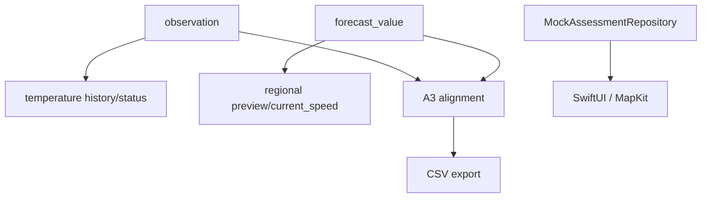

| Data entity | Producer / writers | Readers | API / feature | Downstream |
| --- | --- | --- | --- | --- |
| seagis.dataset | supabase/seed.sql; scripts/provision_a1.py; scripts/deploy_a2.py | A1 ingest/history; A2 persist/preview; A3 source_bundle | private SQL / demo / offline | Dataset identity, version, cadence, licence and ingestion gates. |
| seagis.dataset_parameter | supabase/seed.sql; scripts/provision_a1.py; scripts/deploy_a2.py | A1 ingest/history; A2 persist/preview; A3 source_bundle | private SQL / demo / offline | Source-variable to parameter contract and conversion rules. |
| seagis.forecast_run | seagis_environment.persist; A0 fixtures | seagis_environment.preview/current_speed; A3 source_bundle; CSV exporter | private SQL / demo / offline | Regional model capture/vintage; unknown publication time remains null. |
| seagis.forecast_value | seagis_environment.persist; A0 fixtures | seagis_environment.preview/current_speed; A3 source_bundle; CSV exporter | private SQL / demo / offline | Parameter value per run, grid and valid time; not duplicated per plot. |
| seagis.ingestion_run | seagis_api.ingest; seagis_environment.persist; A0 fixtures | A3 source_bundle; provenance guards | private SQL / demo / offline | Audit of a logical ingestion and its completion state. |
| seagis.observation | seagis_api.ingest; A0 fixtures | seagis_api.history/status; A3 source_bundle; export_experiment_csv.py | temperature history/status | Local sensor water-temperature readings, retaining native values, QC and raw lineage. |
| seagis.parameter | supabase/seed.sql; scripts/provision_a1.py; scripts/deploy_a2.py | A1 ingest/history; A2 persist/preview; A3 source_bundle | private SQL / demo / offline | Registry of parameters and normalized units. |
| seagis.plot | supabase/seed.sql; scripts/provision_a1.py; scripts/deploy_a2.py | A1 ingest/history; A2 persist/preview; A3 source_bundle | private SQL / demo / offline | Plot identity and survey status; nullable coordinates are not evidence of a surveyed location. |
| seagis.plot_grid_mapping | A0 fixture/admin SQL | A3 source_bundle; feature_input guards | private SQL / demo / offline | Operational plot-to-grid mapping with effective and recorded times. |
| seagis.quality_event | seagis_api.ingest; A0 fixtures | A3 source_bundle/alignment | private SQL / demo / offline | Append-only QC log for ingestion or one measurement. |
| seagis.sensor | supabase/seed.sql; scripts/provision_a1.py; scripts/deploy_a2.py | A1 ingest/history; A2 persist/preview; A3 source_bundle | private SQL / demo / offline | Temperature sensor deployment identity, plot, depth and active state. |
| seagis.source | supabase/seed.sql; scripts/provision_a1.py; scripts/deploy_a2.py | A1 ingest/history; A2 persist/preview; A3 source_bundle | private SQL / demo / offline | Registry of dataset providers. |
| seagis.source_grid | seagis_environment.persist; A0 fixtures | seagis_environment.preview/current_speed; A3 source_bundle; CSV exporter | private SQL / demo / offline | Regional cell and depth-layer identity; distinct from cultivation plots. |
| seagis_api.credential | scripts/provision_a1.py; migration 0002 | seagis_api.actor/rate_ok/ingest/history/status | private SQL / demo / offline | API actor identity using token hashes, expiry and revocation. |
| seagis_api.packet_receipt | seagis_api.ingest/reply | seagis_api.actor/rate_ok/ingest/history/status | private SQL / demo / offline | Sensor-packet idempotency key and semantic digest. |
| seagis_api.reader_plot | scripts/provision_a1.py; migration 0002 | seagis_api.actor/rate_ok/ingest/history/status | private SQL / demo / offline | Plot allowlist for a reader credential. |
| seagis_api.request_event | seagis_api.ingest/reply | seagis_api.actor/rate_ok/ingest/history/status | private SQL / demo / offline | Authenticated API response audit and rate-limit basis. |
| seagis_api.temperature_policy | scripts/provision_a1.py; migration 0002 | seagis_api.actor/rate_ok/ingest/history/status | private SQL / demo / offline | Pilot engineering QC settings and request limit; not disease thresholds. |
| seagis_environment.attempt | seagis_environment.claim/persist/finish_failure; migration 0003 | A2 status/preview; A3 source_bundle | private SQL / demo / offline | Audit of a fetch attempt, including duplicate and abandoned outcomes. |
| seagis_environment.current_speed | NOT APPLICABLE: view | A2 status/preview; A3 source_bundle | private SQL / demo / offline | Current-magnitude view joining components from the same run, grid and time. |
| seagis_environment.demo_grid_mapping | seagis_environment.claim/persist/finish_failure; migration 0003 | A2 status/preview; A3 source_bundle | private SQL / demo / offline | Bridge from two fictional plots to real grids for preview, not training authorization. |
| seagis_environment.policy | seagis_environment.claim/persist/finish_failure; migration 0003 | A2 status/preview; A3 source_bundle | private SQL / demo / offline | Regional fetch, licence, scheduler cadence, staleness and retention policy. |
| seagis_environment.schedule_state | seagis_environment.claim/persist/finish_failure; migration 0003 | A2 status/preview; A3 source_bundle | private SQL / demo / offline | Mutable lease, due time, backoff and last-success state. |
| seagis_features.feature_input | A0 fixture/test inserts; production builder NOT FOUND | snapshot/input guards; production ML consumer NOT FOUND | private SQL / demo / offline | Foreign-key input lineage and cutoff guards for feature snapshots. |
| seagis_features.feature_snapshot | A0 fixture/test inserts; production builder NOT FOUND | snapshot/input guards; production ML consumer NOT FOUND | private SQL / demo / offline | Draft/sealed feature container with cutoff and hashes; no production builder found. |
| seagis_quality.alignment_snapshot | seagis_quality.save_snapshot | seagis_quality.source_bundle/save_snapshot/snapshot; curate_environment.py | private SQL / demo / offline | Immutable hourly QC/alignment document; always training_authorized=false. |
| seagis_quality.policy | scripts/quality/store.py::register_policy | seagis_quality.source_bundle/save_snapshot/snapshot; curate_environment.py | private SQL / demo / offline | Immutable registry of QC policy versions and builder code hashes. |
| seagis_quality.snapshot_input | seagis_quality.save_snapshot | seagis_quality.source_bundle/save_snapshot/snapshot; curate_environment.py | private SQL / demo / offline | Per-hour measurement lineage of an alignment snapshot. |
| seagis_raw.raw_payload | seagis_api.ingest; seagis_environment.persist; A0 fixtures | A3 source_bundle; provenance guards | private SQL / demo / offline | Immutable raw manifest: digest, hash basis, licence and retention mode. |


## 11 Data Quality and Architecture Audit

Read-only audit of code and historical metadata; severity expresses potential impact within the prototype scope, not a measured production incident. No application/schema changes were applied.

### F01 iOS assessment is not connected to backend

| Attribute | Finding |
| --- | --- |
| Severity / category | High / Contract / integration |
| Status | VERIFIED |
| Description / impact | The mock returns synthetic_fixture; no assessment API adapter was found. New consumers must not treat the domain model as a wire contract. |
| Affected | Seagis/Seagis/Repositories/Shared/MockAssessmentRepository.swift, Seagis/Seagis/Models/Shared/Assessment.swift |
| Evidence | `Seagis/Seagis/Repositories/Shared/MockAssessmentRepository.swift:1`; `Seagis/Seagis/Models/Shared/Assessment.swift:1` |
| Recommendation | Agree an executable contract and provenance/error mapping before integration. |

### F02 Mapping immutability after 0005 changes the old closing procedure

| Attribute | Finding |
| --- | --- |
| Severity / category | Medium / Lifecycle |
| Status | VERIFIED |
| Description / impact | A0 guard_mapping permits interval closure; the 0005 trigger rejects all UPDATE/DELETE. A0 architecture instructions for closing mappings can fail on the complete schema. |
| Affected | supabase/migrations/0001_initial_schema.sql, supabase/migrations/0005_quality_alignment.sql, docs/architecture.md |
| Evidence | `Seagis-Model/supabase/migrations/0001_initial_schema.sql:1`; `Seagis-Model/supabase/migrations/0005_quality_alignment.sql:1`; `Seagis-Model/docs/architecture.md:1` |
| Recommendation | Define append-only supersession and test interval overlap/cutoff. |

### F03 History grows without a discovered retention job

| Attribute | Finding |
| --- | --- |
| Severity / category | Medium / Governance / retention |
| Status | INFERRED |
| Description / impact | request_event, observations, forecasts and snapshots are append-only; scheduled TTL/cleanup and recovery tests were not found in the checkouts. Capacity risk is inferred, not benchmarked. |
| Affected | supabase/migrations/0001_initial_schema.sql, supabase/migrations/0002_temperature_api.sql, supabase/migrations/0005_quality_alignment.sql |
| Evidence | `Seagis-Model/supabase/migrations/0001_initial_schema.sql:1`; `Seagis-Model/supabase/migrations/0002_temperature_api.sql:1`; `Seagis-Model/supabase/migrations/0005_quality_alignment.sql:1` |
| Recommendation | Set domain retention, archival, backups and restore drills before production scale. |

### F04 A3 SQL checks lineage but does not recompute all QC

| Attribute | Finding |
| --- | --- |
| Severity / category | Medium / Validation boundary |
| Status | VERIFIED |
| Description / impact | save_snapshot verifies policy/code hashes and source values, but usable_context/flags/blocking_flags decisions are not recomputed through Python inside the DB. The worker role remains a trust boundary. |
| Affected | supabase/migrations/0005_quality_alignment.sql, scripts/quality/alignment.py |
| Evidence | `Seagis-Model/supabase/migrations/0005_quality_alignment.sql:1`; `Seagis-Model/scripts/quality/alignment.py:1` |
| Recommendation | Document worker trust; add deterministic QC verification and payload-tampering tests where required. |

### F05 Metadata-only limits raw reproducibility

| Attribute | Finding |
| --- | --- |
| Severity / category | Medium / Data provenance |
| Status | VERIFIED |
| Description / impact | A2 retains no raw content. A Toolbox subset hash is not an original NetCDF/Zarr byte hash; refetching a provider aggregate does not guarantee the same vintage. |
| Affected | scripts/environmental/copernicus.py, supabase/migrations/0003_environment_ingestion.sql |
| Evidence | `Seagis-Model/scripts/environmental/copernicus.py:1`; `Seagis-Model/supabase/migrations/0003_environment_ingestion.sql:1` |
| Recommendation | Preserve hash_basis; if licence and cost allow, propose immutable versioned subset/object retention. |

### F06 Capture CSV is not a historical backtest

| Attribute | Finding |
| --- | --- |
| Severity / category | High / Analytics semantics |
| Status | VERIFIED |
| Description / impact | The exporter selects latest_available_at_capture; A3 uses a per-hour cutoff. Treating the CSV as historical availability risks leakage; code explicitly sets training_authorized=false. |
| Affected | scripts/export_experiment_csv.py, scripts/quality/alignment.py |
| Evidence | `Seagis-Model/scripts/export_experiment_csv.py:1`; `Seagis-Model/scripts/quality/alignment.py:1` |
| Recommendation | Use all-vintage source bundles and explicit cutoffs when designing backtests; retain the training gate until validation. |

### F07 A0 documentation predates A1–A3 implementation

| Attribute | Finding |
| --- | --- |
| Severity / category | Low / Documentation drift |
| Status | VERIFIED |
| Description / impact | docs/architecture.md says ingestion/scheduler/QC are not implemented, while subsequent migrations and workers exist. Statements require phase/date context. |
| Affected | docs/architecture.md, scripts/ingest_environment.py, scripts/curate_environment.py |
| Evidence | `Seagis-Model/docs/architecture.md:1`; `Seagis-Model/scripts/ingest_environment.py:1`; `Seagis-Model/scripts/curate_environment.py:1` |
| Recommendation | Use a phase-status index and source manifest for documentation updates. |

### F08 Catalog snapshot is five days old

| Attribute | Finding |
| --- | --- |
| Severity / category | Medium / Runtime verification |
| Status | UNVERIFIED |
| Description / impact | The 22 October snapshot is not a 27 October runtime audit. Grants, row counts, active schedules and current cloud migrations were not reverified. |
| Affected | runtime catalog |
| Evidence | schema-metadata-20261022.json inspected_at |
| Recommendation | Run a read-only catalog diff and grants review before production decisions. |

Priority: P1 agree integration/contracts and prevent leakage (F01/F06); P2 address trust, retention, mapping lifecycle and raw reproducibility (F02–F05); P3 refresh documentation status/catalog (F07/F08). Index/performance evaluation needs EXPLAIN and actual workloads: no missing-index or slow-query claim is established merely from column names.


## 12 Glossary

| Term | Definition |
| --- | --- |
| Origin | Data origin: sensor, regional model or derived value |
| Ingestion | Receipt and persistence of one capture |
| Vintage | Preserved model capture version |
| Native cadence | Original sample interval, distinct from scheduler tick |
| Availability cutoff | Boundary of information available at decision time |
| Value status | Numeric availability, not disease state |
| QC | Data quality checks; not diagnosis |
| Idempotency | Identical retry does not add a measurement |
| Lineage | Reference trail from output to source |
| Manifest | Input/file list with identities and digests |
| RLS | Row Level Security; effect depends on roles and grants |
| FK | Foreign key: referential integrity between rows |
| NULL | Unavailable value; distinct from numeric zero |
| Metadata-only | Provenance/digest retention without raw content |
| Sealed snapshot | Snapshot that cannot be mutated after sealing |
| Ice-ice | Cultivation disease context; this documentation does not validate its prediction |


## 13 Appendices

### 13.1 Evidence base and audit boundaries

| Repository | Commit | Path |
| --- | --- | --- |
| Seagis-Model | 291b6c5fdc7c990660ea98b1dcf676f6c0b58148 | /Users/cindyram/Documents/Apple/Seagis-Model |
| Seagis | 109619ba0cb43035ce102e187158fbce9a7a42c1 | /Users/cindyram/Documents/Apple/Seagis |
| AppPOC | c68d72ae90457a9e8def40b57dfae9e86607aff8 | /Users/cindyram/Documents/Apple/AppPOC |

Implementation files were read through the documentation generator and targeted searches; the manifest records per-file hashes. No external source substitutes for implementation. No migrations, ingestion workers, database-writing tests or deployment were run. Pure/offline contract tests are reported separately in validation.json. Environment files, credentials and table contents were not copied.

### 13.2 Measured coverage

| Component | Discovered | ID documented | EN documented | Evidence / gaps |
| --- | --- | --- | --- | --- |
| Application databases | 1 | 1 | 1 | Code + historical catalog; current runtime unresolved |
| Application schemas | 6 | 6 | 6 | historical catalog + migrations |
| Physical tables | 28 | 28 | 28 | row counts UNVERIFIED |
| Views | 1 | 1 | 1 | current_speed |
| Columns (tables + view) | 268 | 268 | 268 | 259 table + 9 view fields; some meanings remain limited |
| Physical FK | 47 | 47 | 47 | historical catalog + SQL |
| Column-origin mappings | 268 | 268 | 268 | 268 VERIFIED; 0 UNVERIFIED |
| Pipeline paths | 4 | 4 | 4 | A1, A2, A3, CSV export |
| Boundary contracts | 11 | 11 | 11 | 4 explicit; 7 implementation-derived |
| JSON-schema field/structure entries | 147 | 147 | 147 | Not all nested semantics resolved; full schemas included |
| Object dependency rows | 29 | 29 | 29 | writers/readers from code; deployment unverified |
| Runtime rows/grants/backups | UNVERIFIED | UNVERIFIED | UNVERIFIED | No live access in this audit |

Coverage of 29/29 snapshot objects and 268/268 columns is not a claim of 100% production-architecture coverage. Internal schemas, sources outside the three checkouts, runtime deployment and ambiguous nested fields have no known complete denominator.

### 13.2.1 Observed local file datasets

CSV metadata below was inspected without copying row values. Counts belong to local capture files, not database tables. Regional CSV retains native cadence and latest_available_at_capture; plot temperatures are synthetic. source_bundles/alignment/manifest JSON are exporter/curator outputs under C04/C07/C08; worker.log is operational logging and the CA certificate is trust material, not an environmental dataset.

| File | Rows observed | Columns / contract |
| --- | --- | --- |
| Seagis-Model/data/exports/forecast-20261023T015005Z/features/air_temperature_2m.csv | 26 | timestamp_utc, timestamp_wib, value, unit, value_status, quality_status, qc_flags, attribution, available_at, capture_at_utc, conversion_code, dataset_key, detection_limit, forecast_run_id, id, ingested_at, interval_status, is_synthetic, issue_time_basis, issued_at, kind, licence_url, model_initialized_at, native_cadence_seconds, native_unit, native_value, parameter_code, period_end_at, period_start_at, run_ingested_at, run_kind, selection_basis, source_grid_id, source_kind, source_time, temporal_support, training_authorized, valid_at |
| Seagis-Model/data/exports/forecast-20261023T015005Z/features/cloud_cover.csv | 26 | timestamp_utc, timestamp_wib, value, unit, value_status, quality_status, qc_flags, attribution, available_at, capture_at_utc, conversion_code, dataset_key, detection_limit, forecast_run_id, id, ingested_at, interval_status, is_synthetic, issue_time_basis, issued_at, kind, licence_url, model_initialized_at, native_cadence_seconds, native_unit, native_value, parameter_code, period_end_at, period_start_at, run_ingested_at, run_kind, selection_basis, source_grid_id, source_kind, source_time, temporal_support, training_authorized, valid_at |
| Seagis-Model/data/exports/forecast-20261023T015005Z/features/current_eastward.csv | 5 | timestamp_utc, timestamp_wib, value, unit, value_status, quality_status, qc_flags, attribution, available_at, capture_at_utc, conversion_code, dataset_key, detection_limit, forecast_run_id, id, ingested_at, interval_status, is_synthetic, issue_time_basis, issued_at, kind, licence_url, model_initialized_at, native_cadence_seconds, native_unit, native_value, parameter_code, period_end_at, period_start_at, run_ingested_at, run_kind, selection_basis, source_grid_id, source_kind, source_time, temporal_support, training_authorized, valid_at |
| Seagis-Model/data/exports/forecast-20261023T015005Z/features/current_northward.csv | 5 | timestamp_utc, timestamp_wib, value, unit, value_status, quality_status, qc_flags, attribution, available_at, capture_at_utc, conversion_code, dataset_key, detection_limit, forecast_run_id, id, ingested_at, interval_status, is_synthetic, issue_time_basis, issued_at, kind, licence_url, model_initialized_at, native_cadence_seconds, native_unit, native_value, parameter_code, period_end_at, period_start_at, run_ingested_at, run_kind, selection_basis, source_grid_id, source_kind, source_time, temporal_support, training_authorized, valid_at |
| Seagis-Model/data/exports/forecast-20261023T015005Z/features/nitrate.csv | 2 | timestamp_utc, timestamp_wib, value, unit, value_status, quality_status, qc_flags, attribution, available_at, capture_at_utc, conversion_code, dataset_key, detection_limit, forecast_run_id, id, ingested_at, interval_status, is_synthetic, issue_time_basis, issued_at, kind, licence_url, model_initialized_at, native_cadence_seconds, native_unit, native_value, parameter_code, period_end_at, period_start_at, run_ingested_at, run_kind, selection_basis, source_grid_id, source_kind, source_time, temporal_support, training_authorized, valid_at |
| Seagis-Model/data/exports/forecast-20261023T015005Z/features/phosphate.csv | 2 | timestamp_utc, timestamp_wib, value, unit, value_status, quality_status, qc_flags, attribution, available_at, capture_at_utc, conversion_code, dataset_key, detection_limit, forecast_run_id, id, ingested_at, interval_status, is_synthetic, issue_time_basis, issued_at, kind, licence_url, model_initialized_at, native_cadence_seconds, native_unit, native_value, parameter_code, period_end_at, period_start_at, run_ingested_at, run_kind, selection_basis, source_grid_id, source_kind, source_time, temporal_support, training_authorized, valid_at |
| Seagis-Model/data/exports/forecast-20261023T015005Z/features/precipitation.csv | 26 | timestamp_utc, timestamp_wib, value, unit, value_status, quality_status, qc_flags, attribution, available_at, capture_at_utc, conversion_code, dataset_key, detection_limit, forecast_run_id, id, ingested_at, interval_status, is_synthetic, issue_time_basis, issued_at, kind, licence_url, model_initialized_at, native_cadence_seconds, native_unit, native_value, parameter_code, period_end_at, period_start_at, run_ingested_at, run_kind, selection_basis, source_grid_id, source_kind, source_time, temporal_support, training_authorized, valid_at |
| Seagis-Model/data/exports/forecast-20261023T015005Z/features/salinity.csv | 5 | timestamp_utc, timestamp_wib, value, unit, value_status, quality_status, qc_flags, attribution, available_at, capture_at_utc, conversion_code, dataset_key, detection_limit, forecast_run_id, id, ingested_at, interval_status, is_synthetic, issue_time_basis, issued_at, kind, licence_url, model_initialized_at, native_cadence_seconds, native_unit, native_value, parameter_code, period_end_at, period_start_at, run_ingested_at, run_kind, selection_basis, source_grid_id, source_kind, source_time, temporal_support, training_authorized, valid_at |
| Seagis-Model/data/exports/forecast-20261023T015005Z/features/uv_index.csv | 26 | timestamp_utc, timestamp_wib, value, unit, value_status, quality_status, qc_flags, attribution, available_at, capture_at_utc, conversion_code, dataset_key, detection_limit, forecast_run_id, id, ingested_at, interval_status, is_synthetic, issue_time_basis, issued_at, kind, licence_url, model_initialized_at, native_cadence_seconds, native_unit, native_value, parameter_code, period_end_at, period_start_at, run_ingested_at, run_kind, selection_basis, source_grid_id, source_kind, source_time, temporal_support, training_authorized, valid_at |
| Seagis-Model/data/exports/forecast-20261023T015005Z/features/water_temperature_plot-a.csv | 72 | timestamp_utc, timestamp_wib, plot_id, is_gap, is_synthetic, value_status, quality_status, qc_flags, strict_source_qc_pass, observation_id, available_at_utc, training_authorized, value, raw_value, parameter_code, unit, source_kind, value_policy |
| Seagis-Model/data/exports/forecast-20261023T015005Z/features/water_temperature_plot-b.csv | 72 | timestamp_utc, timestamp_wib, plot_id, is_gap, is_synthetic, value_status, quality_status, qc_flags, strict_source_qc_pass, observation_id, available_at_utc, training_authorized, value, raw_value, parameter_code, unit, source_kind, value_policy |
| Seagis-Model/data/exports/forecast-20261023T015005Z/features/wind_direction_10m.csv | 26 | timestamp_utc, timestamp_wib, value, unit, value_status, quality_status, qc_flags, attribution, available_at, capture_at_utc, conversion_code, dataset_key, detection_limit, forecast_run_id, id, ingested_at, interval_status, is_synthetic, issue_time_basis, issued_at, kind, licence_url, model_initialized_at, native_cadence_seconds, native_unit, native_value, parameter_code, period_end_at, period_start_at, run_ingested_at, run_kind, selection_basis, source_grid_id, source_kind, source_time, temporal_support, training_authorized, valid_at |
| Seagis-Model/data/exports/forecast-20261023T015005Z/features/wind_speed_10m.csv | 26 | timestamp_utc, timestamp_wib, value, unit, value_status, quality_status, qc_flags, attribution, available_at, capture_at_utc, conversion_code, dataset_key, detection_limit, forecast_run_id, id, ingested_at, interval_status, is_synthetic, issue_time_basis, issued_at, kind, licence_url, model_initialized_at, native_cadence_seconds, native_unit, native_value, parameter_code, period_end_at, period_start_at, run_ingested_at, run_kind, selection_basis, source_grid_id, source_kind, source_time, temporal_support, training_authorized, valid_at |

### 13.3 Open questions

- Have cloud schemas and grants changed since 22 October?
- How are immutable mapping supersession and overlap resolution defined?
- Who owns backup/retention operations and how is restore verified?
- Which assessment contract will backend/iOS approve?
- When will real plots/locations/sensor depths be validated and the training gate evaluated?

### 13.4 Illustrative read-only SQL

The following query was not executed against the cloud in this audit.
```sql
BEGIN READ ONLY;
SELECT schemaname, tablename FROM pg_catalog.pg_tables
WHERE schemaname IN ('seagis','seagis_raw','seagis_api',
 'seagis_environment','seagis_quality','seagis_features')
ORDER BY schemaname, tablename;
ROLLBACK;
```

### 13.5 SQL function registry

| Function | Arguments | Evidence |
| --- | --- | --- |
| seagis.valid_value | v double precision, native double precision, status text, lim double precision | `Seagis-Model/supabase/migrations/0001_initial_schema.sql:168` |
| seagis.valid_support | t timestamptz, support text, status text, a timestamptz, b timestamptz | `Seagis-Model/supabase/migrations/0001_initial_schema.sql:176` |
| seagis.jsonb_sha256 | value jsonb | `Seagis-Model/supabase/migrations/0001_initial_schema.sql:296` |
| seagis.reject_mutation |  | `Seagis-Model/supabase/migrations/0001_initial_schema.sql:330` |
| seagis.guard_ingestion |  | `Seagis-Model/supabase/migrations/0001_initial_schema.sql:334` |
| seagis.guard_dataset_identity |  | `Seagis-Model/supabase/migrations/0001_initial_schema.sql:347` |
| seagis.guard_sensor_deployment |  | `Seagis-Model/supabase/migrations/0001_initial_schema.sql:357` |
| seagis.guard_raw |  | `Seagis-Model/supabase/migrations/0001_initial_schema.sql:366` |
| seagis.guard_measurement |  | `Seagis-Model/supabase/migrations/0001_initial_schema.sql:379` |
| seagis.guard_run |  | `Seagis-Model/supabase/migrations/0001_initial_schema.sql:406` |
| seagis.guard_mapping |  | `Seagis-Model/supabase/migrations/0001_initial_schema.sql:415` |
| seagis.guard_quality_event |  | `Seagis-Model/supabase/migrations/0001_initial_schema.sql:424` |
| seagis_features.guard_input |  | `Seagis-Model/supabase/migrations/0001_initial_schema.sql:434` |
| seagis_features.manifest_hash | snapshot uuid | `Seagis-Model/supabase/migrations/0001_initial_schema.sql:458` |
| seagis_features.guard_snapshot |  | `Seagis-Model/supabase/migrations/0001_initial_schema.sql:465` |
| seagis_api.utc | t timestamptz | `Seagis-Model/supabase/migrations/0002_temperature_api.sql:88` |
| seagis_api.actor | token text, actor_kind text | `Seagis-Model/supabase/migrations/0002_temperature_api.sql:90` |
| seagis_api.reply | actor_id uuid, status integer, code text, body jsonb DEFAULT '{}', sensor uuid DEFAULT NULL | `Seagis-Model/supabase/migrations/0002_temperature_api.sql:96` |
| seagis_api.rate_ok | actor_id uuid | `Seagis-Model/supabase/migrations/0002_temperature_api.sql:105` |
| seagis_api.ingest | token text, packet jsonb, wire_sha256 text, wire_bytes integer | `Seagis-Model/supabase/migrations/0002_temperature_api.sql:113` |
| seagis_api.history | token text, target_plot uuid, spec jsonb | `Seagis-Model/supabase/migrations/0002_temperature_api.sql:222` |
| seagis_api.status | token text | `Seagis-Model/supabase/migrations/0002_temperature_api.sql:274` |
| seagis_environment.claim | k text, force_fetch boolean DEFAULT false | `Seagis-Model/supabase/migrations/0003_environment_ingestion.sql:99` |
| seagis_environment.finish_failure | lease uuid, code text | `Seagis-Model/supabase/migrations/0003_environment_ingestion.sql:117` |
| seagis_environment.persist | lease uuid, batch jsonb | `Seagis-Model/supabase/migrations/0003_environment_ingestion.sql:131` |
| seagis_environment.status |  | `Seagis-Model/supabase/migrations/0003_environment_ingestion.sql:212` |
| seagis_environment.preview | plot uuid, as_of timestamptz DEFAULT now( | `Seagis-Model/supabase/migrations/0003_environment_ingestion.sql:227` |
| seagis_environment.finish_failure | lease uuid, code text | `Seagis-Model/supabase/migrations/0004_provider_update_status.sql:2` |
| seagis_quality.source_bundle | p_plot uuid,p_start timestamptz,p_end timestamptz,p_demo boolean DEFAULT false | `Seagis-Model/supabase/migrations/0005_quality_alignment.sql:47` |
| seagis_quality.save_snapshot | document jsonb | `Seagis-Model/supabase/migrations/0005_quality_alignment.sql:121` |
| seagis_quality.snapshot | identity uuid | `Seagis-Model/supabase/migrations/0005_quality_alignment.sql:232` |

### 13.6 Source register

| Path | Lines | SHA-256 |
| --- | --- | --- |
| Seagis-Model/README.md | 71 | 4db1d01136db09e662c2bb005264cd7ff657c5fc6b2a2851b2ef9ccb5010354a |
| Seagis-Model/config/a2_sources.json | 15 | a53addfbf7a0b2733bdcedaabf6c85dad2c428d3afd05eeffbdf79af459393b2 |
| Seagis-Model/config/a3_quality.json | 33 | 0f4e803b19b129edd3d49be6466bcaf0e22eafb293001290c5893e23614bae5e |
| Seagis-Model/contracts/alignment.schema.json | 81 | 7cf0f75151aaf3b1e73da9091ad225abaeee979aba5a1a4aa48d3bd5fff91f66 |
| Seagis-Model/contracts/iot-packet.schema.json | 19 | 1a03ae7fad5b1d3a4f328b879cd68e432544ebeed819f77fa97437aa627581c4 |
| Seagis-Model/contracts/normalized.schema.json | 918 | e3d1605ce38afb2c77cee8ca3a669f3dfbb32ebce927155c65429b74d1b13309 |
| Seagis-Model/contracts/source.schema.json | 527 | 818d451814b97aba7d40d75576d60e5c0a72aea4e110cee900cff795fc7aab08 |
| Seagis-Model/docs/a0_review.md | 73 | 3de9ffcf90fe3abfece563347e5447dfb7bacb56dbc03c265c0d10120025966e |
| Seagis-Model/docs/a1/iot_handover.md | 131 | 7fbd035f3e1b843ca05b69958f7a442515c51e4df5ca33b36bb4c1a6f0914333 |
| Seagis-Model/docs/a1/operations.md | 111 | 01d9de4516a22f3683b8065a5fd0b3a02941e027bba38e81307b87e821c0c36e |
| Seagis-Model/docs/a1/review.md | 53 | b2d95bdf10bff99cf560b93d0a86c2227525f882412d04b1b031d7e3cbdf705c |
| Seagis-Model/docs/a1/validation_20261022.json | 112 | 1ad7b37395480199d2b6b2fa55cab7455862212901b8474c0e4bbc05577dae99 |
| Seagis-Model/docs/a2/architecture.md | 74 | 530a0c4d72f8d9b05b53b0c09dee3d1c30064a6446a8dba7220fc9bd019f5655 |
| Seagis-Model/docs/a2/ingestion_report_20261022.json | 432 | 894bb8e96fa756341075c760c2841db21ff3d95e098aa44540e7557a29c34ddd |
| Seagis-Model/docs/a2/licenses.md | 27 | c1551d495c52a5054f7974d2d7397d1e9ea3f841619b77ed4d504b4570d1743a |
| Seagis-Model/docs/a2/operations.md | 69 | d0a4e9894254025cc7514a9fe808dd25bd929c0053c389f8ea05ff4208c2acfa |
| Seagis-Model/docs/a2/review.md | 52 | ea22ff34a20cbf1691ecfcbe1b3269aeeb46d5d4d6bb5f450b8f9571667442a2 |
| Seagis-Model/docs/a2/source_evidence_20261022.json | 55 | a80fd90bae4da2694c049feed7b34bde43ff0ace51d5ddbb66389536b797b0e5 |
| Seagis-Model/docs/a3/architecture.md | 59 | 9e209b5b3840be8dbdeb0948f2faa9c1c479aaa22bcdec70e231c6c0c94dbb24 |
| Seagis-Model/docs/a3/operations.md | 99 | a5f17669b2400757e76bd6a3fd27caf29a6c6e6966a2bb3bb21d5fc5a7db676e |
| Seagis-Model/docs/a3/quality_report_20261022.json | 1002 | 2e67a3b630917bda4d20fe4ef031d393d3ba61292ea90de15f4ce4a8a8500223 |
| Seagis-Model/docs/a3/review.md | 63 | a0d533104fbfbedad18ab435a0a2702364fecd8392e3b7b9983410afbbd5eb33 |
| Seagis-Model/docs/architecture.md | 85 | b5a7ff5659e4aad20a726218f1333ae814b60963ae5ae272071621b7c9d7f95f |
| Seagis-Model/docs/data_contracts.md | 103 | 836f6ed8879a23efbd67c24fe199246d065c4aae9b73c662b9a8a47ce15a293d |
| Seagis-Model/docs/data_dictionary.md | 115 | 175a21dc9d633b89ad0a605c1747296cefa287a9da134b78cac1f0a2d0f4d8c0 |
| Seagis-Model/docs/decisions/ADR-001-data-storage.md | 50 | bc2fcffc9170b6034ae9707d56b4382fa54ea7a1dfda6a83acb273e4b55d49d3 |
| Seagis-Model/docs/experiment_csv.md | 75 | 67c912601b6c228f0140eea4726cfed34481cf3e6eaa9fe850dc33f4ad8f4b7a |
| Seagis-Model/docs/metadata/source_catalogue_20261021.json | 79 | 8ef86e2ca4db05315efb5b4cececc23951c55fa63295ffa31460cef4b96f0eee |
| Seagis-Model/docs/source_registry.md | 54 | 6310bce3d80e1e7fdea1d2855fd9446febf133902a007af56304254c1a950569 |
| Seagis-Model/fixtures/a1/hourly_synthetic.json | 1970 | 8d833be53dbfe0c2fd5c590830821374f027a5090f8804d2085f686855add22c |
| Seagis-Model/fixtures/a3/synthetic_bundle.json | 670 | 522bd51062e91a1419bf85f0b62e8b206e5e5208df17f3cf5bd81f9606c39d89 |
| Seagis-Model/fixtures/normalized/copernicus_currents.json | 79 | c5fb39ed7cccb2dbba94135d3dda19464bf8287b6e082d224f006ab0461c4913 |
| Seagis-Model/fixtures/normalized/copernicus_nutrients.json | 79 | a30d3dae6c700faa491662773bcda03efe08d0c93d8d136f68c84264f115fa85 |
| Seagis-Model/fixtures/normalized/copernicus_salinity.json | 60 | 9c262f0b2922d3f100a8d35ad326b53fc850e688e2d0d9742c4aeb0aa4e4104a |
| Seagis-Model/fixtures/normalized/open_meteo.json | 155 | 8b4d8cdd2732ca0b88bcd6db6f920e12b4b6746187bb080aa135dbaadf4e94d3 |
| Seagis-Model/fixtures/normalized/sensor.json | 42 | 7ab0f72245e724d6ad36c5c65abcbdd24775f7708b3846d4c31a4b3b3c224d8f |
| Seagis-Model/fixtures/source/copernicus_currents.json | 48 | ee2a87156030ab83902eee430ac9ef0cbf9dc508cf2b48a5981a9780ceded27d |
| Seagis-Model/fixtures/source/copernicus_nutrients.json | 48 | 5f1424796bf98e90ce129f477d063cbd286a4302f7f53e79869157ba4e342675 |
| Seagis-Model/fixtures/source/copernicus_salinity.json | 41 | ba795d27a545d2830c2b05d2ffe3a8e9c4fd7c8d72874edc3493195f94436046 |
| Seagis-Model/fixtures/source/open_meteo.json | 62 | fe3c4e57479ee18e2e295b23a6d4240136f89f6a3dc011950056f4f5fa5ea2f2 |
| Seagis-Model/fixtures/source/sensor.json | 20 | 8c18a6aff2a6b72f77bcce58e8d1a8a4a7cd1d378e2d2d70abea0150a3a9b844 |
| Seagis-Model/pyproject.toml | 19 | bc2c936d59d74591a7c3714c70201d9583e5723c7a386b0e33d11954b91b4c91 |
| Seagis-Model/scripts/check_a0.py | 140 | 27a2ccc2ca016c93bf0436da5884f6ec32598847856fdcc36f5533a9499f728d |
| Seagis-Model/scripts/check_a1.py | 10 | 9223b11860bc099ef330c604d51fb6e53afdeec7651d110ab1dcba32ff27b792 |
| Seagis-Model/scripts/check_a1_http.py | 161 | 19e104cc1cdcd406ef60b1c83a95ef5f9d68460c68dda5b7acc73772bcd773c2 |
| Seagis-Model/scripts/check_a1_live.py | 109 | 6c5992eb844030de9dd96f255c273b46d1aed6bbb3e9fc43d13f0c8c066dbe6d |
| Seagis-Model/scripts/curate_environment.py | 63 | a16b2cce80ef1bc84d514e616c06609a4ac6ecc3f1a3d40bad1ab5f137018c33 |
| Seagis-Model/scripts/deploy_a1.py | 130 | 38bb8c515829ddfb81d2698d27d2a197a4ec49f5d82ef670ccd8327fe8f09c0f |
| Seagis-Model/scripts/deploy_a2.py | 36 | 70b9e672dc5ab270984998320c329fe7ba24b0f6700989e8033c8ac461bc0ab2 |
| Seagis-Model/scripts/deploy_a3.py | 56 | 24bd90b43ea4ec355745f335a51520cc693ce249f9c8289e016a335eb876c9fe |
| Seagis-Model/scripts/environmental/__init__.py | 1 | 1f689d46a84d43a484eae691eb87eb1c5a18fcde06b197d7a02f80441e5126d1 |
| Seagis-Model/scripts/environmental/common.py | 158 | 83237385df19e57171552ab6c42551fcd531d156500780f84e838a964e0adae8 |
| Seagis-Model/scripts/environmental/copernicus.py | 133 | a55dc9b11c14f9b094e72ffb832844b6cc4f530963270f0f6d98b23801e1ef04 |
| Seagis-Model/scripts/environmental/open_meteo.py | 65 | 684ab244e25e6eafac81a2f910462fa326444bfdab26a49c06ed450085eae361 |
| Seagis-Model/scripts/environmental/store.py | 68 | 6e81e722210f5d39f15595e0039f16185ef31d18521c8a206f5de5424ea76708 |
| Seagis-Model/scripts/export_experiment_csv.py | 245 | 7a3eea3739e9aa8938a32b403599d911515b3d4fefe86fdb065ef12c7072c4fa |
| Seagis-Model/scripts/ingest_environment.py | 76 | 10a83e77f4f42ed58095385aedb95aa92e620dd458bc673341de074086952ebb |
| Seagis-Model/scripts/install_a2_scheduler.py | 52 | 1d3bfd452f5b1a6adf850b7d5169d698967d8691785bec1aa37006995ef36fb0 |
| Seagis-Model/scripts/provision_a1.py | 111 | 224bc7a7ce5dcce83e290fd6261c8ddd6349a86d07e4041ac51d0741405503bc |
| Seagis-Model/scripts/quality/__init__.py | 1 | c5b07be1b5223a81fc5ea6a9cf99f794c7a96360a552d23eb3c4300783592ebf |
| Seagis-Model/scripts/quality/alignment.py | 387 | dde4eb5b79edfc3fff1e0ed62befdeea58b162541d9e53962f5dc0f508384ca6 |
| Seagis-Model/scripts/quality/store.py | 66 | 204f411108496fe63d242a8fdc6c338f7e17f52def9cc909affef4e010115802 |
| Seagis-Model/scripts/rotate_worker_credentials.py | 105 | 2a8f5cd0606861abb48ffa145bd4a4f2629f244272cfd931f1d1da31edd6aa73 |
| Seagis-Model/scripts/run_a2_worker.py | 31 | 00fb29d0cb12ef882e729d965bbf788aefdb2f47a2597c5d446cd02c1016e3cb |
| Seagis-Model/scripts/simulate_temperature.py | 216 | 1c452139a18e64d91d4292e0d1370fb010988a58a310a2632c253d312240f4fe |
| Seagis-Model/scripts/supabase_admin.py | 81 | ff4f5e9b5d2849a435fb3b8508b11c4e20b255840c4a89c67e10a04b382fa21d |
| Seagis-Model/scripts/validate_contracts.py | 263 | bd0c9589beb03ae16c5c74141c739d73c980599eda46fb078578df07cfad2a0b |
| Seagis-Model/supabase/config.toml | 420 | 5e2f8fab3c2bcd9dd70e290b6a739257df5d8e2b5729084bb4314174fe9fcceb |
| Seagis-Model/supabase/functions/temperature/connection.ts | 27 | 9eb48afaba8117353276eabfdfc76a37b24c3d1eaac576049c233fc564b27f1a |
| Seagis-Model/supabase/functions/temperature/deno.json | 15 | a16b21ff8a72b6d280187e532a40636be001322c6c86fda1df87485160b8feec |
| Seagis-Model/supabase/functions/temperature/handler.test.ts | 88 | 7f231639b4160931ce21e2f32bdf8f420ba83a6bb5ab1c219c46f865bf7067e7 |
| Seagis-Model/supabase/functions/temperature/handler.ts | 113 | e8391e427cab3979b1076a4aba695da63072a770923d6f7716ef6d4776d08bd7 |
| Seagis-Model/supabase/functions/temperature/index.ts | 31 | 1e74cd3a0eadd83a8145b352603fd9ef3c116057c7663d7183327c5c09fa1b44 |
| Seagis-Model/supabase/migrations/0001_initial_schema.sql | 544 | f83e16be7d676cd1552266f2648444edbe12c01aac6b6ac94d4c6d32161c9b42 |
| Seagis-Model/supabase/migrations/0002_temperature_api.sql | 297 | c1547f70b3bf29ea5a54171ff547177713bbd0f4d9bac8e33d47d1c940fd992f |
| Seagis-Model/supabase/migrations/0003_environment_ingestion.sql | 261 | d49a5897bca967b33e3ab79745bb4f1bb9e76babc318544bfc7c024c8993d1f5 |
| Seagis-Model/supabase/migrations/0004_provider_update_status.sql | 15 | bf92788ed13dd0ffd60a8f21b25f84627976f5e9b46e27f98b00f4062a4cbe0a |
| Seagis-Model/supabase/migrations/0005_quality_alignment.sql | 249 | afc5d564ed54adf9cf353865f0859f414469016b02823707f3d872453608da65 |
| Seagis-Model/supabase/seed.sql | 10 | 4809f15911388f46d0b94fcc09d413e341f7aadf4eb67fb88dadf6e6f0748f79 |
| Seagis-Model/tests/bootstrap_roles.sql | 8 | 4fe6ea493501b15e67aa693fce29a08f24096f1c95d5f6f52af79e3943338f08 |
| Seagis-Model/tests/test_a1.py | 268 | 49ffb98dbf091d5343be35d7f0ef532e27beccdef5af9b2a343bc30b1e8e758b |
| Seagis-Model/tests/test_a1_tools.py | 85 | e9a79d56845040e695774e8205a2aa5ef9ea85bc3dd6448f07479ffc5e0a0bb9 |
| Seagis-Model/tests/test_a3.py | 418 | 607f4ec2cf2bb737a93d4412294da99b49d5bfea04ff1ae886d677f23a2f1df1 |
| Seagis-Model/tests/test_contracts.py | 108 | af73d14cd7b5d49e91555b1040a9520d2ca2eb2ccc7def15f40e59ab31296ea9 |
| Seagis-Model/tests/test_database.py | 489 | 19be7574738537be1358ed6b36ca1cf586be5affd9e9b846f92032e755d56e44 |
| Seagis/AGENTS.md | 28 | 9aeaecda1a0926efa09176c2adbb543b06c4c7041d7fed671cb7a43177fee1e2 |
| Seagis/README.md | 124 | c40fef74d33539a20f283c742175e2f1fd4a747e4d909a9aa6cc152ef29682ba |
| Seagis/SPEC_REFERENCE.md | 25 | dc29fa4fcf7879059b83c255fd604ab0a6d8eb7376deb2a0114ca544db329c8a |
| Seagis/Seagis/App/AppContainer.swift | 20 | 30f78023407d3e3f85dd4f1f3de7be9e8c0db823843ac2435f3134ebc0f85421 |
| Seagis/Seagis/App/SeagisApp.swift | 10 | d6f0f8373869116965c49bbf404a64a1138cc939fd2a6703cdf4ee71ab99797a |
| Seagis/Seagis/Models/FarmMap/FarmPlotDisplayStatus.swift | 25 | 30863de6a7400f137297a0668d175b3c5814f7db7720ad3699325b56ee07a43e |
| Seagis/Seagis/Models/PlotCapture/CaptureMapArea.swift | 20 | c58772b18a16045b75b00f60e86a56a2f034e3da4ba0cb80d4b3c47b030f169f |
| Seagis/Seagis/Models/PlotDetail/ConditionDay.swift | 16 | 10924ce38ee6f243f009d260ca0e099bc7cdd05f12b07c02ffce73009f78fd9e |
| Seagis/Seagis/Models/PlotDetail/ConditionPoint.swift | 23 | 916c2b770f0bf4311257d690d03b3fe2091fa8e9e54f7b41428bae9ade438249 |
| Seagis/Seagis/Models/PlotDetail/ParameterColorScale.swift | 64 | 182ab73e68f99e7b1af35d363bffd616a8b810401e54a4df75c43f45148ddcb8 |
| Seagis/Seagis/Models/PlotDetail/PlotDetailStatus.swift | 30 | 1701f9fca3172013ffdc396ee32f5b55cc10db9c12a1c7e8976b0602bffbf50e |
| Seagis/Seagis/Models/PlotDetail/WaterParameter.swift | 55 | 1b1c583b79a385e9b1327ba5466dc0c1fb7eea2e2ae3d00e3f58d7f6a2256137 |
| Seagis/Seagis/Models/PlotDetail/WaterParameterInfo.swift | 32 | 10782cf6ba9b090cc5e8acd5c0614f2b76813b650dd44462a1f49207e7b744f8 |
| Seagis/Seagis/Models/Shared/Assessment.swift | 25 | 349be21ee4ddaf9dec672875837b2876893658b53c5343ac9a67dc4dda07a70e |
| Seagis/Seagis/Models/Shared/ConditionWindow.swift | 37 | 22019f46b70b9ef012f97407e7df3dba338baa6dcd4f79419a2ecba3e2478a54 |
| Seagis/Seagis/Models/Shared/MetricSummaryItem.swift | 56 | 9705a185e0d121695da2018450df2f49662e68834a7c9d752b5968e5dee46d2d |
| Seagis/Seagis/Repositories/Shared/AssessmentRepository.swift | 17 | 37c4c063a83327523bb7d3ab186cddf6c780d8c651e498f8fe6165425e52df2f |
| Seagis/Seagis/Repositories/Shared/MockAssessmentRepository.swift | 21 | 41618019f73ba0774b04dd43fb2b1643f9b11e17ba7caaff41811907bee4effc |
| Seagis/Seagis/Services/Intelligence/InsightGenerator.swift | 6 | 5cde5f99c69be2fd73e14f8984928dbb930a732e308429542cb22d673bdafcdc |
| Seagis/Seagis/Services/Intelligence/TemplateInsightGenerator.swift | 13 | 945cfd6d3ef1e12ed8d3eef12d58e8a7157618a969d2c7485a0ad9eeae2eae17 |
| Seagis/Seagis/UseCases/Bootstrap/LoadDemoAssessment.swift | 13 | 657ae092c4e13b79772fd05be04606b860cc3897574068535738ac3f6652b9f9 |
| Seagis/Seagis/Utilities/PlotDetail/ConditionDayFormatter.swift | 26 | 7ad2a51263fee6b90eaf933a6ebf0457a776214011e47f93d76c57ab64e44f1f |
| Seagis/Seagis/Utilities/PlotDetail/DailyConditionSummaryFormatter.swift | 29 | 98775dad31d7afa55b4bb62b076b0ddcd5e11a167daeaad56fb15f254c37bd52 |
| Seagis/Seagis/ViewModels/Bootstrap/BootstrapViewModel.swift | 33 | bc8f0d8ee67ae582bddfefe68043892be053d75e8083226d19423f871998d142 |
| Seagis/Seagis/Views/Components/BootstrapView.swift | 75 | 55d25cf1d0f7a6a8786a918c46ed9b989b11b649c19eee9425fbb757ba747b75 |
| Seagis/Seagis/Views/Components/ComponentGalleryPreview.swift | 92 | c3a459bc889713e0201bbe669012e5244f5c6c41a719a15419bd56e9ce566a07 |
| Seagis/Seagis/Views/Components/FarmMap/FarmMapSheetHeader.swift | 165 | 4ed2fca1dbaaf83fcf9a41ff4e2c41fe5c72b38b487e54774a145f61a0c7ff7d |
| Seagis/Seagis/Views/Components/FarmMap/FarmerRow.swift | 95 | 4e21e4e2b7620a06a04132d07af57f3c55e523b1892c02dd995b667526cdbb92 |
| Seagis/Seagis/Views/Components/FarmMap/PlotMapLabels.swift | 102 | 5c87d86f283db0fc7e590dbc69da2f0d346b2923d36b86c52ec09efc90c77fbb |
| Seagis/Seagis/Views/Components/FarmMap/PlotRow.swift | 60 | 6c1dec4c8355c3f7df0787275d46d54723b93115fc7d70c955b6b9d3ae47388d |
| Seagis/Seagis/Views/Components/PlotCapture/ARSceneView.swift | 56 | 34785ca13eecd86ab33b063f8e4dcf6c2035409b4b09c0e898270dacf9532a8e |
| Seagis/Seagis/Views/Components/PlotCapture/CaptureChrome.swift | 223 | bb7a4f5b14b98aef0fdb7a02985255be9d494dae2cea391c5840d1c291a5e60f |
| Seagis/Seagis/Views/Components/PlotCapture/CaptureControls.swift | 141 | d7cb9b0d0c169567c1e21788cd04bea0da420f5e24a4e533c58e8a1a68c44761 |
| Seagis/Seagis/Views/Components/PlotCapture/CaptureMapView.swift | 364 | de0facdb408e2cda3cbe8701783863accd8417558486de75780324cdfa304d54 |
| Seagis/Seagis/Views/Components/PlotCapture/CaptureStepsOverlay.swift | 80 | e643bea1cbd3373a5a22cac83cf7b93846f4a1332a001c0007093d643824fb84 |
| Seagis/Seagis/Views/Components/PlotCapture/HatchedOutline.swift | 61 | 4fdacc0fd4b5ff87139787b8020605536ea141107e294923bca595a71ac67bc0 |
| Seagis/Seagis/Views/Components/PlotCapture/OutlinePreview.swift | 110 | 98724e172d88169bcf13fb11453d5cdbea88c1a67f8ed2e64faee8da72184195 |
| Seagis/Seagis/Views/Components/PlotDetail/ConditionWidget.swift | 91 | 732c4cb26477995528a12f41f4728ffa77d18a7ab3206abc2e28c561d8bfe31d |
| Seagis/Seagis/Views/Components/PlotDetail/CurrentWidget.swift | 85 | 48d87c6ff150c26d8e27bafad217c6114a1d616fe9bfac6d035c1450bd7c4122 |
| Seagis/Seagis/Views/Components/PlotDetail/GaugeWidget.swift | 48 | 7655e21e12000acbc45586fd5e7a349c4f132be1fe51663e743be0e14ec5e302 |
| Seagis/Seagis/Views/Components/PlotDetail/HourlyConditionChart.swift | 96 | c0ebef731591ac7c84c634950e0ca0352ce52a1454b2cecbb8d45f3fa49b1cf0 |
| Seagis/Seagis/Views/Components/PlotDetail/ParameterDayCarousel.swift | 73 | 525e536ecda2a4dfddc2d7940a27bef59f18f6f798b97dad78ad35a507ab5c21 |
| Seagis/Seagis/Views/Components/PlotDetail/PlotDetailPreviewData.swift | 29 | d2d0b94eee2d321b75d4f0ebc338032172a423e54bce95272f1783920e4b441e |
| Seagis/Seagis/Views/Components/PlotDetail/PlotOutlineShape.swift | 30 | d9f42846399d4c218fa4efabf55943c4bd5e46e31ff520dcf910d9daaa3b9f52 |
| Seagis/Seagis/Views/Components/PlotDetail/PlotStatusCard.swift | 88 | 4b9e3437150e8013e5154079f647c97e24d3d6344f3fe6b60cb259f2fc51b4ff |
| Seagis/Seagis/Views/Components/PlotDetail/TemperatureWidget.swift | 95 | 401025ba3aa721025753419da186b8fcbda7ee3bcd23e91c45d12e4a218b6935 |
| Seagis/Seagis/Views/Components/Shared/AdaptiveGlassModifier.swift | 43 | 070be23bb434650845804f3227749464f01283aec5e22c9083f68b2d9b0122c2 |
| Seagis/Seagis/Views/Components/Shared/CircleIconButton.swift | 125 | 9f8458edcff549fd16c0df7d9fccdca5f28990e7de4fe71cb2a252cd2069d276 |
| Seagis/Seagis/Views/Components/Shared/StatusBadge.swift | 115 | 0f7de149618bfe6c82e7ed946f70de7a8d09c18269da97307f917d8cb60a9348 |
| Seagis/Seagis/Views/Components/Shared/StatusBanner.swift | 93 | 7eab25a99e8c8c006c060ebd8e6ac33ea262cc6ae67f1e5bc135691dff7360f1 |
| Seagis/SeagisTests/Services/Intelligence/TemplateInsightGeneratorTests.swift | 15 | 1a23b61f6a886ec61810f3e60725321fec4b4f29dba2ed93355f4bd839488e99 |
| Seagis/SeagisTests/UseCases/Bootstrap/LoadDemoAssessmentTests.swift | 17 | f12da530e126fbd6e0eabcb87b1706b5de3b9bd1b26f252d769f680ef5259ae2 |
| Seagis/SeagisTests/ViewModels/Bootstrap/BootstrapViewModelTests.swift | 47 | 29c0ee996c8aba71f50e15936b01affa343ed2c4abc989851b7c1dee389c4368 |
| Seagis/docs/architecture.md | 67 | 9a3a73e6763f42c40d2609e8ff35f9e1680894340a9fc560ab5855662bd1b1a2 |
| Seagis/docs/decisions/ADR-001-engine-placement.md | 27 | 0292e6f7fbc53ea13e987c619e862f4a58d3429a4bdf4c4ba27621d3480b7b0f |
| Seagis/docs/development-workflow.md | 27 | b6202666a9d68357b8d07f8aef9762410319be76d3eecb1d8fe8addbd28e4e73 |
| Seagis/docs/integration-boundaries.md | 29 | a214c3e3b6432fcbc27afed03009e95d854cbf3b03dee4c013f8dddab5242a61 |
| Seagis/docs/ios2-scaffold.md | 85 | 377a42d94241f06d4b5adb8588c746a6992c4cdc1e6024026c28941c4c47e34b |
| Seagis/docs/ios3-reusable-components.md | 1347 | c866cb9afc1d1c7a30501c015a90f4410a4f6e2f5262cbf0f48c63d0384dbab4 |
| Seagis/docs/iot-dataml-architecture-mapping.md | 149 | 200129d604a399f5da6e0f15928c2bc5f7583484b48f2adcb0e992c24d0ab088 |
| Seagis/docs/open-decisions.md | 17 | 3a1c1673c8337da046d48935f57b97c0347c7fc01501eab9b02b1cf85196fcd1 |
| AppPOC/AGENTS.md | 9 | 39ac4b865dfefe8101538df5c7703e9dc039e7da7ca2c0b7ca873ec0470c8919 |
| AppPOC/Documentation/MODEL_CARD.md | 29 | 86ce30190d9d267bb6757d57e857f6120411178ab0ef96ca063a40427aa07e5d |
| AppPOC/Documentation/SOURCE_REQUIREMENTS.md | 150 | 3c130872b1e857653e8ff47af3f9d82e571e7ad0e1655860f69d7d263d3896ed |
| AppPOC/Documentation/UI_REDESIGN.md | 34 | 52013450c9b0e04a263a452cfba15f8553272dc07a353356a57734c991342b4d |
| AppPOC/Documentation/VERIFICATION.md | 25 | 5237b4ff2b43b40fc98cf68647c485e79787d75dbc8e9c884f43e3c75494f494 |
| AppPOC/POCApp/App/POCApp.swift | 9 | 8e14c4b8dde5c3b11de73ed22dddf1861cf2d69bd382e8dc9b51e065ad388ab2 |
| AppPOC/POCApp/Features/FarmMap/ViewModels/FarmMapViewModel.swift | 151 | e6eb210fc07dfec6f38df729129707343905498d8c30e23485eefc0636e11881 |
| AppPOC/POCApp/Features/FarmMap/Views/FarmMapSheetHeader.swift | 53 | 296dc9226891ad521b2df0c18e8d1190d57782be1d800d442a91f5ee9a6c60be |
| AppPOC/POCApp/Features/FarmMap/Views/FarmMapView.swift | 127 | 06f85b64f137a63b64cd839fc39fead1b1f5824e1258cb9582f00cba08e9b134 |
| AppPOC/POCApp/Features/FarmMap/Views/FarmerListView.swift | 22 | ee5b06f9d4aa1d1e3ed1eab2aecd0925f5c01480abdf0f692a49e0e38e25e77d |
| AppPOC/POCApp/Features/FarmMap/Views/FarmerRow.swift | 29 | 2bb17c91bd9ee33de4929f1070a7d544415068fe75035d9c919598f044537285 |
| AppPOC/POCApp/Features/FarmMap/Views/PlotListView.swift | 47 | 47f3db3934b6aded271d696420487ae58b58a081512e2fceee9a746f698ec578 |
| AppPOC/POCApp/Features/FarmMap/Views/PlotMapLabels.swift | 46 | 9c00ca470f4921b0f440573f9f54b26b3b518f0654adca72db7f5b991aef7389 |
| AppPOC/POCApp/Features/PlotCapture/Models/ARSite.swift | 110 | c68a4dcff8c56b8094e70deb68ee43821040e8b8383caab967d97a74c340a57b |
| AppPOC/POCApp/Features/PlotCapture/Models/CaptureArea.swift | 44 | f6709a92b1898e1fddb15e31c73224830af42342444bb95fe81f60c16b7514e0 |
| AppPOC/POCApp/Features/PlotCapture/ViewModels/ARCaptureViewModel.swift | 445 | 673b9744f7e416d9bea503f09caf54d848d49468a59d24a8000ec94ac301362b |
| AppPOC/POCApp/Features/PlotCapture/ViewModels/CaptureNudge.swift | 20 | b3987dab6afbc02080a2450f0297ec5c028f9c3cf2b6c35688b1a3d09f3f8625 |
| AppPOC/POCApp/Features/PlotCapture/ViewModels/GPSCaptureViewModel.swift | 122 | 885bef577472ce779e1e296f98659ce30b9be3d086d13d29bb8686608e47a2fa |
| AppPOC/POCApp/Features/PlotCapture/Views/ARCaptureView.swift | 71 | 3dd05c13eea600040c88d516c1224af4533fdf6bbff8b4ec003315f3ab19eaf9 |
| AppPOC/POCApp/Features/PlotCapture/Views/ARSceneView.swift | 19 | 16c02fd37f704d0840992a1a34f3beb27b03c37a5a77d732f2558a45edf2c667 |
| AppPOC/POCApp/Features/PlotCapture/Views/CaptureMapView.swift | 201 | c60881ad2bd06fbd2e603a07bfdc1e783d5a13baf86e74a02a88b38d2b190ecb |
| AppPOC/POCApp/Features/PlotCapture/Views/Components/CaptureChrome.swift | 56 | 5d311360e4bcbd2d5750b02d513fe5e9c3129398c3e9fb705f7a4f6f80cccb77 |
| AppPOC/POCApp/Features/PlotCapture/Views/Components/CaptureStepsOverlay.swift | 45 | ed7dfe27275a27e141a7783eb8cf4130922c673f1de10a78e7dbda9000528438 |
| AppPOC/POCApp/Features/PlotCapture/Views/Components/GlassControls.swift | 82 | 59cb3693cf0192152574e8baba54d830909890dfb3a5cf44ea04499c8c483af7 |
| AppPOC/POCApp/Features/PlotCapture/Views/GPSCaptureView.swift | 125 | 94cc2cff9e9c98e7ef305be4002e2260e97fe9fa784c38e7d3e4cfb07f089da8 |
| AppPOC/POCApp/Features/PlotCapture/Views/PlotCaptureFlow.swift | 49 | 2e36716eba568cb10ce43f290824045c4da81731835581c1c030cb124c91aa91 |
| AppPOC/POCApp/Features/PlotCapture/Views/SavePlotSheet.swift | 191 | f3c02cba58ab38c054d254de7bdd2a10d972a1941489cebe5f3511f168eecdbc |
| AppPOC/POCApp/Features/PlotDetail/Models/DailySummary.swift | 44 | 893581a30491604589955e6902042ff015b465c235cdb73c984ffd9f87af441b |
| AppPOC/POCApp/Features/PlotDetail/Models/ParameterColorScale.swift | 60 | 8ef76246dead359265e5c94ce1105a757c271c8183b4632ae785c1baed4e1848 |
| AppPOC/POCApp/Features/PlotDetail/Models/PlotConditions.swift | 53 | 680e31bb9aab5efad8d867b0e02255adad2247979b225837377fa6b34d26df1f |
| AppPOC/POCApp/Features/PlotDetail/Models/PlotStatus.swift | 40 | 8f70f34713993f4392eb319f854bbe7817c6872ead25547bf4e6f5f1d06174ec |
| AppPOC/POCApp/Features/PlotDetail/Models/WaterParameter.swift | 61 | 78a6dca94962d9e271c77fc2ddf3ef6692eb9987e796b46e8bd43a4207735564 |
| AppPOC/POCApp/Features/PlotDetail/Models/WaterParameterInfo.swift | 34 | 3b4582d97e9394fc28c73491127d5cbbb8eea446e03b8aa7c2ce145e4a452e5b |
| AppPOC/POCApp/Features/PlotDetail/Services/WaterConditionProvider.swift | 52 | e4db4bc86a9737e1ae041b1e8a89eb0f5b02d91d7ae7e3602cdf3028d4beb125 |
| AppPOC/POCApp/Features/PlotDetail/ViewModels/PlotDetailViewModel.swift | 41 | cd36ed23c519d7e076cc32e77061febcd37396a624928dc38373cff1ebdc7ba1 |
| AppPOC/POCApp/Features/PlotDetail/Views/ConditionDayFormat.swift | 31 | 2557c452929fb3da14a8b4a044b526245b3af87bbc1ab81b11cb69456c176ef5 |
| AppPOC/POCApp/Features/PlotDetail/Views/Detail/HourlyConditionChart.swift | 115 | 4258f8d2bc53cf3fb7b9cc2b2ba4f7df73390f8ea920e16a9822cd91afb0a3d3 |
| AppPOC/POCApp/Features/PlotDetail/Views/Detail/ParameterDayCarousel.swift | 59 | ff39a72b4e7b4a287c311f243836cbac1a0be3742eb860da13e753f6b0cdfd51 |
| AppPOC/POCApp/Features/PlotDetail/Views/Detail/ParameterDetailView.swift | 126 | b3cbd2b5bd967678b6c863a89d9275d7553ddc80f864e93fd0cedd944e5e3fc2 |
| AppPOC/POCApp/Features/PlotDetail/Views/Detail/PlotOutlineShape.swift | 19 | e59eb2b7041c030193659355a9f8f65604b54fec564ff6097cd85296fb8a4dbe |
| AppPOC/POCApp/Features/PlotDetail/Views/PlotDetailView.swift | 57 | 8d076b7b181e40108086fe24a57d9ff04cb84dce3fdba2d07b167600065980c7 |
| AppPOC/POCApp/Features/PlotDetail/Views/StatusCard.swift | 83 | 4a6fe7b331dcb0accd4ccd1cb784e47ae1243a78e45a0b7a62d0a6409d845b52 |
| AppPOC/POCApp/Features/PlotDetail/Views/Widgets/ConditionWidget.swift | 76 | 7b8865207bb5d336feb7dd3ac4b93e596723863833d563647aeb01a79ebeae88 |
| AppPOC/POCApp/Features/PlotDetail/Views/Widgets/CurrentWidget.swift | 74 | 3334408a2ecc5d412aaf2cb6f297fc0f940c3e58428f5f5b0b38c87e582c65c9 |
| AppPOC/POCApp/Features/PlotDetail/Views/Widgets/GaugeWidget.swift | 30 | 498490bb259c057497df3f47bd7a108447b14111efef2a932f71c8e340d9cf7d |
| AppPOC/POCApp/Features/PlotDetail/Views/Widgets/TemperatureWidget.swift | 100 | 59c03a89512341b8f2fd2c7c9852a7943fcce45de6c142c5d674d9cfd126633d |
| AppPOC/POCApp/Shared/Data/FarmStore.swift | 56 | 35e892e5fa3bc5c8e7a6bcc6b50d03e2fa02712366099d48b0416597b1d3b78f |
| AppPOC/POCApp/Shared/DesignSystem/CircleButton.swift | 25 | b5032491bff7586d8b555e4e3e1a741592e357304a699b650026cc6b7bff13b2 |
| AppPOC/POCApp/Shared/DesignSystem/Glass.swift | 13 | e53326f3fdd43b3043bedfe64dde78791469d0060e8407b99f022646fb4e43d9 |
| AppPOC/POCApp/Shared/DesignSystem/Marine.swift | 17 | 09771fbfbbb29f7c24fb72c2f85c496d43ea3523c6729c3cefbeee8b6f171061 |
| AppPOC/POCApp/Shared/Geo/Geo.swift | 102 | 5a98921b657536f8ad0e25f24e9deda3655415d0fcba80dc185538145f364928 |
| AppPOC/POCApp/Shared/Location/LocationManager.swift | 77 | e907be2920f002826f63db9988e95b67521888a9f75e304c088137226fe116b1 |
| AppPOC/POCApp/Shared/Models/CultivationPlot.swift | 134 | beb25cbb8ab28def3e2529dcae63974825b4767a31a51633358f3723cde23df6 |
| AppPOC/POCApp/Shared/Models/Farmer.swift | 27 | 4497a6d1e7caf1af6344e1700d4b52b6dfe05a16432b038054509b1fad589a5d |
| AppPOC/Packages/TidungCore/Package.swift | 3 | 44dfbfd9d7b80fb3c3995154378836659ea002a57425bb7006c2cb79405a484b |
| AppPOC/Packages/TidungCore/Sources/TidungCore/Models.swift | 112 | 163620afbf41029cc36b880fdde51076991c69adeeecf8899347bb0c7700f8a5 |
| AppPOC/Packages/TidungCore/Sources/TidungCore/NASAPowerClient.swift | 85 | 166aaf4d7e9a79f0ce49b077b3c93961210c1bab2af08c4535737e19a8aaef48 |
| AppPOC/Packages/TidungCore/Sources/TidungCore/SeriesAnalysis.swift | 25 | 577b6b80d785724744f6c26c4cec939e36363067613b464c8228a4cbbf779342 |
| AppPOC/Packages/TidungCore/Sources/TidungCore/SolarModel.swift | 44 | 2b5c297043fd37d50c141b8edcafaf2a381596c6f452b80ccd87de824b15e41a |
| AppPOC/Packages/TidungCore/Tests/TidungCoreTests/TidungCoreTests.swift | 92 | 7cd85a87fd93510f3e9e8dc73547a762313fe40eed8e7e12411dc478bddfc72d |
| AppPOC/README.md | 114 | 7b87e44385e144ae3332357b22ceadb26f89295bcdccaca1444b5e1b4396afc8 |
| AppPOC/TidungMonitor/App/Farms.swift | 63 | 41f88166cc3201e029873c9aa866c685231e70ae2aea25eb1dd4e5cf9b3d5c75 |
| AppPOC/TidungMonitor/App/MonitorViewModel.swift | 58 | 8527556638d36d5ebc6d1710aa0df3192e24c212a76bec4fe6761fecb9d32341 |
| AppPOC/TidungMonitor/App/TidungMonitorApp.swift | 89 | 21d94c9480a177df12654b298ae605a2a69ec8d483af263c052a2d6eb68a9aea |
| AppPOC/TidungMonitor/App/WaterConditions.swift | 114 | 6cf2c87e96e463862a1558fa813bb747332531a669257e6f5a5407a3f59f697f |
| AppPOC/TidungMonitor/Views/ConditionCards.swift | 250 | 0bd541537b7b04aa4023ee6da43eb87572060737fe0e266e7aa51e99450fe17b |
| AppPOC/TidungMonitor/Views/DataSourcesView.swift | 35 | 8673864e9e44548b37d752ca53b468164bc78ae12adae8688a90484392103942 |
| AppPOC/TidungMonitor/Views/HistoryView.swift | 127 | 9ef084f459060ab27f7b8764e144dfbcc0e6e25047d63f7e9ac92f5a40f0aa2f |
| AppPOC/TidungMonitor/Views/ModelView.swift | 32 | 1ba7dcf9e3286a29b40f5cc82e0808587dcaa634ab06b3015f7ea24297f4abd2 |
| AppPOC/TidungMonitor/Views/OverviewView.swift | 266 | 402c6ffb87943bed0d7775ab10b62cd9c062c44ed7de857a5dcc987cd8b79787 |
| AppPOC/TidungMonitor/Views/PlotDetailView.swift | 76 | 5c9a4650ca71eccd92be843424225b448d5d6731757124d058d82ae309b982ac |
| AppPOC/UITests/TidungMonitorUITests.swift | 73 | 70b60d71083ec127a51ddff7482f006d12985c66efbbd5ff4e7487e1574c3f7e |

Migration copies and four contracts are in assets/evidence. source-manifest.json, coverage.json and validation.json are in assets/generated. Documentation/PDF generators are included for reproduction.


