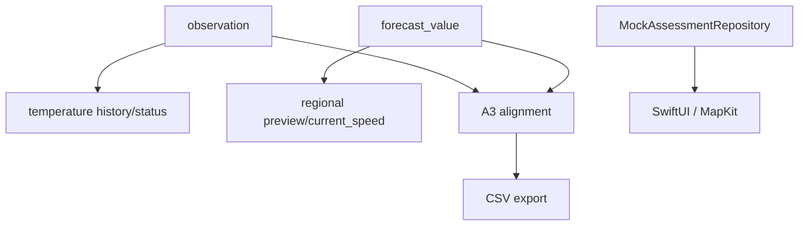

# DATA_DEPENDENCIES

Version: 1.0.0 | Date: 2026-10-27

[Complete document](../DATABASE_DOCUMENTATION.md) | [README](../../README.md)

Temperature workflow: device packet → handler → seagis_api.ingest → receipt/observation/QC → authorized reader history call with from/to and cursor → data/coverage JSON. History orders by observed_at,id; from is inclusive and to exclusive, with a seven-day maximum window and default limit 200/maximum 500. Coverage uses UTC hourly buckets and may differ from paginated row counts. Status summarizes deployments/last packets; it is not a disease assessment.

Regional workflow: dispatcher → claim/fetch/persist → preview selects the latest run available at cutoff and not stale under policy, limits valid_at to the next two days and returns at most 1500 rows. current_speed is an inner join of components; incomplete pairs produce no view row, whereas complete pairs containing missing values produce null speed. Demo preview preserves grid identity and representativeness limitations.

The iOS workflow is AppContainer dependency injection → MockAssessmentRepository → LoadDemoAssessment → BootstrapViewModel → SwiftUI. The Assessment domain model only has synthetic_fixture provenance and no verified backend DTO. AppPOC FarmStore keeps Farmer/CultivationPlot arrays, generates UUIDs, trims names and deletes relationships in memory. No verified mapping connects prototype farmer/plot IDs to seagis.plot. Production local caching/persistence and synchronization conflict handling were not found implemented.

Verified analytical consumers are QC building and CSV export; no production feature builder or training consumer was found for seagis_features. Hourly coverage is not counted as independent observations. No trained ML model producing ice-ice probabilities was found on these backend paths.

Main implementation evidence: `Seagis/Seagis/Repositories/Shared/MockAssessmentRepository.swift:1`; `AppPOC/POCApp/Shared/Data/FarmStore.swift:1`; `Seagis-Model/supabase/migrations/0002_temperature_api.sql:1`; `Seagis-Model/supabase/migrations/0003_environment_ingestion.sql:1`.

Reproducible diagram: `assets/diagrams/dependencies.mmd`.

| Data entity | Producer / writers | Readers | API / feature | Downstream |
| --- | --- | --- | --- | --- |
| seagis.dataset | supabase/seed.sql; scripts/provision_a1.py; scripts/deploy_a2.py | A1 ingest/history; A2 persist/preview; A3 source_bundle | private SQL / demo / offline | Dataset identity, version, cadence, licence and ingestion gates. |
| seagis.dataset_parameter | supabase/seed.sql; scripts/provision_a1.py; scripts/deploy_a2.py | A1 ingest/history; A2 persist/preview; A3 source_bundle | private SQL / demo / offline | Source-variable to parameter contract and conversion rules. |
| seagis.forecast_run | seagis_environment.persist; A0 fixtures | seagis_environment.preview/current_speed; A3 source_bundle; CSV exporter | private SQL / demo / offline | Regional model capture/vintage; unknown publication time remains null. |
| seagis.forecast_value | seagis_environment.persist; A0 fixtures | seagis_environment.preview/current_speed; A3 source_bundle; CSV exporter | private SQL / demo / offline | Parameter value per run, grid and valid time; not duplicated per plot. |
| seagis.ingestion_run | seagis_api.ingest; seagis_environment.persist; A0 fixtures | A3 source_bundle; provenance guards | private SQL / demo / offline | Audit of a logical ingestion and its completion state. |
| seagis.observation | seagis_api.ingest; A0 fixtures | seagis_api.history/status; A3 source_bundle; export_experiment_csv.py | temperature history/status | Local sensor water-temperature readings, retaining native values, QC and raw lineage. |
| seagis.parameter | supabase/seed.sql; scripts/provision_a1.py; scripts/deploy_a2.py | A1 ingest/history; A2 persist/preview; A3 source_bundle | private SQL / demo / offline | Registry of parameters and normalized units. |
| seagis.plot | supabase/seed.sql; scripts/provision_a1.py; scripts/deploy_a2.py | A1 ingest/history; A2 persist/preview; A3 source_bundle | private SQL / demo / offline | Plot identity and survey status; nullable coordinates are not evidence of a surveyed location. |
| seagis.plot_grid_mapping | A0 fixture/admin SQL | A3 source_bundle; feature_input guards | private SQL / demo / offline | Operational plot-to-grid mapping with effective and recorded times. |
| seagis.quality_event | seagis_api.ingest; A0 fixtures | A3 source_bundle/alignment | private SQL / demo / offline | Append-only QC log for ingestion or one measurement. |
| seagis.sensor | supabase/seed.sql; scripts/provision_a1.py; scripts/deploy_a2.py | A1 ingest/history; A2 persist/preview; A3 source_bundle | private SQL / demo / offline | Temperature sensor deployment identity, plot, depth and active state. |
| seagis.source | supabase/seed.sql; scripts/provision_a1.py; scripts/deploy_a2.py | A1 ingest/history; A2 persist/preview; A3 source_bundle | private SQL / demo / offline | Registry of dataset providers. |
| seagis.source_grid | seagis_environment.persist; A0 fixtures | seagis_environment.preview/current_speed; A3 source_bundle; CSV exporter | private SQL / demo / offline | Regional cell and depth-layer identity; distinct from cultivation plots. |
| seagis_api.credential | scripts/provision_a1.py; migration 0002 | seagis_api.actor/rate_ok/ingest/history/status | private SQL / demo / offline | API actor identity using token hashes, expiry and revocation. |
| seagis_api.packet_receipt | seagis_api.ingest/reply | seagis_api.actor/rate_ok/ingest/history/status | private SQL / demo / offline | Sensor-packet idempotency key and semantic digest. |
| seagis_api.reader_plot | scripts/provision_a1.py; migration 0002 | seagis_api.actor/rate_ok/ingest/history/status | private SQL / demo / offline | Plot allowlist for a reader credential. |
| seagis_api.request_event | seagis_api.ingest/reply | seagis_api.actor/rate_ok/ingest/history/status | private SQL / demo / offline | Authenticated API response audit and rate-limit basis. |
| seagis_api.temperature_policy | scripts/provision_a1.py; migration 0002 | seagis_api.actor/rate_ok/ingest/history/status | private SQL / demo / offline | Pilot engineering QC settings and request limit; not disease thresholds. |
| seagis_environment.attempt | seagis_environment.claim/persist/finish_failure; migration 0003 | A2 status/preview; A3 source_bundle | private SQL / demo / offline | Audit of a fetch attempt, including duplicate and abandoned outcomes. |
| seagis_environment.current_speed | NOT APPLICABLE: view | A2 status/preview; A3 source_bundle | private SQL / demo / offline | Current-magnitude view joining components from the same run, grid and time. |
| seagis_environment.demo_grid_mapping | seagis_environment.claim/persist/finish_failure; migration 0003 | A2 status/preview; A3 source_bundle | private SQL / demo / offline | Bridge from two fictional plots to real grids for preview, not training authorization. |
| seagis_environment.policy | seagis_environment.claim/persist/finish_failure; migration 0003 | A2 status/preview; A3 source_bundle | private SQL / demo / offline | Regional fetch, licence, scheduler cadence, staleness and retention policy. |
| seagis_environment.schedule_state | seagis_environment.claim/persist/finish_failure; migration 0003 | A2 status/preview; A3 source_bundle | private SQL / demo / offline | Mutable lease, due time, backoff and last-success state. |
| seagis_features.feature_input | A0 fixture/test inserts; production builder NOT FOUND | snapshot/input guards; production ML consumer NOT FOUND | private SQL / demo / offline | Foreign-key input lineage and cutoff guards for feature snapshots. |
| seagis_features.feature_snapshot | A0 fixture/test inserts; production builder NOT FOUND | snapshot/input guards; production ML consumer NOT FOUND | private SQL / demo / offline | Draft/sealed feature container with cutoff and hashes; no production builder found. |
| seagis_quality.alignment_snapshot | seagis_quality.save_snapshot | seagis_quality.source_bundle/save_snapshot/snapshot; curate_environment.py | private SQL / demo / offline | Immutable hourly QC/alignment document; always training_authorized=false. |
| seagis_quality.policy | scripts/quality/store.py::register_policy | seagis_quality.source_bundle/save_snapshot/snapshot; curate_environment.py | private SQL / demo / offline | Immutable registry of QC policy versions and builder code hashes. |
| seagis_quality.snapshot_input | seagis_quality.save_snapshot | seagis_quality.source_bundle/save_snapshot/snapshot; curate_environment.py | private SQL / demo / offline | Per-hour measurement lineage of an alignment snapshot. |
| seagis_raw.raw_payload | seagis_api.ingest; seagis_environment.persist; A0 fixtures | A3 source_bundle; provenance guards | private SQL / demo / offline | Immutable raw manifest: digest, hash basis, licence and retention mode. |

