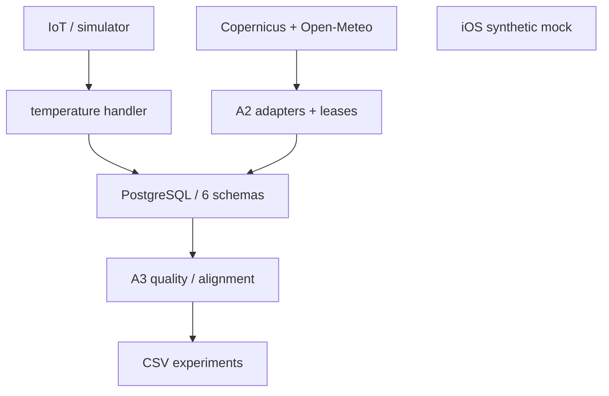
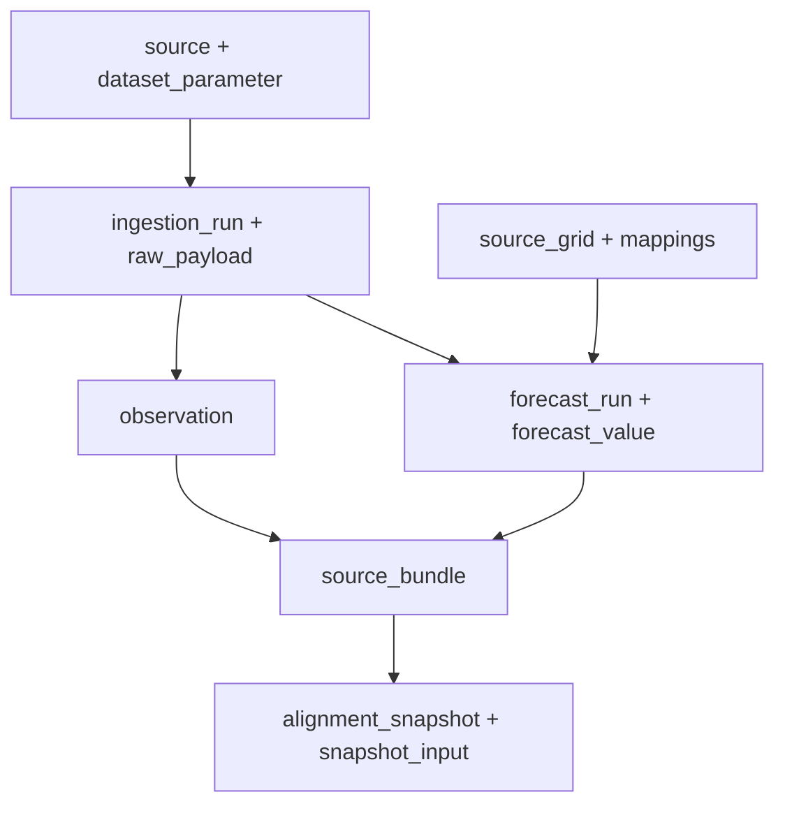

# DATA_FLOW

Version: 1.0.0 | Date: 2026-10-27

[Complete document](../DATABASE_DOCUMENTATION.md) | [README](../../README.md)

PostgreSQL/Supabase is the backend persistence defined by code. Schema `seagis` owns registries, observations, forecasts and provenance; `seagis_raw` holds raw manifests; `seagis_api` bounds the IoT gateway; `seagis_environment` manages regional workers; `seagis_quality` stores QC reviews; `seagis_features` supplies containers not connected to a production feature builder. Supabase internal schemas such as auth/storage are not inventoried as application-owned: current catalog access is unavailable and they must not be assumed empty.

Python retrieves provider data outside the database. A2/A3 workers call stored functions through psycopg; the TypeScript handler invokes only ingest/history/status functions. No ORM was found on these paths. Mutation transactions live in SQL functions; fetch claiming is a separate transaction from persistence so network calls do not hold a database transaction.

The diagram contains disconnected components: the iOS mock has no backend edge. Future integration remains UNVERIFIED. Production Core ML, distributed caches, warehouses, queues and search indexes were NOT FOUND in inspected implementation files; that does not establish absence of services outside these checkouts.

Reproducible diagram: `assets/diagrams/architecture.mmd`.

Reproducible diagram: `assets/diagrams/lineage.mmd`.

