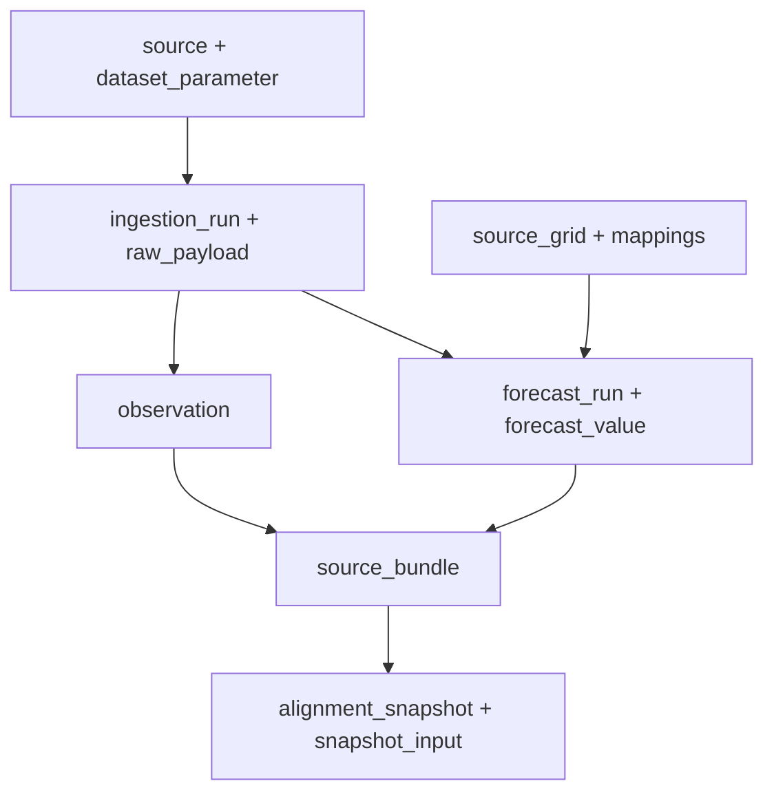

# DATA_LINEAGE

Version: 1.0.0 | Date: 2026-10-27

[Complete document](../DATABASE_DOCUMENTATION.md) | [README](../../README.md)

A1: simulator/device → JSON bytes → HTTP validation → authentication and sensor identity → SQL validation → semantic digest → raw manifest + observation + quality_event + packet_receipt → history/status. Sensor identity, plot and synthetic provenance are verified against credentials and deployment rather than accepted as arbitrary input. Missing packets do not create zero observations.

A2: registry/config → lease claim → provider fetch → metadata/unit/cadence/coordinate checks → one Copernicus cell/layer or Open-Meteo response coordinate → deduplication → semantic run_key → metadata_only manifest → forecast_run + source_grid + forecast_value + demo bridge → preview or A3. Open-Meteo source bytes and the canonical Copernicus logical subset have different hash bases. Neither STAC updates nor generationtime_ms become issued_at.

A3: source_bundle joins sensors, parameters, mappings, records and QC events; the maximum window is seven days with a 72-hour lookback and an older sensor sentinel when needed. The builder filters source_time and available_at at each cutoff, selects context, and records spatial metadata, flags and lineage. Persistence rebuilds the source bundle, verifies source/policy/code hashes, and saves a snapshot with hourly inputs. Source changes require a rebuild.

CSV export reads source_bundle in REPEATABLE READ READ ONLY or uses an offline JSON capture. Only two demo plots are supported. Regional CSV selects the latest vintage at capture time, while alignment JSON retains historical cutoffs. These representations are not interchangeable for backtesting. Every exporter output declares training_authorized=false.

Main implementation evidence: `Seagis-Model/supabase/functions/temperature/handler.ts:1`; `Seagis-Model/scripts/environmental/copernicus.py:1`; `Seagis-Model/scripts/environmental/open_meteo.py:1`; `Seagis-Model/scripts/quality/alignment.py:1`; `Seagis-Model/scripts/export_experiment_csv.py:1`.

Reproducible diagram: `assets/diagrams/lineage.mmd`.

| Dataset | Owner / source | Field | Native unit | Unit | Cadence s | Support | Target |
| --- | --- | --- | --- | --- | --- | --- | --- |
| sensor_temperature_v1 | device/simulator | water_temperature | degC | degC | 3600 | instantaneous | seagis.observation.value |
| cmems_salinity_6h | copernicus | so | 1e-3 | 1e-3 | 21600 | instantaneous | seagis.forecast_value.value (salinity) |
| cmems_currents_6h | copernicus | uo | m s-1 | m/s | 21600 | instantaneous | seagis.forecast_value.value (current_eastward) |
| cmems_currents_6h | copernicus | vo | m s-1 | m/s | 21600 | instantaneous | seagis.forecast_value.value (current_northward) |
| cmems_nutrients_daily | copernicus | no3 | mmol m-3 | mmol/m3 | 86400 | mean | seagis.forecast_value.value (nitrate) |
| cmems_nutrients_daily | copernicus | po4 | mmol m-3 | mmol/m3 | 86400 | mean | seagis.forecast_value.value (phosphate) |
| open_meteo_gfs | open_meteo | precipitation | mm | mm | 3600 | sum | seagis.forecast_value.value (precipitation) |
| open_meteo_gfs | open_meteo | wind_speed_10m | m/s | m/s | 3600 | instantaneous | seagis.forecast_value.value (wind_speed_10m) |
| open_meteo_gfs | open_meteo | wind_direction_10m | ° | degree | 3600 | instantaneous | seagis.forecast_value.value (wind_direction_10m) |
| open_meteo_gfs | open_meteo | cloud_cover | % | percent | 3600 | instantaneous | seagis.forecast_value.value (cloud_cover) |
| open_meteo_gfs | open_meteo | uv_index |  | 1 | 3600 | instantaneous | seagis.forecast_value.value (uv_index) |
| open_meteo_gfs | open_meteo | temperature_2m | °C | degC | 3600 | instantaneous | seagis.forecast_value.value (air_temperature_2m) |

The 3600-second sensor cadence comes from the pilot seed contract, not proof that every device always transmits on time. Provider reliability was not remeasured; retries/validation do not guarantee an SLA.

Main implementation evidence: `Seagis-Model/supabase/seed.sql:1`; `Seagis-Model/config/a2_sources.json:1`.

