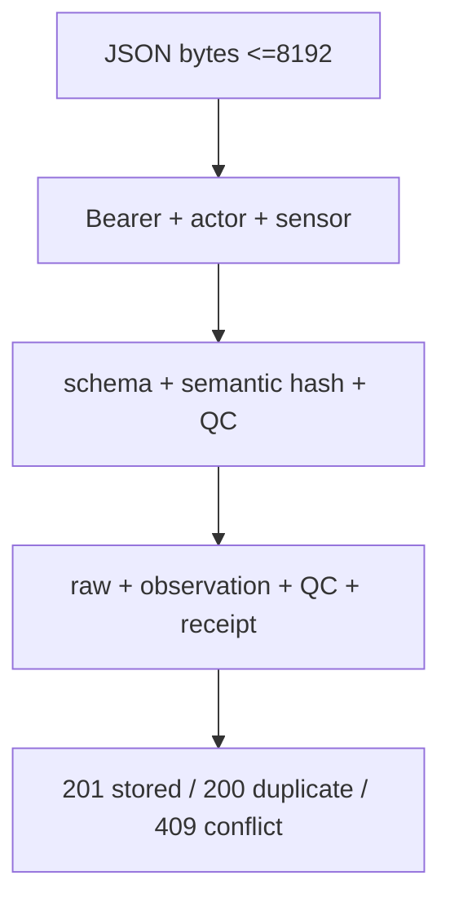
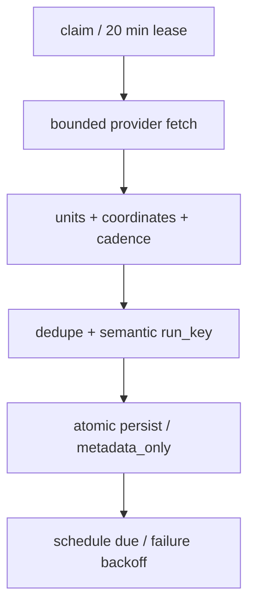
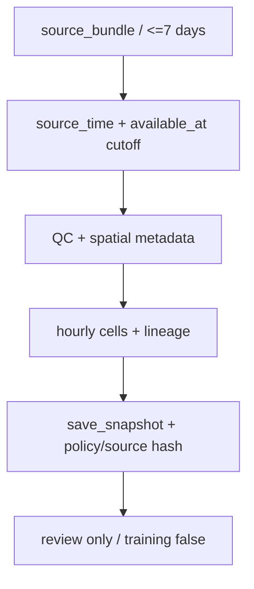

# INGESTION_PIPELINES

Version: 1.0.0 | Date: 2026-10-27

[Complete document](../DATABASE_DOCUMENTATION.md) | [README](../../README.md)

A1 makes one SQL function call per request. The handler accepts application/json up to 8192 bytes and hashes the bytes with SHA-256 before passing JSON to SQL. SQL requires exactly eight fields, schema_version=1.0.0, degC, a uint32 sequence and UTC Z timestamps with up to six fractional digits. An actor advisory transaction lock protects rate limiting, followed by a sensor lock protecting deduplication and QC. An identical retry returns 200 duplicate; changed content under the same boot/sequence returns 409 packet_conflict. New records return 201 stored. QC may persist a rejected reading; rejected does not automatically mean HTTP rejection.

A2 claims each dataset by locking schedule_state, creating a 20-minute lease and a running attempt. The launchd installer configures a 900-second tick; this is installer configuration, not proof of an active job. Nominal policy fetch intervals are 86400 seconds for Copernicus and 21600 for Open-Meteo; native value cadence remains six-hourly/daily/hourly. Offsets are 30600 seconds for salinity/currents, 45000 for nutrients and 16200 for weather. The worker wrapper has a 900-second timeout; HTTP timeout is 40 seconds, response cap four million bytes, and three retry attempts handle network/timeouts/429/selected 5xx with backoff and jitter. Long Retry-After delays are delegated to scheduler backoff.

Open-Meteo pins gfs_global, UTC, wind_speed_unit=ms and forecast_days=3. Its parser checks units, aligned arrays and timezone before assigning UTC to suffix-free labels. Shared returned cells are deduplicated. Copernicus checks product/dataset/version, STAC cadence/grid/depth/units, loads a fixed nearest cell for the two example plots' centroid, checks catalog revision before/after fetching, and decodes through Toolbox/xarray. Nonfinite/extreme fill values become null missing; daily means are not converted into 24 independent samples.

The adapter validates 1–4 grids, exactly two mappings, nonempty values and unique keys; SQL caps batches at two million bytes and 1–5000 values. persist checks lease, policy, dataset version and receipt time before inserting atomically. An existing run_key means duplicate; content changes that alter semantic identity create a new vintage. Grid and demo mapping use ON CONFLICT DO NOTHING with grid identity checks. Statement failure rolls back the entire persistence transaction; claim/attempt state remains and finish_failure is called separately. Lost commit acknowledgement requires status inspection before manual retry.

A3 neither fetches providers nor mutates observations/forecasts. build creates hourly context and detects unit mismatch, missing values, rapid change, flatline candidates, staleness and spatial uncertainty. pilot-quality-2 is an engineering policy. SQL checks lineage, cutoff, selected values, mapping and deterministic output on conflict; it does not rerun all Python QC decisions. This path has no imputation or automatic training.

Main implementation evidence: `Seagis-Model/supabase/migrations/0001_initial_schema.sql:1`; `Seagis-Model/supabase/migrations/0002_temperature_api.sql:1`; `Seagis-Model/supabase/migrations/0003_environment_ingestion.sql:1`; `Seagis-Model/supabase/migrations/0004_provider_update_status.sql:1`; `Seagis-Model/supabase/migrations/0005_quality_alignment.sql:1`.

Main implementation evidence: `Seagis-Model/scripts/ingest_environment.py:1`; `Seagis-Model/scripts/environmental/common.py:1`; `Seagis-Model/scripts/install_a2_scheduler.py:1`; `Seagis-Model/scripts/run_a2_worker.py:1`; `Seagis-Model/scripts/curate_environment.py:1`.

Reproducible diagram: `assets/diagrams/a1.mmd`.

Reproducible diagram: `assets/diagrams/a2.mmd`.

Reproducible diagram: `assets/diagrams/a3.mmd`.

