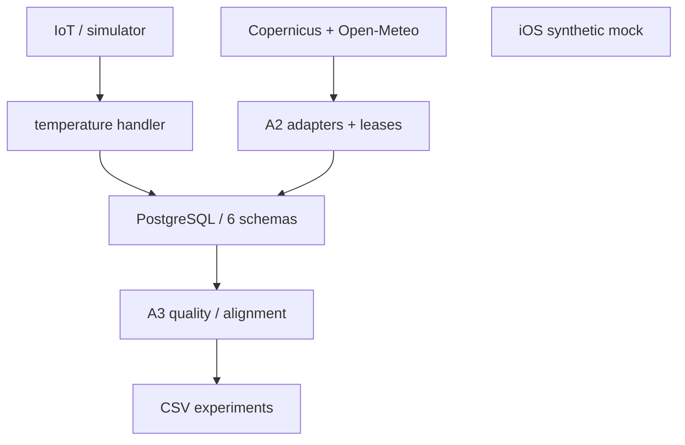
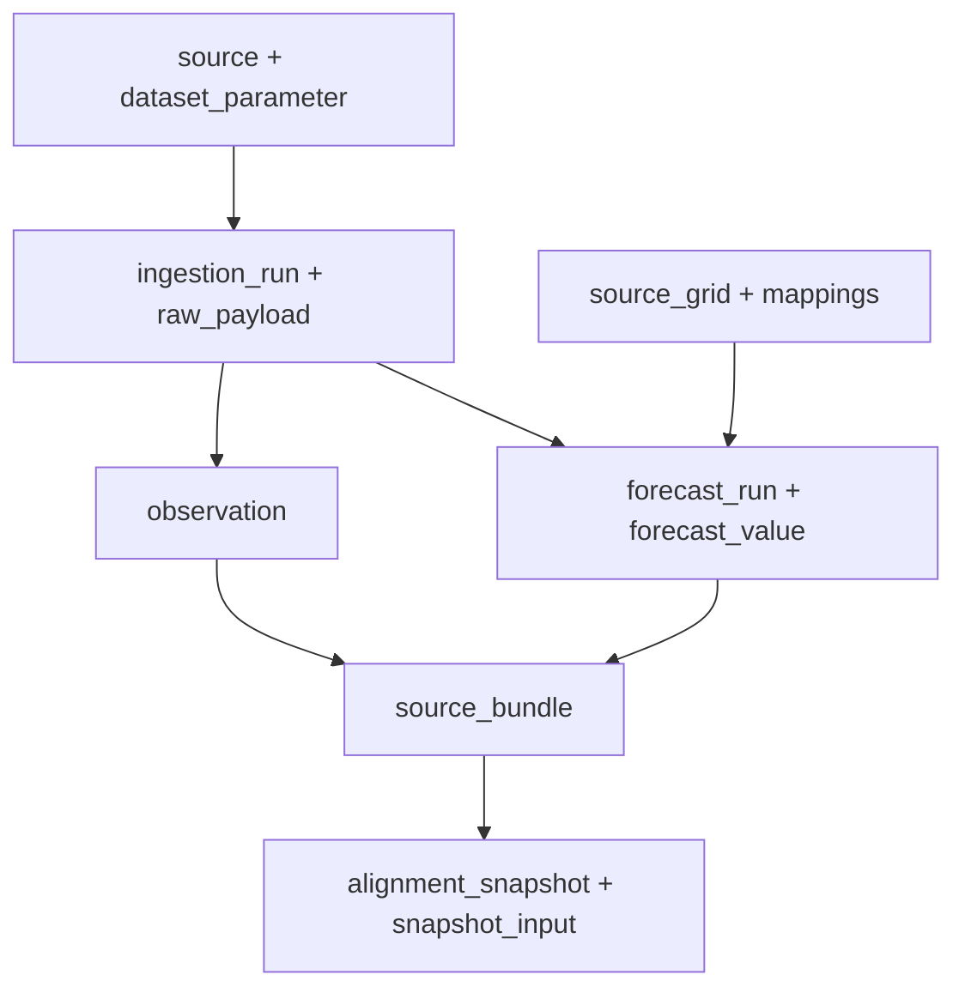

# ALIRAN_DATA

Version: 1.0.0 | Date: 2026-10-27

[Dokumen lengkap](../DOKUMENTASI_DATABASE.md) | [README](../../README.md)

PostgreSQL/Supabase adalah persistence backend yang didefinisikan kode. Schema `seagis` berisi registri, observasi, forecast dan provenance; `seagis_raw` menyimpan manifest raw; `seagis_api` membatasi IoT gateway; `seagis_environment` mengatur worker regional; `seagis_quality` menyimpan review QC; `seagis_features` menyediakan container fitur yang belum dihubungkan ke builder produksi. Schema internal Supabase seperti auth/storage tidak diinventaris sebagai milik aplikasi: akses catalog terkini tidak tersedia dan tidak boleh diasumsikan kosong.

Python melakukan pengambilan provider di luar database. Worker A2/A3 memanggil stored function lewat psycopg; TS handler memanggil hanya fungsi ingest/history/status. Tidak ada ORM yang ditemukan pada jalur ini. Transaksi mutasi berada di fungsi SQL; claim fetch merupakan transaksi terpisah dari persistence agar panggilan jaringan tidak menahan transaksi database.

Diagram memperlihatkan dua komponen yang terputus: mock iOS tidak memiliki edge ke backend. Integrasi masa depan tetap UNVERIFIED. Core ML, cache terdistribusi, warehouse, queue dan search index produksi NOT FOUND dalam file implementasi yang diinspeksi; ini bukan bukti bahwa layanan di luar checkout tidak ada.

Diagram reproduktif: `assets/diagrams/architecture.mmd`.

Diagram reproduktif: `assets/diagrams/lineage.mmd`.

