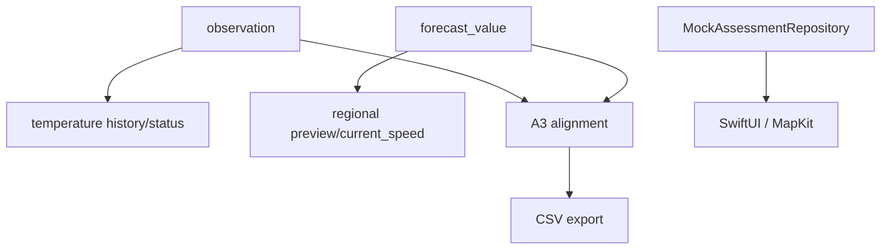

# DEPENDENSI_DATA

Version: 1.0.0 | Date: 2026-10-27

[Dokumen lengkap](../DOKUMENTASI_DATABASE.md) | [README](../../README.md)

Workflow suhu: perangkat mengirim packet → handler → seagis_api.ingest → receipt/observation/QC → reader terotorisasi memanggil history dengan from/to dan cursor → JSON data dan coverage. History mengurutkan observed_at,id; from inklusif, to eksklusif, maksimum tujuh hari, limit default 200/maksimal 500. Coverage memakai bucket jam UTC dan dapat berbeda dari jumlah baris pagination. Status memberi ringkasan deployment/last packet; bukan assessment penyakit.

Workflow regional: dispatcher → claim/fetch/persist → preview memilih run terbaru yang tersedia pada cutoff dan tidak stale menurut policy, membatasi valid_at dua hari ke depan dan maksimum 1500 baris. current_speed adalah join inner komponen; pasangan tidak lengkap tidak menghasilkan baris view, sementara pasangan lengkap dengan missing menghasilkan speed null. Preview demo mempertahankan identitas grid dan batas representativitas.

Workflow iOS: AppContainer menyuntikkan MockAssessmentRepository → LoadDemoAssessment → BootstrapViewModel → SwiftUI. Assessment domain hanya memiliki provenance synthetic_fixture, tidak memiliki DTO backend terverifikasi. FarmStore AppPOC menyimpan Farmer/CultivationPlot dalam array, membuat UUID, men-trim nama, dan menghapus relasi secara in-memory. Tidak ada mapping ID farmer/plot prototype ke seagis.plot yang terverifikasi. Cache/persistensi lokal produksi dan konflik sinkronisasi belum ditemukan implementasinya.

Konsumen analitik yang terverifikasi berupa build QC dan CSV exporter; tabel seagis_features belum memiliki produksi feature builder/training consumer yang ditemukan. Angka coverage hourly tidak dihitung sebagai jumlah pengamatan independen. Tidak ditemukan model ML terlatih yang menghasilkan probabilitas ice-ice pada jalur backend ini.

Bukti implementasi utama: `Seagis/Seagis/Repositories/Shared/MockAssessmentRepository.swift:1`; `AppPOC/POCApp/Shared/Data/FarmStore.swift:1`; `Seagis-Model/supabase/migrations/0002_temperature_api.sql:1`; `Seagis-Model/supabase/migrations/0003_environment_ingestion.sql:1`.

Diagram reproduktif: `assets/diagrams/dependencies.mmd`.

| Data entity | Producer / writers | Readers | API / feature | Downstream |
| --- | --- | --- | --- | --- |
| seagis.dataset | supabase/seed.sql; scripts/provision_a1.py; scripts/deploy_a2.py | A1 ingest/history; A2 persist/preview; A3 source_bundle | private SQL / demo / offline | Identitas dataset, versi, cadence, lisensi dan gate ingestion. |
| seagis.dataset_parameter | supabase/seed.sql; scripts/provision_a1.py; scripts/deploy_a2.py | A1 ingest/history; A2 persist/preview; A3 source_bundle | private SQL / demo / offline | Kontrak variabel sumber ke parameter dan aturan konversi. |
| seagis.forecast_run | seagis_environment.persist; A0 fixtures | seagis_environment.preview/current_speed; A3 source_bundle; CSV exporter | private SQL / demo / offline | Capture/vintage model regional; waktu publikasi yang tidak diketahui tetap null. |
| seagis.forecast_value | seagis_environment.persist; A0 fixtures | seagis_environment.preview/current_speed; A3 source_bundle; CSV exporter | private SQL / demo / offline | Nilai parameter per run, grid dan valid time; tidak diduplikasi per plot. |
| seagis.ingestion_run | seagis_api.ingest; seagis_environment.persist; A0 fixtures | A3 source_bundle; provenance guards | private SQL / demo / offline | Audit satu ingestion logis beserta status penyelesaian. |
| seagis.observation | seagis_api.ingest; A0 fixtures | seagis_api.history/status; A3 source_bundle; export_experiment_csv.py | temperature history/status | Pembacaan suhu air sensor lokal, dengan nilai native, QC dan lineage raw. |
| seagis.parameter | supabase/seed.sql; scripts/provision_a1.py; scripts/deploy_a2.py | A1 ingest/history; A2 persist/preview; A3 source_bundle | private SQL / demo / offline | Registri parameter dan satuan normalisasi. |
| seagis.plot | supabase/seed.sql; scripts/provision_a1.py; scripts/deploy_a2.py | A1 ingest/history; A2 persist/preview; A3 source_bundle | private SQL / demo / offline | Identitas plot dan status survei; koordinat nullable bukan bukti lokasi lapangan. |
| seagis.plot_grid_mapping | A0 fixture/admin SQL | A3 source_bundle; feature_input guards | private SQL / demo / offline | Pemetaan operasional plot ke grid dengan waktu efektif dan waktu tercatat. |
| seagis.quality_event | seagis_api.ingest; A0 fixtures | A3 source_bundle/alignment | private SQL / demo / offline | Log QC append-only untuk ingestion atau satu measurement. |
| seagis.sensor | supabase/seed.sql; scripts/provision_a1.py; scripts/deploy_a2.py | A1 ingest/history; A2 persist/preview; A3 source_bundle | private SQL / demo / offline | Identitas deployment sensor suhu, plot, kedalaman dan status aktif. |
| seagis.source | supabase/seed.sql; scripts/provision_a1.py; scripts/deploy_a2.py | A1 ingest/history; A2 persist/preview; A3 source_bundle | private SQL / demo / offline | Registri penyedia asal dataset. |
| seagis.source_grid | seagis_environment.persist; A0 fixtures | seagis_environment.preview/current_speed; A3 source_bundle; CSV exporter | private SQL / demo / offline | Identitas sel regional dan layer kedalaman; bukan plot budidaya. |
| seagis_api.credential | scripts/provision_a1.py; migration 0002 | seagis_api.actor/rate_ok/ingest/history/status | private SQL / demo / offline | Identitas aktor API berupa hash token, masa berlaku dan pencabutan. |
| seagis_api.packet_receipt | seagis_api.ingest/reply | seagis_api.actor/rate_ok/ingest/history/status | private SQL / demo / offline | Kunci idempotensi paket sensor dan digest semantik. |
| seagis_api.reader_plot | scripts/provision_a1.py; migration 0002 | seagis_api.actor/rate_ok/ingest/history/status | private SQL / demo / offline | Daftar plot yang boleh dibaca satu credential reader. |
| seagis_api.request_event | seagis_api.ingest/reply | seagis_api.actor/rate_ok/ingest/history/status | private SQL / demo / offline | Audit respons API terautentikasi dan dasar rate limit. |
| seagis_api.temperature_policy | scripts/provision_a1.py; migration 0002 | seagis_api.actor/rate_ok/ingest/history/status | private SQL / demo / offline | Konfigurasi QC engineering pilot dan batas request; bukan ambang penyakit. |
| seagis_environment.attempt | seagis_environment.claim/persist/finish_failure; migration 0003 | A2 status/preview; A3 source_bundle | private SQL / demo / offline | Audit satu upaya fetch termasuk duplicate dan abandoned. |
| seagis_environment.current_speed | NOT APPLICABLE: view | A2 status/preview; A3 source_bundle | private SQL / demo / offline | View magnitude arus dari pasangan komponen dengan run/grid/waktu yang sama. |
| seagis_environment.demo_grid_mapping | seagis_environment.claim/persist/finish_failure; migration 0003 | A2 status/preview; A3 source_bundle | private SQL / demo / offline | Bridge khusus dua plot fiktif ke grid nyata untuk preview, bukan otorisasi training. |
| seagis_environment.policy | seagis_environment.claim/persist/finish_failure; migration 0003 | A2 status/preview; A3 source_bundle | private SQL / demo / offline | Kebijakan fetch, lisensi, cadence scheduler, staleness dan retensi regional. |
| seagis_environment.schedule_state | seagis_environment.claim/persist/finish_failure; migration 0003 | A2 status/preview; A3 source_bundle | private SQL / demo / offline | State mutable lease, due time, backoff dan keberhasilan terakhir. |
| seagis_features.feature_input | A0 fixture/test inserts; production builder NOT FOUND | snapshot/input guards; production ML consumer NOT FOUND | private SQL / demo / offline | Lineage FK input feature snapshot dan guard cutoff. |
| seagis_features.feature_snapshot | A0 fixture/test inserts; production builder NOT FOUND | snapshot/input guards; production ML consumer NOT FOUND | private SQL / demo / offline | Container fitur draft/sealed dengan cutoff dan hash; builder produksi belum ditemukan. |
| seagis_quality.alignment_snapshot | seagis_quality.save_snapshot | seagis_quality.source_bundle/save_snapshot/snapshot; curate_environment.py | private SQL / demo / offline | Dokumen QC/alignment hourly immutable; selalu training_authorized=false. |
| seagis_quality.policy | scripts/quality/store.py::register_policy | seagis_quality.source_bundle/save_snapshot/snapshot; curate_environment.py | private SQL / demo / offline | Registri versi kebijakan QC dan hash kode builder yang immutable. |
| seagis_quality.snapshot_input | seagis_quality.save_snapshot | seagis_quality.source_bundle/save_snapshot/snapshot; curate_environment.py | private SQL / demo / offline | Lineage measurement per jam alignment snapshot. |
| seagis_raw.raw_payload | seagis_api.ingest; seagis_environment.persist; A0 fixtures | A3 source_bundle; provenance guards | private SQL / demo / offline | Manifest raw immutable: digest, basis hash, lisensi dan mode retensi. |

