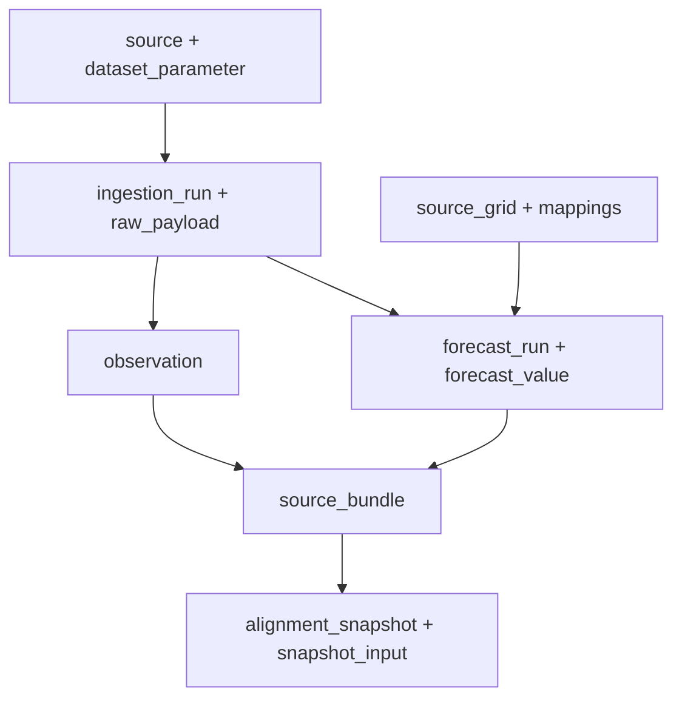

# ALUR_ASAL_DATA

Version: 1.0.0 | Date: 2026-10-27

[Dokumen lengkap](../DOKUMENTASI_DATABASE.md) | [README](../../README.md)

A1: simulator/perangkat → byte JSON → validasi HTTP → autentikasi dan identitas sensor → validasi SQL → digest semantik → raw manifest + observation + quality_event + packet_receipt → history/status. `sensor_id`, plot dan flag sintetis tidak dipercaya dari input bebas: identitas diverifikasi terhadap credential dan deployment. Paket hilang tidak menciptakan observasi nol.

A2: registry/config → claim lease → fetch provider → pemeriksaan metadata/unit/cadence/koordinat → satu sel/layer Copernicus atau koordinat respons Open-Meteo → deduplikasi → run_key semantik → manifest metadata_only → forecast_run + source_grid + forecast_value + bridge demo → preview atau A3. Source bytes Open-Meteo dan canonical logical subset Copernicus memiliki hash_basis berbeda. STAC update dan generationtime_ms tidak dijadikan issued_at.

A3: source_bundle menggabungkan sensor, parameter, pemetaan, record dan event QC; jendela maksimum tujuh hari dengan lookback 72 jam dan sentinel sensor lebih lama bila diperlukan. Builder memfilter source_time dan available_at pada setiap cutoff, memilih konteks, mencatat spatial metadata, flags dan lineage. Penyimpanan membangun ulang source bundle, memeriksa hash/kebijakan/kode, lalu menyimpan snapshot dan input per jam. Perubahan sumber memaksa rebuild.

Ekspor CSV membaca source_bundle dalam REPEATABLE READ READ ONLY, atau capture JSON offline. Dua plot demo diperbolehkan. CSV regional memilih vintage terbaru pada waktu capture, sedangkan alignment JSON menyimpan cutoff historis. Keduanya tidak boleh saling menggantikan untuk backtest. Semua output exporter menandai training_authorized=false.

Bukti implementasi utama: `Seagis-Model/supabase/functions/temperature/handler.ts:1`; `Seagis-Model/scripts/environmental/copernicus.py:1`; `Seagis-Model/scripts/environmental/open_meteo.py:1`; `Seagis-Model/scripts/quality/alignment.py:1`; `Seagis-Model/scripts/export_experiment_csv.py:1`.

Diagram reproduktif: `assets/diagrams/lineage.mmd`.

| Dataset | Owner / source | Field | Native unit | Unit | Cadence s | Support | Target |
| --- | --- | --- | --- | --- | --- | --- | --- |
| sensor_temperature_v1 | device/simulator | water_temperature | degC | degC | 3600 | instantaneous | seagis.observation.value |
| cmems_salinity_6h | copernicus | so | 1e-3 | 1e-3 | 21600 | instantaneous | seagis.forecast_value.value (salinity) |
| cmems_currents_6h | copernicus | uo | m s-1 | m/s | 21600 | instantaneous | seagis.forecast_value.value (current_eastward) |
| cmems_currents_6h | copernicus | vo | m s-1 | m/s | 21600 | instantaneous | seagis.forecast_value.value (current_northward) |
| cmems_nutrients_daily | copernicus | no3 | mmol m-3 | mmol/m3 | 86400 | mean | seagis.forecast_value.value (nitrate) |
| cmems_nutrients_daily | copernicus | po4 | mmol m-3 | mmol/m3 | 86400 | mean | seagis.forecast_value.value (phosphate) |
| open_meteo_gfs | open_meteo | precipitation | mm | mm | 3600 | sum | seagis.forecast_value.value (precipitation) |
| open_meteo_gfs | open_meteo | wind_speed_10m | m/s | m/s | 3600 | instantaneous | seagis.forecast_value.value (wind_speed_10m) |
| open_meteo_gfs | open_meteo | wind_direction_10m | ° | degree | 3600 | instantaneous | seagis.forecast_value.value (wind_direction_10m) |
| open_meteo_gfs | open_meteo | cloud_cover | % | percent | 3600 | instantaneous | seagis.forecast_value.value (cloud_cover) |
| open_meteo_gfs | open_meteo | uv_index |  | 1 | 3600 | instantaneous | seagis.forecast_value.value (uv_index) |
| open_meteo_gfs | open_meteo | temperature_2m | °C | degC | 3600 | instantaneous | seagis.forecast_value.value (air_temperature_2m) |

Sensor cadence 3600 berasal dari seed kontrak pilot, bukan bukti setiap perangkat selalu mengirim tepat waktu. Keandalan provider tidak diukur ulang; adapter memiliki retry/validasi tetapi tidak menjamin SLA.

Bukti implementasi utama: `Seagis-Model/supabase/seed.sql:1`; `Seagis-Model/config/a2_sources.json:1`.

