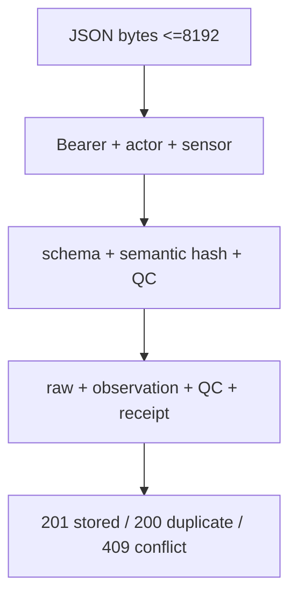
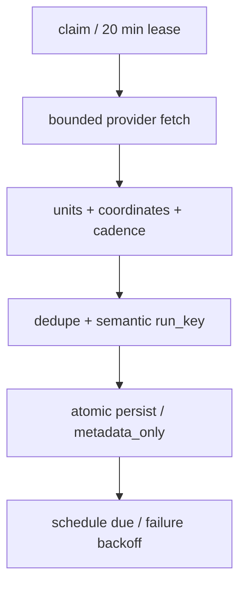
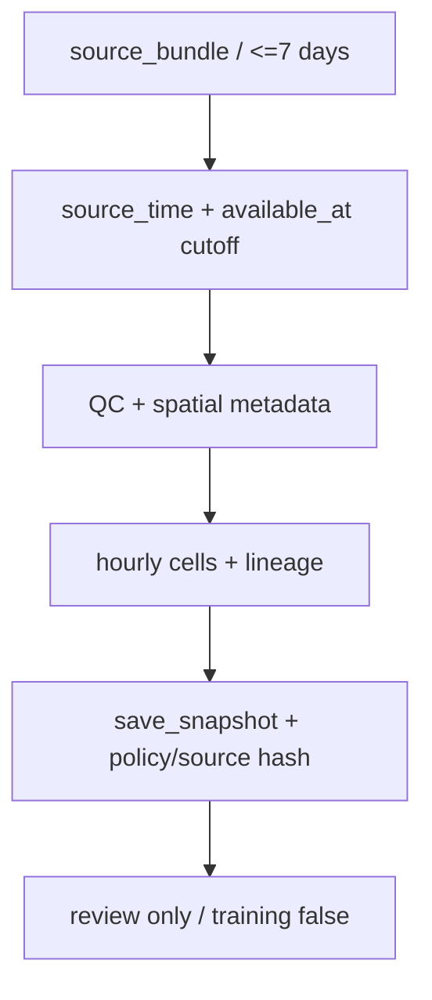

# PIPELINE_INGESTI

Version: 1.0.0 | Date: 2026-10-27

[Dokumen lengkap](../DOKUMENTASI_DATABASE.md) | [README](../../README.md)

A1 menjalankan satu function call SQL per request. Handler menerima application/json maksimum 8192 byte; byte di-hash SHA-256 sebelum JSON dikirim ke SQL. SQL memerlukan delapan field tepat, schema_version=1.0.0, degC, sequence uint32 dan UTC Z dengan presisi maksimal enam digit. Advisory transaction lock per aktor melindungi rate limit, lalu lock per sensor melindungi deduplikasi dan QC. Retry sama menghasilkan 200 duplicate, konten berbeda pada boot/sequence yang sama menghasilkan 409 packet_conflict. Record baru menghasilkan 201 stored. QC dapat menyimpan reading rejected; rejected bukan respons penolakan HTTP otomatis.

A2 berjalan per dataset setelah claim mengambil row lock pada schedule_state, membuat lease 20 menit dan attempt running. File installer launchd menetapkan tick 900 detik, tetapi ini konfigurasi installer, bukan bukti job aktif. Policy fetch nominal Copernicus 86400 detik, Open-Meteo 21600 detik; cadence nilai asli tetap 6 jam/harian/jam. Offset salinity/currents 30600 detik, nutrients 45000 detik, weather 16200 detik. Worker wrapper timeout 900 detik; HTTP timeout 40 detik; response maksimum 4 juta byte; retry tiga attempt pada timeout/network/429/5xx tertentu dengan backoff dan jitter. Retry-After panjang diserahkan pada backoff scheduler.

Open-Meteo dipin gfs_global, UTC, wind_speed_unit=ms dan forecast_days=3. Parser memeriksa unit, array sejajar dan timezone sebelum menambahkan UTC pada label tanpa suffix. Sel respons yang sama dideduplikasi. Copernicus memeriksa product/dataset/version, STAC cadence/grid/depth/unit, memuat nearest cell tetap untuk centroid dua plot contoh, memeriksa revisi katalog sebelum/sesudah, lalu decode melalui Toolbox/xarray. Nilai nonfinite/fill ekstrem menjadi null missing; daily mean tidak diubah menjadi 24 sampel independen.

Adapter memvalidasi 1–4 grid, tepat dua mapping, nilai tidak kosong dan key unik; SQL membatasi batch dua juta byte dan 1–5000 nilai. `persist` memeriksa lease, policy, versi dataset dan receipt time sebelum seluruh insert. Run_key sudah ada berarti duplicate; perubahan konten yang mengubah identitas semantik membuat vintage baru. Grid dan demo mapping memakai ON CONFLICT DO NOTHING dengan pemeriksaan identitas grid. Kegagalan statement mengembalikan seluruh transaksi persistence; claim/attempt tetap tercatat dan finish_failure dijalankan terpisah. Hilangnya commit acknowledgement memerlukan pemeriksaan status sebelum retry manual.

A3 tidak fetch provider dan tidak mengubah observation/forecast. `build` menghasilkan konteks hourly, mendeteksi unit mismatch, missing, rapid change, flatline candidate, staleness dan ketidakpastian spatial. Policy pilot-quality-2 adalah batas engineering. SQL memeriksa lineage, cutoff, nilai terpilih, pemetaan dan determinisme saat conflict; ia tidak menjalankan ulang seluruh keputusan QC Python. Tidak ada imputation atau training otomatis pada jalur ini.

Bukti implementasi utama: `Seagis-Model/supabase/migrations/0001_initial_schema.sql:1`; `Seagis-Model/supabase/migrations/0002_temperature_api.sql:1`; `Seagis-Model/supabase/migrations/0003_environment_ingestion.sql:1`; `Seagis-Model/supabase/migrations/0004_provider_update_status.sql:1`; `Seagis-Model/supabase/migrations/0005_quality_alignment.sql:1`.

Bukti implementasi utama: `Seagis-Model/scripts/ingest_environment.py:1`; `Seagis-Model/scripts/environmental/common.py:1`; `Seagis-Model/scripts/install_a2_scheduler.py:1`; `Seagis-Model/scripts/run_a2_worker.py:1`; `Seagis-Model/scripts/curate_environment.py:1`.

Diagram reproduktif: `assets/diagrams/a1.mmd`.

Diagram reproduktif: `assets/diagrams/a2.mmd`.

Diagram reproduktif: `assets/diagrams/a3.mmd`.

