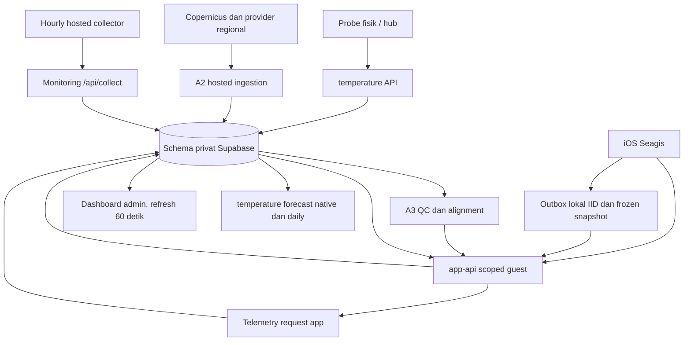

# Handover Seagis — integrasi dan kesiapan rilis

Snapshot audit 12 November 2026, WIB. Dokumen ini merangkum pekerjaan yang sudah ada pada Seagis, Seagis-Backend dan Seagis-Monitoring, keputusan pengguna, perbedaan source/deployment, serta persiapan uji IoT di pulau **13 November 2026**. Hasil tes terdahulu diberi atribusi; tidak dianggap dijalankan ulang dalam audit ini.

**Kesimpulan:** jalur aplikasi → API → database sudah tersedia untuk suhu, konteks regional, forecast dan catatan ice-ice. Lahan 1 sudah mendapat perbaikan jalur regional/forecast; Lahan 2 masih tertahan alignment lokasi. Sistem masih memakai guest/demo scope dan proyek Supabase development. Checklist App Store belum boleh ditandai seluruhnya verified. Monitoring per jam sudah diaktifkan di produksi; satu hosted dispatch telah mengonfirmasi penyimpanan health check. Event jadwal otomatis pertama masih perlu diamati.

## 1. Keputusan yang harus dipertahankan

- Integrasikan semua kontrak backend yang tersedia. Pakai pengukuran suhu air bila benar-benar ada dan layak ditampilkan; bila belum ada, tampilkan SST sebagai **konteks model regional**, dengan sumbernya jelas.
- Dua probe fisik belum dipetakan ke lahan milik siapa pun. Pertahankan sebagai perangkat/plot terpisah sampai lokasi dan kepemilikannya dikonfirmasi. Tidak boleh meminjam data probe untuk mengisi Lahan 1.
- Chart tetap muncul ketika fetch gagal atau data kosong. Kosong berarti belum ada nilai; jangan isi nol atau data contoh seolah observasi nyata.
- Daily tetap daily. Rerata harian dihitung dari cadence asli yang tersedia, tanpa menggandakan nutrien harian menjadi 24 nilai per jam.
- Catatan ice-ice membekukan kondisi yang tersedia saat pencatatan, lalu diunggah dan diambil kembali untuk kalender/IID. Nilai yang belum tersedia tetap dinyatakan tidak tersedia.
- Label aman/waspada/bahaya merupakan aturan lingkungan prototipe. Catatan gejala pengguna, pemutihan, stres lingkungan, diagnosis ice-ice dan prediksi penyakit tetap berbeda.

## 2. Baseline dan lokasi kerja

| Komponen | Checkout yang diaudit | Snapshot |
| --- | --- | --- |
| iOS | `/Users/cindyram/Documents/Apple/Seagis` | `codex/20261112-release-readiness`, `f21eecd` |
| Backend lokal | `/Users/cindyram/Documents/Apple/Seagis-Backend` | `codex/20261112-forecast-location-waiver`, `1a6695f`, bersih saat audit |
| Backend remote main | `De-Voeux/Seagis-Backend` | `2d20299f833e8bf5da2f28ab2ab6b2df2052315f` saat pemeriksaan GitHub |
| Monitoring lokal sebelum perubahan | `/Users/cindyram/Documents/Apple/Seagis-Monitoring` | `codex/20261112-app-api-telemetry-labels`, `e699beb` |
| Monitoring remote main sebelum perubahan | `De-Voeux/Seagis-Backend-Monitoring` (private) | `fc29fa4`; source baru disiapkan dengan menggabungkan main ini |
| Monitoring pekerjaan ini | `/Users/cindyram/Documents/Apple/Seagis-Monitoring` | `codex/20261112-monitoring-hourly-a93e`; source di-push, PR #3 merged dan deployment produksi READY |
| Salinan verifikasi | `/private/tmp/seagis-monitor-live-a93e` | Branch tugas yang sama, merge main terbaru untuk pengujian terisolasi |

App memiliki perubahan lokalisasi staged/untracked milik pekerjaan lain (`Localizable.xcstrings`, dua audit lokalisasi, `supabase/`); tidak diubah. Source backend lokal **tertinggal dari remote main**, terutama fitur forecast daily yang sudah merged. Jangan menyimpulkan schema belum ada hanya karena migration tidak terlihat di branch lokal itu.

## 3. Aliran data dan batas sistem

API/app tidak mendapat akses langsung tabel privat. Dashboard menggunakan endpoint server dan login administrator; collector memakai token server khusus. Monitoring mengukur operasi, bukan mengesahkan kualitas biologis atau lokasi.

## 4. Alignment kontrak aplikasi dan backend

| Kebutuhan | Implementasi / kontrak | Batas aktual |
| --- | --- | --- |
| Bootstrap app | `app-api /v1/sessions`, renew dan revoke; sesi disimpan Keychain | Guest dengan plot yang dibatasi; belum akun petani produksi |
| Farmer/plot/status | `/v1/farmers`, `/v1/plots/{id}`, `/v1/status` | Scope server, bukan UUID bebas dari client |
| Suhu air terukur | `/v1/plots/{id}/temperature` | Probe belum dikaitkan ke lahan contoh; jangan menganggap SST sebagai sensor |
| Kondisi regional | `/v1/plots/{id}/environment`, A3 window dan lineage | Bergantung active location, alignment dan QC; missing/stale dipertahankan |
| Forecast app | `app-api /v1/plots/{id}/forecast` | Bentuk kontrak app berbeda dari reader API daily di bawah |
| Assessment | `/v1/plots/{id}/assessment` dan aturan tampilan app | Aturan prototipe lingkungan; bukan probabilitas penyakit tervalidasi |
| Catatan IID | `/v1/plots/{id}/ice-ice-reports` GET/POST | Persistensi snapshot, stable ID dan authorization plot |
| Kalender IID | `/v1/plots/{id}/ice-ice-calendar` | Ringkasan per tanggal/timezone; detail bersumber dari records |
| Forecast native/daily reader | `temperature /v1/plots/{id}/forecast` | Reader-session contract terpisah; jangan memasukkan reader credential berprivilege ke app |

Source router, schema dan service menunjukkan kemampuan tersebut. Ini tidak sama dengan semua route telah diuji di jaringan seluler pada build iPhone terakhir.

### Lahan 1 dan Lahan 2

Perbaikan source/deployment yang tercatat pada `docs/progress/2026-11-12-release-readiness.md`:

1. Waiver eksplisit hanya untuk `location_coordinates_unverified` dan `location_support_not_confirmed`, dengan `location_assumed` tetap ditampilkan. Flag QC lain tetap dapat memblokir.
2. Forecast turut memilih run Copernicus `analysis_forecast_unspecified` untuk titik dengan `valid_at > ingested_at`. `analysis` murni tidak dipakai; app mempertahankan `run_kind` di lineage.
3. Refresh ketika halaman dibuka memakai minimum lima menit, kecuali pergantian jam/manual. Status plot dihitung dari data yang benar-benar ditampilkan.
4. Lahan contoh lain dapat memakai konteks regional plot fixture terdekat, diberi label. Ini bukan pemetaan probe fisik atau pengesahan koordinat lahan.

Catatan live terdahulu setelah deployment melaporkan Lahan 1: SST 59 titik, salinitas/arus masing-masing 10 titik, nitrat/fosfat masing-masing 2 titik, usable dengan `location_assumed`. Ini **bukti checkpoint terdahulu**, bukan jumlah yang dijamin terus tetap ada saat field test.

**Lahan 2 masih kosong:** tidak punya active plot location/alignment snapshot; `/environment` membalas 503, forecast `current_spatial_context_unavailable`. Jangan menghilangkan error dengan menampilkan data Lahan 1 sebagai milik Lahan 2.

`valid_at > ingested_at` mengidentifikasi nilai model untuk masa depan relatif terhadap penerimaan. Bila provider issue tidak diketahui, aturan ini **belum membuktikan waktu terbit forecast** atau rekam forecast historis yang bebas leakage. Beberapa wording dokumen progres lebih tegas daripada metadata yang tersedia; pertahankan ketidakpastian ini.

## 5. Forecast database dan rerata harian

Schema/API sudah dikerjakan pada commit `b7c8ea8`, migration `20261112000200_forecast_daily_api.sql`, schema `contracts/forecast-api.schema.json`, dokumentasi `docs/a3/forecast_daily_api.md`. [PR backend #14](https://github.com/De-Voeux/Seagis-Backend/pull/14) merged **12 November 2026 20:08:54 WIB** (`7b5186d`). Dokumen commit menyatakan migration dan `temperature` v5 telah aktif dan byte-identical saat handover fitur itu; audit ini memeriksa riwayat/source/merge, bukan mengulang seluruh uji DB deployment.

Reader API menerima `from/to` UTC `[from,to)`, maksimal tujuh hari, `resolution=native|daily|both`, timezone IANA (default Asia/Jakarta), optional `as_of` dan parameter filter. Credential device/hub tidak boleh memakai reader forecast route.

| Variabel | Cadence native | Agregasi harian |
| --- | --- | --- |
| SST | 1 jam | Rerata aritmetika sampel native yang dapat dipakai |
| Salinitas | 6 jam | Rerata sampel tersedia; coverage terhadap empat slot/hari penuh |
| Arus u/v dan speed | 6 jam | Pasangkan komponen pada run/grid/time sama; speed dihitung sebelum mean |
| Nitrat/fosfat | Harian | Passthrough hari UTC provider; bukan direlabel sebagai rerata WIB |

Daily response mempertahankan `sample_count`, excluded/source count, expected slots, coverage, partial-day, min/max, source IDs/times, method dan metadata run. Missing/rejected tidak dijadikan nol. Rerata sampel bukan integral time-weighted yang tervalidasi. Hari query parsial tetap ditandai parsial. Data native daily ambigu tidak dirata-ratakan diam-diam.

**Gap integrasi:** app sekarang mengambil forecast dari **app-api**, sedangkan kontrak `resolution/daily-native-1` berada pada **temperature reader API**. Ketersediaan API daily di backend belum membuktikan app sudah memakai respons daily itu. Tampilan ringkasan app juga mempunyai pengelompokan hari lokal sendiri. Penyamaan definisi daily, basis hari dan metadata coverage perlu dilakukan melalui kontrak app yang scoped; jangan memasang reader secret ke app untuk mempercepatnya.

App mengonversi nutrien `mmol/m³` ke `mg/L` sebagai ion pada mapper sebelum display/assessment. Pertahankan basis kimia dan lineage; jangan membandingkan angka lintas unit secara langsung.

## 6. Logging kondisi ice-ice dan kalender

Migration `20261112000100_ice_ice_reports.sql` menyediakan `seagis_reports.ice_ice_report` dan otorisasi writer per plot; `20261112090300_app_reports.sql` menghubungkannya ke sesi app dan kalender. Source `PersistentIceIceReportService.swift` sudah ada dan dipakai; error lama “Cannot find ... in scope” bukan alasan menambahkan service duplikat.

Perilaku yang perlu dijaga:

- Record dibuat lokal lebih dulu dalam outbox persisten, dengan IID UUID, waktu pencatatan, plot, jawaban dan evidence snapshot yang tersedia.
- Snapshot tidak diganti dengan kondisi terbaru ketika retry. Stable ID/body mendukung retry setelah acknowledgement server atau app crash.
- Koreksi membuat record dengan `supersedesID`; kalender menampilkan record yang berlaku, riwayat tetap dapat dilacak.
- Record belum terpetakan ke backend plot tetap lokal dengan pesan yang jelas. File arsip rusak dipertahankan; service tidak diam-diam menimpanya.
- Sinkronisasi mengunggah pending records dan mengambil records bulan terkait; status lokal/pending/server perlu terlihat di UI kalender/detail IID.

Catatan pengguna tentang gejala bukan diagnosis terverifikasi. Uji silang upload → fetch → kalender → IID pada perangkat fisik dan relaunch masih menjadi acceptance lapangan; keberadaan schema saja tidak membuktikan siklus tersebut lulus.

## 7. Checklist sebelum App Store

| Checklist pengguna | Bukti saat audit | Status yang jujur |
| --- | --- | --- |
| Backend scheduler otomatis | Workflow A2 `7 * * * *`, enable flag aktif; dua hosted dispatch sukses | Konfigurasi aktif; **schedule-event belum terlihat** saat cek |
| Production HTTPS | Endpoint Supabase Singapore HTTPS; Release tanpa ATS exception menurut progres | Transport tersedia pada development project; cellular belum verified |
| Authentication | Scoped guest session/Keychain, authorization plot; tiada privileged secret embedded menurut source/progres | Fondasi implementasi; identitas/otorisasi pengguna produksi belum selesai |
| Refresh lifecycle | Initial, foreground, manual, hourly saat aktif, optional BGAppRefresh | Unit/simulator tercatat; iOS tetap menentukan eksekusi background |
| Persistent cache | Snapshot terakhir valid + waktu/source/schema, Application Support, validasi isolasi plot | Implementasi dan unit evidence; uji relaunch fisik belum lengkap |
| Error states | Transport/backend/auth/invalid; missing/stale terpisah; chart kosong tetap tersedia | Source/tes tercatat; Wi-Fi user pernah melaporkan kegagalan, belum ada retest fisik lulus |
| Retry | Maks. tiga percobaan transient, exponential backoff+jitter, bounded Retry-After, satu renew 401 | Unit evidence; tidak retry semua 4xx |
| Observability | API latency/status + telemetry app-api, source/delivery freshness, collector dan dashboard | Sebagian live backend; aktivasi hourly baru lihat bagian 8 |
| Real-device testing | Rencana Wi-Fi, cellular, airplane, timeout, relaunch, suspension | **Belum seluruhnya verified** |

Dokumen progres iOS mencatat **108 Swift tests lulus**, Debug/Release simulator build berhasil. Audit ini tidak menjalankan ulang Xcode atau menyatakan pengujian perubahan assessor terbaru sudah tercakup di angka itu. Kehadiran iPhone atau file cache tidak membuktikan jaringan seluler, chart terbaru, dan background fetch bekerja.

Rilis masih membutuhkan penerapan identity/authorization produksi yang sesuai pengguna, keputusan environment produksi terpisah, bukti perangkat nyata, serta review klaim fitur. Tidak ada dasar menyatakan model prediksi ice-ice telah tervalidasi.

## 8. Monitoring live per jam untuk uji pulau

Dashboard: [Seagis Monitoring](https://seagis-monitoring.vercel.app), proyek Vercel existing `seagis-monitoring`, region konfigurasi sin1. Repo sebenarnya bernama **Seagis-Backend-Monitoring**, bukan Seagis-Monitoring.

Pekerjaan source baru:

- `.github/workflows/hourly-monitoring.yml`: hosted collector per jam pada menit **05 UTC/WIB**, repository flag `SEAGIS_HOURLY_MONITORING=enabled`, concurrency guard dan timeout lima menit.
- `scripts/collect_hourly.py`: HTTPS POST ke endpoint tetap `/api/collect`; token collector-only, redirect ditolak, response dibatasi, timeout 30 detik, maksimal tiga retry transient. Sukses wajib `ok=true` dan `collected=true`.
- Server menerima token baru `MONITOR_COLLECTOR_TOKEN` **atau** existing `CRON_SECRET`; tidak membuka endpoint dashboard admin.
- Dashboard mengambil ulang data setiap 60 detik saat visible+online; kembali focus/online memicu refresh, request sama yang masih berlangsung tidak digandakan.
- Error mempertahankan data/timestamp terakhir untuk query sama; perubahan query membersihkan view lama. Freshness memakai check terbaru **per komponen**, stale bila lebih dari tiga jam.
- Existing Vercel daily cron tetap backup. Tidak ada observasi ilmiah atau histori jam kosong yang dibuat untuk membuat chart tampak penuh.

**Empat cadence berbeda:** interval firmware menentukan observasi sensor; A2 ingestion berjalan H:07; collector operasional H:05; browser refresh 60 detik. Collector H:05 melihat A2 cycle terakhir yang selesai. Jadwal GitHub dapat terlambat; ini bukan jaminan exact-minute atau pengganti alarm on-call real time.

Source siap direview pada branch tugas repo Monitoring; tidak hanya berada dalam draft temporary.

Status aktivasi: **aktif di produksi sejak 12 November 2026 sekitar 22:42 WIB**. Pengguna telah memberi izin eksplisit untuk kedua tujuan token; penolakan auto-review awal terselesaikan. Token khusus collector sudah dipasang sebagai secret Vercel production dan GitHub Actions privat, tanpa mencetak nilainya. File token lokal dihapus setelah verifikasi.

- [PR Monitoring #3](https://github.com/De-Voeux/Seagis-Backend-Monitoring/pull/3) merged pada 22:41:44 WIB, commit `967cecc1c56b94e2f9712b1aadc0e2b0f9d78b8e`.
- Deployment `dpl_E2XHb6kNheUSRmph9XMEoeAKUGkc` **READY**, alias produksi aktif. Source deployment `4ee27a04ceafe15a33367a01a7c3ace4b4fa7cb5`; merge commit hanya menyatukan ancestry source yang sama.
- Workflow default branch berstatus `active`; repository variable `SEAGIS_HOURLY_MONITORING=enabled`. Dokumentasi bukti aktivasi juga sudah merged melalui [PR #4](https://github.com/De-Voeux/Seagis-Backend-Monitoring/pull/4); main/checkout lokal `32d08be`, working tree bersih. Perubahan setelah deployment hanya dokumentasi.
- [Run 43250579924](https://github.com/De-Voeux/Seagis-Backend-Monitoring/actions/runs/43250579924) **success**, event `workflow_dispatch`. Collector mengonfirmasi `status=collected`, HTTP 200, satu percobaan, `checked_at=2026-11-12T15:42:00.682244+00:00` (**22:42:00 WIB**). Script hanya sukses setelah backend menyatakan `ok=true` dan `collected=true`.
- Probe tanpa autentikasi ke `/api/collect`, `/api/monitor` dan `/api/spatial` semuanya **401**. Ini bukan pengujian login administrator browser.
- Slot otomatis berikutnya nominal **12 November 2026 23:05 WIB**, lalu tiap jam pada menit 05. **Event schedule belum teramati** pada akhir audit; GitHub dapat menunda eksekusi, tidak ada exact-minute SLA. Sukses dispatch tidak dilabel ulang menjadi bukti schedule.

Verifikasi source dalam checkout terisolasi:

| Pemeriksaan dijalankan pada audit ini | Hasil |
| --- | --- |
| `npm run typecheck` | Lulus |
| `npm run lint` | Lulus |
| `npm test` | 18 lulus |
| `python3 -m unittest discover -s tests -p 'test_hourly_collector.py'` | 2 lulus |
| `npm run test:components` | 58 lulus |
| `npm run build` (default Turbopack) | Gagal karena host melarang bind port proses PostCSS (`EPERM`) |
| `npm run build -- --webpack` | Lulus lokal, produksi dan route generation |
| `npm run build` pada deployment Vercel | Lulus Turbopack di lingkungan build remote; deployment READY |

Tes peta lama mengharapkan titik di luar bounds padahal bounds sudah diperluas. Fixture diperbaiki dengan dua kasus nyata: titik lama di dalam, titik berbeda di luar. Tidak ada perubahan bounds untuk sekadar meluluskan tes. Login admin browser tidak diuji dalam audit ini.

### Bukti scheduler backend yang benar-benar diperiksa

Repository variable `SEAGIS_HOSTED_SCHEDULER=enabled`. [Run 43221320715](https://github.com/De-Voeux/Seagis-Backend/actions/runs/43221320715) dan [run 43225774701](https://github.com/De-Voeux/Seagis-Backend/actions/runs/43225774701) sukses, keduanya event **workflow_dispatch**. Run kedua dimulai sekitar 20:17 WIB. Ini membuktikan hosted worker dapat berjalan, **belum membuktikan event schedule otomatis sudah dieksekusi**. Mac LaunchAgent bukan pengganti cloud 24/7 dan status lama berbeda antar checkpoint; tidak diasumsikan sehat sekarang.

## 9. Runbook ringkas 13 November 2026

1. Sebelum berangkat, pastikan job hourly sudah diaktifkan dan ada run sukses. Pisahkan bukti dispatch dari run dengan event `schedule`. Buka dashboard admin dan cek timestamp check DB/API, bukan hanya timestamp fetch browser.
2. Catat node ID kedua probe, interval kirim firmware, WIB/timezone, kondisi daya/jaringan dan jam start. Kepemilikan lahan/koordinat tetap belum diverifikasi.
3. Nyalakan node; cek observation time, receive time dan last-seen bergerak setelah paket sungguhan tiba. Bandingkan delivery delay dan rejection/QC, bukan hanya API healthy.
4. Klasifikasi perangkat existing memakai reporting interval: healthy sampai dua interval, delayed sampai enam, offline selebihnya. Interval yang belum diset berarti freshness unknown. Ini terpisah dari stale collector tiga jam.
5. Lakukan pergantian Wi-Fi → cellular → airplane → online dan relaunch app. Catat waktu, pesan, data/cache/source time sebelum/sesudah. Chart kosong/cache boleh tetap terlihat, tetapi status gagal/stale tidak boleh disamarkan.
6. Untuk IID, buat catatan saat kondisi tersedia, coba offline/pending lalu online; verifikasi IID dan snapshot yang sama tampil kembali di kalender setelah relaunch. Jangan menggunakan report uji sebagai diagnosis penyakit nyata.
7. Bila checks maju tetapi sensor tidak: cek daya, firmware, jaringan dan ingest rejection. Bila regional stale: cek workflow A2/provider. Bila collector merah: lihat sanitized code/HTTP status, bukan mencetak token.
8. Simpan bukti jam-jam pengujian dan hasil kedua node. Satu paket pertama atau satu run collector belum merupakan soak test seharian.

Panduan teknis lengkap disiapkan di `Seagis-Monitoring/docs/HOURLY-FIELD-MONITORING.md`, termasuk disable flag, token revocation dan rollback. Token tidak disimpan di catatan ini, Git, atau browser.

## 10. Handoff pekerjaan berikutnya

Prioritas sebelum uji pulau: aktivasi collector sudah selesai; verifikasi actual scheduled run; pastikan node credentials/binding dan reporting interval valid; rekam baseline. Jangan memetakan probe ke lahan tanpa konfirmasi.

Prioritas integrasi: lengkapi active location/alignment Lahan 2; samakan kontrak daily pada app-api dengan definisi backend reader daily; pertahankan coverage, timezone, run kind dan issue-unknown. Jangan memotong QC tanpa keputusan yang terlihat.

Prioritas rilis: tutup checklist perangkat fisik, identitas pengguna produksi, environment dan acceptance IID round-trip. `docs/app-api-session.md` pada app masih memuat keterangan fondasi lama bahwa sesi belum dipakai UI, sementara source sudah memakai guest main flow; perlu pembaruan dokumen terpisah. Monitoring caller labels pada baseline e699beb sebelumnya belum deployed; kini termasuk source deployment produksi yang sudah READY. Penerimaan visual dengan login administrator tetap belum diuji.

Indeks Engineering tidak diubah karena sedang diklaim task lain; tautan catatan ini dapat ditambahkan setelah handoff kepemilikan. Dokumen ini tidak menimpa catatan audit lama atau perubahan pengguna, dan tidak dipush ke remote vault.

## Sumber dan jalur baca

- [[Audit Kesiapan Backend dan Next Cycle - 12 November 2026]] — snapshot audit sebelumnya; gunakan baseline dokumen ini untuk perbedaan 12 November malam.
- [[Handover Track C - Status Integrasi 29 Oktober 2026]] — riwayat integrasi Track C, bukan status deployment hari ini.
- [[Handover A1 - Arsitektur Data dan Akses IoT]], [[Operasi A1 - Simulator dan Credentials]] — commissioning hardware dan operasi.
- [[Pipeline Seagis A0-A3 - Alur dan Skematik]], [[Handover A3 - Kualitas dan Alignment Data]] — sumber, cutoff dan lineage.
- App: `docs/progress/2026-11-12-release-readiness.md`, `docs/real-device-test-plan.md`, service regional/suhu/IID, mapper dan coordinator pada baseline di atas.
- Backend: migrations `20261112000100`, `20261112090100`–`20261112090500`, `20261112100000`, `20261112110000`, `20261112120000`; daily source `b7c8ea8`; workflow A2; router `supabase/functions/app-api/handler.ts`.
- Monitoring: `docs/VERIFICATION.md`, `docs/IMPLEMENTATION_PLAN.md`, `docs/HOURLY-FIELD-MONITORING.md`, server collect handler, dashboard dan tes pada source pekerjaan ini.
