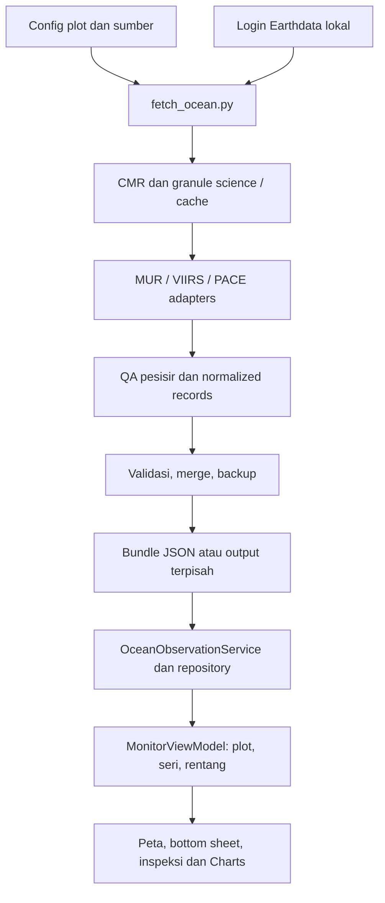

# Riwayat Pengembangan POC - TidungMonitor

**Posisi per 19 Oktober 2026:** aplikasi native iOS sudah menampilkan observasi/analisis ocean NASA yang dapat ditelusuri. Peta, bottom sheet, inspeksi dan tren tetap sederhana. Ada pipeline Python satu command untuk mengambil dan memperbarui data. Belum ada model ice-ice, probabilitas penyakit, keputusan tanam otomatis, atau validasi kondisi farm.

Cara menjalankan fetch: [[Panduan Fetch Data Ocean - TidungMonitor]]. Sumber brief dan wireframe: [[Arsip Pengembangan TidungMonitor - 19 Oktober 2026]]. Catatan ini merekam perkembangan implementasi POC; riset dan wawancara proyek tetap berada pada catatan masing-masing.

## 1. Asal kebutuhan dan batas kesimpulan

Arah proposal tim di [[Challenge Response - Seaweed Ice-Ice]] adalah membantu community advocates mengenali peringatan lingkungan terkait ice-ice dan membuat keputusan tanam. [[Kajian Indikator Warning Ice-Ice - Uji Asumsi Fitur]] membedakan relevansi lingkungan, kondisi bibit/tanaman dan bukti prediksi. Implementasi monitoring tidak dianggap mengesahkan prediksi penyakit tersebut.

[Issue #30 — Tech Requirement and Flow - AI Model](https://github.com/De-Voeux/c67-vault/issues/30), dibuat 19 Oktober 2026 dan dibaca saat dokumentasi, meminta penyelarasan konsep, keluaran/keputusan pengguna, inventaris data, rencana label/evaluasi dan pertanyaan untuk interview ahli terkait issue #29. Issue awal merupakan pekerjaan requirement; permintaan pengguna di percakapan kemudian meluas menjadi pembuatan app dan model eksperimen. Review tim dan pelaksanaan interview ahli belum terverifikasi dalam bukti teknis ini.

Brief awal iOS memprioritaskan NASA POWER yang mudah diakses dan mewajibkan pemisahan data nyata/demo. Instruksi ocean-only berikutnya mengganti scope sumber menjadi MUR SST, VIIRS dan PACE. Kedua brief disimpan sebagai **sumber historis**, bukan dua instruksi aktif yang harus digabungkan sekaligus.

## 2. Kronologi keputusan dan hasil

| Tahap | Perubahan / keputusan | Hasil dan status |
| --- | --- | --- |
| 29 September–14 Oktober 2026 | Challenge produksi akuakultur mengerucut ke rumput laut Pulau Tidung; proposal satelit/cuaca/IoT dengan MapKit/Core ML | Konteks dan proposal tim, belum sistem yang tervalidasi. Rujukan: [[Challenge Final]] dan [[Challenge Response - Seaweed Ice-Ice]] |
| Catatan diimpor 15 Oktober | Mentoring kebutuhan data, sensor portabel/node LoRa, energi dan housing | Rencana pengukuran; tanggal impor bukan konfirmasi tanggal pertemuan. [[Rencana Pengukuran IoT Kondisi Laut - Diskusi Mas Ricky]] |
| 16 Oktober — desain awal | Pengguna mengonfirmasi budidaya laut, belum ada data nyata, Core ML tidak wajib; form dibuat sesederhana mungkin | [[Desain POC - Peta Prioritas Pemeriksaan Rumput Laut]]; simulasi browser terpisah, belum integrasi native/API/IoT |
| 19 Oktober — requirement dan POC iOS | Pengguna meminta implementasi di `Documents/Apple/POCApp` berdasarkan brief awal | App SwiftUI iOS 17+, MapKit, Charts, NASA POWER nyata, fixture demo berlabel dan eksperimen regresi solar |
| 19 Oktober — package | Masalah `missing package TidungCore` dilaporkan | Package dipindahkan ke `Packages/TidungCore`; manifest/source/tests dan referensi product diselaraskan; manifest root duplikat dihapus. Dokumen verifikasi mencatat perbaikan 14.18 WIB |
| 19 Oktober — redesign | Wireframe gambar tangan menjadi acuan struktur; peta lebih dulu, bottom sheet, pilih kelompok/lahan, detail dan Inspeksi | Refactor view existing; dashboard/tab diganti alur peta. Data/model existing dipertahankan pada tahap itu |
| 19 Oktober — copy dan pengujian | Pengguna meminta teks singkat/placeholder. UI test sempat diminta dihapus, lalu pengguna mengonfirmasi perlu dipertahankan untuk screenshot otomatis | Copy ringkas, status belum dinilai, metadata lewat disclosure, UI tests dan screenshot otomatis dipertahankan |
| 19 Oktober — workflow proyek | Pengguna meminta XcodeGen menjadi cara generate proyek | `project.yml` menjadi sumber konfigurasi; aturan tersimpan di `AGENTS.md`; regenerate dan build berhasil |
| 19 Oktober — ocean-only | Brief baru mengecualikan POWER/rainfall/salinity/land products dan synthetic values dari mode produksi | Source-aware ocean contract, tiga adapter terpisah, preprocessing Python, bundle NASA ocean, validasi coastal QA; kode solar diarsipkan |
| 19 Oktober — akses NASA | Awalnya file science memerlukan autentikasi; pengguna login Earthdata lokal | CMR dan NetCDF asli diuji; definisi mask/variabel dibaca dari file; tidak ada credential dalam iOS |
| 19 Oktober — pipeline satu pintu | Pengguna meminta satu command Python yang mudah digunakan | `fetch_ocean.py`: bootstrap environment, login lokal, fetch/QA, validasi, merge sejarah, backup dan publish atomik |
| 19 Oktober — dokumentasi vault | Pengguna meminta seluruh cara pakai dan perjalanan pengembangan dicatat | Panduan, riwayat ini, arsip brief/wireframe, dan tautan navigasi vault |

Urutan keputusan pengguna pada hari yang sama berasal dari percakapan dan task log. Waktu commit adalah snapshot Git, bukan waktu pasti setiap keputusan dibuat.

## 3. Evolusi model AI/statistik

### 3.1 Simulasi form laut — 16 Oktober

Demo awal menggunakan referensi Gaussian multivariat dan jarak Mahalanobis untuk tiga input lingkungan manual, dengan pengamatan tanaman sebagai aturan terpisah. Training 600 sampel dan kalibrasi 200 sampel **seluruhnya sintetis**. Hubungan antarvariabel dan cutoff merupakan konfigurasi simulasi, bukan distribusi kondisi farm atau ambang penyakit.

Keluaran menunjukkan kemiripan terhadap referensi simulasi dan langkah pemeriksaan. Isolation Forest masih kandidat roadmap; bukan model yang dijalankan pada form awal. Artefak ini terpisah dari aplikasi native yang kemudian dibangun. Sumber lengkap: [[Desain POC - Peta Prioritas Pemeriksaan Rumput Laut]].

### 3.2 Regresi solar NASA — eksperimen iOS awal

Eksperimen `tidung-solar-ar7-ridge-v1` benar-benar dilatih dengan NASA POWER `ALLSKY_SFC_SW_DWN` 2021–2025, sebanyak 1.826 record harian di satu titik referensi regional. Fitur: intercept, tujuh lag valid berurutan, sin/cos hari dalam tahun untuk target satu hari setelah pengamatan terakhir. Inferensi lokal Swift memakai koefisien JSON, bukan model penyakit dan tidak memerlukan Core ML.

Split kronologis: training 2021–2023 (1.088 target setelah tujuh hari awal), validation 2024 (366), test 2025 (365). Alpha ridge 0,01 dipilih pada validation, bukan test.

| Model / baseline historis | MAE test, kWh/m²/hari |
| --- | ---: |
| Ridge AR7 + musim | 0,8875 |
| Persistence hari sebelumnya | 1,0890 |
| Rerata tujuh hari | 0,9288 |

Angka berasal dari `Model/evaluation.json`; ini **hindcast retrospektif** memakai produk historis final. Riwayat waktu publikasi/as-of tidak direkonstruksi. Hasil bukan evaluasi forecast operasional, akurasi penyakit, rentang ketidakpastian, atau bukti manfaat agronomi. Tanggal target adalah setelah observasi terakhir, bukan otomatis besok dari tanggal perangkat.

Dokumentasi awal mengoreksi grid solar POWER menjadi **1° × 1°**, berbeda dari angka grid meteorologi yang disebut dalam brief awal. Model tidak mengubah radiasi permukaan menjadi cahaya bawah air.

### 3.3 Setelah ocean-only

Client POWER, kelas/inferensi solar, view estimasi, fixture sintetis app, koefisien model dan README sebelumnya dipindahkan ke `Archive/SolarPOC`, di luar target aplikasi aktif. Folder `Model`, dokumentasi lama, serta `Tools/train_model.py` tetap merupakan sejarah eksperimen solar.

**Tidak ada model AI pengganti untuk penyakit yang dilatih pada fase ocean-only.** Implementasi aktif adalah monitoring dan data engineering. Label biologis berlokasi/berwaktu, definisi outcome, horizon, validasi lapangan dan evaluasi manfaat masih diperlukan sebelum menguji model penyakit baru.

## 4. Struktur teknis yang aktif

Root kode: `/Users/cindyram/Documents/Apple/POCApp`.

| Komponen | Peran |
| --- | --- |
| `TidungMonitor.xcodeproj`, scheme `TidungMonitor` | App aktif; starter `POCApp.xcodeproj` terpisah |
| `project.yml` | Sumber konfigurasi target, scheme, resource, settings dan local package |
| `Packages/TidungCore/Package.swift` | Manifest Swift Package lokal |
| `Models.swift` | Metric source-aware, tanggal UTC, projection observasi dan metadata |
| `OceanObservation.swift` | Kontrak normalized record dan validasi provenance/QA/waktu/jarak/produk |
| `OceanObservationService.swift` | Async service untuk bundle atau JSON HTTPS opsional; repository/cache |
| `SeriesAnalysis.swift` | Segmen chart yang mempertahankan gap dan statistik dengan data cukup |
| `TidungMonitor/App/MonitorViewModel.swift` | Mode/metric/rentang/lokasi, loading/empty/error, stale dan pembaruan query |
| `OverviewView`, `HistoryView`, `DataSourcesView` | Peta, kelompok/lahan, inspeksi/tren dan metadata sesuai permintaan |
| `Config/ocean_plots.json` | Koordinat/ID lahan bersama app dan exporter; lima lahan contoh + satu seed referensi |
| `Config/ocean_sources.json` | Collection ID, versi, seri, variabel dan unit |
| `fetch_ocean.py` | Command utama; setup environment dan delegasi worker |
| `Tools/ocean/pipeline.py` | Orkestrasi transaksi: staging, validation, merge, backup, lock dan publikasi |
| `Tools/ocean/catalog.py`, `adapters.py`, `export.py`, `merge_exports.py` | Discovery, parsing/QA, ekspor dan gabung record |
| `TidungMonitor/Resources/ocean_observations.json` | Bundle NASA yang dipakai offline oleh app |
| `UITests/TidungMonitorUITests.swift` | Flow, pemisahan sumber/missing dan screenshot otomatis |



Credential berhenti di preprocessing lokal. Tidak ada backend atau deployment otomatis. Endpoint HTTPS opsional bisa dipilih melalui `OCEAN_DATA_URL` di Info.plist yang dikonfigurasi lewat XcodeGen; bukan layanan yang sudah di-host.

## 5. Keputusan UI dan fungsi app

- Alur utama: **peta → kelompok → lahan → Inspeksi**; memilih marker juga membuka lahan. Inspeksi menampilkan peta ringkas dan tren.
- Layout mengikuti wireframe, komponen SwiftUI native, warna tertahan dan progressive disclosure. Warna poligon menunjukkan pilihan, bukan status keamanan.
- Nama/koordinat existing dipertahankan saat konfigurasi dipusatkan. Poligon/batas dan posisi tetap **lahan contoh**, bukan hasil survei farm atau output ARKit terverifikasi.
- Pemilihan lahan memuat seri untuk `plot_id` dan koordinat tersebut. Query juga membedakan parameter/rentang; data pilihan sebelumnya tidak dianggap kondisi lahan baru.
- Seri MUR, VIIRS dan PACE dapat dipilih terpisah. Tidak ada pertukaran sumber diam-diam ketika satu sumber kosong.
- Status tetap **Belum dinilai**. Mode **Placeholder** berisi nilai kosong dan jelas berbeda dari NASA. Label Demo/radiasi pada screenshot lama merupakan fase sebelum ocean-only.
- Tanggal observasi berbeda dari waktu pembaruan ekspor. Record historis diberi konteks historis; waktu optik saat ini menggunakan awal granule, bukan scan individual tiap piksel.
- Metadata unit, granule, versi, resolusi nominal, koordinat/jarak dan QA ada di disclosure. Presisi tampilan mengikuti parameter: SST satu, chlorophyll/Kd490 sampai dua, Rrs sampai empat angka desimal agar nilai kecil tidak terbaca nol.
- Rentang app default 90 hari hingga hari ini UTC; tersedia 30/90 hari atau custom maksimum 366 hari. Default command fetch tujuh hari merupakan pengaturan terpisah.
- Chart mempertahankan gap; tidak menghubungkan missing menjadi pengamatan. Rata-rata/perubahan tujuh hari hanya dihitung dengan history yang memenuhi syarat.
- UI tests dipertahankan atas keputusan pengguna agar screenshot dapat diambil otomatis. Tidak ditambahkan layar diagnosis atau dashboard angka baru.

## 6. Produk NASA dan pemrosesan

| Sumber | Collection CMR / versi | Variabel aktif | Catatan |
| --- | --- | --- | --- |
| MUR L4 | `MUR-JPL-L4-GLOB-v4.1` / `C1996881146-POCLOUD` / 4.1 | `analysed_sst`, kelvin → °C | Grid 0,01°, nominal ~1 km; analisis harian dengan pengisian celah |
| VIIRS SNPP L2 | `VIIRSN_L2_OC` / `C3388381264-OB_CLOUD` / 2022.0 | `chlor_a` mg/m³, `Kd_490` m⁻¹, `Rrs_443` sr⁻¹ | Granule yang dibaca mencatat resolusi nominal 750 m; provider OB_CLOUD |
| PACE OCI BGC L2 | `PACE_OCI_L2_BGC` / `C4124887072-OB_CLOUD` / 3.2 | `chlor_a`, mg/m³ | Sumber pembanding terpisah; resolusi dibaca dari granule |
| PACE OCI AOP L2 | `PACE_OCI_L2_AOP` / `C4124887023-OB_CLOUD` / 3.2 | `Rrs` dan koordinat `wavelength_3d` | Satu pita sekitar 443 nm, toleransi pemilihan 5 nm; bukan seluruh spektrum |

Bbox awal W,S,E,N: `[106.40,-5.90,106.60,-5.70]`. Seed -5,80 / 106,50 merupakan titik pencarian, bukan farm terverifikasi. Metode ekstraksi: piksel laut valid terdekat dalam maksimum 2.000 m. Radius adalah keputusan engineering, bukan akurasi atau ambang biologis.

MUR hanya menerima mask tepat `open_sea`; nama itu ditemukan pada file science asli setelah asumsi awal nama flag `water` tidak cocok. Land/lake/ice dan kombinasi tak dikenal ditolak. Nilai fill/rentang native diperiksa sebelum konversi kelvin. Suhu negatif tidak otomatis dianggap invalid.

Ocean color membaca `l2_flags` aktual dan mensyaratkan definisi LAND/CLDICE/COASTZ. Kebijakan konservatif menolak land, cloud, shallow-water/COASTZ dan flag kegagalan lain yang didokumentasikan di kode/sumber. Nominal resolution tidak menjamin seluruh efek campuran pesisir hilang.

Kontrak menyimpan plot/series, nilai atau null, unit, produk/collection/versi, tanggal diminta, akuisisi/jendela waktu, retrieval, piksel/jarak/resolusi, granule, QA, radius, valid-pixel count dan method. Koordinat piksel tidak dikarang ketika tidak ada piksel terpilih. App memvalidasi ulang sumber/QA sebelum menampilkan nilai.

Kd490 adalah proksi kejernihan, bukan NTU. Rrs bukan NTU. Chlorophyll-a bukan klorofil jaringan/biomassa rumput laut atau diagnosis ice-ice. Scope aktif mengecualikan POWER, IMERG, SMAP, ECOSTRESS land temperature dan weather API generik.

## 7. Hasil data nyata dan batas coverage

Discovery meliputi satu bulan 2025 dan satu bulan terbaru yang diuji; jumlah footprint katalog dipisahkan dari file yang benar-benar diparsing.

| Collection | Agustus 2025: ditemukan / diparsing / record valid | September 2026: ditemukan / diparsing / record valid |
| --- | ---: | ---: |
| MUR | 32 / 3 / 18 | 31 / 2 / 12 |
| VIIRS | 37 / 3 / 3 | 1 / 1 / 0 |
| PACE BGC | 33 / 3 / 0 | 1 / 1 / 0 |
| PACE AOP | 33 / 3 / 0 | 1 / 1 / 0 |

**Total snapshot bundle: 17 granule science unik diparsing; 2.196 slot, 33 valid dan 2.163 missing.** Slot berasal dari enam titik × enam seri × 61 hari dalam dua jendela, bukan deret penuh sepanjang interval antara Agustus 2025 dan September 2026.

- 30 record MUR = enam titik × lima tanggal analisis: 1–3 Agustus dan 1–2 September.
- Tiga record VIIRS = chlorophyll, Kd490 dan Rrs pada **satu piksel/tanggal** untuk plot a1, 2 Agustus. Bukan tiga observasi penyakit independen.
- Piksel VIIRS itu sekitar -5,778964 / 106,482658, berjarak ~1,88 km dari titik contoh a1; nominal 750 m tidak menjadikannya pengukuran langsung tali.
- Sampel PACE BGC/AOP diparsing tetapi belum ada nilai yang lolos QA. Pada sampel Agustus alasan terutama cloud atau shallow-water; pada satu granule September masing-masing lima titik cloud dan satu shallow-water.
- Sebagian besar slot missing disebabkan `not_processed` pada run sampel yang dibatasi. Jangan menyebut seluruh bulan tidak memiliki data karena baru beberapa granule diuji.
- Pengambilan ulang MUR dan PACE BGC tanggal yang sama merupakan recheck, bukan penambahan granule independen atau bukti biologis baru.

Seluruh angka ini merupakan hasil engineering pada sampel yang tercatat, bukan validasi kondisi tanaman. Bukti mesin berada pada `docs/validation/august_2025.json`, `september_2026.json`, `catalog_snapshot.json` dan bundle asli di repo app.

## 8. Pipeline satu command

```bash
cd "/Users/cindyram/Documents/Apple/POCApp"
python3 fetch_ocean.py --days 7
```

Pipeline menyiapkan environment berpinned, memakai login lokal, melakukan discovery/parsing/QA, memvalidasi record, merge riwayat, membuat backup, dan menulis output atomik. Mode default mempertahankan data sumber lain. `--replace` merupakan reset yang disengaja dengan backup. Konflik koordinat/versi atau output berubah saat fetch menghentikan publish.

`.ocean-cache/runs/<run-id>/` menyimpan fetch/report/candidate/backup/result sesuai tahap yang tercapai. Lock OS mencegah dua pipeline fetch berjalan bersamaan; lock setup menserialkan instalasi dependency. Cache dan kredensial tidak masuk Git.

Command diuji dua kali lewat CMR dan cache NASA asli untuk MUR 1 Agustus 2025. Output terpisah berisi enam record, tanpa duplikasi pada rerun. Bundle app tidak diubah oleh smoke test tersebut. Keberhasilan ini menguji orkestrasi dan cache; bukan klaim mengunduh ulang seluruh file science pada setiap run.

Panduan seluruh opsi, troubleshooting, login, reset dan pembacaan hasil: [[Panduan Fetch Data Ocean - TidungMonitor]].

## 9. Pengujian: fase lama dan aktif dipisahkan

| Fase | Bukti yang tercatat | Batas |
| --- | --- | --- |
| POC solar awal | 10 Swift tests, dua UI tests, build simulator; parity Python/Swift dan training ulang sesuai artefak | Berlaku pada fase solar; bukan jumlah test ocean saat ini |
| Perbaikan package | Resolve local dependency, clean simulator build, 10 Swift tests lulus | UI tidak diulang karena perubahan struktur, sesuai dokumen verifikasi |
| Redesign wireframe | Build dan dua UI tests lulus; enam screenshot ditinjau/disimpan | Screenshot masih merekam sumber/model solar saat itu |
| Ocean-only | Sembilan Swift tests, delapan Python tests, tiga UI tests lulus; 33 nilai nyata diterima validator Swift | Unit/provenance/UI tests, bukan validasi penyakit atau farm |
| Pipeline satu command | **16 Python tests lulus**: delapan adapter + delapan pipeline; CLI nyata diuji dua kali | Memperluas delapan test Python sebelumnya, bukan tambahan 16 di atasnya; tidak ada perubahan Swift pada tahap ini |

UI ocean mencakup placeholder kosong, flow map/group/plot/inspection, SST nyata tanpa status aman/tidak aman, serta pergantian VIIRS valid → PACE missing. Final acceptance menjalankan dua flow utama dan satu flow source-switch secara eksplisit pada result bundle terpisah. Presisi tampilan akhir dikompilasi kembali dengan hasil build sukses.

Toolchain tercatat: Xcode 27.1, Swift 6.4 dalam mode Swift 5, deployment minimum iOS 17. Runtime yang diuji: iPhone 17 Pro simulator iOS 26.5. Minimum target iOS 17 tidak berarti runtime iOS 17/perangkat fisik sudah diuji. Walkthrough pengguna, VoiceOver oleh pengguna dan validasi lapangan masih terbuka.

Log/result bundle ocean dan smoke pipeline pernah disimpan di `/private/tmp`; file sementara dapat hilang. Laporan dan bundle di repo app menjadi referensi yang lebih tahan lama. Tidak dilakukan rerun fetch/build saat menulis dokumentasi vault ini; hasil di atas ditelusuri ke artefak dan log tugas implementasi yang sudah ada.

## 10. Snapshot Git dan status kerja

| Commit app | Tanggal lokal | Makna snapshot |
| --- | --- | --- |
| `69d6d8e` | 19 Oktober 2026, 13.58 +07 | Initial Commit |
| `938e3a3` | 19 Oktober 2026, 15.11 +07 | Snapshot perpindahan workflow ke XcodeGen |
| `be4e9e1` | 19 Oktober 2026, 18.52 +07 | Snapshot implementasi/laporan ocean dan validation datasets |

Pada saat pendokumentasian, pipeline satu pintu masih **perubahan working tree yang belum di-commit**: `fetch_ocean.py`, `Tools/ocean/pipeline.py`, `Tools/ocean/tests/test_pipeline.py`, serta perubahan `merge_exports.py`, README dan runbook. Catatan ini tidak menganggap semua hasil sudah tersedia pada commit `be4e9e1`.

Repo kode dan vault merupakan lokasi terpisah. Dokumentasi ini tidak melakukan commit/push, mengunggah data atau menyalin seluruh repo ke vault.

## 11. Yang belum dibuktikan dan langkah berikutnya

| Area | Status / kebutuhan berikutnya |
| --- | --- |
| Koordinat, polygon, spesies, batch | Lahan contoh belum farm terverifikasi; perlu konfirmasi lapangan dan konteks budidaya |
| Keterwakilan piksel | Bandingkan produk dengan pengukuran lokal/depth yang relevan; jangan mengartikan jarak/resolusi nominal sebagai akurasi |
| Backfill dan PACE | Perlu tanggal/granule lebih lengkap dan evaluasi missingness; hasil sampel tidak mewakili seluruh musim |
| IoT/ARKit/Core ML | Belum terintegrasi pada implementasi aktif; rencana atau app pihak teman bukan bukti integrasi |
| Inspeksi/label tanaman | Belum ada dataset outcome berlokasi/berwaktu untuk melatih dan mengevaluasi model penyakit |
| Forecast/AI baru | Definisikan target, horizon, waktu tersedia, baseline, split lintas waktu/lokasi dan manfaat tindakan sebelum training |
| Refresh operasional | Exporter lokal tersedia; belum ada scheduler/backend produksi. App memakai bundle atau endpoint opsional |
| Validasi pengguna | Perlu uji keterbacaan, alur keputusan dan manfaat bersama advocate; build/test pass tidak menjawab kebutuhan ini |
| Issue dan diskusi ahli | Review requirement, label kasus, false-alarm tolerance dan useful lead time masih perlu dikonfirmasi dengan tim/ahli |

## 12. Sumber dan tautan penelusuran

**Vault:** [[Desain POC - Peta Prioritas Pemeriksaan Rumput Laut]] · [[Kajian Indikator Warning Ice-Ice - Uji Asumsi Fitur]] · [[Rencana Pengukuran IoT Kondisi Laut - Diskusi Mas Ricky]] · [[Panduan Fetch Data Ocean - TidungMonitor]] · [[Arsip Pengembangan TidungMonitor - 19 Oktober 2026]] · catatan implementasi: [[Indeks - Engineering]] · catatan riset/metode: [[Indeks - Metode dan Rencana]].

**Repo kode yang diperiksa:**

- [README aktif](/Users/cindyram/Documents/Apple/POCApp/README.md)
- [Verifikasi fase awal dan perbaikan TidungCore](/Users/cindyram/Documents/Apple/POCApp/Documentation/VERIFICATION.md)
- [Catatan redesign fase solar](/Users/cindyram/Documents/Apple/POCApp/Documentation/UI_REDESIGN.md)
- [Model card solar historis](/Users/cindyram/Documents/Apple/POCApp/Documentation/MODEL_CARD.md)
- [Evaluasi model solar historis](/Users/cindyram/Documents/Apple/POCApp/Model/evaluation.json)
- [Laporan implementasi ocean](/Users/cindyram/Documents/Apple/POCApp/docs/implementation_report.md)
- [Sumber dan QA ocean](/Users/cindyram/Documents/Apple/POCApp/docs/data_sources.md)
- [Validasi granule dan coverage](/Users/cindyram/Documents/Apple/POCApp/docs/dataset_validation.md)
- [Runbook dan command pipeline](/Users/cindyram/Documents/Apple/POCApp/docs/runbook.md)
- [Konfigurasi XcodeGen](/Users/cindyram/Documents/Apple/POCApp/project.yml)

Sumber tambahan: urutan permintaan pengguna dalam percakapan pengembangan, task log lokal proyek/vault, `git log` dan `git status` saat snapshot. Task log digunakan untuk jejak engineering dan dicocokkan dengan file; bukan bukti biologis. Materi brief/wireframe diarsipkan utuh tanpa menjadikan isi instruksinya aturan operasional baru bagi pembaca.
